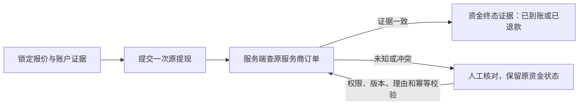

# Nexion · 运营控制后台 PRD(Ops Console PRD)— V1

> **B38 后端增量（2026-11-08）**：[九项交付契约](B38-后端九项交付契约-20261108.md)记录 D6 资金审批、未知结果核查、权限、D4 期初、D1 待办与历史异常、网络可用状态及 K1 编码的后发口径。原九项契约为后端交付记录；本轮 D6／E4 已接入 B38 第二组，分别见开发落地规格 §4.4 与 v2 [E4]。其他项按各自记录，不据此宣称真实资金终点或整批正式 TEST 已验收。

> 本文档是 Nexion 平台**运营控制后台**的产品需求文档。它是独立于前端用户产品 PRD(`Nexion_产品功能架构设计文档_v3.7.md`)的新建文档,只读引用后者、不修改后者。
> 撰写/续写遵循 `nexion-admin-prd` skill 的「编写 → 审查 → 仲裁 → 修订 → 验收」多-agent 流水线。术语、边界与三条贯穿设计原则(双账本 / server-canonical / 埋点优先)见第 1 章。
> §锚点(如 §9.11d、§13.4.1)均指向前端 PRD v3.7;**参数默认值以 `NEXION_12月节奏表.md` 12 月运营周期为权威,前端值仅作现状参考**(详见 §1.3「参数默认值锚定」)。
> **E3/K2 后发裁定（2026-07-21）**：`specs/FEAT-DEV01-task-capacity-schedule.md` 与 `specs/FEAT-DEV02-tradein-ladder.md` 优先于本卷所有 `minHoldingMonths/salvage/degrade*` 旧口径。旧文字仅是历史方案，不再构成实现、验收或 K2 判定依据；K2 当前以 30 天内已完成置换次数叠加正数佣金/IN 向正数赠送事实识别置换套利簇。
> **KYC 全量取消后发裁定（2026-08-07，优先于本卷全部旧文字）**：以 `specs-snapshot-20260807/FEAT-KYC-RM01-remove-kyc-and-pairing.md` 为准。KYC、C4、K5、钱包配对及一切身份认证门槛/复审/权限/接口/事件/报表已退出当前产品；本卷下文相关章节仅为历史设计记录，不得作为实现、测试、验收或恢复功能的依据。提现只读取用户按网络直接维护的当前提现地址。

## 目录(V1 核心批次)

| 章 | 标题 | 域 | 状态 |
|---|---|---|---|
| 1 | 文档概述与边界 | — | ✅ 本卷 |
| 2 | 平台基础(RBAC + 审计 + 操作确认 + 埋点事件体系) | A | ✅ 本卷 |
| 3 | 信息架构与后台导航(全 12 域菜单树) | 全 | ✅ 本卷 |
| 4 | 总览驾驶舱 | B | ✅ 本卷 |
| 5 | 用户与账户管理 | C | ✅ 本卷 |
| 6 | 资金与财务(提现审核队列) | D | ✅ 本卷 |
| 7 | 增长与运营节奏(Phase 调度 + Trial) | H1–H2 | ✅ 本卷 |
| 8 | 风控与反作弊 | K | ✅ 本卷 |
| 9 | 数据模型 + API 概要 + 技术架构概要(V1 域) | — | ✅ 本卷 |

> V2–V4 各批次覆盖域见 §1.10。

---

## 第 1 章 文档概述与边界

### 1.1 文档定位与读者

本文档是 **Nexion 运营控制后台(Ops Console)** 的产品需求文档(PRD)。它描述的是平台运营方内部使用的一套 Web 操盘系统——运营者借此监控全平台资金与用户态势、调整业务参数、审核资金流出、调度运营节奏、处置风控事件。它**不是**面向终端用户的功能,也不是嵌入用户端 app 的任何面板。

本 PRD 服务于以下后台角色(角色权限矩阵的权威定义见第 2 章 RBAC,此处仅列读者画像):

| 角色 | 关注域 | 典型后台诉求 |
|---|---|---|
| 超级管理员(Super Admin) | 全域 | 系统配置、RBAC 授权、kill-switch 总闸、跨域仲裁 |
| 财务(Finance) | 资金与财务、双账本 | 提现审核放行、储备与应付负债对账、兑付覆盖率监控、余额/资产调整复核 |
| 风控(Risk) | 风控与反作弊、资金安全 | 反多账户检测、异常资金链路、试用滥用闭环阻断、冻结与解冻 |
| 增长(Growth) | 用户与账户、增长活动、运营节奏 | 漏斗转化看板、Phase 节奏调度、邀请/任务/活动参数调优 |
| 内容(Content) | 内容合规 CMS | 推送模板池、活动文案、营销 copy 的上线与下架 |
| 客服(Support) | 用户与账户、工单 | 单用户态势查询、受限范围的账户处置、工单流转 |
| 只读审计(Read-only Auditor) | 全域(只读) | 操作审计追溯、合规取证、参数变更历史核查,**不具备任何写权限** |

> 角色与动作的精确映射(谁可发起、谁需复核、哪些动作触发审计)在每个功能子模块的「⑥ 权限 & 审计」段逐条约束;本节仅交代读者构成与阅读视角。

> **关于内容(Content)角色的 V1 范围说明**:完整内容合规 CMS(I 域)在 V4 落地,V1 阶段内容角色不具备全站文案治理面。但 V1 已覆盖的 H2(Trial)与 K(风控)子模块中,涉及**法务披露与试用推送模板的紧急修改**在对应子模块内提供有限文案覆盖——前端 PRD §9.11c.2 已将 Trial claim sheet 文案 + legal disclaimer(`GET /admin/trial/copy?locale=`)与 Risk-disclosure s1-s7 条款(`GET /admin/legal/risk-disclosure?locale=&jurisdiction=`)标注为「监管改文案当天必须能改」的配套紧急可调内容,故 V1 阶段这部分文案能力随 H2/K 子模块一同提供,并非在 V1 完全归零(批次范围见 §1.10)。

### 1.2 后台与前端 app 的边界

后台是**平台运营操盘台**;用户端(H5 app)是**终端用户的产品界面**。两者是同一平台的两侧,但在可见性上严格隔离。

```
┌──────────────────────────────┐        ┌──────────────────────────────┐
│   运营控制后台(本 PRD)        │        │   用户端 H5 app(前端 PRD v3.7)  │
│   Ops Console                 │        │   终端用户产品界面               │
│                               │        │                               │
│  • 双账本 / 兑付覆盖率监控       │        │  • Home / Earn / Store / Team   │
│  • 提现审核队列与放行           │        │  • Wallet / Genesis / 试用       │
│  • 业务参数调优(费率/阈值/cap) │◀──控制──│  • 用户只见结果,不见控制台        │
│  • Phase 运营节奏引擎          │ 派发参数 │  • Phase id / name 永不出现       │
│  • 风控处置 / kill-switch       │        │  • 后台存在本身对用户不可见         │
│                               │        │                               │
│   仅平台内部角色可访问           │        │   公开注册即可使用               │
└──────────────────────────────┘        └──────────────────────────────┘
       服务端权威 (server-canonical)              客户端仅 UI 渲染
```

边界铁律:

1. **单向不可见**:后台的存在、菜单、Phase 命名、参数调节动作,对用户端**永不可见**。前端 PRD §13.4 已确立「Phase 是 PM 内部命名,P1-P6 等术语永远不在用户视角 UI 出现」;后台是这些内部命名与参数的唯一操作面。
2. **控制与展示分离**:后台调整参数 → 通过服务端下发 → 用户端读取并渲染结果。用户端不持有任何"控制权",只持有"展示用缓存"。
3. **运营内部能力**:本 PRD 中少数无前端直接映射的能力(如审计取证、对账视图、内部告警)属于纯运营内部职能,会在所在子模块明确标注其运营意图,而非臆造的用户侧杠杆。

### 1.3 与前端 PRD v3.7 的引用关系

本后台 PRD 有**两个只读权威源**:**前端 PRD `Nexion_产品功能架构设计文档_v3.7.md`**(功能 / 结构 / 现状实现的事实源;本文档不修改它,只对其中「后台控制面种子」做产品化收敛)与 **`NEXION_12月节奏表.md`**(12 月运营周期设计 —— **所有参数默认值的权威源**,优先级**高于**前端现状值,见下方「参数默认值锚定」行)。

| 引用关系 | 说明 |
|---|---|
| **收敛对象** | 前端 PRD §9.11a–§9.11f「后台控制面种子」+ §13.4「平台运营阶段(Phase 引擎)」 |
| **§9.11a** | 免费试用模块的 Admin / User-facing endpoints + 前端实现规则 + 生产环境 server-side 职责清单 |
| **§9.11b** | `TrialConfig` 数据模型(后台可控参数表,含默认值) |
| **§9.11c** | 全平台后台可控参数清单(§9.11c.1 业务参数表 + §9.11c.2 内容池) |
| **§9.11d** | Admin Kill Switch + Client-tamper Defense + Feature Flag/A-B 实验值 |
| **§9.11e** | 跨 store mutation 原子性(transaction boundary) |
| **§9.11e.1** | 组合攻击路径(§9.11e 的子节;§9.11e 定义 transaction boundary,§9.11e.1 在其之上枚举多条 client-tamper 维度叠加才显现的养号/套利闭环)——风控 K 域必须以此为覆盖锚点,而非独立攻击路径文档 |
| **§9.11f** | 状态机失败 / 退款路径(server canonical) |
| **§13.4** | Phase 引擎(6 phase × 时变参数表),后台节奏调度的引擎依据 |
| **第 17 章验收标准 · §18.2 KPI 指标** | 后台 BI 验收基准来源锚点;§18.2 的八项 KPI 指标表是后台数据看板的目标值与测量口径权威源(章节序号歧义见下方说明) |
| **不改前端 PRD** | 本文档为**新建独立 PRD**。若发现前端 PRD 存在缺口,记入 V4「跨文档收口」,不擅自修改前端 PRD。 |
| **参数默认值锚定(12 月运营周期优先)** | 本文档任一数值(费率 / cap / APY / 天数 / 阈值 / 衰减率 / 倍率)的**默认值以 `NEXION_12月节奏表.md` 的 12 月运营周期设计(§6 关键参数表 + P1–P6 运营逻辑)为权威源**;前端 PRD §锚点 / 代码常量仅作**现状实现参考**。三者冲突时**以 12 月运营周期为准**,就地注明前端现状值与差异(供开发对照现状↔目标)。12 月周期未覆盖的参数(如设备基础定价),以前端 §7 现价为现状参考、目标值在对应域按运营节奏设定并注明依据。 |

> **KPI 章节序号歧义(一次性说明)**:前端 PRD v3.7 验收章节存在标题序号混排——目录与正文章节标题写作「第 17 章 验收标准与 KPI」,而实际承载八项 KPI 指标表的小节标题为 **§18.2 KPI 指标**(同章标题之下直接接 §18.x 小节;§17.2 实为「路由组织」,非 KPI)。本文统一以「**前端 PRD 第 17 章验收标准 · §18.2 KPI 指标**」指代该表;全文后续凡引用八项 KPI 一律指向 §18.2,不再重复解释。另:配套 SKILL.md §0/§1 两处将该表写作「§17.2 KPI」,所指即本文 §18.2 小节——SKILL 自身存在同一序号歧义,统一以本文「§18.2」为准,并建议后续将 SKILL.md 同步更正为 §18.2。

### 1.4 产品定位对齐

后台一切控制点都服务于前端 PRD §1.1–§1.3 所定义的产品形态,后台不引入任何脱离该形态的能力。

- **产品形态**:移动端算力消费 app。核心叙事 "Your phone is the AI cluster. Earn while you sleep."——用户手机 NPU 闲置算力对接 AI 推理任务获取收益;用户可进一步购买专用算力设备 NexionBox 系列获得更高的每日 AI 算力收益。
- **双币体系**:收益与结算采用双币——**USDT**(出金、设备结算、提现的稳定币)与 **NEX**(平台代币,严格两个功能:兑换 USDT + 优惠抵扣提现手续费)。后台所有金额参数须明确所属币种。
- **升级阶梯**:手机 → NexionBox S1 → Pro → Rack → Genesis 创世节点的清晰升级路径;后台的设备与定价参数沿此阶梯组织。
- **运营优先级**:后台设计的第一优先级是**支撑用户向购买 NexionBox 的转化**与**平台资金兑付安全**,二者构成后台所有看板与杠杆的取舍基准。

### 1.5 商业模式(对齐前端 PRD §1.4)

前端 PRD §1.4 列出四条收入来源:设备销售、团队分润佣金体系(影响力网络版税 + 双轨)、NEX 平台代币经济、算力市场撮合服务费。后台围绕这四条收入来源组织其监控与杠杆,对应四大支柱:

> **命名口径声明(避免与 SKILL 三锚核对时误判)**:配套 SKILL.md §0「对齐三锚」将商业模式概括为「硬件 GMV + 金融产品利差 + 代币经济」三锚,其中第二锚旧称「金融产品利差」。本章不沿用该三锚概括,而以**前端 PRD §1.4 四条收入来源原文为准**——「团队分润佣金体系(Unilevel + Binary)」与「算力市场撮合服务费」是其中两条相互独立的支柱,与 SKILL 三锚的命名差异为已知差异。后续 reviewer / 仲裁如按 SKILL 三锚核对本表,请以 PRD §1.4 原文四支柱为准,不判「命名不对齐」;建议后续将 SKILL.md 三锚表述与 §1.4 对齐。

| 支柱 | 收入来源(§1.4) | 后台关注的杠杆 |
|---|---|---|
| 硬件 GMV | 设备销售:NexionBox S1 / Pro / Rack / Genesis | 设备定价与上下架、套餐折扣 ladder、试用→购机转化、trade-in 折旧定价 |
| 团队分润佣金体系 | 七层购买与直属双币拆分 + 独立设备分成和团队奖励 | F2 原七层购买、L1 预算拆分、直属设备政策、Partner Status 权益、V-Rank 门槛、binary 双轨日封顶(`binaryDailyCapUSD`,Phase 派发,§13.4.1)、提现冷却、领导池；现行与历史 network 保留 |
| 代币经济 | NEX 平台代币经济(兑换 / 二级市场) | NEX 周价格曲线关键帧排程与做市、Staking 池(USDT 锁仓)APY/penalty、Genesis 节点经济与二级市场、Exchange 三阈值 |
| 算力市场服务费 | 算力市场撮合服务费(向 AI 客户收取) | 向 AI 客户侧收取的平台撮合佣金;**当前前端 PRD 无对应后台参数控制面,AI 客户侧接口均标注 TBD,待 V4 架构收口补入**(注:`GET /api/products/specs` 属设备规格/E 域,与本支柱无关,不作为本支柱锚点) |

> **硬件 GMV 定价基准说明**:§1.4 所列设备价(S1 $299 / Pro $899 / Rack $3,499)为**早期定价**;商城实际售价以前端 PRD §7 商品表为准——当前 §7 列示 **NexionBox S1 $1,299(legacy)/ Pro v2 $2,639 / NexionRack P2 $14,999 / Genesis $9,999**。后台设备与定价子模块(E 域)的参数以 §7 商品表 + §9.11c.1 `Device specs(GET /api/products/specs)` 为权威数据源,**不以 §1.4 为基准**。E 域开发须回源核对 §7 当前每款型号的实际价格列。

> **Staking 收入科目澄清**:Staking 的 APY/penalty 是**用户侧产品参数**(USDT 锁仓产品,NEX 不可质押,§13.3.1 / §9.6),归入"代币经济"支柱作为资金留存杠杆,**不单独列为一条收入来源**;前端 PRD §1.4 未将其列为独立收入科目。

> 取舍原则:在合规与兑付安全约束内,后台杠杆优先服务转化与资金留存,但**资金兑付安全始终优先于短期 GMV**——任何放大流出的参数调整须先满足兑付覆盖率约束(见 §1.8 双账本原则)。

### 1.6 业务目标与 KPI

后台 BI 以前端 PRD **第 17 章验收标准 · §18.2 KPI 指标**(共八项)为验收基准。后台数据看板必须可计算、可下钻、可按 cohort/Phase 切片地呈现下列八项指标:

| # | KPI | 目标值 | 测量口径(§18.2) | 后台可见性 |
|---|---|---|---|---|
| 1 | Day 0 自动接入率 | > 95% | 注册 → 90 秒内首笔 receipt | V1 |
| 2 | Day 7 留存 | > 60% | 7 天后仍开过 app | V1 |
| 3 | L2 → L3 转化率(进 store) | > 30% | 主动浏览商城 | V1 |
| 4 | L3 → L4 转化率(下单) | 5-10% | 完成支付 | V1 |
| 5 | L4 → L5 转化率(推广) | > 40% | 设备持有者推荐 ≥ 1 人 | V4(依赖 F 域分销关系图谱下钻,完整看板随 L 域 BI 落地) |
| 6 | 站内通知点击率 | > 25% | Nova 通知操作去重用户 ÷ Nova 站内通知发出去重用户，不代表手机系统推送送达率 | V4(依赖 I 域内容/推送埋点贯通) |
| 7 | 团队佣金触发率 | > 80% | L1 直推被推荐人首单 | V2 基础计数 / V4 完整下钻(F 域落地后即可按直推首单做基础触发率计数,完整 cohort 下钻随 L 域 BI 补齐) |
| 8 | Genesis 售罄速度 | < 14 天 | 1,000 张 | V2 基础读数 / V4 完整 BI(E 域落地后 Genesis 库存与售出即可有基础读数,完整售罄速率曲线随 L 域 BI 补齐) |

> **后台可见性列说明**:V1 =「总览驾驶舱」域(B)先行实现该指标的实时呈现,聚焦 Day 0 接入、Day 7 留存与购买漏斗 L2→L3→L4 等转化/资金相关核心指标;V2 基础读数 = 对应业务域(F 分销 / E 设备)在 V2 落地后即可提供该指标的基础计数/读数,但完整的可下钻 cohort BI 统一在 V4(L 数据 BI 域)收敛;V4 = 该指标的完整看板随数据 BI(L 域)及其依赖域批次落地。即此列不应被理解为「运营须等到 V4 才能看到任何团队/Genesis 数据」——V1 驾驶舱已覆盖核心转化与资金指标,F/E 域 V2 落地即带来 #7/#8 的基础读数。

### 1.7 12 月运营节奏 P1–P6 概述

平台运营按 12 个月划分为 6 个运营阶段(Phase)(**默认 12 月;节奏总时长由 H1「节奏骨架」运营可配 9–24 月,6 段按月数权重等比重分布,见 Ch7 [H1] ③(c2)**),后台 **H1「Phase 调度器」**(★V1)是其参数的唯一操作面;用户端只读取派发结果、**永不感知阶段切换**(前端 §13.4 铁律:Phase 是 PM 内部命名,P1–P6 等术语永不出现在用户 UI)。

**参数默认值以 `NEXION_12月节奏表.md` §6.4 `ProductPhase` 为权威**(2026-06-01 directive,优先于前端现状)。该 12 月运营模型**按月**派发 **7 个时变 dial**(新用户加成 / 邀请加成 / 复投加成 / 提现惩罚费率 / 提现冷却 / 双轨日封顶 / 任务加成);后台再叠加前端 §13.4.1 的 **`complianceHoldEnabled`**,合计 **8 dial**。下表按 P1–P6 命名带汇总(部分 dial 在带**内**按月有拐点,见表注),完整逐月矩阵在 **Ch7(H1)** 展开。

| Phase | 月段 | 名称 | 新用户加成 | 邀请加成 | 复投加成 | 提现惩罚费率 | 提现冷却 | 双轨日封顶 | 任务加成 | Compliance hold |
|---|---|---|---|---|---|---|---|---|---|---|
| P1 | 0–2 | 极速拉新 | 2.0× | 2.0× | 1× | 20% | 30d | $5,000 | **4×** | — |
| P2 | 2–4 | 温和过渡 | 1.5× | 1.5× | 1× | 20% | 30d | $5,000 | 1× | — |
| P3 | 4–6 | 首波升级 | 1.0× | 1.0× | **2×**(月5–6限时) | 20% | 30d | $5,000 | 1× | — |
| P4 | 6–8 | 订阅化 | 1.0× | 1.0× | 1× | 20% | 30d→**35d**(月8) | **$2,000**(月7起) | 1× | — |
| P5 | 8–10 | 沉淀加深 | 1.0× | 1.0× | 1× | **25%** | 35d→**45d**(月9) | $2,000 | 1× | **✅** |
| P6 | 10–12 | 软退场 | 1.0× | 1.0× | 1× | **30%** | 45d | $2,000 | 1× | ✅ |

> **加粗 = 该 dial 在此带内的变化拐点。** 12 月模型是**月粒度**的,比 6 个等宽 Phase 更细:双轨日封顶在**月 7**(P4 带内)由 $5,000 降 $2,000;提现冷却**月 8** 升 35d、**月 9** 升 45d;提现惩罚费率随 Phase 上行(P1–P4=20% → P5=25% → P6=30%);复投加成仅**月 5–6** 限时 2×。后台 H1 调度器以**月粒度**为准,P1–P6 仅为命名带。
>
> **默认值权威 = 12 月周期,前端为现状参考**:上表默认值取自 `NEXION_12月节奏表.md` §6.4 `ProductPhase`。前端 §13.4.1 是当前原型的**简化实现**(仅 邀请加成 / 提现惩罚费率 / 提现冷却 / 双轨日封顶 / Compliance hold,按等宽 Phase 取值、**无月内拐点**),且**缺** 新用户加成 / 复投加成 / 任务加成 三个倍率。冲突时**以 12 月周期为准**;前端现状差异(如双轨封顶拐点:§13.4.1 标 P4=月6,12 月模型为月7;前端任务加成实现为 1.0→1.5 ramp 而 12 月模型为月1–2=4×、其余=1×),开发对照现状↔目标实现。
>
> **dial 在 V1 的落地边界**:H1(★V1)提供全 **8 dial** 的**查看 / 调优 / 按 cohort 下发**;但各 dial 的**生效逻辑**落在其业务域——提现惩罚费率/冷却在 D 域(V1)、双轨日封顶在 F 域(V2)、邀请/新用户/复投/任务加成在 H3–H6(V3)。即 V1 可调可下发**全部** dial 值,部分 dial 的对账与可视化随对应域批次补齐。

### 1.8 三条贯穿全后台的设计原则

下列三条原则适用于本 PRD 的**每一个**子模块,在各子模块的「⑤ 接口」「⑦ 风控 & 联动」「⑧ 埋点」段具体落地。

#### 原则一:双账本(真实储备 vs 应付负债 → 兑付覆盖率)

**「双账本」是本后台 PRD 新建的运营内部设计构造**,用于约束后台对资金水位的核算方式,**前端 PRD 未命名此机制**。前端 PRD 仅在用户侧叙事层提供"102.4% 超额抵押兑付 + 公开储备"的对外参考,且该数字出处明确为以下两处:(1)前端 PRD §5.14 Home 页信任标识(Trust Chip Wall)副标 `Reserve proof on-chain · 102.4% backed · Trust Center →`;(2)§9.6.3 staking how-it-works 的 `Why it's safe` CalloutBox(102.4% 超额抵押兑付 + 信任中心公开储备)。该 102.4% 是面向用户的信任叙事数字,**并非前端 PRD 已实现的账本系统**;前端 PRD §11.3 是完整信任中心路由的页面描述,其正文并不承载该 102.4% 数字,故不作为该数字的出处归因。本后台 PRD 在此引入"双账本"作为内部设计约束,不主张前端 PRD 存在同名条目。

平台必须分账记录两本账:

- **真实储备账本**:平台实际持有、可用于兑付的资产(USDT 储备等)。
- **应付负债账本**:用户端累计可见的"余额 + 收益 + 待提现 + 锁仓本息"等平台对用户的应付项。

后台总览驾驶舱必须以二者之比持续呈现**兑付覆盖率**(= 真实储备 ÷ 应付负债),作为资金安全的核心水位指标。任何放大资金流出的参数调整(提现限额上调、APY 上调、佣金倍率上调、kill-switch 解除)须先核验该覆盖率约束。后台是上述用户侧信任叙事(§5.14 / §9.6.3 的 102.4% 超额抵押表述)背后的真实账本与水位的权威计算面。

#### 原则二:server-canonical(服务端权威 + 审计 + 幂等 + 操作确认)

凡前端 PRD §9.11d 列为"客户端可篡改"的状态(余额、试用资格、KYC 状态、风控判定、资格门槛、Phase、设备槽位、ID 序列等),后台侧一律按以下四条约束实现:

1. **服务端权威**:服务端是该状态的唯一真相源(server canonical),客户端 localStorage 仅作 UI cache,失效自动重 fetch(§9.11d.2)。后台展示与处置均以服务端值为准。
2. **审计可追溯**:每一次写操作(参数变更、放行、调整、kill-switch、impersonate)落审计日志,记录操作者、时间、前后值、原因;只读审计角色可全量追溯。
3. **幂等**:涉及资金/资产的写入 endpoint 必须支持 `Idempotency-Key`(§9.11e),网络抖动 retry 不得造成重复扣款 / 重复入账 / 重复放行。
4. **操作确认(Confirm-with-Reason)**:大额提现放行、参数批改、kill-switch、impersonate 等高敏动作一律经**确认弹窗二次确认 + 理由必填**后即时生效(余额/资产调整例外:全部进待复核,批准后才入账,见 C3);理由由 server 强制非空(空值返 400 `REASON_REQUIRED`),动作连同理由落 A2 审计(操作者/前后值/理由/IP/时间)。**放大资金流出方向的动作额外前置 B1 兑付覆盖率红线核验,低于红线 server 拒绝(422)**。高敏动作清单权威归 A2;每个高敏动作的确认弹窗按业务单独设计,规格见各子模块「④ 操作动作」「④a 交互与弹窗规格」与「⑥ 权限 & 审计」段。

#### 原则三:埋点优先(全链路事件可观测)

后台的转化漏斗、KPI 和风控信号**派生自统一的事件流**,而非临时查询;资金数字(储备、负债、覆盖率、到期预测)读资金账本、配置和业务存量,不来自事件流,也不为满足本原则补造事件。每一个转化触点、资金动作、状态流转、运营动作都产生一个**规范命名的事件**(`domain.object_action`),由 **A4 埋点事件体系**(Ch2 §2.4)统一定义命名、身份模型(anonId → userId 拼接)、通用属性(含事件发生时所处 Phase / cohort)与 KPI 映射。

1. **漏斗 / KPI 可观测**:§1.6 八项 KPI 与「注册 → 首购 → 锁定计划 → 提现」漏斗(B3),其定义即「由哪些事件按何口径计算」;不存在无埋点支撑的转化看板数字。
2. **资金与风控可观测**:每笔充值 / 提现状态流转 / 收益入账 / 佣金发放 / 兑换 / 锁仓,及每个风控信号(多账户命中 / 套利可疑 / 提现冻结),均落事件,用于追溯和风控;资金金额以账本和存量为准。
3. **服务端权威 + 防篡改**:资金 / 状态类事件由服务端在状态机推进时发出(server-canonical,§9.11d/f);客户端仅发 UI 交互类事件,且不作为资金 / KPI 的权威口径。
4. **每子模块声明**:各功能子模块的「⑧ 埋点」段声明其产生 / 消费的事件,确保 BI 有据、覆盖可审计。

### 1.9 术语表(后台高频术语)

| 术语 | 含义 |
|---|---|
| Ops Console / 运营控制后台 | 本 PRD 所定义的平台内部操盘系统;用户端不可见 |
| 双账本 | 真实储备账本 + 应付负债账本的分账记录体系(本后台 PRD 内部设计构造,前端 PRD 未命名) |
| 兑付覆盖率 | 真实储备 ÷ 应付负债,资金安全核心水位 |
| 应付负债 | 平台对用户累计的应付项(余额 + 收益 + 待提现 + 锁仓本息) |
| server-canonical(服务端权威) | 状态以服务端为唯一真相源,客户端仅 UI cache |
| Client-tamper Defense | 针对客户端可篡改状态的服务端防御(§9.11d.2) |
| 操作确认(Confirm-with-Reason) | 高敏动作的执行确认机制:单人执行 + 业务专属确认弹窗 + 理由必填(server 强制,400 `REASON_REQUIRED`)+ A2 审计留痕,即时生效;放大流出方向动作前置 B1 红线核验(422) |
| Idempotency-Key | 写操作幂等去重键,server 24h 内 dedup(§9.11e) |
| Kill Switch | 监管点名/紧急下架时对某能力(staking 档/swap/试用/Genesis/提现等)的全局停用闸(§9.11d.1 + 后台应急 withdraw) |
| Phase / 运营阶段 | 12 月节奏的 6 段运营阶段 P1–P6,由 Phase 引擎驱动(§13.4);PM 内部命名,用户端永不暴露 |
| Phase 引擎(`useProductPhase`) | 按用户 `joinedAt` 计算所处 Phase 并派发时变 dial 的单一真相源。后台权威模型 = **8 dial**(12 月 §6.4 的 7 dial,Premium/NEXv2 gate 已下线 + 前端 `complianceHoldEnabled`),月粒度,见 §1.7 |
| TrialConfig | 免费试用模块的后台可控参数模型(§9.11b) |
| Shadow earning(试用收益) | 试用期累计的模拟算力收益。**系统层面**:进入 `redeemed` 终态时合并至账户余额(creditBalance/NEX + 双 bill 记录),作为后续购机的余额来源;`failed / cancelled` 终态则归零不入账。**用户侧文案口径**:统一入口统称"试用收益 / 试用累计 / 试用奖励"(§16.2.5);仅 claim sheet 转化场景专用"购机抵扣 / 抵扣购机款"(§9.11b),该口径不适用于所有 UI 入口;两类口径均不向用户暴露 shadow 技术名词(参 §9.11a-f) |
| 七层购买 / 直属拆分 | 购买按原 L1–L7，L1 唯一基础预算固定 10%，仅发放构成拆双币且替代原额外 NEX；L2–L7 不变。设备真实收益只奖励直接邀请人，总比例和拆分独立配置，平台额外支付且本人原收益不减；对碰、等级、培育与领导池保持独立规则 |
| 双轨(Binary Track) | 双轨对碰佣金体系:用户发展 A/B 两侧团队,按 `min(A, B) × 10%` 平衡匹配公式(取两轨中业绩较小一侧的月 GV)日结算佣金,受 Phase 派发的 `binaryDailyCapUSD` 日封顶约束(§8.4 / §13.4.1);与 Unilevel 版税并列构成团队分润两条腿。用户侧一律称 Track A / Track B,不暴露翼 / 左 / 右 / spillover / 上线 / 下线等词汇 |
| V-Rank | 团队业绩驱动的 V0–V12 军衔体系(13 级门槛) |
| 用户生命周期 L0–L5 | 用户产品使用阶段内部 ID(Visitor→Ambassador);用户侧仅显示功能化标签,不暴露 L 编号 |
| NEX v2 Founders Vault | 24 个月 NEX 锁仓产品(用户侧标 250% APY)。**已下线:新开锁仓入口停用,后台不再设其配置面与 kill switch**;存量在锁 position 仍按到期一次性兑付(B2 负债科目 #5「存量在锁,新开已停」,参 §9.5b) |
| 算力市场撮合服务费 | 向 AI 客户收取的平台撮合佣金,§1.4 四条收入来源之一;后台杠杆为 V4 待规划项,当前前端 PRD 无对应控制面、AI 客户侧接口均标注 TBD(参 §1.5) |
| Compliance hold | Phase 派发的合规审查开关,启用后提现进入增强合规审查 |
| 提现状态机 | 提现单的服务端权威状态机:正常 5 态见前端 PRD §9.3.6(submitted / review-passed / processing / sent / confirmed);异常 6 态为真后台扩展定义,见 §9.11f(review-rejected / address-invalid / tx-failed / tx-orphaned / refunded / frozen);client 仅订阅,不持有权威状态 |
| 提现 SLA | 提现 48h 内到账(§2.3 核心场景表) |
| frozen | 用户账户资金冻结标志,提现状态机异常态之一(§9.11f) |
| 双币 | USDT(稳定币,出金/结算)+ NEX(平台代币,锁仓/兑换/二级市场) |
| RBAC | 后台角色访问控制(超管/财务/风控/增长/内容/客服/只读审计) |

### 1.10 文档范围与批次

本 PRD 按批次推进。各批次覆盖的运营域如下,菜单树以 Ch3 为权威索引,每个子模块均可追溯到一个真实前端功能(§锚点)。

| 批次 | 覆盖域 | 状态 |
|---|---|---|
| **V1(核心)** | **A 平台基础**(RBAC / 审计 / 系统配置)· **B 总览驾驶舱**(双账本 / 兑付水位 / 漏斗 / 节奏 / 风险雷达)· **C 用户与账户** · **D 资金与财务**(提现审核队列)· **H1**(§13.4 Phase 引擎调度)**–H2**(§9.11a-f Trial 控制面)· **K 风控与反作弊** | 本卷 |
| V2 | E 设备与商城 · F 分销与团队 | 概述 |
| V3 | G 金融产品 · H3–H6 增长活动全套 | 概述 |
| V4 | I 内容合规 CMS · J 紧急合规 · L 数据 BI · 全局数据模型/API/架构总表 · 跨文档一致性收口 | 概述 |

> **V1 内容能力备注**:I 域完整内容合规 CMS 在 V4 落地;但 V1 已纳入的 H2(Trial)与 K(风控)子模块,随模块配套提供法务披露与试用推送模板的**紧急文案覆盖**(Trial claim sheet 文案 + Risk-disclosure 条款,参 §9.11c.2 / §1.1 内容角色说明),不应误读为 V1 阶段内容文案能力完全缺位。

V1 聚焦"看得见资金与用户态势、管得住资金流出、调得动运营节奏、压得住风控事件"四项核心运营能力闭环:总览驾驶舱(B)提供态势感知,资金与财务(D)管控流出,Phase 调度与 Trial(H1–H2)驱动节奏与转化,风控与反作弊(K)守住资金与账户安全,平台基础(A)提供 RBAC/审计/配置底座,用户与账户(C)提供处置入口。V2–V4 在 V1 底座上逐域补全设备商城、分销、金融产品、增长活动、内容合规与数据 BI,并在 V4 完成全局数据模型/API/架构总表与跨前后端文档的一致性收口。

---

## 第 2 章 平台基础(RBAC + 审计 + 操作确认 + 埋点事件体系)

> 本章覆盖域 A 的四个子模块。§2.1–§2.3(A1 RBAC / A2 审计 + 操作确认 / A3 系统配置)+ §2.4(A4 埋点事件体系)均已落地——它是 B/D/K/L 与 §1.6 KPI 的数据地基,须先于驾驶舱(Ch4)确立。

#### [A1] 运营账号 & RBAC

最后更新：2026-11-08

客服性别、头像及资格职责引用 [M 专属客服中心功能契约](M-专属客服中心功能契约.md#6-继承头像与-m3-保留能力)；主管资格不自动取得账号管理权。新建客服明确男/女/未指定，从许可且已审核的对应默认人像池随机一次，持久化 avatarGender、avatarAssetId、avatarVersion；未指定用混合池。刷新、改名/性别、调组不重抽，历史头像不自动替换。本人或原账号管理范围内有权人员可明确更换，成功保存后替换，失败保留旧像、未知先回查；池失败不造假照片。

**客服/主管资格理由（BUG-163，2026-11-08，实景待验收）**

A1「账号管理」的专属客服/主管资格弹窗与 M1 组管理共用理由校验：沿现有首尾裁剪规则，以 Unicode 码点判断8–200，「𠮷」计1，输入框不再按200个 UTF-16 单位截断；7或201码点不可提交。仍需原总管理员身份、账号读写权限及资格退出交接条件，使用当前账号/资格版本并保留确认、原操作和审计。共享范围及恢复规则见 [M 专属客服中心功能契约 §3.1](M-专属客服中心功能契约.md#31-bug-163原操作恢复与组理由2026-11-08)。本项为已确认的候选实现，A1实际弹窗及持久结果尚待实景验收，不表示已通过。

**① 目的 & 对齐**
A1 是后台的**运营账号、登录安全与会话治理地基**。A1 负责账号创建/启停/资料/角色分配、强制 MFA、登录锁定、会话与安全基线；**A6 是角色定义及角色授权的唯一权威，A8 是权限码字典的唯一权威，A7 管理菜单节点**。A1 只读取 A6/A8 的实时结果做角色变更影响预览，不再维护第二份权限矩阵或 `member/lead` 层级。A2(§2.2)记录所有账号治理写操作，服务端在每次请求上按真实权限码判权，客户端角色只用于展示。

> **运营账号 ≠ 用户账户(C 域)**:A1 管理的是**平台运营方内部员工**的后台登录账号(角色 / 2FA / session),与 C 域(§5 章)管理的**终端用户**账户是两套完全独立的实体与生命周期。后台账号不在用户事件流(A4)中,不持任何用户资产;C 域用户的冻结 / impersonate / 资产调整等动作,其**操作者**是 A1 运营账号、**对象**是 C 域用户账户。两者在本 PRD 中严格区分,不可混用。

**② 后台界面**
1. **运营账号列表**:`账号 ID / 登录名 / 显示名 / 当前角色或暂未分配 / MFA 绑定态 / 账号状态 / 最近登录 / 活跃 session 数`。列表提供新建、编辑、启停、变更角色、重置密码、重置 MFA 与强制登出入口；**没有删除账号入口，账号生命周期只允许禁用和重新启用**。
2. **账号详情**:展示账号资料、真实 MFA 绑定态、服务端审计生成的角色变更记录，以及每条活跃 session 的`设备 / IP / 起始时间 / 最近活动时间`；超管可按单条 session 吊销，也可从列表吊销目标账号全部 session。不得吊销自己的当前账号或任何超管账号的 session。
3. **角色影响预览**:角色选择项来自 A6；选择新角色时用 A6 返回的真实权限码集合显示“新增/失去”的差异，同角色选择必须禁用确认。A6 角色详情或权限差异不完整时必须显式报错并停用“改角色”，不得以空权限集继续提交。A1 顶部提供 A6“角色管理”和 A8“权限字典”的明确跳转，不复制其数据模型。
4. **安全基线**:只读展示 MFA、session、登录锁定与最少有效超管数,页面不提供调整入口。系统进入“治理恢复模式”时显示阻断原因，并只开放恢复双超管所必需的创建超管、提升为超管或启用已绑定 MFA 超管动作。

**③ 可控参数**

| 参数 | 默认值 | 范围 | 生效时机 | 影响 / 依据 |
|---|---|---|---|---|
| 运营账号角色集 | A6 当前启用角色；内置 8 角色:`SUPER_ADMIN / CONFIG_ADMIN / FINANCE / RISK / CONTENT / GROWTH / SUPPORT / AUDITOR`，并允许 A6 中启用的自定义角色 | 以 A6 为准 | 角色分配实时 | A1 不维护固定七角色副本，不存在 `member/lead` 隐式层级 |
| 后台强制 2FA | 强制开启(全角色) | 固定开启(不可关) | 实时(登录时校验) | 后台账号安全基线,§1.8 原则二;无 2FA 不得完成登录 |
| 运营账号 session 时限 | 无有效操作 60min 自动登出;有效操作续期;无绝对登录时限 | 只读基线,不可调 | 每次请求实时校验 | Redis 保存 `issuedAt / lastSeen / IP / User-Agent`；首次强制改密换发 session 时继承本次请求真实 IP/User-Agent；闲置登出停用时显示「已停用 / 无固定上限」 |
| 登录失败锁定 | 短锁 5 次 / 15min;累计 10 次升级长锁 24h(C6 默认值) | 只读基线;阈值由 C6「注册与登录风险」`auth.risk.*` 派生,A1 只展示当前生效值 | 密码与 MFA 失败均计数 | 用户名哈希后写 Redis；错误文案不区分账号、密码或锁定态 |
| 最小权限默认 | 新账号默认“专属客服” | 可显式选择 A6 启用角色或暂不分配；恢复模式仅超管 | 创建即生效 | 客服默认 8 项客服权限、M/M1–M5 菜单及个人服务资格，不授主管资格；暂不分配时权限和菜单为空 |
| 最少有效超管数 | ≥ 2 | 固定下限 2 | 每次账号治理写操作前 | “有效超管”=账号启用 + 超管角色 + MFA 已真实绑定；不足 2 时进入治理恢复模式 |

> **MFA 登录闭环**:密码校验成功只签发一次性 MFA challenge，绝不签发 JWT/session。challenge 在正确验证码路径中以 Redis 原子删除裁决，只允许一个并发请求消费；同一账号已接受的 TOTP 时间步以原子 `SET NX` 标记，换新 challenge 也不得在有效窗口内重放同一验证码。首次登录展示 TOTP 绑定信息，密钥经 AES-GCM 加密落库；完成正确 TOTP 后才建立 Redis session 并签发 8h 上限的 JWT/cookie。重置 MFA 会先校验双超管下限，再清除绑定并吊销该账号全部 session，下一次登录重新绑定。登出只有在服务端确认撤销 session(或确认 token 已无效)后才清除浏览器 HttpOnly cookie；后端/Redis 不可用时返回失败、保留凭据并提示重试，不得伪报成功。

> **双超管恢复范围（S09、BUG-294）**:有效超管不足 2 时，页面只保留创建超管、提升为超管、启用已绑定 MFA 的超管、完成两步验证及既有会话撤销入口。改角色只保留当前角色供对照和「超级管理员」这一变更目标；不能原角色重复提交，已有超管不能降级。普通账号和未绑定 MFA 的超管不能启用。资料编辑、禁用、重置 MFA/密码、客服/主管资格、登记权限及安全基线变更关闭；恢复到 2 个有效超管后按原权限恢复。
>
> **执行边界（2026-11-06，BUG-294 / BUG-297）**:恢复期间新建、提升和启用均提交 A2，须另一位超管批准，不能自批；正常状态新建保留直接创建及一次性临时密码展示。只剩一位可用超管时请运维执行服务器恢复，恢复已有且已绑定两步验证的合法管理员；页面不提供自批或破窗。人数补足后刷新恢复正常状态，服务器恢复记录在 A2 现有详情展示执行人与原因。

**④ 操作动作**

| 动作 | 角色 | 确认弹窗 | 审计点 |
|---|---|---|---|
| 创建运营账号 | 仅超管 | A1-MD1(理由必填) | `admin.operator_account_created`(account_id / initial_role / operator；不记录初始密码) |
| 禁用运营账号 | 仅超管 | A1-MD2(理由必填;禁用前服务端校验剩余有效超管 ≥ 2) | `admin.operator_account_disabled`(account_id / reason / operator) |
| 启用运营账号 | 仅超管 | A1-MD3(理由必填) | `admin.operator_account_enabled`(account_id / reason / operator) |
| 分配 / 变更角色 | 仅超管 | A1-MD4(理由必填) | `admin.operator_role_changed`(account_id / before_role / after_role / operator) |
| 重置运营账号 2FA(员工丢设备) | 仅超管 | A1-MD5(理由必填) | `admin.operator_2fa_reset`(account_id / reason / operator);留痕同 A2 |
| 强制登出运营账号 session | 仅超管(非自己、非超管目标) | A1-MD6(理由必填;止血动作,确认即生效) | admin 审计事件(目标账号 / session / reason / operator) |
| 查看账号列表 / 跳转 A6 角色管理 / A8 权限字典 | 由 `platform_a1_read / platform_a6_read / platform_a8_read` 分别判定 | 否(只读) | admin 审计事件(查看范围 / operator) |

> 后台账号的创建 / 禁用 / 启用 / 角色变更 / MFA 重置五类动作均为后台权限边界写操作,**执行权仅超级管理员**，经确认弹窗 + 理由必填即时生效并落 A2 审计。**强制登出运营账号 session**同样仅限超管，但为避免自锁和双超管互相踢出，服务端拒绝当前账号与超管目标；每次必须记录 reason。

**④a 交互与弹窗规格**

> ④ 表「确认弹窗」列的弹窗 ID 在此逐一定义。弹窗容器统一复用基础 Modal/Drawer,弹窗内容逐弹窗单独设计;本段约定结构/分区/控件类型/行为与状态,不约定视觉。

**(1) 动作触发总表**

| 动作(同④) | 触发控件 + 位置 | 形态 | 可用态规则 | 点击行为 |
|---|---|---|---|---|
| 创建运营账号 | ②(a)账号列表页顶部「新建账号」 | 主按钮 | 仅超管渲染 | 打开弹窗 A1-MD1 |
| 禁用 / 启用账号 | ②(a)账号列表行内菜单 + 账号详情页操作区 | 菜单项 / 次按钮 | 启用态账号显示「禁用」,已禁用账号显示「启用」;仅超管渲染;目标为超管且剩余有效超管 < 3 时「禁用」置灰并提示双超管下限 | 打开弹窗 A1-MD2 / A1-MD3 |
| 分配 / 变更角色 | ②(a)账号详情页角色卡「变更角色」 | 次按钮 | 仅超管渲染 | 打开弹窗 A1-MD4 |
| 重置运营账号 2FA | ②(a)账号详情页安全卡「重置 2FA」 | 次按钮 | 仅超管渲染;目标账号 2FA 未绑定时置灰 | 打开弹窗 A1-MD5 |
| 强制登出 session | ②(a)账号详情页 session 列表行内「强制登出」 | 行内按钮 | 仅超管可用；自己、超管目标或无活跃 session 时置灰并解释原因 | 打开弹窗 A1-MD6 |
| 查看角色定义 / 权限字典 | A1 顶部“A6 角色管理”/“A8 权限字典” | 链接 | 按 A6/A8 read 权限展示 | 跳转权威视图,无弹窗 |

**(2) 弹窗规格**

##### [A1-MD1] 创建运营账号
- **功能**:正常状态填写理由确认后创建并留操作记录；可用超管不足 2 人时仅可新建超管，提交 A2 提案，须另一位超管批准后创建（2026-11-06，BUG-294 / BUG-297）。
- **权限与登录**:默认创建专属客服，按所选角色的当前授权开通权限。客服的个人服务资格、待分组成员及有效档案与账号在同一事务创建，失败一并回滚；不自动授主管资格。首次登录须绑定 MFA 并修改初始密码。
- **输入与选择控件**:

| 字段 | 控件类型 | 必填 | 校验 | 默认值 |
|---|---|---|---|---|
| 账号 ID(登录名) | 单行文本 | 是 | 3–32 字符,字母数字与 `.`/`_`;server 唯一性校验(重复返 409) | 空 |
| 显示名 | 单行文本 | 是 | 2–32 字符 | 空 |
| 初始角色 | A6 启用角色 + 「暂不分配」 | 否 | 恢复模式下只能选择超管；省略为客服，显式空或暂不分配不授角色 | 专属客服 |
| 客服性别 | 男 / 女 / 未指定 | 否 | 有权操作者明确选择，不由姓名或照片推断 | 未指定 |
| 客服头像 | 默认池预览或原受控上传 | 否 | 新建随机一次持久化，失败保留缺失态；旧像不自动替换 | 对应许可且审核通过的池 |
| 临时密码 | 系统生成，不由操作者输入 | — | 正常创建成功后显示一次；恢复提案批准不返回密码，须在账号列表点「重置密码」后交付 | 20 位临时密码 |
| reason(创建理由) | 多行文本 | 是 | server 空值返回 `REASON_REQUIRED`；初始密码不得进入审计/提案 payload | 空 |

- **按钮区**:`[取消]` · 正常状态 `[确认创建账号]` / 恢复期 `[提交创建审批]`（必填未过校验置灰）。
- **错误态**:409 账号 ID 已存在(弹窗不关,字段下内联错误)/ 400 `REASON_REQUIRED` / 403(非超管)。
- **成功反馈**:正常创建后显示一次临时密码；恢复期只提示提案已提交，批准后创建账号；请随后在账号列表点「重置密码」，把临时密码交给账号持有人，不承诺审批返回密码。首次登录须完成两步验证并修改密码。
- **治理恢复**:可用超管少于 2 人时，仅开放新建、提升、启用已绑定两步验证的超管、完成两步验证和撤销会话；新建、提升、启用均须另一位超管批准，不能自批。没有第二位可用超管时由运维执行服务器恢复，页面不提供破窗入口。旧页面直接写入被拒时，提示刷新后提案及联系运维的处理路径。服务器恢复后重新加载人数与状态；A2 现有操作记录以「服务器恢复超级管理员」显示，可在详情查看执行人和原因。

##### [A1-MD2] 禁用运营账号
- **功能**:收回目标账号的后台访问权(即时踢出全部活跃 session),确认即生效。
- **布局结构**:1. **信息区**:目标账号 ID / 显示名 / 角色 / 活跃 session 数 / 最近登录时间。2. **影响预览区**:目标为超管时展示「当前有效超管数 N → 禁用后 N−1」;N−1 < 2 时升级为阻断提示(确认钮置灰,文案含「低于双超管下限,server 将拒绝(422)」)。3. **输入区**:reason(多行文本,必填,8–200 字)。4. **按钮区**:取消 / 确认禁用。
- **按钮区**:`[取消]` · `[确认禁用]`(警示色主按钮;reason 未达标或触发双超管下限时置灰)。
- **错误态**:422 `MIN_SUPERADMIN_VIOLATION`(弹窗不关,内联阻断条)/ 400 `REASON_REQUIRED` / 409(账号已被禁用,提示刷新)/ 403。
- **成功反馈**:弹窗关闭;行内状态更新「已禁用」;toast「已禁用并登出全部 session · 已记审计」;事件 `admin.operator_account_disabled`;实时告警全体超管。

##### [A1-MD3] 启用运营账号
- **功能**:恢复已禁用账号的后台访问权，提交到「操作记录与审批」，由另一位超级管理员批准后生效(账号须重新完成 2FA 登录)；恢复期间仅允许已绑定 MFA 的超管。
- **布局结构**:1. **信息区**:目标账号 ID / 显示名 / 角色 / 禁用时间 / 禁用理由(引自审计)。2. **输入区**:reason(多行文本,必填,8–200 字)。3. **按钮区**:取消 / 确认启用。
- **错误态**:400 `REASON_REQUIRED` / 409(账号已为启用态)/ 403。
- **成功反馈**:提案成功后弹窗关闭并提示等待审批；批准后重新加载显示实际状态/角色。提案失败保留确认框和理由。账号变更与操作记录由系统执行。

##### [A1-MD4] 变更角色
- **功能**:把目标账号分配到 A6 的一个启用角色，或清空为“暂不分配”；提交到「操作记录与审批」，由另一位超级管理员批准后生效并清除权限缓存。恢复期间只能提升为超管。权限缓存失效属于同一事务闭环：Redis 删除失败必须让角色/授权事务回滚，禁止 DB 已变更而旧权限缓存继续存活。
- **布局结构**:1. **信息区**:目标账号 / 当前角色。2. **影响预览区**:用 A6 返回的权限码集合展示“新增/失去”；授予超管时提示最高权限。3. **输入区**:见下表。4. **按钮区**:取消 / 确认变更。
- **输入与选择控件**:

| 字段 | 控件类型 | 必填 | 校验 | 默认值 |
|---|---|---|---|---|
| 目标角色 | A6 启用角色 + 「暂不分配」 | 是 | 不得与当前角色相同；不存在 `member/lead` 字段 | 当前角色 |
| reason | 多行文本 | 是 | server 空值返回 `REASON_REQUIRED` | 空 |

- **错误态**:422 `RBAC_BASELINE_VIOLATION`(server 返回违反的基线条目,弹窗不关)/ A6 权限差异加载不完整(前端停用提交)/ Redis 权限缓存失效失败(事务回滚、提示重试)/ 400 / 409(角色已被他人变更,提示刷新)/ 403。
- **成功反馈**:提案成功后弹窗关闭并提示等待审批；批准后重新加载显示实际状态/角色。提案失败保留确认框和理由。账号变更与操作记录由系统执行。

##### [A1-MD5] 重置运营账号 MFA
- **功能**:解绑目标账号的 TOTP(员工丢设备场景)，同时吊销其全部活跃 session；目标账号下次登录必须重新绑定。
- **布局结构**:信息区展示目标账号、当前 MFA 态与最近登录；输入区要求 reason；按钮区为取消 / 确认重置。身份核验通过既有安全工单流程完成，工单号应写入 reason，A1 不虚构未落库的渠道/时间字段。
- **错误态**:`REASON_REQUIRED` / MFA 未绑定 / 重置后有效超管少于 2 / 非超管或治理恢复模式阻断。
- **成功反馈**:安全卡更新为“未绑定(待重绑)”，活跃 session 清零，A2 写入 `admin.operator_2fa_reset`。

##### [A1-MD6] 强制登出 session
- **功能**:立即终止目标账号的指定活跃 session(疑似账号被盗时快速止血),确认即生效。
- **布局结构**:1. **信息区**:目标账号 ID / session 设备 / IP / 起始时间。2. **输入区**:reason(多行文本,必填,8–200 字)。3. **按钮区**:取消 / 确认登出。
- **错误态**:400 `REASON_REQUIRED` / 409(session 已结束,提示刷新)/ 403。
- **成功反馈**:弹窗关闭;session 行移除;toast「session 已终止 · 已记审计」;admin 审计事件落 A2。**草稿不为风控单方面赋予运营账号 session 踢出权**:已落地 §1.1 未授予风控此权,且 C2 的强制登出针对用户账号(与运营账号 session 踢出是两件不同的事);若后续确认风控需紧急止血路径,须在 §2.1 RBAC(T3)正式定义后方可引入,当前不在本章自定。

**⑤ 接口**
- 登录:`POST /api/admin/auth/login` → MFA challenge；`POST /api/admin/auth/mfa/verify` → JWT/session；`POST /api/admin/auth/logout` → 服务端撤销当前 session；`GET /api/admin/auth/me`。
- 账号:`GET /api/admin/platform/accounts/overview`；`POST /api/admin/platform/accounts`；`PATCH /api/admin/platform/accounts/:id/profile|role|status`；`POST /api/admin/platform/accounts/:id/reset-2fa|password/reset`。
- 会话:`POST /api/admin/platform/accounts/:id/sessions/revoke`(全部)；`POST /api/admin/platform/accounts/:id/sessions/:sessionId/revoke`(单条)。
- 基线:只读。`PATCH /api/admin/platform/accounts/security-baselines/:baselineKey` 恒被服务端拒绝(`SECURITY_BASELINE_LOCKED`),不是可用写入口。角色与权限权威接口分别位于 `/api/admin/platform/roles`(A6)和 `/api/admin/platform/permissions`(A8)。

所有写 endpoint 按专用权限码 + 服务端业务不变量双重校验，并要求 reason / `Idempotency-Key`。**A1 不提供 DELETE endpoint**；任何历史删除调用必须失败，账号只能禁用。

**⑥ 权限 & 审计**

> 本表只描述 A1 自身账号治理动作；实际授权以 A6 角色授予和 A8 权限码为准，不再声明角色内隐式层级。

| 动作 | 超管 | 财务 | 风控 | 增长 | 内容 | 客服 | 只读审计 |
|---|---|---|---|---|---|---|---|
| 查看 A1 账号；跳转 A6/A8 | ✅ | 按实际 read 权限 | 按实际 read 权限 | 按实际 read 权限 | 按实际 read 权限 | 按实际 read 权限 | 按实际 read 权限 |
| 查看运营账号列表 | ✅ | — | — | — | — | — | ✅(只读) |
| 创建账号 | ✅ | — | — | — | — | — | — |
| 禁用 / 启用账号 | ✅ | — | — | — | — | — | — |
| 分配 / 变更角色 | ✅ | — | — | — | — | — | — |
| 重置运营账号 2FA | ✅ | — | — | — | — | — | — |
| 强制登出运营账号 session | ✅(非自己、非超管目标) | — | — | — | — | — | — |

审计记录字段:`操作者 / 角色 / 动作(operator_account_created|operator_account_disabled|operator_account_enabled|operator_role_changed|operator_2fa_reset|logout_session) / 目标账号 ID / 前角色 / 后角色(角色变更时)/ reason / 时间(ms)`。**运营账号体系的所有写操作落 A2 审计**(§2.2),只读审计角色可全量追溯谁在何时创建 / 禁用了运营账号、变更了谁的角色——这是后台内部权限滥用的取证地基。

**⑦ 风控 & 联动**
- **后台账号强制 MFA + 最小权限**:全角色强制 MFA；新建账号默认专属客服及个人服务资格，不自动授主管资格；显式暂不分配时无业务权限。A6 角色授权负责跨域最小权限约束，A1 只消费其结果。
- **运营账号 ≠ 用户账户(防混淆)**:A1 运营账号与 C 域用户账户是两套实体;后台对用户的处置(冻结 / impersonate / 调资产)的操作者是运营账号、对象是用户账户,二者绝不互通(运营账号不持用户资产、不入 A4 用户事件流)。
- **角色变更经 A2 审计 + 操作确认**:角色授予/撤销仅超管可执行，理由必填、即时生效、清权限缓存并留痕；同角色操作在前后端均拒绝。
- **双超管按“有效”而非账号行数计算**:只有启用、超管角色且 MFA 已绑定的账号计入；不足 2 即进入治理恢复模式，避免“账面双超管、实际单点”。

**⑧ 埋点(事件)**
对齐 A4(§2.4.5 ⑥ admin family):
- **产生(admin 审计,§2.4.5 ⑥ admin family)**:
  - `admin.operator_account_created` — 触发点:创建运营账号确认执行;属性:`account_id / initial_role / operator / reason / ts`;喂 A2 审计。
  - `admin.operator_account_disabled` — 触发点:禁用运营账号确认执行;属性:`account_id / reason / operator / ts`;喂 A2 审计。
  - `admin.operator_account_enabled` — 触发点:启用运营账号确认执行;属性:`account_id / reason / operator / ts`;喂 A2 审计。
  - `admin.operator_role_changed` — 触发点:角色分配 / 变更确认执行;属性:`account_id / before_role / after_role / operator / reason / ts`;喂 A2 审计。
  - `admin.operator_2fa_reset` — 触发点:运营账号 2FA 重置确认执行;属性:`account_id / reason / operator / ts`;喂 A2 审计。
- **消费**:无(A1 为账号治理域,不消费用户事件流)。
- **注**:上列五个 `admin.operator_*` 事件须各自经 A4 schema registry 注册(归入 §2.4.5 ⑥ admin family),与各章 admin.* 审计事件统一在 A4 命名空间下;**`operator_` 前缀用于与用户侧 `admin.user_*` 事件区分,防命名空间冲突**(与 C5 用户侧 `admin.2fa_disabled` 对称但命名独立)。强制登出 session、查看类操作仅产 A2 审计记录,无独立 KPI 事件(纯运营内部账号治理,无用户侧事件)。

---

#### [A2] 操作记录与审批

**2026-11-12 后端 66ecdb47 同步**：手机任务审批的 `ruleTaskAction` 从总览、单号详情到历史和原操作恢复原样保留；CREATE／UPDATE／ENABLE／DISABLE 分别显示「新增／编辑／启用／停用手机任务」，字段为空才沿原动作名，不看前后值推断。是否放大及资金类型仍以后端为准。G2 兑换参数、G7 回购参数的批准人是另一位有审批批准权的在职超级管理员；G4 创世参数还须该参数业务权。后端批准前重查旧值（G4 同时重查系列）和候选增量覆盖率，过期提案不应用到现值。课程回滚动作写「回滚至有奖励的课程版本」。能批／能驳仍取后端逐单资格，详情显示其批准／驳回拒因。

**① 定位与边界**

A2 承载各域操作记录、已提交的业务审批与后台记录机制设置。业务事实仍归各域，A2 不代替业务页面发起动作；提交审批的操作须另一位有权管理员批准后生效，直接执行的操作按业务页面提示执行并留记录，不能把全域写入一律说成直做或一律需要超管审批。角色名不替代当前权限、业务范围和工单规则，发起人不能自批。

**② 三个页签与读取**

路由 `/platform/audit`，页名「操作记录与审批」；页签为「待审批」（默认）、「操作记录」（内有「全部记录／审批结果」视图）、「机制设置」。页头说明、读取时间、刷新和「这页怎么用」，导出入口只在操作记录页签；没有旧域页头和另一份页头统计。打开和手动刷新时读取，不轮询。待审批与设置共用无筛选 overview；操作记录有已应用筛选时另读 overview，无筛选时复用主读取。每区独立说明读取失败，不显示旧数据，不以 0 或空列表代替失败；待确认记录不因读取失败消失。

**2026-11-10 任务池同步**：手机任务池新增、编辑、启用、停用与其他单共用中文动作、前后值和单位；后端规范“发布规则任务”的差异包含分钟和 USDT／UVT。“谁能批准”写“另一位有批准权限和任务池修改权限的管理员”。批准按 A2 与 E2 业务权限，发起人不得自批；驳回按后端资格。后端返回逐单 `canApprove`／`canReject` 时优先使用这两个资格值；旧响应缺该字段时沿已核对的权限表。商品单的 `allowedPoolCodes` 显示“任务等级”（L1 初级／L2 中级／L3 高级／L4 旗舰），`datacenter` 显示“托管机房”。保留月收益关闭摘要、布尔真实原值、金额超范围中文／精确上限／受影响型号及原操作恢复；有任务等级不得清空目标。核对后端 `fdc9f469`。

**2026-11-11 小问题修正**：退款金额直接读取审批提案的 `refundAmountUsdt`，部分退款不再显示原订单总额；缺失时写「退款金额未读取」，批准及原批准重试继续禁用，驳回不受影响。结果未知的批准、驳回恢复条都显示后端批准时检查业务权限的说明。设备型号月目标变更标「批准后保存」；已有发布历史的型号影响之后新任务，未首次发布的草稿在首次上架时发布，已建任务与历史到账不变。A2提案审阅未提供完整发布历史，说明按这两种实际分支写，不从下架状态猜测是否曾发布。

**(a) 待审批**

- 三个汇总数是待审批、应急、资金类，读无筛选总览；点数按类型筛队列，不受操作记录筛选影响。类型分段「全部／应急／资金类／参数类／账号/处置」及发起人角色下拉；应急整组优先、资金类其次、各组沿后端提交时间从新到旧的顺序，前端稳定排序。
- 常见队列五列：审批单、变更、发起人、标记、操作。对象不单列，在单号提示、详情及确认事实里保留；没有可做动作时不画操作列。应急红、多付钱橙黄，其他写类型或已退役，不用表情标记；页内分页默认10，可选10／20／50。
- 点行打开右侧审批单抽屉：判断要点、风险提示、完整变更常显，含要做什么、对象、发起人及业务时间、理由、谁能批准和当前阻断原因。底部驳回在左、批准在右；确认框叠在抽屉上，不先关抽屉。本人行内只留「撤回我的申请」，详情的批准／驳回禁用并写「这是你发起的，需要另一位管理员处理」，本人判断使用后端 `mine` 或登录 `username`，不猜显示名。
- 退役动作不能批准或重新发起，保留历史，可依原权限驳回或撤回。手机规则／大使材料解析失败先禁批准并给原因；手机规则生效时间按业务时区（当前北京时间）写明，未来生效只登记排程，不说批准即生效。G3 按工单实际时点说明；J4 执行逐步推进，中途失败可能已有部分步骤生效，须到「监管要求应急处理」的执行追溯核对。
- **完整变更**：队列、抽屉与批准框共用一套呈现。单值写现在→改后；多字段只列变化项；等级等奖励组用小表；首次配置标「新建」。一块底，数字加千分位，长文在详情完整换行，不沿旧“变更前／后两张卡”重复显示。

**(b) 操作记录与审批结果**

- 主筛选是模块（菜单全名）、操作者、对象；动作、起止时间进更多筛选，查询后条件条可逐项移除，按钮「清除筛选」。开始晚于结束就地提示且不发请求，保留输入。以后端筛出的记录为准，不在前端再按较窄字段二次过滤。
- 延用 `domain/operator/action/object/startTime/endTime` 六参数，另存 `tab/list/type/operatorRole/page/pageSize`；有参数且未显式指定页签时进入操作记录，显式 `tab=pending` 刷新仍留待审批。跨页带模块／对象时写定位提示，若该对象有待批单，可「打开审批单」。`returnTo` 仅认站内 `/users/search/...`，显示返回用户详情；`userCode` 当前不作为用户筛选，用户编码与系统ID混用的映射尚未接入。
- 日志最多显示最近200条，需更早记录就缩小范围再查；本地分页10／20／50。动作名由独立数据表 `lib/admin/audit-action-names.ts` 提供，对照后端 `fdc9f469` 及现有页面按钮、确认框标题显示，包括用户资料查询、收款方式读取及各域写操作、后台自动处理动作；原始动作码保留在详情「技术信息」中，动作筛选仍按原码查询。尚无对照的历史动作仍显示原码；角色写中文，系统附加信息进抽屉技术信息。
- 审批结果写「按上方筛选 · 累计 已批准／已驳回／已撤回／已过期」，不是“本周”；处理人写「审批人…」，保留发起人与处理链。分页可选4／8／12。
- 导出仅有 `platform_a2_export` 时可用；记录读取中、失败、空结果或已有未知导出时禁用并说明。按已应用筛选及理由生成最多5,000条CSV，操作者、资源编号、业务编号超过4个字符时仅留首尾两位，不超过4个字符时全部隐藏；直接发起浏览器下载，没有“下载链接24小时有效”。未知导出也保存原筛选、理由和编号，恢复见⑤。

**③ 机制设置与到期清理**

五行配置沿服务端现值，说明放问号，均只影响后台操作人和记录：

| 项目 | 当前规则 |
|---|---|
| 操作理由必填 | 固定开启，不能关闭 |
| 操作理由最短长度（键 `ttl`） | 默认8，8–200整数；保存后新打开的确认框按新下限，最多200个可见字符；已有记录不变，不是审批有效期 |
| 操作记录保留期 | 默认13个月，13–36整数；新记录按新期限，已有记录按原到期时间 |
| 记录字段版本 | 只逐版升级，直接显示下一版，不手填；当前v3则v4，已v4禁用，不降版；兼容后端「统一字段 · v3」等当前写法 |
| 需要确认的操作 | 只读分类说明，不改变业务权限、审批或触发范围 |

「到期记录清理」单独一块：可清理、最早到期、未到期、无到期时间的旧版历史、上次手动清理。0与未取得的「—」弱化；预览读取失败、读取中、可清理0或有未决清理时不能执行。已有定时清理；手动每次最多2,000条，先归档再从在线列表移除，未到期及无到期时间旧记录不动；不是运营随意删除审计。需要 `platform_a2_write`，不可撤销，确认框列本次范围及理由。返回未取得清理锁时说明已有清理进行、本次没删，不报清理成功；显示实际归档／移除数。读取上次清理失败单独提示，不替代本次结果。

**④ 谁能批准与第五轮规则（后端待办 B44）**

前端处理审批先认 `platform_a2_operation_approve`，不是“超管恒可”或业务发起权等于批准权；再分别算该单批准、驳回所需的已知条件。发起人不得批准或驳回自己的单。撤回须本人及 `platform_a2_proposal_create`。

1. **后端规则能确认的类型，照后端判断**。缺当前动作所需权限不显示该入口；批准与驳回要求可能不同，不能共用一份“谁能执行”。
2. **识别不了的照常给入口**。认不出类型、旧记录拿不到原单、摘要不足以判断条件时，具A2批准权者仍可打开批准／驳回；已能确认的条件仍须满足。抽屉「谁能批准」下一行、批准框详情及相关原重试提示写「这类单的业务权限由后端在批准时检查，没有权限会被拒绝并写明原因」。不能沿第三轮把这类单整张禁用，也不能把保留入口当成已获业务授权。
3. **最终以后端为准**。`A2_BUSINESS_PERMISSION_DENIED:权限码` 首次拒绝时，批准／驳回框说明缺该业务权限、原操作未执行／该单未驳回、仍待审批，并列后端给出的权限码；首次确定拒绝丢新号，留框和输入，不新增待确认。原号重试遭403不能证明原操作结果，原记录继续保留且不给解除。
4. **B44 待后端**：队列和详情直接返回当前查看者能否批准、能否驳回；交付前保留上述已知规则加提示方案，不写成已有这两个权威字段。D5／D6／D7结构化前后值或稳定显示摘要也仍待后端。

现有已映射规则举要（均叠加A2批准权、本人限制及服务端当前检查）：

| 工单类型 | 批准／驳回的额外规则 |
|---|---|
| 订单退款 | 两项均需真实超管及 `device_e4_order_refund`；批准另须读到金额，驳回不受金额读取限制 |
| J1恢复 | 两项均需超管及 `emergency_j1_gate_resume` |
| A4登记、E2定价／正式任务目录、兑付／提现压力红线、D5放宽、G3、课程上线、H3/H4/H5/H8专项、验证码首次配置、团队资金专项 | 按已识别的后端专项规则要求另一位超管，不把一般域写权限当其替代 |
| D6敏感汇率 | 两项均需超管及 `finance_d6_manage` |
| D7越南盾提现参数 | 已知部分要求超管；只有后端预览格式 `vN spread=...` 且明确强制倒挂时，批准另需 `finance_d7_force_inverted`，驳回不附加此项；摘要无法识别则标后端检查，不能默认强制倒挂 |
| G4价格档位 | 两项均需超管及 `finprod_g4_price_write`；两份后端摘要都能读出总量且确有变化才另需 `finprod_g4_write`。有一份读不出时保留超管和价格权，供应量条件交后端，不把缺摘要当无需检查 |
| G4分红 | 两项均需超管；`dividend`对象需分红率权限，重跑批次需G4写权 |
| 课程奖励调整 | 按已识别的课程摘要与门槛要求超管及 `content_i7_course_reward_adjust` |
| 代金券删除／批量作废 | 两项均需 `growth_h7_write`，不额外要求超管 |
| F5暂停、H2试用扣款、J4应急预案执行 | 批准分别需奖励暂停、试用扣款、预案执行业务码；驳回按后端原规则，不照搬批准码 |
| 手机规则／换机、算力配置、E6开关、大使材料 | 已映射批准分别认 `device_e6_read` 或大使批准码等，不能一律要求原发起写权限 |
| 后端固定动作名及「动作 · 对象」普通单 | 批准认对应C2账户、K1/K2、E5、A1账号、F域配置／奖励、H域结算、I3通知等精确业务码；普通驳回仅A2批准权，专项例外以上述规则为准 |
| E5强制激活／解绑增长委托例外 | 批准可持对应设备码，或当前主角色GROWTH且有 `platform_a2_proposal_create`、没有 `platform_a2_write`；仍须A2批准权及非本人。这不是默认增长自动获得批准权，仅此两类，其他设备操作不放宽；驳回仍按A2批准权 |

**④a 确认框**

##### [A2-MD1] 机制参数与记录字段版本

改理由最短长度、保留期用现在→改后及范围；字段版本直接写唯一下一版，无可填版本框，已最新不开框。理由按当前动态下限至200字，保存成功回读核对后反馈，失败保留输入，未知按⑤。新增事件／属性在「用户行为事件」A4办理，本页不再描述不存在的A4登记表单。

##### [A2-MD2] 批准审批单

标题仅写动作，具体操作名放标题下一行，审批单号放事实区；常显对象、发起人、发起理由、完整变更及已知生效时点。按钮「确认批准」，资金放大或退款使用危险色，退款另标不能撤销；其他按业务后果显示。覆盖率与红线沿§3.2.1原值及精度规则，读不到写实际读取状态，不冒称已检查；批准执行时由目标域重核，K1覆盖率拒绝仍待审批且账户组与提现限制不变。J4可能部分执行必须明确提示，手机未来规则按计划时点生效。

**退款金额门槛**：行内、抽屉首行、批准框及未知批准条共享订单读取金额；缺订单号、无 `device_e4_read` 或读取失败时，批准及原样批准重试禁用，写「先读到退款金额才能批准」，只可核对／重新读金额，驳回不受此门槛影响。

`G4_CATALOG_MAKER_FORBIDDEN` 说明原发起人缺价格档位权限或账号停用，该单不能提交或批准，须有权人重新发起；`G4_CATALOG_APPROVAL_FORBIDDEN` 说明当前处理人须是另一位有批准权、价格权的超管，改总供应量还要G4写权，不把两类拒绝混为同一个身份问题。

**已知 B37／B4-01 限制**：当前A2仍读取订单详情 `order.amt` 的原整单金额，尚未用工单已返回的 `refundAmountUsdt/originalAmountUsdt`。少退工单的关键金额可能显示成整单金额，实退只在完整变更摘要可见；本轮没有修复，不能将该关键数字称为已核实的实退金额，也不能说已接部分退款金额编辑。

确认后等待业务回放及目标状态回读；成功提示「{单号} 已批准」，不把点击或提交当已执行。已被别人处理（`A2_OPERATION_ALREADY_TERMINAL`／`A2_WITHDRAW_STALE`）时框不关，写最新状态并禁确认，理由保留；其他业务失败显示真实原因。退役或必要核对数据解析失败禁批准。

##### [A2-MD3] 驳回审批单

标题「驳回审批单」，按钮「确认驳回」，只标立即生效，不用危险确认色，不标不能撤销；退款事实叫「申请退款金额」。驳回后该单结束，原业务不执行，普通操作可重新发起；退役操作仍不能重发。权限按④单独判断，不受退款金额读取失败影响。成功回读已驳回后关框；被别人处理同样留框、写最新状态、禁确认。

本人撤回另开「撤回我的申请」框，理由按当前下限；成功回读已撤回。导出列已应用范围、最多5,000条与脱敏事实；立即清理列本次可清理、不动范围及2,000上限。确认框执行摘要默认收起，影响句完整显示，沿共用关闭和校验规则。

**⑤ 结果未知、原样恢复与核查边界**

- 批准、驳回、撤回、参数、清理、导出共用 `nexion-admin-a2-commands-v1`。发送前持久保存对象、动作、原参数／筛选、理由、操作者、编号及首次时间；存不下不发。新命令确定拒绝留框并丢新号；传输失败、5xx、未定幂等码或成功后未能确认目标结果保留原号，关框后页顶常显待确认，锁该单／该参数／清理／导出对象。共用八码见§3.2.1。
- 「读回核对」只给当前事实，不清原命令或授予解除。审批状态、参数相同可能来自别人；上次清理不能证明本次结果；导出按 `A2_AUDIT_EXPORTED + 原命令号` 查询，查到仅证明生成过，不证明浏览器保存了文件，没查到也不证明未执行。页面成功提示仍为「已下载…」，实际只发起浏览器下载，没有文件落盘回执。
- 原样重试须当前动作权限、未满24小时及可核实的持久原记录，退款批准还须读到金额；同号、同内容、同理由，不取页面新筛选。持久记录读不到只停发并保留待确认。审批及参数须确认目标状态才清；清理／导出按各自返回结果收敛。24小时后保留原记录和锁，只核对，不换号重发。
- 旧记录若原单还在队列，用该单补订单号、规则及前后值；不在队列则沿原记录重算，第四轮 `unmapped` 按 `backendChecks` 读，缺摘要条件按④交后端检查。不会因此改原理由、编号、首次时间或延长期限；退款订单号可由已核对的对象恢复，仍读不到金额就不重试。
- 原重试只有 `isExplicitRejection` 判定的带原因码4xx，才可人工核实后解除；401／403／408／425／429、全部 `IDEMPOTENCY_*`、未知／不可读响应及本地错误不算，继续保留。下一次重试先撤去旧拒绝资格；A2解除资格仅在本页内存，刷新不凭旧布尔值重建。解除只删本地记录，不撤销原业务、不办理后端核查结案；现行成功toast仍说可以重新处理／调整，不代表后端已解锁（N3，仅登记）。已开放的解除动作未另查点击时期限，过期约束针对重发。
- 后端受控核查已存在，本页尚无核查结案界面；到期不能自动清理未知业务命令，也不能用机制里的审计归档清理替代业务核查。B44及结构化摘要、B37实退金额消费是不同待办，不能互相核销。

**⑥ 接口、范围与记录**

| 接口 | 当前用途 |
|---|---|
| `GET /api/admin/platform/audit/overview` | 无筛选主总览及有筛选记录读取；六筛选由服务端执行，日志、审批结果及统计范围以后端为准 |
| `POST /api/admin/platform/audit/operations` | 业务域提交需审批原命令，不由A2页面代发新业务；来源、目标、内容与原号绑定 |
| `POST /api/admin/platform/audit/operations/:id/{approve\|reject\|withdraw}` | 批准／驳回／本人撤回，服务端重核当前权限、状态及业务规则 |
| `GET /api/admin/platform/audit/operations/proposals/by-idempotency-key?idempotencyKey=:key` | 各业务原提案找回；A2本页“读回核对”走现有overview／记录，不假称本页核查结案 |
| `POST /api/admin/platform/audit/exports` | 理由、原筛选、原幂等号生成脱敏CSV |
| `POST /api/admin/platform/audit/mechanism-params/:key` | 理由最短长度、保留期、字段版本 |
| `GET /api/admin/platform/audit/retention-preview`；`GET /api/admin/platform/audit/retention-runs/latest`；`POST /api/admin/platform/audit/retention-runs` | 到期清理预览、上次手动结果、实际清理 |

页面须实际菜单和 `platform_a2_read`；导出认 `platform_a2_export`，机制设置写及清理认 `platform_a2_write`，撤回认提案权，批准／驳回按④。后端可见范围：超管／审计全域，财务和财务主管D域，风控C/K域，增长E/H域，内容I域，客服仅本人操作记录；精确本人原提案恢复另受业务授权。具读权不等于批准、导出或核查权。

审计保留操作者、角色、时间、动作、对象、前后值、理由及业务关联。各域业务变动及其审计由服务端留痕；页面不能改写单条审计。记录字段版本只影响新记录，到期先归档再移出在线列表，不把该受控保留期流程说成普通编辑／删历史功能。审批动作保留原机器名及 `A2_OPERATION_APPROVED/REJECTED/WITHDRAWN` 等记录，页面用已批准／已驳回／已撤回显示，不能沿旧“取消执行”名称推断业务已撤销。

**⑦ 跨域执行与验证边界**

各域哪些动作直接执行、哪些提交审批，沿各自当前接口及权限；资金检查在真实发生的时点核验，不能概括为所有高敏动作必查B1或超管可绕过。批准、驳回的业务权威在后端，A2识别入口不是业务授权证据；异步或分步业务按其真实结果核对，J4等部分执行不能承诺失败就全无副作用。

本章按 `69865a90` 及既有后端代码对齐，不以五轮早期截图或模拟响应证明真实批准／退款、钱包、账单、任务或清理终点。第五轮按协调人安排未重拍及跑完整关卡，本轮文档也不代替集成worker的全量验收。

**审计动作中文名核对（2026-11-11）**：显示名按后端 `fdc9f469` 真实写入事件解释。系统拦截注销、清理到期事件、导出敏感资金数据并记录、记录原操作调查结论分别对应自动阻塞、清理数据、直接导出留痕和写入调查结论，不冒充人工驳回、执行业务事件、导出审批或纯查询。银行打款恢复、自动任务原 CID 绑定、Cregis 打款 CID 恢复以及付款重新核对并处理交付均说明写入后果；C3 通用拒绝、提现限额修改拒绝及客服接待操作拒绝按发生对象表述。只改显示名，动作筛选和详情技术信息保留原码。

**⑧ 事件归属**

A4定义事件命名与字段，A2承载操作记录和审批追溯；业务事件仍由各域在实际执行时产生，不把审批提交计成目标业务完成。原有schema注册与跨域事件去重事项按A4和各域合同处理，本页的名称／布局调整不变更机器事件码，也不凭文档同步宣称旧事件清单已全部验收。

---

#### [A3] 系统配置

**① 目的 & 对齐**
A3 托管**平台级横切配置**——feature flag 平台、**kill-switch config store**、系统健康(运营可视/可配范围);并承载两条**固定后端不变量**——server time 单源、Idempotency-Key 去重——作为全平台时间判定与幂等去重的服务端地基(平台强制、运营不可调,**不设配置卡**,约束见 ⑦)。这些底座被多域依赖。对齐前端 **§9.11a.4 中「当前时间权威值」职责**(server time 权威——Trial / Phase 等一切时间判定以服务端时钟为准,防 client clock skew;§9.11a.4 其余 8 条 server-side responsibilities 由 H2 Trial 承接)+ §9.11e(`Idempotency-Key`——资金写入幂等去重键,server 24h dedup)+ §9.11d.3(feature flag / A-B 实验值 server-driven)+ §9.11d.1(kill-switch 闸清单)。服务的业务目标:为 §1.8 原则二.1(server-canonical)与原则二.3(幂等)提供平台级技术底座;**kill-switch config store 是 B5 风险雷达(Ch4)所引用「服务端 kill-switch config store」的实际托管处**(§9.11d.1 定义闸清单,B5 只读其状态灯)。

> **§9.11d.3 内容归属边界(A3 覆盖范围示例)**:§9.11d.3 中 PHASES 全表由 H1 Phase 调度器承接(§3.3 H1),chargeFailRate 归 H2,multiplier/做市价格曲线由对应业务域接管;**A3 feature flag 平台仅承接无明确业务域归属的横切平台 flag**,不覆盖 §9.11d.3 全部内容。归属判定示例——**归 A3 的横切 flag**:A-B 实验开关、灰度发布百分比开关、跨域通用能力开关;**不归 A3 的反例**:PHASES 全表归 H1、chargeFailRate 归 H2、业务域 multiplier 归对应业务域。

> **kill-switch 托管的 V1→V4 边界**:**V1 阶段由 A3 config store 托管 6 闸(5 个二元功能闸〔4 源自前端 §9.11d.1 + 后台应急新增 withdraw 提现闸〕 + 1 个 geo-block 闸)的闸状态与切换入口**(临时承载);**V4 由 J1(Kill-Switch 矩阵,5 功能闸)/ J2(Geo-block)接管管理操作面**——J1/J2 是 kill-switch 的管理操作面,A3 config store 是 V1 阶段的状态存储与临时切换面。**本章是 kill-switch config store 的存储端定义**:B5⑦ 为消费方声明,二者协作而非竞争——A3 为存储端权威、B5 为消费引用方。B5⑦ 中「或专属 config endpoint 待开发确认」的不确定性由本章终结:A3 config store 已终结 B5⑦「落点待开发确认」的不确定性,**B5⑦ 正文须同批次更新为「V1 由 A3 `/api/admin/killswitch` 承载;切换面 V4 归 J1/J2」**,B5⑦「以本子模块此处声明为准」限定改为「仅指消费端读取视图,存储端权威见后台 PRD §2.3 A3」。B5② / B5④ / B5⑦ 已声明「状态在 V1 阶段来自服务端 kill-switch config store(§9.11d.1),V4 归 J1/J2」,本子模块即该 config store 的托管定义,与 B5 引用逐一吻合。(§3.14 跨域归属表目前无「kill-switch 状态」权威归属行。)

**② 后台界面**
四视图:(a) feature flag 平台 + (b) kill-switch config store + (c) 系统健康 + (d) 应用体验配置。**server time 单源与 Idempotency-Key 去重不在本配置面**——为固定后端不变量(平台强制、运营不可调,无卡;约束见 ⑦)。

1. **(a) feature flag 平台**:feature flag 清单 `[flag key / 当前态(on/off/灰度%)/ 适用范围(全量/cohort/Phase)/ 最近变更]`;A-B 实验值 server-driven(§9.11d.3),客户端读取派发结果。flag 切换经 ④ 确认弹窗(A3-MD1,理由必填)。**A3 feature flag 覆盖范围示例**:归 A3 的横切 flag(A-B 实验开关 / 灰度发布百分比 / 跨域通用能力开关);不归 A3 的反例(PHASES→H1 / chargeFailRate→H2 / 业务域 multiplier→对应业务域)。
2. **(b) kill-switch config store**:6 闸(5 个二元功能闸 + 1 个 geo-block 闸)的服务端闸状态托管表 `[闸 key / 状态(enabled/disabled,geo-block 为 activeCountries 非空判定)/ 最近变更(operator / reason)]`——`withdraw 提现(后台应急新增,enforce 于 D 域提现 endpoint)/ staking 单档 / genesis / exchange / trial`(5 个二元功能闸,其中 4 个源自前端 §9.11d.1)+ `geo-block`(国家级屏蔽,结构 `{ key:'geo-block', enabled: countryList.length>0, activeCountries:[] }`);闸切换经 ④ 确认弹窗(熔断 A3-MD2 / 恢复 A3-MD3,V1 临时入口,V4 转 J1/J2)。**默认态**:5 个二元功能闸 `enabled=true`(未熔断);geo-block 默认 `activeCountries` 为空列表(无封锁),`enabled = activeCountries.length > 0`(非 boolean ON/OFF)。
3. **(c) 系统健康**:服务端关键依赖健康面(事件管道 / 账本写入 / endpoint 可用性 / NTP 同步)的运营内部监控总览。
4. **(d) 应用体验配置 · 界面语言(2026-11-04)**:「应用体验配置」卡片(分享渠道、官方应用安装、首页新手任务与周促销开关回显)新增「界面语言」一节,按固定顺序列出 9 种界面语言:中文 `zh`、English `en`、Tiếng Việt `vi`、Bahasa Indonesia `id`、Bahasa Melayu `ms`、Filipino `fil`、Русский `ru`、Қазақ тілі `kk`、Oʻzbekcha `uz`;每行显示语言本身的写法、中文名和代码。zh/en/vi 为基础语言,始终开启、不能取消;其余 6 种可勾选开关。随卡片原有「保存」一起提交,沿用同一保存理由(8–200 字)、版本号和操作记录。关闭后 App 与 H5 Lite 用户在语言列表里看不到该语言,正在使用它的用户改用英文;重新开启后需要用户再选一次。从未配置时为全部 9 种开启。权限同卡片其他部分(`platform_a3_read` 查看 / `platform_a3_write` 修改)。
   - 后端 B26 上线前(读取结果不含 `interfaceLanguages`):该节只读,全部显示为开启,并提示「系统支持后，可以在这里开关界面语言，现在只能查看。」保存时不提交该字段,卡片其余保存行为不变。
   - 读取到的列表含未知代码、重复或缺少 zh/en/vi 时,整张卡片按数据异常处理(与其他字段相同):首次加载和点「刷新」都隐藏表单,只显示报错,之后刷新成功即恢复编辑;保存后返回的列表与提交的不一致时,提示「其他设置已保存，但界面语言没有按你的选择保存」,需刷新核对后重新保存。

**③ 可控参数**

| 参数 | 默认值 | 范围 | 生效时机 | 影响 / 依据 |
|---|---|---|---|---|
| feature flag 清单 | 平台 flag 集(灰度发布开关) | 配置级(增删 flag 须发布) | 实时(切换即派发) | §9.11d.3:A-B 实验 / 灰度 server-driven;client 读派发结果 |
| kill-switch 闸清单与默认态(6 闸) | 5 个二元功能闸 `enabled=true`(含后台应急新增 withdraw) + geo-block `activeCountries` 空(无封锁) | 各闸 enabled/disabled(geo-block 为国家列表) | 实时(熔断即服务端 enforce) | §9.11d.1(4 闸)+ 后台应急 withdraw:监管点名/紧急下架时全局停用闸;V1 由 A3 托管、V4 归 J1/J2 |
| geo-block 国家列表 | 空(无封锁) | 国家码列表 | 实时(enforce 即生效) | §9.11d.1 Region geo-block;`enabled = countryList.length > 0`(非纯 boolean);通过同一 `PUT /api/admin/killswitch?key=geo-block` + activeCountries 字段实现,不设独立 endpoint |

> **kill-switch 闸数量口径(6 闸:5 个二元功能闸 + 1 个 geo-block 国家列表闸)**:前端 §9.11d.1 Kill Switch 表原列 Staking pool 单档 / Genesis 一二级 pause / NEX↔USDT swap(exchange)/ Free-trial entry / NEX v2 Lock / Premium 订阅 / Region geo-block 等二元闸 + 「Risk-disclosure 版本号 + 司法辖区双维 re-ack」条款 re-ack 机制(非二元熔断闸,运营面归 I5 / J 域,V4)。**NEX v2 Lock / Premium 订阅两产品已下线,其 kill 闸随产品移除**;故后台 A3 托管的二元功能闸源自前端 §9.11d.1 的 4 个(Staking 单档 / Genesis pause / exchange swap pause / Free-trial entry)。**后台另在前端 §9.11d.1 之外应急新增 `withdraw` 提现闸**(enforce 于 D 域提现 endpoint,用于监管点名/挤兑场景一键冻结全平台提现流出)。故 A3 config store 托管 **6 个 kill-switch 闸(5 个二元功能闸〔4 源自前端 §9.11d.1 + 后台应急新增 withdraw〕 + 1 个 geo-block 国家列表闸)**——其中 5 个功能闸为二元 enabled/disabled、geo-block 为国家列表语义(`enabled = activeCountries.length > 0`)。geo-block 默认态 = `activeCountries` 为空列表(无封锁);其余 5 个功能闸默认 `enabled=true`,与 B5② geo-block 灯语义声明完全对齐(A3 全章与 B5②④⑦ 统一使用「6 闸」整体计数口径)。

> **默认值口径**:kill-switch 5 个功能闸默认 `enabled=true` 为未熔断常态（4 源自前端 §9.11d.1 + 后台应急新增 withdraw;熔断为监管/应急例外动作），geo-block 默认空列表(无封锁)。12 月节奏表 §6 未覆盖系统配置类参数（flag / 闸），本表按前端 §9.11d.1 / §9.11d.3 现状规则设默认并注明依据（§1.3 默认值口径）。**server time 单源与 Idempotency-Key（24h dedup）为固定后端不变量,非本表可调参数**（平台强制,依据 §9.11a.4 / §9.11e）。

**④ 操作动作**

| 动作 | 角色 | 确认弹窗 | 审计点 |
|---|---|---|---|
| feature flag 切换(on/off/灰度%) | 增长(限增长类 flag)/ 超管 | A3-MD1(理由必填) | `admin.feature_flag_changed`(flag / before / after / operator / reason) |
| kill-switch 功能闸熔断(enable→disable,V1 临时入口) | 风控 / 财务 / 超管 | A3-MD2(理由必填;止血方向,确认即生效) | `admin.killswitch_toggled`(闸 key / disable / operator / reason) |
| kill-switch 功能闸恢复(disable→enable,V1 临时入口) | 仅超管 | A3-MD3(理由必填+B1 红线预检) | `admin.killswitch_toggled`(闸 key / enable / operator / reason) |
| geo-block 国家列表配置(V1 临时入口) | 风控 / 超管 | A3-MD4(理由必填;V4 转 J2;排除财务,见下注) | `admin.killswitch_toggled`(key=geo-block / 国家列表变更 / operator / reason) |
| 查看系统健康 / flag 清单 / 闸状态 | 全角色(各按可见性裁剪)/ 只读审计可全量 | 否(只读) | admin 审计事件(查看范围 / operator) |

> kill-switch 两个方向区别对待(2026-06 操作确认决议):**熔断(enable→disable)是止血方向**——监管点名 / 紧急下架场景需分钟级响应,风控/财务/超管单人经确认弹窗即时执行,执行后实时告警全体超管 + 全运营账号广播;**恢复(disable→enable)是放大流出方向**——执行权仅超管,且前置 B1 兑付覆盖率红线核验(低于红线 server 拒绝 422,弹窗内展示预检结果)。V1 由 A3 config store 临时承载切换入口,V4 由 J1(5 功能闸,含后台应急新增 withdraw)/ J2(geo-block)接管管理操作面。**执行角色分层依据**:① **feature flag** — 增长仅可执行与增长活动/A-B 实验相关的 flag(如 quest 倍率实验);涉及资金/Phase dial/风控行为的 flag 执行权为超管,服务端按 flag 分类校验执行角色资质。② **kill-switch 功能闸熔断** — 资金安全止血场景,财务可参与执行。③ **geo-block** — 为合规/监管驱动(非资金止血),财务不参与、风控主导;与功能闸熔断执行角色不一致是设计意图(分层依据不同),非笔误。

**④a 交互与弹窗规格**

**(1) 动作触发总表**

| 动作(同④) | 触发控件 + 位置 | 形态 | 可用态规则 | 点击行为 |
|---|---|---|---|---|
| feature flag 切换 | ②(a)flag 清单行内开关 / 灰度% 编辑 | 开关 / 行内按钮 | 按 flag 分类裁剪(增长仅见增长类);无权限角色只读 | 打开弹窗 A3-MD1 |
| 功能闸熔断 | ②(b)闸状态表行内「熔断」 | 行内警示按钮 | 仅 `enabled` 态闸显示;风控/财务/超管渲染 | 打开弹窗 A3-MD2 |
| 功能闸恢复 | ②(b)闸状态表行内「恢复」 | 行内按钮 | 仅 `disabled` 态闸显示;仅超管渲染 | 打开弹窗 A3-MD3 |
| geo-block 配置 | ②(b)geo-block 行「编辑国家列表」 | 行内按钮 | 风控/超管渲染 | 打开弹窗 A3-MD4 |
| 查看健康/清单/状态 | ②(a)-(c) 导航 tab | 链接 | 恒可用(按角色裁剪) | 跳转对应视图,无弹窗 |

**(2) 弹窗规格**

##### [A3-MD1] feature flag 切换确认
- **功能**:切换单个 feature flag 的状态(on/off)或灰度百分比,确认即派发(server-driven,client 读结果)。
- **布局结构**:1. **信息区**:flag key / 分类(增长类|平台类)/ 当前态 / 适用范围(全量|cohort|Phase)/ 最近变更记录(引自审计)。2. **影响预览区**:目标态(before→after 并排);灰度% 变更时展示受影响用户占比估算。3. **输入区**:见下表。4. **按钮区**:取消 / 确认切换。
- **输入与选择控件**:

| 字段 | 控件类型 | 必填 | 校验 | 默认值 |
|---|---|---|---|---|
| 目标态 | 单选(on / off / 灰度) | 是 | 不得与当前态相同 | 当前态 |
| 灰度百分比 | 数字输入(0–100,步长 5) | 选灰度时必填 | 0–100 整数 | 当前值 |
| reason | 多行文本 | 是 | 8–200 字;server 空值 400 `REASON_REQUIRED` | 空 |

- **错误态**:403(flag 分类与角色资质不符,server 校验)/ 400 `REASON_REQUIRED` / 409(已被他人变更,提示刷新)。
- **成功反馈**:弹窗关闭;清单行就地更新;toast「flag 已切换 · 已记审计」;事件 `admin.feature_flag_changed`。

##### [A3-MD2] kill-switch 功能闸熔断确认
- **功能**:全局停用单个能力闸(staking 单档/genesis/exchange/trial/withdraw),止血动作,确认即 server enforce。
- **布局结构**:1. **信息区**:闸 key / 当前态 enabled / 该能力的当前活跃量(如在锁 position 数、24h 提现单量,server 派生)/ 最近一次该闸变更记录。2. **影响预览区**:警示条「熔断后该能力 endpoint 全局拒绝,影响全体用户;熔断即时生效并广播全运营账号」;withdraw 闸额外提示「全平台提现流出将冻结」。3. **输入区**:reason(多行文本,必填,8–200 字)+ 触发依据单选(监管点名 / 挤兑风险 / 安全事件 / 其他)。4. **按钮区**:取消 / 确认熔断(警示色)。
- **错误态**:400 `REASON_REQUIRED` / 409(闸已为 disabled,提示刷新)/ 403。
- **成功反馈**:弹窗关闭;闸状态灯变 disabled;toast「已熔断 · 已广播 · 已记审计」;事件 `admin.killswitch_toggled`;实时告警全体超管 + 全运营账号广播;B5 风险雷达状态灯同步。

##### [A3-MD3] kill-switch 功能闸恢复确认
- **功能**:恢复已熔断的能力闸(disable→enable),放大流出方向,仅超管,前置 B1 红线核验,确认即生效。
- **布局结构**:1. **信息区**:闸 key / 熔断时间 / 熔断理由(引自审计)/ 熔断时长。2. **影响预览区**:server 预检「恢复后兑付覆盖率」(尤其 withdraw 闸:展示待处理提现单总额与覆盖率冲击);低于红线时阻断提示(确认钮置灰,文案含「覆盖率低于红线,server 将拒绝(422)」)。3. **输入区**:reason(多行文本,必填,8–200 字)。4. **按钮区**:取消 / 确认恢复。
- **错误态**:422 `COVERAGE_BELOW_REDLINE`(含 server 回传当前覆盖率,弹窗不关)/ 400 / 409 / 403(非超管)。
- **成功反馈**:弹窗关闭;闸状态灯变 enabled;toast「已恢复 · 已记审计」;事件 `admin.killswitch_toggled`;实时告警全体超管;B5 同步。

##### [A3-MD4] geo-block 国家列表配置
- **功能**:编辑国家级屏蔽列表(增删国家码),确认即 server enforce(`enabled = activeCountries.length > 0`)。
- **布局结构**:1. **信息区**:当前 activeCountries 列表(国家码 chip 集)/ 最近变更记录。2. **影响预览区**:本次 diff(新增屏蔽 / 解除屏蔽两组 chip 并排);新增屏蔽国家展示该国当前活跃用户数(server 派生);解除屏蔽视为放大方向,提示行「解除屏蔽将恢复该国用户访问」。3. **输入区**:见下表。4. **按钮区**:取消 / 确认变更。
- **输入与选择控件**:

| 字段 | 控件类型 | 必填 | 校验 | 默认值 |
|---|---|---|---|---|
| 国家列表 | 多选搜索框(ISO 国家码) | 是 | 合法 ISO 码;与当前列表相同则确认钮置灰 | 当前列表 |
| reason | 多行文本 | 是 | 8–200 字;server 空值 400 `REASON_REQUIRED` | 空 |

- **错误态**:400 `REASON_REQUIRED` / 403(财务角色调用返回 403,见 ⑤)/ 409(列表已被他人变更,提示刷新)。
- **成功反馈**:弹窗关闭;geo-block 行就地更新;toast「屏蔽列表已更新 · 已记审计」;事件 `admin.killswitch_toggled`(key=geo-block);实时告警全体超管。

**⑤ 接口**
- `GET /api/admin/system/config` — 返回系统健康 `{ health:{ pipeline, ledger, ntp, endpoints } }`(server time 单源 / Idempotency-Key 为固定后端不变量,**不在本 endpoint 配置面**;feature flag / kill-switch 走各自 endpoint)。
- `GET /api/admin/platform/config/experience` / `PUT /api/admin/platform/config/experience` — 应用体验配置(②(d))。PUT 携 `expectedVersion / baseUrl / channels / appDownload / reason / operator` 与 `Idempotency-Key`;GET 返回 `interfaceLanguages` 时 PUT 一并提交 `interfaceLanguages: string[]`(已开启的代码,含 zh/en/vi,按固定顺序),与其他字段同一版本号、同一条操作记录;校验不通过返回 422 `PLATFORM_EXPERIENCE_LANGUAGES_INVALID`。该字段由后端 B26(uvel-docs 交接 20)提供,App 公共接口 `GET /api/config/platform` 顶层下发同名字段。
- `GET /api/admin/feature-flags` / `PUT /api/admin/feature-flags` — feature flag 清单查询 / 切换(body 携 reason;服务端按 flag 分类校验执行角色资质;切换产 `admin.feature_flag_changed`)。
- `GET /api/admin/killswitch` / `PUT /api/admin/killswitch`(**V1 临时**)— kill-switch 闸状态查询 / 切换 `{ key, enabled, activeCountries?, reason }`,geo-block 闸 `enabled = activeCountries.length > 0`(非纯 boolean,对齐 B5⑤)。**单一 endpoint 按 key 路由**:每次调用切换单一闸,**服务端按 key 与方向校验执行角色资质——功能闸熔断(→disabled)可为风控/财务/超管;功能闸恢复(→enabled)仅超管,且 server 前置 B1 覆盖率红线核验(低于红线返回 422 `COVERAGE_BELOW_REDLINE`);geo-block 拒绝财务(返回 403),仅风控/超管可执行**;geo-block 不设独立 endpoint(经同一 `PUT /api/admin/killswitch?key=geo-block` + activeCountries 字段实现)。**请求体须携 `Idempotency-Key`(server 24h dedup,防网络抖动重复熔断/恢复,§1.8 原则二.3)与 reason(缺失 400 `REASON_REQUIRED`);操作者经确认弹窗(A3-MD2~MD4)直接调用,写入与审计同事务,熔断动作另触发全运营账号广播**;切换产 `admin.killswitch_toggled`。**V4 落地后切换面迁移至 J1/J2 endpoint**,A3 `/killswitch` 标注「V1 临时,V4 转 J 域」。

server-canonical;**server time 为单源时间权威**(防 client clock skew,§9.11a.4 当前时间权威值)、`Idempotency-Key` 由服务端 dedup（§9.11e）、kill-switch 由服务端 enforce（client 不可绕，§9.11d.2 篡改防御）。

**⑥ 权限 & 审计**

| 动作 | 超管 | 财务 | 风控 | 增长 | 内容 | 客服 | 只读审计 |
|---|---|---|---|---|---|---|---|
| 查看系统配置 / 健康 / flag / 闸状态 | ✅ | ✅(只读) | ✅(只读) | ✅(只读) | — | — | ✅(只读) |
| feature flag 切换 | ✅(全部) | — | — | ✅(限增长类 flag) | — | — | — |
| kill-switch 功能闸熔断 | ✅ | ✅ | ✅ | — | — | — | — |
| kill-switch 功能闸恢复 | ✅ | — | — | — | — | — | — |
| geo-block 配置 | ✅ | — | ✅ | — | — | — | — |

> **kill-switch 按方向分两行**:熔断(止血)财务/风控可执行,恢复(放大流出)仅超管 + B1 前置——服务端按 key 与方向区分执行资质(geo-block 拒绝财务返回 403,见 ⑤)。恢复方向执行权就高为超管独占,与 K4 模型发布、A1 账号治理同属 2026-06 操作确认决议的执行门槛就高类。

审计记录字段:`操作者 / 角色 / 动作(feature_flag_change|killswitch_toggle|geo_block_config) / 对象(flag key|闸 key) / 前值 / 后值 / reason / 时间(ms)`。只读审计可全量追溯 feature flag 切换史、kill-switch 熔断/恢复史——这是平台级配置变更的取证地基。

**⑦ 风控 & 联动**
- **server time 单源(核心约束)**:服务端时钟是全平台一切时间判定的唯一权威(Trial 倒计时 / Phase 月龄 / 提现冷却 / 锁仓到期),client 时钟仅 UI 显示、不参与判定(§9.11a.4 当前时间权威值);防用户改本地时钟套利（如伪造 Trial 到期、提前解锁）。H2 Trial / H1 Phase 的时间判定均依赖此单源。
- **幂等键防重复（§9.11e）**:资金 / 资产写入 endpoint 强制携 `Idempotency-Key`，server 在 TTL（默认 24h）内 dedup；A2 审批放行的资金写入亦经此键去重，网络 retry 不致重复扣款 / 重复入账 / 重复放行。
- **kill-switch server enforce（client 不可绕，核心约束）**:闸状态服务端权威，熔断后对应能力 endpoint 在服务端直接拒绝（§9.11d.2 篡改防御：client localStorage 改 flag 无效，真值在 server）；client 仅读 enabled 灯渲染。B5 风险雷达只读其状态、不持开关（避免双写分叉）。
- **feature flag / A-B server-driven（§9.11d.3）**:灰度 / 实验值由服务端派发，client 读结果；flag 切换经确认弹窗 + 理由必填 + 审计告警，误改可快速追溯回滚。
- **kill-switch 托管的 V1→V4 单一源**:V1 由 A3 config store 托管闸状态（存储端权威,B5 为消费引用方）,V4 J1/J2 接管管理操作面后,闸状态权威随之迁移;迁移前后 B5 始终只读单一源、不持开关。

**⑧ 埋点(事件)**
对齐 A4(§2.4.5 ⑥ admin family):
- **产生(admin 审计,§2.4.5 ⑥ admin family)**:
  - `admin.feature_flag_changed` — 触发点:feature flag 切换确认执行;属性:`flag_key / before / after / scope(all|cohort|phase) / operator / reason / ts`;喂 A2 审计。
  - `admin.killswitch_toggled` — 触发点:kill-switch 闸熔断/恢复确认执行（含 geo-block 国家列表变更）;属性:`switch_key / action(enable|disable) / active_countries(geo-block 时)/ operator / reason / ts`;喂 A2 审计 + B5 风险雷达（状态灯变更,V1 阶段由 A3 产生此事件）。
- **消费**:无用户侧事件;A3 为平台配置域,仅产 admin 审计事件。
- **注**:`admin.feature_flag_changed` / `admin.killswitch_toggled` 须经 A4 schema registry 注册（归入 §2.4.5 ⑥ admin family）、经 A2 落 append-only 审计库;**B5② / B5⑦ 须补充反向引用「V1 阶段 kill-switch 状态来自后台 A3 系统配置（§2.3 A3）托管的 config store」**,与 A3① 形成双向引用;**B5⑧ 消费端事件名应对齐为 `admin.killswitch_toggled`(V1 阶段由 A3 产生;V4 J1/J2 落地后由 J 域产生)**。

### 2.4 埋点事件体系(A4)

> A4 是后台**数据地基**(域 A,★V1)。统一定义事件命名、身份模型、通用属性、核心事件目录与 KPI 映射;B3 转化、K(风控)、L(BI)及 §1.6 八项 KPI **从本事件流派生**(§1.8 原则三:埋点优先);资金数字读账本和业务存量,不从本事件流派生。各功能子模块的「⑧ 埋点」段引用本节规范,不另立命名。

#### 2.4.1 设计目标与消费方

- **目标**:漏斗 / KPI / 资金流 / 风控信号**全链路可观测**——任何看板数字都可追溯到一组事件与口径,不存在临时拍脑袋查询。
- **消费方**:B3 实时漏斗 · B1/B2 驾驶舱水位 · D 资金对账 · K 风控信号 · L BI/KPI · H1 Phase 效果归因。

#### 2.4.2 身份模型

| 标识 | 含义 |
|---|---|
| `anon_id` | 注册前的设备 / 会话匿名 ID(落地页、onboarding 阶段已开始打点) |
| `user_id` | 注册后服务端权威用户 ID |
| `session_id` | 单次会话 ID |

**拼接**:`auth.register_completed` 同时携带旧 `anon_id` 与新 `user_id`,服务端做身份拼接,使注册前漏斗事件归因到该 user;归因 `ref`(推荐码 / 渠道)在 `anon_id` 阶段捕获,拼接后落到 user。

#### 2.4.3 事件命名规范

- 形如 `domain.object_action`,小写 snake,**动作用过去式**(事件 = 已发生的事实):`auth.register_completed`、`withdraw.submitted`、`device.purchase_completed`(注:提现用 `withdraw` 独立 domain,与 §2.4.5 ③ 一致)。
- `domain` 对齐 12 域 + 基础域:`app / auth / referral / kyc / onboarding / store / checkout / device / earnings / wallet / withdraw / commission / staking / exchange / genesis / trial / quest / daily / nova / phase / risk / admin`。
- **事件名与属性中禁放原始 PII**(手机号 / 地址明文),一律用 hash 或 id。

#### 2.4.4 通用属性(每个事件必带)

| 属性 | 说明 |
|---|---|
| `event_id` | 服务端生成唯一 ID,用于幂等去重 |
| `event_name` | 见 §2.4.3 |
| `ts` | **服务端权威时间**(ms epoch);client 事件以 server 收到时间为准,防 clock skew |
| `user_id` / `anon_id` | 身份(二选一或拼接期并存) |
| `session_id` | 会话 |
| `phase` | 事件发生时用户所处 Phase(P1–P6)+ 账户月龄 —— **Phase 效果归因关键** |
| `cohort` | 注册周 `YYYY-Www` —— cohort 分析维度 |
| `ref` / `source` | 归因来源(推荐码 / 渠道) |
| `platform` / `app_version` / `locale` | 端信息 |
| `is_server_authoritative` | bool:资金 / 状态事件 = true(server 发),UI 交互事件 = false |

#### 2.4.5 核心事件目录(V1 families)

**① 获客漏斗 acquisition**:`app.session_started` · `onboarding.intro_viewed` · `auth.register_started / otp_sent / otp_verified / register_completed` · `referral.link_opened / referral.bound`(sponsor_code)· `kyc.express_started / express_paid / express_verified`(绑卡 $1,network)· **`device.first_yield_received`**(latency_sec ← Day0 KPI)

**② 转化 conversion**:`store.viewed`(← L2→L3)· `product.detail_viewed` · `checkout.started / checkout.completed`(← L3→L4)· `trial.claim_sheet_shown / trial.started / trial.redeemed` · `upsell.chip_clicked` · `referral.invite_sent`(← L4→L5)

**③ 资金流 money(全部 server-authoritative)**:`wallet.topup_initiated / topup_confirmed` · `withdraw.submitted / approved / rejected / delayed / frozen / sent / confirmed` · `earnings.credited` · `commission.paid` · `staking.opened / claimed` · `exchange.swapped` · `genesis.purchased`(属性:amount / currency / 业务 id / state)

**④ 留存 engagement**:`app.dau`(← Day7 KPI)· `daily.checkin` · `quest.completed` · `nova.push_sent / nova.push_clicked`(← Nova CTR KPI)

**⑤ 风控 risk(server)**:`risk.multi_account_flagged` · `risk.arbitrage_suspected` · `risk.trial_cycle_detected` · `risk.withdraw_held` · `risk.score_updated` · `risk.kyc_review_triggered` · `risk.leaderboard_velocity_flagged` · `auth.login_locked`(属性:rule_id / score;`risk.score_overridden` 为人工覆盖,归 ⑥ admin family,见 §9.3④)。K 域(Ch8)新增 risk.* 已纳入本目录

**⑥ 运营节奏 phase / admin**:`phase.transitioned` · `phase.dial_changed`(admin 改 dial → 同时落 A2 admin 审计事件)· `admin.*` 高敏动作审计事件

#### 2.4.6 KPI 映射(§18.2 八项 → 事件口径)

| KPI | 事件口径 |
|---|---|
| 1 · Day0 接入 >95% | `device.first_yield_received.latency_sec ≤ 90` ÷ `auth.register_completed` |
| 2 · Day7 留存 >60% | day7 有 `app.dau` ÷ register cohort |
| 3 · L2→L3 >30% | `store.viewed` 去重用户 ÷ 注册数 |
| 4 · L3→L4 5–10% | `checkout.completed` ÷ `store.viewed` |
| 5 · L4→L5 >40% | 设备持有者 `referral.invite_sent` ÷ 设备持有者数 |
| 6 · Nova CTR >25% | `nova.push_clicked` ÷ `nova.push_sent` |
| 7 · 佣金触发 >80% | L1 被推荐人首单 `commission.paid` ÷ 直推数 |
| 8 · Genesis 售罄 <14d | `genesis.purchased` 累计达 1,000 的天数 |

#### 2.4.7 漏斗定义(B3)

注册 `register_completed` → 首购 `checkout.completed` → 锁定计划 `wallet.reinvest` / 二次 `checkout.completed` → 提现 `withdraw.submitted`。同一用户按此顺序推进,后一步事件须晚于前一步;旧 KYC 绑卡级已退役,不恢复。各级转化率 = 下级去重用户 ÷ 上级;支持按 **cohort / phase / ref** 三维切片。

#### 2.4.8 管道与治理

- **管道**:事件 → 采集(资金/状态由 server emit;UI 交互由 client SDK emit)→ 去重(`event_id`)→ 事件库 → B3 实时漏斗 + L BI。
- **治理**:**schema registry**(A4 owns,事件名/属性 schema + 版本);PII 不入事件;事件 schema 变更经超管确认弹窗(A2-MD1,理由必填)。
- **防篡改**:资金 / KPI 口径事件**只认 `is_server_authoritative=true`**(server 在状态机推进时发,§9.11d/f);client 事件可丢可重,不影响资金账与 KPI 权威。

#### 2.4.9 默认参数(锚定 12 月运营周期)

| 参数 | 默认值 | 依据 |
|---|---|---|
| Day0 接入窗口 | 90 s | §18.2 KPI 口径 |
| cohort 粒度 | 注册周 `YYYY-Www` | 12 月节奏按周/月运营 |
| 留存口径 | Day1 / Day7 / Day30 | §18.2 + 运营周期 |
| 事件留存期 | 13 个月(完整 12 月周期 + 1 月缓冲) | 12 月运营周期 |
| 采样率 | view/session 类 10%;资金 / 风控 / 转化类 **100% 全量** | 成本 vs 准确性 |
| Phase 归因 | 每事件带 `phase` + 账户月龄 | §6.4 月粒度模型 |

---

## 第 3 章 信息架构与后台导航(全 12 域菜单树)

### 3.1 设计准则

本章是运营控制后台的**信息架构权威索引**,也是全文骨架。三条准则:

1. **前端可追溯**:每个后台子模块都映射到一个真实前端功能(路由 / 组件 / store)与一个前端 PRD §锚点。无前端映射的子模块,标注为「纯运营内部职能」并说明其运营意图(如审计取证、对账视图),不臆造用户侧杠杆。
2. **域内聚 / 跨域低耦合**:12 个顶层域按运营职能切分;跨域共享的能力(如风险评分被用户画像与提现队列复用)在两域均出现引用,但**权威归属唯一**(见 §3.14 跨域归属)。
3. **批次可推进**:每个子模块标注 V1/V2/V3/V4 批次。V1 先建运营闭环底座,V2–V4 逐域补全。

### 3.2 顶层导航(12 域)

```
Nexion 运营控制后台
├─ A 平台基础            ★V1   RBAC / 审计 / 系统配置 / 埋点事件体系(横切地基)
├─ B 总览驾驶舱          ★V1   双账本 / 水位 / 漏斗 / 节奏 / 风险雷达
├─ C 用户与账户          ★V1   检索画像 / 处置 / 资产调整 / KYC / 安全 / 注册风控
├─ D 资金与财务          ★V1   充值对账 / 提现审核队列 / 资金池 / 账本 / 提现参数
├─ E 设备与商城           V2    目录定价 / 代际门 / 任务引擎 / 生命周期 / Trade-in / 订单 / 运维
├─ F 分销与团队           V2    V-Rank / 版税费率 / 双轨 / 领导池 / 佣金审计 / 配额 / 大使 / 排行榜
├─ G 金融产品             V3    Staking / 兑换 / NEX 周曲线排程 / Genesis / 复投
├─ H 增长与运营节奏    ★V1/V3   H1 Phase 调度 ★ · H2 Trial ★ · H3-H6 Quest/活动/签到/里程碑(V3)
├─ I 内容与合规 CMS        V4    转化文案 / Nova 推送 / 通知 / 信任中心 / 风险披露 / i18n / 教程
├─ J 紧急与合规控制        V4    Kill-Switch 矩阵 / Geo-block / 篡改防御监控 / 应急 SOP
├─ K 风控与反作弊        ★V1    反多账户 / 套利刷量 / 提现风控 / 风险评分 / KYC 复审
└─ L 数据与分析 BI         V4    KPI 看板 / 漏斗 cohort / 财务报表 / 运营报表 / 导出
```

### 3.2.1 外壳的显示规则

- 侧栏从上到下是品牌、今日概览、各业务域、模块和页面计数、折叠按钮。平台基础排在所有业务域后面：后端菜单没给排序时按这个顺序；后端给了排序时按后端，现在后端仍把它排第一，等后端调整。菜单编码和路由不变。域图标按业务类别上色：资金金、用户紫、设备青、风险品红，其余灰。
- 侧栏页名前的点表示页面状态：flagship 实心，其他空心。当前页另用底色和右端的品牌色点标出，两者互不替代。当前页所在的模块收起时，模块头也用底色、加粗和右端品牌色点标出，不自动展开。
- 域字母和页面编号不显示在侧栏、面包屑、页头和查找功能页面（⌘K）。查找功能页面仍可按编号搜索，结果行不写编号，提示语写「输入页面名称」，没有结果时写「没有匹配的页面」；今日概览也能搜到，出现条件和侧栏入口相同。「这页怎么用」默认不展示编号，技术信息默认收起；编号仍可用于查询。
- 首页入口和面包屑写「今日概览」。客服客户档案的面包屑写「完整客户档案」。I5 的导航名是「法律条款与风险披露」，G2 是「兑换额度与规则」；后端菜单还是旧名时，侧栏也显示这两个新名。
- 今日概览入口给所有看得到至少一块内容的账号，一块都看不到的账号不显示入口，打开 `/` 进自己的第一个有权限的页。
- 登录后落在哪：看得到待处理或经营数的账号落今日概览，客服落客服工作台，其余落第一个有权限的页。落地规则只在登录后用一次，刷新、书签直达、点入口都留在今日概览。
- 直接打开没有权限的页面：侧栏和顶栏都留着，主区写「没有这个页面的查看权限」，说明账号没有开通哪一页、要用去找超级管理员，按钮「返回有权限的页面」回到这个账号的落地页。不再静默跳走，页面内容不加载。
- 跨页链接：目标页在这个账号的可见菜单里、并且有目标内容的读权限才显示，不会落到无权限页。读权限和目标页自己接受的一致，几个码有一个就行，比如资金储备认 D3、B2、B1 的读权，可用资金与应付款认 B2、D3 的读权。判断去掉查询串，超管也走同一条件。不满足时只去掉可点的动作，说明文字和数字留着。
- 铃铛只放要处理的事：正常的覆盖率、风险结论行不进列表。紧急开关的「没有开启的业务」告警只算可用业务，暂不可用项不提醒，和今日概览口径一致。铃铛数字等于告警条数加待确认条数，和抽屉副标题一致。抽屉标题写「告警和待确认操作」。
- 页头只有一种：返回入口（有来源时）、标题、「这页怎么用」、一句说明、数据时间，动作放右侧。已写内容的页才显示「这页怎么用」。
- 顶栏窗口宽度 1280 及以上显示搜索文字、「兑付覆盖率」标签和 UTC 钟，低于 1280 收起。面包屑放不下时先截中间段，再截首段，末段优先写全；四段且顶栏容器不大于 1110px 时收起中间段，只留首末；窗口低于 1280px 时只留末段。兑付覆盖率读取失败或未取得数据时写「—」，用中性色、无状态底，不当作跌破红线。
- 顶栏角色名按角色表写「财务主管」「风控主管」；双账本总览和可用资金与应付款的权限说明也写「财务主管」。
- 账号菜单：焦点在菜单里时 Esc 也能关闭，焦点回到账号按钮；点外面关闭。Tab 从账号按钮直接到「退出登录」。
- 主题：深色和浅色都保留，顶栏有开关（太阳「浅色」、月亮「深色」，两个普通按钮，Enter、空格切换），默认深色，每个账号的选择记在本机，登录页也跟随。切换不闪屏。还没按改版规范迁移的页面，切到浅色时只有侧栏和顶栏变浅，内容区保持深色，等迁移批次逐页换；现在已迁移的是今日概览、提现审核、资金储备与应付款、订单进度、免费试用设置、关键指标、多账户风险排查、紧急停用开关、法律条款与风险披露、专属会话、完整客户档案、用户详情、查找用户与查看资料、账户操作、余额与资产调整、汇率设置和操作记录与审批。两套 Logo 都提前加载，切换时不空一下。浅色的次按钮是浅底描边，深色填底；主按钮、危险按钮两套一样。
- 新页面的单条详情默认关着，点一行才从右侧滑出，浮在列表上，不用暗遮罩，列表不变窄，被点的行保持高亮。抽屉开着时点另一行直接切到那一行，点空白处关闭，提交中外面点不了。列表和详情并排只用在工作台页。
- 所有页面共用同一个外壳，「团队奖励设置」不再单独改侧栏、顶栏和内容宽度。
- 改版页面共用的显示规则：普通统计数字 24px，每条统计最重要的一个数用 40px，每屏最多一个 40px；结论已有 40px 数字时统计条不再放大，没有明显主次时可不设关键数字。0 或「—」弱化（字色弱、图标底灰、不升到关键字号），不带数字的文字（「无权限」「暂时无法估值」）用 16px，不放大。统计顶对齐；长金额本身不折行、不缩字，一格至少容纳完整数字，放不下时整格换到下一行。内容区窄于或等于 900px 时关键数字独占一行，其余按内容排在下面；没有关键数字时四格两两一行，三格留在一行；一句话结论正常态 16px 一行不放大，异常态和带关键数字的才放大，横幅里的状态词和表格里同一个词同一个颜色；表格放不下时横向滚动，两侧影子提示还有内容；主表配明细的页面放不下时按内容上下排，点一行后滚到明细；不能撤销或直接动钱的操作，确认框的确认按钮是红色、标题前是红底警告图标（单笔及批量提现放行、退款、拒绝、储备注入、人工放行收益），能解除的处置和判断类动作不用红。
- 表格第二行的链接沿用辅助文字的弱色，靠下划线识别；悬停或聚焦时变亮，不套到统计条第二行。页签成功读到的数量为 0 时显示灰色 0，读取中或失败不显示数量。
- 改版页面共用的控件规则：按钮、输入框、下拉高 32，小号 24。禁用的按钮、输入框和下拉不靠透明度，所有样式一个中性灰，两套主题强度一样；只读框同样用灰底，写得出值但看得出不能改。勾选框 16px，有描边，选中实底加勾，文字对准中线。只有图标的按钮悬停和聚焦都写它是什么。错误输入显示橙色描边，日期字段同样支持字段错误状态。提交中的按钮没有文字时转圈。表格操作列右对齐贴表格右边，窄屏固定在右边；被切掉的文字悬停和聚焦都能看全文。提示 0.1 秒打开，轻提示 3 秒消失，悬停时暂停，移开后重新计时。弹窗、抽屉、下拉、提示有投影，页面上的面板没有。看板里并排对等的两块等高，左边选一行右边看详情的不要求。配置行名称比值弱一档，值紧跟名称，动作贴右边线。窄屏时配置页的分组导航是一排文字加下划线，钉在顶上，紧急关闭这类卡片排到第一组后面。告警横幅和页内提示条两套主题一个样子：浅底加同色细边。折叠有告警时只有这一行的摘要上色，里面的内容和子折叠不变色。统计条铺满整行，带重点数字的也一样。
- 改版页面的说明文字不铺在页面上（设计原则 DP-06）：区块副标题里的解释、配置项的这是什么、显示位置、生效时间、改了会怎样、统计数字的口径、折叠组的长说明、按钮旁的后果说明、筛选旁的提示、页面常驻表单的字段说明，都收进紧挨着被解释的东西的提示图标（14px 问号圈，弱色，全站一个样子），鼠标悬停或点击出气泡，键盘 Enter 打开、Esc 关闭回到图标；气泡分行写这是什么、显示位置、生效时间、改了会怎样。标题旁常显的小字只放数据（范围、单位、数量、时间）。页面上留的是数据、状态和要处理的事；一句话结论留着，第二行只写建议和该做什么，怎么算的进句尾的提示图标。页头说明一句话不动。
- 改版页面的确认框和修改框共用这些规则：
  - **没得选不开框**：没有别的选项或现在不能做时，入口禁用，写原因和去哪解决。只有一个值的字段写成事实，不给下拉。
  - **常显**：标题写动作，单号放事实区。对象、金额、前后值、风险、能否撤销常显；执行摘要收起时动作标题与影响分开，影响句独占一整行，展开后不再写一遍标题，说明和影响一样时只写一处；其余说明进提示图标。
  - **覆盖率与配置阈值**：统一叫「兑付覆盖率」，覆盖率写一位小数；红线、健康线、黄线等配置阈值按配置原值写，不补零、不取整（100 → 100%，100.5 → 100.5%；接口给比例时先换成百分数）。读到覆盖率且不低于红线时只写一行「兑付覆盖率 753.8%，红线 100%」，覆盖率与资金影响放在业务字段前面；后果和检查说明进提示图标，不写「请谨慎」；低于红线写全文「… 兑付覆盖率 X，低于红线 Y，提交会被拒绝」，用警告样式，确认按钮的灰色原因写「兑付覆盖率低于红线，暂时无法提交」。提现审核放行、USDT 提现参数、订单进度详情及退款事实同一写法；比较用接口原值，不拿显示值作门禁。配置阈值规则也用于关键指标、资金与应付款总览、风险提醒、余额与资产调整、行情、财务报表和铃铛。检查时机按真实接口写：提交审批不等于检查覆盖率，检查在批准执行时才发生的要写明；后端不查的不能承诺会查。
  - **校验节奏**：刚打开不报错。理由字数写在输入框角落；确认按钮不可点时，鼠标移上去写缺什么；离开字段或点过提交后，才在字段下用警告色写原因。硬阻断时按钮提示只写阻断原因。多字段表单的范围、格式错误跟在对应字段下，按钮提示不再重复同一句；下拉使用统一控件。
  - **数字**：范围写「1–90」「0–1,000,000」，错误写「请输入 1–90 的整数。」，不写「步长」。使用共用数字框的字段接受数字、一个小数点、输入规则允许时的开头负号及合法千分位逗号；不接受科学记数法、空格、单位、夹杂字母、多余小数点或错误逗号分组。非法输入整次拒收，保留上一个已接受的值，框下提示「未接收这次输入，原值未变…」并关联读屏说明，不删字符拼出另一个数。合法「1,234.5」仍是 1234.5；已分组的数字内局部粘贴数字后重新分组。拒收后原值合法仍可继续，确认框显示保留值；先清空再拒收则仍空，按原必填规则处理。空、半截数和 0 的页面处理、原范围、整数、精度、步长及跨字段限制不变。只改一个值时写「现在 → 改后」，不画差异表；新值不合法时不写。
  - **版面**：资金信息排在业务字段前；矮屏弹框最多占视口减 48px，框体一层滚动，头和底栏固定，内容在底栏前渐隐。理由框排在内容最后，不吸底，点开查看详情也不盖字段。取消和确认同一套按钮，确认按钮不带勾。只有一句前后值、一行事实、短词或开关时不用底块；数字输入按范围和当前内容定宽，单位紧跟数字，方向标签跟在框后。配置行靠留白分组，不画分隔线。
  - **关闭**：弹窗填过内容后，第一次按 Esc 在底栏提示「再按一次 Esc 关闭，已填的内容不保留」，再按一次关闭；继续输入收起提示，重新计次。搜索框不算填内容；填过内容后点空白不关，×、取消照常关；提交中全部锁定，× 也不可点。页面自有的抽屉离开确认仍按该页规则。
  - **无权限**：账号缺这项权限（`ADMIN_PERMISSION_DENIED`、`ACCESS_DENIED`、通用 `FORBIDDEN`）时提示「这个账号没有这项权限」，关框，重读权限，页面上的操作按钮随之收起；首次请求被明确拒绝不新增待确认，已有未知结果的原记录继续保留核查。业务规则的 403 有自己的说明，按普通失败留在框内。
  - **冲突**：版本冲突写「这项刚被别人改过。」，按钮「读取最新」。`OBJECT_LOCKED_BY_A2` 的文字不改。
  - **结果未知**：本浏览器保留原命令与对象锁，保留不等于允许重新执行，仍受当前权限、原记录、期限与后端检查约束。重试框写「重发原内容，已成功的不会重复执行。」。记录满 24 小时后保留，对象继续锁住，重试禁用，待确认条写「已超过 24 小时，不能再重试，请到操作记录与审批核对。」；到期或读不到记录都不自动解除，也不重发。
  - **共用未定结果分类（B38 第二组）**：命令 client 除原有传输失败、5xx、不可读响应等未知路径外，精确认定下列八个业务码为仍未收敛，保留原号与原内容：`IDEMPOTENCY_REQUEST_IN_PROGRESS`、`IDEMPOTENCY_RESULT_UNKNOWN`、`IDEMPOTENCY_CLAIM_STATE_LOST`、`IDEMPOTENCY_SUCCESS_STATE_LOST`、`IDEMPOTENCY_FAILURE_STATE_LOST`、`IDEMPOTENCY_ORIGINAL_OPERATION_REQUIRES_INVESTIGATION`、`IDEMPOTENCY_RETRY_CONFLICT`、`IDEMPOTENCY_RECLAIM_CONFLICT`。不是所有 409 或所有 `IDEMPOTENCY_*`；`IDEMPOTENCY_INVESTIGATION_CONFIRMED_NOT_EXECUTED`、`IDEMPOTENCY_INVESTIGATION_CONFIRMED_SUCCEEDED` 等核查终态，以及 `IDEMPOTENCY_KEY_CONFLICT`、`IDEMPOTENCY_KEY_PAYLOAD_MISMATCH`、`IDEMPOTENCY_PREVIOUS_REQUEST_FAILED` 不在此列表。收到未定码不能改新号重做；原号查询、重试、24 小时限制和后端核查锁分别生效。首次丢不丢新号与既有原记录能否解除是两项判断，后者仍用 `isExplicitRejection`，继续排除 401／403／408／425／429、全部幂等前缀及无原因码等，不因这次分类放宽。
  - **分类的实际传播范围**：D1／D2 的普通写入及 D3 导出走 d-client 的既有未知分支；D5／D6／D7 直接保存走 d-client，审批走 A2，均保留原恢复门槛。E4 审批沿 A2 保留完整原提案。C1 普通用户动作走 user360-client，CSV 另在本页用共享判据排除八个业务码的确定拒绝；C3 接 user360-client，但页面自己仍按所有 `IDEMPOTENCY_*` 保号，核查终态也可能留待确认，见 [C3] ⑤。已直接调用共享业务码判据的 A2／K1／J1／H2／I5／L1 及条款、发布内容请求识别同八个业务码；只用 HTTP 状态判据 `outcomeStaysUnknown`／`isDeterministicRejection` 的其他路径没有因此自动接入。此处是代码调用范围，不是上述各页写入、资金或核查流程全部验收通过的证明。
  - **B38第一组审查后恢复**：资金储备与应付款、免费试用设置、法律条款与风险披露、紧急停用开关、多账户风险排查、关键指标、用户详情七页接 `isExplicitRejection`：原样重试只有带原因码4xx且排除401／403／408／425／429、全部 `IDEMPOTENCY_*`、未知或本地错误，才取得人工解除资格，不能因普通catch、读回相同状态或旧布尔标记而放开。I5、用户详情及通知时间校正保存拒绝状态和原因元数据，旧 `rejected/retryRejected=true` 不作证据，新一轮重试撤去原资格；H2读不到持久记录仅停发保留。D1可原号重发的操作也用该判定；补充收款地址、地址池保存、完整对账、入金复核发起／决定、签名原文六类已核实保留原结果并开放原样重试；预览／预检不按命令号去重，仍只读回核对，见[D1]④。所有解除仅清本地，不替后端核查结案，各页原权限和期限仍生效。
  - **共用参数审批恢复**：USDT / 越南盾提现参数、资金与应付款总览、风险提醒、任务定价、团队平衡奖励、区域大使预算、首次每日收益比例、新人礼与邀请奖励的原审批命令，只有精确的 404 `A2_PROPOSAL_NOT_FOUND` 算查无原单，仅这个查询结果不清记录。原样重试时的查询再次精确确认无原单、用原号原内容提交被后端带原因码的 4xx 明确拒绝时，沿用原清理资格自动移除本地审批记录；未取得该查询结论、原记录仍保留时，有人工解除入口的页面才按明确拒绝及人工核实规则处理。401、403、408、425、429、`IDEMPOTENCY_*`、无原因码、结果未知、处理中、响应读不懂或本地错误都不算明确拒绝，保留原命令、配置、理由和时间，不因这次失败换号。首次新命令的清理规则、查到原单后的回读及既有过期保护不变。
  - **解除待确认**：保留对象和现行说明「确认原操作的结果后再解除。这里只移除本浏览器的待确认记录，不撤销原操作，也不办理后端核查结案。后端仍可能保持对象锁。」；避免词中折行，其余解释进提示图标。不能把本地解除当作已确认未执行或后端解锁。
  - **执行摘要对齐**：展开后摘要的值和事实区的值在同一条线；只有一行事实或单项前后值、不带底块时名称列收窄。
- 页面里指向别的页的链接，文字是页名时用菜单名全名（如「操作记录与审批」「资金储备与应付款」「账本与账单核对」），待确认条里的入口写「到操作记录与审批核对」；文字是动作或那一页里的某块内容时（「查看或恢复业务开关」「修改历史」「去修改」）照写动作。页底相关页面放不下时，第二行和第一个链接对齐。
  - **提交审批**：谁来批准、批准前的说明收进生效标签的提示图标；立即生效配闪电，其余生效方式配日历时钟。同一对象已有待批单时，写明等批准、驳回或撤回后再操作，并到「操作记录与审批」看进度。成功提示写谁来批、去哪看进度：「已提交审批，等超级管理员批准。进度到「操作记录与审批」看。」。E4 订单、H2 试用的列表只写「待审批」标签，动作、提交人和业务时间放详情；K1 账户组沿用服务端待审批标记，保留原业务状态并阻断同对象的新操作；读不到不能当作没有审批。
- 改版页面的弹窗、确认框和抽屉，文字分四层（规范 06 第十节），打开一眼分清这是什么操作、关键数字是什么、要填什么、哪些只是辅助：
  - 这是什么操作：标题只写动作和对象，页面分组和长单号不进标题（单号写在关键信息里）。标题前有图标底，默认灰，不能撤销或直接动钱的最终确认是红底警告图标；不带业务色。
  - 关键信息：这次操作的对象和数字放在一块浅底里，是框里最大最亮的字。直接处理资金时，金额可作关键数字（24px，深色金色、浅色正文色），每框最多一个；查询、核对、模拟和状态推进的金额按普通事实显示；其余的值比标签醒目。改后的值用蓝色，表示还没生效；现在值弱一档。多项修改只列改了的项，其余收进「其余设置 · N 项不变」；某一项改了有风险，写在这一行下面，要注意橙黄、真危险红。改一个值时，现在值、新值输入、这次是放宽还是收紧合成一块，没改时不写「还没改动」，确认按钮禁用并写原因。
  - 要填的：字段名比只读标签醒目，必填写红星号；输入内容亮，占位弱。
  - 辅助：范围、字数、说明最弱，同一件事只写一处。操作理由写「至少 8 字」，上限在输入框右下角的字数里。
  - 后果：生效方式（立即生效、批准后生效、次日某时起生效）是标题下的蓝色标签；提交后收不回来的操作再加红色「不能撤销」标签；打款后才收不回来这类写在关键信息里，橙黄。红只给危险确认、提交失败和真危险的后果，填错了用橙黄。
  - 这套分级做在共用组件里，改版页面的确认框一起生效。今日概览、提现审核、资金储备、订单进度、免费试用设置、关键指标、多账户风险排查、紧急停用开关、专属会话（含客户资料）、法律条款与风险披露、用户详情的弹窗、确认框和抽屉表单都按这套走：
    - 标题不带页面分组和长单号，提案和操作记录里的名字不变。
    - 关键数字每框最多一个：直接资金操作用单笔或批量合计金额，账户组的批量冻结和解除误判写涉及账户数，群发写发送给多少位客户；金额批准时才算出来的不做关键数字。
    - 生效方式都是蓝色标签；不改线上的写操作（保存草稿、业务继续关停、只改你看到的显示）用灰色标签。拒绝、退款、解绑、设备置换和回收、删除、归档映射、撤回发布这类收不回来的加红色「不能撤销」。
    - 提交失败红色；结果未知、被别人改了橙黄；填错橙黄，失焦或点过提交才报。
    - 覆盖率一位小数，红线原样写（100%）。解除待确认用同一个框，写原操作和统一的那句话。
    - 成组事件用时间线，同类对象用记录列表；单条事实保留键值。H2 商品框先写「现在：商品名」，商品编号说明逐项可复制，放在这一行的问号里；强制取消确认显示当前状态到已取消的变化，不重复铺用户与试用编号。L1 接近目标规则、指标解读与导出文件内容占整行，指标算法收在原有「这项指标怎么算」中，未绘制的指标及原因使用折叠记录列表，不在窄值列提前折行。

- 连续打开确认框时清除上一条轻提示；新提示放在框标题下参与布局，不能遮住字段和按钮。页面或小窗关闭后，已确认结果交给仍存在的页面或全局反馈区。写入成功后的资料读取失败单独说明，不改写为操作结果未知。
- 时间线用于成组事件，最新在上，按业务时区写成 2026-11-06 09:00:00，时区只写在第一条，并打码主体；没有年份或操作人时不补造；D2 操作记录的年份按本单提交日期推算、缺操作人不写，详见 D2「详情记录」。记录列表用于同类对象，默认五条，可展开全部和收起，时间写法同时间线到分钟，保留金额精度、状态及完整可复制编号。修改框的范围和错误写在新值输入框正下方并左对齐，补充说明仍占整行；长说明不挤在窄值列。加载、失败和空记录分别展示。
- 结论解释可使用具体标题；没有指定时沿用「这句话怎么算」。页面指南默认只讲如何使用，最常做的三件事一件一个小标题，步骤一行一步；技术信息由用户展开，和页面折叠同一个样子，一句一行。完整客户档案的正文、指南和解释气泡均跟随深浅主题。

**待实施（B38／BE-03）**：D2、D3、E4、H2、K1、J1、I5、L1、用户详情补受控人工核查结案，绑定原对象、动作和命令，保存核查人、时间、证据与结论。超期或查不到都不能据此解锁、换号重发；证据不足继续锁定。后端交付前各页只保留现有核查提示和查询入口，明确拒绝后的本地解除及 H2 已停用扣款的只读核查仍按各自现行规则，不冒充服务端结案。

### 3.3 子模块索引表

> 列说明:**子模块** = 后台菜单项;**对应前端** = 受其控制/监控的用户端功能(路由/组件/store);**§锚点** = 前端 PRD v3.7 依据;**批次** = 落地批次。标 ⚠️ 的锚点为存疑、待对应章节回源核实。

#### A 平台基础 ★V1

| 子模块 | 名称 | 对应前端 / 运营职能 | §锚点 | 批次 |
|---|---|---|---|---|
| A1 | 运营账号 & RBAC | 纯运营内部(后台账号体系,用户端不可见) | §9.11d(权限边界依据) | V1 |
| A2 | 操作记录与审批 | 纯运营内部(所有写操作留痕 + 高敏确认契约) | §9.11d / §9.11e | V1 |
| A3 | 系统配置 | server time 权威 / 幂等键 / feature flag | §9.11a.4 / §9.11e / §9.11d.3 | V1 |
| A4 | 埋点事件体系 | 全链路事件流(漏斗/KPI/风控的数据地基,见 Ch2 §2.4) | §18.2(KPI 口径)/ §2.4 | V1 |

#### B 总览驾驶舱 ★V1

| 子模块 | 名称 | 对应前端 / 运营职能 | §锚点 | 批次 |
|---|---|---|---|---|
| B1 | 双账本总览 | 用户侧信任叙事的真实账本面(纯运营内部) | §5.14 / §9.6.3(102.4% 叙事源) | V1 |
| B2 | 资金池水位 | 充值/提现/锁仓/排放负债汇总(纯运营内部) | §9.2 / §9.3 / §9.6 / §10 | V1 |
| B3 | 转化漏斗 | 注册→首购→锁定计划→提现(L1-L5) | §2.1 / 第17章·§18.2 KPI | V1 |
| B4 | 节奏状态 | Phase 现值 + dial 概览 | §13.4 / §13.4.1 | V1 |
| B5 | 风险雷达 | 挤兑预警 / 异常账户 / kill-switch 状态灯 | §9.11d.1 / §9.11d.2 | V1 |

#### C 用户与账户 ★V1

| 子模块 | 名称 | 对应前端 / 运营职能 | §锚点 | 批次 |
|---|---|---|---|---|
| C1 | 查找用户与查看资料 | 多条件查询、按权限裁剪列表及脱敏导出，进入用户详情 | §2.1 / §2.2 / §12.1 | V1 |
| C2 | 账户操作 | 账户处置、注销申请、用户数据只读视图、账户名单 | §4.5(session)/ §9.11d.2 | V1 |
| C3 | 余额与资产调整 | USDT／UVT 调整申请、另一人批准、单次冲正 | §9.1 / §9.7 / §12.1 | V1 |
| C4 | KYC 合规台账 | KYC-Express $1 钱包配对 / complianceCheckId | §4.4 / §9.11d.2 | V1 |
| C5 | 安全 & 会话 | 2FA / session 列表 / 密码重置 | §4.5 / §4.6 | V1 |
| C6 | 注册/登录风控配置 | OTP TTL/配额 / 锁定阈值 / CAPTCHA | §4.1 / §4.2 | V1 |

#### D 资金与财务 ★V1

| 子模块 | 名称 | 对应前端 / 运营职能 | §锚点 | 批次 |
|---|---|---|---|---|
| D1 | 充值与收款对账 | 订单付款 / 银行卡充值 / USDT 充值 / 充值流水与对账 | §9.2 / §9.2.4 | V1 |
| D2 | 提现审核队列 | /me/wallet/withdraw 全生命周期 + 失败态机 | §9.3 / §9.3.6 / §9.11f | V1 |
| D3 | 资金池水位仪表盘 | B2 的财务深度页(储备 vs 负债 / 到期利息) | §9.6 / §9.6.3 | V1 |
| D4 | 账本与账单核对 | 全平台账单 / 按用户查账单(余额逐笔核对、钱包核对);/me/wallet/bills(server 唯一账本) | §9.7 / §12 | V1 |
| D5 | USDT 提现参数 | 每日提现次数、余额可提上限、小额免审线、到账时效、三个提现网络、网络确认费、UVT 抵扣率；运营阶段三项只读 | §9.3.2 / §13.4.1 | V1 |
| D7 | 越南盾提现参数 | 卖出点差、提现报价有效期、手续费与单笔限额，HDPay 设置可用状态；D6 基准价与买入点差只读引用 | §9.3 | V1 |

#### E 设备与商城 — V2

| 子模块 | 名称 | 对应前端 | §锚点 | 批次 |
|---|---|---|---|---|
| E1 | 商品目录 & 定价 + 评价 | /store 商品表(6 SKU)· 完整 SKU 规格(名称/档位/硬件规格/双币日产 USDT+NEX/AI 性能/社会证明/代际生命周期,对齐前端商品卡全部展示参数)· 新增/编辑表单按档位 tier 对齐字段集(份额型显示年化收益 + 日产 NEX,隐藏硬件算力/AI 性能/库存/代际换代;实体设备型显示全字段)· 用户评价增删改查 | §7.1 / §9.11c.1 | V2 |
| E1 | 代际发布门 | unlocksAtPhase(Pro v2=P3 / Rack P2=P5) | §7.1 / §13.4 | V2 |
| E2 | 收益 & 任务引擎 | /earn 任务定价(6 类)/ QUEUE_SATURATION | §6.3 / §9.11c.1 | V2 |
| E3 | 设备生命周期 | 衰减曲线 / MIN_EFFICIENCY / 豁免 | §6.8 / §9.11c.1 | V2 |
| E3 | Trade-in 配置 | salvage / decay / minHoldingMonths / eligibility / promo | §7.5 / §9.11c.1 | V2 |
| E4 | 订单进度 | 订单事实与审批、退款授权、普通购买设备任务影响 | §7.4 / §9.11f | V2 |
| E5 | 设备运维 | heartbeat / MAX_DEVICES=6 / 批量 pause | §6.1 / §11.1 | V2 |

#### F 分销与团队 — V2

| 子模块 | 名称 | 对应前端 | §锚点 | 批次 |
|---|---|---|---|---|
| F1 | V-Rank 晋升管理 | /team/rank(13 级)+ 等级奖励清单(USDT/NEX/代金券/SKU/自定义,运营可配) | §8.2 / §9.11c.1 | V2 |
| F2 | 团队奖励设置 | /team/unilevel 团队购买奖励（L1–L7）、好友购买奖励与好友设备收益奖励双币拆分 + 独立 Partner Status 权益 | V2 F2 / F5 | V2 |
| F3 | 团队平衡奖励 | /team/binary(A 组 / B 组较小一组订单额 ×10% / binaryDailyCapUSD) | §8.4 / §13.4.1 | V2 |
| F4 | 团队激励池 | /team/leadership-pool(5% 周 GMV / V_VOTES) | §8.5 / §9.11c.1 | V2 |
| F5 | 奖励记录核对 | /team/commissions(8 类奖励记录) | §8.6 | V2 |
| F4b | 硬件配额 | /team/quota(Pro 5 位 / Rack 15 位直接邀请的好友) | §8.9 | V2 |
| F4c | 区域大使审批 | /team/agent(4 类预算 / KOL 50%) | §8.10 | V2 |
| F4d | 排行榜 & 反欺诈 | /team/leaderboard(4 周期奖池 / Podium) | §8.11 | V2 |

#### G 金融产品 — V3

| 子模块 | 名称 | 对应前端 | §锚点 | 批次 |
|---|---|---|---|---|
| G1 | 质押产品配置 | /staking(USDT 锁仓 4 档 / 参考年奖励率 / 提前解锁扣款 / kill) | §9.6 / §9.11c.1 / §9.11d.1 | V3 |
| G2 | 兑换风控 | /me/wallet/exchange(三阈值 caps / queue) | §9.4 / §9.11c.1 | V3 |
| G3 | NEX 周曲线关键帧排程器 | /market(price / 周关键帧曲线 / oracle) | §5.7 / §11.9 / §9.11c.1 | V3 |
| G4 | 创世节点销售与收益 | /genesis(认购与转让市场 / 排放 / pause / geo) | §10 / §9.11d.1 | V3 |
| G7 | 锁定计划 | /me/wallet/repurchase(参考年奖励率 / 好友升级奖励倍率 / Genesis 券) | §9.5 | V3 |

#### H 增长与运营节奏 — H1/H2 ★V1,H3–H6 V3

| 子模块 | 名称 | 对应前端 | §锚点 | 批次 |
|---|---|---|---|---|
| H1 | 12 月节奏 Phase 调度器 | Phase 引擎(**8 dial** × 月粒度 / cohort override;§1.7 权威) | §13.4 / §13.4.1 / §6.4 / §9.11c.1 | ★V1 |
| H2 | 免费试用引擎 | /me/trial（参数、记录、转购买情况及强制取消审批；历史扣款仅核查） | §9.11a–§9.11f | ★V1 |
| H3 | Quest 引擎 | Weekly 17 quest 逐项(Tier1 主 quest 9 + Tier2 互动 quest 8)· 逐项奖励 / 启停 · phase 倍率 1.0–1.5× | §5.15 / §11.13 / §9.11c | V3 |
| H4 | 活动中心 CMS | /events(8 EventKind / featured / trackable) | §11.10 | V3 |
| H5 | 签到 & 积分 | /daily(Lucky 倍率 / streak / saver / 里程碑) | §9.8 / §9.11c.1 | V3 |
| H6 | 里程碑庆祝 | MilestoneWatcher(5 档阈值 + NEX 奖励) | §11.3a | V3 |

#### I 内容与合规 CMS — V4

| 子模块 | 名称 | 对应前端 | §锚点 | 批次 |
|---|---|---|---|---|
| I1 | 转化文案 A/B | MissedIncome / ConversionBanner 文案池 | §9.11c.2 | V4 |
| I2 | Nova 推送运营 | Nova/Stella 10 channel cadence + 模板池 + per-channel kill | §11.0A / §9.11c.1 | V4 |
| I3 | 通知 Campaign | /me/notifications(优先级 CAP / 批量系统通知) | §11.2 | V4 |
| I4 | 信任中心 CMS | /trust(财报数字 / leadership / NEX 叙事 / 徽章) | §11.3 | V4 |
| I5 | 风险披露版本管理 | /me/risk-disclosure(version × jurisdiction 双维 re-ack) | §11.4a / §9.11d.1 | V4 |
| I6 | i18n 文案管理 | en/zh 镜像 + marketing namespace 多版 | §14 / §9.11c.2 | V4 |
| I7 | 教程中心 | /learn(15 课 / featured / 奖励) | §11.11 | V4 |

**I5 法律条款与风险披露（2026-11-07 现行页面）**：三个页签各自的读取时间和刷新统一放页头；失败写清读取失败，只留「重试」。三个页签共用未保存保护，换稿、新建、查看别的版本、行内发布与撤回先询问；冲突按段落标识三方合并，自己改过的保留，写清别人改了哪，两边改同一处时提示核对。读取最新失败不丢稿，读到前不能保存；读回核对切到原操作的语言、适用范围和版本，待确认条写查证对象与状态，时间按业务时区。

- 法律新草稿带入当前范围已发布版本的全部节；没有时先取本范围最近版本，再按用户端回退顺序带入并写来源。节数少于现行版的草稿在列表、详情、编辑器的发布入口都禁用，写明去补全；后端发布接口尚未检查节数。撤回 en/GLOBAL 影响这个范围及依赖它回退的用户，有自己已发布版本的范围不受影响。正文与现行版相同只提示，不拦保存。
- 发布批准只封存版本内容，不切换 App 当前版本；生效版本设置另行审批。版本或适用国家变更生效后，新旧国家用户原来的确认失效，并生成紧急级通知。App 可主动阅读和确认，不强制确认；不确认不影响提现、购买或其他操作，未确认人数和确认进度只做用户阅读记录，不是运营待办，不是停业务开关。需要停业务时到「紧急停用开关」。
- 首屏统计只留「当前版本未确认用户」「生效的适用范围」，各适用范围生效版本表不放拦截数。「未确认被拦截（近 7 天）」总数移到折叠「需要先确认的操作」，注明历史记录，可能包含已确认用户；分适用范围的数保留在适用范围抽屉。当前没有受限操作，不把历史拦截数解释为当前仍在拦截。披露版本已归档时生效版本设置写「无，vN 已归档」，历史版不标生效中。
- 发布差异只比较两边都有的语言，语言范围变化另列事实；改过和未改的章分成两个折叠，七章都改也不逐章堆在确认框里；只展开改过的语言，核对勾选紧贴理由区上方，写明本次语言范围。本轮只支持中文、越南语、英语录入，超出三语的范围不作为新可选项；编辑已有宽语言草稿时，语言选择框仍显示当前的「N 种语言（暂不能录入）」，这项禁选，不显示成空白。不含英语的可见选项禁用。已有九语版本的历史内容保留，仍按正文完整性和语言范围检查引用异常，不把隐藏选项当作已补齐其余六语。新版本生效日期默认今天，早于今天提示但不拦；生效日期用于展示，发布不等该日期。
- 披露新建草稿的底稿语言范围包含中文、越南语、英语以外的语言时，语言范围默认改用中、越、英三语，字段下常显提示：「原版本的另外 N 种语言这里不能录入，新版本只含中文、越南语和英语。」N 按底稿中三语以外的语言数计算。此类新草稿即使三语正文未改，抽屉和保存确认框也不显示与当前已发布版本内容相同的提示；未发生此类范围缩减时，内容相同仍只提示、不拦保存。默认范围调整只用于新建，不改旧版本或已有草稿（闸门 2 决定 32）。
- 适用范围归档加「不能撤销」和危险样式，确认框写涉及用户和红字后果；归档后不能再启用或改名，之后只能删除。审批按钮写「提交发布审批」「提交调整审批」「提交归档审批」。撤回法律条款写红字后果，撤回和隐私删除语言进入三点菜单，抽屉底栏危险操作在左。隐私保存写「另存草稿，公开版不变」，删除语言先确认。保存后状态放底栏，预览叫「保存后预览」，列名用「开头说明」，结论不露内部 default- 编号。技术信息默认收起，用记录列表；结构化原文可选取复制。
- 浏览器后退与站内离页共用未保存询问，可继续编辑、放弃或保存后继续；保存被拒、冲突、权限不足或结果未知时不当作成功离页。适用范围代码失焦后显示格式错误，修正立即清除。
- 法律与隐私过期原操作保留对象锁和核查入口，不引导重发或按到期自动解除。隐私发布更新公开接口，没有译文按英语回退；另存草稿不改公开版，撤下后公开接口不可读，不承诺注册页或邀请页的展示位置。
- 披露和法律编辑器一章或一节一个折叠，字段写「标题」「正文」，查看入口写「查看全文」。披露同一版本全页用「生效中」「已发布」「已取代」「草稿」，只有生效版本设置已发布、版本为已发布或已取代且没有引用异常时才标「生效中」；引用草稿或已归档版本时保留真实状态及异常原因；已归档版本仍写「已归档」。适用范围历史用记录列表，受限动作用配置行，已归档行写要用时重新新增；目录的「新增适用范围」在标题行。国家已选在前，其余按代码排；不可设置生效版本时说明原因。确认摘要展开后不重复影响。
- 生效版本设置确认逐项列出已发布／历史版本、适用范围、生效日期和历史内容回退提醒；法律条款章节标识用可复制记录列表。技术信息默认收起，隐私结构化原文用带标签、可选取复制的只读文本框。


生效版本设置决定一个适用范围使用哪个已发布版本及适用国家；适用范围可以是地区或监管机构，适用国家决定用户人群。入口写「设置生效版本」「调整生效版本」「归档生效版本设置」，表格写「确认进度」「未确认 N」「暂无适用用户」；原审计动作名和命令不变。旧 I4 本机未决命令不迁移到新页，旧会话到操作记录人工核查。内容同事仍只写草稿，由已有提交权限的账号发起发布；风控补只读权限待 B38／BE-RBAC，本轮不扩大权限。

页面上的适用范围名称、字段、目录、详情、确认标题、成功与错误提示统一用「适用范围」；统计写「生效的适用范围」，发布核对、详情的阅读状态统一写「未确认」，不与操作结果待确认混用。原审批动作名、命令、接口字段仍保留原名，确认框用独立标题显示新称呼。生效版本设置的默认执行摘要一次写清所选国家换版、新旧国家原确认失效及紧急级通知，展开说明不重复。

#### J 紧急与合规控制 — V4

| 子模块 | 名称 | 对应前端 / 运营职能 | §锚点 | 批次 |
|---|---|---|---|---|
| J1 | Kill-Switch 矩阵 | 提现、试用、兑换、创世节点四项可用；质押卡保留但暂不可用 | §9.11d.1 + 后台应急 withdraw | V4 |
| J2 | Geo-block | 国家级屏蔽(各 endpoint geo_block) | §9.11d.1 | V4 |
| J3 | 篡改防御监控 | server-canonical enforcement 看板(纯运营内部) | §9.11d.2 / §9.11d.3 | V4 |
| J4 | 监管点名应急 SOP | 纯运营内部(应急流程编排) | §9.11d | V4 |

**J1 紧急停用开关**：质押已在 App 下线，卡片与总表保留并写「暂不可用」，标签用中性色并配圆圈斜线图标，刷新失败时保留的上次状态卡也一样；没有新关停、恢复或批量勾选入口，不计入在线业务分母。既有质押审批、结果未知记录和自动关停补录继续核对，保留原命令恢复。业务卡与「功能开关总表」按提现、试用、兑换、创世节点、质押的顺序显示；暂不可用的业务永远排在可用业务之后，刷新失败时保留的上次状态卡沿用这个顺序。保留业务控制卡、待补录表、待确认条、批量关停及折叠总表。结论不放大数字，待补录逾期排最前，业务与截止时间在下一行，恢复受阻原因跟在结论里；业务卡只留状态标签。统计叫「自动或批量关停」，有可用业务关停时在线数用橙黄，统计名写「在线 / 可用业务」。页头写「HH:mm 读取（北京时间）」，刷新紧跟时间；总表把业务名和控制能力合成一格。可用业务全部在线但有结果未知时，结论写「可用业务全部开启，N 项操作或审批结果未确认」，橙黄并指向待确认条。可用业务全开、没有待补录或结果未知，但有已知恢复申请待审批时，结论用橙黄写「业务开关：可用业务全部开启，N 项恢复申请待审批」，下一行写「到业务卡上核对原审批」，含历史质押申请；不写没有要处理的事。触发值和阈值按事件留存值带单位与千分位，不用当前阈值改写历史事件。参数冲突读取最新后保留新值、清空理由并写明别人改了什么；读取失败保留草稿。

资金恢复须估值可靠且服务端 `recoveryAllowedByServer` 允许，不能只比较页面百分比自行放行；估值不可靠写「暂时无法判断」并隐藏数值图。未允许时写系统尚未许可，到资金页核对覆盖率与估值，不承诺补足储备即可恢复。试用免查覆盖率。恢复提交 A2 应急审批，批准前仍关停，另一位有 A2 审批及 J1 恢复权的超级管理员批准后执行，发起人不能自审；批准资金恢复时重查覆盖率，失败保留待批。

原恢复申请结果未知时先查原号，未查到且未过期、当前服务端允许时才沿原号、原字段和原理由重试；被拒仍保留原记录，满 24 小时只查询。页面读取失败时核查入口仍存在。首次失败写「业务开关读取失败」，只留「重试」；刷新失败保留上次读到的业务状态和读取时间，注明可能已过期，不给操作入口或勾选，页头不留读取时间和刷新。结论解释标题「恢复审批怎么走」。

单项及批量关停立即生效，批量确认逐项列出业务、控制能力和前后状态；只选一项时直接写业务名，不放折叠，多项清单默认收起。触发依据占整行，关停、批量关停、补录框不重复小标题，展开摘要不再重写标题和事实；补录不恢复业务。试用开关控制新领取和试用转购；关停后停止这两项，已有试用记录仍按系统状态展示，用户仍可取消，不把关停写成结束既有试用或停止全部试用展示。提现关停暂停新申请、审核放行及尚未提交通道的派发，已提交通道的继续核对和结算，不因关停退款。链上打款尚未派发的继续暂停；已提交打款方的链上单继续核对原结果，不能保证撤回。审核放行不等于已经派发，不据此承诺关停后仍会打款。

关停结论下常显下一步：有待补录时提示到业务卡点「补录结论」，再判断是否恢复；逾期也给补录入口说明。一般关停第二行写“风险解除后，到业务卡点「提交恢复审批」；批准前仍关停”，无发起权限时写「风险解除后，请有权超管发起恢复审批；批准前仍关停」。审批人只在页头副标题写，不在结论第二行重复；问号补发起人不能自批、提交后业务卡标「恢复待审批」、申请在应急审批队列置顶。资金阻断原因继续常显。单项关停标题去掉业务名末尾的「开关」；单项、批量最终确认用危险样式，不加「不能撤销」标签，默认摘要写恢复要提交审批、由另一位有权超管批准，展开说明不重复审批人。本轮不新增用户通知，真实用户通知链路及强制通知另排核实。

#### K 风控与反作弊 ★V1

| 子模块 | 名称 | 对应前端 / 运营职能 | §锚点 | 批次 |
|---|---|---|---|---|
| K1 | 反多账户引擎 | IP/设备指纹/支付工具三层去重(纯运营内部) | §9.11e.1 / §16.2 | V1 |
| K2 | 套利 & 刷量检测 | minHoldingMonths 套利 / trial 循环养号 / 刷榜 | §9.11e.1 / §7.5 | V1 |
| K3 | 提现风控规则引擎 | 金额/速度/新账户/地址信誉 → delay/freeze/人工 | §9.3 / §9.11f | V1 |
| K4 | 风险评分模型 | 供 C1 画像 + D2 提现队列复用(纯运营内部) | §16.2 | V1 |
| K5 | 大额 KYC 复审 + 告警 | 大额提现/兑换触发复审 | §4.4 / §9.3 | V1 |

#### L 数据与分析 BI — V4

| 子模块 | 名称 | 对应前端 / 运营职能 | §锚点 | 批次 |
|---|---|---|---|---|
| L1 | KPI 看板 | 八项 KPI 验收(纯运营内部) | 第 17 章 · §18.2 | V4 |
| L2 | 漏斗 / cohort / 留存 | 多维转化分析(纯运营内部) | §2.4 / §18.2 | V4 |
| L3 | 财务报表 | 收入/兑付/敞口/负债到期(纯运营内部) | §9.6 | V4 |
| L4 | 设备/任务/网络报表 | 平台运营指标(纯运营内部) | §5.1.1 / §9.11c.1 | V4 |
| L5 | 导出 & 监管报告 | 账单 CSV / 合规报表导出 | §9.7 | V4 |

##### [L1] 关键指标

路由 `/analytics/kpi`，读权限 `bi_l1_read`，这页只看不改，页头写「调整和保存只改本机显示，不改业务数据」。指标算法和目标已锁定，这页没有修改入口。

**首屏：** 查询条、一句结论、四张概览卡、八项指标和所选指标明细。

**查询条：** 刷新在页头读取时间旁，不放在筛选条里。露时间范围（近 24 小时、近 7 天、近 30 天、自定义，默认近 7 天），其余切片（注册周、运营阶段、语言、渠道）进「更多筛选」，点「应用筛选」才查询；已生效的条件显示成可移除的条件条，有未应用的输入时写「条件未应用」。查询条在加载和失败时都留着。时间范围和切片在每次查询后写进网址，默认范围也写，刷新保留、能发给同事；网址带条件时优先于本机保存的视图，没带时按保存的视图。「保存为视图」存屏幕上已生效的条件和显示设置，不存没应用的输入，按钮旁的提示图标写只存在这台电脑的浏览器里、存什么不存什么；「注册周、注册月」旁的提示图标写只影响保存视图，自定义日期旁的提示图标写时区、含结束日、最长 400 天。只有点「应用筛选」「应用自定义」或在输入框按 Enter 才读输入；页头读取时间旁的「刷新」、移除条件、清除筛选用已生效的日期，失败后重试用失败那次的完整条件。自定义按业务日，含结束日，最长 400 天，不含未来日期，超了或开始晚于结束就地写原因、不发请求，没选全时按钮提示「先选开始和结束日期」；注册周格式不对同样不发请求。「注册周、注册月」只记进保存视图，不改数据。

**小样本：** 每项统计样本至少 5 个才显示；首笔收益到账、注册后浏览商城按分子人数（收到首笔收益、看过商城的人），创世节点售罄速度按购买人数，其余按分母人数。售罄速度的计算分母是售出数量，样本保护仍按购买人数，不另开例外。扩大时间范围后仍不足时等样本积累，不承诺扩窗就能计算，也不展示受保护的当前人数。按服务端保护标记显示「样本过小」，不显示被保护的当前值、分子、分母、较上期或趋势点，不算达标或未达标。上期受保护时环比显示「环比样本过小」。概览的暂无法判断分别列缺数据与小样本数量；真实 0 保留，趋势空点断开，不补零、不跨缺口连线。导出仍按权限开放，保护项写「样本过小」，相关数值留空。

**结论：** 有未达标时写「关键指标：N 项未达标」，全部达标写「关键指标：全部达标」，没有未达标但有缺数据或接近目标时写「没有未达标的项」，全部暂无法计算或样本过小时写「暂时无法判断」，下一行提示选更长的时间范围，仍不足 5 人时等样本积累；只有确实有缺数据项时才追加「缺数据的项点开看原因」。样本门槛和各项取数口径收进句尾问号。有未达标时结论条是红色，和表格里的「未达标」同一个颜色。读取失败写「网络连接失败，没有读到数据」，不写「操作结果未确认」。

**概览卡：** 已达标、接近目标、暂无法判断、当前运营阶段。暂无法判断是暂无法计算与样本过小的合计，下面分别列出数量。未达标的数写在结论里，不和暂无法判断相加；缺数据不算未达标，也不按 0% 算。状态名全页一致：达标、接近目标、未达标、暂无法计算、样本过小，不写灯色。

**状态：** 单侧指标严格好于目标才算达标，等于目标算接近目标。接近范围默认 10%，5–20 整数，入口在接近目标卡的「调整接近范围」，只改本机显示，不写后端。修改框标题写「调整接近目标的范围」，下面灰色标签「只改你看到的显示」；现在值和新值输入合成一块，范围写在输入框下面，填错时字段下写「要填 5–20 的整数」，和当前值相同不能应用；确认按钮写「应用」，折叠说明叫「状态怎么判定」；刷新会恢复、要保留就保存为视图的说明在标题旁的提示图标里。购买转化在健康带内算达标，两端都算，带外归接近目标，行里写「在健康带外」。

**八项指标：** 每行写名字、当前值、目标、走势、状态，公式放明细。未达标排最前，接着是接近目标、暂无法计算和样本过小，达标的最后。点一行右边换成这一项的明细。这八行是一组单选：方向键、Home、End 移动并选中，Tab 只停在当前行，Enter、空格选中。放不下时明细排到下面，点一行后页面滚到明细。样本过小或暂无法计算时当前值写「—」，状态只在状态列写一次。样本过小时解读写「人数太少，不下结论」，原因在提示图标里；暂无法计算时写具体缺什么数据。

**站内通知点击率（第 6 项）**：主表、下钻明细、图例、叠加图和规则表统一使用这个名称，下钻回包不覆盖为旧名。事件公式仍是 `nova.push_clicked ÷ nova.push_sent`，按去重用户计算。「计算方式」写「Nova 通知操作去重用户 ÷ Nova 站内通知发出去重用户」，公式问号写「有 Nova 通知操作事件的去重用户数 ÷ 有 Nova 站内通知发出事件的去重用户数。不代表手机系统推送送达率。」可计算时解读写「统计的是站内通知事件，不代表手机系统推送送达率。」缺数据和样本过小按各自原因说明；没有分母时写「这个范围没有 Nova 站内通知发出事件，暂无法计算，不按 0% 算」。

**所选指标明细：** 当前值和目标的阈值尺（目标和接近线）、怎么算、分子分母、较上期、统计范围、解读（暂无法计算时写缺的是什么）、走势（所选时间范围等分六段，这句在走势标题旁的提示图标里；少于两点不画，不用 0 补；每段都是 0 时写一句话，不画图）、「这项指标怎么算」（摘要写「指标 N 的公式和开放批次」，里面写「开放批次」）、到目标页查原因的链接（目标页可达并有读权限才显示）。明细读取失败只影响这一块，可重试。默认选中排在最前的一项。走势的纵轴包住全部值和目标线；值和线都离 0 很远时从一个整齐的低值起，让变化看得出。

**折叠组：** 这几项相对目标在变好还是变坏（叠加走势，至少留一项，第五项起用灰色，所有指标都没有走势时整块不显示）、指标规则表（算法和目标已锁定，去掉状态列，算法写一句话、公式进问号；列名「开放批次」，写「第 N 批」）。「计算方式」放不下时折两行，两行均衡，第二行不留单字，开放批次留在屏内。叠加图只放单侧目标的指标：各自目标 = 100，轴写「100 = 等于目标」，高于 100 是好于目标，越高越好算实际值 ÷ 目标值，越低越好算目标值 ÷ 实际值，纵轴包住全部值，只看走向，不比谁离目标远。图右侧列指标、最新值、距目标；勾选项和八项指标表同序。购买转化是健康带，没有单一目标，选中时单独画真实值和上下限，右侧列对应事实。未绘制的指标在折叠记录列表里逐项说明是缺数据、样本保护还是有效值每段均为 0；只有真实全零才写「每段都是 0」。接近目标规则、指标解读和导出内容占整行，指标算法仍在原有折叠中查看。

**导出：** 有 `bi_l1_write` 才显示按钮，是次按钮，导出不是这页的主任务，按钮旁的提示图标写「要填理由，生成下载任务，留操作记录」。趋势齐全时导出序列，不齐时导出当前汇总；提交前填 8–200 字理由，占位写「写这份数据给谁、做什么用」，确认框有生效标签，常显文件格式 CSV，文件内容用短语说明，受保护项说明进问号；再写已应用的范围、接收人（BI 管理员）和文件行数（8 行，一项指标一行，另有表头；只有累计数时按累计数的行数，范围写「当前累计」，不虚构是否受时间筛选影响），提交中理由锁住。趋势与汇总文件只导出可用的当前值、目标和分子分母；受保护的指标与趋势点保留保护标记，数值留空。只有累计数时按实际累计内容导出。提交后生成任务，文件到「数据导出与监管报告」下载，提示写「已提交导出，生成后到「数据导出与监管报告」下载」，页面留一条提示，目标页可达并有 `bi_l5_read` 才给链接和这句去向，否则写「已提交导出，文件生成后才能下载」和找有权限的同事。读取中、读取失败时按钮禁用并写原因。

**导出结果未知：** 网络断开、5xx、回复读不了、`code` 缺失或业务码 5xx、回复「相同操作正在执行」或幂等结果未知，都算结果未知。服务已经回复幂等结果未知时不自动重发，一次提交只发一次。4xx 和业务 4xx 才算明确拒绝，留在确认框。页面上方常显待确认条，写完整发出日期和时间，刷新后还在。原内容、理由和命令号都留着，只能「按原操作重试」，不能改内容，重试须有当前导出权限，失权时保留记录并常显原因，这期间不能发起新导出。这页没有回执可查，要到「数据导出与监管报告」核对。记录满 24 小时后保留，对象继续锁住，重试禁用，条上写「已超过 24 小时，不能再重试，请到操作记录与审批核对。」；到期或读不到记录都不自动解除，也不重发。原重试只有 `isExplicitRejection` 判定的带原因码4xx才出现「解除待确认」；401／403／408／425／429、全部 `IDEMPOTENCY_*`、未知／不可读响应及本地错误不算，原记录和锁继续保留，确认框标题「解除待确认」，保留对象及§3.2.1现行本地解除说明，不撤销原操作或办理后端核查结案，其余在提示图标里。

**读取：** 打开时读取，不自动刷新，页头写读取时间和业务时区。刷新失败时保留旧数据并写明是什么时候的，导出禁用，可重试。读取失败不用提交口吻。只有累计数时显示累计数和「暂时无法判断」，不拼比率。

### 3.14 跨域归属与依赖

为避免控制点重复归属,下列跨域能力的**权威归属唯一**,其余域为引用方:

| 跨域能力 | 权威归属 | 引用方 |
|---|---|---|
| Phase 引擎参数表(**8 dial**,月粒度;§1.7 权威) | **H1** Phase 调度器 | B4 节奏状态(只读展示)· D5 提现参数(cooldown/withdrawPenaltyFeeRate 随 Phase)· F3 双轨(binaryDailyCapUSD 随 Phase) |
| 风险评分模型 | **K4** 风险评分 | C1 用户画像(展示分)· D2 提现队列(路由依据)· B5 风险雷达(异常账户阈值) |
| 资金池水位 | **D3** 资金池水位仪表盘 | B1/B2 驾驶舱(概览卡)· B5 风险雷达(挤兑比率分母) |
| 审计日志 / 操作确认 | **A2** 审计 & 操作确认 | 全域所有高敏写操作 |
| 埋点事件流(命名 / 身份 / 通用属性) | **A4** 埋点事件体系 | B3 漏斗 · K 风控 · L BI · 全部 §1.6 KPI |
| 兑付覆盖率(双账本) | **B1** 双账本总览 | 所有放大资金流出的参数调整须先核验(§1.8)· J1 kill-switch 解除前置核验(V4) |
| KYC 状态 | **C4** KYC 合规台账 | D2 提现门槛 · G2 兑换门槛 · K5 复审 |
| kill-switch 状态(6 闸) | **A3** config store(V1) | B5 只读状态灯;V4 切换面归 J1(5 功能闸,含后台应急新增 withdraw)/ J2(geo-block) |
| 账户冻结态 | **C2** 账户操作 | K1 批量冻结触发 · D2 提现 frozen 联动 · B5 异常账户维度 |
| 累计 KYC 触发阈值 | **K5**(V1)/ G2(V3) | C4 消费(到阈值触发 KYC 复审);兑换日 cap 三阈值另归 G2 |
| 账户级名单(信任/禁入,userId 维度) | **C2** 账户操作 | 与 K1 IP 维度白名单不重叠(K1 权威) |

### 3.15 跨批次推进说明

- **V1 先行,建运营闭环底座**:A(地基)+ B(态势)+ C(处置入口)+ D(资金管控)+ H1/H2(节奏与转化)+ K(风控)。此六域构成「看得见 / 管得住 / 调得动 / 压得住」的最小可运营闭环。
- **V2(E+F)** 依赖 V1 的 A(RBAC/审计)与 D(资金),补全设备商城 GMV 与分销佣金两大收入引擎的运营面。
- **V3(G + H3–H6)** 依赖 V1/V2,补全金融产品与增长活动全套。
- **V4(I+J+L + 总收口)** 补全内容合规 CMS、紧急合规、数据 BI,并完成全局数据模型/API/技术架构总表与跨前后端文档一致性收口(含将本卷记录的前端 PRD 内部矛盾——「8 dials」笔误、§8.4 双轨固定值 vs §13.4.1 可变参数、KPI 章节序号 §17/§18.2、**Genesis 日排放率 §10.1=0.1% vs §10.3=1.5%(✅ 已裁定 0.1%,PM 2026-06-01;前端 §10.3 笔误待订正)**、提现冷却 §13.4.1 缺月8=35d 中间档——统一上报处置(完整清单见附录 A))。
- 每章经 `nexion-admin-prd` skill 流水线(编写→4 审查→仲裁→修订)产出;全卷在 **T11 V1 gate** 做跨章一致性总审查后定稿。

---

## 第 4 章 总览驾驶舱(域 B)

> 本章覆盖域 B 的五个子模块(B1 双账本总览 / B2 资金池水位 / B3 转化漏斗 / B4 节奏状态 / B5 风险雷达),全部 ★V1。驾驶舱是运营操盘台的"态势感知"首屏:**资金兑付安全**(B1/B2/B5)与**转化健康**(B3/B4)两类核心态势在此一屏汇聚。
>
> 全章遵循 §1.8 三条贯穿原则:**原则一**(双账本兑付覆盖率)由 B1 落地、B2/B5 引用;**原则二**(server-canonical + 操作确认)约束所有阈值配置与登记动作;**原则三**(埋点优先)——本章转化数字(B3)派生自 A4 事件流(Ch2 §2.4),资金数字(B1/B2)来自资金账本和业务存量,驾驶舱不做临时查询。[^ch4-principles]
>
> 跨域归属(§3.14)在本章的体现:兑付覆盖率权威归 **B1**;资金池水位深度页权威归 **D3**(B2 为其驾驶舱概览卡);Phase dial 权威归 **H1**(B4 只读展示,调整跳 H1);风险评分权威归 **K4**;kill-switch 状态在 V1 阶段由服务端 kill-switch config store 托管(§9.11d.1 定义其闸清单),V4 落地后非 geo-block 的 5 个功能闸(含后台应急新增 withdraw)由 **J1**(Kill-Switch 矩阵)接管管理操作面、geo-block 闸由 **J2**(Geo-block)接管(B5 只读聚合,处置跳对应域)。驾驶舱是"看板与跳转入口",**本身不持有处置权**。

[^ch4-principles]: §1.8 原标题/引言写「两条」原则但正文实含三条(原则一双账本 / 原则二 server-canonical / 原则三 埋点优先)。**已于本批(Ch4)同步修正** §1.8 标题与引言为「三条」——后台 PRD 内部笔误,非跨文档问题。

---

#### [B0] 今日概览

**2026-11-11 小问题修正：** 时段选择本地读写失败均回到今日；超过 5 条的待处理来源读取失败仍有对应重试入口；`default_off` 仅说明当前没有有效配置、系统按关闭处理，不推断历史设置。

路由 `/`，给所有运营角色。每天上班第一眼、开会前、收到告警时打开，用 30 秒判断今天要不要动手。这页只读，要处理就跳业务页，不在这里审批。

有紧急开关读取权限时，「风险与开关」里的「查看或恢复业务开关」在读取成功时放在开关那一行，读取失败时放在错误块下面，加载中放在加载块下面；若已在顶部结论给入口，折叠内不重复。

**首屏：** 一句话状态，下面是待处理和资金安全；经营数据六张卡单独占整行，再下面是资金明细、风险与开关、资金进出、用户与转化、关键指标五行折叠摘要。六张经营卡是本页例外，每卡只留名称、主数、一行对比、最多三行分项，口径进问号。

**权限：** 不再要求五项 B 读权限才能看整页。每块只看自己的读权限，没有权限的块不出现，也不发请求。

| 块 | 读权限 |
|---|---|
| 资金结论、风险事项、覆盖率告警、资金明细、风险与开关、运营阶段 | `overview_b1_read` |
| 可覆盖天数 | `finance_d3_read` 或 `overview_b2_read` |
| 紧急开关待补录、没有开启的业务 | `emergency_j1_read` |
| 打款异常、待审核提现、系统处理中笔数 | `finance_d2_read` |
| 待审批操作 | `platform_a2_read` |
| 客服待跟进 | `service_m1_read` 或 `service_m3_read`，并且账号有客服读取范围 |
| 入金总额、提现总额、净入金、销售额、折叠内今日提现明细 | `bi_l3_read` |
| 注册用户、活跃用户 | `user_c1_read` |
| 储备净流入、资金进出图 | `overview_b2_read` |
| 设备异常 | `device_e1_read`～`device_e6_read` 任一 |
| 资金进出内的今日充值渠道金额、笔数与合计 | `finance_d1_read` |
| 用户转化 | `overview_b3_read` |
| 关键指标 | `bi_l1_read` |

**状态句：** 从上到下取第一条命中的，只用现有规则的结果。第 3、4、6 条在待处理还有其他事项时加「另有 N 件事要处理」，已经说到的行不算。第 1～3 条读到就说，其余等这一屏读完再下结论，紧急开关告警也算在内。

| 序 | 条件 | 句子 |
|---|---|---|
| 1 | 覆盖率低于红线 | 资金告警：覆盖率跌破红线，带可覆盖天数和建议 |
| 2 | 可覆盖天数等级是危险 | 资金告警：储备只够付 N 天，带建议；天数未知时写不到 7 天 |
| 3 | 风险条目有 p0，或紧急开关补录已逾期 | 有紧急风险，先看待处理 |
| 4 | 资金数据读取失败 | 资金数据读取失败，状态不确定，带重试；首屏不再显示资金安全行，资金明细、风险与开关不因读取失败上色或自动展开 |
| 5 | 提现压力到红线 | 提现压力到红线，先看风险与开关 |
| 6 | 提现开关不在开启状态 | 关闭或没有配置都写「提现已关停」，第二行写「用户现在不能提现」；没有配置时在问号里说明当前没有有效配置、系统按关闭处理。为什么关、不是钱不够这些解释在句尾的提示图标里，给「查看或恢复业务开关」 |
| 7 | 覆盖率低于健康线 | 资金需要注意：覆盖率低于健康线，带可覆盖天数和建议 |
| 8 | 等级是预警 | 资金需要注意：储备只够付 N 天，带建议 |
| 9 | 提现压力到黄线 | 提现压力到黄线，看一下风险与开关 |
| 10 | 待处理有内容 | 有 N 件事要处理；资金已读成功且正常时加「资金安全」 |
| 11 | 都没有 | 一切正常，没有要你处理的事 |

有读权限的块读取失败时，第 11 句改写「{块名}读取失败，状态不确定」，多块失败写「部分数据读取失败，状态不确定」，不说一切正常。提现关停不进待处理，由状态句说。

**待处理：** 按覆盖率告警待确认、紧急开关待补录、风险事项、打款异常、待审批操作、待审核提现、客服待跟进排序。风险事项不按严重度过滤，只去掉覆盖率的正常结论行，等待重新评分、中风险账户这类都留。账号读不到资金总览数据时，已读到的紧急开关告警在这里写「没有开启的业务 N 个」，只算可用业务，质押等暂不可用项不计数、不提醒，和铃铛一致。数量为 0 的行不显示，读不到的行写失败和重试。最多 5 行，其余写在下面一行，不折叠。其他待处理目标页不可达时不显示。设备数据只在经营数据的独立设备卡呈现；等待启动大于 0 仅沿用卡内提醒色，不增加待处理或告警。待处理用两列，同排等高，只有一项时占整行；长说明折行，不省略。

**经营数据：** 有资金或销售卡时显示今日、本周、本月三档，分别从业务日 0 点、周一 0 点、1 日 0 点到现在，页面标北京时间；本周、本月写具体起始日期「MM-DD 至今」。没有资金或销售卡时不放时段切换，按今日展示，说明写注册累计和三个新增、活跃只有今日与昨日，以及设备是此刻的台数，不讲时段对比。选择按账号保存在本机；读不到有效选择时默认今日，保存失败仍可在本次切换，重新打开按可读到的旧选择或今日。只并排写昨日全天、上周全周；本月只有销售额写上月全月，资金三卡写「暂不对比上月」；原因只在入金卡的问号写一次：按天接口只能取最近 31 天，拿不到上月全月。不算百分比，对比数不用红绿。注册累计和三个新增不随时段变；周月活跃写「—」和「只有今日数据」，不能逐日相加。

| 卡 | 当前口径与分项 | 去向 |
|---|---|---|
| 入金总额 | 已入账的链上充值和银行卡折算 USDT，按入账时间；不含余额购机、财务注资、调账、待确认或失败单，外部直付购机尚未纳入。只写入金笔数；有 D1 读权时，各充值渠道的今日金额和笔数在资金进出查看 | 充值与收款对账 D1 |
| 提现总额 | 已完成提现本金，按完成时间，不含手续费、待审、处理中、拒绝和退款单。写已完成笔数；有 D2 读权时另写当前「系统处理中」笔数，和提现审核同组（已提交、冷却中、已放行、处理中、已发出），不随时段变。待审核数量只在待处理写；提现审核页不可达且提现卡可见时才改在卡内写待审核，读取失败在对应行给重试 | 提现审核 D2 |
| 净入金 | 入金总额减提现总额，下面用比例条比较入金和提现，图例不重复金额；两者均为 0 时写当前时段没有进出，不画条。不等于储备流入或银行现金净变化 | 财务报表 L3 |
| 销售额 | 已付款且已完成的设备订单，按付款时间，不含团队奖励；退款后扣减，历史日期的数也可能变小。分项列订单数、客单价（销售额除以订单数，无订单写「—」） | 订单进度 E4 |
| 注册用户 | 注册完成且未删除的累计用户，对比行写「上线以来累计」，分项同时列今日、本周、本月新增，按北京时间的注册时间筛选；月初本周新增可大于本月新增 | 用户转化概览 B3 |
| 活跃用户 | 今日用有效登录状态访问过 App 或 H5 的去重人数，不含后台和测试账号；无当日记录写「—」，昨日无记录明确写出。只有今日、昨日数据，设备统计另列独立卡 | 用户转化与留存 L2 |
| 设备 | `/api/admin/devices/overview` 的 `running` 为主数「运行中 N 台」；副行写 `total` 总台数与「用户设备，不含手机」，下方两行是 `waitingActivation`「等待启动 N 台」和 `stopped`「已停用 N 台」。等待启动的问号照 E5 说明包含待激活、等待初始化和旧任务未结清的设备；大于 0 用现有提醒色，0 弱化。这些分类并非全部状态，分项不要求相加等于总数；不随时段变。后端只读核对 `fdc9f469` 的 `MybatisDeviceOpsRepository.overviewCounters`，范围由 `DeviceOpsMapper.STORE_SCOPE` 排除手机 | 设备管理 E5 |

卡按真实权限显示，有设备读权的账号另有设备卡，不依赖用户读权；活跃卡用灰色。整卡可点时名称行有箭头，悬停整卡变亮；目标不可达时不可点且不显示箭头，不隐去已有读权的数。真实 0 保留并弱化；读取中用等高占位，读不到写「—」「暂时读不到 · 重试」，没有权限不显示卡。设备卡独立读取、独立重试，失败不展示旧值或旧分类；没有用户读权也可显示设备卡，设备管理不可达时保留数据并去掉链接。充值渠道在资金进出独立读取、独立重试，不跟入金卡成败走；待审核读取失败在待处理或卡内对应位置说明，不重复报错。最多七张卡沿用默认三列，设备卡排在活跃用户之后，两张卡两列，且分项区限宽 360px；四张卡够宽时四列，否则两列，容器不够三列时也改两列。列数按三个时段中最长的格式化金额定；任一时段主金额达到 13 个字符时，内容区不大于 900px 排两列，切换时段列数不变。分项区按这组卡最多行数留高，主数、对比和分项位置固定，本月对比问号不撑高；金额完整显示，不折行、不缩字。

**图表：** 每块一个图，只用接口已有的数，全是 0、只有一类或样本过小时写一句话代替。图不随面板横向拉满：条和尺的宽度有上限，数字紧跟在条右边；图在左、数字在右，窗口窄时上下排。资金明细：覆盖率阈值尺（刻度从 0 到包住覆盖率和两条线的整数，红线、健康线画竖线并写数值，条的颜色按覆盖率和两条线比）、应付款最多的几类排序条（前 3 类加「其他」，一个颜色；只有一类时写「全部是 X，金额」）、未来 7 天每天到期柱图，只有一天到期时写日期和金额的一句话，没有到期时写「未来 7 天没有到期」。应付款排序条共用金额列，右边线对齐。风险与开关：「提现在途」单位写「笔」；两条提现压力比率和黄线、红线同一把阈值尺，尺在左，异常账户、提现在途、平均风险分在右；两条比率都是 0 时不画尺，一句话写两个数和两条线。资金进出：标题行写今日储备净流入和近 8 天流入流出结论；近 8 天全零时只写「近 8 天储备账没有进出」。展开保留近 8 天流入流出柱图、今日储备流入和流出。储备账口径含充值、财务注资、储备返还／冲正、提现扣储备与拒付退回；非银行放行扣储备，银行付款成功结算，不代表全部已实际打款，用余额购机不算。滚动近 24 小时的净流入和数据时间进问号，和业务日的今日数分清。有 D1 读权时，充值各渠道的金额和笔数始终放在资金进出，银行卡渠道统一写「银行卡」。入金卡已提供合计时不重复；没有入金卡或入金读取失败时，折叠内保留今日充值合计。今日提现明细仍在折叠内。用户与转化：注册到提现各步人数排序条，服务端标记受保护的一步不画条，写「样本过小」并隐藏相关数值；全部受保护时不画人数列表，展开写「满 5 人的步骤显示人数，不满 5 人的步骤先不显示」。累计注册已在经营卡，不在折叠重复，也不再写「活跃用户暂未统计」。关键指标详情里的趋势图继续用接口给的序列。差额没有真实历史，不画走势。

**资金安全：** 「资金安全：{正常／警戒／预警／危险／跌破红线}，可覆盖 N 天」，覆盖率区间和水位等级取更差的一个，超过 365 天写「可覆盖 1 年以上」。正常时放在待处理标题行右边，「展开明细」在原地展开资金明细；没有待处理块时单独显示。覆盖率阈值尺与提现压力阈值尺保留，明细可重复展示覆盖率。低于健康线或等级到预警时并入顶部状态句，写建议和「查看资金与应付款总览」；D3 的「关注」只是水位提醒，不单独升级为本页资金告警。

**业务开关：** 暂不可用的业务不算开关：不列、不计数、不提醒、不默认展开。「风险与开关」中已关停的可用业务按提现、试用、兑换、创世节点的顺序列出，沿用紧急停用开关的显示顺序。质押不算没有开启的业务；紧急开关告警和铃铛使用同一口径。可用业务全部开启时，折叠摘要写「N 个业务都开着」，N 用实际业务数，不固定写五个。可用业务关闭或没有配置都显示「已关停」，算异常，「风险与开关」默认展开；没有配置时气泡写「这个开关当前没有有效配置，系统按关闭处理，用户现在用不了这项业务。要开放，到「紧急停用开关」页提交恢复审批。」人工关停的气泡说明有人关闭业务，并指向紧急停用开关查看原因和恢复方式。上线前目标库要配齐。「查看或恢复业务开关」读取成功时在开关那一行用文字链，读取失败时放在错误块下面，加载中放在加载块下面；状态句已给入口时这里不再给。「查看资金与应付款总览」也只在状态句或资金明细标题行出现一处。

**关键指标折叠：** 未达标的一行一个；已达标、缺数据与样本过小分开列示，只剩一组时不重复组名。受保护项不显示数值或达标结论。点名字查看定义；详情里的「样本过小」只在标题下写一处，不写内部编号，目标用普通事实，真实当前值才用关键数字。「查看关键指标」用文字链。计算说明占整行，受保护详情不画趋势，真实 0 保留、缺口不连线。

**读取：** 每块各自加载、各自报错，一块失败不挡别的块。转化每读一次写一条审计；用户与转化、关键指标和资金进出内今日充值、提现明细都在展开时才读；关键指标首次未展开时写「点开看」，不预读结论。经营数据在打开和刷新时读取，金额及销售额一次读齐三个时段，切换不重发请求。页头写「HH:mm 读取（北京时间）」和带图标的刷新，不写「实时」。客服待跟进和紧急开关告警每 30 秒更新。折叠读取中只占一行。

**导出：** 页头「导出资金数据」下载留痕 JSON，只有真实超级管理员且有 `overview_b0_export` 才显示。新快照须资金读取成功；确认框常显生效标签、JSON 格式和快照范围，格式用普通事实；执行摘要只写成功路径，结果未确认的处理放在折叠说明里。填理由后先保存原快照、理由和请求号，再登记导出意图，收到有效回执才按服务端文件名下载。后台不保存或核验 JSON 内容。结果未知时同标签页刷新、离页再返回仍用原快照、理由和请求号；重试被拒继续保留，超过 24 小时只保留证据。已有待确认记录不因最新资金读取失败而隐藏。对账 CSV 在资金总览，单独要求 `finance_d3_export`；指南区分两种入口和产物。详见《PCN-29-B0-导出留痕-20261106》。

**待实施（B36）：** 总计、同时段对比、外部直付购机入金、首充首购、退款分项、提现分币种、完整在途笔数与金额、周月活跃、注册走势，以及金额和注册人数排除测试账号／模拟打款，等待后端汇总接口和 PC 第二步接入。当前入金尚不含外部直付，金额与注册人数未排除测试账号；活跃人数沿用现有接口的过滤。增长开放销售额总额也待 B36，本轮不扩大财务权限。覆盖率真实历史仍无数据。

---

#### [B1] 双账本总览

**① 目的 & 对齐**
落地 §1.8 原则一(双账本)。以"真实储备账本 vs 应付负债账本"并列分账,持续呈现**兑付覆盖率**(= 真实储备 ÷ 应付负债)作为全平台资金安全的最高水位指标,并作为 §1.5 取舍原则("资金兑付安全始终优先于短期 GMV")的量化裁决依据。对齐前端 §5.14 / §9.6.3 的 102.4% 超额抵押兑付**用户侧信任叙事**——B1 是该叙事背后的真实账本与水位的权威计算面(前端 PRD 未命名此机制,"双账本"为本后台 PRD 内部设计构造,§1.8)。服务的业务目标:资金兑付安全、挤兑预警、放大流出类参数调整的前置约束。

**② 后台界面**
单屏并列双账本 + 覆盖率大数 + 趋势 + 净敞口曲线 + 告警条,自上而下五区:

1. **兑付覆盖率大数(hero)**:特大号显示当前覆盖率(储备 ÷ 负债,如 `118.6%`)+ 红/黄/绿灯 + 较昨日 Δ;灯色由 ③ 红线/黄线阈值判定。**此数字为运营内部风控口径,与用户侧 102.4% 信任叙事数字相互独立**——102.4% 是面向用户的对外抵押叙事(§5.14/§9.6.3),B1 大数是真实储备÷真实负债的内部实时核算值,二者不强制相等,界面明示该区为"运营内部口径"。
2. **真实储备账本卡**:平台实际可兑付资产明细(USDT 储备主科目 + 其他可变现资产),含手动注入登记的累计额(④ 登记动作写入)。
3. **应付负债账本卡**:用户端累计应付项汇总(余额 + 收益 + 待提现 + 锁仓本息),作为概览数;**9 类负债科目的完整分解下钻入 B2**(本卡点击"查看负债构成"跳 B2)。
4. **净敞口曲线**:净敞口(= 真实储备 − 应付负债,绝对额 USDT)时间序列折线,可选窗口(7d / 30d / 90d);敞口转负(负债 > 储备)区段高亮红。 今日概览的资金区按精确净差额区分三态：负值写储备不够付，0 写「储备刚好够付应付款」，正值才写储备多于应付款；0 不归入富余分支（BUG-179）。
4. **净敞口曲线**:净敞口(= 真实储备 − 应付负债,绝对额 USDT)时间序列折线,可选窗口(7d / 30d / 90d);敞口转负(负债 > 储备)区段高亮红。 首页覆盖率卡与差额卡按精确净差额区分三态：负值写储备不足，0 写「储备与应付款持平」/「储备等于应付款，刚好够付」，正值才写储备有余；0 不归入富余分支。双账本「两本账对照」中的「有富余 / 刚好够 / 不够付」同样按净差额判断，与下方净额标签一致；即使覆盖率舍入为 100%，差额 −1 USDT 仍显示「不够付」（BUG-179）。
5. **告警条**:覆盖率跌破红线 / 黄线时置顶常驻告警条(联动 B5 风险雷达 + ⑦ 风控),展示触发时刻、当前值、建议处置(收紧提现 dial,**仅建议不自动执行**)。

数据来源:储备与负债数字由服务端读资金账本、配置和业务存量聚合(见 ⑧),**server-canonical**,不来自事件流。其中真实储备总额引用 **D3 聚合结果**(§3.14:资金池水位权威归 D3),B1 不另立独立账本计算(见 ⑦)。

**③ 可控参数**

| 参数 | 默认值 | 范围 | 生效时机 | 影响的前端 / 依据 |
|---|---|---|---|---|
| 兑付覆盖率红线(`coverageRedLine`) | **100%** | 80%–150%(须 < 黄线值) | 实时(改后即重判灯色与告警) | 无前端直接映射(纯运营内部水位线)。默认 100% = 储备至少等额覆盖负债。**注**:此 100% 是运营内部红线,**非**用户侧 102.4% 叙事(§1.8),二者口径不同不冲突 |
| 兑付覆盖率黄线(`coverageYellowLine`) | **110%** | 100%–200%(须 > 红线值) | 实时 | 同上(运营内部预警缓冲带);默认 110% 给运营 10pct 安全垫提前介入 |
| 净敞口曲线默认窗口 | 30d | 7d / 30d / 90d | 实时(仅视图) | 无(视图参数) |
| 储备科目纳入范围 | USDT 储备(主)+ 已配置可变现资产 | 科目级开关 | 仅新对账周期(改后下一对账批生效,不追溯历史快照) | 与 B2 负债科目开关对称;科目定义须与 D3 资金池口径一致(§3.14 D3 权威) |
| 告警通知渠道 | 站内 | 站内；邮件暂不可用；外部消息通知按配置开放 | 实时 | 首页差额卡显示「站内」（BUG-345）；告警订阅与 B5 共用同一配置 |

> **红黄线互锁约束**:`coverageYellowLine` 与 `coverageRedLine` 不是相互独立的两个范围——必须强制满足 **`coverageYellowLine > coverageRedLine`**(黄线为预警缓冲带,须高于红线触发线),否则告警逻辑倒置。该互锁由 ⑤ `PUT /api/admin/treasury/thresholds` 在服务端校验(违反返回 400);上表范围列已就地标注"须 < 黄线值 / 须 > 红线值"作为互锁边界。

> **默认值口径声明**:红线 100% / 黄线 110% 为**本子模块规格设定**(12 月节奏表 §6 未覆盖此参数,该值为本章草稿制定),**优先于**任何前端现状值;前端 PRD 无对应账本系统(102.4% 仅为用户侧叙事数字,非已实现账本,§1.8),故无"前端现状值"可对照,差异说明从略。(已核实:12 月节奏表 §6.4 `ProductPhase` 接口不含 `coverageRedLine`/`coverageYellowLine` 字段。)

**④ 操作动作**

| 动作 | 角色 | 确认弹窗 | 审计点 |
|---|---|---|---|
| 阈值配置(改红线 / 黄线 / 科目纳入) | 财务(lead)/ 超管 | B1-MD1(理由必填) | `admin.treasury_threshold_changed`(前后值 + 原因) |
| 手动储备注入登记 | 财务(lead)/ 超管 | B1-MD2(理由必填) | admin 审计事件(注入额 / 来源凭证 / 操作者 / 时间) |
| 对账导出(储备 vs 负债快照 / 净敞口序列 CSV) | 财务 / 只读审计 | 否(只读导出) | admin 审计事件(导出范围 / 操作者) |

> **手动储备注入登记**为"登记"语义:记录平台向储备账本注入资金的事实(链上充值凭证 / 银行入账凭证),供覆盖率核算与监管取证,**不触发任何用户侧资金动作**,纯运营内部账本写入。旧人工银行回单和国际卡退役不涉及本动作:银行储备注入是平台储备登记,不是用户支付通道,银行入账凭证继续有效。
>
> 阈值配置与储备注入登记均为资金风控线 / 储备账本级写操作,**执行权 = 财务(lead)/ 超管**(2026-06 操作确认决议:原复核层级转为执行门槛,member 不可执行),经确认弹窗 + 理由必填即时生效,落 A2 审计并实时告警超管 / 财务 lead(§2.2 ②b)。

**④a 交互与弹窗规格**

**(1) 动作触发总表**

| 动作(同④) | 触发控件 + 位置 | 形态 | 可用态规则 | 点击行为 |
|---|---|---|---|---|
| 阈值配置(红线 / 黄线) | ②(1) 兑付覆盖率大数区右上「阈值配置」 | 次按钮 | 仅财务(lead)/ 超管渲染;其余角色不渲染 | 打开弹窗 B1-MD1 |
| 阈值配置(储备科目纳入) | ②(2) 真实储备账本卡「科目纳入配置」 | 菜单项 | 仅财务(lead)/ 超管渲染 | 打开弹窗 B1-MD1(定位科目纳入字段) |
| 手动储备注入登记 | ②(2) 真实储备账本卡「登记注入」 | 次按钮 | 仅财务(lead)/ 超管渲染 | 打开弹窗 B1-MD2 |
| 对账导出 | ②(4) 净敞口曲线区顶部「导出」 | 次按钮 | 财务 / 只读审计渲染;当前窗口无数据时置灰 | 直接生效:按当前窗口生成 CSV + toast + 留痕 |

**(2) 弹窗规格(逐弹窗)**

##### [B1-MD1] 兑付覆盖率阈值配置
- 降低兑付覆盖率红线须提交 A2 审批。当前值与拟改值并列，填写理由后点「提交审批」，待审期间当前值及版本保持原样。另一位有效超管批准后生效。提交和批准均按拟改红线校验实际覆盖率。
- 提高红线或单改健康线，按现有入口直接确认。已有阈值写权限的角色仍可发起对应提案和查询自己的回执。未知结果可先查询原操作，再按原输入与命令号重试。查询未命中的重试状态仍锁定原理由和配置，查询与原样重试保持可用；明确拒绝释放原操作后才可修正（BUG-305）。配置过期时关闭弹窗并重新读取。
- **输入与选择控件**:

| 字段 | 控件类型 | 必填 | 校验(client + server) | 默认值 |
|---|---|---|---|---|
| 红线(`coverageRedLine`) | 数值输入(%) | 是(改红线时) | 80%–150%;server 校验 `coverageYellowLine > coverageRedLine`,违反 400 | 当前值 |
| 黄线(`coverageYellowLine`) | 数值输入(%) | 是(改黄线时) | 100%–200%;同上互锁,违反 400 | 当前值 |
| 储备科目纳入 | 科目级开关组 | 否 | 科目枚举须与 D3 口径一致(server 校验,违反 422) | 当前纳入态 |
| reason(调整理由) | 多行文本 | 是 | 8–200 字;server 空值 400 `REASON_REQUIRED` | 空 |

- **按钮区**提供「取消」及对应方向的「提交审批」或「确认提交」。理由、输入或版本校验失败时保留错误信息。
- **错误态**:400(`REASON_REQUIRED` / 互锁 `coverageYellowLine > coverageRedLine` 违反,弹窗不关、字段内联错误并回传 server 当前值)/ 422(科目口径与 D3 不一致,内联警示)/ 409(阈值已被他人修改,提示刷新)/ 403。
- 提案成功提示审批单号并读取当前配置。直接保存或批准后按生效阈值读取灯色和告警，配置变更进入既有审计。

##### [B1-MD2] 手动储备注入登记
- **功能**:登记一笔平台向储备账本的注入事实(纯内部账本写入,不触发用户侧资金动作),确认即入账。
- **布局结构**:1. **信息区**(只读):当前真实储备总额 / 当前覆盖率 / 累计注入额。2. **影响预览区**:server 预检返回「登记后储备总额与覆盖率」(储备 +X → 覆盖率 Y% → Z%,灯色变化);注入为流入方向,无红线阻断。3. **输入区**:见下表。4. **按钮区**:取消 + 确认。
- **输入与选择控件**:

| 字段 | 控件类型 | 必填 | 校验(client + server) | 默认值 |
|---|---|---|---|---|
| 注入金额(USDT) | 数值输入 | 是 | > 0;server 二次校验 | 空 |
| 来源凭证类型 | 下拉单选(链上充值凭证 / 银行入账凭证) | 是 | 枚举内 | 空 |
| 凭证编号 / 哈希 | 单行文本 | 是 | 非空;server 留存取证 | 空 |
| reason(登记说明) | 多行文本 | 是 | 8–200 字;server 空值 400 `REASON_REQUIRED` | 空 |

- **按钮区**:`[取消]` · `[确认登记注入]`(必填未过校验置灰;提交 loading 防双击;**携 `Idempotency-Key`,防同一笔注入重复登记**)。
- **错误态**:400 `REASON_REQUIRED` / 409(同 `Idempotency-Key` 已登记,返回原始结果并提示「该笔注入已登记」)/ 422(凭证校验不通过,内联警示)/ 403。
- **成功反馈**:弹窗关闭;储备账本卡累计注入额与覆盖率就地更新;toast「注入已登记 · 已记审计」;admin 审计事件落 A2(注入额 / 来源凭证 / operator / 时间);实时告警超管 / 财务 lead。

**⑤ 接口**
- `GET /api/admin/treasury/coverage` — 返回 `{ reserveTotalUsdt, liabilityTotalUsdt, coverageRatio, netExposureUsdt, redLine, yellowLine, lightStatus, asOf }`,**server-canonical**(由资金账本和业务存量聚合,非客户端可算)。其中 `reserveTotalUsdt` 引用 D3 聚合结果(§3.14:D3 是资金池水位权威),B1 不独立计算储备总额。
- `GET /api/admin/treasury/ledger` — 双账本明细 + 净敞口时间序列(`?window=7d|30d|90d`)。
- `PATCH /api/admin/treasury/dual-ledger/thresholds` 直接保存收紧或健康线，提交 `reason`、`operator` 和读取时的 `expectedVersion`。降低红线走 `POST /api/admin/platform/audit/operations` 的 `B/b1_coverage_thresholds`。
- `POST /api/admin/treasury/reserve-injection`(储备注入登记,确认弹窗 B1-MD2:body 携 reason,`Idempotency-Key` 必带,防重复登记同一笔注入)。
- `GET /api/admin/treasury/reconciliation/export`(对账导出)。

所有金额字段明示币种(USDT),时间戳为 ms epoch 服务端权威(对齐 §2.4.4 `ts`)。

**⑥ 权限 & 审计**

| 动作 | 超管 | 财务 | 风控 | 增长 | 客服 | 只读审计 |
|---|---|---|---|---|---|---|
| 查看双账本 / 覆盖率 | ✅ | ✅ | ✅ | ✅(只读) | — | ✅ |
| 阈值配置 | ✅ | ✅(lead) | — | — | — | — |
| 储备注入登记 | ✅ | ✅(lead) | — | — | — | — |
| 对账导出 | ✅ | ✅ | ✅ | — | — | ✅ |

审计记录字段:`操作者(operator) / 角色 / 动作 / 对象(threshold|reserve) / 前值 / 后值 / 原因(reason) / IP / 时间(ms) / Idempotency-Key`。只读审计角色可全量追溯阈值与注入历史。

**⑦ 风控 & 联动**
- **server-canonical**:覆盖率、储备、负债均为服务端聚合权威值,客户端 / 任何 admin 前端不得本地计算或缓存为权威(§1.8 原则二.1)。
- **储备引用 D3,不另立账本**:B1 应付负债账本由 B1 落地为权威(§3.14:兑付覆盖率权威归 B1),但**真实储备总额(`reserveTotalUsdt`)引用 D3 资金池聚合结果**(§3.14:资金池水位权威归 D3),B1/B2/D3 三处储备口径单一源,B1 不独立重算储备,避免两套聚合源分叉。
- **跌破红线联动**:覆盖率 < 红线 → ① B1 告警条置顶 + ② **联动 B5 风险雷达**点亮覆盖率告警灯 + ③ 系统**建议收紧提现 dial**(提现惩罚费率上调 / 冷却延长 / 日限下调,对应 H1 dial + D5 提现参数),**仅生成建议,不自动执行**任何 dial 变更或 kill-switch(避免误触发挤兑)。实际收紧由运营在 H1/D5 经确认弹窗(理由必填)执行。
- **放大流出前置约束(§1.8 原则一)**:全后台任何放大资金流出的参数调整(提现限额上调 / APY 上调 / 佣金倍率上调 / kill-switch 解除)须先核验 B1 覆盖率约束——B1 是该约束的权威水位面(§3.14:兑付覆盖率权威归 B1)。
- **不持处置权**:B1 只产出水位与告警 + 建议,真实收紧动作落 D5 / H1 / J,符合"驾驶舱不持处置权"原则。

**⑧ 埋点(事件)**
储备与负债金额读资金账本和业务存量,不按事件累加;B1 **产生** admin 审计与告警事件(对齐 A4,Ch2 §2.4):

- **决定账本增减的业务动作(§2.4.5 ③ money)**:
  - 储备侧:`wallet.topup_confirmed`(充值入储备)、手动注入登记动作事件、`withdraw.confirmed`(已确认出金核减储备账本——储备侧与负债侧同时核减,见下方公式注)。
  - 负债侧:`withdraw.confirmed`(出金核减应付负债)、`earnings.credited`(收益增应付负债)、`commission.paid`(佣金增负债)、`staking.opened`(锁仓本金增负债)/`staking.claimed`(到期核减)、`genesis.purchased`(排放承诺增负债)。
  - 聚合口径:应付负债 = 余额 + 累计收益 + 待提现 + 锁仓本息;真实储备 = topup 累计 + 注入 − 已确认出金(`withdraw.confirmed`)− **未到期 USDT staking 锁仓本金**(见下方 staking 本金归属说明)。覆盖率 = 储备 ÷ 负债。`withdraw.confirmed` 是储备与负债**同时核减**事件(储备账本付出现金、应付负债同步勾销),上方储备侧与负债侧均列该事件即指同一次核减的两侧记账。**9 类负债科目明细拆解在 B2**,B1 取汇总。

> **USDT staking 锁仓本金的储备归属(避免与 B2 双重计算)**:用户 USDT 锁仓产品的在锁本金(`staking.opened` 未到期部分)在 B2 科目 #2 列为应付负债。为与 B2 科目 #2/#3 的到期预测口径一致、**不产生双重计算**(储备高估、兑付压力低估),B1 真实储备口径采用"**本金不计入可兑付真实储备**"处理:即用户锁仓的 USDT 本金在锁定期内不视为平台可自由兑付的储备(等待到期兑付),故储备公式扣减"未到期 staking 本金";到期(`staking.claimed`)后本金随兑付动作离开负债账本,储备侧同步释放。该归属设计在前端 §9.6 未明确(§9.6 为用户侧产品规格),由本子模块定为权威口径;若开发侧核对后确认 USDT 锁仓本金仍沉淀于平台储备账户内可调度,则改采"本金计入储备、同时在负债侧全额挂账"的等价处理,两种处理均须保证 B1 储备口径与 B2 科目 #2/#3 不重复计同一笔本金(需开发回源 §9.6 锁仓资金的实际托管/可调度性确认)。

- **产生**:
  - `admin.treasury_threshold_changed` — 触发点:阈值配置确认执行(B1-MD1);属性:`field(red|yellow|scope) / before / after / operator / reason`。
  - `admin.coverage_threshold_breached` — 触发点:覆盖率跌破红线 / 黄线;属性:`ratio / line(red|yellow) / reserveUsdt / liabilityUsdt / ts`;喂 B5 风险雷达 + L3 财务报表 + 告警订阅。事件名采用 `admin` domain(§2.4.3 domain 枚举含 `admin`,**不含 `treasury`**;此为运营内部告警事件,归 `admin` family)。
- **喂给**:B5 风险雷达(覆盖率告警灯)、L3 财务报表(兑付/敞口/负债到期)。

---

#### [B2] 可用资金与应付款（已并入 D3）

**2026-11-11 SPM-01 当前入口**：B2 的全部 62 项能力并入「资金储备与应付款」D3，删除 B2 重复页面、表单、导出和专用客户端实现。旧 `/overview/liquidity` 在布局鉴权前非永久跳到 `/finance/pool?tab=due&maturity=7d`；前端静态 B2 菜单移除，后端仍返回旧菜单时也不出现重复入口。公共菜单数据库退役另由后端在当批 SOP-01 和产品批准后执行，前端不补 D3 权限。以下科目与预测契约由 D3 原四页签承接，不再表示独立 B2 界面。

D3 保留统计、水位档、应付款 Donut、页内配置与确认、按 URL 选页签/窗口，以及缺价可导出政策。九类明细及每天到期在「应付款与到期」，近八天/八个月历史在「资金流」，配置在「预测设置」。金额保留真实小数；科目原标签/来源/编号可查，窄屏每日构成在抽屉，不丢字段。原 B2 两份结果未知记录在同标签页由 D3 用原键/槽接续；原内容、理由、命令号、操作者、时间与过期点不变。

**① 目的 & 对齐**
B2 是驾驶舱域内的**资金池水位概览卡**,把 B1 应付负债账本的汇总数拆解为 **9 类应付负债科目**,并叠加**到期负债预测**(未来 7/30 天到期的提现 + 锁仓利息),让运营看清"负债由什么构成、什么时候到期兑付",支撑挤兑预判与流动性排程。对齐前端 §9.2(充值)/ §9.3(提现)/ §9.6(staking)/ §10(Genesis)的资金负债来源。**资金池水位的完整财务深度页权威归 D3**(§3.14);B2 是 D3 在驾驶舱侧的态势呈现,口径与 D3 严格一致,**不另立账本**(取消任何"财务深度页"自我定位——深度页是 D3,B2 是概览卡)。

**② 后台界面**
三区:储备水位 + 9 类负债科目分解 + 到期负债预测。

1. **储备水位区**:真实储备总额(同 B1 储备账本,引用 D3 聚合)+ 较负债总额的覆盖率(引用 B1,§3.14)。
2. **9 类应付负债科目分解**(堆叠条 + 明细表,各科目占比 + 绝对额 USDT):

   | # | 应付款科目(显示名称与 key) | 含义 | 业务来源(金额读账本和存量,事件名只标业务动作) | 前端依据 |
   |---|---|---|---|---|
   | 1 | 可提现余额(`withdrawable_balance`) | 用户钱包内可立即提现的余额 | `earnings.credited` / `wallet.topup_confirmed` 累计 − 已出金 | §9.1 / §9.7 |
   | 2 | USDT 质押锁定金额(`usdt_staking_principal`) | 用户 USDT 锁仓产品在锁本金 | `staking.opened`(USDT 池)− `staking.claimed` | §9.6 |
   | 3 | 应付质押奖励(`staking_interest`) | 锁仓期累计应付未付利息(USDT 池) | 由 `staking.opened` 本金 × APY × 已锁天数线性派生 | §9.6 |
   | 4 | 创世节点应付收益(`genesis_daily_emission`) | Genesis 节点持有者的日排放应付池 | `genesis.purchased` 持有量 × 日排放率 | §10 |
   | 5 | UVT 锁仓到期应付(`nex_v2_future`) | NEX v2 Founders Vault 锁仓到期应付(250% APY,P6 月 11+ 解锁)。**产品已下线:存量在锁 position 保留至到期兑付,新开锁仓入口已停**——本科目为真实兑付义务,后台只删录入/配置入口、负债存量不删 | `staking.opened`(NEX v2)派生到期兑付额(见下方计算口径) | §9.5b / §13.4 |
   | 6 | 待处理提现(`withdrawal_queue`) | 已提交 / 审核中 / 处理中、尚未到账的提现冻结额 | `withdraw.submitted` − `withdraw.confirmed`(在途) | §9.3 / §9.3.6 |
   | 7 | 冷却期内未发放的奖励(`commission_cooling`) | 已计提但仍在冷却期、未可提现的佣金 | `commission.paid` 计提 − 冷却期满可提部分 | §8.6 / §9.11c.1(冷却期参数源 `commission/cooling-days`,见 ⑦) |
   | 8 | 其他锁定金额及奖励(`lock_other`) | legacy 锁仓存量并入科目:原 NEX 质押池存量本息(NEX 质押产品已下线,存量沉淀至到期兑付)+ 其他未被 #2–#7 覆盖的锁仓类应付本息;**非空预留位**,当前承载真实 `lock_other` 存量(≈$250K,口径与 D3 同源) | 原 NEX 质押池 `staking.*` 存量派生(`lock_other`) | §9.6 |
   | 9 | 未确认的入金(`unverified_deposit`) | 已收到、尚未确认入账的入金;确认入账后转入可提现余额 | 待核实入金存量 | — |

   > **科目 #5 NEX v2 应付额计算口径(一次性兑付,非线性计提)**:NEX v2 Founders Vault 兑付额 = `staking.opened`(NEX v2 池)时锁仓 NEX 数量 × (1 + 250%),到期日 = `openedAt` + 24 个月。**口径须与科目 #3(USDT 线性利息)严格区分——NEX v2 不按已锁天数线性计提,而是到期一次性兑付本金 + 250% 收益**。负债登账须在 `staking.opened` 时即按到期应付额全额计入应付负债账本(锁定瞬间确认未来兑付义务),但其到期日落在 12 月运营周期之外(见 ③ 到期预测区的窗口过滤说明)。NEX v2 在 V1 阶段为 P6(月 11+)才开放锁仓,最早到期月 35。

   > **科目 #6 trial shadow 不在 9 类硬负债内**:试用累计 shadow earning 中尚未进 `redeemed` 终态的部分,**平台无兑付义务**(§1.9:未 redeemed 无应付;**Model A 兑现拆分**(§9.11.4):redeemed 终态时经 `computeTrialOffset` 拆分,**仅 `remainderUSD`(超 `trialOffsetCapUSD` 抵扣上限的 USD 部分)+ 购后全额 NEX 入余额才成应付**,`offsetUSD = min(shadow, trialOffsetCapUSD)` 是购机款折扣、不入余额、非应付负债;failed/cancelled 终态归零),故**不列入 9 类应付负债科目**,避免压力测试时虚增负债、低估兑付覆盖率。其潜在转化估算另置于 ③ 到期预测区的"可选压力测试层"(非应付负债,不进入兑付覆盖率分母,见 ③)。

3. **到期负债预测区**:未来 **7d / 30d** 时间轴上的到期兑付额预测,分三类叠加——**提现到期**(待提现 queue 中按提现冷却到期日 / SLA 排布,两层含义见 ③ 与 ⑦)+ **利息到期**(staking 应付利息按到期日排布)+ **Genesis 日排放到期**(节点持有人日排放应付;排放率已裁定 0.1%/日(PM 2026-06-01,§A.1 row5;前端 §10.3=1.5% 笔误待 V4 订正),详见 Ch6 D3);输出每日预计兑付额柱状 + 累计曲线,标注储备可覆盖天数。(D3 为到期预测权威源,§3.14;B2 口径与 Ch6 D3 一致)
   - **NEX v2 到期额超出预测窗口,不在图内**:科目 #5 NEX v2 锁仓最早月 11 开始、24 个月后到期,在 12 月运营周期(V1 范围)内到期应付额为零,**不应出现在 7d/30d 到期预测中**。到期预测区**仅展示预测窗口(7d/30d)内实际到期额**,过滤掉超出窗口的远期负债;运营按钮 / 图例固定标注「NEX v2 到期额超出预测窗口(24 月锁期,12 月运营周期内零到期),不在图内」,避免远期负债被纳入近期兑付压力导致严重高估。
   - **可选压力测试层(trial 潜在 redeemed 预估)**:可叠加一条独立的"trial 潜在转化"压力曲线,基于在册未结 shadow earning 估算未来可能进 redeemed 的并入额。**此为潜在转化估算,非平台应付负债**,默认 OFF,开启仅用于压力测试;**不进入兑付覆盖率分母**,界面明示该层为"假设性压力,非硬负债"。

**③ 可控参数**

| 参数 | 默认值 | 范围 | 生效时机 | 影响的前端 / 依据 |
|---|---|---|---|---|
| 到期预测窗口 | **7d / 30d**(双窗口) | 7d / 30d 可选 | 实时(仅视图) | 无前端映射(运营内部流动性排程视图)。默认 7d/30d 对齐 12 月运营周期短期兑付排程粒度 |
| 各负债科目纳入开关(9 类) | 全部纳入(ON) | 科目级 ON/OFF | 仅新对账周期(改后下一聚合批生效,不追溯) | 与 B1 储备科目开关对称;科目口径须与 D3 一致(§3.14) |
| staking 利息计提口径 | 按已锁天数线性计提(仅科目 #3 USDT 池) | 线性 / 到期一次性 | 仅新对象(改后新开锁仓按新口径,存量不变) | §9.6 APY 口径;默认线性贴近真实应付。**注:科目 #5 NEX v2 固定为到期一次性,不受此开关影响** |
| trial 潜在 redeemed 压力层 | 关(OFF,默认不计入预测) | ON / OFF | 实时(仅视图/压测) | §9.11b:shadow 未 redeemed 非应付负债,该层仅作压力测试叠加,不进覆盖率分母 |

> **切换 staking 利息计提口径会导致预测数字阶跃**:计提口径(线性 ↔ 到期一次性)切换仅作用于科目 #3(USDT 池)的"仅新对象",但会使 B2 到期预测曲线在切换点出现阶跃(历史快照不变,未来预测口径变化)。④ 的 `POST /api/admin/treasury/forecast-config/preview` 在提交预检时返回**改前/改后的预测差值预览**;确认弹窗(B2-MD1)影响预览区展示该预测差值,供执行前确认——运营须在弹窗内看到预测变化幅度预览后方可确认执行。

> **到期预测的两层含义(冷却解锁 vs SLA)**:提现到期预测区分两层:(a) **冷却解锁预测**——按 `withdraw.submitted` 时账户冷却到期日(Phase 派发的 `withdrawCooldownDays`)预测未来哪些申请将解锁进入可审核状态;(b) **SLA 到期预测**——已进入 review-passed/processing 状态的申请,按提现 48h SLA(§1.9)预测最晚到账日。B2 到期预测曲线**以 (a) 冷却解锁为主轴**(代表负债到期压力),(b) SLA 积压另行展示。

> **默认值口径**:预测窗口 7d/30d、科目口径以 12 月运营周期流动性排程为准并与 D3 资金池(§3.14 权威)对齐;前端 PRD 各源(§9.2/§9.3/§9.6/§10)仅提供负债**来源定义**,不提供后台预测参数,故无现状值冲突。

**④ 操作动作**

| 动作 | 角色 | 确认弹窗 | 审计点 |
|---|---|---|---|
| 导出(负债科目分解 / 到期预测 CSV) | 财务 / 只读审计 | 否(只读) | admin 审计事件(范围 / 操作者) |
| 预测参数配置(窗口 / 科目开关 / 计提口径 / 压力层) | 财务(lead)/ 超管 | B2-MD1(理由必填) | admin 审计事件(前后值 + 原因 + 预测差值预览) |

> 预测参数配置影响覆盖率口径,**执行权 = 财务(lead)/ 超管**(2026-06 操作确认决议:原复核层级转为执行门槛);计提口径切换须在弹窗影响预览区展示预测差值后方可确认执行(见 ③ 注与 ④a B2-MD1)。

**④a 交互与弹窗规格**

**(1) 动作触发总表**

| 动作(同④) | 触发控件 + 位置 | 形态 | 可用态规则 | 点击行为 |
|---|---|---|---|---|
| 导出(负债科目分解) | ②(2) 9 类负债科目明细表顶部「导出」 | 次按钮 | 财务 / 只读审计渲染;当前分解为空时置灰 | 直接生效:生成 CSV + toast + 留痕 |
| 导出(到期预测) | ②(3) 到期负债预测区顶部「导出」 | 次按钮 | 同上 | 直接生效:按当前窗口生成 CSV + toast + 留痕 |
| 预测参数配置 | ②(3) 到期负债预测区右上「预测参数」 | 次按钮 | 仅财务(lead)/ 超管渲染 | 打开弹窗 B2-MD1 |
| trial 压力层开关(③ 视图层) | ②(3) 预测区图例「压力层」 | 开关 | 仅财务(lead)/ 超管可切;其余只读 | 打开弹窗 B2-MD1(定位压力层字段;属 ④ 预测参数配置动作) |

**(2) 弹窗规格(逐弹窗)**

##### [B2-MD1] 预测参数配置
- **功能**:修改到期预测窗口、9 类应付款纳入开关、质押奖励计算方式、创世节点纳入态、试用业务压力层及远期应付款纳入态。先编辑再确认，保存后次日 UTC 00:00 起生效，不影响历史数据；已有待生效配置时以该配置作为编辑起点。保存结果未知时弹窗关闭，页面上方留待确认条，写基于的版本、预测窗口和理由，确认前「调整预测配置」不可点。「按原操作重试」同命令号、同内容，不能改，只有成功才解除；重试被明确拒绝时写原因，多一个「解除待确认」，规则同 D3：只放开本页的锁，不发请求，不写操作记录。这条记录和资金储备共用，在哪边处理都算数，没有资金储备菜单的账号在这里恢复。
- **布局结构**:编辑页展示配置项和操作原因；确认页展示拟提交的预测窗口、质押奖励计算方式、创世节点与试用业务压力层状态、原因和生效时机。确认步骤请求系统影响预览，展示 7 / 30 天到期预测、配置储备、配置应付款、净差额、配置覆盖率的改前、改后和差额；每日创世仅在变化时显示。显示 `effectiveAt`；退出分母的科目使用页面名称逐项警示。配置覆盖率按配置全额应付款计算，明确标为「配置口径」，不替代兑付覆盖率。
- **输入与选择控件**:

| 字段 | 控件类型 | 必填 | 校验(client + server) | 默认值 |
|---|---|---|---|---|
| 预测窗口 | 下拉单选(7d / 30d) | 是 | 旧 90d 可读、仅显示且不可新选，须改选 7d / 30d | 当前值 |
| 应付款纳入开关 | 科目级勾选组(9 类，与 D3 共用科目键) | 否 | 科目口径由系统校验 | 当前纳入态 |
| 质押奖励计算方式 | 下拉单选(线性摊提 / 到期计提) | 否 | 枚举内 | 当前口径 |
| 创世节点每日收益 / 试用业务压力测试 / 远期应付款 | 勾选框 | 否 | 布尔值 | 当前态 |
| 操作原因 | 多行文本 | 是 | 去掉首尾空白后 8–200 字，输入最多 200 字 | 空 |

- **按钮区**:编辑页为「取消」「下一步：确认」，确认页为「返回修改」「确认提交」；提交中禁用确认与返回修改。
- **预览与确认门禁（BUG-171 / PCN-24）**：预览仅 POST，提交与 PUT 保存相同的业务字段及 `expectedVersion`，不带理由、操作者或命令号。加载中、失败或草稿/版本变化时清除原预览并禁确认；失败显示实际原因和「重试预览」。只有当前草稿和版本的成功预览可提交。`NO_LIABILITIES` 显示「无应付款」，允许确认；`VALUATION_UNAVAILABLE` 显示「暂时无法估值」，改后不可估值禁确认并提示可返回修改，只有改前不可估值则不显示覆盖率差额但允许确认；null 不显示为 0 或 100%。预览或保存 409 时重新加载配置，须查看新版本的影响后再确认。原 PUT、理由及命令号/结果尚未确认重试规则保持。
- **理由校验**:空白或不足 8 字时停留在编辑弹窗，操作原因字段旁显示「操作原因需为 8–200 个字」，保留原因和其他配置输入，不显示页面级「加载失败」。修改原因时清除旧校验提示，再次点击下一步重新校验；有效原因可进入确认页。关闭后重新打开清空原因及校验提示。
- **提交失败（BUG-281）**:保留原因及配置；明确失败返回编辑页，版本冲突例外按预览门禁重新加载最新配置；结果尚未确认时保留确认页和原操作编号供原样重试。错误原因持续显示在当前弹窗内，不放在遮罩后的页面上；重新提交或重新打开弹窗时清除旧保存提示，加载错误仍由页面反馈。
- **成功反馈**:弹窗关闭，显示「已保存，次日 UTC 00:00 起生效」，重新加载配置与预测数据。系统记录 `D3_FORECAST_CONFIG_CHANGED` 操作记录。

**⑤ 接口**
- `GET /api/admin/treasury/liabilities?breakdown=true` — 返回 9 类负债科目分解 `[{ category, amountUsdt, share }]` + 储备水位 + 覆盖率(引用 B1 口径)。
- `GET /api/admin/treasury/maturity-forecast?window=7d|30d` — 到期负债预测,返回 `{ daily:[{date, withdrawDueUsdt, interestDueUsdt, genesisDividendUsdt}], cumulative, reserveCoverDays }`(三类到期叠加,与 Ch6 D3⑤ 一致;`genesisDividendUsdt` 排放率已裁定 0.1%/日(PM 2026-06-01,§A.1 row5);已过滤超窗口远期负债如 NEX v2)。
- `POST /api/admin/treasury/forecast-config/preview` — B2 / D3 提交前只读预览，业务字段及 `expectedVersion` 同保存；仅有 B2 或 D3 写权限可访问。
- `PUT /api/admin/treasury/forecast-config` — 预览确认后保存，必填理由、`expectedVersion` 和 `Idempotency-Key`，成功才增长版本；次日 UTC 00:00 起生效。
- `POST /api/admin/treasury/liabilities/export` — B2 与 D3 共用的应付款 CSV 导出；B2 页面按原导出权限显示入口，提交 8–200 字理由、操作者和 `Idempotency-Key`，直接下载并记操作记录。旧 `/api/admin/treasury/b2/liabilities/export` GET 已退役；后端权限兼容缺口见 D3④。

> **B2 作为驾驶舱层调用 D3,不独立建账本**:§3.14 已明确**资金池水位权威归 D3**(非条件选项)。B2 驾驶舱负债分解 / 到期预测数据**来自 D3(权威)**——以下 endpoint(`/treasury/liabilities`、`/treasury/maturity-forecast` 等)待 D3 子模块(Ch6,D 域)确定后统一命名,B2 作为驾驶舱层调用 D3 服务层聚合结果,不独立建账本。D3 对应 endpoint 的最终归属与命名以 Ch6 D3 子模块为准(需开发回源确认 D3 已定义对应 endpoint)。

server-canonical;金额币种均 USDT;到期日按服务端权威时间计算。

**⑥ 权限 & 审计**

| 动作 | 超管 | 财务 | 风控 | 增长 | 只读审计 |
|---|---|---|---|---|---|
| 查看负债分解 / 到期预测 | ✅ | ✅ | ✅ | ✅(只读) | ✅ |
| 预测参数配置 | ✅ | ✅(lead) | — | — | — |
| 导出 | ✅ | ✅ | ✅ | — | ✅ |

审计字段同 B1 结构(操作者 / 角色 / 动作 / 前后值 / 原因 / IP / 时间)。

**⑦ 风控 & 联动**
- **server-canonical**:负债分解与到期预测均由服务端聚合,口径**单一源于 D3 资金池**(§3.14),B2/B1/D3 三处同一口径,不得各算各的。
- **联动 B1**:9 类负债科目总和 = B1 应付负债账本汇总数(一致性约束:B2 分项之和必等于 B1 汇总,任一不等触发对账告警)。
- **佣金冷却参数源**:科目 #7 佣金冷却未解锁额按 `commission/cooling-days`(前端 §9.11c.1,`lib/v3/commission.ts:141`,默认 30d,监管紧缩可拉长 30d→45d→60d)的冷却态拆分;该参数与提现冷却(`withdrawCooldownDays`)为不同业务域,不得混用(见 B4 dial 表注)。
- **联动 B5 / D 域**:到期预测显示未来某日兑付额逼近储备可覆盖上限 → 喂 B5 挤兑预警维度 + 提示运营在 D 域调度提现节奏(冷却 / 日限,经确认弹窗、理由必填)。
- **不持处置权**:B2 只做资金池水位概览呈现,处置仍落 D 域 / H1;完整财务深度页在 D3。

**⑧ 埋点(事件)**
与 B1 **同源**读资金账本和业务存量,B2 做科目级拆分(对齐 A4):

- **决定科目增减的业务动作(§2.4.5 ③ money)**:同 B1,**按科目语义对应**——`staking.opened`(USDT 池增本金负债 → 科目 2,派生科目 3 应付利息;NEX v2 池 → 科目 5 按到期额一次性登账)、`withdraw.submitted`(增待提现 queue 负债 → 科目 6)、`withdraw.confirmed`(核减 queue 与储备)、`commission.paid`(增佣金负债 → 科目 7,按冷却态拆分)、`genesis.purchased`(增日排放承诺 → 科目 4)、`earnings.credited` / `wallet.topup_confirmed`(科目 1)。trial shadow **不作为硬负债事件消费**(§1.9 无应付义务);trial 潜在转化压力层另消费 `trial.started`(在册未结 shadow)做压测估算,不进负债账本。
- **产生**:`admin.treasury_threshold_changed`(预测参数配置确认执行(B2-MD1),复用 B1 审计事件族,属性标 `field=forecast_*`);科目分项与 B1 汇总不一致时产 `admin.coverage_threshold_breached` 同族对账告警(喂 B5 + L3)。
- **喂给**:D3 资金池深度页(B2 与 D3 同口径)、B5 挤兑预警、L3 财务报表(负债到期)。

---

#### [B3] 转化漏斗

**① 目的 & 对齐**
对齐 §1.6 KPI #1–#4 与 §1.8 原则三(埋点优先)。以"注册 → 首购 → 锁定计划 → 提现"四步漏斗呈现全平台转化健康度,叠加用户生命周期 L1–L5 标注,支撑 §1.4 第一优先级("支撑用户向购买 NexionBox 的转化")。并辅以 **Day7 留存率(KPI #2)**作为漏斗后辅助指标(见 ②)。**数据 100% 派生自 A4 事件(Ch2 §2.4.7 漏斗定义 + §2.4.6 KPI 口径),不做临时查询**(§1.8 原则三.1:不存在无埋点支撑的看板数字)。

B3 服务的 **V1 KPI 收窄至 #1/#2/#3/#4**:**#1 Day0 接入**(分子与分母均由 B3 辅助指标卡消费计算,见下方说明)、**#2 Day7 留存**(辅助指标卡)、**#3 L2→L3**(进 store)、**#4 L3→L4**(下单)。

> **#7 团队佣金触发率不在 B3 V1 承载范围**:KPI #7(团队佣金触发率)依赖 F 域 commission.paid 分销关系树,**§1.6 明确 #7 为「V2 基础计数 / V4 完整下钻」,V1 阶段 F 域未落地**。#7 在 V2 F 域(`commission.paid` 分销关系树)落地后由 F5 佣金审计模块提供基础读数,B3 V1 不承载该指标。其在 B3⑧ 的事件口径仅作前瞻性声明,不在 V1 漏斗主图或辅助卡呈现。

> **KPI #1 在 V1 驾驶舱的呈现边界**:KPI #1 口径为 `device.first_yield_received.latency_sec ≤ 90` ÷ `auth.register_completed`(比率,§2.4.6)。**#1 的分子(latency_sec ≤ 90 事件)与分母(`auth.register_completed`)均由 B3 辅助指标卡(②)消费计算并呈现**——因漏斗主图只展示各级去重用户数与 CVR、无 `latency_sec` 维度,故 #1 的完整计算与展示在 V1 由 **B3 辅助指标卡**承载(与 #2 Day7 留存卡并列);完整可下钻 Day0 latency 分布随 V4 L 域 BI(L1 KPI 看板)补齐。

**② 后台界面**
漏斗主图 + 三维切片器 + 级间指标表 + 辅助指标卡:

1. **四步漏斗主图**(纵向漏斗 / 桑基):
   - 注册 → 首购 → 锁定计划 → 提现(旧五步里的 KYC 绑卡已退役,不恢复);
   - 各级标注对应**用户生命周期 L 编号**作运营内部参照(L 编号纯内部,§1.9;用户端不可见):注册≈L1、首购≈L3→L4、锁定计划和提现≈L5;
   - 每级显示**去重用户数** + **级间 CVR**(转化率)+ **周比较**(较上一周 Δ;比较值未产出时显示「—」)。
2. **三维切片器**:**cohort**(注册周 `YYYY-Www`)× **phase**(P1–P6,事件 `phase` 属性)× **ref**(推荐码 / 渠道);任意维度可单选 / 组合下钻。
3. **级间指标表**:每级 `去重用户数 / 上级 / CVR / 周比较 Δ / 对应 KPI 目标值(§1.6)`,CVR 低于 §1.6 目标值时标黄(如 L2→L3 < 30%、L3→L4 < 5%)。
4. **辅助指标卡区**(漏斗主图后,呈现非漏斗级的核心 KPI 数字卡):
   - **Day0 接入率卡(KPI #1)**:`device.first_yield_received.latency_sec ≤ 90 事件数 ÷ auth.register_completed 事件数`,目标 >95%(§2.4.6)。
   - **Day7 留存率卡(KPI #2)**:`day7 有 app.dau 事件的用户 ÷ register cohort(day7 窗口)`,目标 >60%(§2.4.6)。该卡支持 cohort 切片,呈现各注册周 cohort 的 Day7 留存。
5. **cohort 趋势**:选定漏斗级的 CVR(或辅助指标)按 cohort 周序列折线,观察 Phase 切换对转化的影响(归因入口跳 B4 / H1)。

**③ 可控参数**

| 参数 | 默认值 | 范围 | 生效时机 | 影响的前端 / 依据 |
|---|---|---|---|---|
| cohort 粒度 | **注册周 `YYYY-Www`** | 固定为周 | — | 对齐 §2.4.9(cohort 粒度 = 注册周) |
| 漏斗级事件口径 | 见 §2.4.7(下表锁定) | 只读(口径由 A4 治理) | — | §2.4.7 漏斗定义;口径变更须走 A4 schema registry 经确认弹窗(A2-MD1,理由必填,§2.4.8),非 B3 本地可改 |
| 比较基准 | 上一周(`WEEK / PREVIOUS`) | 固定;月度、同比和自定义比较不提供 | — | 无(视图参数) |
| 看板默认切片 | 全量(不切片) | cohort / phase / ref 任意组合 | 实时(仅视图) | 无(视图参数) |

漏斗级事件口径(锁定于 §2.4.7,B3 只读引用;事件名一律含 domain 前缀,§2.4.3 格式):

| 漏斗级 | 事件(§2.4) | KPI 映射(§2.4.6) |
|---|---|---|
| 注册 | `auth.register_completed` | #1 Day0 分母 |
| 首购 | `checkout.completed` | **#4 分子** |
| 锁定计划 | `wallet.reinvest` 或二次 `checkout.completed` | — |
| 提现 | `withdraw.submitted`(domain=`withdraw`) | — |
| (辅:进 store) | `store.viewed` | #3 分子 / #4 分母 |

> **漏斗级事件口径补充注**:
> - **#3 完整口径**:`#3 = store.viewed 去重用户 ÷ auth.register_completed 去重用户`(§2.4.6 #3 = `store.viewed ÷ 注册数`);`store.viewed` 同时是 #4 的分母,`checkout.completed` 是 #4 的分子(`#4 = checkout.completed ÷ store.viewed`)。`checkout.completed` **仅映射 #4 分子**,不参与 #3。
> - **提现级 domain 归属**:提现级用 `withdraw.submitted`(domain=`withdraw`,与 §2.4.5 ③ 一致);§2.4.3 举例的 `wallet.withdraw_submitted` 为**命名格式示例,非权威事件名**;A4 schema registry 以 §2.4.5 ③ 为准,`withdraw` 为独立 domain(§2.4.3 domain 枚举含 `withdraw`)。

> **锁定计划级数据口径**:页面名「锁定计划」(原「复投」),事件不变。`wallet.reinvest` 或第二次 `checkout.completed` 都计入本级,按用户去重。

> **默认值口径**:cohort = 注册周、漏斗级口径均锚定 A4 §2.4(数据地基),与 12 月运营周期一致;前端无独立漏斗看板,本子模块是 A4 事件的首个消费视图,无现状值冲突。

**④ 操作动作**

| 动作 | 角色 | 确认弹窗 | 审计点 |
|---|---|---|---|
| 看板配置(切片保存为视图;粒度和比较基准固定) | 增长 / 财务 / 只读审计 | 否(直接生效留痕;视图配置,不改数据口径) | admin 审计事件(视图定义 / 操作者) |
| 导出 cohort(漏斗各级去重用户数 + CVR 序列 CSV) | 增长 / 只读审计 | 否(只读导出,不含 PII 明文,§2.4.3) | admin 审计事件(导出范围 / 操作者) |

> B3 **无写数据动作**——漏斗口径由 A4 治理(§2.4.8),B3 只配置呈现与导出。导出严格遵守 §2.4.3"事件名与属性中禁放原始 PII",cohort 导出为聚合计数,不含用户手机号 / 地址明文。

**④a 交互与弹窗规格**

**(1) 动作触发总表**

| 动作(同④) | 触发控件 + 位置 | 形态 | 可用态规则 | 点击行为 |
|---|---|---|---|---|
| 切片调整(③ 视图参数) | ②(2) 三维切片器 + ②(3) 级间指标表表头 | 筛选控件(下拉 / 分段) | 恒可用(全可见角色) | 就地筛选,无弹窗 |
| 看板配置(保存为视图) | ②(2) 切片器右侧「保存为视图」 | 次按钮 | 增长 / 财务 / 只读审计渲染;当前切片与已存视图相同时置灰 | 直接生效:保存视图定义 + toast + 留痕 |
| 导出 cohort | ②(3) 级间指标表顶部「导出」 | 次按钮 | 增长 / 只读审计渲染;当前切片结果为空时置灰 | 直接生效:按当前切片生成聚合 CSV(无 PII)+ toast + 留痕 |
| cohort 趋势下钻 / 归因入口 | ②(5) cohort 趋势图「归因 →」 | 链接 | 恒可用 | 跳转 B4 / H1,无弹窗 |

**(2) 弹窗规格(逐弹窗)**

本模块无确认弹窗动作(④ 全部为只读 / 直接生效留痕;漏斗口径变更属 A4 schema registry,经 A2-MD1 在 A4 治理面执行,不在 B3 开窗)。

**⑤ 接口**
- `GET /api/admin/funnel?cohort=&phase=&ref=` — 返回四步漏斗 `[{ stage, distinctUsers, cvrFromPrev, momDelta, lifecycleLabel, kpiTarget }]` + 切片维度回显;数据由 A4 事件库按 §2.4.7 口径聚合,**非临时查询**(预聚合 / 物化)。
- `GET /api/admin/funnel/aux-metrics?cohort=` — 返回辅助指标卡数据 `{ day0AccessRate, day7Retention }`(KPI #1 / #2 的比率与 cohort 切片)。
- `GET /api/admin/funnel/cohort-trend?stage=&cohortRange=`(选定级 / 辅助指标的 cohort 序列)。
- `GET /api/admin/funnel/export?cohort=&phase=&ref=`(cohort 导出 CSV)。
- `POST /api/admin/funnel/view`(保存看板视图定义,非数据写)。

时间口径以 §2.4.4 `ts`(服务端权威 ms epoch)为准。

**⑥ 权限 & 审计**

| 动作 | 超管 | 增长 | 财务 | 风控 | 客服 | 只读审计 |
|---|---|---|---|---|---|---|
| 查看漏斗 / 切片 | ✅ | ✅ | ✅ | ✅ | ✅(受限,见下) | ✅ |
| 看板配置 / 保存视图 | ✅ | ✅ | ✅ | — | — | — |
| 导出 cohort | ✅ | ✅ | ✅ | — | — | ✅ |

> 客服角色查看范围受 RBAC 限定(对齐 §1.1 客服"单用户态势查询"画像,A1 RBAC 精确约束),漏斗聚合视图客服默认只读总览、不可导出。审计字段:`操作者 / 角色 / 动作(view|export) / 切片参数 / 时间`。

**⑦ 风控 & 联动**
- **派生口径不可篡改**:漏斗数字只认 `is_server_authoritative=true` 的服务端事件(§2.4.8 防篡改);客户端 UI 交互类事件(`is_server_authoritative=false`)不进入资金 / 转化权威口径,故漏斗不被客户端伪造事件污染。
- **联动 B4 / H1 归因**:漏斗 CVR 随 cohort 的变化,与 B4 节奏状态(Phase 现值)+ H1 Phase 效果归因联动——cohort 跨 Phase 时 CVR 波动可下钻至 H1 做 dial 归因。
- **联动 §1.6 KPI 看板**:B3 是 #1/#2/#3/#4 在 V1 驾驶舱的实时呈现面;#7 随 V2 F 域落地、完整可下钻 cohort BI 在 V4 L 域(§1.6 后台可见性列)。

**⑧ 埋点(事件)**
对齐 A4(§2.4.5–§2.4.7),B3 是漏斗/转化事件的**主消费方**:

- **消费(漏斗四步,§2.4.7)**:`auth.register_completed`(注册)、`checkout.completed`(首购)、`wallet.reinvest` / 二次 `checkout.completed`(锁定计划,§2.4.7 双口径)、`withdraw.submitted`(提现);辅 `store.viewed`(#3 分子 / #4 分母)。各级按 `cohort / phase / ref`(§2.4.4 通用属性)三维切片。
- **消费(辅助指标)**:`device.first_yield_received`(latency_sec → #1 Day0 接入率分子)、`app.dau`(§2.4.5 ④ engagement family → #2 Day7 留存分子)。
- **KPI 喂给(§2.4.6,事件名含 domain 前缀)**:
  - **#1 Day0 接入**:分子 = `event_name='device.first_yield_received' AND latency_sec ≤ 90` 的去重 `user_id` 计数(同一 user 首次接入事件计一次);分母 = 当期 cohort 的 `auth.register_completed` 去重 `user_id` 计数;两者按同一注册 cohort 窗口对齐(§2.4.6)。
  - **#2 Day7 留存**:`day7 有 app.dau 事件的用户数 ÷ auth.register_completed(day7 cohort 窗口)`(§2.4.6)。
  - **#3 L2→L3**:`store.viewed 去重用户 ÷ auth.register_completed`。
  - **#4 L3→L4**:`checkout.completed ÷ store.viewed`。
  - (#7 佣金触发不在 B3 V1 承载,V2 F 域落地后由 F5 提供,见 ①。)
- **产生**:仅 admin 审计事件(看板配置 / 导出),**无新增业务事件**(B3 是消费视图,不产生用户侧事件)。
- **喂给**:L2 漏斗/cohort/留存(V4 完整 BI)、§1.6 KPI #1/#2/#3/#4。

> **#5/#6/#8 不在 B3 承载**:#5(L4→L5)/ #6(Nova CTR)/ #8(Genesis 售罄)不在 B3 承载;#5/#8 的 V2 基础读数由 F/E 域提供,完整 BI 随 V4 L 域落地;#6 随 V4 I 域推送埋点贯通(见 §1.6)。

---

#### [B4] 节奏状态

**① 目的 & 对齐**
对齐 §1.7(12 月运营节奏 P1–P6)。在驾驶舱呈现平台当前**运营态势**:各 Phase 用户数分布 + 8-dial 现值 + 距下一拐点 + 本月被推动的杠杆组合 + Phase 效果归因入口。**dial 在 B4 为只读展示,任何调整在 H1 调度器执行**(§3.14:Phase 引擎参数权威归 H1,B4 只读引用)。服务的业务目标:运营节奏态势感知、Phase 切换前后的转化/资金影响归因、向 H1 调度的入口。

**② 后台界面**
四区:Phase 分布 + dial 现值表 + 拐点倒计时 + 杠杆组合 + 归因入口。

> **运营提示(dial 数量口径)**:后台 §1.7 / §1.9 / §3.3 / §3.14 已统一为 **8-dial**(Premium/NEXv2 gate 两 dial 随产品下线移除),H1 调度器(Ch7)亦按 8-dial 展开。前端 §13.4.1 / §9.11c.1 / §9.11d.3 仍含 Premium/NEXv2 gate 等现状差异,后台不擅改前端。**运营按 B4 所列 8-dial 操作 H1**。详见 ③ dial 数量口径差异注。

1. **各 Phase 用户数分布**:P1–P6 六段当前在册用户数分布(柱状 / 漏斗),按用户账户月龄(`joinedAt` → 所处 Phase,§1.9 Phase 引擎)归集;呈现"用户当前散落在生命周期哪一阶段"的全局视图。
2. **8-dial 现值表**(引用 §1.7,只读):

   | dial | 当前值 | 锚定来源 | V1 生效状态 |
   |---|---|---|---|
   | 新用户加成 | 按当前月粒度取值 | 12 月 §6.4 `newUserBonusMultiplier` | H3–H6 域 V3 后生效 |
   | 邀请加成 | 〃 | §6.4 `inviteRewardMultiplier` | H3–H6 域 V3 后生效 |
   | 复投加成 | 〃(仅月 5–6 限时 2×) | §6.4 `reinvestMultiplier` | G7 域 V3 后生效 |
   | 提现惩罚费率 | 〃(P5=25% / P6=30%) | §6.4 `withdrawPenaltyFeeRate` | D 域 V1 已生效 |
   | 提现冷却 | 〃(月 8→35d、月 9→45d) | §6.4 `withdrawCooldownDays`[^cooldowndiff] | D 域 V1 已生效 |
   | 双轨日封顶 | 〃(月 7 由 $5,000 降 $2,000) | §6.4 `binaryDailyCap`[^binarycap] | F 域 V2 后生效 |
   | 任务加成 | 〃(月 1–2=4×,其余 1×) | §6.4 `questBonusMultiplier` | H3 域 V3 后生效 |
   | Compliance hold | 〃(P5 起 ✅) | 前端 §13.4.1 `complianceHoldEnabled`(§6.4 无此字段,为 §6.4 7 dial 之外的额外叠加,权威源为前端 PRD §13.4.1 / 后台 §1.7 补充定义) | D 域 V1 已生效(提现增强合规审查) |

   > **提现冷却专用,有别于佣金冷却**:本行"提现冷却"为提现专用冷却(§6.4 `withdrawCooldownDays`),**有别于佣金冷却**(`commission/cooling-days`,前端 §9.11c.1,见 B2 科目 #7)——两个命名相近但业务域不同的参数,开发不得混淆。

   表头注明:**现值取自 H1 调度器服务端权威下发,B4 只读;默认值锚 12 月 §6.4(`complianceHoldEnabled` 除外——见该行锚定来源)**(§1.7)。每行 dial 末提供"在 H1 调整 →"跳转(只读页不内联可编辑控件)。
   - **「V1 生效状态」列说明**:H1(★V1)对全 8 dial 提供查看 / 调优 / 按 cohort 下发,但各 dial 的**生效逻辑**落在其业务域(§1.7"dial 在 V1 的落地边界")。该列标注每个 dial 在 V1 阶段是否已在对应业务域落地生效,防止运营误判"全部 8 dial V1 均可操作并即时生效"——V1 可调可下发全部 dial 值,但仅 D 域相关 dial(提现惩罚费率 / 冷却 / Compliance hold)在 V1 已实际生效,其余随对应域批次(F=V2、G/H3–H6=V3)补齐。

[^cooldowndiff]: **提现冷却 35d 中间档前端差异**:前端 §13.4.1 无 35d 中间档:前端 P4=30d、P5 直接 45d;12 月节奏目标月 8=35d 中间档须前端新增实现,开发须在 P4 带末(月 8)新增 35d 状态。

[^binarycap]: **双轨日封顶月 6 vs 月 7 拐点差异**:前端 §13.4.1 P4 整带(月段 6–8)均为 $2,000;而 12 月节奏月 6 目标值为 $5,000(仅月 7+ 才降至 $2,000)——即前端月 6 区间比目标多封顶 $3,000,用户在月 6 可能损失双轨收益。**V1 H1 以 12 月节奏下发(月 7+ = $2,000、月 6 = $5,000)**;运营在月 6 区间须以 H1 下发值($5,000)为准,开发须修复前端 P4 月 6 区间的封顶值。表中"月 6=$5,000 / 月 7-8=$2,000"为双值展示(月 7 拐点),消除整带单值误读。

3. **距下一个月粒度拐点**:倒计时 + 拐点说明(如"距月 7:双轨日封顶 $5,000 → $2,000,剩 X 天")。**以月粒度为准**(§1.7:12 月模型月粒度比 6 段 Phase 更细,拐点在带内按月出现)。
4. **本月被推动的杠杆组合**(§4.3 协同效应):呈现当月同时被推动的 2–3 个杠杆 +"成长奖励抵消衰减"组合(如月 5:S1 衰减 82% 损失感 + Pro v2 上市 FOMO + V3 解锁 Network Royalty Pool 成长感),帮助运营理解当月运营叙事。
5. **Phase 效果归因入口**:跳 **H1**——对选定 Phase / dial 变更做转化(联动 B3)与资金(联动 B1/B2)的前后效果归因。

**③ 可控参数**

| 参数 | 默认值 | 范围 | 生效时机 | 影响的前端 / 依据 |
|---|---|---|---|---|
| (本子模块**无可写参数**) | — | — | — | dial 调整权威在 **H1**(§3.14);B4 为只读展示页,不持有任何 dial 写入能力 |
| Phase 分布视图粒度 | 按 Phase(P1–P6) | Phase / 按月(月 0–12) | 实时(仅视图) | 无(视图参数);月粒度对齐 §6.4 月模型 |
| 杠杆组合展示月份 | 当前月(server time) | 任意月 0–12 | 实时(仅视图) | §4.3 杠杆组合表 |

> **dial 现值非 B4 参数**:8-dial 现值是 B4 **展示对象**,其默认值锚 12 月 §6.4(优先于前端 §13.4.1 简化实现,§1.7),由 H1 服务端权威下发。前端 §13.4.1 现状仍含 Premium/NEXv2 gate 且无月内拐点的差异(§1.7),B4 按 H1 下发的 8-dial 现值展示。

> **dial 数量口径的已知差异(8 为权威)**:本表为 **8-dial 现值表**(§1.7:7 时变 dial + `complianceHoldEnabled`)。**后台 PRD 内部 §1.7 / §1.9 / §3.3 / §3.14 已统一为 8 dial**(Premium/NEXv2 gate 两 dial 随产品下线移除)。剩余差异均在**前端 PRD**(现状,后台不擅改前端):
> - **前端 §13.4.1**:简化实现(缺 新用户 / 复投 / 任务加成 3 个倍率,且无月内拐点;仍含 Premium/NEXv2 gate)。
> - **前端 §9.11c.1 / §9.11d.3**:仍含 Premium/NEXv2 gate dial(缺 `newUserBonusMultiplier` + `questBonusMultiplier`,且把 `complianceHoldEnabled` 计入)。
>
> **§1.7 为后台权威(8 dial)**;前端差异(含已下线的 Premium/NEXv2 gate)开发对照现状↔目标实现。(已回源确认:12 月 §6.4 `ProductPhase` 原含 9 个 dial 字段,Premium/NEXv2 gate 两项随产品下线移除后为 7 个时变 dial,**均不含 `complianceHoldEnabled`**;后者来自前端 §13.4.1。)

**④ 操作动作**

| 动作 | 角色 | 确认弹窗 | 审计点 |
|---|---|---|---|
| 跳 H1 调度(发起 dial 调整) | 增长 / 超管 | —(跳转动作;实际 dial 改动的确认弹窗在 H1) | 由 H1 记录(B4 仅记跳转 admin 审计事件) |
| 导出 Phase 分布(各 Phase 用户数 CSV) | 增长 / 财务 / 只读审计 | 否(只读) | admin 审计事件(范围 / 操作者) |

> B4 **本身不改任何 dial**——所有 Phase 参数调整在 H1 经确认弹窗(理由必填)执行(§1.8 原则二.4:参数批改经操作确认 + 理由必填即时生效)。B4 是只读态势页 + 跳转入口,这是"驾驶舱不持处置权"在节奏域的体现。

**④a 交互与弹窗规格**

**(1) 动作触发总表**

| 动作(同④) | 触发控件 + 位置 | 形态 | 可用态规则 | 点击行为 |
|---|---|---|---|---|
| 跳 H1 调度(发起 dial 调整) | ②(2) dial 现值表每行末「在 H1 调整 →」 + ②(5) Phase 效果归因入口 | 链接 | 仅增长 / 超管渲染跳转链接;其余角色 dial 行不渲染该列 | 跳转 H1 调度器(定位选中 dial),无弹窗;B4 记跳转 admin 审计事件 |
| 导出 Phase 分布 | ②(1) Phase 分布区顶部「导出」 | 次按钮 | 增长 / 财务 / 只读审计渲染;当前分布数据为空时置灰 | 直接生效:按当前视图粒度生成 CSV + toast + 留痕 |
| 视图粒度 / 杠杆组合月份切换(③ 视图参数) | ②(1) 分布区粒度分段控件 + ②(4) 月份选择器 | 筛选控件(分段 / 下拉) | 恒可用(全可见角色) | 就地切换视图,无弹窗 |

**(2) 弹窗规格(逐弹窗)**

本模块无确认弹窗动作(④ 全部为跳转 / 只读导出;B4 无可写参数,dial 调整的确认弹窗在 H1 定义,B4 不开窗)。

**⑤ 接口**
- `GET /api/admin/phase/overview` — 返回 `{ phaseDistribution:[{phase, userCount}], dials:{...8 dial 现值 + 各 dial V1 生效状态...}, nextPivot:{ atMonth, daysLeft, changes:[...] }, monthLeverCombo:[...], asOf }`;dial 现值来自 H1 单一源(§3.14),**B4 不重算 Phase**。
- `GET /api/admin/phase/distribution/export`(Phase 分布导出)。
- (dial 调整接口属 H1,B4 不持有;B4 跳 H1 的 `PUT /api/admin/phase/dials` 等在 Ch7 H1 定义。)

**⑥ 权限 & 审计**

| 动作 | 超管 | 增长 | 财务 | 风控 | 只读审计 |
|---|---|---|---|---|---|
| 查看节奏状态 / dial 现值 | ✅ | ✅ | ✅ | ✅(只读) | ✅ |
| 跳 H1 调度 | ✅ | ✅ | — | — | — |
| 导出 Phase 分布 | ✅ | ✅ | ✅ | — | ✅ |

审计字段:`操作者 / 角色 / 动作(view|jumpToH1|export) / 选定 Phase / 时间`;dial 实际变更审计由 H1 记录(`phase.dial_changed` + A2 admin 审计,§2.4.5 ⑥)。

**⑦ 风控 & 联动**
- **只读单一源**:dial 现值与 Phase 分布均引用 H1 服务端权威(§3.14),B4 不本地计算 Phase 也不缓存为权威,避免与 H1 不一致。
- **归因联动**:B4 → H1 做 Phase 效果归因时,横向拉取 B3(转化)+ B1/B2(资金)按 `phase` 切片的数据(§2.4.4 每事件带 `phase` + 账户月龄,§1.7 称"Phase 效果归因关键")。
- **放大流出约束传导**:B4 展示的"距拐点"若涉及放大流出的 dial 变化(如复投加成上调、提现冷却缩短),运营在 H1 执行前须经 B1 覆盖率约束核验(§1.8 原则一)——B4 拐点提示与 B1 告警共同构成节奏调整的前置判断。

**⑧ 埋点(事件)**
对齐 A4(§2.4.5 ⑥ phase / admin):

- **消费**:`phase.transitioned`(Phase 切换事实,驱动 Phase 分布与拐点)、`phase.dial_changed`(dial 变更,反映在现值表);并**按 `phase` 属性切片消费**漏斗事件(B3 family)+ 资金事件(B1/B2 family)做 Phase 效果归因(§2.4.4 `phase` + 账户月龄)。
- **产生**:仅 admin 审计事件(跳 H1 / 导出);**dial 实际变更事件 `phase.dial_changed` 由 H1 产生**(§3.14 权威归 H1),B4 不产生。
- **喂给**:H1 Phase 效果归因、L2/L4 运营报表(Phase 维度)。

---

#### [B5] 风险雷达

首页「提现压力（待提现 ÷ 储备）」读取双账本同一快照，以待提现队列金额除以真实储备。B5 的「挤兑比率」使用过去 24 小时的提现申请额除以真实储备。

GET 与实时推送共用 `generatedAt`，表示服务器生成快照的 UTC 时刻。现有「更新于」按浏览器时区显示同一时刻。兼容仍在运行的旧版后端时，无偏移的 `generatedAt` 按旧服务端固定的北京时间解析。

**① 目的 & 对齐**
对齐 §1.8 原则一(兑付安全)+ 域 K(风控)+ 域 J(kill-switch)。把**资金风险**与**账户风险**汇于一屏,作为运营的风险态势"雷达"——挤兑预警、异常账户、提现队列积压、kill-switch 状态、兑付覆盖率告警五维同屏。**B5 是只读雷达 + 跳转入口,不直接处置**(挤兑/异常/积压的处置分别落 D 提现队列 / K 风控 / J kill-switch)。服务的业务目标:资金兑付安全的早期预警、风险信号的统一感知与快速分诊。

**② 后台界面**
五维风险面板 + 告警订阅:

1. **挤兑预警(双指标分层)**:① **挤兑比率** = `24h 提现申请额 ÷ 真实储备` → 比率大数 + 红/黄/绿灯(阈值见 ③;**储备生存度量**,分母稳定、不受入金骤停失真)——比率逼近阈值时高亮 + 联动 B1/B2 储备与到期预测;② **出金压力比 e(t) =(payout + 佣金)÷ 毛流入**(经济模型 §5.3 **原生流量健康度量**,红线 0.7 固定)——e(t) 先于挤兑比率变红,作**早期警戒**:破线人工研判、可走 J 域应急轨手动熔断,**不直接触发自动动作**。两级递进:e(t) 警戒(人工)→ 挤兑黄线(运营窗口)→ 挤兑红线(= V4 J1 R1 提现闸自动熔断引用线,§15 J1④)。
2. **异常账户数**:来自 **K 域信号**(反多账户命中 / 套利可疑 / trial 循环养号 / 提现冻结)的当前异常账户计数 + 分类;明细下钻跳 K。
3. **提现队列积压**:当前各在途态(`submitted` 已提交 / `review-passed` 审核通过待处理 / `processing` 处理中)的在途单数与金额(对齐提现状态机正常 5 态 §9.3.6 / §1.9 + 异常态 §9.11f),积压超阈值标黄;跳 D2 提现审核队列。
4. **各 kill-switch 功能闸状态灯**(5 功能闸):`withdraw / staking / genesis / exchange / trial` 各自状态灯(绿=开放 / 红=已熔断);其中 **withdraw 为后台应急新增闸**、其余 4 闸源自前端 §9.11d.1。**状态在 V1 阶段来自服务端 kill-switch config store**,B5 只读聚合,切换跳 J1(V4 待建,见下方说明)。**geo-block 为地域屏蔽闸,其状态归 J2,不在本雷达功能闸灯内。**
   - **kill-switch 闸数量口径(雷达呈现 5 功能闸灯)+ geo-block 归属**:前端 §9.11d.1 Kill Switch 表原列 Staking pool 单档 / Genesis 一二级 pause / NEX↔USDT swap pause(exchange)/ Free-trial entry / NEX v2 Lock / Premium 订阅 / Region geo-block 等二元闸 + 「Risk-disclosure 双维 re-acknowledge」条款 re-ack 机制(非二元熔断闸,运营面归 I5 / J 域,V4)。**NEX v2 Lock / Premium 订阅两产品已下线,其 kill 闸随产品移除**;后台另在 §9.11d.1 之外应急新增 withdraw 提现闸。故 **B5 雷达呈现 5 个功能闸状态灯 = withdraw(后台应急新增)+ §9.11d.1 的 4 个二元功能闸(staking/genesis/exchange/trial);geo-block 不计入功能闸灯,其状态归 J2 地域屏蔽面**。
   - **geo-block 归属与 V4 切换面**:geo-block 灯状态 = 已封锁国家列表是否非空,但**该灯归 J2(Geo-block,V4)地域屏蔽面、不在 B5 功能闸灯内**;5 个功能闸(withdraw〔后台应急新增〕/staking/genesis/exchange/trial)的切换操作面在 **V4 J1(Kill-Switch 矩阵)**。geo-block API 结构标准化为 `{ key:'geo-block', enabled: countryList.length > 0, activeCountries: string[] }`(非纯 boolean),归 J2。
5. **兑付覆盖率告警**:引用 **B1** 覆盖率灯(§3.14:覆盖率权威归 B1);跌破红线/黄线时雷达点亮 + 与 B1 告警条联动。
6. **告警订阅配置**:与 B1 共用订阅体系。当前站内可用，邮件固定禁用；外部消息通知仅在系统已配置受控代理时可开启，已有外部订阅仍可关闭。至少保留一个可用渠道，有变更时才允许保存。 加载中和加载失败均不展示默认渠道值，保存按钮禁用；失败在订阅区显示原因和「重试」，重试只重新加载订阅，成功后恢复真实配置和编辑入口，其他风险区块不受影响（T09、BUG-281）。
7. **我的站内告警**:只显示发给当前账号的告警。加载中显示区内加载状态；失败时区内持续显示「站内告警加载失败」、原因和「重试」，不显示无告警结论或旧告警操作。重试只重新加载收件箱，其他风险卡片和近期信号仍可查看。只有成功返回空列表才显示「当前没有站内告警。」；确认已读成功后按相同流程重新加载收件箱，重读失败在本区提示，不覆盖已确认的成功反馈。
8. **近期风险信号的处理状态**:有分类处理权限时，待处理信号可「标记已处理」，已处理信号可「标记已解决」。理由框取消立即结束本次操作，不请求写入、不改变状态、不提示字数错误；实际提交时去掉首尾空白后的理由须为 8–200 字，不足或超出则提示「理由必须为 8–200 字」，不发送状态变更请求。状态标记只记录处理进度，实际风险处置仍前往对应业务页。

**③ 可控参数**

| 参数 | 默认值 | 范围 | 生效时机 | 影响的前端 / 依据 |
|---|---|---|---|---|
| 挤兑比率黄线(`bankrunYellow`) | **20%**(24h 提现 ÷ 储备) | 5%–50% | 实时(改后即重判灯色) | 无前端映射(运营内部资金风控线)。**12 月节奏表 §6 未覆盖此参数,默认值为本章草稿制定**(24h 提现压力达储备 1/5 预警) |
| 挤兑比率红线(`bankrunRed`) | **40%**(24h 提现 ÷ 储备) | 10%–80% | 实时 | 同上;**本章草稿制定**(40% = 24h 提现压力达储备 2/5 触发挤兑告警)。须满足 `bankrunRed > bankrunYellow`;**V4 J1 R1 提现闸自动熔断引用本线**(J1 引用不另持,§15 J1④) |
| 出金压力比红线(`pressureRedLine`) | **0.7**(e(t) =(payout + 佣金)÷ 毛流入) | **固定**(经济模型 §5.3 原生度量,模型锚定、不随运营调) | 实时 | 无前端映射(运营内部健康警戒);破线为早期警戒(人工研判),**不触发自动动作** |
| 提现队列积压阈值 | 由 D 域 SLA 派生(提现 48h SLA,§1.9) | 单数 / 金额双阈 | 实时 | §9.3 / §2.3 提现 SLA;超 SLA 在途单积压标黄 |
| 异常账户告警阈值 | K 域风险评分阈值(引用 K4) | 引用 K4 | 实时 | §3.14:风险评分权威归 K4,B5 引用其阈值不另设 |
| 告警订阅渠道 | 系统已保存配置，加载失败不填默认值 | 站内 / 受控代理外部通知；邮件禁用 | 保存后立即生效 | 与 B1 共用订阅配置；至少一个可用渠道 |

> **默认值口径**:挤兑黄线 20% / 红线 40% 为**本子模块规格设定**——12 月节奏表 §6(§6.1–§6.5 关键参数表)**未覆盖此参数**,该值为本章草稿制定(§1.3:默认值以 12 月节奏表为权威,未覆盖项则按本章规格设定并注明依据,不主张外部文档背书)。**出金压力比 e(t) 红线 0.7 为经济模型 §5.3 原生度量**(模型锚定非草稿制定),与挤兑比率(储备生存)互补分层、术语不混用(「出金压力比」专指 e(t),「挤兑比率」专指 24h 提现 ÷ 储备)。前端 PRD 无对应挤兑预警面(纯运营内部),无现状值冲突。kill-switch 阈值/状态不在 B5 设定(闸清单由 §9.11d.1 定义、V1 由服务端 config store 托管、V4 归 J 域),B5 只读其状态。

> **P5–P6 高摩擦阶段挤兑阈值的 Phase 联动建议**:P5–P6 阶段提现冷却达 45d、惩罚费率升至 25%–30%,24h 提现申请量自然受压。建议 P5 起下调黄线至 10%–15%、红线至 25%–30%,以维持雷达预警灵敏度。H1 Phase 调度时同步更新 B5 挤兑阈值为**连带操作项**(Phase 联动调整建议值);运营在 P5 拐点须将该阈值调整列入 H1 调度的连带 checklist。

**④ 操作动作**

| 动作 | 角色 | 确认弹窗 | 审计点 |
|---|---|---|---|
| 一键跳处置域(→ D2 提现队列 / → K 风控 / → J kill-switch) | 风控 / 财务 / 超管 | —(跳转;实际处置的确认弹窗在目标域) | admin 审计事件(跳转目标 / 触发风险维度 / 操作者) |
| 挤兑阈值配置(黄线 / 红线) | 风控(lead)/ 超管 | B5-MD1(理由必填) | admin 审计事件(前后值 + 原因) |
| 告警订阅配置 | 风控 / 财务 | 否(订阅偏好,直接生效留痕,非资金动作) | admin 审计事件(订阅变更 / 操作者) |

> 挤兑阈值为资金风控线级写操作,**执行权 = 风控(lead)/ 超管**(2026-06 操作确认决议:原复核层级转为执行门槛,member 不可执行),经确认弹窗 + 理由必填即时生效(服务端校验 `bankrunRed > bankrunYellow`),落 A2 审计并实时告警超管 / 风控 lead(§2.2 ②b)。
>
> B5 **不直接处置任何风险**——提现放行/冻结落 D2、账户冻结/解冻落 C2/K、kill-switch 熔断/恢复落 J,均在目标域经各自确认弹窗(理由必填,§1.8 原则二.4)。B5 是"雷达 + 分诊跳转",这是"驾驶舱不持处置权"在风控域的体现。
>
> **kill-switch 切换入口的 V1 过渡(J1 / J2 分流)**:雷达 kill-switch 状态灯的**切换操作面在 J 域**,按闸类型分流——**非 geo-block 的 5 个功能闸**(withdraw〔后台应急新增〕 / staking / genesis / exchange / trial)切换面在 **J1(Kill-Switch 矩阵,V4 待建)**;**geo-block 闸**切换面在 **J2(Geo-block,V4 待建)**。V4 J1/J2 落地前,实际熔断/恢复操作由服务端 kill-switch config store 经 A3 系统配置(V1)或专属 config endpoint 执行(具体托管落点须开发侧确认),B5 切换入口标注「J1/J2 V4 待建」,V1 阶段点击跳转至当前承载该 config 的配置面。

**告警类型 → 分诊处置域映射**(上「一键跳处置域」行的语义展开;B5 只读分诊,任何处置均落目标域各自确认弹窗(理由必填),§1.8 原则二.4):雷达各维度(②)与未处理告警列表的每类信号,按下表分诊到承载处置的目标域。本表为**功能性分诊契约**(不含界面跳转路径);开发据「分诊处置域」列接线告警的下钻目标,据「处置动作语义」列确认处置不在 B5 落地。

| 告警类型 | 雷达维度(②) | 触发源(域 / A4 事件) | 分诊处置域 | 处置动作语义(落目标域确认弹窗) |
|---|---|---|---|---|
| 兑付覆盖率跌破健康线 | ⑤ 覆盖率告警 | B1 / `admin.coverage_threshold_breached`(§2.4.5 ⑥) | **B1** 双账本(核验)→ **H1/D5**(收紧 dial) | 核验覆盖率口径;系统**建议**收紧提现 dial(提现惩罚费率上调 / 冷却延长 / 日限下调),实际收紧经 H1/D5 确认弹窗(理由必填)执行,B5/B1 不自动执行(§[B1]⑦ 跌破红线联动) |
| 异常账户簇 / 套利命中 | ② 异常账户数 | K1/K2 / `risk.multi_account_flagged` · `risk.arbitrage_suspected` · `risk.trial_cycle_detected`(§2.4.5 ⑤) | **K** 风控(K1/K2)+ **C2**(单账户) | 账户簇批量冻结(K1)/ 单账户冻结(C2)/ 套利识别规则调整(K2),均经目标域确认弹窗(理由必填) |
| 资金净流出加速 | ① 挤兑(分子)+ 水位联动 | D3 资金池 / `withdraw.confirmed` 24h 聚合(§2.4.5 ③) | **D3** 资金池(对账)+ **B2** 到期预测 | 流动性研判 + 提现节奏调度(D 域经确认弹窗、理由必填);B5 只研判分诊、不处置 |
| 提现队列积压超 SLA | ③ 提现队列积压 | D2 / `withdraw.submitted` − `withdraw.confirmed`(在途差,§2.4.7) | **D2** 提现审核队列 | 审核放行 / 延迟 / 冻结(D2 状态机;大额 ≥ $1,000 经确认弹窗、理由必填,§Ch6 D2④) |
| 挤兑比率逼近阈值 | ① 挤兑预警 | B5 / `risk.bankrun_threshold_breached`(分子 `withdraw.submitted` ÷ 分母 B1/D3 储备) | **D** 提现(收紧)+ **B1/B2**(研判) | 挤兑研判 + 提现节奏收紧(D 域经确认弹窗、理由必填);阈值本身改动在 B5④ 经确认弹窗 B5-MD1(理由必填;服务端校验 `bankrunRed > bankrunYellow`);破 `bankrunRed` 另触发 V4 J1 R1 自动熔断 withdraw 闸(§15 J1④) |
| 风险评分均值上行 | ② 异常账户数 | K4 / `risk.score_updated`(§3.14 评分权威归 K4) | **K4** 风险评分 + **K3** 提现风控规则 | 评分模型权重 / 分档阈值调整(K4)/ 提现风控规则调整(K3),均经目标域确认弹窗(理由必填) |
| 功能闸熔断 / 状态异常 | ④ kill-switch 状态灯 | 服务端 config store / `admin.killswitch_toggled`(V4 J 域产生,§2.4.5 ⑥) | **J1**(5 功能闸)/ **J2**(geo-block) | 熔断 / 恢复经 J 域确认弹窗(理由必填,§1.8 原则二.4 操作确认);B5 只读状态灯、不持开关;geo-block 归 J2(见 ②) |

> **映射边界**:本表「分诊处置域」是**功能归属**,非界面路由——同一告警可下钻至该域的列表/详情面,具体落点随各域实现细化;B5 对每类告警仅产 admin 审计事件(跳转目标 / 触发风险维度 / 操作者,见 ④ 表首行),不产生处置事件。表内事件名与 ⑧ 埋点消费/产生清单一致。

**④a 交互与弹窗规格**

**(1) 动作触发总表**

| 动作(同④) | 触发控件 + 位置 | 形态 | 可用态规则 | 点击行为 |
|---|---|---|---|---|
| 一键跳处置域 | ②(1)–(5) 各风险维度卡「处置 →」 + 未处理告警列表行下钻 | 链接 | 风控 / 财务(限 D 资金维度)/ 超管渲染;其余角色不渲染 | 按分诊映射表跳转目标域(D2 / K / J),无弹窗;B5 记跳转 admin 审计事件 |
| 挤兑阈值配置(黄线 / 红线) | ②(1) 挤兑预警区右上「阈值配置」 | 次按钮 | 仅风控(lead)/ 超管渲染;其余角色不渲染 | 打开弹窗 B5-MD1 |
| 告警订阅配置 | ②(6) 告警订阅配置区(各维度渠道开关) | 开关组 + 保存按钮 | 风控 / 财务渲染;订阅项无变更时保存钮置灰 | 直接生效:保存订阅 + toast + 留痕(与 B1 共用订阅体系) |

**(2) 弹窗规格(逐弹窗)**

##### [B5-MD1] 挤兑阈值配置
- 提高自动停提红线须提交 A2 审批。弹窗并列展示当前及拟改阈值、保留拟改值对应的实况灯色预览，并说明自动停提将更晚触发。另一位有效超管批准后生效，已有停提事件继续按 J1 处理。
- 降低红线或单改告警黄线直接保存。已有阈值写权限的角色仍可发起对应提案并查询自己的回执。未知结果先查询原操作，仍可重试时按原输入和命令号提交。查询未命中的重试状态仍锁定原理由和配置，查询与原样重试保持可用；明确拒绝释放原操作后才可修正（BUG-305）。B5 保留原压力预览规则。
- **输入与选择控件**:

| 字段 | 控件类型 | 必填 | 校验(client + server) | 默认值 |
|---|---|---|---|---|
| 黄线(`bankrunYellow`) | 数值输入(%) | 是(改黄线时) | 5%–50%;server 校验 `bankrunRed > bankrunYellow`,违反 400 | 当前值 |
| 红线(`bankrunRed`) | 数值输入(%) | 是(改红线时) | 10%–80%;同上互锁,违反 400 | 当前值 |
| reason(调整理由) | 多行文本 | 是 | 8–200 字;server 空值 400 `REASON_REQUIRED` | 空 |

- **按钮区**提供「取消」及对应方向的「提交审批」或「确认调整」。填写理由并取得当前版本的有效预览后才能提交。
- **错误态**:400(`REASON_REQUIRED` / 互锁 `bankrunRed > bankrunYellow` 违反,弹窗不关、字段内联错误并回传 server 当前值)/ 409(阈值已被他人修改,提示刷新)/ 403。
- 提案成功提示审批单号并读取生效配置。直接保存或批准后，B5 及 J1 R1 使用同一生效阈值并记录审计。

**⑤ 接口**
- `GET /api/admin/risk/radar` — 返回五维风险态势 `{ bankrun:{ ratio24h, light, withdraw24hUsdt, reserveUsdt, pressureRatio }, abnormalAccounts:{ count, byCategory }, withdrawBacklog:{ byState:[{state, count, amountUsdt}] }, killSwitches:[{ key, enabled }], coverage:{ ratio, light } }`(`pressureRatio` = 出金压力比 e(t),模型 §5.3,红线 0.7 固定);各维度数据**引用单一源**——挤兑分母储备来自 B1/D3、覆盖率来自 B1、kill-switch(**5 功能闸**:§9.11d.1 的 4 个二元功能闸 + 后台应急新增 withdraw)来自服务端 config store(V4 归 J1)、异常账户来自 K、队列来自 D2。**geo-block 闸不在本雷达 `killSwitches[]` 内,其状态归 J2 地域屏蔽面(见 ②)**。
- **SSE 实时**:`GET /api/admin/risk/radar/stream`(Server-Sent Events)推送风险维度实时变化(挤兑比率 / kill-switch 状态 / 覆盖率灯),保证雷达实时性。
- GET 和 SSE 使用同一份 B1 快照中的 `coverage.redlinePct` 和 `coverage.healthyPct`。红线可设 80%–150%，健康线可独立设为 100%–200% 且须高于红线。覆盖率低于红线为红灯，达到红线且低于健康线为黄灯，达到健康线为绿灯。B5 校验服务端返回的覆盖率与灯色。无应付款时覆盖率为空、灯态不可用，覆盖率来源不可靠时读取失败。分步部署先更新 PC。PC 仅对旧 Java 回包中缺失的健康线使用旧校验规则。
- `PUT /api/admin/risk/bankrun-thresholds` 直接保存收紧或黄线，携 `reason` 与 `expectedVersion`。提高红线走 `POST /api/admin/platform/audit/operations` 的 `B/b5_bankrun_thresholds`。
- `PUT /api/admin/risk/alert-subscription`(告警订阅)。

server-canonical;比率与金额均服务端权威实时计算。

**⑥ 权限 & 审计**

| 动作 | 超管 | 风控 | 财务 | 增长 | 客服 | 只读审计 |
|---|---|---|---|---|---|---|
| 查看风险雷达 | ✅ | ✅ | ✅ | ✅(只读) | — | ✅ |
| 一键跳处置域 | ✅ | ✅ | ✅(限 D 资金) | — | — | — |
| 挤兑阈值配置 | ✅ | ✅(lead) | — | — | — | — |
| 告警订阅配置 | ✅ | ✅ | ✅ | — | — | — |

审计字段:`操作者(operator) / 角色 / 动作(view|jumpTo|threshold|subscribe) / 风险维度 / 跳转目标 / 前后值(阈值变更时)/ 原因(reason,阈值变更时)/ IP / 时间`。

**⑦ 风控 & 联动**
- **只读雷达,不直接处置**(核心约束):B5 五维全部为只读聚合 + 跳转,处置落 D / K / J(§3.14 各域权威)。
- **kill-switch 状态单一源**:服务端 kill-switch config store 共托管 **6 闸**(§9.11d.1 的 4 个二元功能闸 + 后台应急新增 withdraw = 5 功能闸,再 + geo-block);V1 由 A3 系统配置或专属 config endpoint 托管(落点待开发确认)。**B5 雷达只读其中 5 个功能闸的 enabled 灯——geo-block 归 J2、不在 B5 功能闸灯内(见 ②)**。**V4 落地后由 J1(5 功能闸)/ J2(geo-block)接管为管理操作面**——J1/J2 是管理操作面而非 V1 状态存储源;B5 不持有 kill-switch 开关,只读 enabled 灯,避免双写造成状态分叉。(§3.14 跨域归属表目前**无 kill-switch 状态权威归属行**;在该行补入前,以本子模块此处声明为准。)
- **覆盖率来自 B1,挤兑分母储备取 B1/D3**:兑付覆盖率告警维度引用 B1(§3.14:覆盖率权威归 B1),与 B1 告警条联动同源;挤兑比率分母(真实储备)取 B1/D3 储备口径。**注:§3.14 D3 引用方列遗漏 B5**(D3 行引用方现仅列 B1/B2/J1),B5⑤/⑦ 已声明挤兑分母储备取自 B1/D3、与 D3 存在消费关系。
- **挤兑联动 B1/B2**:挤兑比率分子(24h 提现申请额)取 `withdraw.submitted` 24h 聚合;比率告警时联动 B2 到期预测判断流动性可覆盖天数 + 提示运营在 D 域调度提现节奏(经确认弹窗、理由必填)。
- **风险评分来自 K4**:异常账户维度引用 K4 风险评分(§3.14),不另设评分模型。

**⑧ 埋点(事件)**
对齐 A4(§2.4.5 ③ money / ⑤ risk / ⑥ admin):

- **消费**:
  - 挤兑:`withdraw.submitted`(24h 聚合 ÷ B1/D3 储备 → 挤兑比率)。
  - 异常账户:`risk.multi_account_flagged` / `risk.arbitrage_suspected` / `risk.trial_cycle_detected` / `risk.withdraw_held`(§2.4.5 ⑤,server)。
  - 提现积压:`withdraw.submitted` / `withdraw.approved`(= review-passed 态)/ `withdraw.sent` / `withdraw.confirmed`(在途态差 → 积压;含 `processing` 在途态,口径对齐 §1.9 正常 5 态 submitted / review-passed / processing / sent / confirmed)。[^withdrawstates]
  - kill-switch 状态:服务端 kill-switch config store 变更事件(`admin.*` 熔断/恢复动作,§2.4.5 ⑥;V4 J1/J2 落地后由 J 域产生)。
  - 覆盖率告警:`admin.coverage_threshold_breached`(B1 产生)。
- **产生**:`risk.bankrun_threshold_breached` — 触发点:挤兑比率跌破黄线 / 红线;属性:`ratio24h / line(yellow|red) / withdraw24hUsdt / reserveUsdt / ts`;喂 K 风控 + L3 财务报表 + 告警订阅;另产 admin 审计事件(跳转 / 阈值配置 / 订阅)。事件名采用 `domain.object_action` 双段过去式(§2.4.3):domain=`risk`、object_action=`threshold_breached`。
- **喂给**:K 风控(挤兑/异常信号闭环)、D2 提现队列(积压调度)、J kill-switch(熔断决策参考)、L3 财务报表。

**运营告警 domain 归属原则(admin vs risk)**:本章 ⑧ 产生的告警事件按以下原则归 domain——**资金安全类告警**(覆盖率 / 到期压力,如 `admin.coverage_threshold_breached`)由 server 账本聚合触发,归 **admin** domain;**风控识别类告警**(挤兑行为判断 / 异常账户,如 `risk.bankrun_threshold_breached`)由 K 域风控模型驱动,归 **risk** domain——两者分工以"数据源是账本还是风控模型"为准,记入 A4 schema registry。

[^withdrawstates]: 提现在途态命名以 §1.9 正常 5 态(submitted / review-passed / processing / sent / confirmed)+ §9.11f 异常态为准。§2.4.5 ③ money family 中提现事件名写作 `withdraw.submitted / approved / rejected / delayed / frozen / sent / confirmed`,其中 `withdraw.approved` 对应状态机的 `review-passed`("审核通过")。本卷以"`approved`(=review-passed)"对照标注,**`approved` 与 `review-passed` 是否最终统一为同一事件名,须 A4 schema registry 确认**(§2.4.8);② 界面分态展示同步对齐 §1.9 命名(含 `processing` 在途态,避免积压 queue 漏算)。

---

## 第 5 章 用户与账户管理(域 C)

> 本章覆盖域 C 的六个功能子模块(C1 检索 & 画像 / C2 账户操作 / C3 余额 & 资产调整 / C4 KYC 合规台账 / C5 安全 & 会话 / C6 注册/登录风控配置),全部 ★V1。C 域是后台操盘的**单用户处置入口**:从一个用户的全景态势(C1)出发,下钻到账户处置(C2)、资产纠错(C3)、合规台账(C4)、账户安全(C5)与注册登录风控配置(C6),构成「看得见 / 管得住 / 调得动 / 压得住」闭环中面向**单一用户实体**的操盘面。
>
> 全章遵循 §1.8 三条贯穿原则:**原则一**(兑付安全优先)——C3 加余额(放大可提负债)须先核 B1 兑付覆盖率红线;**原则二**(server-canonical + 操作确认)——画像与台账聚合各域 server 权威数据(§9.11d.2 篡改防御:`useWalletPairing` / `useSecurity` / Bills 客户端可篡改,真值在 server),impersonate / 冻结 / 调资产 / disable 2FA / 密码重置等高敏动作一律经**业务专属确认弹窗 + 理由必填**(server 强制非空 400 `REASON_REQUIRED`,8–200 字)由具备执行权的单人即时执行,落 A2 审计(operator / before / after / reason / IP / ts)并实时告警超管与对应域 lead(§1.8 原则二.4,2026-06 操作确认决议);放大资金流出 / 负债方向的动作前置 B1 红线核验(低于红线 422 `COVERAGE_BELOW_REDLINE`),弹窗必有影响预览区;涉及资金 / 资产写入的 endpoint 一律带 `Idempotency-Key`(§1.8 原则二.3);**原则三**(埋点优先)——C 域产生的 `admin.*` 审计事件与消费的 `auth.*` / `kyc.*` / `risk.*` 事件严格对齐 A4 埋点事件体系(Ch2 §2.4.5),不另立命名。
>
> **跨域归属铁律(§3.14)在本章的体现**——C 域**持有** KYC 状态与账户冻结态两项权威,其余跨域能力为引用方:
> - **KYC 状态 → C4 权威**:C4 KYC 合规台账是全平台唯一 KYC 状态权威源,**D2 提现门槛 / G2 兑换门槛 / K5 大额复审**均引用 C4(§3.14;`GET /api/kyc/status/:userId` 为单源);K5 仅**触发**增强复审并产复审工单、不持 KYC 状态,裁决结果回写 C4。(注:§3.14引用方列为「D2 提现门槛 · G2 兑换门槛 · K5 复审」三方,不含 D1 充值;若后续确认充值入口有 KYC 校验需求,须先在 D1 章节(Ch6)补对应 C4 引用说明并同步 §3.14 引用方列,三处对齐后方可在 C4 引用。)
> - **风险评分 → K4 权威**:C1 用户画像**消费 K4 风险分**(展示分,K4 是评分权威,C1 不重算);D2 / B5 同样消费 K4 同一份分数。
> - **账户冻结态 → C2 权威**:批量冻结由 K1 触发,但冻结态台账权威落 C2;C2 冻结联动 D2 提现 `frozen` 态(§9.11f)。
> - **server 唯一账本 → D4 权威**:C3 USDT / NEX 余额调整**写 D4 账本**(D4 是 server 唯一记账源,§9.11d.2),C3 不另立账本,调整即在 D4 落 bill;积分(`points`)为独立 store(§12.12),仅 C1 只读展示贡献积分、已非提现门槛(提现摩擦改为惩罚费率 + NEX 可选抵扣,见 D5/H1),C3 不再调整积分。
> - **审计 → A2 权威 / 埋点 → A4 权威**:所有操作确认与审计留痕落 A2,C 域不另立确认与审计体系;`admin.*` / `auth.*` / `kyc.*` 事件命名 / 身份 / 通用属性以 A4 为单一规范。
> - **C6 与 K1 分工**:C6 **owns** OTP TTL / 配额 / 登录锁定 / CAPTCHA 开关(防撞库,注册登录侧摩擦);**同 IP / 设备 / 支付工具的多账户去重(`maxSignupPerIp24h` 等)权威归 K1**(§3.3 K1),C6 不重复定义,避免反多账户阈值双源。
>
> **默认值口径(§7 硬规则二)**:本章参数默认值以 `NEXION_12月节奏表.md` 12 月运营周期(§6 关键参数表 + P1–P6 运营逻辑)为权威源;12 月周期未直接覆盖的账户安全 / 注册登录摩擦参数(access token TTL / refresh TTL / session 过期 / OTP TTL / 锁定阈值等),按运营逻辑 + 前端 §4.1 / §4.2 / §4.5 / §4.6 现状设默认并就地注明依据。前端 PRD §锚点 / 代码常量仅作现状实现参考,冲突时以 12 月周期为准。

---

#### [C1] 查找用户与查看资料

**2026-11-11 空结果列修正：** 初次未读到余额或设备字段时不显示对应列及设备选项；非空列表实际带回字段后再显示，零结果不推断列可见性，读取中沿用已确认结构。

**① 目的 & 对齐**
C1 是 C 域的**入口与单用户全景态势面**——以多维检索定位用户,聚合各域 server 权威数据呈现单用户画像,并作为下钻到 C2–C6 及 D2 / D4 等各域处置的统一跳板。对齐前端 §2.1(用户分层 L0–L5 内部 ID,用户分层权威锚点)+ §2.2(V0–V12 头衔)+ §2.4(用户 30 天旅程,时序叙事与 `joinedAt` 账户月龄派生)+ §13.4(Phase 引擎,按 `joinedAt` 计算)+ §12.1(`User` 模型字段)。服务的业务目标:客服 / 风控 / 增长在单一用户视图内完成态势研判与处置分诊(转化分层、资金态势、风险分诊),不必跨多个后台页拼凑;**画像是聚合视图,不是任何权威源**——各卡片数字均引用其所属域权威(KYC 来自 C4、风险分来自 K4、账本来自 D4、提现史来自 D2),C1 不重算、不持有。

**② 后台界面**
(a) 查询列表 + (b) 用户详情页。

**(a) 查找用户与查看资料（列表页）**：路由 `/users/search`。页头一句说明、读取时间和「刷新」，没有额外结论句；本页可查询和导出，处置从用户详情进入对应模块。

- **统计**：注册用户、高风险用户、冻结账户；没有风险读权时不显示高风险一格。冻结账户只算 FROZEN，不含受限和封禁。统计来自独立总览，不拿本页行数代替；读取失败各值写「—」，只在第一格写一次「统计读取失败」及重试。风险评分来源不可用时写「暂无评分」。
- **查询**：分段「全部 / 冻结、受限、封禁 / 高风险」，后者只给有风险读权的账号；冻结分段网址仍是 `seg=frozen`。关键词停止输入 300 毫秒后查询，可按用户编码、系统编号、昵称、推荐码、脱敏手机号及手机号哈希查，完整手机号不发请求。十二个更多条件是用户分层、团队等级、推荐码、累计充值上下限、USDT 余额上下限、UVT 余额上下限、风险等级、注册开始及结束日期；点「查询」或 Enter 才应用。金额可填非负小数，下限不能大于上限，开始日期不能晚于结束日期；有误保留上次结果并说明新条件未生效。条件条可移除，支持清除筛选。
- **网址与风险条件**：仅已应用的分段、条件、页码和每页数写入网址；非法值回默认。高风险分段与风险下拉使用同一有效条件，手动改风险后退出该分段。无 `risk_k4_read` 且非超管时，不发送网址中的风险条件；原导出已带风险条件而账号失去风险读权时，禁止原样重试，保留原条件和命令，不能删条件后用原号发送。
- **表格**：通常六列（用户、状态、等级、风险、USDT 余额、操作）；设备在「显示更多列」，一行总数、第二行「活跃 n」。风险按权限裁剪，余额与设备按后端实际返回字段裁剪，无详情可达权时没有操作列，因此不是每个角色固定六列；隐藏原因放面板问号。BANNED 写「封禁」。余额不用 `$`，显示返回的全部小数、至少两位，同列补齐小数位；普通钱包契约为六位小数，不以浮点舍入金额。整行、Enter 或「查看资料」进入用户详情，返回保留条件。
- **分页与读取**：默认 50 条，可选 20 / 50 / 100 / 200；越界回最后一页。同条件刷新可保留原行，失败明确提示。列表与总览分别读取、分别失败，不以旧行冒充新条件结果。
- **导出入口**：只认 `user_c1_export`；没有时页头写「你只能查看；导出名单需要「导出脱敏用户清单」权限」。读取中、列表失败、条件有误、0 条时禁用并说明原因。导出按当前已应用筛选，最多 5,000 条；超过时确认框放大实际导出的 5,000 条，再写符合条件的总数和缩小范围提示。超级管理员、风控、审计在具备导出权时为 15 列（含风险分、设备数和余额），其他有导出权账号 9 列；不能把该列规则当成给风控新增导出权。

用户分层 L0–L5 是后台内部编号；团队等级 V0–V12 用户在 App 也能看到，不再写成团队等级仅后台可见。列表不设置业务参数，也不提供冻结或调余额的直接入口。

**(b) 用户详情页（现行界面）**：路由 `/users/search/{用户编码}`，和完整客户档案是同一页面。从上到下：页头（返回入口、名字、用户编码、账户状态、分层和团队等级、刷新）；一句话结论，只说能证明的事实：账户非正常时写「账户状态：{状态}，提现和交易可能受限。」，其余写要处理几件事（账号锁定、支付密码异常、支付安全解除结果待确认、解绑后仍可能被扣款的卡、高风险档、未关闭的风险案件、已读到的提现异常和等待处理的提现、设备异常、订单异常、通知推送失败）。一般写操作和通知时间校正的待确认不计入件数，在独立待确认条写一次；支付安全解除待确认仍列入安全事项。有多件事时先写危险项，常显最重要的两件，其余写「还有 N 件」。客服只有风险档没有分数时按档算。撤销状态按全部支付方式算，含已解绑和别的页，不跟列表筛选走。没有事项、读取已完成且没有待确认操作时写「账户正常，已核对的项目没发现问题」，核对了哪些放句尾问号；只有待确认操作时不再写正常结论，不写成没有要处理的事；有读不到的内容时写「N 组资料加载失败」，说明哪块没有判断，账单流水读不到时收益和兑换写读不到，不写 0 或没有记录；结果未确认的待确认条（含通知时间校正，点「打开时间证据」回到抽屉）；最多 4 个关键数字（钱包可用余额、累计充值、累计提现、设备数或团队规模，点击定位并展开）。累计充值和累计提现各用入、出箭头图标，账户冻结用雪花图标；累计充值、累计提现和相关总额是后端能核对到的小计，不保证覆盖全部历史，字段完整性是部分时，在累计充值／累计提现的问号说明「已核对小计」，不占用最近一笔的位置；读不到写「—」不算 0；处理入口（按钮在标题栏右边，下面一行跨页查询）；风险与资产；分区导航；五个折叠组：安全（登录安全、支付安全、支付方式）、资金（充值、提现、账户状态、兑换）、设备与收益、团队与互动（推荐团队、互动与参与、团队等级）、记录（通知、商城订单、后台操作记录）。折叠组标题保留异常和读取失败摘要；异常写清事项与数量，普通待处理不叫异常，读取失败统一写「加载失败」。登录安全、支付安全、支付方式、账户状态、团队等级都收成同样的一行，支付安全无事时写「支付密码无异常」。账户状态只列两步验证和需重置密码，两步验证统一写开启、关闭。登录、支付方式、充值、提现、设备、收益、推荐团队、互动、兑换、通知、商城订单及后台操作历史一次只展开一组明细，点击关键数字或锚点直接展开目标。同一用户刷新保留选择，切换用户重置，展开后摘要不再重复下面的数。账号有独立的支付密码解除权限时算有写权限；没有这项权限时不显示解除按钮。分区导航回到顶部时高亮第一组。真异常写「分区名 N 项／笔／台／条」并带「有异常」；只有等待处理时写「资金 · N 笔待处理」，失败写「分区名 · 加载失败」。区块里点一行从右侧打开这条记录的抽屉。金额写明币种，按接口原值显示，至少两位小数，不舍入。结论按钮按实际落点写「查看安全信息」「查看支付方式」「查看提现记录」「查看设备明细」「查看商城订单」或「查看通知记录」；排在前面的风险事项没有入口时，按钮可定位后面的事项，不写「查看首项问题」。只定位并展开现有区块，不承诺直接进审核页。全权限账号有五个候选数字时设备数优先于团队规模，团队规模到团队区查看。

**累计充值、累计提现的最近一笔**：两格第二行各显示最近一笔，名称旁显示完整金额、币种，下面显示时间和状态；点最近一笔的金额打开该笔记录抽屉。最近一笔的状态都用标签，已到账等正常结束状态用灰色，待确认、等待处理、失败和异常按各自状态着色；长状态整体换到时间下面，不拆词、不撑宽统计格。没有记录时写「暂无链上充值」或「暂无提现」；充值只看已到账记录的入口写「暂无到账的链上充值」。读不到写「—」，D1 最近充值独立读取中写「读取中…」，这些提示均不可点。

**最近充值的读取范围**：非客服入口、可读取本用户 D1 充值流水时，按用户号精确读取发起时间最新的一笔，含待确认、失败、异常及停用前的国际卡充值，当前不含银行卡充值；显示名称「最近一笔」，时间取发起时间。不具备 D1 读权或从客服入口进入时，不另读财务接口，显示「最近一笔到账」，只在本页列出的已入账充值记录中按确认时间选取；不含待确认、失败或银行卡充值。D1 最近充值读取失败时仍显示「—」，不会切换为「最近一笔到账」。

**最近提现的读取范围**：按创建时间从本页列出的最多 30 条提现中选最新一笔，各种状态都算。后端先按风险档、同档再按创建时间倒序提供记录，列出的最多 30 条不一定是全历史最新 30 条，第一行也不一定最新；结论问号说明核对范围。总笔数大于已列条数时，累计提现问号写共多少笔、只列多少笔及最新一笔可能不在其中，不承诺这里已取得全历史最新提现。

**充值与提现记录**：充值列表最多 30 条，只含已确认的链上充值和停用前的国际卡充值，不含银行卡充值；确认总额含银行卡充值，但仍是能核对到的小计，不等于列表相加。充值抽屉同时列发起时间、确认时间，待确认和异常状态用标签，已入账状态沿用文字。提现记录表、最近一笔与抽屉统一沿用提现审核页单条记录的名称，包括「已到账」「冷却中，等待复查」「冻结」「已发出」「打款失败」「打款异常，需人工核对」；银行单 `SENT` 写「银行处理中」，`FAILED`／`TX_FAILED` 写「打款失败 · 已退回」，`TX_ORPHANED` 写「人工核对 · 未解冻」；ERC20 丢失确认写「冻结 · 仍占提现额度」，不认识的状态写「未知状态」。旧状态码 `PENDING` 写「已提交」，不再计入结论的「等待处理」。

**待实施（B39）**：最近充值补齐银行卡渠道，以及最近提现不受现有 30 条风险排序样本限制的完整读取，均待后端交付后 PC 接入。银行卡已计入确认总额，不代表当前已能显示最近一笔银行卡充值。

**列表与读取时间**：充值、提现、收益、兑换、设备、订单的次要字段并入第二行，金额与链、状态与风险分、类型与方向、商品与机房分别合列，保留四至五列；设备名称与规格合并到实例编号第二行，列名「实例 · 名称 · 规格」，不再单列规格。推荐团队仍为六列。支付方式只有超过接口每页条数才显示翻页；收益明细超过 10 条才显示分页，可选 10 / 20 / 50。读取说明只留时间，「打开和点刷新时读取」进问号，刷新入口统一叫「刷新」，读屏名保留对象。

**资料与安全的读取边界**：登录会话存在但安全信息为空时按读取失败处理，结论计入资料加载失败数量，并说明安全项目暂时无法确认，安全组自动展开，相关字段写「暂时无法确认」。服务端把会话读取失败折成空列表，页面尚不能区分「没有」与「失败」，在线登录设备 0 不能证明没有会话。安全摘要和安全信息统一写「在线登录设备」，与购得的设备分开。客服核对清单只列实际可读项目（含风险档），不写未读取的风险案件。设备数、团队规模已经入选关键数字时，正文不重复；持有设备、在线设备等口径在各自提示图标里，风险档与评估时间和全部资料弹层保持一致。流水行写业务名，单号进展开，日期按业务时区。

**写操作（现行界面）**：重置昵称、解绑支付方式、回收并记录置换和回收都在这页确认后立即生效，不走审批。框的标题只写动作，尾号和设备实例号写在关键信息里，标题下面是蓝色「立即生效」。解绑、置换、回收不能撤销，加红色「不能撤销」标签，确认按钮用危险样式。提交被后端明确拒绝时留在框内写原因，理由保留。结果未知时（含 `IDEMPOTENCY_REQUEST_IN_PROGRESS`、`IDEMPOTENCY_RESULT_UNKNOWN`）保存原对象、内容、理由和命令号，页面上方常显待确认，这个对象的写入口禁用，只能读回核对或按原操作重试；重试按当前入口和动作权限，客服入口只留读回核对并指向用户详情。升级前缺原理由／操作者的legacy记录保留并继续锁对象，只给读回，不给重试或解除；新格式记录重试被后端明确拒绝后才能解除待确认，解除只放开本页的锁，不发请求，不写操作记录。提交前先把原命令存好，存不下就不发。超过 24 小时不能再用原号重试，记录不删，对象继续锁着，待确认条写「已超过 24 小时，不能再重试，请到操作记录与审批核对」；到期或查不到都不自动解除。刷新和重读时写入口禁用并写原因，页面上的旧资料保留，读取失败才清掉。

**钱包可用余额**：取系统返回的钱包可用 USDT，不等于用户当次可提金额。实际可提现金额和资格以用户提现页实时检查为准，还受账户组、受保护收益、额度、地址及业务开关约束。

**历史试用支付方式**：当前试用无需绑卡，购买由用户到 App 或 H5 的试用页主动确认。支付方式中的旧关联写「历史试用记录」；有写权限时，有历史试用保护的已绑定卡保留灰色「解绑」按钮，悬停写「这张卡有历史试用关联记录，暂时不能解绑。」历史卡解绑的财务／支付承接人、支付商撤销及本地关联处理流程待指定、核实，本页不承诺能完成解绑。移除「发送换绑通知」的新发起按钮和确认框；已有换绑结果未知记录继续查询、按原命令重试和恢复，沿用当前权限及 24 小时限制。提交发送只表示创建站内通知并安排推送，不代表手机已收到；App 系统通知取决于通知权限和设备投递结果，H5 通过站内通知查看。

**设备回收与记录置换的后果**：两者都会回收并离线设备，不再派新任务，已有资金不动，不主动通知用户；有任务在跑时后端拒绝，说明「设备还有任务未结束，本次未处理」，引导到设备运行管理核对并保留理由。回收并记录置换额外写一条已完成置换单，仅是记录，不自动发新设备、不退款、没有后续流程。确认框写清这些后果，操作对象统一为「昵称 · 用户编码」；记录置换的按钮写「确认回收并记录置换，立即生效」，设备已回收或停用时说明不能再回收或记录置换。支付密码异常外层、详情底部和说明均按独立解除权限决定是否给解除入口。支付密码无法恢复，只能重置：用户在 App 或 H5 完成身份验证后自行重设，运营不能查看、代设或清除密码，不承诺人工核验可以绕过验证渠道。

**用户详情原命令恢复（B38审查后）**：普通用户动作只在原重试得到 `isExplicitRejection` 明确拒绝后开放人工解除；保存 `status/reasonCode/backendMessage`，旧 `retryRejected` 布尔值不作证据。新一轮重试先清旧拒绝资格，下一次认证／授权／限流／幂等层或本地失败不保留原解除资格；通过刷新保留的是有效拒绝元数据。legacy缺原理由的命令只有读回。错误添加业务前缀仍保留原异常类型、状态和原因，设备置换错误也保留元数据，不改变调用、权限或设备处理。

**通知时间校正原操作（第二次复核）**：原号重试同样只认明确拒绝元数据，不再信旧布尔值，每次重试先撤去旧拒绝。非明确拒绝保留原投递证据、理由、请求号和锁；不是所有失败都能解除。快照变更、证据变更、已校正、校正参数失效四类既有收敛分支，也先要求带状态和原因码的明确拒绝，才清该原记录并重读新证据；不能只凭错误文字或普通读回收尾。人工解除只移除本地标记，提示「已移除本地待确认记录，后端结果和锁定状态不变」，不撤销通知或重发，不改变已读状态。该末轮修复尚未在原worker完成运行验收，本轮只做静态对齐。

**操作结果与记录**：通知时间校正等写操作成功后关闭弹层，结果在页面保留并滚入视口；随后资料读取失败时说明操作已成功、资料需重读。后台操作历史用时间线，事件写中文，未收录的写「后台操作」，原始代码和操作内容、结果进问号。前后状态只有账户状态变更及 K1 冻结、恢复账户三类事件使用账户状态中文表；其他业务只写理由，原始状态进问号，不套成「状态未知」。成功不另写，失败写「· 失败」并用红点。理由和已识别的账户状态按中文显示，保留角色与 IP。通知时间证据也用时间线，保留事件编号、原始事件名和 UTC 时间查看入口；证据结论占整行，两个判断时间常显，校正权限和原命令恢复规则不变。只读记录抽屉满高，单号只在副标题；金额和状态排前面，已接状态标签的记录沿用标签，常显提现中文原因，原因码留到提现审核。提示颜色跟记录结论走；写「请到…核对」时，有目标页权限就给去提现审核、设备运行管理、订单进度或充值与收款对账的入口；充值失败或异常时给「去充值与收款对账」，待确认不提供这个异常跳转。去提现审核携原提现单号、全部状态范围（`group=all`）和返回地址，不被目标页默认待处理筛选排除。设备回收在列表和抽屉都用描边红。

**(b1) 旧规格的用户画像卡片（未全部实现，现行内容以上一段为准）**:单屏聚合下列卡片,每卡均标注数据来源域,可点击下钻到对应子模块处置:

1. **基本信息卡**:`userId / 手机号(脱敏)/ referralCode / tier(L0–L5,附 §2.1 阶段语义)/ V 级 / joinedAt(注册时间 + 账户月龄)/ 当前 Phase(对齐 §13.4 Phase 引擎,按 joinedAt 计算)`。
2. **KYC 态卡(来自 C4)**:KYC 状态 + 钱包配对地址(脱敏)+ 配对网络;点击跳 C4 单用户 KYC 详情。
3. **钱包配对卡(来自 C4)**:KYC-Express $1 配对地址(脱敏)/ 网络 / 配对时间(`verifiedAt`)。
4. **设备 fleet 卡**:用户持有设备列表 `[kind(phone / stellarbox-s1 / stellarbox-pro / stellarrack-p1 / cloud-share,§12.2)/ 购入时间 / 当前效率档]` + 槽位占用(`MAX_DEVICES = 6`,§9.11d.2 server enforce 篡改防御表权威来源;client 限制纯 UI,不可本地绕过);后台 UI 渲染时做友好化显示(如「NexionBox S1」),API 字段层使用 §12.2 实际枚举值;点击跳 E 域设备处置(V2)。
5. **推荐树位置卡**:该用户在推荐树的上级(sponsor)与下级(直推 `directRefs` 列表,§8 团队);**仅展示树位,佣金报表下钻归 F 域(V2)**;推荐树节点数据权威归 F 域(见 ⑤),C1 引用展示。
6. **资产卡**:`usdtBalance / nexBalance / pendingEarnings`(§12.1)+ `points`(贡献积分,§12.12 独立 `Points` store,非 §12.1 User 直接字段,只读展示);USDT / NEX 点击跳 C3 资产调整(C3 不调整积分)。
7. **试用态卡(来自 H2)**:`FreeTrial.status`(idle / active / grace / extended / redeemed / failed / cancelled,§12.18)+ 当前 shadow 试用收益累计;点击跳 H2 试用处置。
8. **账单卡(来自 D4)**:近期账单流水摘要(各 BillType 累计);点击跳 D4 单用户账本。
9. **提现史卡(来自 D2)**:该用户全部提现单 + 当前在途状态 + 24h 频次;点击跳 D2 提现队列详情。
10. **风险分卡(来自 K4)**:风险分 + 分档 + 各维度命中明细(多账户 / 套利 / KYC 态 / 提现速度 / 账户年龄 / 异常行为的得分贡献,§Ch8 K4②);**引用 K4 可解释评分,C1 不重算**(§3.14)。
11. **登录设备卡(来自 C5)**:活跃 session 列表摘要(IP / UA / lastActive);点击跳 C5 会话管理。

**③ 视图参数与只读引用**

C1 没有业务杠杆设置，也没有「11 卡 ON/OFF」运营配置入口。列表分页默认 50，可选 20／50／100／200；列显示依权限与后端字段裁剪，设备列可选。脱敏由后端执行，页面不能选择导出明文。六个金额筛选用原生数字输入及 `step="any"` 接受小数，仍校验非负及上下限；没有改用共用 `NumberInput`，不能套用它的非法粘贴拒收保证。L0–L5 分层和 V0–V12 团队等级只读引用业务定义，L 编号仅内部使用，V 等级在 App 可见。

**④ 操作动作**

| 动作 | 角色 | 确认弹窗 | 审计点 |
|---|---|---|---|
| 检索用户 / 查看画像 | 超管 / 财务 / 风控 / 增长 / 客服 / 只读审计(各按可见性裁剪) | 否(只读) | 敏感查看产 `admin.user_profile_viewed`(见 ⑧) |
| 导出用户列表(脱敏 CSV) | 具备 `user_c1_export` 的管理员 | 普通确认，填写 8–200 字理由 | `admin.user_list_exported`(范围 / 操作者) |
| 从画像跳各子模块处置 | 按目标子模块角色 | 否(跳转;处置确认由目标子模块确认弹窗承接) | 跳转记审计(operator / 目标模块) |

**账户操作入口（BUG-202）**：用户详情的「冻结 / 解冻账户」同时要求账户操作读取权和当前会话解析后的目标菜单授权；沿用外壳的菜单解析与路径检查。有读取权但没有该菜单时不显示链接，保持当前用户详情；获准时带入当前用户编码和用户详情自己的地址作为返回来源，不增加任何菜单或业务权限。

> **C1 的处置范围**:账户冻结、资产调整、账户安全落对应子模块(C2–C6 / D2 / D4),由其确认弹窗与审计约束。用户详情自己只有这几项写操作:重置昵称、解绑支付方式、回收并记录置换和回收、通知时间校正、支付密码异常解除,各按独立权限。这与「画像是聚合视图、各域权威唯一」一致。

**导出结果与恢复（BUG-209，改版后）**：新导出确认框固定本次筛选、实际导出条数、导出内容、浏览器下载去向和操作记录说明，理由 8–200 字，trim 后不能以 `{`、`[` 开头或带 `://` 网址；本地先校验，后端拒绝理由时也标出字段。首次发送前把原号、筛选、理由、操作者和时间持久保存，存不下不发。首次确定拒绝按原分类丢本次号、保留框和输入；结果未知保号，框转为原操作，页面上方常显待确认条，刷新后还在。

已有结果未确认时不得换新号另发：页头为「继续原导出」（过期时「查看原导出」），框里只有「稍后处理」「按原操作重试」，原理由为事实行。重试只能同号、同筛选、同理由，新入口须当前导出权；发送前核实持久记录、风险读权及 24 小时期限，服务端复核导出授权；框开着跨过期限再点击也不发送，不新增计时器。超过期限不再重试，原记录和锁不自动清。原重试被后端带原因码的 4xx 明确拒绝后，人工核实才给「解除待确认」；401、403、408、425、429、全部 `IDEMPOTENCY_*` 及本地错误不算。解除在同一个框换视图，不叠第二个框；只移除本浏览器记录，不撤销导出、不办理后端核查结案，后端可能仍有对象锁。现行解除入口只看已取得的明确拒绝，解除动作未再次检查点击时期限；不承诺跨期后一律隐藏已开放的解除。已打开框的重试也未另做导出码点击时检查，入口按导出码显示，授权最终由服务端拒绝或允许。

收到 CSV 并触发下载后清本地记录，提示「名单已生成，已发起下载 · 文件名」。名单生成时即记入操作记录，浏览器没存下文件也算导出过；页面不能声称已经保存文件。查询后端受控核查结案的入口本页未接。

**④a 交互与弹窗规格**

> 检索、查看画像和跳转无需本地确认。导出用户名单使用本页确认框，显示本次或原操作的筛选条件、必填理由和下载结果；填写理由后直接生成并留记录，无需另一人批准。

**(1) 动作触发总表**

| 动作(同④) | 触发控件 + 位置 | 形态 | 可用态规则 | 点击行为 |
|---|---|---|---|---|
| 检索用户 / 查看画像 | ②(a)多维检索区搜索栏 + 结果列表行 | 搜索框 / 列表行 | 各角色按可见性裁剪渲染(卡级裁剪见 ⑥) | 列表行点击进入 ②(b)画像页,无弹窗 |
| 导出用户列表(脱敏 CSV) | 页头「导出名单」；有原操作时继续 / 查看原导出 | 次按钮 + 本页确认框 | `user_c1_export`；新导出须读完有效且非空的列表；有未确认原操作时只恢复原操作 | 固定筛选及 8–200 字理由生成；结果未知锁新导出，只原样重试或符合条件后本地解除；成功只称名单生成并发起下载 |
| 从画像跳各子模块处置 | ②(b)各画像卡片右上「处置」入口 | 链接 / 行内按钮 | 按目标子模块的角色与执行权裁剪渲染 | 跳转目标子模块,处置确认由目标模块确认弹窗承接,无本地弹窗 |

**⑤ 接口**
- `GET /api/admin/users/profiles`、`GET /api/admin/users/overview` — 列表和独立总览；列表使用 `pageNum` / `pageSize`，筛选含关键词或精确系统编号 / 手机哈希 / 脱敏手机号、`status`、`tier`、`vRank`、`referralCode`、`depositMin/Max`、`walletUsdtMin/Max`、`walletNexMin/Max`、`riskBand`、`joinedFrom/To`。不再写游标或本页没有的 KYC 筛选。
- `GET /api/admin/users/profiles/:userKey/360` — 单用户详情聚合，当前返回 `profile/security/sessions/deposits/withdrawals/devices/orders/risk/team/financial/summary` 等分区及来源信息；按权限与读取状态显示。各字段的业务权威仍在所属域，C1 不另立账本或重算为权威，不沿旧 `basic/assets/referralTree` 草稿结构描述当前回执。
- `POST /api/admin/users/profiles/export` — 按确认框保留的筛选与理由按权限生成 15 / 9 列脱敏 CSV，最多 5,000 条；请求头 `Idempotency-Key` 与该次筛选、理由绑定，原样重试恢复同一次导出，不同的新导出使用新编号。

手机号等 PII 字段在所有返回体中脱敏;时间戳 ms epoch 服务端权威(§2.4.4 `ts`)。

**⑥ 权限 & 审计**

| 动作 | 超管 | 财务 | 风控 | 增长 | 客服 | 只读审计 |
|---|---|---|---|---|---|---|
| 检索 / 查看画像(全卡) | ✅ | ✅(资金 / KYC 卡) | ✅ | ✅(转化 / 分层卡) | ✅(受限:基本 / 资产 / 提现 / 试用,**风险分明细按策略裁剪**) | ✅(只读,脱敏受限) |
| 查看风险分卡(K4 明细) | ✅ | — | ✅ | — | —(仅档色) | ✅(只读) |
| 导出用户列表（`user_c1_export`） | ✅ | — | 默认无，另授码才可 | ✅ | — | ✅ |

审计记录字段:`操作者 / 角色 / 动作(search|view_profile|export) / 目标 userId(或检索条件 hash)/ 查看卡范围 / 时间(ms)`。**敏感画像查看(含 KYC / 风险分 / 资产明细)落 `admin.user_profile_viewed` 审计事件**,只读审计可全量追溯谁在何时查看了哪个用户的敏感信息;只读审计角色自身的可见 PII 范围受限(脱敏 + 不可导出明文)。

**⑦ 风控 & 联动**
- **画像聚合各域 server 权威数据(server-canonical)**:画像每个卡片的数字均由所属域服务端权威提供——KYC 来自 C4(§3.14)、风险分来自 K4(§3.14)、账本来自 D4、提现史来自 D2、资产来自 §12.1 server 真值(`cumulativeDepositUsdt` server-canonical,经 C1⑤ 聚合端点 `GET /api/admin/users/profiles/:userKey/360` 读取,不调用户端 `GET /api/users/me`,保持 admin / 用户端 API 隔离);C1 聚合层**不本地计算、不缓存为权威**,任何 client / admin 前端不得据 localStorage 推断(§9.11d.2:`useApp` 余额、`useWalletPairing` KYC、`useSecurity` 2FA 客户端均可篡改,真值在 server)。
- **PII 脱敏 + 审计可见范围受限(§2.4.3)**:手机号 / 钱包地址等 PII 在检索、展示、导出三处一律脱敏(hash / 掩码);**事件与属性中禁放原始 PII**(§2.4.3);敏感查看产审计事件,只读审计角色的可见明文范围按 RBAC 进一步收窄。
- **处置范围**:C1 是态势 + 跳转面,账户、资产、安全处置经对应子模块确认弹窗;用户详情自有的写操作见 ⑤ 上方「写操作（现行界面）」。
- **跨模块联动**:C1 是 C2–C6 / D2 / D4 / E / F 等处置面的统一入口;从画像任一卡下钻,处置权与审计落目标域。

**⑧ 埋点(事件)**
对齐 A4(Ch2 §2.4),C1 **消费各域事件聚合画像**、**产生** 敏感查看审计事件:

- **消费(聚合画像,各域 server-authoritative)**:`auth.register_completed`(身份 + cohort)、`kyc.express_verified`(C4 KYC 态)、`risk.score_updated`(K4 风险分)、`earnings.credited` / `commission.paid` / `withdraw.*`(D4 账本 + D2 提现史)、`trial.*`(H2 试用态)等——C1 聚合这些事件的**当前快照视图**,不作为任一事件的权威产生方。
- **产生(admin 审计)**:
  - `admin.user_profile_viewed` — 触发点:查看含 KYC / 风险分 / 资产明细的敏感画像;属性:`target_user_id / viewer_operator / viewer_role / cards_viewed / ts`;喂 A2 审计 + L5 合规取证。
  - `admin.user_list_exported` — 触发点:脱敏 CSV 名单生成并记录导出;属性:`filter_hash(检索条件 hash,不含 PII 明文) / row_count / exporter_operator / exporter_role / ts`;喂 A2 审计 + L5 监管报告。
  - 上列 admin 事件须经 A4 schema registry 注册(归入 §2.4.5 ⑥ admin family)。
- **喂给**:A2 审计日志(敏感查看留痕)、L5 监管 / 合规报告。**C1 不喂任何资金 / KPI 看板**(聚合视图,非数据源)。

---

##### [C1·deepening] deposit 实体只读下钻(per-user · 360 HUB 用户画像「投入卡」)

> **归属与边界(已纠正)**:本子节是 **C1 用户画像页**(§Ch3 C1,360 HUB 用户详情 `users/search/[id]`)在 **deposit 实体维度**的只读下钻——在 C1 画像的「资产卡 / 账单卡」之上,新增一张聚合呈现单用户真实投入的「投入卡」。**它不是 D1 的子节,也不另立任何资金调整 / 记账 / 入账权威**。
> - **与 D1 的关系**:本卡是「下钻引用 D1 平台对账面」——D1 是平台侧充值对账中心(渠道 / PSP 报表 / `fee_buffer` / BIN / chargeback **及单用户 `cumulativeDepositUsdt` 写源与核减**),本卡只读消费 D1/D4/E 的既有权威值并提供跳转。**早前草稿「上文 D1 管平台侧、本节管 per-user」的边界声明不成立**:D1 本身即含 per-user 维度(D1② 充值流水含 `userId`,本仓 draft:19;D1④ chargeback 明文影响 `cumulativeDepositUsdt`;D1⑦ 整段为单用户 `cumulativeDepositUsdt` 写源 + 核减),故不存在「D1 不管 per-user」的留白可由本节填补。
> - **只读定位**:本卡所有数据**全部引用既有权威**(C1 聚合端点 / D4 账本 / D1 对账 / E 域 trade-in 配置 / A4 事件流),**自身无任何写动作**;一切处置(差错补记 / 冲正 / 纯余额补记)跳转到 **D1 / C3 / D4 既有处置面**执行(见 ④⑤)。
> - 覆盖 CGM 控制行 `CGM-D-011`(recordDeposit)/ `CGM-D-017`(cumulativeDepositUsdt)/ `CGM-D-003`(creditBalance,作反例边界)/ `CGM-D-020`(BillType `topup`,作筛选维度),source 锚 `Nexion-prototype/lib/store/index.ts`(recordDeposit / creditBalance)+ `lib/store/bills.ts`(BillType)。

**① 目的 & 对齐**
让运营在单用户画像视角**只读地看清该用户的真实资金投入**:累计已确认 USDT 入金、近 30 日充值流水、以及历史差错补记 / 冲正分录的汇总——并据此一键跳转到既有处置面纠错。对齐前端 §9.2(`/me/wallet` 钱包充值)+ §9.11c.1(Deposit write path:`user.cumulativeDepositUsdt` 仅由真实充值累加)。服务三个业务目标:**资金安全**(单用户入账可逐笔追溯)、**风控**(异常充值在用户维度可识别)、**对账完整性**(客户端 `+x.toFixed(2)` 累加丢亚分,以服务端 canonical 值为准呈现)。关键联动:`cumulativeDepositUsdt` 是 **E 域 trade-in 资格门槛源**(§9.11c.1),本卡据各档配置只读显示达标态,**门槛阈值与资格重算均归 E 域 / D1 真实充值链路,本卡不写该字段、不触发资格重算**(见 ⑦)。

**② 后台界面**
C1 用户画像页「投入卡」(`app/components/hub/deposit-section.tsx`),单用户一张**只读**卡,四区:

1. **累计投入指标(只读)**:`cumulativeDepositUsdt`(终身已确认 USDT 入金累计,server canonical 值)为主数字 + 当前 `usdtBalance`(可用余额,来自 `CGM-C-016`)作副指标;指标旁标注**两值口径不同**(累计投入是流入总额、永不随提现 / 消费减少;余额是当前净额),避免运营误读。下方一行 trade-in 资格徽标:依 `cumulativeDepositUsdt` 显示各档达标态(「达标 / 未达标 + 距下一档差额」),**门槛阈值只读引用 E 域 trade-in 配置(§锚待 E 域确认),本卡不设定门槛数值**。
2. **30 日充值曲线(只读)**:近 30 日按日聚合的 `topup` 入账额柱状 / 折线(数据派生自 `wallet.topup_confirmed` 事件流,见 ⑧),用于一眼看出该用户投入节奏与异常脉冲。
3. **逐笔 topup 流水表(只读,数据来源 D4 账本)**:该用户全部 `type=topup` 账单,列 `[ts(ms,服务端权威)/ amount(USDT,带符号)/ status / ref(业务参考号,如 PSP 充值单 ID)/ PSP 或链上 txid / memo]`;支持按 status 筛选与时间区间过滤。**数据来源 D4 账本(§3.14:server 唯一记账源 / 账单权威归 D4)**,经 D4 既有账单读端点按 `userId + type=topup` 过滤取得(见 ⑤),界面层标注来源;`status` 取值集**以 A4 schema / D4 为权威**(§2.4.8 schema registry),不在本卡自定义枚举(避免与 D2 提现态 / 账单态混淆)。每行可下钻到 D1 平台对账面的对应充值单(查该笔在渠道侧对账状态)。
4. **运营调整记录区(只读汇总)**:该用户历史上经 **D1 对账面**(差错核销 / chargeback 冲正)与 **C3 资产调整面**(纯余额补记)产生的、与本用户投入相关的调整分录**只读汇总** `[ts / delta / 类型 / 工单号 / operator / 调整后值]`,append-only 只读展示,**本卡无任何编辑 / 新建 / 删除入口**——所有调整动作在 D1 / C3 既有处置面执行(见 ④)。

> **数据来源(全部只读引用既有权威)**:累计 / 余额读 C1 聚合端点(见 ⑤),逐笔流水读 D4 账本端点,30 日曲线与调整记录派生自 A4 事件流(§2.4.5 ③ money 家族 + ⑥ admin 家族),**server-canonical**;客户端 store 的 `creditBalance` / `recordDeposit` 仅乐观 UI,后台界面**不以客户端值为准**(见 ⑦)。

**③ 可控参数**
**无独立可控参数。** deposit 实体的两个核心值(`cumulativeDepositUsdt` / `usdtBalance`)均为 **server-canonical 派生量**——前者由真实充值经服务端 `recordDeposit` 路径累加、后者由账本(bill ledger)服务端推导,二者**不是可配置项**,运营不能直接「设值」。充值费率 / 渠道阈值 / 最小充值额等**平台级**参数归 [D1] §③;trade-in 资格门槛归 E 域 trade-in 配置,本卡只读引用。本卡为只读下钻,不引入任何新参数。

**④ 操作动作(本卡无写动作,均为跳转到既有处置面)**

| 动作 | 角色 | 确认弹窗 | 落点(既有处置面) |
|---|---|---|---|
| 查看投入卡(累计 / 余额 / 流水 / 曲线 / 调整记录) | 超管 / 财务 / 风控 / 客服(仅本次服务工单关联用户)/ 只读审计 | 否(只读) | 本卡;敏感查看经 C1 既有 `admin.user_profile_viewed` 留痕 |
| 跳转:**对账差异核销 / 到账补记** | 财务 | 承 D1 处置面确认弹窗(理由必填) | **D1 对账面**——`POST /api/admin/topup/reconcile`,事件 `admin.deposit_reconciled` |
| 跳转:**拒付 / 重复入账冲正** | 财务 | 承 D1 处置面确认弹窗(理由必填) | **D1 chargeback 处置面**——`POST /api/admin/topup/chargeback/:topupId/refund`,事件 `admin.topup_chargeback_refunded` |
| 跳转:**纯余额补记(非充值差错)** | 客服 / 财务提交申请,另一位有批准权限的管理员批准 | 承 C3-MD1(理由必填 + B1 红线预检(credit 方向)) | **C3 资产调整面**——`POST /api/admin/users/profiles/:userId/asset-adjustments` 进待复核,批准后 D4 落 adjustment bill,事件 `admin.balance_adjusted`(发起层）+ `admin.bill_adjusted`（记账层,以 billId 关联) |

> **铁律 1 · deposit 调整事件不另立(对齐 §3.14 控制点权威唯一 + A4 命名治理)**:本卡**不定义 `admin.deposit_adjusted` 等任何新资金调整事件族**。三类资金更正各有既有权威事件,territory 已覆盖,新立会与之双源:**(a)** 对账差异核销 / 到账补记 → 复用 D1 既有 `admin.deposit_reconciled`;**(b)** 拒付 / 重复入账冲正 → 复用 D1 既有 `admin.topup_chargeback_refunded`;**(c)** 非充值差错的纯余额补记 → 归 C3 既有 `admin.balance_adjusted`(发起层)+ `admin.bill_adjusted`(D4 记账层),以 `billId` 关联防双计。A4 admin family 注册表仅含前述三者,**无 `deposit_adjusted`**;本下钻子节不得另立资金调整事件族,亦不引入 `reconcile-credit` / `red-flush` 等自造命名。

> **铁律 2 · `cumulativeDepositUsdt` 写源唯一 + 资格不被污染(对齐 store JSDoc + V2 §3.14 冻结)**:本卡对 `cumulativeDepositUsdt` **只读**。该字段的写入**仅由 D1 真实充值确认链路**产生——正向由 PSP-webhook 上游 `recordDeposit` 累加、负向由 chargeback 核减(与 chargeback refund bill 同一 server 事务);store JSDoc 与 C3 均明文该字段**「never earnings / never salvage / never KYC / never quest」**、人工纯余额补记**不写该字段**以免污染 BI / 资格口径(index.ts:743-770;CGM-D-011/D-017)。**纯余额补记(C3 路径)显式声明:不写 `cumulativeDepositUsdt`、不触发 trade-in 资格重算**——否则等于制造「非充值金额套取换机资格」的反套利漏洞。trade-in 资格重算只在 D1 真实充值写 / 核减 `cumulativeDepositUsdt` 时由其链路触发,非本卡职责。

> **append-only & 操作确认**:上述三类更正动作的 append-only 不可改不可删、确认弹窗 + 理由必填、超额执行层升级,均**承 D1 / C3 既有处置面的既定约束**(V1 D1④⑥ / C3④⑤⑥),本卡不重述、不另设阈值。

> **⚠ 待主循环域对齐确认(needsSourceVerify)**:「充值差错补记 vs 纯余额补记」两类动作各自该落哪条路径(**D1 真实充值确认链路** vs **C3 balance_adjusted + D4 adjustment bill**)、以及 `cumulativeDepositUsdt` 的**逆向核减写路径归属**,是被 **V2 §3.14 显式冻结的设计决策**——V2 明文「`cumulativeDepositUsdt` 退款核减写路径归属待 D1/D4 对齐确认,E4/本节不可单方面声明 D4 的写行为」并列为 **V2 gate 阻断项**(V2:31/420)。本子节按既有权威**只读引用并跳转**,**不在本卡裁定路由**;主循环须与 D1 / D4 / C3 owner 完成域对齐后方可落地两类动作的最终路由。

**⑤ 接口(全部只读，复用既有端点，本卡不新增写端点)**
- 读 · 累计与余额:**复用 C1 既有聚合端点** `GET /api/admin/users/profiles/:userKey/360` → 取 `assets.cumulativeDepositUsdt` / `assets.usdtBalance`,**server-canonical**。C1⑤ 已定义该 admin 单用户聚合读端点、其字段表已含 `cumulativeDepositUsdt`;C1⑦ 明文该字段「经 C1⑤ 聚合端点读取,不调用户端 `GET /api/users/me`,保持 admin / 用户端 API 隔离」。**本卡不另立 `GET /api/admin/users/:id` 等第三个读变体**(违反单源 + API 隔离);若需更细 deposit 切片,作该聚合端点字段子集呈现。
- 读 · 逐笔充值流水:**复用 D4 既有账单读端点** `GET /api/admin/bills?userId=&type=topup&from_ts=&to_ts=&status=&cursor=` → `topup` 账单列表(游标分页)。本仓 draft D4⑤ `GET /api/admin/bills?userId=` 已是单用户账本读端点(draft:339);§3.14 server 唯一记账源 / 账单权威归 D4,C1 聚合端点 `bills` 字段亦标注 `(from D4)`,C3⑦ 全域口径「调整即在 D4 落 bill,不另立账本」。命名风格对齐 C3 `GET /api/admin/users/:userId/adjustments`。
- 写 · **无**。一切资金更正经 ④ 跳转到既有写端点执行:D1 `POST /api/admin/topup/reconcile` 与 `/chargeback/:topupId/refund`;C3 `POST /api/admin/users/profiles/:userId/asset-adjustments` 进待复核,批准后落 D4 adjustment bill；真实充值确认 canonical 写路径为 **PSP-webhook upstream of `POST /api/wallet/topup`**(CGM-D-011;前端 §9.11c.1)。**本卡不定义 `POST /api/admin/users/:id/deposit-adjust` 等第四条平行写路径。**

> **幂等键载体(跳转时透传)**:本卡无写动作；④ 跳转到的既有写端点其幂等键一律经 **`Idempotency-Key` HTTP header** 传入(client mint UUIDv4，server dedup 24h，§9.11e；v3.7「每个 endpoint 必须支持 `Idempotency-Key` header」)，**不放入请求体字段**。本卡转入既有处置面时透传同一 key、不换形态。附注:A2 父端点 approve 措辞为「请求体须携 `Idempotency-Key`」、A2 reject 行标「待确认」为既有未收口项——本子节**沿用 §9.11e 全局 header 约定,不另立第三口径**。

所有金额字段明示币种(USDT),时间戳为 ms epoch 服务端权威。业务 ID（分录 id / 工单号）由 server mint（§9.11d.2:client mint ID 可伪造）。

**⑥ 权限 & 审计**

| 动作 | 超管 | 财务 | 风控 | 增长 | 客服 | 只读审计 |
|---|---|---|---|---|---|---|
| 查看投入卡 / 流水 / 曲线 / 调整记录 | ✅ | ✅ | ✅ | —（与本卡无关故略） | ✅(仅本次服务工单关联用户) | ✅ |
| 跳转处置（对账核销 / chargeback 冲正 / 纯余额补记） | 承 D1 / C3 既有权限矩阵 | 承 D1 / C3 | 承 D1 / C3 | — | 承 C3(提交调整申请) | — |

> 权限列集与同域 C1⑥ / C3⑥ / D1⑥ 对齐（六角色：超管 / 财务 / 风控 / 增长 / 客服 / 只读审计）；deposit 投入卡与「增长」角色无关，故该列填 —。本卡为只读视图，**不持任何写 / 处置权**——一切处置经 ④ 跳转到目标处置面，由其确认弹窗与审计约束（与 C1「画像是聚合视图、各域权威唯一、C1 不持写权」一致）。敏感查看（含累计投入 / 流水明细）经 C1 既有 `admin.user_profile_viewed` 留痕，**本卡不另立确认 / 留痕机制**；三类资金更正的审计统一落各自处置面既有审计（D1 `admin.deposit_reconciled` / `admin.topup_chargeback_refunded`、C3 `admin.balance_adjusted` + D4 `admin.bill_adjusted`，§2.4.5 ⑥）。

**⑦ 风控 & 联动**
- **server-canonical（核心）**:余额由 **bill ledger 服务端推导**、累计投入由真实充值经服务端累加，**客户端 `creditBalance` / `recordDeposit` 仅乐观 UI，非权威**（对齐 store JSDoc PRODUCTION 注:无独立 `/api/wallet/credit`，入账经 action 端点副作用）。客户端 `+(s.user.cumulativeDepositUsdt + amount).toFixed(2)` 在数月累加中**丢亚分**，本卡显示的累计值以服务端 canonical 为准（index.ts:768-770），差错经 ④ 跳转 D1 对账面纠偏。
- **`cumulativeDepositUsdt` 单一写源（承铁律 2）**:该字段**仅由 D1 真实充值确认链路写入**（正向 `recordDeposit` 累加 / 负向 chargeback 核减），non-deposit credit（earnings / salvage / KYC / quest）与 C3 纯余额补记**均不得触达**（见 ④ 铁律 2；index.ts:748-750）。这是字段语义纯净性与 trade-in 资格不被套取的硬前提。本卡只读该字段，不参与其写。
- **trade-in 资格重算归 D1 / E 域，本卡不触发**:资格门槛达标态由本卡只读呈现；门槛阈值权威在 **E 域 trade-in 配置**；资格重算只在 D1 真实充值写 / 核减 `cumulativeDepositUsdt` 时由其链路连带触发——**本卡与 C3 纯余额补记路径均显式声明不触发 trade-in 资格重算**，杜绝非充值金额套取换机资格。
- **server 事务原子性（承既有处置面，本卡不重述实现）**:在 D1 / C3 处置面执行更正时，「调整分录 + 对应 topup/adjustment bill + 余额（及合规时的 cumulative）重算」须在同一 server 事务内原子完成、`Idempotency-Key` 覆盖整笔事务，杜绝写分录成功但 bill 未落账的半状态（对齐 D1⑦ chargeback「核减与 refund bill 同一 server 事务」；store JSDoc「recordDeposit 成功后同事务写 topup bill，idempotency key=PSP charge id」index.ts:752-756/764-767；C3「调整与记账同一原子事务」）。本卡只读，不承载该写事务，仅在跳转目标面落地。
- **反套利 / K 域联动**:补记 / 冲正分录与异常充值模式（短时多笔补记、补记后立即提现等）喂 K 域反作弊（支付工具 / 资金路径维度，§9.11e.1 组合攻击路径覆盖锚点）；K 域可据此对该用户后续提现路由加严。本卡作为单用户投入视图为该联动提供只读切片。
- **储备流入口径承父节 D1⑦，本子节不重述**:真实充值额（含经核销确认的补记）作为 D3 真实储备账本流入来源的口径，已在 D1⑦ 末条定义（§3.14：储备底层账本权威归 D3，D1 不另立储备账本、只产生 `wallet.topup_confirmed` 供 D3 聚合）；本只读下钻子节**不重述该平台级联动**。

**⑧ 埋点（事件）**
对齐 A4（Ch2 §2.4），本卡**仅消费**充值事件做只读展示与对账，**不产生任何新事件**（资金更正事件由 ④ 跳转的既有处置面产生）：

- **消费（§2.4.5 ③ money，`is_server_authoritative=true`）**:**复用 D1⑧ 既有 `wallet.topup_confirmed`**（入账确认，属性 `amount / currency / channel / topupId / psp`）——按 `userId` 过滤即得 per-user 视图，驱动逐笔流水表与 30 日曲线，与 D1⑧ 完全对齐。**不另立 `deposit.topup_posted` 等消费事件**:其一会使用不存在的 `deposit` domain（A4 §2.4.3 domain 枚举为 22 个，含 `wallet / withdraw / ...`，**不含 `deposit`**；新 domain 须走 A4 blocking 扩展申请，参照 V2 `order` domain 体例 V2:32/421，`deposit` 未登记不得使用）；其二会与已注册的 `wallet.topup_confirmed` 形成双源（劈裂 BI / 对账计数）。口径以 **A4 §2.4.5 ③ 为权威**（§2.4.8 schema registry）。判例:`wallet.withdraw_submitted` 为命名格式示例、非权威事件名，同理不得据「格式示例」自造 `deposit.*`。
- **产生**:**无。** 三类资金更正的事件由既有处置面产生（D1 `admin.deposit_reconciled` / `admin.topup_chargeback_refunded`；C3 `admin.balance_adjusted` + D4 `admin.bill_adjusted`），本卡不重复产生、不另立 `admin.deposit_adjusted`（承 ④ 铁律 1；admin family 注册表无该事件）。
- **喂给**:本卡是消费侧只读视图，不作为任何看板的事件源；其呈现的数字派生自上述既有 money / admin 事件流（B 域资金看板单用户投入下钻、K 域异常补记模式、L 域 BI 投入分布均直接消费既有事件，不经本卡中转）。

##### [C1·deepening] 奖励 & 代金券实体下钻(per-user · 360 HUB「奖励 & 代金券卡」)

> **归属与边界**:本子节是 **C1 用户画像页**(§Ch3 C1,360 HUB 用户详情 `users/search/[id]`)在「奖励 & 代金券」维度的下钻——在画像中聚合呈现该用户**已领代金券**(可用 / 已用 / 过期)与**系统奖励台账**(活动 / 推荐 / 成就 / 客服补偿的 USDT·NEX 入账),并提供两个运营写动作:**客服补偿**(发 USDT / NEX)与**派发代金券**。对齐前端 **§11.5a**(个人中心「我的奖励」:可用 / 过期券 + 系统奖励分类)+ **§7.7 / §12.20**(代金券)。
> - **与既有权威的关系**:① **客服补偿**(真实资产入账)**承 C3 资产调整权威**——复用 C3 的 `creditBalance` / `creditNex` 入账 + D4 落 adjustment bill + B1 红线(加钱方向)+ append-only,不另立资金权威;② **派发代金券**是 [H7] 代金券目录的 **per-user 发放**(把某张现存代金券记入该用户钱包),为促销折扣**无 B1**;③ 系统奖励台账为 D4 账本中奖励类 bill(`bonus` / `refer` / `achievement` / `adjustment`)的**只读切片**。

**① 目的 & 对齐**
让运营在单用户画像视角**查清该用户的奖励资产并据需补发**:已领代金券状态、历史系统奖励入账,以及两类运营补发(客服补偿 USDT / NEX、派发代金券)。对齐前端 §11.5a(我的奖励)。服务业务目标:**客服处置完整性**(争议 / 补偿可在用户维度一站执行 + 留痕)、**留存挽回**(对流失风险用户定向派券)、**资产口径一致**(系统奖励以 D4 账本 server canonical 值呈现)。关键区分:**客服补偿是真实资金流出(走 B1 + C3 权威),派发代金券是促销折扣(无 B1)**——两条路径在本卡并列但风控口径不同(见 ⑦)。

**② 后台界面**
C1 用户画像页「奖励 & 代金券卡」(`app/components/hub/rewards-section.tsx`),三区:
1. **已领代金券(只读 + 派发入口)**:该用户钱包中代金券列表 `[券名 / 类型面值 / 状态(可用·已用·过期)/ 领取时间 / 核销订单(已用时)]`,数据来源 `GET /api/users/:id/vouchers`;顶部「派发代金券」按钮(从 [H7] 现存投放中代金券下拉选)。
2. **系统奖励台账(只读)**:该用户 D4 账本中奖励类 bill 切片 `[ts / 类型(活动 bonus / 推荐 refer / 成就 achievement / 客服补偿 adjustment)/ 币种(USDT·NEX)/ 金额 / memo / operator(补偿类)]`,按类型筛选;数据来源 D4 既有账单读端点按 `userId + type ∈ {bonus,refer,achievement,adjustment}` 过滤。
3. **运营写动作区**:「客服补偿」(发 USDT / NEX)+「派发代金券」两个动作入口(见 ④)。

**③ 可控参数**
**无独立可控参数。** 本卡为 per-user 处置面,补偿金额 / 币种 / 所派代金券均为**动作输入**(非平台配置项);代金券目录参数归 [H7] §③,系统奖励来源规则归各产生域(活动 H4 / 推荐 F / 成就)。本卡不引入新参数。

**④ 操作动作**

| 动作 | 执行权 | 确认弹窗 | 审计点 |
|---|---|---|---|
| 查看奖励 & 代金券卡 | 超管 / 财务 / 客服(仅本次服务工单关联用户)/ 只读审计 | 否(只读) | 经 C1 既有 `admin.user_profile_viewed` 留痕 |
| **客服补偿**(发 USDT / NEX) | 客服(≤ $500 等值)/ 财务(lead)/ 超管(超额) | C1R-MD1(理由必填 + B1 红线预检(credit 方向)) | `admin.balance_adjusted`(发起层)+ `admin.bill_adjusted`(D4 记账层,billId 关联) |
| **派发代金券**(从 H7 现存券选) | 客服 / 增长(lead)/ 超管 | C1R-MD2(理由必填) | `admin.voucher_issued`(user id / voucher id / 原因 / operator) |

> **客服补偿承 C3 既有权威**:补偿即 C3 资产调整的 per-user 入口——append-only(红冲不真删)、确认弹窗 + 理由必填、加钱方向前置 B1 红线核验(低于红线 422)、超额执行层升级,均**承 C3④⑤⑥ 既定约束**,本卡不另立阈值 / 事件。**派发代金券无 B1**(促销折扣非负债)。

**④a 交互与弹窗规格**

**(1) 动作触发总表**

| 动作(同④) | 触发控件 + 位置 | 形态 | 可用态规则 | 点击行为 |
|---|---|---|---|---|
| 客服补偿 | ② 写动作区「客服补偿」 | 主按钮 | 客服 / 财务(lead)/ 超管渲染 | 打开弹窗 C1R-MD1 |
| 派发代金券 | ② 已领代金券区「派发代金券」 | 次按钮 | 客服 / 增长(lead)/ 超管渲染;无 active 券时置灰 | 打开弹窗 C1R-MD2 |

**(2) 弹窗规格**

##### [C1R-MD1] 客服补偿(资产入账)
- **功能**:向该用户补发 USDT 或 NEX(争议补偿 / 善意金),承 C3 资产调整链路,确认即入账 + 落 D4 bill。
- **布局结构**:1. **信息区**:用户 id / 当前 USDT 余额 / NEX 余额(C1 聚合同源)。2. **影响预览区**:补偿后余额 before→after;**加钱方向 server 预检覆盖率**,低于 B1 红线展示警示条 + 确认钮置灰(文案「覆盖率低于红线,server 将拒绝(422)」)。3. **输入区**:币种(USDT / NEX 单选)+ 金额(数字,> 0)+ reason(多行,必填 8–200 字)。4. **按钮区**:取消 / 确认补发。
- **错误态**:422 `COVERAGE_BELOW_REDLINE` / 400 `REASON_REQUIRED` / 409 / 403。
- **成功反馈**:弹窗关闭;余额 + 系统奖励台账就地更新;toast「补偿已入账 · 已记审计」;事件 `admin.balance_adjusted` + `admin.bill_adjusted`;实时告警财务 lead。

##### [C1R-MD2] 派发代金券
- **功能**:把一张现存投放中代金券([H7] 目录)记入该用户钱包(等同其自行领取),确认即生效。
- **布局结构**:1. **信息区**:用户 id / 已持券数。2. **影响预览区**:所选券名 / 类型面值 / 适用 / 有效期;若用户已持同券提示「已持有」(server 幂等,不重复派)。3. **输入区**:代金券(下拉选 active 券)+ reason(多行,必填)。4. **按钮区**:取消 / 确认派发。
- **错误态**:400 `REASON_REQUIRED` / 409(已持同券 / 券已暂停)/ 403。
- **成功反馈**:弹窗关闭;已领代金券区 +1;toast「代金券已派发 · 已记审计」;事件 `admin.voucher_issued`;实时告警增长 lead。

**⑤ 接口**
- 读 · 已领代金券:`GET /api/users/:userId/vouchers` — 该用户钱包券列表(server-canonical;与前端 §11.5a `GET /api/me/vouchers` 同资源的 admin 侧读端点)。
- 读 · 系统奖励台账:**复用 D4 既有账单读端点** `GET /api/admin/bills?userId=&type=bonus|refer|achievement|adjustment` — 奖励类 bill 切片(§3.14 账本权威归 D4)。
- 写 · 客服补偿:**承 C3 既有写端点** `POST /api/users/:userId/compensation`(C3 `adjust` 的补偿语义入口;落 D4 adjustment bill;reason 必填空值 400;加钱方向 server 核 B1,< 红线 422;携 `Idempotency-Key` header)。
- 写 · 派发代金券:`POST /api/users/:userId/vouchers`(body 带 `voucherId`;server 校验券为 active + 用户未持,幂等防重复派;reason 必填)。
- **本卡不另立** `POST /api/admin/users/:id/reward-adjust` 等第三条平行资金写路径(承 C3 单源 + API 隔离)。

**⑥ 权限 & 审计**

| 动作 | 超管 | 财务 | 增长 | 客服 | 只读审计 |
|---|---|---|---|---|---|
| 查看奖励 & 代金券卡 | ✅ | ✅ | —(与本卡无关故略) | ✅(仅服务工单关联用户) | ✅ |
| 客服补偿(USDT / NEX) | ✅ | ✅(lead,超额) | — | ✅(≤ $500 等值) | — |
| 派发代金券 | ✅ | — | ✅(lead) | ✅ | — |

> 客服补偿承 C3⑥ 权限矩阵(客服小额、财务 / 超管超额)+ A2 审计(`action / user_id / currency / amount / before / after / coverageAtSubmit / reason / operator / ts`);派发代金券审计字段 `action / user_id / voucher_id / reason / operator / ts`。本卡处置承既有处置面约束,不另立机制。

**⑦ 风控 & 联动**
- **客服补偿走 B1(真实资金)**:USDT / NEX 补发是真实负债流出,加钱方向提交即 server 核 B1 兑付覆盖率红线(< 红线 422);append-only 不可改不可删;`cumulativeDepositUsdt` **不被补偿污染**(承 deposit 卡铁律 2:补偿是 non-deposit credit,不写该字段、不触发 trade-in 资格重算)。
- **派发代金券无 B1**:代金券是促销折扣(只抵设备价、永不入可提现余额),派发不计入兑付覆盖率;server 幂等防同券重复派(`voucherId × userId`)。
- **反套利**:① 客服补偿超额升执行层(防客服越权大额补发);② 派券受 [H7] 券本身的受众 / 适用 / 有效期约束;③ 异常补偿 / 派券模式(短时多笔补偿、补偿后立即提现、批量派同券)喂 K 域反作弊。
- **server 事务原子性**:补偿的「调整分录 + adjustment bill + 余额重算」承 C3 同一 server 事务 + `Idempotency-Key`;派券的「钱包记券」单事务幂等。本卡为下钻视图,写事务落 C3 / H7 既有链路。

**⑧ 埋点(事件)**
- **消费(只读展示)**:D4 奖励类 bill(`bonus` / `refer` / `achievement` / `adjustment`)+ `GET /api/users/:id/vouchers` 券态,按 `userId` 过滤驱动台账与代金券列表。
- **产生**:客服补偿复用 C3 既有 `admin.balance_adjusted`(发起层)+ `admin.bill_adjusted`(D4 记账层,billId 关联防双计);派发代金券产生 `admin.voucher_issued`(归 §2.4.5 ⑥ admin family)。**不另立** `admin.reward_adjusted`(承 C3 单源)。
- **喂给**:补偿事件 → B1 覆盖率影响 + K 域异常补偿监控 + L 域 BI 补偿成本;`admin.voucher_issued` → 促销 BI(L 域:定向派券核销率)+ 留存挽回归因。

#### [C2] 账户操作

**2026-11-11 概况失败说明修正：** 概况刷新失败只暂停列表内的冻结、恢复、结束只读视图及名单入口；抽屉按独立读取的账户上下文和原规则决定是否可操作。

**① 目的 & 对齐**

C2 是账户处置、注销审核、限时用户数据核对及账户名单的入口。账户状态、名单、注销申请和只读会话均以服务端为准；冻结联动 D2 在途提现，全部设备登出复用 C5 会话体系。这里的「用户数据只读视图」显示系统中的四组用户数据，不承诺复现用户看到的 App 页面。

**② 后台界面**

- **四个页签**：账户处置（默认）、注销申请、用户数据只读视图、账户名单。网址支持 `tab=deletions|views|lists`、`deletionStatus`；保留 `userCode`、`source` 和站内 `returnTo` 的带入与返回。用户详情、客服工作台、专属会话、篡改防御监控分别为 `source=C1/M1/M3/J3`；无来源或未知来源只说「带入用户」，不推断出处。
- **结论及统计**：等处理注销数为 `REQUESTED + IN_REVIEW`，任一总数读不到就显示未知，不当成 0；「去处理」进入对应待处理筛选。四格统计是全量冻结账户数、进行中的只读视图数、信任名单数、禁入名单数；视图最久剩余时间是读取时快照，不自行按秒扣减。失败写「—」，各区可分别重读；账户概况失败不妨碍有权者读取注销申请。
- **账户处置**：查找框按用户编码、系统编号、邀请码、邮箱精确定位。列表只列最近注册的 50 个样本，不代表全部冻结账户；后端已有账户状态分页接口，本页尚未接入。表格 6 列，含「注册 · 最近登录」，行内只留冻结、恢复。会话样本截断时标题写「在线设备（至少）」，单元格仍写「n 台」。
- **账户抽屉**：依次是判断要点、冻结情况（来源及联动 D2 冻结笔数）、账户、登录记录和技术详情折叠。账户金额保留原值；登录记录三列。底栏放冻结或恢复、退出全部设备，以及「更多操作」（查看这个用户的数据、加入信任／禁入名单、移出名单）；操作不可做时禁用并解释。只读账号没有操作列和写操作底栏。
- **用词**：`BANNED` 为「封禁」，`DISABLED` 为「已注销」（C2 的状态映射，完成注销才写入）；登录会话为「活跃／已撤销／已过期」，风险为「{分} · {档}」，与用户详情共用显示规则。技术信息默认折叠，时间按业务时区显示。

**③ 权限**

页面入口仍须菜单可达。账户处置、只读视图和名单须 `user_c2_read`；注销申请只认 `user_c1_read`，注销审核只认 `user_c1_write`，没有前端超管角色绕过。各动作再检查精确码：

| 动作 | 所需权限与现行限制 |
|---|---|
| 冻结／恢复账户 | `user_c2_account_freeze`／`user_c2_account_unfreeze`；主角色为财务、持有 `platform_a2_proposal_create` 且没有 `platform_a2_operation_approve` 时走 A2 提案。内置财务、财务主管、客服和增长没有 C2 入口，不能把兼容提案路径写成默认可用 |
| 退出全部设备 | `user_c2_session_revoke_all` 或 `user_c5_session_revoke_all`，另有 `platform_a2_proposal_create` 或 `platform_a2_write`；批准为另一位有权超级管理员 |
| 开始／结束只读视图 | `user_c2_impersonate_start`／`user_c2_impersonate_terminate` |
| 加入或移出信任／禁入名单 | `user_c2_blocklist_add`，两类名单共用该动作码 |
| 注销审核 | `user_c1_write`，并依当前申请状态提供动作 |

内置种子下超管、风控、审计可读 C2，审计只读；角色名不能替代当前动作码及服务端业务检查。

**④ 操作与确认框**

确认框列真实对象、当前状态和影响，理由 8–200 字；等后端写结果后才关闭，失败留在框中。执行摘要收起时影响句独占一行，错误字段用橙色描边，沿用 §3.2.1 共用规则。

##### [C2-MD1] 冻结账户确认

选择冻结原因分类（默认风控命中）并填详述。直接冻结成功后，用户不能登录 App、已登录设备全部下线、待处理提现一起冻结，显示实际影响设备及提现数。财务兼容路径提交 `c2_account_freeze` 审批，批准前状态不变；不把提交提案说成冻结成功。

##### [C2-MD2] 恢复账户确认

恢复后用户须重新登录，关联提现回到冻结前的状态；恢复不检查兑付覆盖率，也不把这些提现说成重新审核或直接打款。随 K1 账户组冻结的账户要回「多账户风险排查」处理；USDT 充值异常冻结不能在 C2 恢复，须到「充值与收款对账」另提 `UNFREEZE` 处置并由另一人复核。财务兼容路径为 `c2_account_unfreeze` 审批，批准前不恢复。

##### [C2-MD3] 退出全部设备

入口留在账户抽屉。页面名改为「退出全部设备」，操作记录中的「强制登出 · {用户}」及机器码沿用原值。提交 A2 `C / c2_session_revoke_all / {userId}`，目标 `{domain:"C",type:"user",id}`、`sourceDomain:"C2"`；C2、C5 共用。另一位有权超管批准后才撤销全部会话，发起人不能自批；批准前设备不下线，PC 不调用直接 revoke-all 接口。单设备处置仍由 C5 原流程负责。

结果未知时，C2／C5 按操作员和用户共用原理由、内容、编号与 24 小时期限；已有原记录不因当前写权缺失或设备数变为 0 隐藏核对入口。恢复先按原键查 A2，核对本人及目标；回执带 `operationCode` 时还须匹配，未带时不据此否定。未找到且未过期才原号原内容重试，过期只查询；查询失败或回执不符继续保留。新提交确定失败可清新号；原记录重试只在 `isExplicitRejection` 且不是 404 时清除，401／403／408／425／429、所有 `IDEMPOTENCY_*`、无原因码及本地错误均不清。此共用流程没有手动解除入口；当前查询仍用非严格 `fetchA2ProposalByKey`，不能套用下文财务提案的严格未找到分类；该 helper 还把 `IDEMPOTENCY_KEY_PAYLOAD_MISMATCH` 转成未定结果，这是自身保留规则，不属于共用八个业务码列表。

##### [C2-MD4] 用户数据只读视图

时限 5／10／15／30 分钟，默认 15；原因分类默认「复现用户反馈的问题」，详述必填。确认后签发只读会话句柄，展示 HOME／WALLET／DEVICES／PROFILE 四组系统数据，不能代用户提现、改密、下单或写入。列表、抽屉和标题统一写「用户数据只读视图」，结束确认标题为「结束只读视图」；权限键、接口和原操作码不改。

会话限时、可主动结束、查看轨迹留审计；切换数据页不延长期限。到期时间及概览里的 `createdAt/expiresAt/endedAt` 延续 BUG-360 映射：无偏移的存储时间按 Asia/Shanghai（UTC+8）解析，带偏移的保持原时刻，缺失及 null 保留；倒计时不受浏览器时区影响。此映射不扩到普通登录记录或其他账户字段。冻结账户不能发起查看。

##### [C2-MD5] 加入信任名单／移出名单

信任名单说明为「目前没有哪项检查按它放宽，只做记录」，不承诺降低风控摩擦。账户级名单与 K1 的 IP 白名单分开；每个用户只有一条账户名单，加入另一类会替换原类。从名单页签加入时先读取当前条目；用户或名单已改变时重开确认，列出实际替换，按钮「确认替换」。禁入改信任等于解除禁入，须明确警示；解除后能否登录仍取决于账户是否正常，不能承诺冻结或已注销账户可登录。

期限可选永久或日期，指定日期不得早于今天，到当天 23:59:59（当前业务时区北京时间）后失效；日期错误贴字段显示。移出同样需理由并列明真实影响。

##### [C2-MD6] 加入禁入名单

明确用户不能登录 App、已登录设备全部下线；若替换信任名单，先读原条目并确认替换。禁入不清算用户资产，资产处置另走 C3／D2。理由、期限和替换核对与 MD5 相同。

**⑤ 注销申请（2026-11-09 产品决定 3 定 A、BUG-404 定 B）**

申请列表 4 列，点行开抽屉；审核理由在动作确认框内填写，8–200 字。`REQUESTED` 可开始审核、拒绝、取消；`IN_REVIEW` 可拒绝、完成注销、取消；`BLOCKED`（含运营拒绝、系统拦下）提供「重新审核」「取消申请」。`COMPLETED`、`CANCELLED` 没有写动作。

重新审核仍调用 `review`，`BLOCKED → IN_REVIEW`；确认框标题「重新审核」，常显申请号、系统编号、前后状态和原拦下原因／原拒绝理由，执行摘要「改回审核中，可以再完成注销或拒绝。」，按钮「确认重新审核」。取消调用 `cancel`，`BLOCKED → CANCELLED`；标题「取消注销申请」，执行摘要「申请结束，账号不注销；用户可以再提交。」，按钮「确认取消」。两者只认 `user_c1_write`，详情读到且版本未落后才给入口，发送读到的 `expectedVersion`；版本落后不开框，提示「申请状态已变化，请刷新后再审核。」，后端版本冲突沿用读回处理。

完成注销为不可撤销的危险确认，**须先结清，不作废余额**。按后端 `origin/test@abaf9207` 的 `AccountDeletionAdminService.completeNow` 与 `AppUserSecurityMapper.hasUnsettledFundsOrOrders`，可用 USDT（`usdt_available`）、可用 UVT（`nex_available`）、提现冻结金额（`pending_withdraw`）任一大于 0，或有未结束的提现、充值、兑换、质押、设备订单（同时检查订单和付款状态），就转 `BLOCKED / UNSETTLED_FUNDS_OR_ORDERS`。不新增其他余额种类或结清条件。抽屉列出这些条件，并写「用户结清后，点「重新审核」再「完成注销」；用户也可以在 App 取消申请。」

**零头余额处理（产品 2026-11-09 补充）**：低于最低提现额或最低兑换量、用户自己无法清掉的余额，由用户联系客服，财务在「余额与资产调整」（C3）写理由，经审批清零；之后运营重新审核，再完成注销。仅在 `UNSETTLED_FUNDS_OR_ORDERS` 的拦下原因旁问号中说明这一路径。当前账号菜单可达且有 `user_c3_read` 时，复用 C3 已有 `/users/assets?userId={系统编号}&returnTo=…` 跳转；没有该读取入口时只显示文字。C2 不自动清零、不预填金额、不新建 C3 入口或修改 C3 页面。

财务读取失败转 `BLOCKED / UNSETTLED_STATE_UNAVAILABLE`，写「当时读不到财务状态，没有注销」；财务状态恢复且结清后可重新审核，再完成注销。两种拦下都不禁用账户、不报注销成功，页面按返回的最终状态显示，并把中文原因放在抽屉「拦下原因」一处。通过检查才注销、撤销设备会话并匿名化。后端已有原申请理由字段，当前页面类型尚未消费，不列为待后端新增。

上述两项为产品 2026-11-09 已定规则；App 的 BUG-404 文案由另一任务同步，本轮只交付 PC。两个新入口沿用下文 R1 的原对象、原内容、理由、命令号及按申请号锁定，不另设恢复流程。

**App 事实复核（2026-11-09）**：按 App `origin/test@34f28f5c`、Lite `7016a48e` 核对安全设置的注销显示：两类系统原因码译为中文；空理由或全大写字母／数字且用下划线分段的未知码使用通用说明；其余运营拒绝理由原样显示。提交、待审核／审核中／已拒绝时取消及取消后可再提交的行为不变，C2“拒绝理由用户会在 App 看到”的普通运营理由口径成立，PC 页面说法不改。外部 C2 重构说明的 9 条 App 源码事实统一登记 `34f28f5c`，服务端决定的两条仍以既有后端事实为准。

**⑥ 结果未知与恢复**

冻结／恢复、开始／结束查看、名单、注销写入前按对象持久保存原命令（含原编号、理由、参数及注销版本）；存不下不发。未知结果常显待确认，锁同对象新写入；重试前检查当前精确权限、24 小时期限和原持久记录，按原号原内容发送。写成功后清原记录，再分别刷新；刷新失败是读取失败，不重新标为写结果未知。只有原重试被后端带原因码的明确业务拒绝，才开放本地「解除待确认」；登录、权限、超时、限流及幂等层拦截不算。共用的八种未定幂等结果见 §3.2.1。过期禁止重发；已取得明确拒绝的人工解除入口只看原拒绝标记，解除动作未另做期限检查，不写成到期一律没有解除入口。

财务冻结／恢复提案也先存完整原提案，恢复使用严格 A2 查询：只有 `404 + A2_PROPOSAL_NOT_FOUND` 允许原号原内容再提交；其他 404、无权读取、5xx、无法辨认回执及核查状态继续保留原记录，引导到操作记录与审批核对。找到回执须为本人且目标一致。重试还须原冻结／恢复动作码及 `platform_a2_proposal_create`，财务身份不能替代授权；“按原操作重试”不保证能重放出原结果。

本页解除只移除本浏览器记录，不撤销操作、不办后端核查结案；后端可能继续保持对象锁。B38 后端核查已交付，本页尚无核查界面，注销命令也不属于该核查支持范围。财务读取 C 域原回执的权限缺口仍需有权同事核对，不写成已修复。退出全部设备使用 MD3 的独立共用恢复流程。

**⑦ 接口与联动**

| 接口 | 用途 |
|---|---|
| `GET /api/admin/users/account-actions/overview` | 统计、最近账户样本、只读会话及名单 |
| `GET /api/admin/users/account-actions/accounts/:userKey` 及 `/context` | 精确查账户和处置上下文 |
| `PATCH /api/admin/users/profiles/:userId/status` | 直接冻结／恢复，携 `status/reasonCode/reason/operator` 及原幂等号 |
| `POST /api/admin/platform/audit/operations` | 财务冻结／恢复提案及全部设备登出审批 |
| `POST /api/admin/users/profiles/:userId/impersonations`；`POST /api/admin/users/impersonations/:sessionNo/terminate` | 开始／结束只读会话 |
| `GET /api/impersonation/view?page=HOME\|WALLET\|DEVICES\|PROFILE` | 按只读句柄取四组数据 |
| `POST /api/admin/users/account-lists`；`POST /api/admin/users/account-lists/:userId/remove` | 写入／移出账户名单 |
| `GET /api/admin/users/account-deletions` 及 `/:requestNo`；`POST /:requestNo/{review\|block\|complete\|cancel}` | 注销列表、详情及携 `expectedVersion/reason` 的审核动作 |

写请求携 `Idempotency-Key`，不本地推断账户、提现或注销成功。冻结来源与结果供 D2／K1／B5 引用，会话撤销走服务端会话体系；只读会话起止、每次查看、账户和名单处置均保留操作员、对象、理由及时间，审核与执行记录到 A2 追溯。

---

#### [C3] 余额与资产调整

**① 目的 & 对齐**

人工补偿或纠错时增减用户 USDT／UVT 余额。原调整全部先提交待审批，另一位有批准权的同事批准后才入账；不存在「500 USDT 以内即时入账」。余额及 D4 账单由服务端同一事务写入，前端只做试算、提交和回读，不另立账本。

**② 后台界面**

- **结论**：待审批数来自概览。有批准权时橙黄关键数字及「到待审批」入口；无批准权时用中性色普通数字，并写「由有批准权限的同事处理，批准前余额不变」。没有待批时为中性结论，读取中／失败不补 0；去掉原四张统计卡。
- **发起区与试算**：账户候选下拉搜索用户编码、昵称或邀请码，搜索等待时不能按 Enter 选旧候选，方向键令选中项滚入视野，输入法组词时不误选。选中后显示账户状态、风险、USDT、UVT、提现中；右侧「批准后会怎样」用十进制字符串计算当前／批准后余额，保留接口全部小数、至少两位，同列补齐小数位。只在 UVT 展示 USDT 等值。无发起权时整块收进「试算一笔调整」，没有提交按钮。
- **待审批队列**：可操作时 6 列；既无批准权又无发起权时去掉操作列为 5 列。点行开抽屉，判断要点含目标账户、金额、余额、覆盖率和能否批准；底部及行内提供当前有权的批准／驳回／本人撤回。发起人自己的单不能批准或驳回，禁用并说明原因。
- **调整历史**：默认折叠，读取失败自动展开；按资产筛选，可选列为原因、凭证、账单。首列「调整单 · 复核时间」，原因分类在可选原因列第二行。摘要「共 n 笔」按当前资产筛选，含已批准、驳回、撤回、冲正等记录；「已批准 m 笔」来自全资产概览（含批准的反向单），不随筛选变，历史为空或读取失败仍可显示；「最近提交」只取第 1 页的首笔，不把其他页首笔说成最近。
- **状态**：待审批、已批准、已驳回、已撤回、红线挂起；另标冲正单、已冲正。旧 `SUSPENDED` 可显示「红线挂起」，不把它当成当前待审批队列可处理单。状态悬停写白话；账户 `BANNED` 为「封禁」。
- **位置恢复**：`userId` 精确读取对应账户，`returnTo` 只接受站内地址；网址记 `queuePage/queueSize/history/historyAsset/historyPage/historySize`。队列默认每页 5，历史 10，可选 5／10／20／50。

**③ 金额分层与表单**

| 项目 | 当前规则 |
|---|---|
| 资产／方向 | USDT／UVT，默认 USDT；增加／扣减，默认增加（`CREDIT`） |
| 金额 | 不预填；大于 0，最多 6 位小数，每笔不超过 10,000 USDT 等值。普通财务最多 500 USDT 等值，超过由财务主管或超管发起，不提示拆单 |
| 原因分类 | 客服补偿（默认 `SUPPORT_COMPENSATION`）、系统纠错、活动补发、争议退回；没有可选「其他」 |
| 详细原因 | 8–200 字，不能带链接 |
| 凭证 | 3–255 字，不能以 `{`、`[` 开头；写工单号或凭证引用 |
| 确认框备注 | 「选填，不会保存」；业务原因与凭证使用页面表单原值，不能把此备注写成已落审计的原因 |

金额沿用共用 `NumberInput`：非法输入事件整次拒收、保留前值并提示，合法千分位照常；超过 6 位小数由页面校验阻止提交。逐字输入 `1e3` 时，`e` 这一事件拒收，之后 `3` 仍可输入，最终框中为 13；整段粘贴 `1e3` 则整次拒收，不能写成指数被解析或悄悄清洗成数。余额不得因扣减为负。

B43 前向迁移 `20261108_b43_support_c3_scope.sql` 移除 SUPPORT 的全部 `user_c3_*` 权限及 C3 菜单绑定，与 B30 种子一致；客服没有本页读取或发起权限。旧大额请求接口已退役：先查发起权限，有权也只返回 410 `C3_LARGE_REQUEST_RETIRED`，不创建请求。页面删除发起分支；超过 500 的普通调整仍由财务主管或超管发起并待另一人批准。旧大额待确认记录只留核对和对象锁，不能改成普通申请重发。

创建调整申请撞唯一键返回 `C3_ADJUSTMENT_CREATE_CONFLICT`，显示「创建调整申请时发生冲突，本次未完成。请刷新后到待审批和调整历史核对。」；`C3_ALREADY_REVERSED` 仅用于原单已冲正，不能用来解释创建冲突。

**④ 动作、资金检查与确认框**

| 动作 | 入口及实际效果 |
|---|---|
| 提交调整（C3-MD1） | 核对账户、币种、方向、金额及凭证；确认后创建 `PENDING_REVIEW`，余额不变，显示单号与等待批准 |
| 批准 | 另一位有 `user_c3_adjust_approve` 的同事；批准前余额扣后为负、增加余额时覆盖率不可靠或预计批准后低于红线，按钮禁用并写原因。批准框覆盖率为「现在 → 批准后约 · 红线」一行 |
| 驳回／撤回 | 驳回同样不能由发起人操作；撤回仅有发起权的发起人本人。两框关键数字叫「申请调整金额」，成功余额不变 |
| 冲正（C3-MD2） | 有 `user_c3_adjust_reverse`，仅已批准且未冲正的原单，每笔一次；生成等额反向单并直接执行，原单和流水保留。冲正单不能再冲正，扣回后余额不足时禁用并说明 |

**普通增加余额调整**：发起前按当前资金数据试算，批准执行时服务端再按实时值核验；预计不足或算不出时前端不能批准。服务端批准时若低于红线，原单会转 `REJECTED` 并返回 422 `COVERAGE_BELOW_REDLINE`，余额不变，框内写「系统已把这张单改成已驳回，余额没有变」并回读，不继续当待批。并发状态变更须回读确认当前状态后再说明。覆盖率一位小数，红线等配置按原值；比较使用原值。

**冲正不检查兑付覆盖率**：后端 `reversalFlow` 跳过该检查，包括原扣减单的增加余额冲正；仍受原单状态、一次性及余额约束。旧「反向为 credit 时 B1 红线预检」作废。普通扣减也不做增加负债方向的覆盖率检查。

详情重新读取时清空上笔详情；失败只用当前列表行（列表已无该行则保留本次打开的原行）展示基本事实，余额和覆盖率显示未读到，批准禁用，不能把旧账户详情混入当前单。

**⑤ 结果未知与读取失败**

提交前将原命令写入 `nexion-admin-c3-adjust-commands-v2`，按创建目标用户、复核调整单、冲正调整单锁对象；旧 v1 记录不自动迁移。存不下不发。页顶常显待确认，关闭或刷新后仍按原对象恢复，只能原号原内容重试；重试还检查当前权限、原记录和 24 小时期限。期限已过保留记录与锁，不换号重发；已取得明确拒绝的人工解除仍按原标记开放，解除动作未额外校验期限。

普通用户接口已接 §3.2.1 八种未定幂等结果，但 C3 页面首次失败另按所有 `IDEMPOTENCY_*` 前缀保留原命令；因此不在八项中的幂等终态也可能继续显示待确认，这是现有差异，未随 B38 分类收窄。原样重试后只有带原因码的明确业务拒绝才开放「解除待确认」；401／403／408／425／429、所有 `IDEMPOTENCY_*`、读不懂的响应和本地错误都不算。

解除只清本浏览器记录，不撤销原操作或后端核查结案；人工先确认结果。原重试成功后，只有表单仍是同一用户、资产、方向、金额、分类、原因、凭证，才清这条申请的金额、原因和凭证；已改的新草稿保留。写成功关闭确认框，再刷概览、队列和历史；回读失败只在相应区写读取失败，不恢复为写结果未知。创建后状态丢失／回读失败相关码使用中文引导核对，不报成功。

核对链接还受 A2 业务域范围约束：财务、财务主管、增长、内容不能仅凭 A2 菜单跳去核对 C 域；页面写「请能查看「用户与账户」操作记录的同事按单号核对」。其他角色也须实际菜单及 A2 读权，最终数据范围由后端执行。

**⑥ 接口、权限与审计**

| 接口 | 用途 |
|---|---|
| `GET /api/admin/users/asset-adjustments/accounts`；`GET /api/admin/users/profiles/:userId/asset-adjustment-context` | 账户候选、余额与试算上下文 |
| `GET /api/admin/users/asset-adjustments`、`/overview`、`/:adjustmentNo` | 分页队列／历史、全量概览、详情 |
| `POST /api/admin/users/profiles/:userId/asset-adjustments` | 提交普通调整，必须原 `Idempotency-Key` |
| `POST /api/admin/users/profiles/:userId/asset-adjustment-requests` | 后端已退役；有权返回 410 `C3_LARGE_REQUEST_RETIRED`，不创建；页面无入口 |
| `POST /api/admin/users/asset-adjustments/:adjustmentNo/{approve\|reject\|withdraw}` | 批准／驳回／撤回，服务端重新校验身份、状态及资金约束 |
| `POST /api/admin/users/asset-adjustments/:adjustmentNo/reverse` | 等额反向冲正，单次直接执行 |

| 动作 | 超管 | 财务 | 财务主管 | 风控 | 增长 | 客服 | 只读审计 |
|---|---|---|---|---|---|---|---|
| 查看（`user_c3_read`） | ✅ | ✅ | ✅ | ✅ | — | — | ✅ |
| 发起（`user_c3_adjust_create`） | ✅ | ≤ 500 USDT 等值 | ≤ 10,000 USDT 等值 | — | — | — | — |
| 批准／驳回（`user_c3_adjust_approve`） | ✅ | — | ✅ | — | — | — | — |
| 本人撤回 | ✅ | ✅ | ✅ | — | — | — | — |
| 冲正（`user_c3_adjust_reverse`） | ✅ | — | ✅ | — | — | — | — |

表格为内置种子，页面仍按当前精确码和本人约束显示。批准与冲正由服务端原子改余额并落 D4 bill，审计保留对象、币种、方向、金额、业务原因／凭证、发起与处理人、原单／冲正关系、时间和幂等号。历史不删除或改写，余额与账单以回读为准。

**⑦ 风控与联动**

人工调整不替代充值到账，不把人工补偿计成用户实际入金。账本写入与余额一致；负债变化供 D3／B1 聚合，UVT 余额变化供后续提现手续费抵扣按最新余额计算，不能据此承诺重算既有提现。C3 不能绕过提现门槛、Phase 或其他业务规则。普通调整的两人复核与冲正的直接反向执行是两条既有流程，不混写。

**⑧ 记录与事件**

创建、批准、驳回、撤回、冲正各自留审计；只有批准入账／冲正实际落账才记余额与 bill 变动，申请提交不算余额已调整。原有 `admin.balance_adjusted`（业务上下文）与 `admin.bill_adjusted`（D4 账本上下文）按 `billId` 关联，统计避免双计；人工调整不复用设备收益 `earnings.credited` 口径。该双事件的历史 schema 对齐事项仍留开发缺口，不因本次页面文档同步宣称已验收。

---

#### [C4] KYC 合规台账

**① 目的 & 对齐**
C4 是**全平台 KYC 状态权威台账**——KYC 状态的唯一真相源,**D2 提现门槛 / G2 兑换门槛 / K5 大额复审**均引用 C4。对齐前端 §4.4(KYC-Express:$1 钱包配对验证)+ §4.4.1(触发场景:首次提现 / 累计兑换 ≥ $100 lifetime / 用户主动验证)+ §9.11d.2(`useWalletPairing` 客户端可篡改 → server enforce)。服务的业务目标:合规与兑付安全——以单一 KYC 权威台账支撑提现 / 兑换门槛、大额复审、监管取证导出;**C4 是 KYC 状态权威,K5 仅触发复审不持状态**(§3.14)。C4 消费各触发方(首次提现 → D2、累计兑换 ≥ $100 → K5 / G2、主动验证 → 用户侧)产生的触发信号,据此更新 KYC 状态,**触发阈值配置权威不在 C4**(见 ③)。

**② 后台界面**
(a) KYC 状态列表 + (b) 单用户 KYC 详情 + (c) 监管批量导出,三区。

**(a) KYC 状态列表**:全平台 KYC 状态总览 `[userId / KYC 态(已验证 / 未验证 / 复审中)/ 配对地址(脱敏)/ 网络(TRC20/ERC20/...)/ 配对时间 / 触发来源(首次提现 / 兑换累计 / 主动)]`;支持按 KYC 态 / 网络 / 复审状态筛选。
**(b) 单用户 KYC 详情**:单用户 KYC 全景,仅列后台 KYC 台账实际数据字段 `[userId / 当前 kycStatus / walletPaired(boolean)/ 配对地址 pairedAddress(脱敏)+ 网络 network + 配对时间 verifiedAt / KYC 状态变更历史 / 关联 K5 复审工单(若有)]`;提供人工标记 / 撤销 / 触发复审动作。(注:Sumsub 仅为说明页合规叙事品牌,不出现在后台 KYC 台账字段里;前端 §4.4 KYC-Express 实际流程为 $1 钱包配对验证。)
**(c) 监管批量导出**:KYC 台账批量导出 `[userId / KYC 态 / 配对网络 / 配对时间]`,供监管报告与外部审计(脱敏 / 聚合,地址按监管要求脱敏处理)。

**③ 可控参数**

> **默认值口径**:KYC 触发条件 / KYC 费直接取前端 §4.4 / §4.4.1 现状(与 12 月周期不冲突);累计 KYC 触发阈值 $100 lifetime 与 K5 `cumulativeKycThresholdUsdt`、G2 兑换 KYC 触发线同源(§9.4.2)。

| 参数 | 默认值 | 范围 | 生效时机 | 影响的前端 / 依据 |
|---|---|---|---|---|
| KYC 触发条件 | 首次提现 / 累计兑换 ≥ **$100 lifetime** / 用户主动验证 | 只读引用(阈值配置入口在 K5 / G2) | 实时 | §4.4.1 系统触发规则;**只读引用展示,阈值配置入口在 K5 / G2**(见下注),C4 持 KYC 态、不持触发阈值 |
| KYC 费 | **$1 USDT**(实际计入用户余额,无损失,§4.4.2) | 固定(如需调整走治理) | 实时 | §4.4.2:$1 计入余额;用户侧「Free · 90 seconds」叙事(§4.4.4) |
| 配对网络白名单 | TRC20 / ERC20 / BTC / ETH | 网络级 ON/OFF | 实时 | §9.3 提现网络;配对地址网络须在白名单内 |

> **KYC 触发阈值配置归属(以 K5③ 参数表实际条目为准)**:累计 KYC 触发阈值配置在 **K5**(`cumulativeKycThresholdUsdt` = $100 lifetime,§Ch8 K5③ 参数表已列为 K5 自有可配参数);兑换日 cap 三阈值(用户日 $50 / 平台日 $20K)配置权威在 **G2 兑换风控**(§3.3 G2,V3,§9.4.2);大额提现复审阈值配置在 K5(`largeWithdrawReviewUsdt`)。**C4 持有 KYC 状态权威,不持有触发阈值配置**——C4 消费 K5 / G2 的触发判定,被触发后更新 / 升级 KYC 态。
>
> 注:K5 引言「K5 不持有兑换触发阈值配置权」与 K5③ 参数表(`cumulativeKycThresholdUsdt` 为 K5 自有)、Ch8 K 域引言三处当前指向不一致,属 K 域内部 gap,**K 域修复归 V4 gate**(建议口径:兑换日 cap 三阈值 → G2、`cumulativeKycThresholdUsdt` → K5),C4 本章不单方主张、仅按 K5③ 实际条目引用。**`cumulativeKycThresholdUsdt` 的 V1 阶段操作入口在 K5(已在 K5③ 落地);G2 落地(V3)后转交 G2,转交时同步更新 §3.14**——本 gap 范围限定为「K5 引言措辞」(引言与 K5③ 条目不一致),非参数操作入口本身;K5 引言措辞修正归 V4 gate。

**④ 操作动作**

| 动作 | 角色 | 确认弹窗 | 审计点 |
|---|---|---|---|
| 人工标记 KYC verified | 风控(lead)/ 超管(客服可发起标记请求单转风控) | C4-MD1(理由必填) | `admin.kyc_status_changed`(before/after / reason / operator) |
| 撤销 KYC(标记未验证 / 失效) | 风控(lead)/ 超管 | C4-MD2(理由必填) | `admin.kyc_status_changed`(撤销原因 / operator) |
| 触发复审(联动 K5) | 风控 / 客服 | 否(直接生效留痕;仅触发,不改 KYC 态;裁决在 K5 经确认弹窗回写 C4) | `risk.kyc_review_triggered`(来自 K5)+ admin 审计 |

> **触发复审去重(跨域防重复建单)**:发起「触发复审」前须检查该用户**是否已有未完结(非 passed/rejected)K5 复审工单**(含 K5 自动触发与手动补触发);已有则**不展示「触发复审」入口,改提示「已有 K5 工单 · 勿重复」并提供查看 K5 工单跳转**(K5 工单状态 = K5 权威,C4 只读引用)。可触发态由 KYC 状态(非「复审中」)与 K5 在途工单状态**共同**决定,防止 C4/K5 双侧重复建单污染复审队列与 C4/K5 状态一致性。server 侧同样二次校验(已有在途工单时拒绝重复触发)。
| 监管导出 | 风控 / 财务 / 只读审计 | 否(只读脱敏导出) | admin 审计(导出范围 / 操作者) |

> **人工标记 / 撤销 KYC = 确认弹窗 + 审计**(§1.8 原则二.4,2026-06 操作确认决议):KYC 状态是提现 / 兑换 / 大额复审的门槛权威,人工变更执行权 = 风控(lead)/超管(原复核层级转执行门槛),经确认弹窗 + 强制原因即时执行,落 A2 审计并实时告警;客服可发起标记请求单(业务请求,转风控核实执行,不具执行权)。**触发复审不改 KYC 态**(仅产复审工单交 K5),K5 裁决后回写 C4 才改态。

**④a 交互与弹窗规格**

**(1) 动作触发总表**

| 动作(同④) | 触发控件 + 位置 | 形态 | 可用态规则 | 点击行为 |
|---|---|---|---|---|
| 人工标记 verified | ②(b)单用户 KYC 详情「人工标记」 | 次按钮 | 仅非 verified 态;风控(lead)/超管渲染;客服见「发起标记请求」变体 | 打开弹窗 C4-MD1 |
| 撤销 KYC | ②(b)详情「撤销」 | 警示按钮 | 仅 verified 态;风控(lead)/超管渲染 | 打开弹窗 C4-MD2 |
| 触发复审 | ②(b)详情「触发复审」 | 菜单项 | 非「复审中」态;风控/客服渲染 | 直接生效(toast + 留痕,产 K5 复审工单) |
| 监管导出 | ②(c)导出区「导出」 | 次按钮 | 风控/财务/只读审计渲染 | 直接生效:脱敏导出 + toast + 留痕 |
| 查看列表 / 详情 | ②(a)列表行链接 | 链接 | 按角色裁剪 | 跳转 ②(b)详情,无弹窗 |

**(2) 弹窗规格**

##### [C4-MD1] 人工标记 KYC verified
- **功能**:人工将用户 KYC 状态置为 verified(纠错 / 特批),确认即生效,下游 D2/G2/K5 门槛立即按新态判定。
- **布局结构**:1. **信息区**:userId(链 C1)/ 当前 kycStatus / walletPaired / 配对地址(脱敏)+ 网络 / 来源请求单号(从客服请求进入时)/ 关联 K5 复审记录(如有)。2. **影响预览区**:提示行「标记后该用户提现 / 兑换门槛立即按 verified 判定」;该用户在途提现单数。3. **输入区**:见下表。4. **按钮区**:取消 / 确认标记。
- **输入与选择控件**:

| 字段 | 控件类型 | 必填 | 校验 | 默认值 |
|---|---|---|---|---|
| 标记依据 | 下拉单选(线下核验 / 系统纠错 / 复审结论 / 其他) | 是 | 枚举内 | 空 |
| reason | 多行文本 | 是 | 8–200 字;server 空值 400 `REASON_REQUIRED` | 空 |
| evidenceRef | 单行文本(凭证/工单引用) | 是 | 非空 | 来源请求单号(如有) |

- **按钮区**:`[取消]` · `[确认标记]`(必填未过置灰;loading;携 `Idempotency-Key`)。
- **错误态**:409(状态已被变更,提示刷新)/ 400 `REASON_REQUIRED` / 403。
- **成功反馈**:弹窗关闭;详情态就地更新 verified;toast「已标记 · 已记审计」;事件 `admin.kyc_status_changed`;实时告警;D2/G2/K5 门槛联动。

##### [C4-MD2] 撤销 KYC
- **功能**:将用户 KYC 状态撤销为未验证 / 失效(影响提现与兑换门槛),确认即生效。
- **布局结构**:1. **信息区**:userId / 当前态 / verifiedAt / 该用户在途提现单与近期兑换(提示撤销后门槛立即收紧)。2. **输入区**:撤销原因码(下拉:身份存疑 / 复审驳回 / 司法协查 / 其他)+ reason(必填 8–200 字)。3. **按钮区**:取消 / 确认撤销(警示色)。
- **错误态**:409 / 400 / 403。
- **成功反馈**:弹窗关闭;状态更新;toast;事件 `admin.kyc_status_changed`;实时告警;下游门槛联动。

**⑤ 接口**
- `GET /api/admin/kyc` — KYC 状态列表;query `?kycStatus=&network=&reviewStatus=&cursor=`,返回脱敏列表 + 游标分页;**server-canonical**。
- `GET /api/admin/kyc/:userId` — 单用户 KYC 详情(`kycStatus / walletPaired / pairedAddress(脱敏)/ network / verifiedAt / 变更历史 / 关联 K5 工单`)。
- `GET /api/kyc/status/:userId` — **KYC 状态单源读端点**:**D2 提现门槛 / G2 兑换门槛 / K5 复审均调用此端点**取 KYC 真值(§3.14:KYC 状态权威归 C4),对齐前端 §4.4 `useWalletPairing` 的 server 权威化(§9.11d.2);返回 `{ userId, kycStatus, walletPaired, pairedAddress(masked), network, verifiedAt }`。
- `POST /api/admin/kyc/:userId/{verify|revoke}`(人工标记 / 撤销,确认弹窗 C4-MD1/MD2,body 携 reason(空值 400 `REASON_REQUIRED`),`Idempotency-Key` 必带,防重复变更;执行权 = 风控(lead)/超管,资质不足 403)。
- `POST /api/admin/kyc/:userId/trigger-review`(触发复审 → 产 K5 复审工单;不改 KYC 态)。
- `GET /api/admin/kyc/export`(监管脱敏导出)。

ID server mint;配对地址脱敏;时间戳 ms epoch 服务端权威。

**⑥ 权限 & 审计**

| 动作 | 超管 | 财务 | 风控 | 增长 | 客服 | 只读审计 |
|---|---|---|---|---|---|---|
| 查看 KYC 列表 / 详情 | ✅ | ✅ | ✅ | — | ✅(受限)| ✅ |
| 人工标记 verified | ✅ | — | ✅(lead) | — | —(可发起标记请求单) | — |
| 撤销 KYC | ✅ | — | ✅(lead) | — | — | — |
| 触发复审 | ✅ | — | ✅ | — | ✅ | — |
| 监管导出 | ✅ | ✅ | ✅ | — | — | ✅ |

审计记录字段:`操作者 / 角色 / 动作(verify|revoke|trigger_review|export) / 目标 userId / KYC 前态 / 后态 / 原因 / 时间(ms) / Idempotency-Key`。只读审计可全量追溯每个用户的 KYC 状态变更链与裁决者,供合规取证。

**⑦ 风控 & 联动**
- **KYC 状态 server 单源(§9.11d.2)**:`useWalletPairing` 客户端可篡改(`setState({ walletPaired: true })` 即可伪造已验证)→ server enforce 真值在 `GET /api/kyc/status/:userId`;**提现 / 兑换 endpoint 二次校验 KYC 态**(§9.3.3 首次提现 KYC 门槛 / §9.4.2 兑换 KYC 触发线),client localStorage 仅 UI cache,不持有 KYC 权威。
- **C4 是 KYC 权威,K5 触发复审不持状态(§3.14)**:K5 大额复审仅**触发**增强复审并产复审工单,**KYC 状态由 C4 持有**;K5 裁决(通过 / 驳回)回写 C4,C4 据此更新 / 维持 KYC 态。这与「KYC 状态 → C4 权威,D2 / G2 / K5 引用」一致。
- **下游引用单源**:**D2 提现门槛**(§Ch6 D2⑦「KYC 门槛来自 C4」)、**G2 兑换门槛**(V3)、**K5 复审上游**(§Ch8 K5⑦「KYC 状态读自 C4」)均调 `GET /api/kyc/status/:userId`,不各自维护 KYC 态。三方与 §3.14引用方列一致。
- **PII 脱敏**:配对地址按 §2.4.3 脱敏,监管导出按监管要求处理;审计可见范围受 RBAC 约束。(Sumsub 仅说明页合规叙事品牌,不入后台台账字段,不参与 KYC 真值判定。)
- **server-canonical**:KYC 态、配对地址、配对网络均服务端权威,client 不得本地推断。

**⑧ 埋点(事件)**
对齐 A4(Ch2 §2.4),C4 **消费** KYC-Express 流程事件、**产生** KYC 状态变更 admin 事件:

- **消费(§2.4.5 ① acquisition / ⑤ risk)**:`kyc.express_started` / `kyc.express_paid` / `kyc.express_verified`(§2.4.5 ①:绑卡 $1,network;KYC-Express 流程推进)、`risk.kyc_review_triggered`(来自 K5,大额 / 累计命中触发复审 → C4 将工单升为「复审中」态,§Ch8 K5⑧)。**复审触发与裁决回写两种机制区分**:`risk.kyc_review_triggered` 是 K5 触发复审时产的**通知事件**,C4 **消费该事件**将工单升为「复审中」态;而 K5 裁决放行 / 驳回是经 **`POST /api/admin/risk/kyc-review/:id/decide` 直接回写 C4 KYC 状态(API 调用,非事件消费)**。据此 **K5⑧「喂给 C4 方向待对齐」标注现可关闭**——触发=事件消费、裁决=K5 API 直接回写,两条路径明确。
- **产生(admin 审计)**:`admin.kyc_status_changed` — 触发点:人工标记 / 撤销 KYC 放行,或 K5 复审裁决回写;属性:`target_user_id / before / after / reason / source(manual|k5_review) / operator / ts`;喂 A2 + D2(提现门槛)+ G2(兑换门槛)+ K5(复审闭环)+ L5 监管报告。须经 A4 schema registry 注册(归入 §2.4.5 ⑥ admin family)。
- **喂给**:**D2 提现审核队列**(KYC 门槛)、**G2 兑换风控**(兑换门槛,V3)、**K5 大额复审**(复审闭环回写)、L5 监管 / 合规报告。C4 是这些消费方的 **KYC 状态单一源**(§3.14)。

---

#### [C5] 安全 & 会话

> 2026-11-12 机型锁恢复补充：原样重试经 isExplicitRejection 判定明确拒绝后，原请求、理由、修订号和命令号继续保留，并开放既有「解除待确认」确认；只清选定的本地待确认，不撤销后端操作，随后读回当前机型锁。回执 404、403、IDEMPOTENCY_* 不产生解除资格。首次提交、读取和恢复遇到 401/403 时都收起原理由及详情，通知外层重查权限，原命令保留。

> 2026-11-12 后端 66ecdb47 机型锁解除：新命令按操作者、用户、安装、修订号、理由和数据环境／runId 去重。结果未知保存原请求与命令号，24 小时内可「按原操作重试」或「查原解除结果」，不读取新 revision 改写旧请求。回执 GET `/api/admin/users/profiles/{userId}/phone-model-locks/{installationId}/release-receipt?commandKey=` 限原操作者及当前客户范围；核对原命令号、用户、安装及 status，以 `response` 中有效的已解除原结果收尾。仅 SUCCEEDED／CONFIRMED_SUCCEEDED 可确认；404 不能证明未执行，403 不能解除，原记录继续保留。超过 24 小时仅查询；升级前没有 receiptSupported 的旧未知记录只读回，不补发或补造回执。收起明细仍显示待核实入口，无权隐藏原理由，解除仍需原换机特批权限。此增量覆盖下方历史“机型锁只读回”说法。

> 2026-11-12 全域支付解除恢复：异常列表不依赖外层用户选择，按当前操作者枚举所有全域待确认原记录。关闭详情、刷新或原异常已不在默认列表时，仍可从既有待确认提示打开原用户的原记录详情查询或按原操作重试；该记录的恢复入口已显示在详情或用户支付安全区时不重复提示。不将 support 范围原操作改发为 global。

> 2026-11-12 逻辑修正：概览重读时关闭旧锁定详情，短锁和长锁均不沿用操作前快照；读回失败保留原待确认。C5、C1 用户详情、M1、M3 共用支付异常详情在翻页或操作收到 401/403/404 后清除详情、验证记录与确认状态，重新核对权限，原待确认保留。手机历史对象按真实类型读取：SUCCESS 使用 sourceId，REQUEST/GRANT 使用 targetInstallationId；无对象值时该格留空。技术详情纳入 eventId/sourceKind/sourceId/sourceEnvironment/runId/resourceId，页面分别显示为换机事件号、记录来源、来源记录号、数据环境、沙盒运行号、关联对象号，取值照原样；历史原结果查询仅给 PHONE_GRANT_ISSUE/PHONE_REQUEST_CLOSE/PHONE_GRANT_REVOKE。依据后端 fdc9f469 的 PhoneReplacementMapper:20–30,114–121、PhoneReplacementAdminReadService:74–87、PhoneReplacementOperationsService:172–175。使用说明写明登录处置、支付规则调整和支付密码解除在 24 小时内可按原操作重试、超期只查询，手机换机只查询原结果，机型锁只读回；C5 手机换机的时间与本页其他时间同为「2026-11-12 08:00」格式（E6 共用的格式函数不变）。

> 2026-11-11 支付原操作恢复补充（优先于本节旧的“未知只查询”说明）：支付策略调整保存原值、新值、理由、版本、确认标记、操作者、时间和原请求字节；两种支付解除也保存完整原请求。C5 只在 24 小时内用原请求体和原命令号重试；过期或旧记录缺字段时只查询。403、429、IDEMPOTENCY_* 等非结论不会释放待确认；原样重试被共享 isExplicitRejection 判定明确拒绝后，操作人可确认解除本标签页记录。此解除不撤销后端操作。M1、M3、C1 保持现有确认与查询入口，恢复入口是否扩展另行决定。


**2026-11-11 实现口径：安全与登录设备重构（以下优先于本节历史设计）**

页面 `/users/security` 是先选用户的安全处置工作台，分「用户安全处置／登录与改号规则／支付密码／手机换机」四页签。URL 支持 `userCode`、`tab`、`paymentTab`、合法同站 `returnTo`；保留 `#payment-password-panels`。首次不选第一位用户；搜索 300ms，8–15 位原始号码只在浏览器规范化并 SHA256 为 `phoneHash`，原号码、哈希和理由不写 URL。搜索改变立即清旧用户、会话和用户域内容，旧响应不能覆盖新选择。

身份卡按昵称、用户编码、脱敏手机号展示；账户状态只用已读取的 profile.status。下方三项是登录锁定、两步验证和密码重置事实，未读写未确认，不将支付锁或冻结混为登录锁。默认页最多四项平台统计，失败显示「—」；今日异常登录是 tokenReuse 次数。锁定详情最多五条，不伪造全量分页。登录设备中文状态、遮罩编号、IP、业务时区时间与原始时间均保留，最近时间异常单独提示。

| 写操作 | 当前权限、确认和恢复 |
|---|---|
| W01 单台退出 | `user_c5_session_revoke_one`，ACTIVE 设备；确认对象和立即下线后果，理由 8–200 字；原请求按命令号去重 |
| W02 全部退出 | C2 或 C5 全部退出专权任一个，加 A2 write/proposal_create 任一个；只提 A2 `c2_session_revoke_all`，另一位超级管理员批准后生效，范围以批准时在线设备为准；与 C2 共用本人原提案恢复槽，不调用旧直执行接口 |
| W03 密码重置、W04 关闭两步验证 | 各自精确权限；本人核验声明是 operatorConfirmed，不是假造 KYC。重置撤销全部登录会话，下次登录由用户改密；本页无用户密码输入或展示 |
| W05 短锁、W06 长锁 | 各自专权；短锁允许超级管理员／风控／客服，长锁仅超级管理员／风控；清错次，不取消账户冻结、封禁或待重置密码要求 |
| W07–W11 登录与改号参数 | 五项独立调整，取服务端 min/max/version；整数、新值留空、与当前值不同；共享配置版本，冲突后读最新再核对。stepUpDays 只读；令牌改动不重写旧令牌，改号规则下一次资格检查采用 |
| W12 支付规则 | 独立 policy_write 专权与服务端 editable、constraints、effectDescription；三项整数整组保存、至少一项变化、理由 trim 8–200 和核对勾选；APPLIED 并核对完整审计才报已保存，未知只 GET 原命令回执 |
| W13 支付锁解除、W14 异常标记解除 | 独立 release 专权及服务端 capability/version；两类影响分别展示；跨 global/support 入口不新建命令，原入口查回执，404 或 pending 不表示未执行 |
| W15 关联核实、W16 关闭申请、W17 一次授权 | grant 专权；有效待处理申请，核实关联 supportRef 不发消息；授权要求同申请、同操作者证据与原绑定版本、至少一豁免，未知次数或绑定时间必须相应豁免；24 小时一次，仍由用户回 App 确认 |
| W18 撤销授权 | revoke 专权，只撤仍 ACTIVE 的未用特批，不能撤回已完成换机；四类手机命令未知只查询原 key 或 operationId |
| W19 解除机型锁 | grant 专权、服务端 releasable 与 expectedRevision；解除后用户须重新校准。当前后端没有按 key 去重或命令回执，未知只读回当前安装，保留原请求且不再 POST；不把 revision 保护冒充命令去重 |

每个写操作先持久化原对象、请求内容、理由、版本、操作者和命令号，存不下不发。提交中锁住按钮、关闭和目标切换；未知以页级提示保留，按对象锁住新意图。只有 `isExplicitRejection` 认定的明确拒绝允许解除；401/403/408/425/429、全部 IDEMPOTENCY_*、5xx、404 查询未找到或协议失败均不能据此丢原操作。超过 24 小时保留记录，不再重发。登录写成功但页面刷新失败保留原记录，提示读回；机型锁读到 released 也不能证明原命令审计。

支付异常按 draft／已提交 query 分开，查询或 Enter 从第 1 页开始；日期倒置不应用，失败重试旧 query；ALL 是不限状态。用户验证记录和状态共同读取；异常详情重载保留页签、记录和页码一并回第 1 页，审计用时间线。客服不查询全域支付异常，只在客户归属范围内读取。手机明细「申请／机型锁／历史」互斥展示，三类历史每页 10 条只用 hasMore，不造 total。

无写权隐藏入口；有权但条件不符禁用并说明；读取失败不显示空表或零。所有列表保留原分页档位，1024 默认列不横向滚动，次要字段进详情。后台不直接替用户换机、不代设支付密码、不承诺解锁后一定可登录。此口径依据后端 `fdc9f469`，共享支付客户端的原错误码和原理由／版本持久化由 M1 同期修复统一集成。

**历史设计（接口、KYC 与角色措辞以以上当前实现口径为准）：**

**① 目的 & 对齐**
C5 是**用户账户安全管理面**——2FA 状态、session 列表、密码重置、锁定状态的运营处置。对齐前端 §4.5(安全管理 / session,§4.5.1 2FA / §4.5.2 session 管理)+ §4.6(密码凭证,§4.6.2 锁定计数器 / §4.6.5 reset)+ §4.2.3(用户侧一次性 reset 流程)。服务的业务目标:账户安全排障与处置(丢设备路径 disable 2FA、被盗号强制登出、密码重置、解除锁定);**高敏安全操作经确认弹窗 + 理由必填 + KYC 二次验证**,防社工攻击;session 与 2FA 态 **server-canonical**(§9.11d.2:`useSecurity` 客户端可篡改 `twoFactorEnabled`,真值在 session token claim)。**账户解锁处置权统一归 C5**(安全处置面):无论 15min 短锁还是 24h 长锁,账户解锁经 C5 执行;C6 锁定阈值配置为解锁触发条件的参数面(见 ⑦ 与 C6④)。

**② 后台界面**
四区:2FA 状态 + session 列表 + 密码重置 + 锁定状态。

App 自助修改密码先校验旧密码，再提交本次校验通过的固定输入；恢复已有成功指令时只读取原回执，不重复改密。忘记密码先验证原短信挑战，成功后填写新密码，最终提交再次校验并消费挑战、吊销原会话，回到密码登录，不自动建立新会话。登录与验码请求只作用于原手机号、输入和当前步骤，编辑输入或离开页面后的旧响应不得推进状态，也不能令按钮永久停留在提交中。

1. **2FA 状态**:单用户 2FA 状态 `[2FA 是否启用(TOTP)/ recovery codes 剩余数(8 个上限,§4.5.1)/ 启用时间]` + 人工 disable 2FA 动作(丢设备路径)。
2. **session 列表**:该用户活跃 session `[sessionId / IP / UA / lastActiveAt(§4.5.2)/ 是否当前 session]` + 强制登出(指定 / 全部)动作;30 天未活跃自动过期(§4.5.2)。
3. **密码重置**:人工触发密码重置(KYC 二次验证路径),不直接看 / 改密码明文(server `argon2id` 哈希,§4.6.3)。
4. **锁定状态**:当前账户锁定态 `[锁定类型(15min / 24h,§4.6.2)/ 触发原因(密码连错 / 2FA 连错)/ 剩余时长]` + 人工解除锁定动作(账户解锁处置权落 C5)。

**③ 可控参数**

> **默认值口径**:access token TTL / refresh TTL / session 过期阈值直接取前端 §4.5.2 现状(12 月 §6 未覆盖 → 前端现状参考);这些是账户安全基础设施参数,非业务杠杆,无 12 月运营周期目标值。

| 参数 | 默认值 | 范围 | 生效时机 | 影响的前端 / 依据 |
|---|---|---|---|---|
| access token 有效期 | **4 小时**(§4.5.2) | 1–24h | 仅新签发 token(在途不变) | §4.5.2 Access token JWT 4h;**12 月 §6 未覆盖 → 前端现状参考** |
| refresh token 有效期 | **30 天滑动**(每次 refresh 重置,§4.5.2) | 7–90d | 仅新签发 | §4.5.2 refresh 30 天滑动 + rotate;**前端现状参考** |
| session 过期阈值 | **30 天未活跃**(`now − lastActiveAt > 30d` → 失效,§4.5.2) | 7–90d | 实时(改后按新阈值判过期) | §4.5.2 session 30 天未活跃过期;**前端现状参考** |
| step-up auth 阈值 | **V1 阶段只读(现状 = 7d 硬编码)**(§4.5.2) | **V1 只读;目标扩展范围 1–30d,须开发侧确认可配化后方生效** | 实时 | §4.5.2:`lastActiveAt > 7 天` 的 session 在提现 / 改密 / 关 2FA 前 step-up。**前端 §4.5.2 现状 = 硬编码 7 天**;「后台可配」意味着需新增 server 配置能力(step-up 判定改从 server config 读而非 hardcode),须开发侧确认可行后方作为可控参数;**V1 阶段若不实现可配化,本行为只读展示值** |
| 2FA challenge 过期 | 5 分钟(§4.5.1) | 固定 | — | §4.5.1:2FA challenge 5 分钟过期 |

**④ 操作动作**

| 动作 | 角色 | 确认弹窗 | 审计点 |
|---|---|---|---|
| 强制登出指定 session | 按 `user_c5_session_revoke_one` 授权 | C5-MD1（理由必填；立即生效） | `admin.session_revoked`；经会话撤销体系 |
| 提交全部 session 登出审批 | C2 强退权限及 A2 提案权限（与 C2 相同） | C5-MD1（8–200 字理由；批准后生效） | A2 `c2_session_revoke_all`；另一位超管批准后撤销 |
| 人工 disable 2FA(丢设备路径) | 风控(lead)/ 超管(客服可发起请求单) | C5-MD2(理由必填+**KYC 二验前置**,防社工,§4.5.1) | `admin.2fa_disabled`(operator / KYC 校验结果 / reason) |
| 密码重置 | 风控(lead)/ 超管(客服可发起请求单) | C5-MD3(理由必填+**KYC 二验前置**) | admin 审计(operator / KYC 校验 / reason) |
| 解除账户锁定(15min / 24h) | 15min 短锁:风控 / 客服;24h 长锁:风控(lead)/ 超管 | C5-MD4(理由必填+KYC 二验;server 按锁定类型校验执行门槛) | admin 审计(锁定类型 / KYC 校验 / operator) |

> **disable 2FA / 密码重置 = 确认弹窗 + KYC 二验**(§4.5.1 / §4.6.2,2026-06 操作确认决议):前端不提供「忘记 2FA」自助路径(防社工,§4.5.1);运营侧 disable 2FA 与密码重置执行权 = 风控(lead)/超管(原复核层级转执行门槛),均须**确认弹窗 + 理由必填 + KYC 二次验证 + audit log + 实时告警**(§4.5.1:「server 人工 disable 2FA + audit log,审核通过后用户重新走 enroll」;§4.6.2 异常解锁:「提交 KYC 二次验证 + 客服工单,server 人工 unblock + 写 audit log」);客服可发起请求单(转风控核实执行)。全设备强制登出按 T02 提交审批，另一位超级管理员批准后生效；单设备登出保持立即生效。
>
> **24h 长锁执行门槛升级的依据(前端 PRD 无直接依据,本 PRD 政策扩展)**:前端 §4.6.2 异常解锁路径**未区分锁定类型**;本 PRD 作为运营后台政策扩展,**对 24h 长锁解除设更高执行门槛(风控 lead/超管)**,原因是 **24h 锁关联 §4.6.2 强制 reset 流程,解锁等同绕过 reset 门槛,安全敏感性高于 15min 短锁**。
>
> **账户解锁处置权统一在 C5(消除 C5/C6 双归属)**:账户解锁是安全处置动作,权威落 C5;**15min 短锁**保留客服 KYC 二验即时解锁(高频排障),**24h 长锁**执行权升至风控(lead)/超管(高敏处置)——两路径边界明确,同经 C5-MD4 确认弹窗,server 按锁定类型校验执行门槛;C6 不持解锁处置权,仅持锁定阈值配置(解锁触发条件的参数面,见 C6④)。

**④a 交互与弹窗规格**

**(1) 动作触发总表**

| 动作(同④) | 触发控件 + 位置 | 形态 | 可用态规则 | 点击行为 |
|---|---|---|---|---|
| 强制登出 | ②2 session 列表行内「登出」+ 顶部「全部登出」 | 行内按钮 / 次按钮 | 有活跃 session 时可用 | 打开弹窗 C5-MD1 |
| disable 2FA | ②1 2FA 状态卡「人工解绑」 | 警示按钮 | 仅 2FA 已启用态;风控(lead)/超管渲染;客服见「发起请求单」变体 | 打开弹窗 C5-MD2 |
| 密码重置 | ②3 密码重置区「触发重置」 | 次按钮 | 风控(lead)/超管渲染;客服见请求单变体 | 打开弹窗 C5-MD3 |
| 解除锁定 | ②4 锁定状态区「解除锁定」 | 次按钮 | 仅锁定态显示;15min 型风控/客服渲染,24h 型仅风控(lead)/超管渲染 | 打开弹窗 C5-MD4 |
| 查看 2FA/session/锁定态 | ②1-4 视图 | 链接 | 按角色裁剪 | 跳转视图,无弹窗 |

**(2) 弹窗规格**

##### [C5-MD1] 强制登出确认
- **单设备**：原确认框与 `user_c5_session_revoke_one` 权限不变，填写理由后立即退出该设备，成功刷新会话列表。
- **全部设备（BUG-349）**：改用现有操作确认，8–200 字理由，明确「批准后生效」；提交 A2 `c2_session_revoke_all`，参数和来源同 C2-MD3。新提案与 C2 使用同一权限：`user_c2_session_revoke_all` 或 `user_c5_session_revoke_all`，加 `platform_a2_write` / `platform_a2_proposal_create` 之一。
- **反馈与恢复**：成功仅提示已提交审批，不声称已经下线。结果尚未确认时保留原键、原内容与理由；刷新、重开恢复并锁定原理由；已有原记录时，即使不再具有新提案所需权限仍显示可用的「重试原操作」。恢复与超过 24 小时后的只查询规则同 C2-MD3；原重试仅在 `isExplicitRejection` 且非 404 时清记录，其余保留，没有手动解除，不另建命令。发起人不能审批自己的提案。

##### [C5-MD2] 人工 disable 2FA
- **功能**:解绑用户 2FA(丢设备路径,server revoke recovery codes),确认即生效;用户须重新 enroll。
- **布局结构**:1. **信息区**:userId / 2FA 启用时间 / recovery codes 剩余数 / 最近登录 IP 与时间(防社工核对)/ 来源请求单号(如有)。2. **KYC 二验区**:展示该用户 KYC 二次验证结果(server 校验态;未通过时确认钮置灰,文案含「KYC 二验未通过,server 将拒绝(422)」)。3. **输入区**:reason(必填 8–200 字)+ 确认勾选「我已通过独立渠道核实用户本人身份」(必勾)。4. **按钮区**:取消 / 确认解绑(警示色)。
- **错误态**:422 `KYC_REVERIFY_REQUIRED`(二验未过,弹窗不关)/ 409(2FA 已未启用)/ 400 / 403。
- **成功反馈**:弹窗关闭;2FA 状态卡更新「未启用(待重新 enroll)」;toast;事件 `admin.2fa_disabled`;实时告警超管/风控 lead。

##### [C5-MD3] 密码重置确认
- **功能**:置该用户密码失效并触发 §4.2.3 一次性 reset 路径,确认即生效。
- **布局结构**:1. **信息区**:userId / 最近登录记录 / 锁定状态(如有)/ 来源请求单号。2. **KYC 二验区**:同 C5-MD2(未通过置灰)。3. **输入区**:reason(必填)+ 核实勾选(必勾)。4. **按钮区**:取消 / 确认重置。
- **错误态**:422 `KYC_REVERIFY_REQUIRED` / 409 / 400 / 403。
- **成功反馈**:弹窗关闭;toast「已触发重置 · 用户下次登录走 reset 路径」;admin 审计;实时告警。

##### [C5-MD4] 解除账户锁定
- **功能**:解除 15min 短锁或 24h 长锁(server 人工 unblock),确认即生效;server 按锁定类型校验执行门槛(24h 型须风控 lead/超管)。
- **布局结构**:1. **信息区**:userId / 锁定类型(15min/24h)/ 触发原因(密码连错/2FA 连错)/ 剩余时长;24h 型加提示行「解除等同绕过强制 reset 门槛」。2. **KYC 二验区**:同 C5-MD2。3. **输入区**:reason(必填 8–200 字)。4. **按钮区**:取消 / 确认解除。
- **错误态**:422 `KYC_REVERIFY_REQUIRED` / 403(24h 型资质不足)/ 409(锁定已过期)/ 400。
- **成功反馈**:弹窗关闭;锁定状态区更新;toast;admin 审计(含锁定类型与 KYC 校验结果);24h 型实时告警。

**⑤ 接口**
- `GET /api/admin/users/:userId/sessions` — session 列表(IP / UA / lastActiveAt / 当前标识,§4.5.2)+ 2FA 状态 + 锁定态。
- 指定设备登出沿用现有 `POST /api/admin/users/sessions/{refreshTokenId}/revoke`；全部设备登出改为 `POST /api/admin/platform/audit/operations` 提交 `c2_session_revoke_all`，批准后经会话撤销体系执行。
- `POST /api/admin/users/:userId/invalidate-password`(密码重置,确认弹窗 C5-MD3,body 携 reason + **KYC 二验前置**(未过 422 `KYC_REVERIFY_REQUIRED`);server **置该用户密码失效**并向用户手机发送 reset OTP(或令下次登录强制走 reset 路径),用户侧走 **§4.2.3 一次性 reset** 完成设置新密码并撤销原会话，再回到密码登录，不自动签发 session;server `argon2id` 哈希存储,§4.6.3;`Idempotency-Key` 必带)。
- `POST /api/admin/users/:userId/disable-2fa`(人工 disable 2FA,确认弹窗 C5-MD2,body 携 reason + **KYC 二验前置**;server revoke recovery codes,§4.5.1;`Idempotency-Key` 必带)。
- `POST /api/admin/users/:userId/unlock`(解除锁定,账户解锁处置权落 C5;确认弹窗 C5-MD4,body 携 reason + KYC 二验;server 按锁定类型校验执行门槛——24h 长锁须风控(lead)/超管(资质不足 403),15min 短锁风控/客服,§4.6.2;与 C6 共用同一 endpoint,C6 不另设解锁端点)。

session / 2FA / 锁定态 server-canonical,client 仅订阅(§9.11d.2);时间戳 ms epoch 服务端权威。

**⑥ 权限 & 审计**

| 动作 | 超管 | 财务 | 风控 | 增长 | 客服 | 只读审计 |
|---|---|---|---|---|---|---|
| 查看 2FA / session / 锁定态 | ✅ | — | ✅ | — | ✅ | ✅ |
| 强制登出 | ✅ | — | ✅ | — | ✅ | — |
| disable 2FA | ✅ | — | ✅(lead) | — | —(可发起请求单) | — |
| 密码重置 | ✅ | — | ✅(lead) | — | —(可发起请求单) | — |
| 解除账户锁定(15min / 24h) | ✅ | — | ✅(15min)/ ✅(lead,24h) | — | ✅(仅 15min) | — |

审计记录字段:`操作者 / 角色 / 动作(revoke_session|invalidate_password|disable_2fa|unlock) / 目标 userId / scope / 锁定类型(unlock) / KYC 二验结果 / reason / 时间(ms) / Idempotency-Key`。**disable 2FA / 密码重置 / 解锁全程留痕 + KYC 二验结果入审计**,只读审计可全量追溯账户安全处置链,防社工与内部滥用。

**⑦ 风控 & 联动**
- **高敏安全操作确认弹窗 + KYC 二验(防社工)**:disable 2FA、密码重置、24h 长锁解除执行权 = 风控(lead)/超管,均须确认弹窗 + 理由必填 + KYC 二次验证 + 实时告警(§4.5.1 / §4.6.2);前端无「忘记 2FA」自助路径,运营路径是唯一恢复通道且强约束,防攻击者借客服社工夺号。
- **session server-canonical(§9.11d.2)**:session 列表、2FA 态真值在 server——`useSecurity` 客户端可篡改 `twoFactorEnabled`,但 **session token claim 持真实 2FA 态**(敏感操作 step-up 以 server claim 为准,§4.5.2);client localStorage 仅 UI cache。强制登出经 server revoke(refresh + access JTI revocation list),client 不能本地伪造登出 / 续命。
- **refresh rotation 异常检测(§4.5.2)**:refresh token rotation 检测异常 reuse(同一 refresh 被两次 redeem)→ server 立即 revoke 整条 session chain;C5 session 列表反映该 server 处置结果。
- **与 C2 强制登出共用 session 体系**:C2 账户处置的「强制登出」与 C5 的 session revoke 是同一 server 能力(§4.5.2),事件共用 `admin.session_revoked`(统一属性集见 ⑧);冻结账户(C2)时一并 revoke 其 session。
- **账户解锁处置权落 C5,C6 持锁定阈值配置**:C5 解除的「锁定状态」由 C6 注册登录风控配置的锁定阈值(5 次 /15min + 10 次 /24h)触发(§4.6.2);**账户解锁经 C5 执行(C5 是锁定态的处置面),C6 锁定阈值配置为解锁触发条件的参数面,不持解锁处置权**(C5/C6 解锁不双归属,见 C6④/⑤/⑧)。

**⑧ 埋点(事件)**
对齐 A4(Ch2 §2.4),C5 **产生** 安全处置 admin 事件、**消费** 登录锁定事件:

- **产生(admin 审计,§2.4.5 ⑥)**:
  - `admin.session_revoked` — 触发点:强制登出 / session revoke(与 C2 共用);属性:`target_user_id / scope(current|all) / reason / operator / ts`。**此为跨 C2/C5 共用事件,A4 schema registry 以此统一属性集为准、仅注册一次**(C2⑧ 同步对齐该属性集)。
  - `admin.2fa_disabled` — 触发点:人工 disable 2FA 确认执行;属性:`target_user_id / operator / kyc_verified / reason / ts`;喂 A2(安全敏感动作全审计)。
  - 密码重置 / 解锁产 admin 审计事件(KYC 二验结果 + operator;解锁附锁定类型)。
  - 上列事件须经 A4 schema registry 注册(归入 §2.4.5 ⑥ admin family)。
- **消费(§2.4.5 ⑤ risk)**:`auth.login_locked`(账户触发登录锁定,§2.4.5 ⑤;C5 锁定状态区据此展示 + 处置)。
- **喂给**:A2 审计、B5 风险雷达(异常安全事件,如批量 session revoke / 2FA disable 激增)、L5 监管报告。

---

#### [C6] 注册/登录风控配置

**① 目的 & 对齐**
C6 是**注册登录侧风控参数配置面**——OTP 配置、登录锁定配置、CAPTCHA 开关,与 K1 多账户去重**互补不重复**。对齐前端 §4.1(注册:3 步 OTP)+ §4.2(登录:密码 / OTP 双模式)+ §4.6.2(锁定计数器 + OTP TTL + CAPTCHA 触发)+ §16.2.1(CAPTCHA 阈值)。服务的业务目标:注册登录侧反撞库 / 反短信轰炸的运营调节(OTP TTL / 配额 / 登录锁定 / CAPTCHA);**OTP / 锁定 server enforce**(§9.11d.2:OTP client 仅正则校验,真值 server);**与 K1 分工**——C6 owns OTP / 锁定 / CAPTCHA(防撞库),**同 IP / 设备 / 支付工具多账户去重在 K1**(`maxSignupPerIp24h` 等,§3.3 K1),C6 不重复定义。**C6 不持账户解锁处置权**——账户解锁经 C5 执行(§4.6.2 异常解锁),C6 锁定阈值配置仅为解锁触发条件的参数面(见 ④)。

**② 后台界面**
三区:OTP 配置 + 登录锁定配置 + CAPTCHA 开关。

1. **OTP 配置**:`[OTP TTL / 重发冷却 / 同号 24h OTP 上限]` 现值 + 配置入口;展示当前触发 CAPTCHA 的阈值联动(同号 24h ≥ 上限 → CAPTCHA,§16.2.1)。
2. **登录锁定配置**:`[密码连错锁定(5 次 /15min)/ 密码连错升级锁定(10 次 /24h)/ 2FA 连错锁定(5 次 /15min)]` 现值 + 配置入口(§4.6.2 锁定计数器)。
3. **CAPTCHA 开关**:CAPTCHA 全局开关 + 触发阈值(同号 24h OTP 请求数)现值 + 配置入口。

**③ 可控参数**

> **默认值口径(§7 硬规则二)**:12 月运营周期 §6 未覆盖注册登录摩擦参数 → 以前端 §4.1 / §4.2 / §4.6.2 / §16.2.1 现状为参考并注明;这些是反撞库 / 反轰炸基础设施参数,非业务杠杆。**同 IP / 设备多账户去重阈值不在本表**——其权威归 K1(见下注)。

| 参数 | 默认值 | 范围 | 生效时机 | 影响的前端 / 依据 |
|---|---|---|---|---|
| OTP TTL | **5 分钟**(§4.6.2) | 1–15min | 实时(改后新 OTP 按新 TTL) | §4.6.2:6 位 OTP server-side 有效 5 分钟;**12 月未覆盖 → 前端现状参考** |
| OTP 重发冷却 | **60 秒**(§4.6.2 `RESEND_SECONDS`) | 30–300s | 实时 | §4.6.2:resend 60 秒倒计时防短信轰炸;**前端现状参考** |
| 同号 24h OTP 上限 | **3 次**(超触发 CAPTCHA,§16.2.1) | 1–10 次 | 实时 | §4.6.2 / §16.2.1:同号 24h 内 ≥ 3 次 send 触发 CAPTCHA;**前端现状参考** |
| 短锁 · 触发次数 | **5 次**(§4.6.2) | 3–10 次 | 实时 | §4.6.2:密码 / 2FA 连错达此次数 → 触发短锁;触发次数与锁定时长**各自独立可调**(逐项,不合并为一个值) |
| 短锁 · 锁定时长 | **15 分钟**(§4.6.2) | 5–60min | 实时 | §4.6.2:触发短锁后的锁定时长;**前端现状参考** |
| 长锁 · 触发次数 | **10 次**(§4.6.2) | 5–20 次 | 实时 | §4.6.2:密码连错达此次数 → 触发长锁 + 强制 reset;触发次数与锁定时长**各自独立可调** |
| 长锁 · 锁定时长 | **24 小时**(§4.6.2) | 12–48h | 实时 | §4.6.2:触发长锁后的锁定时长;**前端现状参考** |
| CAPTCHA 开关 | **ON(默认按阈值触发)** | ON / OFF | 实时 | §16.2.1 / §4.6.2:同号 24h ≥ 3 次 OTP 触发 CAPTCHA 为前端既定安全限频规则,默认 ON 与前端现状对齐;开关提供运营紧急关闭能力(12 月周期未覆盖 → 前端现状参考)。**OFF 状态安全风险见 ⑦** |

> **同 IP / 设备 / 支付工具多账户去重在 K1,C6 不重复**(§3.3 K1 / §3.14):`maxSignupPerIp24h`(同 IP 24h 注册上限 ≤ 3)、`maxAccountsPerDevice`、`maxAccountsPerPaymentInstrument` 三个**反多账户去重阈值权威归 K1**(§Ch8 K1③),在注册 / sponsor-bind / 充值入口 server enforce。**C6 owns 的是 OTP / 登录锁定 / CAPTCHA(防撞库 / 防轰炸单账户摩擦)**,与 K1 的「同一实体多账户聚集检测」是不同层次——C6 管「单手机号的 OTP / 登录尝试频率」,K1 管「跨账户的实体去重」;二者互补,C6 不定义任何 `maxSignupPerIp24h` 类去重参数,避免反多账户阈值双源。

**④ 操作动作**

| 动作 | 角色 | 确认弹窗 | 审计点 |
|---|---|---|---|
| OTP 配置(TTL / 冷却 / 24h 上限) | 风控(lead)/ 超管 | C6-MD1(理由必填) | `admin.auth_config_changed`(field / before / after / operator / reason) |
| 登录锁定配置(阈值) | 风控(lead)/ 超管 | C6-MD2(理由必填) | `admin.auth_config_changed`(lockout field / before / after / operator / reason) |
| CAPTCHA 开关 / 阈值 | 风控(lead)/ 超管 | C6-MD3(理由必填;**关闭须填关闭时限**,见 ⑦) | `admin.auth_config_changed`(captcha field / before / after / operator / reason) |

> **配置 = 确认弹窗 + 理由必填;C6 不持账户解锁处置权**:OTP / 锁定 / CAPTCHA 参数批改属高敏动作,执行权 = 风控(lead)/超管(2026-06 操作确认决议,原复核层级转执行门槛),经确认弹窗即时生效,落 A2 审计并实时告警。**C6 不提供「人工解锁账户」操作**——账户解锁处置权统一归 C5(§4.6.2 异常解锁,KYC 二验 + 24h 长锁高执行门槛 / 15min 短锁即时,见 C5④);C6 的锁定阈值(5 次 /15min + 10 次 /24h)是**解锁触发条件的参数面**(配置「何时锁」),解锁动作本身(「解谁的锁」)在 C5 执行,二者不双归属、各管一层。

**④a 交互与弹窗规格**

**(1) 动作触发总表**

| 动作(同④) | 触发控件 + 位置 | 形态 | 可用态规则 | 点击行为 |
|---|---|---|---|---|
| OTP 配置 | ②1 OTP 配置区「编辑」 | 次按钮 | 风控(lead)/超管渲染 | 打开弹窗 C6-MD1 |
| 登录锁定配置 | ②2 锁定配置区「编辑」 | 次按钮 | 风控(lead)/超管渲染 | 打开弹窗 C6-MD2 |
| CAPTCHA 开关 / 阈值 | ②3 CAPTCHA 区开关 + 「编辑阈值」 | 开关 / 次按钮 | 风控(lead)/超管渲染 | 打开弹窗 C6-MD3 |
| 查看 auth 配置 | ②1-3 视图 | 链接 | 按角色裁剪(增长/客服只读) | 跳转视图,无弹窗 |

**(2) 弹窗规格**

##### [C6-MD1] OTP 配置变更
- **功能**:调整 OTP TTL / 重发冷却 / 同号 24h 上限,确认即对新 OTP 生效。
- **布局结构**:1. **信息区**:三参数当前值 / 近 24h OTP 发送量与 CAPTCHA 触发量(server 派生)。2. **影响预览区**:放宽方向(TTL 调长 / 上限调高)提示行「放宽将降低反轰炸摩擦」。3. **输入区**:otpTtlSec(1–15min)/ otpResendCooldownSec(30–300s)/ otpMaxPer24h(1–10)(数字输入,范围引③表)+ reason(必填 8–200 字)。4. **按钮区**:取消 / 确认变更。
- **错误态**:422(超③表范围,server 回传合法区间)/ 422 `MULTI_ACCOUNT_PARAM_BELONGS_TO_K1`(误携 K1 参数)/ 400 `REASON_REQUIRED` / 403 / 409。
- **成功反馈**:弹窗关闭;配置区就地更新;toast;事件 `admin.auth_config_changed`;实时告警。

##### [C6-MD2] 登录锁定配置变更
- **功能**:调整短锁/长锁阈值,确认即按新阈值判定。
- **布局结构**:1. **信息区**:三组锁定参数当前值 / 近 7 日触发锁定次数。2. **影响预览区**:放宽方向(次数调高/时长调短)提示「放宽将降低防撞库强度」。3. **输入区**:短锁次数与时长 / 长锁次数与时长(数字输入,范围引③表)+ reason(必填)。4. **按钮区**:取消 / 确认变更。
- **错误态**:422(超范围 / 长锁阈值 ≤ 短锁阈值互锁违反)/ 400 / 403 / 409。
- **成功反馈**:弹窗关闭;就地更新;toast;事件 `admin.auth_config_changed`;实时告警。

##### [C6-MD3] 人机验证紧急关闭 / 恢复
- **功能**：开启时可紧急关闭；临时关闭时可立即恢复。关闭按所选时限自动恢复。滑块触发阈值只在「异常套利与刷量排查」修改。
- **当前与目标（BUG-306）**：当前值显示真实「开启」状态；默认选中的「30 分钟后自动恢复」只表示本次关闭后的恢复时间。切换时限不改变当前状态说明。临时关闭时页面显示系统返回的恢复时间。
- **输入与选择控件**：

| 字段 | 控件类型 | 必填 | 校验 | 默认值 |
|---|---|---|---|---|
| 关闭时限 | 单选（30 分钟 / 1 小时 / 2 小时 / 4 小时后自动恢复） | 紧急关闭时必填 | 只接受提供的选项 | 30 分钟后自动恢复 |
| reason | 多行文本 | 是 | 按系统理由规则校验，最多 200 字 | 空 |

- **错误态**:422 `SHUTOFF_TTL_REQUIRED`(OFF 未带时限)/ 400 / 403 / 409。
- **成功反馈**:弹窗关闭;开关态就地更新(OFF 态显示恢复倒计时);toast;事件 `admin.auth_config_changed`;实时告警超管/风控 lead。

**⑤ 接口**
- `GET /api/admin/auth/config` — 注册登录风控参数现值 `{ otpTtlSec, otpResendCooldownSec, otpMaxPer24h, lockoutShortAttempts, lockoutShortWindowMin, lockoutLongAttempts, lockoutLongWindowH, captchaEnabled, captchaTriggerOtpCount }`;**不含** `maxSignupPerIp24h` 等 K1 去重参数(§3.14:K1 权威)。
- `PUT /api/admin/auth/config`(参数配置,确认弹窗 C6-MD1~MD3,body 携 reason(空值 400 `REASON_REQUIRED`),执行权 = 风控(lead)/超管;**请求体含 `maxSignupPerIp24h` / `maxAccountsPerDevice` / `maxAccountsPerPaymentInstrument` 时 server 返回 422** + error body `{code:'MULTI_ACCOUNT_PARAM_BELONGS_TO_K1', message:'多账户去重阈值由 K1 反多账户引擎配置', suggestedPath:'/admin/risk/multi-account'}`——这些参数只能经 K1 修改,C6 不接受其写入,从接口层 enforce 分工,防双源。**注:`suggestedPath` 为「建议导航路径」(advisory-only),非 HTTP redirect 语义**;接口文档须注明 advisory-only,消除 422 + redirect 的语义矛盾)。**双向文档对齐**:**K1⑤ 需补「C6 `PUT /api/admin/auth/config` endpoint 会拒绝 K1 三个去重参数写入并给出 `suggestedPath`;K1 是这三个参数的唯一配置入口」**,形成 K1 与 C6 双向文档链。
- **服务端认证顺序**：正式 App 注册使用 `POST /auth/users/register/otp/send` 发码、`POST /auth/users/register/otp/verify` 预验。预验核对 `countryCode/phone/challengeNo/code` 及注册场景、环境、有效期、剩余试次和未消费状态；错误累计试次并返回 `USER_REGISTRATION_OTP_INVALID`，成功只返回 `REGISTRATION_OTP_VERIFIED`，不消费挑战、不创建账户或会话、不签发 `verifyToken`。最终 `POST /auth/users/register` 再次校验并原子消费，错误或过期回到验码步骤；不能只凭填满 6 位或前端成功标记注册。短信登录 `/auth/users/login/otp/verify` 与二次登录 `/auth/users/login/2fa` 验证成功后才签会话；忘记密码 `/auth/users/password-reset/otp/verify` 先预验，`/auth/users/password-reset/otp/complete` 最终消费并改密、吊销会话。C6 提供 OTP/锁定/CAPTCHA 参数，不改变各场景顺序或允许跨场景复用。
- 账户解锁:经 C5 `POST /api/admin/users/:userId/unlock`(§4.6.2,账户解锁处置权落 C5,C6 不另设解锁端点)。

参数配置 server-canonical(client 仅 UI 正则校验 OTP 格式,真值 server,§9.11d.2);时间戳 ms epoch 服务端权威。

**⑥ 权限 & 审计**

| 动作 | 超管 | 财务 | 风控 | 增长 | 客服 | 只读审计 |
|---|---|---|---|---|---|---|
| 查看 auth 配置 | ✅ | — | ✅ | ✅(只读)| ✅(只读)| ✅ |
| OTP / 锁定 / CAPTCHA 配置 | ✅ | — | ✅(lead) | —(增长不持 auth 安全配置写权,见下注)| — | — |

> **增长(Growth)不持 auth 安全配置写权(对齐 §1.1 RBAC)**:OTP / CAPTCHA 参数属安全基础设施,不在 §1.1 增长职责范围(漏斗转化看板 / Phase 节奏 / 邀请·任务·活动参数调优);增长若需观察 CAPTCHA 对注册漏斗的影响,经「查看 auth 配置」只读观察权获取,**不授予写权**。这与 §1.1 RBAC 及已写各章节(B/D/H/K 域均未授予增长安全配置写权)一致。

审计记录字段:`操作者 / 角色 / 动作(auth_config_change) / field / 前值 / 后值 / reason / 时间(ms)`。只读审计可全量追溯注册登录风控参数变更史(单账户解锁记录在 C5 审计追溯,见 C5⑥)。

**⑦ 风控 & 联动**
- **OTP / 锁定 server enforce(§9.11d.2)**:OTP client 仅做 6 位数字正则校验(§4.1 step 2),真值在 server——`POST /api/auth/otp/verify` 必调 server 校验 TTL + 试次 + idempotency(§4.6.2 / §4.1);登录锁定计数器 server 持有(IP + userId 维度,§4.6.2),client 仅显示倒计时(`error.lockedUntil`),不能本地绕过。锁定期间 server 拒绝该手机号一切登录请求(密码 / OTP / reset),即使新 `send` 也不签发 code(§4.6.2 防绕过短信通道刷量)。
- **与 K1 分工(§3.14)**:C6 **owns** OTP(TTL / 冷却 / 24h 上限)/ 登录锁定(5 次 /15min + 10 次 /24h)/ CAPTCHA(防撞库 / 防短信轰炸,单手机号摩擦);**同 IP / 设备 / 支付工具多账户去重在 K1**(`maxSignupPerIp24h` 等,§Ch8 K1③),不重复。CAPTCHA 触发(24h ≥ 3 次 OTP)是 C6 的单号频率控制,与 K1 的跨账户实体去重正交——二者共同构成注册登录侧防御但各管一层。
- **CAPTCHA OFF 状态安全风险(高敏)**:**关闭 CAPTCHA 将关闭 OTP 超频保护,等同开放短信轰炸通道**,仅用于系统级紧急维护(如 CAPTCHA 服务商故障),**不应作为转化优化手段使用**;关闭执行权 = 风控(lead)/超管,**且强制要求填写关闭时限**(到期自动恢复 ON,经 C6-MD3 确认弹窗)。CAPTCHA 开关 / 阈值影响注册漏斗(B3)转化率,增长可只读观察其漏斗影响,不持写权(见 ⑥)。
- **账户解锁在 C5,C6 持锁定阈值配置**:C6 配置「何时锁」(锁定阈值),**账户解锁动作在 C5 执行**(§4.6.2 异常解锁:KYC 二验 + server 人工 unblock + audit log;24h 长锁高执行门槛 / 15min 短锁即时,见 C5④/⑦);C6 不持解锁处置权,二者不双归属。
- **server-canonical**:所有 auth 配置 server 权威,client 不缓存为权威;参数下发 enforce 在 server 注册登录 endpoint。

**⑧ 埋点(事件)**
对齐 A4(Ch2 §2.4),C6 **产生** 注册登录侧 auth 事件(§2.4.5 ① 获客漏斗 + ⑤ 风控):

- **产生(server-authoritative,注册登录侧)**:
  - `auth.otp_sent` — 触发点:OTP 发送;**该事件已在 §2.4.5 ① 获客漏斗 family 登记**,C6 在此**首次声明完整属性 schema**:`anon_id|user_id / phone_hash / send_count_24h / captcha_required / ts`,**A4 schema registry 以此为规范属性集**;喂 B3 漏斗 + C6 命中观测。
  - `auth.register_started` / `auth.otp_verified` / `auth.register_completed` — 注册漏斗事件(§2.4.5 ①);`register_completed` 携 `anon_id` + `user_id` 做身份拼接(§2.4.2)+ `ref`(推荐码)。
  - `auth.login_locked` — 触发点:登录 / 2FA 连错达锁定阈值(§2.4.5 ⑤);属性:`user_id / phone_hash / lock_type(15min|24h) / rule_id(password|2fa) / ts`;喂 B5 风险雷达 + C5(锁定态展示)+ K(撞库信号)。
  - `admin.auth_config_changed` — 触发点:参数配置确认执行;属性:`field / before / after / operator / reason / ts`;喂 A2 审计。须经 A4 schema registry 注册(归入 §2.4.5 ⑥ admin family)。
- **消费**:无业务事件作判定(C6 是配置 + enforce 侧);命中观测读 server enforce 计数。
- **喂给**:**B3 转化漏斗**(`auth.register_*` 注册级)、**B5 风险雷达**(`auth.login_locked` 撞库信号)、**K1**(注册侧 IP / 设备命中喂多账户去重,§Ch8 K1⑧ 消费注册事件)、A2 审计。

---

> **已知偏差**:
> - **§3.14「风险评分模型」引用方列补 C1**:§3.14引用方现列「C1 用户画像 · D2 提现队列 · B5 风险雷达」;C1 消费 K4 在本章已落实(画像卡 10),与 K4① 引用预设一致,该引用方向已由 Ch5 核实落地。
> - **§3.14 增「账户冻结态」行**:须增「账户冻结态 → C2 权威,引用方:K1(批量冻结触发)/ D2(提现 frozen 联动)/ B5(异常账户维度)」行,与现有 §3.14 D3 / B1 / K4 行格式一致;C2 草稿已自洽声明。
> - **§3.14 增「账户级名单 / K1 IP 白名单」行**:须增「账户级名单(信任 / 禁入,userId 维度)→ C2 权威 / K1 IP 白名单(共享网络豁免,IP 维度)→ K1 权威」一行,明确二者不重叠;C2② 草稿已声明。
> - **§3.14 增「推荐树节点数据」行**:须增「推荐树节点数据 → F 域权威(V2;V2 前由注册侧 sponsorId 简化树),C1 引用展示」一行,标注待 F 域落地后补入;C1⑤ 草稿已声明。
> - **§3.14 增「累计 KYC 触发阈值」行**:须增「累计 KYC 触发阈值(`cumulativeKycThresholdUsdt`)→ K5 权威(V1 临时)/ G2 权威(V3 转交);C4 消费方」行(与 K5③ 实际条目一致),并标注 V1→V3 转交;K 域引言 / K5 引言「K5 不持兑换触发阈值」与 K5③ 不一致属 K 域内部 gap,**K 域修复归 V4 gate**。
> - **§9.7 BillType 扩展(adjustment)**:USDT / NEX 人工调整须选择在 D4 扩展**新的 adjustment BillType**(§9.7 现为 7 类:swap / topup / withdraw / earning / commission / refund / bonus,均无 adjustment),**标为 P0 收口项**;**不复用 refund 类**——refund 在 §9.11f 与 D4 现有语义中专指已拒绝 / 失败的提现退回余额,复用会破坏 B1 / D3 储备 vs 负债聚合口径。adjustment credit bill 在 B2⑦ 负债聚合中归入「可提余额」科目 #1 而非「退款」流。须回源 §9.7 + §9.11f 确认。
> - **C3⑧ 双事件分工对齐 D4**:`admin.balance_adjusted`(C3 发起层)与 `admin.bill_adjusted`(D4 记账层)两事件分工须在 V4 收口前对齐 D4 已落地文本——若 D4 已声明 `admin.bill_adjusted`,则按「以 billId 关联、各司其职」收口;备选「合并为单一事件」须 D4 文本同步修订。A4 schema registry 须明确同一调整产两个互补事件、L3/A2 以 billId 去重。
> - **C3⑦ NEX 抵扣额实时取数机制**:提现摩擦已由 NEX 闸门槛迁移为「惩罚费率 + NEX 可选抵扣」(无门槛、不阻断提现),C3 调整 NEX 余额不再触发任何「门槛重判」。NEX 余额仅在用户**下次发起提现**时由 server 实时读取,据以计算该笔提现的 NEX 可抵扣手续费额(`requiredNex = grossFee / nexFeeOffsetRate`,可选);不对在途申请做抵扣额重算,亦不承诺在途重判。
> - **C4⑧ K5⑧ 标注关闭**:K5⑧「喂给 C4 方向待对齐」标注现可关闭——K5 触发复审产 `risk.kyc_review_triggered`(C4 消费升「复审中」态)、K5 裁决经 `POST /api/admin/risk/kyc-review/:id/decide` 直接回写 C4 KYC 状态(API 调用),两条路径明确;K5⑧ 文本须同步关闭该标注。
> - **C5③ step-up auth 可配化**:前端 §4.5.2 现状 = 硬编码 7 天;后台「可配」须开发侧确认 server config 能力可行,否则本行 V1 为只读展示值(参数表已统一为 V1 只读 / 目标 1–30d)。
> - **C5④ 24h 长锁执行门槛前端补注**:前端 §4.6.2 异常解锁未区分锁定类型;本 PRD 对 24h 长锁设更高执行门槛(风控 lead/超管)属政策扩展,须在前端 §4.6.2 补注「管理员路径见运营后台 PRD C5」。
> - **C6⑤ 422 拒绝 K1 参数双向对齐**:K1⑤ 须补「C6 `PUT /api/admin/auth/config` 会拒绝 `maxSignupPerIp24h` / `maxAccountsPerDevice` / `maxAccountsPerPaymentInstrument` 写入并返回 422 + `suggestedPath`;K1 是这三参数唯一配置入口」,形成 K1↔C6 双向文档链;422 body 的 `suggestedPath` 为 advisory-only(非 HTTP redirect),接口文档须注明。
> - **K1⑥ 角色命名体系不对齐**:K1⑥ 使用「平台管理员 / 风控主管 / 风控运营 / 客服 / 财务 / 审计员」,与 §1.1(超管 / 财务 / 风控 / 增长 / 内容 / 客服 / 只读审计)及 C 域不一致;C 域草稿已用 §1.1 统一体系,无需改动,K1⑥ 命名修复归 V4 gate。
> - **「风控主管 / 财务主管」不是独立角色或隐式层级**:这是业务职责称谓；实际执行资格由 A6 对对应角色显式授予的动作权限码决定，A8 提供权限码定义。产品与接口不得再依赖 `member/lead` 字段。
> - **admin.* 系列事件注册**:本章新增 `admin.user_profile_viewed` / `admin.user_list_exported` / `admin.user_frozen` / `admin.user_unfrozen` / `admin.user_impersonation_started` / `admin.user_impersonation_ended` / `admin.balance_adjusted` / `admin.bill_adjusted` / `admin.kyc_status_changed` / `admin.2fa_disabled` / `admin.session_revoked`(跨 C2/C5 共用、仅注册一次)/ `admin.auth_config_changed` 须经 A4 schema registry 注册(归 §2.4.5 ⑥ admin family / ③ money)。
>
> 核实要点(供 gate / 仲裁):① **C4 为 KYC 状态唯一权威**,`GET /api/kyc/status/:userId` 单源,引用方 = D2 / G2 / K5 三方,与 §3.14 + K5⑦「KYC 状态读自 C4」+ D2⑦「KYC 门槛来自 C4」一致;**D1 充值已从 KYC 引用方移除**(§3.14未列 D1);**C4 单用户 KYC 详情字段去除 complianceCheckId / Sumsub 材料引用**,仅列后台台账实际字段(kycStatus / walletPaired / pairedAddress / network / verifiedAt / 变更历史 / 关联 K5 工单)。② **C1 消费 K4 风险分**(展示,不重算),与 §3.14 + K4① 一致;C1 资产读经 admin 聚合端点、不调用户端 `GET /api/users/me`。③ **C3 USDT/NEX 写 D4 账本(adjustment BillType,不复用 refund)** + 加余额过 B1 覆盖率红线(执行时实时值,低于红线 422 即拒、无挂起队列);双事件 `admin.balance_adjusted`(发起层)+ `admin.bill_adjusted`(记账层)以 billId 关联防双计。④ **C2 冻结态权威落 C2**,impersonate 拆 `_started`/`_ended` 双事件 + 只读 claim 机制(A3/Ch9);账户级名单 vs K1 IP 名单分工明确。⑤ **账户解锁统一归 C5**(C6 不持解锁处置权,仅持锁定阈值;24h 长锁高执行门槛为政策扩展);密码重置端点 `invalidate-password` 对齐 §4.2.3 一次性 reset。⑥ **C6 CAPTCHA 默认 ON**(对齐前端既定限频规则,OFF 为高敏紧急维护 + 强制时限)、增长不持 auth 安全配置写权(对齐 §1.1)、422 拒绝 K1 参数用 `suggestedPath`(advisory-only)。⑦ 设备 kind 用 §12.2 实际枚举(phone / stellarbox-s1 / stellarbox-pro / stellarrack-p1 / cloud-share),MAX_DEVICES=6 锚 §9.11d.2 server enforce。⑧ 参数默认值忠实引用前端现状(§4.5.2 / §4.6.2 / §16.2.1),12 月 §6 未覆盖处已注明;BillType 全章口径统一为 7 类。

---

## 第 6 章 资金与财务(域 D)

> 本章覆盖域 D 的五个子模块(D1 充值与收款对账 / D2 提现审核队列 / D3 资金池水位仪表盘 / D4 账本与账单核对 / D5 USDT 提现参数),全部 ★V1。D 域是后台操盘的**资金中枢**:充值侧(D1)管资金流入对账、提现侧(D2/D5)管资金流出节奏与摩擦、资金池侧(D3)是储备 / 负债 / 到期负债的底层账本权威页、账本侧(D4)是 server 唯一记账源。
>
> 全章遵循 §1.8 三条贯穿原则:**原则一**(双账本兑付覆盖率)——**储备的底层账本权威是 D3**(§3.14),**兑付覆盖率的计算与裁决权威是 B1**(B1 以 D3 储备为分子、以 B1 自有负债账本为分母计算覆盖率),B2 是 D3/B1 的驾驶舱概览卡;**原则二**(server-canonical + 幂等 + 操作确认)——所有资金写入 endpoint 带 `Idempotency-Key`;大额放行 / 储备登记 / 参数批改 / 冻结 / 退款等高敏动作一律经**业务专属确认弹窗 + 理由必填**(server 强制非空 400 `REASON_REQUIRED`,8–200 字)由具备执行权的单人即时执行,落 A2 审计(operator / before / after / reason / IP / ts)并实时告警超管 / 财务 lead(2026-06 操作确认决议);放大资金流出方向的动作前置 B1 兑付覆盖率红线核验(低于红线 server 拒绝 422 `COVERAGE_BELOW_REDLINE`),弹窗必有影响预览区;**原则三**(埋点优先)——D 域是 §2.4.5 ③ money family 事件的**主产生方**(`wallet.topup_*`、`withdraw.*`)与主消费方(对账、水位),驾驶舱 B / 风控 K / BI L 的资金数字全部派生自此。
>
> **跨域归属铁律(§3.14)在本章的体现**——储备 / 负债 / 覆盖率三者分权,不得混并:
> - **储备(覆盖率分子)→ D3 权威**:真实储备的底层账本聚合在 D3,B1/B2/B5 消费 D3 储备,不另立储备账本。
> - **负债(覆盖率分母)→ B1 权威**:应付负债账本由 B1 落地为兑付覆盖率分母权威;D3 提供负债明细的底层科目聚合输入,B1 以其自有负债账本裁决覆盖率分母。
> - **覆盖率计算 → B1 裁决**:B1 以 D3 储备为分子、以 B1 自有负债账本为分母计算覆盖率(比值 + 红黄线告警),裁决权归 B1;**D3 不计算覆盖率**。
>
> 其余跨域归属:**② 提现 cooldown / 惩罚费率** 是 Phase 派发参数,权威归 **H1**,**D5 是生效面而非权威源**(不另立两源);**③ 风险评分** 权威归 **K4**(D2 消费,作提现路由依据);**④ 审计 / 操作确认** 权威归 **A2**;**⑤ 埋点命名 / 身份 / 通用属性** 权威归 **A4**。D 域不重复定义这些权威源,只作生效 / 消费 / 产生方。

---

#### [D1] 充值与收款对账

**2026-11-11 显示与提示修正**：BEP20 人工资金准备的只读余额与条件检查不要求业务参考号，创建准备单仍须填写。原签名挑战取回而来源不在当前异常快照时，常显来源类型／编号、挑战编号及刷新查找／联系值班人员核查的下一步；不凭空创建来源。自动资金流程的暂停入口及确认明确只暂停本网络，已发送原单继续只读核对。

> **旧充值通道已退役（2026-11-04）**：人工银行转账回单、国际卡（含 PSP 主备、卡风控参数、BIN/IP/设备锁、拒付追回）和旧收款账户池已从 PC 删除。依据：产品未上线，没有历史回单和拒付；后端已禁止新建人工转账单（`VIETQR_MANUAL_TOPUP_RETIRED`）和新卡支付授权（`CARD_TOPUP_CHANNEL_RETIRED`），当前 App 不再产生这两类交易。PC 代理不再转发对应写接口，后端接口的关闭由后端单独处理。`nx_topup_fee_buffer_*` 账本仍由 G2 兑换写入，D1 不再展示「卡费缓冲」。

**① 目的 & 对齐**
管控平台**资金流入侧**的对账：订单付款手续费与付款记录、银行卡支付（HDPay）充值订单与人工确认、USDT 链上充值（Cregis）、充值流水与支付商差异挂账。服务的业务目标：资金流入真实可对账（入账不丢不重）、`user.cumulativeDepositUsdt`（trade-in 资格门槛源，§9.11c.1）的权威写入正确性。**充值入账是储备账本的流入来源**——D1 入账数据喂 D3 储备聚合（§3.14：储备底层账本权威归 D3）。

**闸门 2 决定（已落地）**：共同充值规则写「超级管理员批准后生效，超管发起的由另一位超管批准」，不替换收款与出款开关等独立复核规则（决定 13）。付款手续费只有超级管理员能改（`finance_d1_fx_manage`），其他角色只读；财务主管只调整已有授权的其他充值参数（决定 14）。无效的银行卡充值费率入口已下线，实际充值手续费仍为 0；订单付款费用按独立规则（决定 28）。历史充值累计异常只写累计数不完整及条数，不再给无法办理的「去操作记录完成核对」指引（决定 26）。ERC20 异常入金页内不能认领或退款，入口禁用并写明先由财务人工处理、负责人待指定（决定 01）。

**现行与未决边界**：历史累计异常的清理待 BE-26，财务签认人及后端执行负责人、证据清单和逐类修复方案待指定，证据不足不能批量结案。银行卡本地待人工核对已计入页头和页签待办，按全量计数去除与旧三态的交集；刷新银行卡面板也重读该全量概览，任一来源读不到保持未知，不拿列表条数代替。ERC20 异常入金的负责人、证据、退款和结案路径待指定，不能套用 BEP20 的办理流程；要在页面办理需后端能力。**历史缺陷 BUG-403**：旧后端`fa6286a5`按2行校验，三网表必定回滚；本次只读`origin/test@8e48596d`已按 `CregisNetwork.values().length` 校验，不再把旧必败条件当当前代码现状。本轮未执行真实紧急停用，不据源码核对代替部署及资金验收。

**② 后台界面**
页面名「充值与收款对账」，路由 `/finance/recon`。打开和点页头「刷新」时读取，不自动刷新。没有任何 D1 写权限的账号，页头写「没有修改权限时，这页只能查看。」

- **结论句**：一句话回答有没有要处理的事。要处理的数 = 需人工处理的订单付款 + 银行卡待办并集 + USDT要人处理的异常 + 待挂账的对账差异通道；银行卡并集为全量 `bankManualReviewCount + Σ(旧三态total − 各manualReviewCount)`，三态是回单待核对、信息不一致待核对、逾期回单待核对；系统还在处理的不算，口径在问号里。USDT 有未解除的紧急或严重告警时整句变红，句首写告警，告警不加进数字。有事时第二行写「点页签上带数字的区处理」。部分区读取失败时写哪几个区读取失败、这个数不全，带「重试」；全部失败写「读取失败，不知道有没有要处理的事」。没有要处理的事时写「没有发现要处理的事」，有未配置的付款手续费时另写「手续费 N 种未配置」；0待办不等于所有账目已对平，零态不作对平证明。
- **页签**：订单付款（默认）、银行卡充值、USDT 充值、充值流水与对账，各标要处理的数，0 弱化，读不到写「—」，数到上限写「N+」。USDT 有未解除告警时页签名后加红色告警图标，数字不变。所选页签写进网址。
- **跨区提醒**：别的页签有没保存的修改、结果未确认的操作、待另一位管理员复核的开关提案、待审批或结果待核对的共同规则提案时，页签上方提示「别的页签有事没做完」，每个区一行，带「返回…」；对账差异挂账结果未确认时那一行写「充值流水与对账：有 N 次挂账结果未确认」。
- **单条详情**：付款记录、银行卡订单、充值流水、收款记录、异常都在右侧抽屉打开，可上一条、下一条。哈希、地址等长值写前后几位，完整值在提示里，可复制。

1. **订单付款**：付款记录在前，状态和付款方式两个筛选在面板标题行，方式含 TRC20；有需人工处理的付款时顶部提示，可「只看需人工处理」。付款详情链上到账写交易号、日志序号、区块号、区块哈希；底部有只读「刷新」（提交中不能点）和「重新核对到账」。付款手续费收在折叠里：银行卡、BEP20、ERC20、TRC20 四种方式一张表，不分网络页签，只有超级管理员能改，其他角色只读；未配置的方式标「未配置」，用户付款时看不到。旧响应缺渠道时补不可编辑的一行，写「后端没返回这个渠道，不能修改 / 用户付款时看不到；核对部署后刷新」，计入方式总数和未配置数；不补默认费率。修改框列出每项现在和改后的值；有未保存的修改时，刷新先确认是否放弃。TRC20 金额明细说明「外部链上费用 · 用户在钱包里另付的 TRX、能量和带宽不算在内」，摘要写「外部链上费用由用户另付」。银行卡付款的锁定汇率写「1 USDT = 26,390 ₫」，应付金额用 ₫。规则见 [订单付款运营规格](specs/FEAT-PURCHASE-PAYMENT-OPERATIONS-20261031.md)及 [D1 / D5](D1-D5-USDT分网络资金控制-20261107.md) D1 节。
2. **银行卡充值**：
   - **银行卡支付订单**：HDPay 充值单列表在前，按状态和关键字（付款单 / 用户 / 附言）查询，含实际入账、支付商状态与确认来源。页签与页头使用同一全量并集，不随列表分页、状态或关键词变化；列表可选「本地待人工核对」，只发 `settlementStatus=MANUAL_REVIEW`，不再额外限PROCESSING而漏过期仍待核对单。面板刷新同时重读列表、旧三态计数和全量概览，任一读中／失败都不以旧全量数冒充最新；人工入账后也更新这些来源。有待核对订单时提示要人核对后再人工入账；挂着多张或不能复用回单的要先核清回单，页内没有入口，「人工确认入账」禁用并写请联系财务负责人。符合条件的订单可「人工确认入账」，必须填写交易参考号、到账时间（日期时间选择，按越南时间 UTC+7）、回单图片（JPG / PNG，最大 10 MB）和理由。
   - **银行卡支付设置**（折叠）：银行卡支付渠道启停（渠道码仍是 `vietqr`，HDPay 充值的开关）、单笔上限、最低充值金额（在「订单付款 › 付款手续费」里设置，带「去设置」）、USDT 链上充值（值旁写 BEP20、ERC20、TRC20，带「查看实际状态」跳到 USDT 充值）。费率入口已下线。银行卡订单表头写「应付（₫）」「实际收款（₫）」，详情判断要点、待核对金额、人工确认句和 VietQR 金额范围报错用 ₫；汇率对名称 VND/USDT 和引用 App 原文保留。
3. **USDT 充值**：顶部 4 格汇总带（待处理资金、未解除告警、地址分配、自动入账），点「未解除告警」打开「最近对账与告警」抽屉：告警写中文类型（新类型写「其他告警」），类型编号和原始证据在提示里，表三列（级别、类型、对象 · 时间），不全时写「显示前 N 条」。收款状态收在折叠里，BEP20、ERC20、TRC20 出款能力各一行，三网地址池一张表，补充地址、立即完整对账从这里发起，抽屉也分别写三网完整对账。返回了分网络地址池却缺某网时，该网写「尚未配置，请核对部署后刷新」；整个地址池未返回或该网已有池但不可用时写「暂不可用，请刷新核对」。TRC20 开关未配置时不能补池或完整对账，补池另查地址池可用等条件。没有接入收款服务时只在提示条写一次原因，汇总带写「未开放」，折叠摘要写「未接入」；服务商统一叫「收款服务」，链写 BEP20 / ERC20 / TRC20。下分四个第二层页签，用下划线样式与外层页签区分：
   - **收款记录**：入金记录与充值单。
   - **异常处理**：六类队列合成一张异常表，行内直接入金复核、认领或退款；待处理灰字带时钟，回调处理失败红，结果未知橙，系统处理中蓝，异常详情写已等待秒数和日志序号。六类读取各管各的，哪块失败只在那块写；退款费用读不到只禁原路退款，认领照常。入金复核工单在同一子页签。
   - **充值与地址设置**：共同充值规则（最低充值额、固定手续费、链上确认数）三网共用，TRC20 另须固化区块核验；地址池三网分库存、共用补充目标。收款与出款开关表三网各一行，旧两网响应缺 TRC20 时该行尚未配置、实际状态待核实、不可调整；全局链上出款总闸三网共用，分网出款仍去 D5。全局紧急停用按钮写「紧急停用三网」，历史BUG-403及当前源码修复情况见上文。开关规则与新原因文字见 [D1 / D5 USDT 分网络资金控制](D1-D5-USDT分网络资金控制-20261107.md)。修改框都写现在的值和改后的值。
   - **归集与付款**：面板为「BEP20 自动归集与甲方付款」「BEP20 归集与甲方付款准备」，都只适用于 BEP20。
   规则见 [D1 USDT-BEP20 充值规则](D1-USDT-BEP20充值规则.md)。
4. **充值流水与对账**：
   - **历史累计**：历史回填不完整时提示「历史充值累计数不完整」，只写异常条数（手续费、储备各几条）。
   - **今日充值**：今日入账（USDT，按业务日）、今日入账笔数、对账差异（没挂账的通道数）、差异金额（没挂账通道的支付商减平台合计）。今天没有流水时差异两格写「—」，对账差异下面写「今天还没有流水」。这四个数只在本页签。
   - **对账差异**（折叠，有待挂账时默认展开）：按通道对比支付商和平台的笔数与金额，结果分三种：「金额与笔数一致」「待挂账：单边 / 支付商侧多 / 平台侧多 N USDT」「已挂账 · 差异仍在」（第二行写差多少）。挂账只登记例外，钱和笔数仍然对不上，不算对上；折叠摘要、提示和成功提示都不说对上了。今天没有数据时写「今天还没有支付商流水或入账记录。有数据后会自动对比；没有数据不代表已经对上。」
   - **充值流水**：来源是链上充值单、历史支付记录和国际卡记录；银行卡支付的订单不在这张表，在「银行卡充值」看。列表 5 列：充值单 · 提交时间、用户 · 通道、金额（第二行支付商实收）、状态（第二行入账时间或「尚未入账」）、操作；金额按每行自己的币种写，不折算。抽屉写交易号和提交、确认、入账三个时间，未发生时分别显示「尚未确认 / 尚未入账」，不得用提交时间回填。状态分组为全部、处理中、已入账、异常。用户编号单独一个框，按 `userId` 精确查，只能填数字；关键字只查充值单号和交易号。筛选和页码写进网址。

数据来源:充值业务事实由服务端充值单、支付记录、D4 钱包分录和 D3 储备分录共同闭环；支付商或链上事实保存在独立账单中，不从平台入账记录反推。A4 的 `wallet.topup_initiated/topup_confirmed` 仅用于事件治理和消费通知，不替代账务表。对账差异由独立账单与 D4 入账聚合比对得出，**server-canonical**(支付回调或链上确认 → server 原子入账,见 ⑦)。

> **channel 枚举值口径**:枚举值实际定义以 A4 schema 为权威(§2.4.8 schema registry),不混用缩写与全称。页面把 `vietqr`、`hdpay` 都显示为「银行卡支付」；历史流水中的 `card` 仍显示为「国际卡刷卡」。

**③ 可控参数**

| 参数 | 默认值 | 范围 | 生效时机 | 说明 |
|---|---|---|---|---|
| 银行卡支付费率 | **0%** | 遗留值，PC 无入口 | 不改变实际充值手续费 | `vietqr` 无效费率入口已下线（闸门 2 决定 28） |
| 银行卡支付单笔上限(`perTxLimitUsd`) | **$5,000** | $100–$10,000 整数 | 仅新付款单 | 后端要求整组配置提交;轮换策略、容差、回单宽限和旧确认数不再有编辑入口,按读回值原样提交 |
| 订单付款手续费 | 未设置 | 见订单付款运营规格 | 仅之后发起的付款 | 按银行卡、BEP20、ERC20、TRC20 分别配置；只有超级管理员能改，旧响应缺渠道只读提示、不补默认费用 |
| USDT 充值规则与地址池 | 见 D1 USDT-BEP20 充值规则 | 见规则 | 见规则 | 走 A2 审批或地址池配置,不再使用旧渠道固定费 |

> **资金数字输入**：付款手续费表、单笔上限等共用数字框按 §3.2.1 接收合法十进制与千分位，非法文本整次拒收、框下提示并保留上一个已接受的值，不把 `1e2` 改成 12 或把 `1.2.3` 拼成 1.23。手续费表允许暂时输入开头负号，负数仍由原非负金额校验拒绝保存；本金整数、费用精度及接口范围不变。确认框显示实际保留的值；原值合法时仍可继续核对。

> **退役参数**:Card 充值费、3DS 强制阈值、Card 同卡重试上限、Card 锁卡时长、主备 PSP 路由、BTC/ETH 渠道费率和按渠道最小充值额(`MIN_TOPUP`)不再有 PC 入口。

> **BEP20 Cregis 例外（2026-10-28）**：此通道没有充值预订单，以系统首次发现交易时的充值配置作为该交易的规则快照；在此之前已广播但之后才被发现的交易，按首次发现时的配置处理。详见 [D1 USDT-BEP20 充值规则](D1-USDT-BEP20充值规则.md)。

**④ 操作动作**

| 动作 | 角色 | 确认弹窗 | 审计点 |
|---|---|---|---|
| 渠道启停(停用银行卡支付渠道) | 财务(lead)/ 超管 | D1-MD1(理由必填) | `admin.topup_channel_toggled`(渠道 / enable\|disable / operator / reason) |
| 订单付款手续费修改 | 仅超管(`finance_d1_fx_manage`) | 修改确认(逐项现在值、改后值,理由必填) | 请求携理由与操作者,以 A2 查询为准 |
| 单笔上限调整 | `finance_d1_bank_config_manage` | 操作确认(理由必填) | 请求携理由与操作者,以 A2 查询为准 |
| HDPay 人工确认入账 | `finance_d1_bank_reconcile` | 操作确认(参考号、到账时间、回单图片、理由必填) | 请求携理由与操作者,以 A2 查询为准 |
| 对账差异确认挂账 | 财务(lead)/ 超管 | D1-MD4(方式+凭证+理由必填) | `D1_TOPUP_RECONCILIATION_WRITEOFF`(差异额 / 核销方式 / evidence / operator / reason) |

> **D1 所有写动作均为高敏动作**:统一要求持久 `Idempotency-Key`、理由、认证会话操作者与必达 A2 审计;相同键同载荷回放原结果,不同载荷拒绝。服务端执行精确动作权限,页面隐藏按钮不能替代后端门禁。任一资金、审计或幂等写入失败均整体回滚并失败关闭。

> **结果未确认的写操作**:页面先把原命令存进浏览器再发,存不下不发。结果未知时在所在页签顶部常显「… · 结果未确认」,写发出时间,命令号在提示里。同一对象(路径去掉复核、恢复、重试动作,再加网络、CID、来源、付款单)有未决命令时,入口禁用并写原因,确认框打不开,发送前再拦一次;从原入口重交同样内容也拦;暂停自动流程是收紧,不被未决提案挡。「读回核对」只给对象现状,状态可能是别人改的,不解除。后端按命令号去重的操作可「按原操作重试」(同命令号、同内容);只有重试被后端带原因码的 4xx 明确拒绝(不含 401、403、408、425、429 和 `IDEMPOTENCY_*`)之后才出现「解除待确认」,人工核实原操作结果后才能解除,处理中、结果仍未知、响应读不懂、本地没发出去的都保留原命令。核对后端 `origin/test@8e48596d` 后，补充收款地址、地址池保存、立即完整对账、入金复核发起／决定、生成所有权签名原文六类均已开放「按原操作重试」：保留原路径、网络、请求体、理由、命令号及首次时限；完整对账和入金复核用独立事务回执保留，其余用 `executeRetained`。同键同内容返回原结果；后端有按固定动作、当前本人命令号查询结果的只读接口，本页的「读回核对」仍展示对象现状，不冒充原回执。签名原文原号重试成功后将原挑战、原用户和原动作接回签名流程。首次生成原文或预览返回未知时立即同步页级待确认条，原入口按原对象锁定；预览只给读回核对。生成原文和核对签名这两步只同步本地待确认与对象锁，不触发异常列表刷新，保留当前抽屉的目标用户、原文、签名和证据。预览／预检没有命令去重，不提供原号重发或解除。超过 24 小时不能再按原请求重试,也不自动解除,记录留作核查。解除只放开本页的锁,不发请求。写操作的报错都显示中文,原码在提示里。

> **已退役动作**:主备 PSP 切换、Card 风控参数调整、BIN/IP/设备锁定与释放、chargeback 追回、人工回单登记、回单匹配入账、按实收核销、登记退回、收款账户新增与维护、轮换策略切换。

**④a 交互与弹窗规格**

**(1) 动作触发总表**

| 动作(同④) | 触发控件 + 位置 | 形态 | 可用态规则 | 点击行为 |
|---|---|---|---|---|
| 渠道启停 | ②2 银行卡支付设置「停用」/「启用」 | 警示按钮 / 次按钮 | `finance_d1_channel_manage`;按渠道当前态显示对向动作 | 打开弹窗 D1-MD1 |
| 单笔上限调整 | ②2 银行卡支付设置「单笔上限 · 调整」 | 次按钮 | `finance_d1_bank_config_manage`,配置已加载,无未决命令 | 打开数字确认弹窗 |
| 付款手续费修改 | ②1 付款手续费折叠「保存修改」 | 主按钮 | `finance_d1_fx_manage`(只授超管),有改动且合法,无未决命令 | 打开修改确认,逐项列现在值和改后值 |
| HDPay 人工确认入账 | ②2 银行卡支付订单行内或抽屉「人工确认入账」 | 行内按钮 | `finance_d1_bank_reconcile`;服务端返回 `manualCreditAllowed`,未入账,这笔无未决命令;挂着多张或不能复用回单时禁用并写原因 | 打开确认表单 |
| 对账差异挂账 | ②4 对账差异行内「挂账」 | 行内按钮 | `finance_d1_reconcile`;金额或笔数不一致且未挂账,无未决命令 | 打开弹窗 D1-MD4 |

**(2) 弹窗规格**

##### [D1-MD1] 充值渠道启停确认
- **功能**:停用 / 启用银行卡支付渠道,确认即时生效,只影响之后的新交易。
- **布局结构**:1. **信息区**:标题写明动作和渠道,说明「只影响之后的新交易。」。2. **输入区**:reason(必填,8–200 字;server 空值 400 `REASON_REQUIRED`)。3. **按钮区**:`[取消]` · `[确认提交]`(必填未过置灰;loading 防双击)。
- **错误态**:409(渠道态已被他人变更,提示刷新)/ 400 `REASON_REQUIRED` / 403。
- **成功反馈**:弹窗关闭;渠道行状态就地更新;toast;事件 `admin.topup_channel_toggled`。

##### [D1-MD2] 主备 PSP 切换确认
已退役(2026-11-04)。

##### [D1-MD3] chargeback 退款确认
已退役(2026-11-04)。

##### [D1-MD4] 对账差异挂账确认
- **功能**:对渠道日聚合的真实差异执行「挂账」(登记例外),记录处理方式、凭证和幂等键;本动作不擅自补记用户余额或冲销 D4 历史。需要真实补记 / 冲正时必须进入对应业务单与 D4 专用记账闭环。
- **布局结构**:1. **信息区**:入口、标题和按钮都叫「挂账」;第一行写对象「通道 · 单边 / 支付商侧多 / 平台侧多 N USDT」,再写差异金额及支付商侧、平台侧的笔数和金额(USDT),金额是普通值;标签「只登记，不动余额」。2. **影响预览区**:写明「只登记差异，不改用户余额，金额和笔数仍然对不上。今天这个通道不能再挂账一次。」3. **输入区**:方式固定为 `CONFIRM_EXCEPTION` + reason(必填,8–200 字)+ evidenceRef(支付商账单号或工单号,必填)。4. **按钮区**:`[取消]` · `[确认挂账]`(loading 防双击;携 `Idempotency-Key`)。
- **错误态**:409(差异项已被他人挂账)/ 400 `REASON_REQUIRED` / 403 / 422(挂账方式与差异类型不匹配)。
- **成功反馈**:弹窗关闭;这一行改为「已挂账 · 差异仍在」,第二行写差多少,不再计入对账差异数和要处理的数;toast「差异已挂账，差异仍在」;事件 `admin.deposit_reconciled`;实时告警财务 lead;喂 L3 / L5。

**⑤ 接口**
- `GET /api/admin/finance/topup/overview` — 返回渠道结构化费率、独立支付商流水 vs D4 入账聚合及历史回填完整性;空数据保持为空,不补造对平行。响应中的 Card 风控参数、fee buffer、BIN/IP/设备锁与 chargeback 字段暂按契约保留,页面不再展示。
- `GET /api/admin/finance/topup/flows?status=pending|confirmed|abnormal&userId=&keyword=&pageNum=&pageSize=` — 服务端分页充值流水;`status` 空值表示全部,不得隐式映射为已确认。
- `PATCH /api/admin/finance/topup/channels/:channel/{enabled|fee|max-amount}` — 渠道启停及结构化数值调整,body 分别携 `{enabled}` 或 `{numericValue,unit}` + reason。页面已不调用 `fee`(费率入口下线)。
- `POST /api/admin/finance/topup/reconciliation/:channel/writeoff` — 独立源差异确认,body 携 `{method:"CONFIRM_EXCEPTION",evidenceRef,reason}`;`Idempotency-Key` 必带。
- `GET /api/admin/finance/vietqr/overview?view=inflight&pageNum=1&pageSize=20` — 页面取 `config` 和 `asOf`;响应中的账户和队列字段暂按契约保留,页面不再展示。
- `PATCH /api/admin/finance/vietqr/config` — 整组配置提交,携 `expectedVersion`、理由和 `Idempotency-Key`。
- `GET /api/admin/finance/vietqr/orders?paymentRail=HDPAY&status=&keyword=&pageNum=&pageSize=` — 银行卡支付订单列表。
- `POST /api/admin/finance/vietqr/orders/:intentNo/manual-credit` — HDPay 人工确认入账。
- `POST /api/admin/finance/vietqr/receipt-evidence` — 上传人工确认用的回单图片,JPG/PNG,最大 10 MB。
- `POST /openapi/v1/topups/provider-statements` — 支付商或链上独立账单接入;要求精确原始请求体签名,只接受渠道与 provider 白名单匹配、可核对凭证和 31 日内观察时间。接入只写独立对账记录,不得直接改变用户余额、累计充值或 D4/D3 分录。

**PC 代理已不再转发**:`/topup/psp/primary`、`/topup/card-risk/:key`、`/topup/bin-locks/**`、`/topup/chargebacks/:caseNo/refund`、`/topup/channels/:channel/min-amount`、`/vietqr/accounts/**`、`/vietqr/receipts`、`/vietqr/reconciliations/:id/actions/*`。`/openapi/v1/topups/card/*` 属于后端接入面,不经 PC,随后端卡业务退役处理。

所有金额字段同时返回结构化数字和单位；业务时间统一按 `Asia/Shanghai(+08:00)` 生成和比较，数据库连接会话固定同一时区，外部签名时间戳使用 Unix epoch。列表分别返回提交、确认、入账时间。充值单号等业务 ID 由 server mint；D1 成功响应必须通过字段、类型、枚举与单位校验；「无差异」的 `diff=null` 是合法空语义，页面规范化为空展示值，其他错误类型仍失败关闭。500 或畸形 200 时页面清空旧权威数据、禁用写动作并提供重试，不得以默认零值伪装成功。

**⑥ 权限 & 审计**

| 动作 | 超管 | 财务 | 风控 | 增长 | 客服 | 只读审计 |
|---|---|---|---|---|---|---|
| 查看付款记录 / 充值流水 / 对账 | ✅ | ✅ | ✅ | — | — | ✅ |
| 渠道启停 | ✅ | ✅(lead) | — | — | — | — |
| 付款手续费 | ✅ | — | — | — | — | — |
| 单笔上限 | ✅ | ✅(lead) | — | — | — | — |
| HDPay 人工确认入账 | ✅ | ✅(lead) | — | — | — | — |
| 对账差异挂账 | ✅ | ✅(lead) | — | — | — | — |

审计记录字段:`操作者 / 角色 / 动作 / 对象(channel|config|order|reconcile) / 前值 / 后值 / 原因 / 时间(ms) / Idempotency-Key`。只读审计角色可全量追溯渠道启停 / 参数 / 人工入账 / 挂账历史。

**⑦ 风控 & 联动**
- **服务端入账(server-canonical)**:充值入账以**服务端处理支付回调 / 链上确认**为唯一真相源(§9.11c.1 Deposit write path)。客户端 `creditBalance` 仅 UI 渲染,**不作为入账权威**;`Bills 客户端 push 无 server 二次入账 = 伪造账单`(§9.11d.2),故入账与账单一律 server 记。
- **更新 `user.cumulativeDepositUsdt`(trade-in 资格源)**:每笔已确认充值由 server 累加 `cumulativeDepositUsdt`(§9.11c.1),该值是 E 域 trade-in 资格门槛源。
- **入账喂 D3 储备**:已确认充值额是 D3 真实储备账本的流入来源(§3.14:储备底层账本权威归 D3),D1 不另立储备账本,只产生 `wallet.topup_confirmed` 供 D3 聚合。`OPEN` 且 `received_vnd > 0` 的回单仍按待核实入金计入 D3。
- **HDPay 对账投影**:HDPay 新单继续写 `APP-{intentNo}` 在途投影(`nx_vietqr_reconciliation`),这不是到账或待核实资金。
- **fee_buffer 账本**:`nx_topup_fee_buffer_*` 继续承接 G2 兑换费用分配,不能随卡业务删除。

**⑧ 埋点(事件)**
对齐 A4(Ch2 §2.4),**消费**充值事件做对账、**产生** admin 对账与渠道审计事件:

- **消费(§2.4.5 ③ money,`is_server_authoritative=true`)**:`wallet.topup_initiated`(发起，含 channel)、`wallet.topup_confirmed`(入账确认，属性 `amount / currency / channel / topupId`)。对账差异由 `topup_confirmed` 事件流与支付商/链上账单比对得出。
- **产生**(格式遵循 §2.4.3 `domain.object_action`):
  - `admin.topup_channel_toggled` — 触发点:渠道启停确认执行;属性:`channel / action(enable|disable) / operator / reason`。
  - `admin.deposit_reconciled` — 触发点:对账差异挂账确认执行;属性:`channel / diffAmountUsdt / method / operator / reason`;喂 L3 财务报表 + L5 监管报告。
- **喂给**:D3 资金池(储备流入)、B2 资金池水位(科目 1 可提余额来源之一)、L3 财务报表。

---

#### [D2] 提现审核

**页面现状（改版后）**：页面名「提现审核」，路由 `/finance/withdrawals`。下面的 ②～⑥ 是业务规则和接口，页面的摆放以本段为准。

- **首屏**：页头、四个汇总数字、状态分组和筛选、提现单列表，流程说明收在列表下面。
- **汇总数字**：「要处理」是待审核、冻结、审核拒绝、地址无效、打款失败、打款异常的全部笔数，不随筛选变。「高优先队列」「本页金额」只算当前页，本页金额不分状态，金额下面不重复笔数。「每日提现次数上限」的提示图标里点「USDT 提现参数」可以跳过去。四个数字的口径都在名称旁的提示图标里；列表标题旁的提示图标写可单笔或批量处理，批量操作条的提示收进已勾选数旁的图标。
- **状态分组**：要处理（默认）、系统处理中（已提交、冷却中、已放行、处理中、银行处理中 / 已发出）、已结束（已确认、已退款）、全部，组内用下拉再细分。接口的 `status` 只收一个值，看整组时按状态分别读取，合并排序后切出这一页。
- **表格**：默认 5 列加操作列，资产 / 链、手续费、账户状态、生命周期 / 异常放进「显示更多列」，选择按账号记住。开启后，这四个可选列依次排在状态列之后、操作列之前，表头与数据顺序一致；窄屏先显示提现单、用户、金额、风险、状态等关键列，原横向滚动和固定列方式不变。整行可点。金额表头写「金额 USDT」，金额右对齐，和风险列之间留白。行内露一个决定，其余进「更多操作」。提现单号完整显示。分页行不再说明收起了哪些列，选项统一在「显示更多列」。列表下的流转表只写从哪个状态、发生什么、去哪个状态三列，说明跟在动作下面。
- **时间**：全页按业务时区显示，只标一次：表头写时区，详情的判断要点写「时间均为…」。银行到账证据按越南时间（UTC+7）。
- **账户状态显示**：`banned` 写「封禁」，`restricted` 写「受限」，不再写「未知」。列表可选的账户状态列、抽屉对象与「收款与用户信息」摘要、放行禁用原因和确认说明共用这套映射；空值仍写「—」，其他未识别值仍写「未知」。这次只修显示名称，不改变放行门槛。
- **详情抽屉**：默认关着，点行从右侧滑出，不挡列表宽度。开头是判断要点（金额、对象、收款网络和完整地址、风险、兑付覆盖率和说明）；银行卡提现的 HDPay 打款信息里锁定汇率写「25,400 ₫/USDT」；有放行入口时列「兑付覆盖率」（覆盖率一位小数、红线按配置原值，如「753.8%，红线 100%」），有特别原因时说明这单为什么要人审，没有特别原因的待审核单不写说明。打款结果不明时常显「打款结果不明，不要重新放行」，具体原因另起一行；其他状态不重复状态名，写下一步。其余按主题收起，折叠标题写结论。风险规则名称在左、值在右，命中的排前面；费用先写「提现金额 − 手续费 = 实际到账」，手续费构成收进一层折叠。收款与用户信息合成一组，设备状态用中文。手动退款用描边红。详情读取失败只在抽屉横幅写原因并给重试，底部只写「为避免按旧数据操作，已暂停处理」。决定按钮固定在底部，上一条、下一条连着处理。
- **Cregis 打款核对（三网）**：BEP20、ERC20、TRC20（含 `USDT-` 前缀的链名）详情都读取并显示「Cregis 打款核对」折叠。服务商已接手（`source=provider`）的本单不再给通用放行、退款或重发；只有服务端 `canRecover` 允许且为本单服务商原单时才给核对恢复入口，绑定、查询原 CID，不新建出款。处理中、已发送或异常单还没读到本单 Cregis 事实时不提供通用退款动作。TRC20 审批及首次出款核验原提交阶段的 N 天快照；`TRC20_WINDOW_SNAPSHOT_UNAVAILABLE` 写原阶段窗口尚未核实、暂不能审批或出款，`TRC20_WINDOW_SNAPSHOT_INVALID` 写原阶段窗口快照不完整、请核查原单；不把缺失当作 0 天，不新增回填窗口入口。当前 TRC20 每笔等窗口、不进加强合规审查；**产品已定三网同一规则，待后端 B42**。
- **提现开关关闭时**：读 `/api/admin/emergency/kill-switches/alerts`（所有已登录运营账号可读），页面顶部写「提现已关停」，解释问号紧跟标题；行、抽屉和批量的放行入口禁用，写明现在放行不会生效、到「紧急停用开关」恢复提现后再放行，不打开确认框。后端的真实结果：单笔放行返回 422 `WITHDRAWAL_KILL_SWITCH_DISABLED` 并记 `D2_WITHDRAWAL_REVIEW_BLOCKED`，状态、储备都不变；批量放行里小额单进状态已变化，大额单转人工；冷却到期的小额单不自动放行，转待审核；用户提交返回 409。拒绝、延迟、冻结、解冻、退款不受影响。关停后暂停尚未提交通道的打款；已提交通道的继续核对和结算，不因关停退款。恢复后重新检查派发条件，符合的继续派发：BEP20、ERC20 在加强合规审查开着时，派发前还核对合规人工审批，没有的回到人工审核，原预留和费用不变（后端 `737dd098`）。开关状态读不到时照常打开确认框，事实区写明放行时系统会再查，不挡操作。
- **网址**：分组、状态、关键词、更多筛选、排序、页码、每页条数都写进网址，刷新保留。不合法的参数回默认值。
- **小额自动放行**：不超过 D5 小额免审线、不到大额人工审核门槛（配置 `withdrawal.strong_review_threshold_usdt`，现值 1000 USDT）、风险分低且风控通过，才可小额自动过审；加强合规审查开着时 BEP20、ERC20 不走小额免审。TRC20 每笔仍须等提交时的阶段窗口，到期重新检查后才可自动放行；N=0 不额外等待。这是系统规则，写在「这页怎么用」里。
- **结果未知**：提交后结果不明时弹窗关闭，页面上方出现待确认条，写操作内容和时间，刷新后还在。这笔单在确认前不能再操作。「读回核对」只给这笔现在的状态，状态变了可能是别人改的，不解除待确认，也不删原命令。「按原操作重试」同命令号、同内容，不接受新输入；重试按账号当前的动作权限判断，只有成功才解除；重试被拒也继续保留；只有后端带原因码的 4xx 明确拒绝才出现「解除待确认」，人工核实原操作结果后才能解除。401、403、408、425、429、`IDEMPOTENCY_*`、结果未知、处理中、响应读不懂及没有状态码的本地错误不算，保留原命令，可在权限和有效期等条件允许时再重试。解除的确认框标题「解除待确认」，只留对象和共用的两句「确认原操作的结果后再解除。解除后可以重新操作，这一步不改任何数据，也不记操作记录。」，其余在提示图标里。命令号和理由在条末的说明里，可达时给「到操作记录与审批核对」入口。记录满 24 小时后保留，对象继续锁住，重试禁用，条上写「已超过 24 小时，不能再重试，请到操作记录与审批核对。」；到期或读不到记录都不自动解除，也不重发。
- **风控主管（有提现审核读权，没有 USDT 提现参数读权）**：列表照常，额度和到账时限写「无权限」，用到额度的放行禁用并写原因。读权还在但额度读取失败时，整页暂停操作，不走这条。
- **放行入口**：覆盖率低于红线时和提现关停一样，行、抽屉、批量的放行入口禁用，写原因和到「资金储备与应付款」补足储备，不打开确认框。银行单收款账户不合格时行和抽屉的放行禁用。账户不是正常状态或冷却未结束时也禁用并在行上写原因。达到大额门槛的放行只有财务主管或超级管理员能做：其他账号的行、抽屉、批量入口禁用，写「这笔达到大额门槛，要财务主管放行」，批量里这种单算不适用。
- **角色不足的入口**：仍按原动作权限码决定是否显示；有动作权限但角色不满足时，冻结、解冻和手动退款的行、更多菜单、详情入口禁用并写「冻结、解冻和手动退款需财务主管、风控主管或超级管理员操作」。批量冻结选项同样禁用并写角色要求，不计入可执行集合；拒绝提现并退款不受此角色门槛影响。规则对应后端 `OpsFinanceService.isD2RoleAllowed`（2912398b）。
- **确认框**：金额排第一行；放行时收款地址或银行收款账号紧跟金额，再写网络、昵称与用户编码、提现单号、风险、命中规则、兑付覆盖率和能否撤销。风险等级和分数在一行，命中规则另起一行。手动退款改写打款结果和交易哈希，无哈希写「没有记录」，供勾选前核对。字段名只写名称，天数范围和时区在输入框下面；延迟的能否撤销写「到复查时间前不能改」，冻结写「可以解冻」。列表放行成功后留在列表，抽屉开着这笔才刷新抽屉。
- **谁能处理**：详情里没有权限时写要找哪个角色：放行找财务或财务主管，延迟、拒绝找财务、财务主管、风控或风控主管，冻结、解冻找财务主管或风控主管，手动退款找有对应动作权限的财务主管或风控主管；超级管理员也可处理。

**① 目的 & 对齐**
D2 是后台**最高频操盘动作**,控制平台**资金流出节奏**与**兑付安全**——逐笔 / 批量审核提现申请,在 server-canonical 状态机内放行 / 拒绝 / 延迟 / 冻结。对齐前端 §9.3(`/me/wallet/withdraw` + 追踪)+ §9.3.6(正常 5 态)+ §9.11f(异常 / 失败 6 态)。服务的业务目标:资金流出节奏可控(放大流出须先过 B1 覆盖率约束)、兑付安全、提现风控闭环、提现 48h SLA(§1.9 / §2.3)。**非银行提现放行时核减 D3 储备，银行提现在打款成功时结算**(§3.14),联动 B1 覆盖率 + B5 挤兑雷达——D2 是 B3 漏斗提现级、B5 挤兑预警、B1/D3 水位的**核心事件源**(§2.4.5 ③ `withdraw.*` 由 D2 状态机产生)。

**单笔与批量结果恢复**：原单据、动作、理由、业务字段、操作者与命令号先持久化再发出，存不下不发送。单笔与交叠批量共用对象锁，列表状态变化不证明原操作结果；读回核对只读状态，不能自动解除。第一次提交被明确拒绝可丢号后修改；结果未知后的原命令重试被拒仍保留，只有符合上文明确拒绝条件才给人工核对后解除，不把每次请求失败都当作拒绝。过期或存储缺失时不再发送，也不另造编号。升级前只有编号、没有完整内容的旧格式不做迁移；无正式运营存量，测试标签页应关闭重开。

列表及详情的用户编码在有 `user_c1hub_read` 且用户详情目标可达时可跳转对应用户详情；无权只显示文字。列表和批量清单的优先级后明确写「风险分 N」。审核通过只是交给系统打款，打款成功才算完成；延迟在复查前不能改，冻结可提前解冻，到期只回待审核，不直接打款。

确认摘要各写一次后果：放行写「审核通过，交给系统打款；打款成功才算完成」，延迟写「暂停审核，到复查时间自动回到待审核」，冻结写「冻结资金、不会打款，到复查时间回到待审核」；延迟、冻结不在摘要重复「能否撤销」行。拒绝和手动退款均写「申请金额全额退回用户余额，手续费不扣」，不在展开说明重复；单笔拒绝说明写「确认后立即拒绝并退款」。流程表写「要选拒绝原因分类」。批量确认的风险列保持一行。持有／冻结期限为运营阶段快照时，详情与经过写「按申请时的运营阶段（第 N 月 · Pn）」，冷却取申请时的配置；详情的问号解释快照与冷却口径，并提示看复查时间。

**覆盖率检查时机**：单笔放行执行时重新检查当前覆盖率；批量只对实际处理的小额单逐笔走同一检查，大额只转人工。其他五种审核动作不检查覆盖率。仅开发环境的「模拟冷却到期」先把到期时间提前，再走正常生命周期检查；只有尝试自动放行时才查覆盖率，低于红线转待审核，不能写成提交前统一检查。界面通过既有 `coverageCheck` 覆盖该框默认句，不改模拟接口或资金门禁。

**开发模拟与拒绝反馈**：模拟冷却到期要求环境能力、放行动作权、H1 冷却来源及未来复查时间；已到期禁用且原因常显，开发用户资格由后端终审。确认框说明会提前复查，可能放行、转待审核、冻结或再延迟一次，不沿用普通放行按钮的覆盖率或开关前置门槛。银行查单、Cregis 核对和模拟框先显示对象与状态，金额按普通事实显示。CID 非数字、前导零或超范围时仅字段报错并禁提交。每日上限、地区、冷却与用户状态拒绝分别说明原因和下一步，单笔、批量共用，不承诺隔日自动可放。批量全未执行时留框并保留对象和理由；混合结果按成功、转人工、未执行分组折叠，已有结果窗不重复轻提示。

**详情记录**：提现历史和风险分明细逐条列示，保留资产、完整精度、每笔渠道、时间、状态和可复制单号；兼容旧三段及含网络四段历史，当前单带「当前这笔」标签。状态历史分「现在」「经过」：现在列状态、复查时间、责任人和期限；责任人为空或为 `H1_PHASE_COOLDOWN / H1_ZERO_DAY_AUTO_REVIEW / K3_EXPIRY_DELAY / K3_RULE_FREEZE / K3_RULE_DELAY` 五个系统值时写「系统自动」；其他人工责任人保留原文，全大写姓名或工作编号也不改写。经过用时间线写「用户提交提现」等动作，最新在上，与其他节点同一分钟的更新时间不单列。操作记录也用时间线。原串只有月日时分时，年份按本单提交日期推算：月日早于提交日期时取下一年，否则取提交年；不借当前年或责任人补值，没有操作人就不写。推算规则和到「操作记录与审批」核对完整时间、操作人的说明进问号。两类记录均保留「查看原始记录」文字链。生命周期、期限和核对说明占整行。

**② 后台界面**
(a) 队列列表 + (b) 完整状态机 + (c) 批量操作面 + (d) 单笔详情,四区。

**(a) 队列列表**:`[withdrawalNo / userId / 金额(USDT)/ 目标地址 + 链(TRC20/BEP20/ERC20，银行单另列银行卡渠道)/ 提交时间 / 风险评分(来自 K4)/ 手续费明细(网络固定确认费 grossFee / NEX 抵扣额 nexBurned / 实际手续费 actualFee / 实际到账 netReceive)/ 24h 第几笔 / 命中规则(来自 K3 提现风控规则引擎)/ 当前状态]`;支持按状态 / 风险评分 / 金额 / 命中规则筛选与排序。「最低风险分」只接受 0–100 的整数:其他输入不发查询,在字段旁提示范围,并说明列表仍按上次生效的风险分。之后的翻页、切状态和操作后刷新按上次生效的值查询,同时把输入框改回这个值,并提示刚才的输入没有生效,页面显示值与实际查询值保持一致。**提现不因 NEX 不足被拒**——NEX 仅可选抵扣手续费,无 NEX 则付全额网络确认费、NEX 凑齐则手续费全免(无门槛)。风险评分**引用 K4**(§3.14:风险评分权威归 K4),D2 不另设评分模型。
**D2 字段契约**:单笔主键线上真名为 `withdrawalNo`，由 `lib/admin/d-client.ts` 的详情寻址与响应模型共同约束；批量入参保持 `withdrawalIds:[]`，冲突回传成员保持 `conflicts[].withdrawalId`，三者不可互换。

**(b) 完整提现状态机**(server-canonical,client 仅订阅):

**ERC20 失去链上确认（S04 / BUG-343）**：`USDT-ERC20` 的 `TX_ORPHANED` / `DEAD` 在队列与详情统一显示「冻结 · 仍占提现额度」，资金保持冻结并继续占额度，不提供手动退款或其他处置入口；需核对链上结果。即使从页顶遗留退款记录点「重试原操作」，确认入口也先按最新行状态拒绝退款，保留原记录并提示到操作记录核对，不发退款请求。选择「冻结」筛选时只查询 FROZEN；筛选行下提示丢失链上确认的 ERC20 单须在「打款异常，需人工核对」中查看，不扩展后端查询。BEP20、银行轨及 ERC20 其他状态沿用各自规则。后端必须在直接调用退款接口时明确业务拒绝，不能返回 500；实际冻结余额、额度占用及链上重组处理仍由后端负责。

**银行轨详情与恢复**：BANKQR 单据在同一 D2 队列展示，读取锁定报价、收款账户一致性 `beneficiaryEligibility:{canWithdraw,reasonCode}` 和资金终态证据 `settlementEvidence`。详情只展示掩码账号；服务端检查当前平台账号、收款账户编号和版本与原报价一致，不要求外部账户/本人归属核验证据，也不生成伪造 verified。服务商原始状态不能单独证明已到账或已退款；终态以服务端完成原单和账本核对后落库的 `paid/refunded` 证据为准。

银行单 `MANUAL_REVIEW` 的“重新查单”仅查询原服务商订单，再由服务端裁决恢复；不新建提现、不重复出款。请求携 `Idempotency-Key`、当前 `version` 和 8–200 字理由，版本变化或已有处理中/未知命令时拒绝重发。权限同时要求 `finance_d2_read`、`finance_d2_withdrawal_approve`、`finance_d2_withdrawal_refund`；结果冲突继续人工核对并保留资金原状态。



**链上轨状态**：以下原有链上状态不替代银行轨资金证据。

```
                    ┌──────────── 异常 / 失败支线(§9.11f)────────────┐
                    │                                                  │
submitted ─风控评分─▶ review-pending ─approve─▶ review-passed ─▶ processing ─▶ sent ─▶ confirmed
  (K4 自动)            │                                       │         │            │
                      ├─reject──▶ review-rejected(+reason,退回余额)      │            │
                      ├─delay──▶ (extended-hold 延长持有,人工延迟到期回 review-pending)        │
                      ├─freeze──▶ frozen(本单冻结,+reason)──手动解冻或到复查时间──▶ 回 review-pending
                      │                                                  │            │
   submitted ─地址校验失败──▶ address-invalid ─────────────────────────┐│            │
                                                                       ││            │
   processing/sent 链上异常 ──▶ tx-failed / tx-orphaned ──▶ 按渠道规则处理◀┘          │
                                                                                       │
   (review-rejected / address-invalid / tx-failed 按渠道规则 ──▶ refunded)◀─────┘
```

- **正常 5 态**(§9.3.6 / §1.9):`submitted → review-passed → processing → sent → confirmed`。状态机中 `review-pending` 为 `approve` 动作前的待审中间节点,`approve` 推进至 `review-passed`(与前端 §9.3.6 及后台 PRD 术语表 `review-passed` 命名对齐),`review-passed` 后进 `processing`;事件侧 `withdraw.approved`(=review-passed 态,§2.4.5 ③)。**`review-pending` 是后台扩展态**——对应前端 §9.3.6 `submitted` 状态在后台队列中的细分(等待人工审核中),其上承接 `delay` / `freeze` / `reject` / `approve` 四条转出边(详见下"转出边触发态"说明)。
- **异常 / 失败 6 态**(§9.11f,真后台扩展):`review-rejected`(审核拒绝)/ `address-invalid`(地址非法)/ `tx-failed`(链上交易失败)/ `tx-orphaned`(交易孤块)/ `refunded`(已退回余额)/ `frozen`(账户冻结)。全部 server-canonical,client 仅订阅(§9.11f:client 绝不本地推进)。
- **转出边触发态(delay / freeze 前置态)**:`delay`(extended-hold)与 `freeze`(冻结)均从 `review-pending` 态引出,`submitted` 仅保留一条转出边(→ `review-pending`,风控评分后自动推进);具体——`freeze` 可在 `review-pending` 及之后任何在途态(`review-passed` / `processing`)触发,`delay` 仅在 `review-pending` 态触发。
- **失败态资金归位**：各渠道按已确认资金结果处理；`USDT-ERC20` 的 `TX_ORPHANED` / `DEAD` 禁止退款，继续冻结并占额度。`TX_FAILED` 等其他状态沿用原规则，不因本次调整扩大退款范围。

**到期处理**：人工延迟、冻结到复查时间自动回待审核，不直接打款；H1 系统冷却到期重新检查当前规则与风险，结果可能是放行、待审核、冻结或再次延迟一次。打款异常单不能批量处理，须打开详情到打款方核对。

**(c) 批量操作面**:按**风控规则 / IP 段 / 金额区间**筛选后批量 `approve / reject / delay / freeze`;批量放行受 ③ 大额阈值约束(超阈值单笔不可批量自动放行,server 自动过滤大额单 → 拦截转人工单笔,见 ④ 批量行)。批量动作单条记审计、整体记批次 ID。

**(d) 单笔详情**:用户画像快照(来自 C1,含分层 / 设备 / 推荐位)+ 风险评分明细(K4)+ 提现历史(该用户全部历史单 + 24h 频次)+ 决策区(approve/reject/delay/freeze + reason 必填)。

**③ 可控参数**

> **默认值口径**:SLA / 自动路由阈值锚 12 月运营周期兑付节奏 + 前端 §2.3 提现 SLA;**cooldown 不在 D2 设定**——其为 Phase 派发参数,权威归 H1、生效面在 D5(§3.14;见 D5)。D2 消费 D5 的网络确认费(grossFee=所选网络的固定费)与 NEX 抵扣率计算手续费明细,不重设。
>
> **大额人工审核阈值与 Compliance hold 门槛是两层独立参数**(见下表二、三行),不可合并为同一参数行。

| 参数 | 默认值 | 范围 | 生效时机 | 影响的前端 / 依据 |
|---|---|---|---|---|
| 大额人工审核阈值(后台始终生效) | **$1,000**(< 阈值且风险评分低于路由线者走快速通道自动放行;≥ 阈值强制人工审核,放行执行 = 财务(lead)/ 超管) | $0–$5,000 | 实时(改后新申请按新阈值路由) | **开发设定值,无前端现状参考,12月 §6 未覆盖 → 后台静态参数**;后台常态生效的大额/小额路由分界 |
| 加强合规审查与大额窗口 | H1 派发开关及 N 天；服务端大额门槛当前 1,000 USDT | D2 不可修改 | 按当前 H1 规则核验；TRC20 原单窗口按提交时快照 | BEP20/ERC20 开启合规时全部人工，仅严格超过门槛者附加 N 天；TRC20 每笔等原窗口、不受合规开关影响。产品已定三网同一规则，待后端 B42 |
| review SLA | **≤ 2 工作日**(review 环节最长停留) | 1–5 工作日 | 实时 | §2.3 提现 SLA;超 SLA 在 B5 积压标黄 |
| sent → confirmed 区块确认 | **3–12 块** | 链相关,可配 | 实时 | §9.3.6 链上确认;到账确认数 |
| 整体到账 SLA | **48h** | 1–168 小时(`payoutSlaHours`,D5 配置) | 实时 | §1.9 / §2.3(提现 48h 内到账) |
| delay(extended-hold)时长 | **可配**(默认对齐 Compliance hold 窗口,P5+ = `withdrawCooldownDays` 派发上限内) | 1–45d | 实时 | §9.3.5(extended review window);delay 不超过当期 Phase 合规审查窗口 |
| 自动路由阈值(金额 / 速度 / 新账户 / 地址信誉) | 引用 **K3** 提现风控规则引擎阈值 | 引用 K3 | 实时 | §3.14 间接:提现风控规则权威在 K3(§9.3 / §9.11f),D2 消费其路由结论(delay/freeze/人工) |

> **大额人工审核阈值 vs Compliance hold 门槛分层说明**:① **大额人工审核阈值($1,000)** 是后台始终生效的静态路由分界参数(开发设定值,12月 §6 未覆盖 → 后台静态参数),决定提现走快速通道还是强制人工审核(大额放行执行 = 财务(lead)/ 超管,server 按金额校验执行资质);② **合规大额门槛** 来自服务端 `complianceReviewThresholdUsdt`（当前 1,000 USDT），H1 派发开关及 N 天；BEP20/ERC20 加强合规开启时全部人工，金额严格超过门槛才附加 N 天；等于门槛不附加。TRC20 按原提交窗口逐笔等待，当前不进加强合规。D2 只读联动；三网统一规则待 B42。两者不可合并为同一参数行——前者是常态后台静态参数,后者是 Phase 动态条件。
>
> **自动路由阈值不在 D2 重设**:金额 / 速度 / 新账户 / 地址信誉四维的路由阈值由 **K3 提现风控规则引擎**(§3.3 K3,V1)定义,D2 队列消费 K3 的路由结论(自动放行 / delay / freeze / 转人工),不在 D2 另设一套规则,避免风控规则双源。

**④ 操作动作**

| 动作 | 角色 | 确认弹窗 | 审计点 |
|---|---|---|---|
| approve(放行) | 小额(< $1,000)= 财务;**大额(≥ $1,000)= 财务(lead)/ 超管**(server 按金额校验执行资质) | D2-MD1(理由必填+B1 红线预检) | `withdraw.approved`(=review-passed)+ admin 审计(operator / amount / reason) |
| reject(+reason + 退回余额) | 财务 / 风控 | D2-MD2(理由必填)→ 自动 refund | `withdraw.rejected`(reason)+ refund bill |
| delay(extended-hold 延长持有) | 风控 / 财务 | D2-MD3(理由必填) | `withdraw.delayed`(holdDays / reason) |
| freeze(账户资金冻结 + reason) | 风控(lead)/ 财务(lead)/ 超管 | D2-MD4(理由必填) | `withdraw.frozen`(reason / operator) |
| unfreeze(解冻) | 风控(lead)/ 财务(lead)/ 超管 | D2-MD5(理由必填) | admin 审计(reason / operator) |
| manual-refund-override(手动退款覆盖,异常态) | 有对应动作权限的财务主管 / 风控主管 / 超管 | D2-MD6(理由必填) | `withdraw`→`refunded` + refund bill + admin 审计 |
| 批量(approve/reject/delay/freeze) | 财务 / 风控(批量 approve 受 approve 行同资质约束,server 校验) | D2-MD7(理由必填;approve 方向带 B1 红线预检;信息区含 server 分拣预览) | 每条单独审计 + 批次 ID |

> **大额放行 + 批量 approve + freeze/unfreeze + refund = 高敏动作**(§1.8 原则二.4,2026-06 操作确认决议):上列动作一律经业务专属确认弹窗 + 理由必填(server 强制非空 400 `REASON_REQUIRED`,8–200 字)由具备执行权的单人即时执行,落 A2 审计并实时告警超管 / 财务 lead。**放行(approve)是放大资金流出方向**——单笔与批量 approve 均前置 B1 兑付覆盖率红线核验(低于红线 server 拒绝 422 `COVERAGE_BELOW_REDLINE`),弹窗显示当前覆盖率与红线，无放行后试算接口。**执行资质按金额分层**:小额(< $1,000)且风险评分低于路由线者由财务单人确认放行以保 SLA;大额(≥ $1,000)执行 = 财务(lead)/ 超管——单一 URL 不分路径,server 按提现单实际金额与当前门槛校验执行角色资质(§9.2 口径),资质不足 403。冻结 / 解冻执行权按原复核层级就高为风控(lead)/ 财务(lead)/ 超管;手动退款覆盖执行 = 有对应动作权限的财务主管 / 风控主管 / 超管。
>
> **批量含大额单的拦截 / 分拣**:`POST /api/admin/withdrawals/batch` 请求含大额单(≥ $1,000)时,server 返回 `{ accepted:[smallIds], rejected:[largeIds], reason:'LARGE_AMOUNT_REQUIRES_SINGLE_MANUAL_REVIEW' }`——大额单自动降级为单笔人工审核队列(不整体失败,由具备大额执行资质者逐笔经 D2-MD1 处理),剩余小额单按批量处理;这与 ③ 大额阈值"超阈值不可批量自动放行"语义一致。

**④a 交互与弹窗规格**

**(1) 动作触发总表**

| 动作(同④) | 触发控件 + 位置 | 形态 | 可用态规则 | 点击行为 |
|---|---|---|---|---|
| approve | ②(d)单笔详情决策区「放行」+ ②(a)队列行内 | 主按钮 / 行内按钮 | 仅 `review-pending` 态;财务渲染(大额 server 校验 lead/超管资质) | 打开弹窗 D2-MD1 |
| reject | ②(d)决策区「拒绝」+ ②(a)行内 | 警示按钮 / 行内按钮 | 仅 `review-pending` 态;财务/风控渲染 | 打开弹窗 D2-MD2 |
| delay | ②(d)决策区「延迟」 | 次按钮 | 仅 `review-pending` 态;风控/财务渲染 | 打开弹窗 D2-MD3 |
| freeze | 单笔详情、行内更多操作 | 警示按钮 | 按服务端状态允许冻结；须对应动作权，且为财务主管、风控主管或超级管理员，角色不足时禁用并说明 | 打开 D2-MD4 |
| unfreeze | 冻结单行内或详情 | 次按钮 | 仅冻结单；动作权限与角色门槛同上 | 打开 D2-MD5 |
| manual-refund-override | 异常单详情 | 警示按钮 | 仅渠道和状态允许退款且未退款的单；须退款动作权及上述角色，ERC20 TX_ORPHANED / DEAD 无入口 | 打开 D2-MD6 |
| 批量操作 | ②(c)批量操作面「批量执行」 | 主按钮 | 已筛选 ≥ 1 单且已选动作;财务/风控渲染 | 打开弹窗 D2-MD7 |
| 查看队列 / 单笔详情 | ②(a)/(d) 导航 | 链接 | 按角色裁剪(客服只读受限) | 跳转视图,无弹窗 |

**(2) 弹窗规格**

##### [D2-MD1] 提现放行确认
- **功能**:对单笔提现执行 approve(`review-pending → review-passed`),确认金额、风险与水位影响后即时生效；非银行放行扣储备，银行打款成功结算，不能把放行都写成已实际打款。
- **布局结构**:
  1. **信息区**:withdrawalNo / userId(链 C1)/ 金额(USDT)/ 目标地址 + 链 / K4 风险评分(含分档)/ 命中规则(K3)/ 24h 第几笔 / 当前状态。
  2. **影响预览区**:事实区一行写「兑付覆盖率」(覆盖率一位小数、红线按配置原值,如「753.8%，红线 100%」),提交时系统会再查一次写在提示图标里,排在大额核实前面。没有放行后试算的接口,不显示试算值。当前值低于红线时入口禁用,不打开确认框;打开框后才跌破红线的由提交时的 422 拦下。
  3. **收款信息**:常显实际收款网络和完整地址(银行单写银行和脱敏账号),放在核实项上面。
  4. **输入区**:reason(多行文本,必填,8–200 字;server 空值 400 `REASON_REQUIRED`);达到大额门槛时加「大额放行核实」复选框「我已核对地址与风险信息」,默认不勾,勾选才能提交。要不要核实以后端单笔详情的 `addressVerificationRequired` 为准,打开确认框前现读;读不到时不打开,提示重试。
  5. **按钮区**:`[取消]` · `[确认放行]`(必填未过 / 大额未选核实时置灰;loading 防双击;携 `Idempotency-Key`)。
  6. **层级(现行实现)**:标题写「放行提现」,下面是蓝色标签「立即生效」。金额是框里最大的数字,排在信息区第一行,下面依次是提现单、用户、风险、收款网络、收款地址、兑付覆盖率、能否撤销。风险等级按状态色加图标(加强审核红、高优先橙黄、常规不上色);「能否撤销」写「打款前可以冻结,打款后不能撤销」,橙黄。
- **错误态**:422 `COVERAGE_BELOW_REDLINE`(弹窗不关；刷新覆盖率、开关、阻断原因，理由保留；最新数据仍阻断或列表读取失败时不能再提交)/ 409 状态机非法(已被他人处理:弹窗不关,内容刷新成最新状态,写清这笔现在是什么状态,确认按钮禁用,页面不显示读取失败的红条)/ 403(账号缺这项权限时按 §3.2.1 提示并关框;大额资质不足的账号入口已禁用)。
- **最终确认样式**：单笔和批量放行均用红色确认按钮及危险警告色，银行单一致；放行不是付款完成。
- **成功反馈**:弹窗关闭;列表发起时留在列表,抽屉开着这笔才刷新抽屉;行内状态更新 `review-passed`;toast「<短单号> 已放行」;事件 `withdraw.approved` + admin 审计(operator / amount / reason);实时告警超管 / 财务 lead(大额)。

##### [D2-MD2] 提现拒绝确认
- **功能**:对单笔提现执行 reject,确认即生效,服务端同一流程拒绝并退回用户钱包可用余额(server 记 refund bill),单据直接到「已退款」,不停在「审核拒绝」。不能撤销:标题下面两个标签,蓝色「立即生效」、红色「不能撤销」,事实区不再写「能否撤销」;拒绝原因分类默认不选，字段写「拒绝原因分类」，与操作理由分开；申请金额全额退回，手续费不扣，确认按钮用危险色。手动退款同样。
- **布局结构**:1. **信息区**:withdrawalNo / userId / 金额 / 命中规则(K3)/ K4 风险评分 / 当前状态。2. **影响预览区**:提示行「拒绝后提现额自动经 `refunded` 退回用户钱包可用余额,不得资金悬空」。3. **输入区**:拒绝原因码(下拉单选:风控命中 / 地址风险 / 资料不符 / 用户申诉撤回 / 其他)+ reason(必填,8–200 字)。4. **按钮区**:`[取消]` · `[确认拒绝]`(警示色;置灰条件 / loading;携 `Idempotency-Key`)。
- **错误态**:409 状态机非法 / 400 `REASON_REQUIRED` / 403。
- **成功反馈**:关窗;行内状态更新 `review-rejected → refunded`;toast;事件 `withdraw.rejected` + refund bill。

##### [D2-MD3] 提现延迟(extended-hold)确认
- **功能**:对单笔提现执行 delay(人工延迟到期回 `review-pending`，系统冷却到期另走重新检查),确认即生效。
- **布局结构**:1. **信息区**:withdrawalNo / userId / 金额 / 当前状态 / 当期 Phase 合规审查窗口上限。2. **影响预览区**:提示行「延迟收紧流出,不触发 refund;到复查时间自动回待审核」。3. **输入区(生命周期字段)**:持有天数 / 期限(数字输入,1–45d,≤ ③ 表 delay 时长上限,默认 7 天)+ **责任人(owner,负责到期复查的运营/角色)** + **复查时间(reviewAt,北京时间 UTC+8 的日期时间)** + reason(必填,8–200 字)。4. **按钮区**:`[取消]` · `[确认延迟]`(置灰条件 / loading;携 `Idempotency-Key`)。
- **现行排版与校验**:期限单独一行，责任人与复查时间同一行；范围写在字段名，错误跟字段，不再在按钮提示重复。等待天数 1–45 的整数;复查时间须在未来,和所选期限相差不超过一天;没手动改时复查时间跟着期限变,手动改后保留。不合规不能提交,原因写在框内。复查时间的说明在提示图标里。
- 单笔和批量的冻结与延迟确认框共用「复查时间（北京时间 UTC+8）」字段。冻结期限默认选 7 天，复查时间默认取北京时间当前分钟加 7 天，未手填时随期限更新，自定复查默认 7 天。手填后保留原值。期限校验按 A3 业务日界执行，提交和保存都使用字段的北京时间。
- **错误态**:409 / 400 `REASON_REQUIRED`(reason / owner / reviewAt 任一缺失)/ 422(天数超窗口上限)/ 403。
- **成功反馈**:关窗;行内状态更新 extended-hold(含到期日);**到复查时间自动回待审核,列表展示冻结/延迟时长、剩余复查时间、当前责任人**;toast;事件 `withdraw.delayed`(holdDays / owner / reviewAt / reason)。

##### [D2-MD4] 提现资金冻结确认
- **功能**:对在途提现执行 freeze(转 `frozen` 态,账户资金冻结),确认即生效。
- **布局结构**：常显提现单、用户、金额、当前状态及风险依据；说明只冻结本单，手动解冻或到复查时间回待审核。填写冻结期限、责任人、北京时间 UTC+8 复查时间及 8–200 字理由。表单中文期限提交 `7d / 14d / 30d / 45d / LONG_TERM`；详情兼容后端大写枚举，显示「7 天」等中文，`K3_DELAY_ONCE` 显示「到期复核后再延迟一次（以复查时间为准）」。「LONG_TERM」显示「自定复查（到期回待审核）」，须在未来 1–365 天内复查，其余校验同 D2-MD3。
- **错误态**:409(非在途态)/ 400 `REASON_REQUIRED`(reason / period / owner / reviewAt 任一缺失)/ 403。
- **成功反馈**:关窗;行内状态更新 `frozen`;**到复查时间自动回待审核,列表展示冻结时长、剩余复查时间、当前责任人**;toast;事件 `withdraw.frozen`(period / owner / reviewAt / reason / operator);实时告警风控 lead;喂 B5。

##### [D2-MD5] 提现解冻确认
- **功能**:对 `frozen` 态提现执行 unfreeze(回 `review-pending` 重新进审核),确认即生效。解冻不检查 B1 覆盖率:解冻后单子回到待审核,放行时仍按当前覆盖率和红线拦截,资金不会绕过门禁。
- **布局结构**:1. **信息区**:withdrawalNo / userId / 金额 / 冻结时间与冻结 reason(引自审计)/ 关联风控处置结论(K 域)。2. **影响预览区**:提示行「解冻仅回审核队列,不直接放行;放行另经 D2-MD1(含 B1 红线预检)」。3. **输入区**:reason(必填,8–200 字)。4. **按钮区**:`[取消]` · `[确认解冻]`(置灰条件 / loading;携 `Idempotency-Key`)。
- **错误态**:409(非 frozen 态)/ 400 `REASON_REQUIRED` / 403。
- **成功反馈**:关窗;行内状态更新 `review-pending`;toast;admin 审计(reason / operator);实时告警风控 lead。

##### [D2-MD6] 手动退款覆盖确认
- **功能**：仅对渠道和状态允许退款的异常单执行退款，退回用户钱包可用余额并记账。ERC20 `TX_ORPHANED / DEAD` 继续冻结、占额度，列表、详情及原退款重试均禁止发送退款请求；读最新状态失败时也保留原待确认记录。
- **布局结构**：常显提现单、用户、退款金额、异常原因和链上交易号；填写 8–200 字理由，勾选「我已核实钱没有打出去」后才能确认。蓝色「立即生效」、红色「不能撤销」，危险确认按钮。申请金额全额退回，手续费不扣。后端再次核对无重复出金，前端不改资金数据。
- **错误态**:409(已 refunded / 状态机非法)/ 422(server 预检发现链上在途出金,阻断)/ 400 `REASON_REQUIRED` / 403。
- **成功反馈**:关窗;行内状态更新 `refunded`;toast「已退回 · 已记账 · 已记审计」;refund bill + admin 审计;实时告警财务 lead。

##### [D2-MD7] 批量操作确认
- **功能**:对筛选出的提现单批量执行 approve / reject / delay / freeze,确认即生效;批量 approve 前置 B1 红线预检。
- **布局结构**:
  1. **信息区**:批量动作类型 / 笔数 / 本次实际放行金额（扣除转人工单，转人工金额另行写） / 对象清单 / 不适用笔数和处理方式。action=approve 时按列表自带的门槛和大额标记写几笔转人工(大额单不随批量执行,逐笔转 D2-MD1),其他动作没有转人工。
  2. **影响预览区**(action=approve 时必有):显示当前兑付覆盖率和红线,写明提交时系统会再查一次;逐笔列出单号、金额、收款网络和完整地址;低于红线或提现开关已关时批量放行入口禁用,不打开确认框;「小额直接放行,大额转为单笔人工审核」只在 action=approve 时写。其他动作写影响单数。
  3. **输入区**:reason(必填,8–200 字,落每条单的审计)。
  4. **按钮区**:`[取消]` · `[确认批量执行]`(置灰条件 / loading;携 `Idempotency-Key`)。
- **错误态**:422 `COVERAGE_BELOW_REDLINE`(approve 方向)/ 400 `REASON_REQUIRED` / 403。部分单状态已变更时接口仍返回 200,走成功反馈。
- **失败后**：刷新后按最新覆盖率和开关更新框内依据，理由保留；仍阻断或列表读失败时确认禁用，不按旧数据重发。
- **成功反馈**:确认框关闭,打开批量结果,逐笔列出成功、大额转人工、状态已变化的单号和原因;队列重读;每条单独审计 + 批次 ID;实时告警超管 / 财务 lead。

**⑤ 接口**
- `GET /api/admin/withdrawals?status=submitted|review-pending|review-passed|processing|sent|confirmed|review-rejected|address-invalid|tx-failed|tx-orphaned|refunded|frozen&cursor=` — 队列列表(按状态筛,游标分页),返回列表字段含 `riskScore`(K4)、`kycStatus`(C4)、手续费明细 `penaltyFeeRate / grossFee / nexBurned / feeWaived / actualFee`、`count24h`、`hitRules`(K3)。
- `GET /api/admin/withdrawals/:id` — 单笔详情(用户画像快照 + 风险评分明细 + 提现历史 + 当前状态)。
- `POST /api/admin/withdrawals/:id/{approve|reject|delay|freeze|unfreeze|refund}` — 单笔状态推进(server-canonical 状态机;每个动作 server 校验当前态合法转移,非法返回 409);**body 必携 `{reason}`**(空值 400 `REASON_REQUIRED`),各动作对应确认弹窗 D2-MD1~MD6。**approve 为单一 URL 不分路径**——server 按提现单实际金额与当前门槛校验执行角色资质(大额 ≥ $1,000 = 财务 lead / 超管,资质不足 403,§9.2 口径),并前置 B1 覆盖率红线核验(低于红线 422 `COVERAGE_BELOW_REDLINE`);弹窗只显示当前覆盖率和红线，没有放行后试算接口。
- `POST /api/admin/withdrawals/batch` — 批量操作 `{ action, withdrawalIds:[], reason }`(确认弹窗 D2-MD7,reason 空值 400 `REASON_REQUIRED`);**入参名 `withdrawalIds` 与冲突回传项 `conflicts[].withdrawalId` 是本端点的线上真名(实现即此名),不随单笔主键 `withdrawalNo` 改名**;含大额单时 server 返回 `{ accepted:[smallIds], rejected:[largeIds], reason:'LARGE_AMOUNT_REQUIRES_SINGLE_MANUAL_REVIEW' }`,大额单转单笔人工队列(不整体失败);`action=approve` 时实际执行的小额单逐笔走单笔放行检查，冲突逐项回传，可能部分成功；大额只转人工。

**所有写操作带 `Idempotency-Key`**(§1.8 原则二.3 / §9.11e):网络抖动 retry 不得造成重复放行 / 重复退款。状态推进 server-canonical,client 通过 `GET /api/withdrawals/:id` 或 SSE 订阅当前态(§9.11f:client 绝不本地推进)。金额币种 USDT,时间戳 ms epoch 服务端权威。`withdrawalNo` server mint(§9.11d.2)。

**⑥ 权限 & 审计**

| 动作 | 超管 | 财务 | 风控 | 增长 | 客服 | 只读审计 |
|---|---|---|---|---|---|---|
| 查看提现队列 / 详情 | ✅ | ✅ | ✅ | — | ✅(只读,受限) | ✅ |
| approve 小额(< $1,000) | ✅ | ✅ | — | — | — | — |
| approve 大额(≥ $1,000) | ✅ | ✅(lead) | — | — | — | — |
| reject / delay | ✅ | ✅ | ✅ | — | — | — |
| freeze / unfreeze | ✅ | ✅(lead) | ✅(lead) | — | — | — |
| manual-refund-override | ✅ | ✅(lead，仍需动作权限) | ✅(lead，仍需动作权限) | — | — | — |
| 批量操作 | ✅ | ✅ | ✅(仅 reject/delay/freeze 方向;approve 受上两行同资质约束,server 校验) | — | — | — |

审计记录字段:`操作者 / 角色 / 动作(approve|reject|delay|freeze|unfreeze|refund|batch) / withdrawalNo(或批次 ID) / 金额 / 前态 / 后态 / reason / 时间(ms) / Idempotency-Key`。只读审计可全量追溯每笔提现的完整状态流转与决策者。

**⑦ 风控 & 联动**
- **全 server-canonical**(核心约束):提现状态机的每一次推进均由 server 在状态机内执行,**client 仅订阅状态,绝不本地推进**(§9.11d.2 / §9.11f);提现额 / 状态 / 风险判定均服务端权威,client localStorage 仅 UI cache。
- **放行实时 debit D3 水位 → 联动 B1 / B5**:`approve` 放行后,提现冻结额随出金流程核减 **D3 储备水位**(§3.14:储备底层账本权威归 D3)→ 实时影响 **B1 兑付覆盖率**(B1 以 D3 储备为分子、以 B1 自有负债账本为分母计算)→ 喂 **B5 挤兑雷达**(24h 提现额 ÷ 储备比率)。**放大流出前置约束**:批量放行 / 大额放行前须核验 B1 覆盖率约束(§1.8 原则一),覆盖率跌破红线时 B1/B5 告警,运营应优先 delay 而非 approve。
- **cooldown 来自 H1 Phase 派发;网络确认费和 NEX 抵扣率来自 D5**:提现 `withdrawCooldownDays` 由 H1 经 Phase 派发、D5 为生效面(§3.14);`networkConfirmFeeUsd`、`nexFeeOffsetRate`(NEX 抵扣率)为 D5 拥有的可写参数。D2 队列消费网络确认费算毛手续费、消费 NEX 抵扣率算 NEX 可抵扣额(可选)、消费 cooldown 判定冷却是否到期,**不在 D2 重设**。
- **Compliance hold 联动(P5+ 只读)**:P5+ Phase 激活 `complianceHoldEnabled=true` 时,提现申请进入增强合规审查(extended hold),该 dial 权威归 H1 Phase 派发,D2 只读联动渲染审查门槛,不自行启停。
- **风险评分来自 K4 / 路由规则来自 K3**:风险评分**引用 K4**(§3.14),提现风控路由(金额 / 速度 / 新账户 / 地址信誉 → delay/freeze/人工)由 **K3** 提现风控规则引擎产出,D2 消费其结论,不另立评分或规则。**风险分档路由对齐 K4 执行矩阵**:低 < 40 → 快速通道(满足其他门槛自动放行);中 40–69 → 人工队列普通优先级;高 ≥ 70 → 强制人工 + 高优先级;≥ 85(K4 `autoEscalateScore`)→ 队列置顶 + 通知风控主管。即 ③ 参数表「风险评分低于路由线」的**路由线 = K4 `scoreBand` 低档上沿(40)**;同笔提现 K3 路由结论(delay/freeze/manual)与本风险分档取**最严**者为最终路由(对齐 K3⑤ 优先级合成)。

**⑧ 埋点(事件)**
对齐 A4(Ch2 §2.4),D2 是 §2.4.5 ③ money family 提现事件的**主产生方**:

- **产生(§2.4.5 ③,全部 `is_server_authoritative=true`,§2.4.8 防篡改)**:`withdraw.submitted`(用户提交，D2 队列入口)、`withdraw.approved`(=review-passed 放行)、`withdraw.rejected`、`withdraw.delayed`、`withdraw.frozen`、`withdraw.sent`、`withdraw.confirmed`。属性:`amount / currency / withdrawalNo / state / address(hash)/ riskScore`。这些事件由 server 在状态机推进时发出(§9.11d/f),client 仅订阅，**不作为资金 / KPI 权威口径**。
  - **`approved` 与 `review-passed` 命名对齐**:事件名 `withdraw.approved` 对应状态机 `review-passed` 态(§2.4.5 ③ 与 §9.3.6 命名映射)。
- **消费**:`risk.*` 评分(`risk.multi_account_flagged` / `risk.arbitrage_suspected` / `risk.withdraw_held`，来自 K 域，作队列风险标注与路由依据，§2.4.5 ⑤)。
- **喂给**:**B3 漏斗提现级**(`withdraw.submitted`，§2.4.7)、**B5 挤兑雷达**(`withdraw.submitted` 24h 聚合 ÷ D3 储备)、**B1/B2/D3 水位**(`withdraw.confirmed` 核减储备与负债)、L3 财务报表、K 风控(提现冻结闭环)。D2 是这些消费方的**核心资金事件源**。
- 另产 admin 审计事件:freeze/unfreeze、refund-override、批量动作(§2.4.5 ⑥ `admin.*`)。

---

#### [D3] 资金储备与应付款

**2026-11-11 SPM-01 并入 B2**：维持资金概况／应付款与到期／资金流／预测设置四页签，B2 独立业务页已删除。旧网址跳到 due/7d；今日概览九类入口同落点，今日概览/B1 资金流入口到 flow 并要求原 B2 历史读权和 D3 菜单。B4 已有概况落点保留。B1/B5 相关入口逐码判权，不保留 D3 自链接。侧栏只保留 D3 的静态位置，不把后端 B2 菜单自动转授 D3。

金额、前后值保留接口真实小数，同组/列按最多真实小数位对齐至少两位；覆盖率仍一位且完整值可查，占比不再截为一位。每日明细窄屏为日期/当日合计/累计/构成，构成抽屉包含提现、质押奖励、创世及启用时试用压力。科目抽屉直接显示类型编号，技术详情给原标签、来源全文和数值。历史单独标统计时间，月份保留年，日/月明细折叠互斥；历史共因失败只显示一次并可重试，零值仍有完整明细。

两写零拷贝复用原 sessionStorage（预测保存 b2-liquidity/forecast-config，导出 d3-treasury/sensitive-export|liabilities），不重命名或续期，不清注入或对账记录。完整原记录可复制；只同操作者、同权限原样重试。CSV 拒绝保留 HTTP 状态及原因码，只有共用 isExplicitRejection 判定的明确拒绝才给人工解除；403/429 和 IDEMPOTENCY_* 均不给解除。过 24 小时留记录和锁、不重发。缺价 CSV 按现有 D3 决定 30：缺价金额及全部占比留空，不能当完整总额。

**请求失败反馈（BUG-257 Follow-up 1）**：储备注入、预测配置保存和 CSV 导出失败时，原因只在当前确认框内显示一次，保留理由与原表单，不在遮罩后重复显示提交错误。导出失败同样保留确认框。第一次提交被明确拒绝时丢掉原操作编号，留在确认框改了再提交。

**结果未知**：储备注入、预测设置保存和 CSV 导出结果不明时确认框关闭，页面上方出现橙黄待确认条，和别页一样，写操作内容和时间，刷新后还在。理由、金额、凭证和配置都不能再改：注入的表单清空，这个凭证号在确认前不能再登记，别的凭证号不受影响；「预测设置」页签只读；这种导出的按钮不可点。「按原操作重试」只显示原内容，写「重发原内容，已成功的不会重复执行。」，预测设置列出这次改的项，同命令号、同内容、同理由、同操作人，只有成功才解除。记录满 24 小时后保留，对象继续锁住，重试禁用，条上写「已超过 24 小时，不能再重试，请到操作记录与审批核对。」；到期或读不到记录都不自动解除，也不重发。收到「相同操作正在执行」或结果未知时仍算结果未知，不给解除。原重试仅在 `isExplicitRejection` 认定带原因码4xx时取得人工解除资格；401／403／408／425／429、所有 `IDEMPOTENCY_*`、结果未知／不可读响应及本地错误均不算，原内容、理由、操作者和编号继续保留。重试被明确拒绝也继续保留，条上写原因，多一个「解除待确认」：确认框标题「解除待确认」，保留对象，按§3.2.1说明只移除本地记录、不撤销原操作、不办后端核查结案，其余在提示图标里。解除资格按命令号记。原「可用资金与应付款」留下的预测保存和应付款导出记录由 D3 原键接续，解除或重试成功后仅精确移除该原记录。

**恢复与旧页**：重试按账号当前权限判断，读回核对不受影响。写请求成功但响应读不懂也按结果未知保留原命令。D3 接续旧记录和新保存预测设置都先确认原记录已持久化，存不下不发；应付款导出走带理由、幂等和操作记录的 POST，明确失败留框，结果未知保留原号；仅原样重试被明确拒绝后才可人工核实并本地解除，读回本身不给解除资格。

**CSV 估值边界**：后端自 `99a6a830` 起，两种 CSV 都输出 `valuation_status`。应付款 CSV 使用 `valuedAmountUsdt/valuedShare`：缺价时 UVT 金额及所有占比留空，非 UVT 已知金额保留，各行写同一快照的估值状态。对账 CSV 使用 `valuedTotalUsdt`：储备金额保留且状态为 `AVAILABLE`；缺价时应付款合计和差额金额留空，状态为 `VALUATION_UNAVAILABLE`，不按兼容金额低报，也不把未知当 0。PC 缺价时仍可新导出及按原请求重试；权限、数据读取和原命令锁照常检查。常显「UVT 缺少有效价格，应付款总额暂时无法估值。导出的 CSV 里无法估值的金额和占比留空，并标注估值状态，不能当完整总额用。」缺价时两种导出确认框都加「估值」一行：应付款 CSV 写「暂时无法估值，UVT 那一类的金额和各类占比留空」；对账 CSV 写「暂时无法估值，应付款和差额两行金额留空」，不把对账 CSV 写成有占比列。不因估值未知把金额当 0。

**预测设置口径**：默认天数只影响打开后的到期窗口，资金等级固定按 7 天；差额算全部勾选科目，到期只算提现、质押奖励、创世节点收益三类。创世及远期还要对应总开关打开；远期只进差额，不进到期预测。试用业务只做压力测试，开启后影响到期预测和资金安全等级，不计入实际应付款或当前差额；配置摘要写「开启（影响预测和等级）」。USDT 储备关闭时差额和等级按储备 0 算，其他可用资产开关禁用并写「暂不参与计算」，不计入有效储备开启数或配置对比，九类原始金额照常显示。

**① 目的 & 对齐**
D3 是**储备 / 负债 / 到期负债的底层账本权威页**(§3.14:储备底层账本权威归 D3)——真实储备明细 + 9 类应付负债科目分解 + 到期负债预测 + 当前配置口径净差额。对齐前端 §9.6(staking 负债源)/ §9.6.3(102.4% 用户侧叙事)/ §9.2(充值储备流入)/ §9.3(提现负债)/ §10(Genesis 排放负债)。服务的业务目标:储备与负债明细的单一底层账本聚合面,供 **B1**(以 D3 储备为分子、以 B1 自有负债账本为分母裁决兑付覆盖率 + 红黄线告警)与 **B2**(D3 分解的驾驶舱概览卡)消费。**B1/B2 消费 D3 为储备底层账本单一源 + 负债明细聚合输入**——D3 是储备 + 负债明细 + 到期的底层账本权威,B1 是覆盖率裁决面(储备分子取 D3、负债分母用 B1 自有账本)、B2 是其驾驶舱概览卡;储备口径单一源于 D3,杜绝两套储备聚合分叉。**D3 不计算覆盖率**(覆盖率裁决权威在 B1,§3.14)。

> **与已写 B1/B2 措辞的关系(§3.14 仲裁)**:若本子模块与已写 Ch4 B1/B2 措辞存在冲突,按 §3.14 三分权裁定——**储备 → D3 权威;负债分母 → B1 权威;覆盖率计算 → B1 裁决**。具体:B1③ 应付负债账本卡 / B1⑦「应付负债账本由 B1 落地为权威」的表述成立——B1 自有负债账本是兑付覆盖率分母权威;B1 以 D3 储备为分子、以 B1 自有负债账本为分母计算覆盖率(比值 + 红黄线告警),是覆盖率的权威裁决面。D3 侧:储备总额的底层账本计算权威在 D3,负债明细的底层科目聚合在 D3 作为 B1 负债账本的输入来源;**应付负债总额作为覆盖率分母的裁决权威归 B1,不归 D3**。B1/B2 不独立重算储备,只引用 D3 储备聚合;D3 不裁决覆盖率分母,只提供储备(分子)与负债明细(分母输入)。B1 已声明「真实储备总额引用 D3 聚合结果」「B2 是 D3 在驾驶舱侧的态势呈现」,本处与之一致。

**② 后台界面**
页面名「资金储备与应付款」,路由 `/finance/pool`。四个页内页签,当前页签写进网址 `tab`,时间窗写进 `maturity`、`exposure`:

- **资金概况**(默认):一句话结论写资金水位和可覆盖天数。未来 7 天没有到期时写「未来 7 天没有到期」，提示图标说明算不出能付多少天；结论整句一个字号，不单独放大天数。三格统计为可用储备、应付款、7 天到期应付款，可用储备是这一屏的关键数字；累计注入放在可用储备下面，说明按凭证汇总，不是当前余额。资金安全等级面板在前，储备组成默认收起；只有一类储备时摘要写「全部是 X」，展开只列金额和已扣除的质押锁定金额，两类都有钱才画环图。档位带四档等宽，边界写在下面；当前档实色，只有可覆盖天数小于 365 且有到期时才画标记，够付一年以上或没有到期时只标当前档。关注不是当前档时用灰，当前档仍用橙黄。问号说明「关注」是水位提醒，不等同今日概览的资金告警，两页按各自阈值判断。通知方式和平均每天到期在档位带右边分两行，放不下时排到下方。数据来源收进折叠，展开是一行弱文字。相关页面放在最后。
- **应付款与到期**:到期窗口 7 / 30 天。统计先写配置口径的「储备和应付款的差额」，有富余、刚好够、不够付标签在金额下面，不另占面板；再写累计到期、能付多久、兑付覆盖率。差额恢复为这一屏的关键数字；为 0 或暂时无法估值时按共用统计规则显示，不放大。只有一天到期时写日期、金额和构成，不画图；多日时画每日到期和累计到期两张图，峰值并入图标题。每日明细的 0 弱化。9 类科目构成环图在左、明细表在右，1024 仍左右排；只有一类或最大一类占比达到 90% 时不画环，改写一句话。环图只画金额最大的两类和「其他 N 类」，中间写应付款合计；表格色点作图例，金额和占比只在表里写一遍，占比一位小数。金额表头写「金额 USDT」，窄屏隐藏数据来源列，抽屉保留。零金额科目折成弱按钮，可展开全部。覆盖率只写数字，不画红线、健康线。科目说明、窗口口径和差额不画走势的原因都进对应问号。点明细表一行打开详情，分别写「计入差额」「计入到期预测」及原因，按科目和创世、远期总开关判断。缺价时应付款总额、UVT 金额、所有占比和兑付覆盖率写「暂时无法估值」，不画构成图；非 UVT 金额、可用储备和到期预测继续显示。配置口径差额独立使用净敞口接口的估值状态，缺价时不下富余／不足结论，未纳入远期 UVT 时仍可计算。旧结构只在两个估值状态字段同时缺失时兼容；发布需对齐 BUG-333 后端。
- **资金流**：近 8 天流入流出按储备账统计，含充值、财务注资、返还／冲正、提现扣储备与拒付退回；非银行提现放行扣储备，银行付款成功结算，不等于全部已打款，用余额买设备不算。日流入流出和近 8 个月新增入金明细分别折叠，读取失败只影响该页签。数据来源逐项显示，科目定义和 UVT 估值说明占整行。
- **预测设置**:待生效配置、当前版本、口径配置。编辑区先写「预测窗口和算法」，再写「计入哪些金额」；金额区依次列储备、应付款、其他口径，应付款选项三列排。保存条贴住窗口底部，有改动时可放弃修改或保存；确认框的生效时间只写一处。待生效版本以折叠列出与当前生效值的差别，只读或锁定时默认展开。只读账号也能逐项核对。有写权限时每个字段、勾选项和勾选组的说明在名称旁的提示图标里,版本行旁的提示图标写生效时间,保存按钮旁的提示图标写切页签不丢、再保存会覆盖待生效版本;页面上常驻的只有「有未保存的修改」。

预警、危险和主数据读取失败是页级提示,放在页签之外,切到任何页签都看得到,带建议和下一步入口。危险态的「去紧急停用开关」用描边红，避免和「登记储备注入」同时出现两个实心按钮；主数据读取失败只留一条提示。其他情况结论只在资金概况,不打扰别的页签。

读取权限按接口原授权分开:储备、应付款、到期预测、预测配置要 `finance_d3_read` 或 `overview_b2_read`;当前差额要 `finance_d3_read` 或 `overview_b1_read`;资金流只认 `overview_b2_read`,没有这个权限时不显示「资金流」页签。资金水位和 7 天到期固定按未来 7 天算,不随页面选的窗口变。全零时图改成一句话,金额用「1,234.56 USDT」。

以下是各区的业务口径。

0. **资金水位分级(四级)**:按**储备可覆盖到期天数**(= 储备总额 ÷ 日均到期额,单源派生)分四级,各级绑定阈值 / 颜色 / 触发条件 / 建议动作 / 通知策略,顶部高亮当前档。该分级是「资金流出节奏」预警,与 B1 兑付覆盖率(储备 ÷ 应付负债)互补——覆盖率管「能否全额兑付」、水位管「按当前流出还能撑几天」,任一进危险档都联动收紧。

   | 档位 | 阈值(可覆盖到期天数) | 颜色 | 触发条件 | 建议动作 | 通知策略 |
   |---|---|---|---|---|---|
   | 正常 | ≥ 30 天 | 绿 | 储备充裕 | 常规运营,无联动 | 无(并入日报) |
   | 关注 | 15–30 天 | 橙黄 | 流出节奏偏快 | 加密监控到期曲线 + 净敞口 | 财务日报标注 |
   | 预警 | 7–15 天 | 橙黄 | 储备承压 | 联动 D5 收紧提现节奏 / D2 优先延迟大额 | 实时告警 + 值班响应 |
   | 危险 | < 7 天 | 红 | 储备告急 | 联动 J1 Kill-Switch 评估熔断提现 + 升级超管 | 立即升级超管 + B5 雷达 |

1. **真实储备明细**:平台实际可兑付资产分项(USDT 储备主科目 + 其他可变现资产 + 手动注入登记累计)+ 储备总额大数。储备公式见 ⑧(topup 累计 + 注入 − 已确认出金 − 未到期 USDT staking 本金)。
2. **9 类应付负债科目分解**(环图在左、明细表在右:环只画前两类加「其他」,表格第一列带色点当图例,明细表列全部 9 类的绝对额 USDT + 占比,为 0 的类折成一行;科目明细作为 B1 负债账本的聚合输入,口径与 B2 科目**严格一致、单一源**,编号完全镜像 B2 -640):

   | # | 应付款科目(显示名称与 key) | 含义 | 业务来源(金额读账本和存量,事件名只标业务动作) | 前端依据 |
   |---|---|---|---|---|
   | 1 | 可提现余额(`withdrawable_balance`) | 用户钱包内可立即提现的余额 | `earnings.credited` / `wallet.topup_confirmed` 累计 − 已出金 | §9.1 / §9.7 |
   | 2 | USDT 质押锁定金额(`usdt_staking_principal`) | 用户 USDT 锁仓产品在锁本金 | `staking.opened`(USDT 池)− `staking.claimed` | §9.6 |
   | 3 | 应付质押奖励(`staking_interest`) | 锁仓期累计应付未付利息(USDT 池,按已锁天数线性派生) | 由 `staking.opened` 本金 × USDT 锁仓 APY × 已锁天数派生 | §9.6 |
   | 4 | 创世节点应付收益(`genesis_daily_emission`) | Genesis 节点持有者的日排放应付池 | `genesis.purchased` 持有量 × server 权威日排放率(见脚注[^genesisdiv]) | §10 |
   | 5 | UVT 锁仓到期应付(`nex_v2_future`) | NEX v2 Founders Vault 锁仓到期应付(用户侧 250% APY,P6 月 11+ 解锁)。**产品已下线:存量在锁保留至到期兑付,新开已停**——真实兑付义务,负债存量不删 | `staking.opened`(NEX v2)按到期额一次性登账(见 B2  口径) | §9.5b / §13.4 |
   | 6 | 待处理提现(`withdrawal_queue`) | 已提交 / 审核中 / 处理中、尚未到账的提现冻结额(在途) | `withdraw.submitted` − `withdraw.confirmed`(在途) | §9.3 / §9.3.6 |
   | 7 | 冷却期内未发放的奖励(`commission_cooling`) | 已计提但仍在冷却期、未可提现的佣金 | `commission.paid` 计提 − 冷却期满可提部分 | §8.6 / §9.11c.1(`commission/cooling-days`) |
   | 8 | 其他锁定金额及奖励(`lock_other`) | legacy 锁仓存量并入科目(D3 权威定义):原 NEX 质押池存量本息(NEX 质押已下线、存量沉淀至到期兑付)+ 其他未被 #2–#7 覆盖的锁仓类应付本息;当前为**真实存量负债**(`lock_other` ≈$250K),非空扩展位;未来新增锁仓类负债经 §2.4.8 schema 治理并入本科目 | 原 NEX 质押池 `staking.*` 存量派生(`lock_other`) | §9.6 |
   | 9 | 未确认的入金(`unverified_deposit`) | 已收到、尚未确认入账的入金;确认入账后转入可提现余额 | 待核实入金存量 | — |

   > **trial shadow 待入账不计入 9 类负债科目**(脚注,不占编号序列,与 B2  处理一致):试用累计 shadow 未进 `redeemed` 终态部分,平台**无兑付义务**(§1.9:仅 redeemed 终态并入余额,failed/cancelled 归零),故**不进 9 类硬负债**,不占负债科目编号序列;其潜在转化估算仅作 ③ 到期预测区的"可选压力测试层"(默认 OFF,不进 B1 覆盖率分母)。本处理与 B2「trial shadow 不在 9 类硬负债内、以表外脚注说明」完全镜像。
   >
   > [^genesisdiv]: **Genesis 日排放率为 server 权威字段**:负债科目 #4 日排放率取 `GET /api/genesis/state` 返回的 `dailyDividendShare`(server-canonical,即 `dailyDividendShare`),**不在 PRD 硬编码比例**,PRD 不锁死硬编码比例。**日排放率已裁定 = 0.1%/日(PM 2026-06-01,§A.1 row5)**:`dailyDividendShare` 默认取 0.1%(§10.1.1 权威;前端 §10.3=1.5% 为笔误,V4 上报前端订正);**D3 负债科目 #4 据此精算(节点价 × 持有量 × 0.1%/日),不再阻塞 D 域落地**。Genesis 1000 节点满持下日排放应付池量级按 0.1% 估算,作为 B1 覆盖率红黄线阈值设定的敏感性参考。前端 §10 内部矛盾已裁定,V4 上报前端订正 §10.3=1.5% 笔误。
   >
   > **科目 #2/#3 与 #5 计提口径区分**:科目 #2/#3(USDT staking)按已锁天数线性计提应付利息;科目 #5(NEX v2)**到期一次性兑付本金 + 250% 收益、不线性计提**(口径与 B2  严格一致),`staking.opened`(NEX v2)时即按到期应付额全额登账。

3. **到期负债预测**(未来 **7d / 30d**,与 B2 同口径):**按当前设置纳入三类**——**提现冷却解锁到期**(待提现 queue 按 `withdrawCooldownDays` 到期日排布)+ **staking 利息到期**(科目 #3 按到期日)+ **Genesis 排放**(日排放逐日应付,Genesis 日排放是真实日到期负债);输出每日预计兑付额柱状 + 累计曲线 + 储备可覆盖天数。**NEX v2 到期额(科目 #5)最早月 35 落在 12 月运营周期外,过滤出近窗预测**(见 ③ 远期负债说明)。
4. **当前差额**:差额(= 真实储备 − 应付负债,绝对额 USDT)只显示当前金额和「有富余」「刚好够」「不够付」,写明按当前预测设置计入的科目算。接口的序列用当前应付款往回推,不是真实历史,不画图也不给查看窗口;有真实快照后再恢复走势。供 B1 净敞口卡引用同源储备 + 负债明细。
5. **导出**:「导出对账 CSV」在页头,导出储备、应付款、差额三行;「导出应付款 CSV」在「应付款与到期」的九类明细上,导出全部 9 类当前数据。两者都要填理由。确认后浏览器直接下载并记操作记录。确认框常显范围和去向，执行摘要写留痕影响，不重复去向或实现细节。缺价时按「CSV 估值边界」禁用。到期预测和净敞口序列没有导出入口(T12 第 6 条)。

**③ 可控参数**

> **默认值口径**:预测窗口 7d/30d 与科目口径锚 12 月运营周期短期兑付排程,与 B2 对称;储备 / 负债科目纳入口径须与 B2 一致(B2 是 D3 概览卡)。前端各源(§9.2/§9.3/§9.6/§10)仅提供负债**来源定义**,不提供后台预测参数,无现状值冲突。

| 参数 | 默认值 | 范围 | 生效时机 | 影响的前端 / 依据 |
|---|---|---|---|---|
| 储备科目纳入口径 | 当前配置计算只计 USDT 储备；其他可用资产禁用、不参与计算 | USDT ON/OFF，其他只读 | 仅新对账周期(日批,UTC 00:00 触发;改后下一日批生效,不追溯历史快照) | 与 B2 负债科目开关、B1 储备科目开关对称;科目定义单一源 |
| 9 类负债科目纳入口径 | 全部纳入(ON);trial shadow 脚注项**不计入硬负债** | 科目级 ON/OFF | 仅新对账周期(日批,UTC 00:00 触发;改后下一日批生效,不追溯历史快照) | 与 B2 §② 9 科目一致;trial shadow 仅压测观测、不占编号 |
| 预测窗口 | **7d** | 7d / 30d；旧 90d 仅显示，保存前须重新选择 | 次日 UTC 00:00 起生效，不影响历史数据 | 与 B2 到期预测窗口一致;对齐 12 月短期兑付排程粒度 |
| Genesis 日排放是否纳入到期预测 | **ON**(建议默认 ON,Genesis 日排放为真实日到期负债) | ON / OFF | 次日 UTC 00:00 | §10;与 B2 到期预测三类叠加口径一致 |
| 远期负债近窗排除 | 排除超预测窗口的远期到期(如 NEX v2 月 35 到期) | 固定排除 / 可选纳入远期视图 | 实时(仅视图) | 避免远期负债纳入近期兑付压力导致高估;NEX v2 24 月锁期 12 月周期内零到期 |
| staking 利息计提口径 | 按已锁天数线性(仅科目 #3 USDT 池) | 线性 / 到期一次性 | 仅新对象(存量不变;切换附预测差值预览) | §9.6 APY 口径;科目 #5 NEX v2 固定到期一次性,不受此开关影响 |
| trial 潜在 redeemed 压力层 | 关(OFF) | ON / OFF | 实时(仅压测视图) | §9.11b;不进 B1 覆盖率分母 |

> **储备 / 负债科目纳入口径生效粒度**:科目纳入口径开关**仅在新对账周期生效**(日批,UTC 00:00 触发;改后下一日批生效,不追溯历史快照);B1③ 同参数行须补充相同粒度定义,保持 D3 与 B1 口径一致。
>
> **远期负债须排除出近窗预测**:科目 #5 NEX v2 锁仓最早月 11 开始、24 个月后到期(最早到期月 35),在 12 月运营周期(V1 范围)内到期应付额为零,**不得出现在 7d/30d 到期预测中**;到期预测区固定标注「NEX v2 到期额超出预测窗口(24 月锁期),不在图内」,与 B2 到期预测区一致。

**④ 操作动作**

| 动作 | 角色 | 确认弹窗 | 审计点 |
|---|---|---|---|
| 导出对账 CSV | 只认 `finance_d3_export` | 是(理由必填) | admin 审计事件(范围 / 操作者 / 理由) |
| 导出应付款 CSV | `overview_b2_export` 或 `finance_d3_export`。应付款导出与 B2 共用原记录 | 是(理由必填) | admin 审计事件(范围 / 操作者 / 理由) |
| 口径配置(储备 / 负债科目纳入 / 预测窗口 / 计提口径) | `finance_d3_write` 或 `overview_b2_write` | D3-MD1(理由必填;确认框列改动项的前后值,保存前先读 `POST /api/admin/treasury/forecast-config/preview`,常显配置影响预览) | admin 审计事件(前后值 + 原因 + 预测差值预览) |
| 手动储备注入登记 | 财务(lead)/ 超管 | D3-MD2(理由必填) | admin 审计事件(注入额 / 来源凭证 / 操作者 / 时间) |

> **口径配置 / 储备注入登记 = 高敏动作**(§1.8 原则二.4,2026-06 操作确认决议):口径配置影响配置口径覆盖率，不代表兑付覆盖率；注入登记属储备账本写入(资产调整级)。**执行权 = 财务(lead)/ 超管**(原复核层级转为执行门槛,member 不可执行),经确认弹窗 + 理由必填(server 强制非空 400 `REASON_REQUIRED`,8–200 字)。口径配置次日 UTC 00:00 起生效，不影响历史数据；储备注入登记确认即时入账。落 A2 审计并实时告警超管 / 财务 lead(§2.2 ②b)。
>
> **手动储备注入登记:B1 是 UI 触发入口,D3 是唯一 server 实现**:B1④ 的"手动储备注入登记"与本动作是**同一笔登记**——记录平台向储备账本注入资金的事实(链上 / 银行入账凭证),供覆盖率核算与监管取证,**不触发任何用户侧资金动作**。因 §3.14 储备底层账本权威归 D3,该登记的**权威 server 实现唯一在 D3**(`POST /api/admin/treasury/reserve-injection`),B1 仅作 UI 触发入口(B1-MD2)、不独立实现 endpoint;确认弹窗契约(理由必填 / 错误态)与 `Idempotency-Key` 定义以 D3(D3-MD2)为准,B1-MD2 引用而不重复定义。**草稿落地前须同步在 B1⑤  该 endpoint 后补注「server 实现权威归 D3,§3.14;B1 为 UI 调用入口,实现定义以 D3⑤ 为准」**,不可仅凭 D3 单方声明阻止开发侧在 B1 独立实现。

**④a 交互与弹窗规格**

**(1) 动作触发总表**

| 动作(同④) | 触发控件 + 位置 | 形态 | 可用态规则 | 点击行为 |
|---|---|---|---|---|
| 口径配置 | 「预测设置」页签底部「保存预测设置」 | 主按钮 | 有写权限才渲染;结果未知核对完之前页签只读并写原因;刷新中不可点并写原因;没有改动时不可点,写「还没有修改」;点了先读影响预览,按钮写「正在加载配置影响预览…」 | 预览成功打开弹窗 D3-MD1;失败和改后无法估值写在按钮旁 |
| 登记储备注入 | 页头「登记储备注入」 | 资金水位正常时次按钮,其他档位主按钮 | 有 `finance_d3_injection_create` 才渲染,其余账号页头写「你只能查看；登记储备注入需财务主管。」;数据没读到时不可点 | 打开抽屉填金额、凭证类型和凭证号,点「下一步：确认」打开弹窗 D3-MD2 |
| 导出对账 CSV | 页头 | 次按钮 | 有 `finance_d3_export` 才渲染;读取中、主数据读取失败、无法估值或本类导出结果未知时禁用并写原因 | 打开确认框,标题「导出对账 CSV」,事实区写范围和去向,填理由,确认后下载 |
| 导出应付款 CSV | 「应付款与到期」九类明细标题栏 | 小按钮 | 有 `overview_b2_export` 或 `finance_d3_export` 才渲染；读取中、主数据读取失败、无法估值或本类导出结果未知时禁用并写原因 | 打开确认框,标题「导出应付款 CSV」,事实区写范围和去向,填理由,确认后下载 |
| 查看储备 / 负债 / 到期 / 净敞口 | 四个页内页签 | 页签 | 没有读权限的页签不显示 | 切换内容,未保存的预测设置不丢 |

切页签和窗口不丢草稿。有未保存修改时，刷新及站内链接离开先问，可继续编辑、放弃或保存后继续；关窗口走浏览器提示，浏览器后退同样询问继续编辑、放弃或保存后继续；保存被拒、冲突或结果未知时不离页，原稿保留。

**(2) 弹窗规格**

##### [D3-MD1] 口径配置确认
- **功能**：编辑储备 / 9 类应付款科目、7d / 30d 预测窗口、创世与远期总开关、质押奖励计算方式和试用压力层；已有待生效配置作为编辑起点。旧 90d 保留显示但不可新选，须选择 7d 或 30d。
- **现行实现**:确认框标题写「保存预测设置」,下面是生效时间的蓝色标签。只列改了的项,一行写名称、现在值、改后值,改后值蓝色;其余收进「其余设置 · N 项不变」,点开能看全部 16 项。取消某类应付款时,在这一行下面用橙黄写这类现在的金额;不计入 USDT 储备时,在这一行下面用红字写资金安全等级按储备 0 算(USDT 储备本来就不计入、这次没动时,框里仍提醒一句)。没有改动时不能保存。别人先改时框内写「这项刚被别人改过。」,点「读取最新」后显示别人改了什么,保留自己改的字段,理由清空,用最新版本提交。确认按钮写「确认保存，次日生效」。写入带版本号和命令号,结果未知时确认框关闭,页面上方留待确认条,刷新后还在,可以刷新核对或按原操作重试。保存前先读系统影响：确认框在改动项下面常显「配置影响预览」，写 7 / 30 天到期预测、配置储备、配置应付款、净差额、配置覆盖率的改前、改后和差额，改前值弱化，只有实际变化的改后值和差额用蓝色，不变项不突出，配置口径的说明在提示图标里；退出分母的科目用橙黄写在表下面。
- **布局与流程**：在「资金储备与应付款」点击「保存预测设置」先加载只读 POST 影响预览，期间按钮显示加载并禁用；预览成功且仍对应本次草稿及版本才打开标准确认框。「执行摘要」默认收起，金额影响表常显，理由必填 8–200 字。共用 B2-MD1 的金额、配置口径、退出分母科目警示及 null 状态展示和门禁；生效时间显示为服务端返回的待生效日期及 UTC 00:00，保留「不影响历史数据」。失败不开确认框，在按钮旁显示真实原因，再点按钮重试。改后无法估值不开确认框，影响及原因显示在按钮旁，可直接修改草稿；只有改前无法估值、无应付款均允许确认。
- **错误态**：保留输入及真实失败原因。预览 409 时读取最新配置，自己改的字段留着，写「这项刚被别人改过」一类的原因，再点保存时看新版本的影响；保存 409 时框内「读取最新」，读完重新预览后才重开确认框。结果尚未确认保留原请求及既有命令号规则。
- **成功反馈**：关窗并重新加载，提示「已保存，次日 UTC 00:00 起生效」，不影响历史数据，记录配置操作。

##### [D3-MD2] 登记储备注入确认
- **功能**:登记平台向储备账本注入资金的事实(链上 / 银行入账凭证),确认即时入账,供覆盖率核算与监管取证;不触发任何用户侧资金动作。
- **现行实现**:入口、抽屉和确认框都叫「登记储备注入」，操作记录名不变。抽屉和最终确认常显「这里只登记已经到账的资金，不会转账」，最终确认的说明只留这一句；凭证号判重规则仍保留。抽屉顶部写现在可用储备，金额合法且当前可用储备大于 0 时显示相加后的本地试算，不当作服务端预检；当前为 0 时不显示确定的登记后金额，写「当前可用储备为 0，登记后以刷新结果为准。」金额单位在输入框里。抽屉填金额(最多两位小数,超过直接拒绝,不四舍五入)、凭证类型(链上交易哈希 `CHAIN`、银行流水号 `BANK`)和凭证编号(6–96 位,字母或数字开头)。凭证号原样提交,后端按原值判重;凭证类型写在理由前面,随注入记录和操作记录保存。抽屉刚打开不报错,失焦或点「下一步：确认」才报,字段说明在提示图标里,理由字数写在框内角落。确认框标题下面两个标签,蓝色「立即生效」、红色「不能撤销」;注入金额是框里最大的数字,确认按钮危险色,填理由。后端没有撤销接口。403 时确认框关闭,抽屉由页面关,草稿保留。凭证号重复时写「这个凭证号已经登记过」。结果未知时确认框和抽屉关闭,页面上方留待确认条,刷新后还在,可以刷新核对或按原操作重试。服务端试算与凭证预检接口尚未提供。
- **布局结构**:1. **信息区**:现在可用储备；金额合法且当前大于 0 时写登记后试算，当前为 0 时只提示登记后以刷新结果为准。累计注入在资金概况里。2. **影响**:只登记已到账的注入事实，不检查兑付覆盖率；可展示的登记后金额仅为本地试算，零储备不从截断后的余额倒推；凭证是否重复由提交时后端判断。3. **输入区**:注入额(USDT,> 0)+ 凭证类型与编号(必填)+ reason(必填,至少 8 字；上限为 200 减凭证类型前缀字数，链上凭证 188 字、银行凭证 189 字)。4. **按钮区**:抽屉是「下一步：确认」，确认框填理由后「确认登记」，携 `Idempotency-Key`，防重复登记同一笔。
- **错误态**:409(同 `Idempotency-Key` / 同凭证重复登记)/ 400 `REASON_REQUIRED` / 400(金额非法)/ 403。
- **成功反馈**:关窗;储备明细就地更新;toast「储备注入已登记」;admin 审计事件(注入额 / 来源凭证 / operator / 时间);实时告警超管 / 财务 lead;B1/B2 同源刷新。

**⑤ 接口**
- `GET /api/admin/treasury/reserve` — 真实储备明细 `{ usdtReserveUsdt, otherLiquidUsdt, injectedCumulativeUsdt, reserveTotalUsdt, asOf }`,**server-canonical 唯一储备源**(B1/B2 调用此为储备总额,§3.14)。
- `GET /api/admin/treasury/liabilities?breakdown=true` — 9 类负债科目分解 `[{ category, amountUsdt, share }]` + 负债明细聚合(B1/B2 调用此为负债明细输入;覆盖率分母由 B1 以其自有负债账本裁决)。
- `GET /api/admin/treasury/maturity-forecast?window=7d|30d` — 到期负债预测 `{ daily:[{date, withdrawDueUsdt, interestDueUsdt, genesisDividendUsdt}], cumulative, reserveCoverDays }`(三字段含 Genesis 日排放,`genesisDividendUsdt` 为真实日到期负债,与 ② 科目 #4 一致;已过滤超窗口远期负债如 NEX v2)。**B2 调用同 endpoint**:B2⑤  返回体须同步更新为三字段 `{date, withdrawDueUsdt, interestDueUsdt, genesisDividendUsdt}`、B2② 到期预测文字须同步改为「三类叠加」(草稿落地前须同步 B2⑤ ,不得在 D3 单方声明已回写而 B2 实际未变)。
- `GET /api/admin/treasury/net-exposure?window=7d|30d|90d` — 净敞口序列(B1 净敞口卡引用同源)。
- `POST /api/admin/treasury/forecast-config/preview` — D3-MD1 与 B2-MD1 共用的只读提交前预览。
- `PUT /api/admin/treasury/forecast-config` — 预览后以同一业务字段、`expectedVersion` 保存，理由和命令号必填，次日 UTC 00:00 起生效。
- `POST /api/admin/treasury/reserve-injection`(储备注入登记,**唯一 server 实现,B1 仅 UI 触发入口**;确认弹窗 D3-MD2(B1 侧入口为 B1-MD2,同一 server 契约):body 携 reason;`Idempotency-Key` 必带,防重复登记同一笔)。
- `POST /api/admin/treasury/reconciliation/export`(填写理由并携原命令号的对账导出,**server 实现权威归 D3**;§3.14;B1⑤  同名 endpoint 须补注「server 实现权威归 D3,§3.14;B1 为 UI 调用入口,实现定义以 D3⑤ 为准」,避免双重建模)。
- `POST /api/admin/treasury/liabilities/export` 导出应付款科目分解明细，须具备 `overview_b2_export` 或 `finance_d3_export`，提交理由和 `Idempotency-Key`。B2 也使用本 POST，带理由、操作者和命令号；旧 B2 GET 已退役。`/reconciliation/export` 导出储备与负债对账全量快照。

> **D3 是 B1/B2 调用的底层账本服务层**:Ch4 B1⑤/B2⑤ 引用的 `/api/admin/treasury/*` endpoint(`/reserve`、`/liabilities`、`/maturity-forecast`、`/net-exposure`、`/reconciliation/export`、`/liabilities/export`、`reserve-injection`)的**底层储备 / 负债明细 / 到期聚合 server 实现权威在 D3**;B1 `/coverage` 在 D3 储备(分子)与 B1 自有负债账本(分母)之上计算覆盖率比值与红黄线灯,B2 `/liabilities` `/maturity-forecast` 直接是 D3 同名 endpoint 的驾驶舱调用。本子模块为这些 endpoint 的命名与 server 实现归属定锚(§3.14:储备底层账本权威归 D3),B1/B2 作驾驶舱层调用方,不独立建储备账本。**reserve-injection(B1⑤ )与 reconciliation/export(B1⑤ )的 B1 侧补注,草稿落地前须同步 B1⑤**。

所有金额字段明示币种(USDT),到期日 / 时间戳按服务端权威时间(§2.4.4 `ts`)。

**⑥ 权限 & 审计**

| 动作 | 超管 | 财务 | 风控 | 增长 | 只读审计 |
|---|---|---|---|---|---|
| 查看储备 / 负债 / 到期 / 净敞口 | ✅ | ✅ | ✅ | ✅(只读) | ✅ |
| 口径配置 | ✅ | ✅(lead) | — | — | — |
| 储备注入登记 | ✅ | ✅(lead) | — | — | — |
| 对账导出 | ✅ | ✅ | ✅ | — | ✅ |

审计字段:`操作者 / 角色 / 动作(config|injection|export) / 对象(reserve|liability|forecast) / 前值 / 后值 / 原因 / 时间(ms) / Idempotency-Key`。只读审计可全量追溯口径配置与注入历史。

**⑦ 风控 & 联动**
- **server-canonical 唯一储备源**:储备、负债明细、到期均由服务端聚合,**杜绝两套储备聚合分叉**——D3 是 §3.14 储备底层账本权威,B1(覆盖率裁决,储备分子取 D3)/ B2(概览卡)/ B5(挤兑分母)三处引用 D3 同一储备聚合,不得各算各的(B1 已声明引用 D3 储备算覆盖率分子、B2 已声明同口径于 D3、B5⑤ 已声明挤兑分母储备取 B1/D3)。
- **USDT 锁仓本金归属须与 B2 口径一致、不双重计算**:沿用 Ch4 B1⑧ 处理——USDT staking 在锁本金(科目 #2)的储备归属采用"本金不计入可兑付真实储备"(储备公式扣减未到期 staking 本金),与 B2 科目 #2/#3 到期口径一致,避免储备高估 + 兑付压力低估的双重计算。若开发回源 §9.6 确认锁仓本金仍沉淀于平台储备可调度,则改采"本金计入储备 + 负债侧全额挂账"的等价处理,两种处理均须保证储备口径与负债科目 #2/#3 不重复计同一笔本金(需开发回源 §9.6 锁仓资金托管 / 可调度性确认)。
- **B1 以 D3 储备为分子、以 B1 自有负债账本为分母计算覆盖率**:兑付覆盖率的分子(储备)取 D3 聚合,分母(负债)用 B1 自有负债账本(D3 提供负债明细作其聚合输入),B1 在其上判红黄线灯(§3.14:覆盖率裁决面归 B1,储备底层账本归 D3);覆盖率跌破红线时 B1 告警 + 联动 B5,**放大流出参数调整须先核验该覆盖率**(§1.8 原则一)。
- **到期预测喂挤兑预判**:到期预测显示某日兑付额逼近储备可覆盖上限 → 喂 B5 挤兑预警 + 提示运营在 D2/D5 调度提现节奏(冷却 / 日限,经目标域确认弹窗、理由必填)。
- **不持处置权 + 不计算覆盖率**:D3 是储备 / 负债明细 / 到期的底层账本计算 + 对账面,**不计算覆盖率**(覆盖率计算权威在 B1,§3.14;D3 为其提供分子储备与分母输入来源负债明细),**处置(收紧提现)落 D2/D5/H1**;D3 产出底层账本口径与告警,不直接改 dial 或 kill-switch、不裁决覆盖率。

**⑧ 埋点(事件)**
对齐 A4(Ch2 §2.4),D3 **聚合全部 §2.4.5 ③ money 事件为储备与负债明细单一底层账本源**:

- **消费(§2.4.5 ③ money,全部 `is_server_authoritative=true`)**:`wallet.topup_confirmed`(充值入储备)、`withdraw.confirmed`(出金核减储备与负债)、`earnings.credited`(收益增负债 → 科目 1)、`commission.paid`(佣金增负债 → 科目 7 按冷却态)、`staking.opened`(本金增负债 → 科目 2 USDT / 科目 5 NEX v2;科目 3 应付利息派生)+ `staking.claimed`(到期核减)、`genesis.purchased`(排放承诺增负债 → 科目 4);加手动储备注入登记动作事件。trial shadow **不作为硬负债事件消费**(§1.9 无应付义务;trial shadow 脚注项仅压测观测 `trial.started`,不占负债科目编号)。
  - **储备聚合口径**:真实储备 = topup 累计 + 注入 − 已确认出金(`withdraw.confirmed`)− 未到期 USDT staking 本金;应付负债明细 = 9 类科目之和(trial shadow 脚注项除外)作为 B1 负债账本输入;**覆盖率 = 储备 ÷ 负债,由 B1 计算裁决(D3 不计算覆盖率)**。`withdraw.confirmed` 是储备与负债**同时核减**事件(储备付出现金、负债同步勾销),与 B1⑧ 一致。
- **产生**:
  - `admin.deposit_reconciled` / `admin.treasury_threshold_changed`(口径配置确认执行,复用 B1/B2 审计事件族,属性标 `field=forecast_*` 或 `field=scope`);储备注入登记 admin 审计事件。
  - 科目之和与 B1/B2 汇总不一致时产 `admin.coverage_threshold_breached` 同族对账告警(喂 B5 + L3)。
- **喂给**:**B1 双账本总览**(以 D3 储备为分子 + B1 自有负债账本为分母算覆盖率)、**B2 资金池水位**(9 科目分解 + 到期预测同源)、**B5 挤兑雷达**(储备作挤兑比率分母)、L3 财务报表(收入 / 兑付 / 敞口 / 负债到期)。D3 是这些消费方的**储备底层账本 + 负债明细单一源**。

---

#### [D4] 账本与账单核对

**2026-11-11 显示与提示修正**：草稿未应用时条件条明确列出已应用的类型、用户、状态、时间和关键词（未设条件时写全部账单）；拒绝无效草稿后仍能识别当前结果。按用户表头显示接口的账单总数，设时间范围时标「这段时间账单」，无范围才标「全部账单」，不随只看对不上筛选减少。时间草稿、网址查询及条件显示保留秒，结束时间不含所填时刻。读取失败用读取错误提示；导出理由的提示和校验由共用确认框读取 A2 理由规则，不再写死本页 8–200。

**① 目的 & 对齐**
D4 是平台 **server 唯一账本**的审计面——全平台账单流水、单用户账本、Running Balance、对账导出。对齐前端 §9.7(`/me/wallet/bills`,6 BillType)/ §12(账本)。服务的业务目标:每笔资金动作都落账(server 唯一记账源)、单用户资金可逐笔追溯、与 A4 money 事件一一对应的账实相符、监管取证可导出。

**待实施（B38／BE-09）**：按币种带入开始时间前最后一笔已结算账单余额，作为区间期初及最终余额起点；未结算账单不参与。后端交付前，页面用临时保护（决定 09，已上线）：设了开始时间时只核对逐笔余额是否连续，不和当前钱包比、不显示钱包差额，钱包差额也不算进「对不上」的处数；结束时间早于现在时（后端返回 `HISTORICAL_RANGE`）同样不和当前钱包比。BE-09 交付后去掉这个条件和结论第二行、问号里的临时说明。

客服仅可读取获授权用户账单，不开放全平台、导出或写权；页面按真实权限显示（只有 `finance_d4_user_read` 的账号只能按用户查），授权用户的范围校验、启动种子与迁移统一待 B38／BE-RBAC（决定 15），不能写成各环境已具备。

**② 后台界面**
页面名「账本与账单核对」，路由 `/finance/ledger`。打开和点「刷新」时读取，不自动刷新。有 `finance_d4_read`（或超管）时有两个页签「全平台账单」「按用户查账单」；只有 `finance_d4_user_read` 的账号没有页签，直接是按用户查账单，页头写「你只能按用户查账单，不能查看全平台账单。」两种读权都没有时整页「无权限访问」。页底相关页面：余额与资产调整、充值与收款对账、提现审核、资金储备与应付款、操作记录与审批、用户行为事件、数据导出与监管报告，进不去的不显示；放不下时第二行和第一个链接对齐。

1. **全平台账单**
   - **结论句**：「当前条件下有 n 条处理中、m 条失败」「当前条件下有 n 条处理中」或「没有处理中或失败的账单」（后两种用信息图标，不打勾）。数量按当前类型、用户、时间、关键词算，不随状态筛选变，失败含已拒绝；带「只看处理中 / 只看失败 / 只看已拒绝」。数量读不到时写「暂时读不到处理中和失败的数量」带重试。列表 0 条或读取失败时不放结论句。问号写明这句不代表账都对，核对要到「按用户查账单」。
   - **筛选**：类型分段（全部、兑换、充值、提现、收益、团队奖励、退款、奖励、商品购买）；用户编码或系统编号（U00000005 或 5 都认）；「开始时间（北京时间）」「结束时间（北京时间，不含）」，时间范围两个页签共用；状态下拉在前、关键词（账单号 / 用户编码 / 昵称 / 备注）在后。
   - **表格**：六列：账单（长单号中间省略，留开头和最后一个「:」后的一段）、类型（第二行明细）、金额（带符号和币种，第二行「余 …」）、状态、时间、操作「查这个用户」。备注在「显示更多列」里，排在时间后面。底部分页旁写「本页：入账 n 条 · 出账 n 条 · 处理中 n 条」。
   - **带账单号进来**（`bizNo`）：按账单号精确查，写「正在定位账单」「已定位账单」或「没有找到账单」，定位到的行标蓝底。
   - **空和失败**：空列表原文「暂无匹配账单流水；空数据不代表已经对平」（契约，`origin/test` e2e 按原文匹配），有条件时带「清除筛选」；读取失败写「全平台账单读取失败，不显示旧数据：{原因}」，带重试，不留旧数据。
2. **按用户查账单**
   - 查询区一行：用户编码或系统编号、开始时间、结束时间、「加载账户」；没选用户时「还没选用户」，用户框自动聚焦。用户不存在时是灰色空状态「没有找到用户 U…」「检查用户编码或系统编号，改好后点「加载账户」。」，不当作失败、不带重试；真读取失败写「用户账单读取失败，不显示旧数据」带重试。换用户或时间先清掉上一份结果。
   - **结论句**：有对不上时「余额核对：n 处对不上」，第二行分开说几条账单对不上、哪个币种钱包差多少（如「1 条账单对不上，USDT 钱包差 −0.50 USDT。到对应业务单核查；另有 1 条未结算的不参与核对。」），能进余额与资产调整时带入口；都对得上时写「余额都对得上，且最终余额与钱包一致」（和钱包比了）或「这段时间的账单余额都对得上」（没比）；没有账单时写「这段时间没有账单，没有可核对的余额」。没和钱包比时第二行写原因：设了开始时间的写「没有和钱包比。要比，清空开始时间后点「加载账户」。」，结束时间早于现在的写「结束时间早于现在，没有和当前钱包比。」
   - **汇总带四格**：USDT、UVT 当前余额（取自钱包，不随时间范围变）；和钱包比时后两格是 USDT、UVT 钱包差额（钱包余额减最后一笔已结算账单的余额，不为 0 时红）；不和钱包比时换成「这段时间 USDT / UVT 净变动」，正文色，第二行写「含处理中 n 条」「含失败或取消 n 条」，口径是这段时间全部状态账单的合计，不一定等于钱包实际变化。
   - **余额核对表**：最新在前，五列：账单（第二行类型 · 明细）、金额、变动后余额（对不上时第二行「期望 …」）、核对结果（「对不上」第二行「差 ±x 币种」；「未结算」第二行「不参与钱包核对」；「对得上」）、时间。对不上的行标红底；有对不上时勾选项「只看对不上的账单（n 条）」，默认勾上。
   - **分类合计**（折叠）：摘要「没有账单」「各类净合计都是 0」或「n 类净合计不为 0」，表里只列净合计不为 0 的类型（USDT、UVT 两列）；问号写全部状态都算、一入一出会相抵。
3. **账单详情抽屉**：点任一行打开，可切上一条下一条。头部账单号全文（在「:」后换行）和复制按钮，状态另起一行。判断要点：金额、变动后余额、账户、时间，按用户页签还写核对结果。按用户页签每一行都写「按上一笔算应为」（读不到写「—」）和「差额」（未结算写「不参与核对」，对不上时红）。类型、明细（没有中文名时写「其他业务」，问号里给业务类型原值）、备注（中文）。技术详情折叠：账单记录号、原始备注、业务类型原值、方向「入账（IN）/ 出账（OUT）」、更新时间。全平台页签的抽屉底部「查这个用户」。
4. **备注和明细的中文**：明细按后端现在写进账本的业务类型译成中文（学习奖励、订单退款、促销奖励和追回、人工调整、试用奖励冲回、新人礼、活动奖励、幸运转盘、拒付追回、质押和锁定计划、创世节点产出和转让、Cregis 链上重组等），认不出的写「其他业务」，原码在列表悬停和抽屉问号里。备注按后端写的英文开头逐项译（提现网络费、违约金、手续费抵扣、出款失败退回、兑换、商品购买、订单退款、促销、试用转购、团队奖励各种写法等）；认不出的英文写「系统备注（详见技术详情）」，带中文的备注（课程名、运营理由）原样显示；不按编号猜业务。原文都在技术详情。
5. **导出 CSV**：有 `finance_d4_export`（或超管）才显示，在全平台页签的页头（只有按用户读权的账号在按用户页签）。读取中、读取失败、条件有误、0 条、超过 10 万条时禁用并写原因（如「超过 10 万条，缩小时间范围后再导出」）。确认框写账单条数、范围（当前条件）、去向「浏览器直接下载」、隐藏内容「不含昵称和备注，用户编码只留首尾」，理由必填；导出记入操作记录。失败时确认框不关闭，保留理由并显示原因，页面上的账单不受影响。
6. **写入**：页面现在只有导出，没有账单调整入口；④ 的「手动 refund / 调整账单」和 D4-MD1 按 DOC-13 另行处理，本次未改。
7. **网址参数**：`view`（`all` / `user`）、`bizNo`、`keyword`、`status`、`userId`、`type`、`from`、`to`、`page`、`pageSize`、`ledgerUserId`；替换方式写入，不加浏览器历史，默认值不写，不合法的回默认值。没写 `view` 时，带账单号进来看全平台，只带用户进来看按用户。

**查询提示**(2026-11-04 产品决定):用户编号或时间不合法时不发查询，保留上次结果，错的框描边橙黄，一行写哪一项错了、怎么填（「用户编码有误：要填 U00000005 或 5。」「时间有误：开始时间要早于结束时间。」）和「没有查询，下面仍是上次的结果」；按用户查账单同理，写「下面仍是 {用户} 的结果」，余额核对一并保留；改了条件还没查时写「条件未应用」；条件有误期间不能导出。读取真实失败时清空对应数据块，提示只说明被清空的那一块(全平台账单或用户账单),另一块照常显示。

**③ 可控参数**

| 参数 | 默认值 | 范围 | 生效时机 | 影响的前端 / 依据 |
|---|---|---|---|---|
| BillType 口径 | 8 类:swap / topup / withdraw / earning / commission / refund / bonus / purchase(页面:兑换 / 充值 / 提现 / 收益 / 团队奖励 / 退款 / 奖励 / 商品购买) | 只读(类型由 §9.7 + bonus 终态定义,新增类型走 schema 治理) | — | §9.7 + §9.11b bonus 终态;BillType 与 A4 money 事件一一对应(见 ⑦) |
| 账单 / 账本保留期 | **13 个月**(对齐 §2.4.9 事件留存:完整 12 月周期 + 1 月缓冲) | 12–24 月 | 仅新对象(改后新账单按新保留期) | §2.4.9 事件留存期一致;账实相符要求账单留存 ≥ 事件留存 |
| 对账导出脱敏 | 强制脱敏(无 PII 明文) | 固定 ON | — | §2.4.3 禁放原始 PII |

> **默认值口径**:BillType 口径锚前端 §9.7(6 类基础)+ §9.11b bonus 终态(第 7 类),保留期锚 A4 §2.4.9 事件留存(13 月);12 月运营周期未单列账单保留参数,以"账单留存 ≥ 事件留存(13 月)保证账实相符可追溯"为依据设定。
>
> **bonus BillType 决策(V1 范围内,影响 V1 已在运行账本,不推迟 V4)**:trial redeemed 终态产生 bonus 账单(§9.11b)。**V1 决策**:建议将 trial redeemed 终态产生的 bonus 归入 `earning` 科目,并在 A4 schema registry 中为 `earning` BillType 补充子类型字段 `subtype:'trial_redemption'`,以便 D4 审计面按子类型过滤。若确认需要独立第 7 类 `bonus` BillType(本表已按独立第 7 类列出 `bonus`,与该路径一致),须立即在 D4⑤ 接口返回体 type 枚举 + 本③ 参数表中补充 `bonus` 类型并走 A4 schema registry 治理(schema 变更经超管确认弹窗 A2-MD1,理由必填,§2.4.8),**不推迟到 V4**。两条路径任一须在 V1 落地,消除 6 类口径与 bonus 终态的歧义。

**④ 操作动作**

| 动作 | 角色 | 确认弹窗 | 审计点 |
|---|---|---|---|
| 手动 refund / 调整账单 | 财务(lead)/ 超管 | D4-MD1(理由必填+B1 红线预检(credit / refund 方向)) | `admin.bill_adjusted`(billId / 调整额 / 类型 / 原因 / operator) |
| 导出账单(当前条件 CSV) | 有 `finance_d4_export` 的账号(财务主管、只读审计、超管) | 导出确认框(理由必填) | admin 审计事件(范围 / 操作者 / 理由) |
| 异常账单核查(余额对不上 / 钱包差额排查) | 有 D4 读权的账号 | 否(只读;在「按用户查账单」看对不上的行和抽屉读数,到对应业务单或「余额与资产调整」处理) | 无页面写入 |

> **手动 refund / 调整账单是 server 账本的唯一合法写入路径**(§1.8 原则二.4,2026-06 操作确认决议):任何账单调整由具备执行权的操作者(财务(lead)/ 超管,原复核层级转为执行门槛)经确认弹窗 D4-MD1 + 理由必填(server 强制非空 400 `REASON_REQUIRED`,8–200 字)在 server 落账即时生效(§9.11d.2:`Bills 客户端 push 无 server 二次入账 = 伪造账单`),client 永不写账本;调整须附原因 + 关联凭证,产 `admin.bill_adjusted` 审计事件并实时告警超管 / 财务 lead;**credit / refund 方向(增加用户可提余额,放大可提负债)前置 B1 兑付覆盖率红线核验**(低于红线 server 拒绝 422 `COVERAGE_BELOW_REDLINE`),与 C3 资产调整 credit 方向约束一致。

**④a 交互与弹窗规格**

**(1) 动作触发总表**

| 动作(同④) | 触发控件 + 位置 | 形态 | 可用态规则 | 点击行为 |
|---|---|---|---|---|
| 手动 refund / 调整账单 | ②1 全平台账单流水行内「调整」/ ②2 单用户账本行内 | 行内按钮 | 财务(lead)/超管渲染;仅可调整态账单可用 | 打开弹窗 D4-MD1 |
| 导出账单 | 页头「导出 CSV」 | 次按钮 | 有导出权限才显示;读取中、失败、条件有误、0 条、超过 10 万条时禁用并写原因 | 打开确认框填写理由后下载脱敏 CSV(留痕);导出失败时确认框不关闭,保留理由并显示原因,页面上的账单不受影响 |
| 异常账单核查 | ②2 余额核对表「只看对不上的账单」、点行打开抽屉 | 勾选项 / 行 | 有对不上的账单时出现勾选项 | 打开只读账单详情抽屉,无写动作 |
| 查看账单 / 按用户核对 | 页签「全平台账单」「按用户查账单」;全平台行「查这个用户」 | 页签 / 行内按钮 | 全平台页签要 `finance_d4_read`;只有用户读权时只有按用户查账单 | 切页签,「查这个用户」带用户切到按用户查账单 |

**(2) 弹窗规格**

##### [D4-MD1] 账单调整 / 手动 refund 确认
- **功能**:对单条账单执行手动 refund 或金额 / 状态更正,确认即 server 落账即时生效(append-only:以更正分录落账,不改写原 bill)。
- **布局结构**:1. **信息区**:billId / userId(链 C1)/ type / 原金额与状态 / 关联 ref(order / withdrawal / exchange ID)/ 核查结论引用(从异常核查进入时)。2. **影响预览区**:server 预检调整后该用户 Running Balance(断点是否闭合);**credit / refund 方向必有**「调整后兑付覆盖率」预检——低于黄线警示(当前值 + 黄/红线),低于红线阻断(确认钮置灰,文案含「覆盖率低于红线,server 将拒绝(422)」)。3. **输入区(结构化分录)**:调整类型(下拉单选:手动 refund / 金额更正 / 状态更正)+ **调整方向(下拉单选:增加 credit / 减少 debit / 冲正 reversal)** + **币种(下拉单选:USDT / NEX)** + **调整金额(数字,正数;明确为「调整额」非「调整后余额」,杜绝把调整后余额误填成调整额)** + reason(多行文本,必填,8–200 字;server 空值 400 `REASON_REQUIRED`)+ evidenceRef(关联凭证,必填)。**分录预览**:实时展示 `方向 + 金额 + 币种`(如 `+100 USDT`)+ 关联凭证,提交前可核对分录。4. **按钮区**:`[取消]` · `[确认调整]`(警示色;必填未过 / 覆盖率阻断置灰;loading;携 `Idempotency-Key`)。
- **错误态**:422 `COVERAGE_BELOW_REDLINE`(credit / refund 方向,含 server 回传当前覆盖率,弹窗不关)/ 409(账单已被并发调整,提示刷新)/ 400 `REASON_REQUIRED` / 403。
- **成功反馈**:关窗;账单行与 Running Balance 就地更新;toast「已调整 · 已记账 · 已记审计」;事件 `admin.bill_adjusted`;实时告警超管 / 财务 lead;喂 L3 / L5。

**⑤ 接口**
- `GET /api/admin/bills?type=&userId=&keyword=&bizNo=&status=&from=&to=&pageNum=&pageSize=` — 全平台账单(页码分页,返回 `records / total / pageNum`);处理中、失败、已拒绝的数量用同一条件加 `status` 各查一次总数。`type` 枚举见 ③。
- `GET /api/admin/bills/users/:userId?from=&to=` — 单用户账单、按币种和类型的合计、当前 USDT / UVT 钱包余额;用户不存在返回 `USER_NOT_FOUND`。
- `GET /api/admin/bills/running-balance?userId=&from=&to=` — 单用户逐笔核对序列(每行期望余额、差额、是否对不上、是否已结算),`reconciliationScope` 为 `CURRENT_WALLET`(带钱包差额)或 `HISTORICAL_RANGE`(不带)。
- `POST /api/admin/bills/:id/adjust`(手动 refund / 调整,确认弹窗 D4-MD1:body 携 `{adjustType, targetValue, reason, evidenceRef}`,reason 空值 400 `REASON_REQUIRED`;credit / refund 方向 server 前置 B1 覆盖率红线核验(低于红线 422 `COVERAGE_BELOW_REDLINE`);`Idempotency-Key` 必带,防重复调整)。
- `GET /api/admin/bills/export?<当前查询条件>&reason=`(脱敏 CSV 导出,理由必填)。

`billId` 等 ID 由 server mint(§9.11d.2:client mint Bill ID 可伪造);金额明示币种;时间戳 ms epoch 服务端权威。

**⑥ 权限 & 审计**

| 动作 | 超管 | 财务 | 风控 | 增长 | 客服 | 只读审计 |
|---|---|---|---|---|---|---|
| 查看账单流水 / 单用户账本 / Running Balance | ✅ | ✅ | ✅ | — | ✅(单用户,受限) | ✅ |
| 手动 refund / 调整账单 | ✅ | ✅(lead) | — | — | — | — |
| 异常账单核查 | ✅ | ✅ | ✅ | — | — | ✅ |
| 导出账单 | ✅ | ✅(lead) | — | — | — | ✅ |

审计记录字段:`操作者 / 角色 / 动作(adjust|export|inspect) / billId(或范围) / type / 前值 / 后值 / 原因 / 时间(ms) / Idempotency-Key`。只读审计可全量追溯账单调整历史。

**⑦ 风控 & 联动**
- **server 是唯一账本(核心约束)**:全平台账单只在 server 落账,**client 不写**——`Bills 客户端 push 无 server 二次入账 = 伪造账单`(§9.11d.2);后台展示与导出均以 server 账本为准,client localStorage 账单仅 UI cache,拉 `GET /api/bills` 不写。
- **每笔资金动作落 bill,与 A4 money 事件一一对应**:每个 §2.4.5 ③ money 事件(`wallet.topup_confirmed` → topup bill、`withdraw.confirmed`/`refunded` → withdraw/refund bill、`earnings.credited` → earning bill、`commission.paid` → commission bill、`exchange.swapped` → swap bill)对应一条 bill 记账;账实相符 = 账单加总与 D3 储备 / 负债明细聚合、与各 money 事件计数对齐,任一不符触发对账告警(联动 D3 + B2)。
- **ID 全 server mint**:bill / order / withdrawal / card ID 全部 server 单源 mint(§9.11d.2:client mint ID 可枚举 / 撞 ID / 伪造 PSP token),后台审计以 server ID 为准。
- **联动 D1/D2/D3**:D4 账本是 D1 充值入账、D2 提现状态流转、D3 储备 / 负债明细聚合的**记账落点**——D1/D2 产生的 money 事件在 D4 落 bill,D3 聚合账本和业务存量为储备 / 负债明细;三者账实须一致。

**⑧ 埋点(事件)**
对齐 A4(Ch2 §2.4),D4 是 money 事件的**记账镜像**:

- **消费(§2.4.5 ③ money)**:每个 money 事件(`wallet.topup_confirmed` / `withdraw.confirmed` / `withdraw.delayed`→无账动 / `earnings.credited` / `commission.paid` / `staking.opened`+`claimed` / `exchange.swapped` / `genesis.purchased`)对应一条 bill 记账;`withdraw.rejected`/`tx-failed`/`refunded` 对应 refund bill(资金退回);trial redeemed 终态对应 bonus 账单(归 earning+subtype 或独立 bonus 类,见 ③)。**每个 money 事件 ↔ 一条 bill 一一对应**(§1.8 原则三:资金动作全链路可观测)。
- **产生**:`admin.bill_adjusted` — 触发点:手动 refund / 调整账单确认执行;属性:`billId / type / before / after / reason / operator`;喂 L3 财务报表 + L5 监管报告。另产 admin 审计事件(导出 / 核查)。
- **喂给**:D3 资金池(聚合账本和业务存量为储备 / 负债明细)、L3 财务报表、L5 导出 & 监管报告(账单 CSV)。

---

#### [D5] USDT 提现参数

**2026-11-11 提示修正**：覆盖率专用拒绝提示按后端原因码 `COVERAGE_BELOW_REDLINE` 判断，不依赖中文译文。解除本地待确认后的提示统一为「已移除本地待确认记录，后端结果和锁定状态不变」。网络调整按钮名为「调整 TRC20 提现」等，抽屉内保留网络通道开关。

**① 目的 & 对齐**
D5 是**提现摩擦的运营杠杆**生效面——提现参数的后台展示与配置(其中日限额 / 余额上限 / 网络确认费 / NEX 抵扣率由 D5 配置,cooldown 由 H1 Phase 派发 D5 只读)。对齐前端 §9.3.2(NEX 优惠抵扣提现手续费)+ §13.4.1(Phase 派发提现参数)+ §9.11c.1(Wallet 提现限额 + fee 公式 + 日额度)+ 12 月 §6.4。服务的业务目标:提现摩擦的运营调节(日限 / 上限 / fee / NEX 抵扣率由 D5 owns),同时**对齐 Phase 派发**——**cooldown 是 Phase 派发参数,权威归 H1,D5 是生效面**(§3.14),D5 不独立设该参数,避免与 H1 双源。

> **提现手续费模型(本子模块权威定义)**:提现手续费 = 所选网络的固定确认费 `networkConfirmFeeUsd`(FEAT-WD02,D5 配置)= grossFee;NEX **可选**抵扣(非强制门槛,无 NEX 也能提现)——`requiredNex = grossFee / nexFeeOffsetRate`(凑齐即手续费全免)、`nexBurned = min(用户 NEX 余额, requiredNex)`、`feeWaived = nexBurned × nexFeeOffsetRate`、`actualFee = grossFee − feeWaived`、`netReceive = 提现额 − actualFee`。无 NEX → 付全额网络确认费、不阻断;NEX 凑齐 → 手续费全免(免费提现)。`nexFeeOffsetRate` 默认 $0.40/NEX,约为 NEX 市场兑换价($0.027)的 ~15×——抵扣比例高于实际兑换价值为**设计意图**(NEX 保留兑换 USDT 功能,但抵扣手续费时按高于实际兑换价值的比例换算)。

> **FEAT-WD02 更正(2026-11-04)**:提现手续费已改为按网络固定确认费,D5 页面不再显示惩罚费率,D5 和 D2 也不再按比例计费。

> **D 域生效面定位(§3.14 铁律)**:提现 cooldown 由 H1 Phase 引擎按全平台当前运营月下发(权威源 H1),**D5 是该参数在 D 域的生效面 / 展示面,非权威源**——D5 只读展示 Phase 现值 + 跳 H1 调整;D5 **owns** 的是非 Phase 参数(日限额 / 余额上限 / 网络确认费 / NEX 抵扣率)。这一分工避免"两源"问题(H1 派发 + D5 又设一套)。

> **B42 USDT 三网合规审查更正(2026-11-08)**：TRC20 / BEP20 / ERC20 使用同一套规则。加强审查关闭时沿用小额免审线、大额强审门槛及 K3/K4 风控，不附加 H1 阶段等待；开启后所有新 USDT 提现须人工复核，小额免审暂停适用，只有本金严格大于服务端 `complianceReviewThresholdUsdt`（本轮为 1,000 USDT）才从原申请提交时刻起附加 `cooldownDays` 天窗口，等于门槛不附加等待。0 天仍须人工复核，窗口到期只回人工、不代表到账；关闭合规不解除既有风险冻结或延迟，不改历史费用。TRC20 不再每笔固定等待或豁免强审；旧未发送单转换、审批证明及首次出款闸口与另两网一致，保留原预留，已发送单沿原 CID 查询恢复。三网网络权限仍独立。下文旧冷却、自动到期及 Phase 说明与本条冲突时，以本条及[D1 / D5 当前契约](D1-D5-USDT分网络资金控制-20261107.md#d5加强合规审查与大额审查窗口2026-11-08)为准。

**现行参数口径（2026-11-09 同步）**：USDT 最低提现额固定 20 USDT，D5 没有配置入口，可配置能力另排。余额可提比例范围 50%–100%。以下审查规则已对照本地后端 `origin/test@abaf9207`；TRC20、BEP20、ERC20 使用同一规则，D5 保留改版结构。

- **到账审查窗口**（`cooldownDays`，H1 派发）：仅加强合规审查开启且提现本金严格超过服务端大额门槛时，从原申请提交时刻起等 N 天；等于门槛不附加等待，N=0 不额外等待。三网相同，窗口到期只回人工复核，不自动放行、不代表到账。既有风控延迟、冻结照原规则，大额强审门槛为另一项风控判断。
- **加强合规审查**（`complianceHoldEnabled`，H1 派发）：开着时三网全部新 USDT 提现须人工复核，小额免审暂停；仅本金严格超过服务端 `complianceReviewThresholdUsdt` 时附加大额窗口。门槛当前为 1,000 USDT，D5 和 H1 都不能改，页面按读值显示。未首次出款旧单重新核对当前审批证明及窗口，保留原预留与费用；已发送单只恢复原 CID。关闭不解除既有风险冻结／延迟；越南盾不纳入这项三网开关。App 开启时显示「提现合规复核」。
- **小额免审线**（`smallAmountThresholdUsd`，0–500 USD）：加强审查关闭时，不超过该线、低于大额强审门槛、低风险且风控通过才可自动过审；不附加 H1 阶段等待。开启加强审查后三网均暂停小额自动过审。冻结、延迟沿原风控。设成0关闭小额自动过审；越南盾仍按自身原规则，到账审查窗口为0天时才用该线。用户看不到这条线。
- **到账时效**（`payoutSlaHours`，1–168 小时）：新提现的截止时间 `payoutDueAt` = 审查截止时间加这个时效，打款按截止时间排先后，没有超时提醒。缩短算放宽。App 提现进度页在提现没进安全确认、还没到账时，把这个截止时间写成「预计处理时刻」；在安全确认或人工复核中不写，合规复核要等窗口的写「审查窗口截至 …；到期不代表到账」；到账后写服务端返回的实际到账时间，缺了不推算。它算不算对用户的到账承诺、要不要超时提醒，待协调人定。

**页面**：改版页写在 [D1 / D5 USDT 分网络资金控制](D1-D5-USDT分网络资金控制-20261107.md)「D5：USDT 提现参数」：结论句、「额度和时效」「网络和费用」两组配置行、整组「调整」抽屉、提现网络实际状态、放宽提交审批和收紧立即生效、结果未知。放宽结果未知时只锁新的放宽，允许收紧，原记录继续核查，这是同对象新操作全锁规则的明确例外。仍待实施：财务主管读待批审批待 B38／BE-RBAC，不增加批准权；D5 读接口直接返回提现总开关。

> **三网规则的交付边界**：本地 `abaf9207` 已使用上述统一规则。页面的两行「现在怎么审」、到账审查窗口／加强合规审查／小额免审线说明和页面指南保持同一语义；公共 TEST、真实出款与独立验收按各自回执记录，不由本次集成代签。

**② 后台界面**
页面名「USDT 提现参数」，路由 `/finance/params`。结论句一行，下面三组：

1. **额度和时效**（D5 配置，可调整）：每日提现次数、余额可提上限、小额免审线、到账时效，四项一个抽屉整组提交。
2. **网络和费用**（D5 配置，可调整）：TRC20 / BEP20 / ERC20 提现各一行，写这页的配置和用户现在能不能用；网络确认费三个网络一行；UVT 抵扣率（字段 `nexFeeOffsetRate`）一行。三个网络开关一个抽屉，三个网络确认费一个抽屉，UVT 抵扣率一个抽屉。
3. **随运营阶段变化的设置**（只读折叠）：依次六行——当前运营阶段和第几月、到账审查窗口 N 天、加强合规审查开启 / 关闭、大额门槛、BEP20、ERC20 现在怎么审、TRC20 现在怎么审。前三行来自 H1，门槛来自后端合规规则，后两行由读值推导。带按目标页权限显示的「去运营阶段设置」；旧兼容字段 `penaltyFeeRate` 不显示，不另设旧版右栏或「当前执行规则」区。

每行名称旁问号写这是什么、什么时候生效、显示位置、改了会怎样；可修改行按钮叫「调整」。折叠中门槛已读到时，两行「现在怎么审」使用同一规则：加强审查关闭写「按小额免审和风控审核，不额外等待」，开启且 N>0 写「全部人工复核，超过 X USDT 等 N 天」，开启且 N=0 写「全部人工复核，不额外等待」。超过按本金严格比较，从原提交时刻计时；到期或批准不等于到账。结论句、网络状态、抽屉、审批和结果未知规则见上面「页面」所指文档。

旧接口同时缺门槛和来源时，「大额门槛」和两行「现在怎么审」写「待核实」（即使合规开关关闭也不推断），提示刷新或到运营阶段设置核对；H1 的 N 天仍按读值显示；TRC20 与另两网均显示待核实。只缺一项、来源不是 `compliance-rule`、非正数或非法值时整页加载失败、清空旧值并给重试，不显示旧规则。

| 参数 | 现值来源 | D5 可写？ |
|---|---|---|
| 每日次数、余额可提上限、小额免审线、到账时效 | D5 配置 | 可配，额度和时效整组提交 |
| 提现网络、网络确认费、UVT 抵扣率 | D5 配置 | 可配，分别按三网开关 / 三网费用 / 单项抵扣率提交 |
| 到账审查窗口（接口 `cooldownDays`，H1 dial `withdrawCooldownDays`）、加强合规审查 | H1 Phase 派发 | 只读，去 H1 调整 |
| 大额门槛（`complianceReviewThresholdUsdt`） | 服务端合规规则（`sourceByField:'compliance-rule'`） | 只读，D5 和 H1 都不能改 |
| 两行「现在怎么审」 | 当前 H1 参数及合规门槛 | 只读推导，不新增参数或写入口 |

三网审查语义见上方 B42 更正；展示仍使用改版的「随运营阶段变化的设置」折叠、配置行及说明气泡，不恢复旧版右栏、顶部小额卡或绿色常驻提示。

**③ 可控参数**

> **现值与默认值口径**：页面现值以服务端返回为准；日限 / 上限 / fee / NEX 抵扣率行保留原默认值的参考来源。到账审查窗口和加强合规审查取 H1 当前派发值，D5 不用历史节奏表的目标值覆盖现值，也不新增写入口。

| 参数 | 默认值 | 范围 | 生效时机 | 影响的前端 / 依据 |
|---|---|---|---|---|
| 提现日限额(次数) | **1 次 / 日**(前端 §9.3 现状) | 1–10 次/日 | 收紧提交后立即生效，放宽批准后生效；下一笔提现起按新值 | §9.11c.1 日额度 / §9.2.4 提现限额 copy「Daily limit: 1 withdrawal」;**12 月 §6 未覆盖 → 前端现状参考** |
| 余额上限(可提比例) | **80%**(前端 §9.3 现状) | 50%–100% | 同上 | §9.2.4 提现限额 copy「80% balance max」;**12 月 §6 未覆盖 → 前端现状参考** |
| 小额免审线(`smallAmountThresholdUsd`) | 以服务端配置为准 | 0–500 USD,0 表示关闭 | 收紧立即生效，放宽批准后生效；只影响新提现 | 见上「现行参数口径」;用户看不到 |
| 到账时效(`payoutSlaHours`) | 以服务端配置为准 | 1–168 整数小时 | 延长立即生效，缩短批准后生效；只影响新提现 | 见上「现行参数口径」;App 提现进度页「预计处理时刻」 |
| 提现网络(`networkEnabled`,TRC20 / BEP20 / ERC20) | 以服务端配置为准 | 开启 / 关闭 | 关闭提交后立即生效，开启批准后生效 | App「选择提现网络」;用户能不能用另看实际状态,见 [D1 / D5](D1-D5-USDT分网络资金控制-20261107.md) |
| 网络确认费(`networkConfirmFeeUsd`) | **TRC20 $1 / BEP20 $1 / ERC20 $5**(每笔固定) | 各 0–25 USD,步进 0.5,三个一起保存 | 调高立即生效，调低批准后生效；只影响新提现 | FEAT-WD02;取代原比例加最低最高额的算法 |
| UVT 抵扣率(`nexFeeOffsetRate`,**D5 owns,可写**) | **$0.40 / NEX**(每 1 NEX 抵扣 $0.40 手续费;约为 NEX 市场兑换价 $0.027 的 ~15×) | 最小 0.000001 | 调低立即生效，调高批准后生效；只影响新提现 | §9.3.2 NEX 优惠抵扣提现手续费(`requiredNex = grossFee / nexFeeOffsetRate`);抵扣比例高于市场兑换价是设计意图;**12 月 §6 未覆盖 → 前端现状参考** |
| 到账审查窗口(`withdrawCooldownDays`,**Phase 派发,只读**) | 以服务端当前运营阶段值为准，不在 PC 写死天数 | 由 H1 Phase 引擎控制 | Phase 派发(全平台按当前运营月);只影响新提现 | §6.4 `withdrawCooldownDays`;**权威 H1**,D5 只读展示;适用范围见上「现行参数口径」(TRC20 每笔,BEP20 / ERC20 仅加强合规审查开着且严格超过后端大额门槛,风控延迟 / 冻结照旧) |
| 加强合规审查 `complianceHoldEnabled`(**Phase 派发,只读**) | 以 H1 当前派发开关为准 | 由 H1 Phase 引擎控制 | Phase 派发，全平台按当前运营月 | H1 Phase 派发;启用后 BEP20、ERC20 提现都进人工审核、不走小额自动过审,严格超过后端大额门槛的再等到账审查窗口;TRC20、越南盾不受影响;**权威 H1**,D5 只读展示,跳 H1 |
| 大额门槛（`complianceReviewThresholdUsdt`） | 后端当前为 1,000 USDT | 正数，只读 | 服务端合规规则下发 | BEP20/ERC20 加强合规开着时，单笔严格超过才附加 N 天；等于不附加；不影响 TRC20 原窗口 |
| BEP20、ERC20 / TRC20 现在怎么审 | 见②六行折叠 | 只读文字 | 随本次读取的阶段参数和门槛推导 | 当前分网络行为见「现行参数口径」；产品已定三网同一规则，待后端 B42 |

> **阶段现值**：本页只展示后端按全平台当前运营月派发的 `cooldownDays`、`complianceHoldEnabled`，不按用户加入时间取值，也不用历史节奏表的目标天数覆盖服务端现值。TRC20 历史单继续核验提交时不可变的 N 天快照，不能用当前值追改。

**④ 操作动作**

| 动作 | 角色 | 确认弹窗 | 审计点 |
|---|---|---|---|
| 非 Phase 参数配置(每日次数 / 余额可提上限 / 小额免审线 / 到账时效 / 提现网络 / 网络确认费 / UVT 抵扣率) | 有对应字段修改权的账号(财务主管、超管);放宽另要发起审批权 | D5-MD1(理由必填+B1 红线预检(放大流出方向)) | `admin.withdraw_limit_changed`(field / before / after / operator / reason) |
| Phase 参数(cooldown / complianceHoldEnabled)展示 + 跳 H1 | 财务 / 风控 / 增长 | 否(只读展示 + 跳转;实际调整的确认弹窗在 H1) | 跳转 admin 审计事件(D5 仅记跳转,实际 dial 改动由 H1 记 `phase.dial_changed`) |

> 非 Phase 参数配置属于高敏动作。经 D5-MD1 填写变更理由后，收紧立即执行，放宽进入 A2 待审。放宽须通过 B1 兑付覆盖率核验，并由另一位超管批准后生效。
>
> **Phase 参数只读展示 + 跳 H1 调整(避免与 H1 双源)**:D5 **不独立设 cooldown / complianceHoldEnabled**——这两个是 Phase 派发 dial(权威 H1,§3.14),D5 只读展示 Phase 现值 + 提供"在 H1 调整 →"跳转;运营调这两项一律去 H1 调度器经 H1 的确认弹窗(理由必填)改 dial。**D5 owns 每日次数 / 余额可提上限 / 小额免审线 / 到账时效 / 提现网络 / 网络确认费 / UVT 抵扣率** 这些非 Phase 参数的写入。这是"提现摩擦 = Phase 派发参数(H1)+ D 域固定参数(D5)"分工的落地。

**④a 交互与弹窗规格**

**(1) 动作触发总表**

| 动作(同④) | 触发控件 + 位置 | 形态 | 可用态规则 | 点击行为 |
|---|---|---|---|---|
| 非 Phase 参数配置 | ②1、②2 每行「调整」 | 行内按钮 | 有这一组修改权才渲染;有收紧结果未确认时禁用;放宽被挡且这一组已是最紧的值时禁用并写原因;运营阶段行不渲染 | 打开这一组的右侧抽屉,「提交修改」后进 D5-MD1 |
| 跳 H1 调 Phase 参数 | ②3 折叠标题「去运营阶段设置」 | 链接 | 能进运营阶段设置才渲染 | 跳转 H1,无本地弹窗 |
| 查看参数 / Phase 现值 | 本页分组导航(额度和时效 / 网络和费用 / 运营阶段) | 页内导航 | 按角色裁剪 | 定位到该组,无弹窗 |

**(2) 弹窗规格**

##### [D5-MD1] 提现参数变更确认
- 提高每日提现次数、小额免审线、余额可提上限或 UVT 抵扣率，缩短到账时效，开启任一提现网络，或降低任一网络确认费，均须提交 A2 审批。恢复默认导致任一网络费降低时也须审批。网络开关和网络确认费分别按三网整组提交。
- 标题「调整 + 组名」，写版本号和改了哪几项的前后值（没改的项收起），理由必填 8–200 字。放宽标「批准后生效」，写「兑付覆盖率 X，红线 Y」（覆盖率一位小数，红线按配置原值），操作为「提交审批」；收紧标「立即生效」，操作为「确认修改，立即生效」，只关网络时为「确认关闭，立即生效」。沿用对应 D5 字段修改权，放宽另要 `platform_a2_proposal_create` 或 `platform_a2_write`。服务端在提交和批准时检查版本及兑付覆盖率，由另一位具备审批权限的超管批准，发起人不能批自己的单。
- 提交成功展示审批单号并回读当前配置。待审期间现值和版本保持不变。提交前保存原命令号、配置值和理由，浏览器存不下不发。放宽结果未知时只锁新的放宽：有 A2 读取或发起审批权限时先查询原审批单，明确查不到（`A2_PROPOSAL_NOT_FOUND`）才可用原命令号和原输入重试。收紧成功后立即生效并回读；结果未知（含 2xx 读不出数据）时整页暂停修改，只能按原操作重试。放宽原样重试时，若本轮查询精确返回 `A2_PROPOSAL_NOT_FOUND` 且随后提交被带原因码的 4xx 明确拒绝，沿用原资格自动清除本地审批记录，页面提示原命令已清除；收紧重试、或放宽重试后记录仍保留的，只有明确拒绝后才给人工核实并解除待确认；401、403、408、425、429、`IDEMPOTENCY_*`、结果未知、处理中、响应读不懂和没有状态码的本地错误不算，原命令保留，可在权限和有效期等条件允许时再重试。原因码取 `reasonCode` 或审批接口的 `backendMessage`；首次提交被拒后的保号规则沿用原实现。收紧、放宽超过 24 小时都不能再重试或解除，记录和锁保留核对；详见 [D1 / D5](D1-D5-USDT分网络资金控制-20261107.md)「结果未知」。在途对象仍按已锁定的参数处理。
- 网络确认费范围为 0–25 USD，步进 0.5，三网均合法才可提交。误携 Phase 字段、版本冲突或权限不足沿用各自拒绝结果。
- 数字框按 §3.2.1：科学记数法、空格、单位、字母、多余小数点、错误逗号分组及不允许的负号整次拒收，保留前值并提示；合法千分位仍为同一个数。原值合法时确认框显示保留值；原范围、精度和步长、余额百分数除以 100 的换算均不变。

**⑤ 接口**
- `GET /api/admin/withdraw/limits` — 返回 `version`、`dailyLimitCount`、`balanceMaxRatio`、`smallAmountThresholdUsd`、`payoutSlaHours`、`networkConfirmFeeUsd:{trc20,bep20,erc20}`、`networkEnabled:{trc20,bep20,erc20}`、分网实际状态 `networkStatus` / `effectiveNetworks`、`nexFeeOffsetRate`、`coverageRatio`、`redlinePct`、`coverageReliable`、`currentPhase`、`currentMonth`、`cooldownDays`、`complianceHoldEnabled`，以及只读 `complianceReviewThresholdUsdt:number`（当前 1,000，不纳入可写字段）。`sourceByField` 中非 Phase 配置为 `'d5'`，开关与天数为 `'phase-h1'`，大额门槛为 `'compliance-rule'`。旧 `penaltyFeeRate` 兼容返回，PC 不读取、不参与手续费。GET 与 PUT 回读使用同一返回契约；旧接口同时缺门槛和来源、半字段及非法字段的处理见②，不在前端写死门槛。
- `PUT /api/admin/withdraw/limits` 直接执行收紧变更，携带 `expectedVersion`、`reason` 与 `Idempotency-Key`。放宽直写返回 409 `D5_WITHDRAWAL_LIMITS_APPROVAL_REQUIRED`，通过 `POST /api/admin/platform/audit/operations` 创建 `D/d5_withdrawal_limits` 审批单，命令值携带 `expectedVersion`。

> **D5 PUT 拒绝 Phase 参数写入(防双源)**:`PUT /api/admin/withdraw/limits` 服务端**仅接受非 Phase 参数**;若请求体携带 `cooldownDays` / `penaltyFeeRate` / `complianceHoldEnabled`,server 返回 **422 Unprocessable Entity** + error body `{code:'PHASE_PARAM_READONLY', message:'cooldownDays/penaltyFeeRate/complianceHoldEnabled 为 Phase 派发参数，请经 H1 调整', redirect:'/admin/phase/h1'}`。这从接口层 enforce "D5 不是这些参数的权威源"(§3.14)。
>
> **放宽方向覆盖率强约束**。审批发起和批准时，覆盖率不可用或低于 B1 兑付红线均由服务端拒绝。收紧继续直接执行。

金额 / 比例字段明示口径,时间戳 ms epoch 服务端权威。

**⑥ 权限 & 审计**

| 动作 | 超管 | 财务 | 风控 | 增长 | 客服 | 只读审计 |
|---|---|---|---|---|---|---|
| 查看提现参数 / Phase 现值 | ✅ | ✅ | ✅ | ✅(只读) | — | ✅ |
| 非 Phase 参数配置 | ✅ | ✅(lead) | — | — | — | — |
| 跳 H1 调 cooldown / complianceHold | ✅ | ✅ | ✅ | ✅ | — | — |

审计记录字段:`操作者 / 角色 / 动作(limit_change|jumpToH1) / field / 前值 / 后值 / 原因 / 时间(ms)`;cooldown / complianceHoldEnabled 的实际变更审计由 H1 记录(`phase.dial_changed` + A2 admin 审计,§2.4.5 ⑥)。

**⑦ 风控 & 联动**
- **cooldown / complianceHoldEnabled 由 Phase 引擎(H1)下发,D5 是生效面非权威源**(§3.14 铁律):这两个参数的权威值在 H1,全平台按当前运营月所处 Phase 取值(§1.7 月粒度);D5 展示派发现值并作 D2 队列"冷却是否到期 / 是否进加强合规审查"判定的生效面,**不重设、不缓存为权威**,避免 H1 派发 + D5 又设一套的双源分叉。
- **D5 owns 非 Phase 参数**:每日次数、余额可提上限、小额免审线、到账时效、提现网络、网络确认费、UVT 抵扣率由 D5 单一拥有与配置(server-canonical);其调整属放大 / 收紧资金流出,**放大流出方向改前须过 B1 覆盖率红线强约束**(§1.8 原则一:覆盖率低于红线时 server 拒绝放大流出,见 ⑤);收紧方向不受此约束。
- **联动 D2 队列**:D5 生效的参数是 D2 提现队列的判定输入——日限(24h 第几笔)、余额上限(可提额)、网络确认费(grossFee 与到账额)、cooldown(到账审查窗口到期,适用范围见③)、NEX 抵扣率(NEX 可抵扣手续费额,可选不阻断)、complianceHold(BEP20 / ERC20 人工审核)、小额免审线(自动过审)、到账时效(打款排队截止时间);D2 消费 D5 生效值,不重设。
- **Phase 拐点连带**:H1 派发的 cooldown / complianceHoldEnabled 变化后，D5 下次读取展示最新现值，非 D5 自行改动；TRC20 已提交单的原窗口快照不追改。

**⑧ 埋点(事件)**
对齐 A4(Ch2 §2.4),D5 **消费** Phase dial 变更、**产生** 非 Phase 参数审计事件:

- **消费(§2.4.5 ⑥ phase / admin)**:`phase.dial_changed`(H1 改 cooldown / complianceHoldEnabled dial → D5 联动展示现值变化,§3.14 权威归 H1);并按 `phase` 属性感知全平台当前运营阶段的派发现值。
- **产生**:`admin.withdraw_limit_changed` — 触发点:非 Phase 参数(日限 / 上限 / fee / NEX 抵扣率)配置确认执行;属性:`field(dailyLimit|balanceMax|networkFee|nexFeeOffsetRate) / before / after / operator / reason`;喂 L3 财务报表(提现摩擦运营记录)。**注**:cooldown / 惩罚费率 / complianceHoldEnabled 的变更事件 `phase.dial_changed` **由 H1 产生**(§3.14),D5 不产生。
- **喂给**:D2 提现队列(参数生效值 + complianceHold)、L3 财务报表(提现参数运营变更)、B5 风险雷达(提现限额变化间接影响挤兑阈值,P5–P6 高摩擦阶段联动,见 Ch4 B5③ Phase 联动建议)。

---

#### [D7] 越南盾提现参数

**① 目的 & 对齐**
管理 BANKQR 提现的卖出点差、提现报价有效期、手续费与单笔限额，对齐前端 §9.3 的提现方式选择及银行单恢复。D6 持有基准价和买入点差，D7 只管理出金参数；D2 持有单据处置与资金终态。
字段及 App 账户、报价、恢复契约见[银行卡提现规格](../../../PRD/specs/FEAT-PAYOUT-VND01-bank-payout-rail.md)。

**② 后台界面**
页面名「越南盾提现参数」，路由 `/finance/payout-vnd`。打开和点「刷新」时读取，不自动刷新。没有修改权的账号页头写「当前账号只能查看这页」，不显示「修改参数」。不再返回或展示外部账户核验能力 `capabilitySummary`。

- **结论句**：HDPay 设置不可用时写「HDPay 设置不可用，用户现在不能发起新的银行卡提现」，第二行请联系技术人员检查商户设置和服务状态，问号说明已放行的提现暂时不会发给 HDPay、参数还能修改。可用时写「HDPay 打款设置已配置」，只表示服务端配置齐全，不代表已确认真实到账；和充值收款共用同一商户，提现总开关关闭时用户也不能提现。只有读到并读完放宽单审批列表、且没有结果未确认、待批、被拒和刚提交的单时，才接「，没有要处理的事」；看不到审批列表、读取中、读取失败都不下这个结论。
- **页面上的条**：结果未确认的条（「参数修改 · 结果未确认」「放宽提交 · 结果未确认」）、「放宽提交被拒绝」、「放宽单 N 等待批准，批准前当前参数不变」（能看操作记录时带入口）、「放宽单状态暂时读不到」（带重试）。看不到审批列表的账号（财务主管）提交放宽后常显「放宽单 N 已提交，等待另一位超管批准，批准前当前参数不变。这个账号看不到后续进度，结果请问超级管理员。」
- **汇总带**：买入价、卖出价、买卖价差。买入价 = 基准价 ×（1 + 买入点差），取整到十位，在「汇率设置」修改；卖出价 = 基准价 ×（1 − 卖出点差），按用户实际报价显示，不取整（例如 25,643.8 ₫/USDT）；买卖价差 = 买入价 − 卖出价，倒挂时标「价格倒挂」。汇率一律写「数字 ₫/USDT」，句子里写「1 USDT = 数字 ₫」；金额单位写 USDT。
- **当前参数**：分「卖出报价」（卖出点差、提现报价有效期、重报价偏差阈值）和「手续费与限额」（提现费率、最低手续费、手续费封顶、单笔最低金额、单笔最高金额）两组，只显示名称和值；名称旁问号写这是什么、显示位置、生效时间、改了会怎样。重报价偏差阈值一行写「当前不起作用」。面板标题行「修改参数」打开抽屉。
- **版本与来源**（折叠）：摘要写版本和生效时间；基准价、买入点差只读，带「去修改」到汇率设置；最近操作者，迁移写入的写「系统初始值」。
- **相关页面**：页底一行汇率设置、提现审核、USDT 提现参数、操作记录与审批，目标页进不去的不显示。
- **读取失败**：首次和再次读取失败都整页换成「越南盾提现参数加载失败」，不显示旧值；D6 来源读不到时带「去汇率设置」。
- **修改抽屉**：8 项整组修改，一项一行；数字框按 §3.2.1，非法输入整次拒收、保留前值并提示，合法千分位不改变数值，原范围、精度、步长及跨字段限制继续适用。原值合法时可以继续，确认框按保留值核对。顶部「价格预览」写买入价、卖出价和买卖价差的前后值。每项下面写现在的值、范围和默认值，填错时错误顶替帮助，写全范围；跨项规则（最低手续费低于单笔最低金额、手续费封顶不低于最低手续费、单笔最高不低于单笔最低）违反时错误写在这一项下面。底部实时写走哪条路：没有改动写「没有改动」；只要有一项放宽，整组走审批，标签「放宽」「批准后生效」；全部收紧，标签「立即生效」。挡住的原因另起一行常显：先读取最新、没有改动、有 N 项要修改、价格倒挂、已有放宽单在等批准、兑付覆盖率低于红线、没有发起审批的权限。「恢复默认值」只回填表单，仍须提交。
- **离开保护**：抽屉有改动时，点关闭、点外面、按 Esc、刷新或点页内链接都先问「还有没提交的修改」：继续编辑、放弃改动、保存；选「保存」的成功后再接着关闭、刷新或跳转。抽屉开着时再点「修改参数」不重建草稿。
- **版本冲突**：抽屉里提示「参数已被其他人员更新」，保留当前输入；「读取最新」后标题写「已读取最新版本 vN，别人已改 n 项」，列出别人已改的项（已生效，用正文色），自己改过的项保留自己的值。
- **强制保存倒挂的价格**：只有 `finance_d7_force_inverted`（超级管理员）在倒挂时看到「强制保存（价格倒挂）」，两步标题都叫「强制保存倒挂的价格」；先输入「确认价格倒挂风险」，输错当场提示，第一步备注占位写「这里写的不会保存」；风险写在卖出价那一行下面。没有强制保存权的账号写「价格倒挂，默认不能保存。强制保存只有超级管理员能做」。

**结果未确认**：放宽和直接保存都先存原内容和命令号再发，存不下不发；结果未知时关框关抽屉，页面上方常显待确认条，修改入口锁住。写请求返回成功信封但回执读不懂也算结果未确认。只能按原操作重试（同命令号、同内容）；重试成功后重新读取当前参数，不用当时的回执。直接保存给「读回核对」看版本有没有变；放宽给「查询原操作」，只有明确查不到原审批单（`A2_PROPOSAL_NOT_FOUND`）才算没有原单，其他查询失败保留记录。放宽原样重试时，若本轮查询精确返回 `A2_PROPOSAL_NOT_FOUND`、随后提交被后端带原因码的 4xx 明确拒绝，沿用原资格自动清除本地审批记录，页面显示原本地记录已清除；直接保存的重试、或放宽重试后记录仍保留的，只有明确拒绝并人工核实原操作结果后才能「解除待确认」；401、403、408、425、429、`IDEMPOTENCY_*`、结果未知、处理中、响应读不懂和没有状态码的本地错误不算，原操作保留，可在权限和有效期等条件允许时再重试。原因码包括业务接口的 `reasonCode`、审批接口的 `backendMessage`。解除只放开本页的锁，不发请求。超过 24 小时不能重试、不能解除，继续锁住，等受控人工核查结案（BE-03）；能看操作记录的账号提示到操作记录核对，看不到的提示用「读回核对」或「查询原操作」核对后交财务负责人处理。

**待实施**：财务主管看放宽单待批进度要等 B38／BE-RBAC（当前有发起权，前端已按发起权放开「查询原操作」，待批列表仍只给有 `platform_a2_read` 的账号读，不扩大批准权）；超期待确认的人工核查结案要等 BE-03；HDPay 真实可用状态当前只有配置检查。

**③ 可控参数**

| 字段 | 页面名称 | 默认值 | 合法域 | 生效规则 |
|---|---|---|---|---|
| sellSpreadPct | 卖出点差 | 1.5% | 0–3%，最多两位小数 | 新报价；调小为放宽 |
| quoteTtlMinWithdraw | 提现报价有效期 | 10 分钟 | 1–60 整数 | 新报价有效期；调长为放宽 |
| requoteTolerancePct | 重报价偏差阈值 | 2% | 0–10%，最多一位小数 | 配置保留，当前不起作用；后端和 App 不用它重新报价，现行银行单仍按锁定报价执行。保存后整组版本照样更新，用户还没提交的旧报价需要重新报价；调大为放宽 |
| feeRatePct | 提现费率 | 1% | 0–5%，最多一位小数 | 新报价；调低为放宽 |
| feeMinUsd / feeMaxUsd | 最低手续费 / 手续费封顶 | 1 / 25 USDT | 各 0–1,000 USDT，每档 0.5 | 大于 0 的最低手续费必须低于单笔最低金额；封顶不能低于最低手续费；调低为放宽 |
| minAmountUsd / maxAmountUsd | 单笔最低金额 / 单笔最高金额 | 20 / 5,000 USDT | 整数；0–10,000 / 1–100,000 USDT，最高不能低于最低 | 指含手续费的扣款总额；单笔最低按配置值生效，不另设 20 USDT 底线；调低最低、调高最高为放宽 |

`channelEnabled` 不是可配置项：页面没有通道开关入口，只按 `providerReady` 显示 HDPay 设置是否可用（`channelEnabled` 是它的投影）。

报价绑定 D5/D7 版本与收款账户版本；未提交报价遇配置变化须重新确认，已提交订单不得被新参数改写。

**④ 操作动作**
参数变更先展示前后值和业务影响，再填写理由确认。降低卖出点差、延长报价有效期、提高重报价容差、降低任一手续费参数、降低单笔下限或提高单笔上限，均为放宽。只要有一项放宽，整组提交审批：确认框标题下两个标签「批准后生效」「放宽」，读得到覆盖率时写一行，提交后展示审批单号；另一位超管批准后，新报价使用新参数，未提交的旧报价需重新报价，已提交订单金额保持不变。提交和批准时服务端检查兑付覆盖率及版本。全部收紧直接保存，立即生效。已有放宽单在等批准时不能再提交放宽；收紧时确认框提示该放宽单批准时会因版本变化被拒、要重新发起。倒挂配置仍须具备专用权限并完成二次确认。

**⑤ 接口**
`GET /api/admin/finance/payout-vnd/config` 读取现值。`PATCH /api/admin/finance/payout-vnd/config` 携带参数和 `expectedVersion/reason/forceInverted` 直接保存收紧变更。放宽直写返回 409 `D7_PAYOUT_VND_CONFIG_APPROVAL_REQUIRED`，通过 `POST /api/admin/platform/audit/operations` 创建 `D/d7_payout_vnd_config` 审批单，命令值携带 `expectedVersion/forceInverted`。配置变更携带 `Idempotency-Key`，遇版本冲突需重新读取和确认。

**⑥ 权限 & 审计**
读取要求 `finance_d7_read`，参数保存要求 `finance_d7_manage`，发起放宽审批另需 `platform_a2_proposal_create` 或 `platform_a2_write`，由另一位具备审批权限的超管批准。强制倒挂继续校验 `finance_d7_force_inverted`。服务端记录操作者、前后版本和参数、理由及结果，幂等重放不重复执行业务写入。

**⑦ 风控 & 联动**
页面没有开启或关闭通道的操作，`channelEnabled` 跟随 `providerReady`（真实服务商配置及运行环境就绪）；外部账户真实性与本人归属核验不作为前提。HDPay 不可用时已有单据仍可查询和恢复，不把配置成功等同于真实银行已付款。App 依据服务端 `enabled` 与 `unresolvedIntent` 决定新单入口，账户与报价编号/版本仍须一致。读取失败和旧请求都不能被当作可重复提交的新单。供应商契约及授权实盘验收未完成前真实代付继续 HOLD；该边界不由撤销外部核验门自动解除。

**⑧ 埋点(事件)**
配置变更及拒绝写入 D7 审计记录；D2 资金事件由服务端资金状态推进产生，配置操作不产生提现到账事件。

## 第 7 章 增长与运营节奏(H1 Phase 调度 + H2 Trial)


> **域归属**:本章覆盖域 H(增长与运营节奏)的 V1 部分,含两个功能子模块:**[H1] 12 月节奏 Phase 调度器**与 **[H2] 免费试用引擎**。
>
> **跨域权威声明**:**H1 是全平台 Phase 模型(后台管理共 8 项 dial)的唯一权威操作源与值定义源**。第 1 章 §1.7 是 phase-band 汇总速查表(admin PRD §1.7 已称「8-dial 表」),**本章 §H1 的逐月矩阵是逐值权威**,两者必须逐值一致;若不一致以本章为准并同步修订 §1.7。下游消费方均为只读引用:B4(第 4 章节奏状态,只读展示)、D5(第 6 章提现 cooldown/withdrawPenaltyFeeRate 生效面)、F3(双轨封顶,V2)。
>
> **dial 计数口径(一次性说明)**:本后台文档的权威模型为 **后台管理共 8 项 dial**,= 12 月节奏表 §6.4 `ProductPhase` 的 7 个时变 dial(新用户加成 `newUserBonusMultiplier` / 邀请加成 `inviteRewardMultiplier` / 复投加成 `reinvestMultiplier` / 提现惩罚费率 `withdrawPenaltyFeeRate` / 提现冷却 `withdrawCooldownDays` / 双轨日封顶 `binaryDailyCap` / 任务加成 `questBonusMultiplier`)+ 1 个叠加 dial(`complianceHoldEnabled`,前端 §13.4.1 新增,§6.4 未覆盖)。**Premium 可用 / NEXv2 锁仓可用两 gate dial 随产品下线移除**。即:**7-dial(§6.4 ProductPhase 接口,去 Premium/NEXv2 gate)+ 1 叠加 dial(complianceHoldEnabled,§13.4.1)= 8 项**,与 §1.7 / §3.14 / B4 已写「8 dial」口径一致。
>
> 前端侧的 dial 计数口径仍含已下线的 Premium/NEXv2 gate:**前端 §13.4.1 Phase 参数表为简化实现(admin PRD §B4 已注);前端 §9.11c.1 / §9.11d.3 以 dials × phases 描述同一引擎**(计入 `complianceHoldEnabled`,但缺 `newUserBonusMultiplier` + `questBonusMultiplier`)。本章不对前端口径与后台「8-dial」做一刀切等同表述;全章「8 项 dial / 8-dial 矩阵」均按后台权威口径理解。
>
> **依赖**:埋点统一经 A4 事件中枢(§2.4);审计与操作确认(Confirm-with-Reason)统一经 A2;改 dial、改 TrialConfig 敏感项均为高敏动作——经业务专属确认弹窗 + 理由必填(server 强制非空 400 `REASON_REQUIRED`)由具备执行权的单人即时执行(2026-06 操作确认决议),落 A2 审计并实时告警。

---

#### [H1] 运营阶段设置

> **现行实现口径（2026-11-11，后端 `fdc9f469`）**：本节后续的 8/10-dial、沙盒、自动推进和 cohort 创建属于历史目标；本轮按现行七参数与三个控制入口保留功能，不将旧目标宣称已交付。
>
> 页面以「总体安排」StageLine 阶段线、本阶段进度 ScaleBar、四格统计和完整月度七参数矩阵为主。阶段线只表示先后；当前阶段取后端持久值，不由前端按月份推算。E1 商品开放阶段与 H1 统一来源由后端待交付，交付前明确显示此边界。0 或缺失配置不得补成默认阶段或第 1 月。
>
> 七参数为新用户加成、邀请加成、锁定计划加成、到账审查窗口、团队平衡奖励每日上限（USD）、任务加成、加强合规审查。四倍率范围 1–4，上限 0–50,000 USD，最多六位小数；窗口 0–90 整数天；合规仍传「否」「是」。倍率和上限增加、窗口减少、合规从是改否走 A2；收紧直接写入。非当前月保存该月配置，切换到该月取用。放大由另一位有 A2 批准权和 H1 业务权的超管批准，批准前不先改值；后端超管硬约束缺口已交接 B47 H1-BE-01，不因前端标签视为已落实。
>
> 加强合规审查开启时，USDT 三个网络每笔人工审查，仅本金严格大于 1,000 USDT 才等待到账审查窗口；0 天仍需人工审查。关闭后不因窗口值强制每笔等待，也不保证每笔自动通过。
>
> 总月数选项按响应（现为 9/12/15/18/24）；总月数、当前月份、本阶段人工进度仍直接保存。校准只发变化字段，先月份后进度，每一步单独命令号、单独回执；后一步失败不回滚前一步，恢复不重复已成功步骤。写成功而明细读回失败时标明已保存，只读回核对。
>
> 排程、锁定当前阶段、单独覆盖策略三个入口保留，批准后只保存配置，后端目前不执行。未钉住显示为未锁定阶段，不等于开启自动推进。当前接口未提供覆盖人群，不据空数组推断 0 人被覆盖，不造覆盖行。六阶段归因是静态参考，参考值不等于当前参数，P5/P6 的退役参数资料常显失效说明。
>
> 权限逐项按 authority：读 `growth_h1_read`；总月数/进度/月参数 `growth_h1_write`；控制 `growth_h1_control_pin_write`；撤销 `growth_h1_override_revoke`。提案另需 `platform_a2_proposal_create` 或 `platform_a2_write`，不依角色名补授。无写权隐藏修改入口；B30 收回 GROWTH 三写权保持。
>
> 所有写分支发前持久保存原对象、URL/method、完整 body、理由、发起人、命令号及时间；未知时同对象锁定，刷新后可恢复。24 小时内仅用原 key 原请求重试；超过 24 小时记录和保护继续保留，只核查。仅原样重试得到 `isExplicitRejection` 明确拒绝、再读回核实后才能解除本页保护；401/403/408/425/429、IDEMPOTENCY_* 与无效回执均不解除。提案按原 key 查票，404 不等于未提交。解除不代表后台撤销或核查结案。
>
> 「阶段切换」「单独覆盖」「阶段归因」折叠显示真实摘要；B4 的 from/phase/dial 深链及原状态页返回保留；数字不舍入，原值可查看，矩阵按钮支持键盘。刷新直接 GET，成功后才提示已刷新；指南说明三项常见任务。
>
> 视觉复查修正：当前月份与本阶段进度为首屏主数字，覆盖率正常时保持中性色；矩阵当前月整行标记，列内按真实最大小数位对齐、至少两位，独立数字只按自身精度显示。校准进度在输入处校验 0–100 整数并阻断越界提交；部分保存后的「现在」采用最新回执。明确拒绝原因随原操作保留，解除时列全原对象、前后值和拒绝原因，解除后清除旧核对提示。未知结果统一警示色；归因按阶段分组卡片，B4 定位到目标阶段。

**刷新反馈（BUG-259，现行改版）**：「刷新数据」仅在本页数据成功加载后显示「已刷新」。刷新不再经过写入确认框；失败显示读取原因与「重试」，不报告成功。

##### ① 模块定位与目标

12 月运营节奏的唯一操作面,同时是全平台 Phase 模型(后台管理共 8 项 dial)的权威源与值定义源。对齐前端 §13.4(useProductPhase 引擎)、12 月节奏表 §6.4(`ProductPhase` 定义,12 月权威分月值)、§9.11c.1 / §9.11d.3(phase-config endpoint 与 server-canonical 决策)。

> **前端 dial 口径来源(与 §B4 已写口径对齐)**:前端 §9.11c.1 / §9.11d.3 / §13.4.1 仍含已下线的 Premium/NEXv2 gate dial(且缺 `newUserBonusMultiplier` + `questBonusMultiplier`)。后台权威以 8-dial 展开(§6.4 七项时变 dial,去 Premium/NEXv2 gate + `complianceHoldEnabled`),口径差异不作一刀切等同。

平台按 12 个运营月推进,划分为 6 个 Phase 段(P1–P6),每个运营月对应一组 dial 取值(后台管理共 8 项)。这 8 项 dial 共同决定全站的拉新加成、复投激励、资金流出摩擦(提现冷却 / 提现惩罚费率)、双轨封顶、任务加成与合规留存强度。本模块的职责是:让运营在单一受控界面查看、推进、覆盖 Phase,并在改动生效前预览全站下游影响。

**目标**:

- 将 dial 取值(后台管理共 8 项)收敛为后台单一权威源,前端只消费 server 下发的当前 dial 值,杜绝客户端篡改改变实际激励 / 闸门。
- H1 抬头和页内总体安排读取同一份服务端运营节奏。保存运营总月数或当前月份后，在当前页面同步显示最新月份、总长和阶段。
- 让 Phase 推进(定时按月 / 手动 pin / cohort 加速)可控、可审计、可回滚。
- 改 dial 前可沙盒预览下游联动(D5 提现、F3 双轨),改 dial 后可按 Phase 归因效果,反哺 B4。
- 对放大资金流出方向的 dial 改动,强制先核 B1 兑付覆盖率红线,守住 §1.8 原则一。

##### ② 角色与权限

| 角色 | 权限 |
|------|------|
| 增长(Growth,对应 §1.1 RBAC 角色) | 查看 Phase 总览、逐月 dial 矩阵、Phase 效果归因;运行沙盒预览;**执行非放大流出方向的 dial 改动、手动 pin、cohort override、定时切换配置**(经确认弹窗 + 理由必填) |
| 风控(Risk,对应 §1.1 RBAC 角色) | 查看 Phase 总览、逐月 dial 矩阵、Phase 效果归因;运行沙盒预览;监督高敏操作流水(风控 lead 接收放大流出方向改动的实时告警,§2.2 ②b) |
| 超级管理员(Super Admin,对应 §1.1 RBAC 角色) | **执行全部 dial 改动**——含放大资金流出方向的 dial 改动(降 `withdrawCooldownDays` / 降 `withdrawPenaltyFeeRate` / 升 `binaryDailyCap`,**执行权仅超管**,server 前置 B1 兑付覆盖率红线核验)及 pin/override/定时切换配置;跨域仲裁;查看审计轨迹 |
| 只读审计(Read-only) | 仅查看总览、矩阵、归因,不可发起任何写操作或运行预览写入 |

- 改 dial、手动 pin phase(全局 / cohort)、cohort override、修改定时切换配置,均为**高敏写操作**(2026-06 操作确认决议):由具备执行权的单人经业务专属确认弹窗 + 理由必填(server 强制非空 400 `REASON_REQUIRED`,8–200 字)即时执行,落 A2 审计(operator / before / after / reason / IP / ts)并实时告警超管与增长 lead。**放大资金流出方向的 dial 改动执行权仅超管**,且 server 前置 B1 兑付覆盖率红线核验(低于红线 422 `COVERAGE_BELOW_REDLINE`),弹窗内强制展示覆盖率预检(与 A2③ 高敏动作清单对齐)。
- 沙盒预览为只读推演,不写库,任何具备查看权限的角色均可运行;只读审计角色运行预览不得产生任何持久化副作用。
- **角色命名归属**:本表角色取自 A6 当前启用角色；执行门槛以 A6 显式动作权限 + A2 高敏动作清单为权威，本章只引用，不另建角色或隐式层级。

##### ③ 界面与信息架构

**(a) 当前 Phase 总览**
- 当前运营月(月 1–12)与当前所处 Phase 段(P1–P6)。
- 用户分布(按当前全局生效月及 cohort override 后的有效月分组):处于默认全局 phase 的用户数 / 占比 vs 被 cohort override / 手动 pin 命中的用户数 / 占比,明确区分全局默认与 cohort/pin 覆盖两类人群。
- 当前生效的 8 项 dial 实时值快照(取自 server-canonical 下发值)。

**(b) 逐月 dial 矩阵(后台管理共 8 项,本模块核心)**
- 矩阵维度:行 = 运营月(默认月 1–12 共 12 行;**行数 = 节奏总时长,运营可配 9–24 月,见 ③(c2)**),列 = 8 项 dial,单元格 = 该月该 dial 的权威取值(超 12 月无 seed 的行回退末行值)。
- 这是 §1.7 承诺的「完整逐月矩阵在 Ch7 展开」;§1.7 为 phase-band 汇总,**本矩阵为逐月逐值权威**。
- 每个 dial 列标注**生效范围**(实时全量 / 仅新用户)——见 ④ 参数表「生效范围」列。
- 每个单元格可下钻到沙盒预览(改值入口)。

**(c) Phase 切换控制**
- **手动 pin**:将全局或指定 cohort 钉到某一 Phase(覆盖定时推进),用于演示、应急冻结、活动对齐。
- **定时按月推进**:配置自动按运营月推进的时间表(切换日期 / 目标月)。
- **cohort override**:按注册批次(cohort)整体加速或延迟其 phase 进度(相对全局月偏移),用于分批放量或分批收紧。

**(c2) 节奏骨架配置(节奏总时长 / 当前运营月 / 本阶段进度)**
- **节奏总时长**:运营可在 **9 / 12 / 15 / 18 / 24 月**间调整(默认 12,权威 = 12 月节奏表 §6.4)。改后逐月 dial 矩阵行数随之增减,6 个 Phase 段按各段月数权重等比重重分布(默认 12 月 = P1·2 / P2·2 / P3·3 / P4·1 / P5·2 / P6·2 月);当前运营月超出新总时长时自动收敛至末月。**下限 9 月**——低于 9 月会令最短的 P4 段被压缩为 0 月而不可达。控件为枚举勾选(不手输)。
- **当前节奏位置**:设定 / 校准当前走到第几月(1..总时长)+ 本阶段已进行进度(0–100%);单弹窗多字段、各值独立写入。真实环境由 server cron 每月 1 日 00:00 UTC 自动推进,此为手动设定 / 校准入口。当前所处 Phase 段由当前月按月数权重派生(月 → 段),不单独设定。
- 二者均为高敏写,经业务专属确认弹窗 + 理由必填 + A2 审计(同 (c) Phase 切换控制门槛:增长 lead / 超管)。
- 改后 **B4 节奏状态看板 / H1 矩阵当前月高亮 / L 域 KPI(当前 Phase·月)/ 首页域脉搏 / D5 提现派发只读三项 / F3 双轨日封顶**全部同源派生跟随(单源,不抄快照)。

**(d) 沙盒预览**
- 选定一组 dial 改动后,预览其对全站下游的影响(D5 提现 cooldown/withdrawPenaltyFeeRate 面、F3 双轨封顶、受影响用户规模、预估资金流出方向变化)。
- 预览**不写库、不生效**;预览结果可一键带入对应确认弹窗(H1-MD1)发起正式改动。

**(e) Phase 效果归因**
- 漏斗事件(claim/start/redeem/购买)与资金事件(充值/提现/扣款)按 phase 切片,输出各 Phase 段的转化与资金画像。
- 归因结果作为数据源喂给 B4(第 4 章节奏状态只读展示)。

##### ④ 数据与参数

**提现参数名称（现行，覆盖旧闸门 2）**：统一为「到账审查窗口」「加强合规审查」。后端 `fdc9f469`：合规开启时三网每笔人工审查，仅本金严格大于 1,000 USDT 才等窗口；0 天仍人工审。H1 本轮已同步名称。

**权威来源**:dial 默认值以 **12 月节奏表 §6.4 `ProductPhase`** 为权威,前端 §13.4 取值仅作现状参考。`complianceHoldEnabled` 为前端 §13.4.1 新增、12 月节奏表 §6.4 未覆盖项,作为叠加 dial 纳入(差异已在章首 dial 计数口径中注明)。

**逐月 dial 矩阵(后台管理共 8 项,权威,与 §1.7 phase-band 汇总逐值一致):**

| 运营月 | newUserBonusMultiplier 新用户加成 | inviteRewardMultiplier 邀请加成 | reinvestMultiplier 复投加成 | withdrawPenaltyFeeRate 提现惩罚费率 | withdrawCooldownDays 到账审查窗口(天) | binaryDailyCap 双轨日封顶 | questBonusMultiplier 任务加成 | complianceHoldEnabled 加强合规审查 |
|---|---|---|---|---|---|---|---|---|
| 月 1 | 2 | 2 | 1 | 20% | 30 | 5000 | 4 | 否 |
| 月 2 | 2 | 2 | 1 | 20% | 30 | 5000 | 4 | 否 |
| 月 3 | 1.5 | 1.5 | 1 | 20% | 30 | 5000 | 1 | 否 |
| 月 4 | 1.5 | 1.5 | 1 | 20% | 30 | 5000 | 1 | 否 |
| 月 5 | 1 | 1 | 2 | 20% | 30 | 5000 | 1 | 否 |
| 月 6 | 1 | 1 | 2 | 20% | 30 | 5000 | 1 | 否 |
| 月 7 | 1 | 1 | 1 | 20% | 30 | 2000 | 1 | 否 |
| 月 8 | 1 | 1 | 1 | 20% | 35 | 2000 | 1 | 是 |
| 月 9 | 1 | 1 | 1 | 25% | 45 | 2000 | 1 | 是 |
| 月 10 | 1 | 1 | 1 | 25% | 45 | 2000 | 1 | 是 |
| 月 11 | 1 | 1 | 1 | 30% | 45 | 2000 | 1 | 是 |
| 月 12 | 1 | 1 | 1 | 30% | 45 | 2000 | 1 | 是 |

> **矩阵起始行与预热期说明**:dial 矩阵以**月 1** 为起始行(共 12 行:月 1–12),与 §6.4 接口注释(各 dial 月段均自月 1 起,如 `newUserBonusMultiplier 月 1-2: 2`)及 §4.1 阶段划分(P1=月 1-2)严格一致。§6.4 / §4.1 均无「月 0」定义,故矩阵正文不含月 0 行,亦不将任何外推值混入矩阵正文。若需表达预热期:§1.7 P1 月段在部分外部叙述中含「月 0–2」,其月 0 各 dial 取值推断等同月 1,**但属外推状态、§6.4 无显式定义,须 PM 显式确认后方为权威**;在确认前,月 0 不进入本矩阵也不进入下方速记表月段范围。

> **月段边界规则(以 §6.4 / §4.1 为权威)**:Phase 月段采用 §4.1 阶段划分的**闭区间**表述(P1=月 1-2、P2=月 3-4、P3=月 5-6、P4=月 7-8、P5=月 9-10、P6=月 11-12)。据此 `newUserBonusMultiplier` / `inviteRewardMultiplier` 月 1-2=2、月 3-4=1.5(§6.4),与 P1=月 1-2、P2=月 3-4 边界一致,月 2 取 2× 正确归属 P1。本章不再使用左闭右开 [A,B) 的自定义边界规则,消除原草稿「月 2 入 P2」与 §6.4 月 1-2=2 的内部矛盾。
>
> **月 8 双 dial 边界(显式消除表观矛盾)**:月 8 同时是两个 dial 的不同月内拐点,二者并不矛盾——
> - `withdrawCooldownDays` 在月 8 改为 35d,属 **P4(月 7-8)带末月粒度拐点**(§6.4 月 8=35d;admin PRD B4 明示「月 8=35d(P4 带末月粒度拐点)」),冷却值仍按 P4 内月粒度演进。
> - `complianceHoldEnabled` 自月 8 起 = `true`,§1.7 将其标注为 **P5 带(月 8-10 整带 ✅)** 的激活点(admin PRD B4 / 1439:「P5 带(月 8)起 = true,无月内拐点」;§13.4.1:`complianceHoldEnabled === true` 于 P5+)。
>
> 故 P4 行同时含「月 8 冷却值 35d」与「complianceHoldEnabled 在月 8 进入 P5=true」并无矛盾:两个 dial 各有不同的月内拐点;P4 的冷却值在月 8 改变,而 `complianceHoldEnabled` 从月 8 起属 P5。此一致性已由 §1.7 P5 行「✅」与 admin PRD B4「P5 带月 8→complianceHoldEnabled true」承载,**§1.7 与 B4 现有 D5 脚注已说明,后台 PRD §1.7 不需要修改**,本章声明一致即可。

**dial 参数速记表(与上表一致,便于核对;月段以 §6.4 权威写法):**

| dial | 取值规则 | 范围(min/max 或枚举) | 生效范围 | 生效时机 |
|------|----------|------------------------|----------|----------|
| newUserBonusMultiplier 新用户加成 | 月 1-2 = 2;月 3-4 = 1.5;月 5+ = 1 | 1–4(倍率) | 仅新用户(影响新注册用户加成基数) | `PUT /api/admin/phase/dials` 成功后即时下发;前端 `useProductPhase` 下次 poll / TTL 失效后生效(建议 TTL ≤ 60s) |
| inviteRewardMultiplier 邀请加成 | 月 1-2 = 2;月 3-4 = 1.5;月 5+ = 1 | 1–4(倍率) | 仅新用户(影响新邀请关系计酬) | 同上 |
| reinvestMultiplier 复投加成 | 月 5-6 = 2;其余月 = 1 | 1–4(倍率) | 实时全量(复投动作发生时按当前值) | 同上 |
| withdrawPenaltyFeeRate 提现惩罚费率 | 月 1-8 = 20%;月 9-10 = 25%;月 11-12 = 30%(P1–P4=20% / P5=25% / P6=30%) | 0–100% | 实时全量(D5 提现生效面) | 同上 |
| withdrawCooldownDays 到账审查窗口(天) | 月 1-7 = 30;月 8 = 35;月 9+ = 45 | 7–90 天 | 实时全量(D5 提现 cooldown 生效面) | 同上 |
| binaryDailyCap 双轨日封顶 | 月 1-6 = 5000;月 7+ = 2000 | 0–50000 USD | 实时全量(F3 双轨封顶,V2) | 同上 |
| questBonusMultiplier 任务加成 | 月 1-2 = 4;其余月 = 1 | 1–4(倍率) | 实时全量(任务结算时按当前值) | 同上 |
| complianceHoldEnabled 加强合规审查 | 月 8+ = 是;之前 = 否(前端 §13.4.1 新增,12 月节奏表 §6.4 无,叠加纳入) | 是 / 否(枚举) | 实时全量(合规留存闸门) | 同上 |

> **月 0 外推注脚**:上表所有「月 1-x」起始月写法以 §6.4 权威月段为准(月 1-8、月 1-2 等),**不在速记表正文将月 0 并入月 1 的月段范围**。月 0(如需)推断等同月 1,但 §6.4 无显式定义,**须 PM 确认后方为权威**,在确认前以本注脚形式单独标注外推状态,不得被下游开发视为已确认的权威值。
>
> **`binaryDailyCap` 技术字段名注(开发须知)**:本表与矩阵技术字段名以 §6.4 为准 = `binaryDailyCap`(无 USD 后缀);admin PRD §1.5 / F3 内部引用时写 `binaryDailyCapUSD`(加了 USD 后缀,§13.4.1),两者指同一 dial,USD 后缀为 admin 侧标注,§6.4 未加,开发须知此对应关系。
>
> **`withdrawCooldownDays` 粒度差异注**:§13.4.1(简化实现)将月 6-8 合并入相邻 phase band(30d),月 9-10 为 45d;此处 **月 8=35d** 按 12 月节奏表 §6.4 权威分月值展开,与 §13.4.1 phase-band 汇总存在粒度差异(§13.4.1 无 35d 中间档)。
>
> **生效范围语义**:「仅新用户」= 改值仅影响该值生效后新注册 / 新建立关系的用户,存量用户保持其建立时锁定的加成基数;「实时全量」= 改值即时对全量用户的对应动作生效。每个 dial 在矩阵 (b) 与本表均明确标注,改 dial 时界面必须回显其生效范围,确认弹窗与审计记录须固化该范围。

**节奏骨架参数(运营可配,真写键 `H1.rhythm.*`;对应 ③(c2)):**

| 参数 | 默认值 | 范围 | 生效时机 | 影响 |
|------|--------|------|----------|------|
| `H1.rhythm.totalMonths` 节奏总时长 | 12 月 | 枚举 9 / 12 / 15 / 18 / 24 | 实时 | 逐月 dial 矩阵行数 + 各 Phase 段月数(按权重 [2,2,3,1,2,2] 等比重分布;< 9 月 P4 退化故下限 9) |
| `H1.rhythm.currentMonth` 当前运营月 | 7(server cron 每月 +1) | 1..总时长 | 实时 | 当前 Phase 段(月→段权重派生)+ 当月派发 dial 值(D5/F3 等下游同源派生) |
| `H1.rhythm.phaseProgressPct` 本阶段进度 | 58% | 0–100 | 实时 | B4 节奏看板进度 / 路线图填充 |

> **当月派发值单源派生(2026-06-24)**:D5 提现派发只读三项(冷却 / 惩罚费率 / 合规留存)与 F3 双轨日封顶的「当前派发值」**= 逐月 dial 矩阵在 `H1.rhythm.currentMonth` 行的取值**(单源,随当前运营月实时流转),不另设镜像快照——杜绝改当前月后下游展示与 H1 矩阵脱钩(键名亦统一 dial 规范名,零错配)。

**Cohort override 数据**:cohort 标识(注册批次,数据类型为 `YYYY-Www` 注册周字符串,对齐 §2.4.4 cohort 属性)、相对全局月偏移(加速 +N 月 / 延迟 −N 月)、override 生效区间、命中用户规模快照。

**④a 交互与弹窗规格**

**(1) 动作触发总表**

| 动作(同⑤) | 触发控件 + 位置 | 形态 | 可用态规则 | 点击行为 |
|---|---|---|---|---|
| 改 dial 值 | ③(b)逐月矩阵单元格下钻「改值」+ ③(d)沙盒预览「转为正式改动」 | 行内按钮 / 次按钮 | 增长/超管渲染;放大流出方向 dial(降 cooldown / 降惩罚费率 / 升 cap)仅超管可提交(增长可打开预览,确认钮置灰并提示执行权) | 打开弹窗 H1-MD1 |
| 手动 pin phase | ③(c)切换控制区「手动 Pin」 | 次按钮 | 增长/超管渲染 | 打开弹窗 H1-MD2 |
| 定时切换配置 | ③(c)切换控制区时间表卡「编辑时间表」 | 次按钮 | 增长/超管渲染 | 打开弹窗 H1-MD3 |
| 新增 cohort override | ③(c)切换控制区「新增 override」 | 次按钮 | 增长/超管渲染 | 打开弹窗 H1-MD4 |
| 撤销 cohort override | ③(c)override 列表行内「撤销」 | 行内按钮 | 仅生效中 override 行显示;增长/超管渲染 | 打开弹窗 H1-MD5 |
| 沙盒预览 | ③(d)沙盒预览区「运行预览」 | 次按钮 | 恒可用(只读推演,不写库) | 就地展示推演结果,无弹窗 |
| 查看总览 / 矩阵 / 归因 | ③(a)/(b)/(e) 导航 tab | 链接 | 恒可用(按角色裁剪) | 跳转对应视图,无弹窗 |

**(2) 弹窗规格**

##### [H1-MD1] dial 改动确认
- **功能**:对单一运营月 × 单一 dial 提交改值,确认即写入 phase-config 并即时下发(server-canonical);放大资金流出方向执行权仅超管 + B1 红线前置。
- **布局结构**:
  1. **信息区**:运营月 / dial 名(技术字段名 + 中文)/ 生效范围(实时全量 | 仅新用户,引 ④ 速记表)/ 最近一次该 dial 变更记录(引自审计)。
  2. **影响预览区**(必有):「该 dial 当前值 → 目标值」并排;**影响 cohort 数与命中用户规模**(含被 override/pin 命中人群拆分);**方向判定(放大流出 / 收紧 / 中性)**——放大流出方向(降 `withdrawCooldownDays` / 降 `withdrawPenaltyFeeRate` / 升 `binaryDailyCap`)必展示 server 预检「拟生效后兑付覆盖率」,低于黄线警示、低于红线升级为**阻断**(确认钮置灰,文案含「覆盖率低于红线,server 将拒绝(422)」);下游联动摘要(D5 / F3,由沙盒推演派生)。
  3. **输入区**:见下表。
  4. **按钮区**:取消 / 确认改动。
- **输入与选择控件**:

| 字段 | 控件类型 | 必填 | 校验 | 默认值 |
|---|---|---|---|---|
| 目标值 | 数字输入 / 开关(按 dial 类型) | 是 | 范围引 ④ 速记表(如倍率 1–4 / 冷却 7–90 天 / 封顶 0–50000);不得与当前值相同;超范围 server 422 | 当前值 |
| 生效范围确认 | 只读回显(实时全量 \| 仅新用户) | — | 由 dial 定义固化,不可改 | ④ 速记表值 |
| reason | 多行文本 | 是 | 8–200 字;server 空值 400 `REASON_REQUIRED` | 空 |

- **按钮区**:`[取消]` · `[确认改动]`(主按钮;必填未过 / 覆盖率阻断 / 放大方向非超管时置灰;loading 防双击;携 `Idempotency-Key`)。
- **错误态**:422 `COVERAGE_BELOW_REDLINE`(含 server 回传当前覆盖率,弹窗不关、内联展示)/ 422(目标值超 ④ 速记表范围,server 返回合法区间)/ 400 `REASON_REQUIRED` / 409(矩阵已被他人变更,提示刷新)/ 403(放大流出方向非超管)。
- **成功反馈**:弹窗关闭;矩阵单元格就地更新并高亮;toast「dial 已生效 · 已记审计」;事件 `phase.dial_changed` + A2 审计;实时告警超管与增长 lead(放大流出方向另告警风控 lead)。

##### [H1-MD2] 手动 pin phase 确认
- **功能**:将全局或指定 cohort 钉到某一 Phase 段(覆盖定时推进),确认即生效,触发命中用户 `phase.transitioned`。
- **布局结构**:1. **信息区**:作用域(全局 | cohort)/ 当前运营月与 Phase 段 / 命中用户规模快照。2. **影响预览区**:目标 Phase 段 8-dial 值 vs 当前生效值的逐项 diff;方向判定——若目标 Phase 的提现参数较当前**放宽**(等效放大流出),展示 server 预检「拟生效后兑付覆盖率」,低于红线阻断(确认钮置灰,文案含「server 将拒绝(422)」)。3. **输入区**:作用域选择(全局 / cohort 多选搜索,`YYYY-Www`)+ 目标 Phase 段(下拉 P1–P6)+ reason(多行文本,必填,8–200 字)。4. **按钮区**:取消 / 确认 pin(置灰条件 / loading;携 `Idempotency-Key`)。
- **错误态**:422 `COVERAGE_BELOW_REDLINE`(等效放宽方向)/ 400 `REASON_REQUIRED` / 409(pin 状态已被他人变更,提示刷新)/ 403。
- **成功反馈**:弹窗关闭;总览(a)pin 状态就地更新;toast「已 pin · 已记审计」;命中用户产 `phase.transitioned`(cause=pin)+ A2 审计;实时告警超管与增长 lead。

##### [H1-MD3] 定时切换配置确认
- **功能**:变更自动按运营月推进的时间表(切换日期 → 目标月),确认即写入,到期由调度自动推进。
- **布局结构**:1. **信息区**:当前时间表(下一切换日期 / 目标月)/ 最近变更记录。2. **影响预览区**:时间表 before→after 并排;下一次切换将命中的用户规模;目标月 dial 值摘要。3. **输入区**:切换日期(日期选择,须晚于当前 server time)+ 目标月(下拉 月 1–12)+ reason(多行文本,必填,8–200 字)。4. **按钮区**:取消 / 确认变更(置灰条件 / loading;携 `Idempotency-Key`)。
- **错误态**:422(切换日期早于 server time)/ 400 `REASON_REQUIRED` / 409(时间表已被他人变更,提示刷新)/ 403。
- **成功反馈**:弹窗关闭;时间表卡就地更新;toast「时间表已更新 · 已记审计」;A2 审计;到期推进产 `phase.transitioned`(cause=scheduled)。

##### [H1-MD4] 新增 cohort override 确认
- **功能**:按注册批次设置 phase 月偏移(加速 +N / 延迟 −N),确认即生效,该 cohort 按偏移后有效月取 dial。
- **布局结构**:1. **信息区**:目标 cohort(`YYYY-Www`)/ 该 cohort 当前有效月与命中用户规模快照。2. **影响预览区**:偏移后有效月 → 该月 8-dial 值与当前值的逐项 diff;方向判定——偏移使提现参数较当前**放宽**(等效放大流出,如延迟至低惩罚费率/短冷却月份)时,展示 server 预检「拟生效后兑付覆盖率」,低于红线阻断。3. **输入区**:见下表。4. **按钮区**:取消 / 确认生效(置灰条件 / loading;携 `Idempotency-Key`)。
- **输入与选择控件**:

| 字段 | 控件类型 | 必填 | 校验 | 默认值 |
|---|---|---|---|---|
| cohort | 多选搜索框(`YYYY-Www` 注册周) | 是 | 合法注册周;已有生效 override 的 cohort 提示冲突(server 409) | 空 |
| 月偏移 | 数字输入(+N 加速 / −N 延迟) | 是 | 偏移后有效月须落在 1–12;超界 server 422 | 0 |
| 生效区间 | 日期区间选择 | 是 | 起始须 ≥ 当前 server time | 空 |
| reason | 多行文本 | 是 | 8–200 字;server 空值 400 `REASON_REQUIRED` | 空 |

- **错误态**:422 `COVERAGE_BELOW_REDLINE`(等效放宽方向)/ 422(偏移越界)/ 400 `REASON_REQUIRED` / 409(该 cohort 已有生效 override)/ 403。
- **成功反馈**:弹窗关闭;override 列表新增行;toast「override 已生效 · 已记审计」;命中用户产 `phase.transitioned`(cause=cohort_override)+ A2 审计;实时告警超管与增长 lead。

##### [H1-MD5] 撤销 cohort override 确认
- **功能**:撤销某 cohort 的月偏移 override,确认即生效,该 cohort 回到全局有效月取 dial。
- **布局结构**:1. **信息区**:目标 cohort / 当前偏移与生效区间 / 命中用户规模 / 原 override 的 reason(引自审计)。2. **影响预览区**:回到全局有效月后的 8-dial 值 diff;等效放宽提现方向时展示覆盖率预检(同 H1-MD4 规则)。3. **输入区**:reason(多行文本,必填,8–200 字)。4. **按钮区**:取消 / 确认撤销(置灰条件 / loading;携 `Idempotency-Key`)。
- **错误态**:422 `COVERAGE_BELOW_REDLINE`(等效放宽方向)/ 400 `REASON_REQUIRED` / 409(override 已失效或已被撤销,提示刷新)/ 403。
- **成功反馈**:弹窗关闭;override 列表行移除;toast「override 已撤销 · 已记审计」;命中用户产 `phase.transitioned`(cause=cohort_override)+ A2 审计。

##### ⑤ 操作与流程

1. **改 dial 值**(高敏 · 确认弹窗 H1-MD1)
   - 在矩阵 (b) 选定运营月 + dial,输入新值,确认生效范围(实时全量 / 仅新用户),先运行沙盒预览,再经 H1-MD1 确认弹窗(理由必填)即时执行。
   - **流出方向红线前置 + 执行权就高**:若改动为放大资金流出方向(降 `withdrawCooldownDays` / 降 `withdrawPenaltyFeeRate` / 升 `binaryDailyCap`),**执行权仅超管**(2026-06 操作确认决议),且 server 强制前置 B1 兑付覆盖率红线核验——**覆盖率低于 B1 `coverageRedLine`(默认 100%,§[B1] ③)时 server 拒绝写入(422 `COVERAGE_BELOW_REDLINE`)**,弹窗内强制展示覆盖率预检;非放大流出方向执行 = 增长 / 超管。
   - 确认后即时写入 phase-config,写入与审计同事务,落 `phase.dial_changed` + A2 审计并实时告警。
2. **手动 pin phase**(高敏 · 确认弹窗 H1-MD2)
   - 选择作用域(全局 / 指定 cohort),选定目标 Phase 段,经确认弹窗(理由必填)即时生效;覆盖定时推进,触发命中用户 `phase.transitioned`;目标 Phase 等效放宽提现方向时 server 前置 B1 红线核验。
3. **定时切换配置**(高敏 · 确认弹窗 H1-MD3)
   - 配置自动按运营月推进的时间表(切换日期 → 目标月),经确认弹窗(理由必填)即时写入;到期由调度自动推进并产 `phase.transitioned`。
4. **cohort override**(高敏 · 确认弹窗 H1-MD4 / 撤销 H1-MD5)
   - 按注册批次设置月偏移(加速 / 延迟),经确认弹窗(理由必填)即时生效;该 cohort 按偏移后的有效月取 dial;等效放宽提现方向时 server 前置 B1 红线核验。
5. **沙盒预览**(只读 · 不写库)
   - 任意 dial 组合的下游影响推演,结果可一键带入 H1-MD1 确认弹窗发起正式改动。

##### ⑥ 风控与边界

- **全 dial server-canonical**:8 项 dial 的当前生效值由 server 单源决策并下发(§9.11d.2 / d.3)。前端 `useProductPhaseOverride.pinned` 与 `?dev=1` 在客户端可被篡改,该路径用于 PM demo 演示(§13.4.3);**生产环境必须移除 `?dev=1`、phase/dial 一律以 server 决策为准**,客户端篡改不得改变实际激励 / 闸门 / gate。
- **改 dial 联动下游**:任一 dial 改动须同步反映到下游生效面——`withdrawCooldownDays` / `withdrawPenaltyFeeRate` → D5 提现;`binaryDailyCap` → F3 双轨封顶;`complianceHoldEnabled` → D5/D2 加强合规审查。沙盒预览须覆盖这些联动,正式生效须触发下游一致刷新。
- **流出方向红线(硬约束)**:放大流出方向的 dial 改动(降 cooldown / 降 points / 升 cap)在提交前强制核 B1 兑付覆盖率;**覆盖率 < B1 `coverageRedLine`(默认 100%)时 server 直接拒绝**,不可绕过、不可仅前端放行。具体红线数值由 B1 双账本总览权威定义(§[B1] ③ `coverageRedLine` 默认 100%、范围 80%–150%,§3.14:兑付覆盖率权威归 B1),H1 此处仅做引用;§1.8 原则一确立「放大流出须先核覆盖率」的硬约束,数值不在 §1.8 内承载。
- **生效范围一致性**:标注「仅新用户」的 dial 改动不得回溯改变存量用户已锁定基数;标注「实时全量」的 dial 改动须对全量即时生效;范围由 server 强制,前端标注仅作展示。
- **可回滚**:pin / override / 定时配置 / dial 改动均保留前值,可经对应确认弹窗(理由必填)回退到改动前值;回退本身同样按放大 / 收紧方向判定执行权与 B1 红线前置。

##### ⑦ 接口与依赖

- **接口**:
  - `GET /api/admin/phase/dials`——读取当前逐月 dial 矩阵与当前生效快照。
  - `PUT /api/admin/phase/dials`——提交 dial 改动 / 定时切换配置(经确认弹窗 H1-MD1/MD3 即时落库;**body 必携 `{reason}`**,server 校验非空,缺失返 400 `REASON_REQUIRED`;**server 按 dial 与方向校验执行角色资质——放大资金流出方向仅超管(资质不足 403),且前置 B1 覆盖率红线核验,低于红线返 422 `COVERAGE_BELOW_REDLINE`**;写入与审计同事务)。**须支持 `Idempotency-Key` header(§1.8 原则二),server 24h 内对同一 key 幂等返回首次响应**,防止网络抖动导致重复配置写入。
  - cohort override endpoint:
    - `GET /api/admin/platform/phase-config/cohort-overrides`——列出所有 override。
    - `POST /api/admin/platform/phase-config/cohort-overrides`——新增月偏移 override(经确认弹窗 H1-MD4,body 携 reason,即时生效)。
    - `DELETE /api/admin/platform/phase-config/cohort-overrides/:cohortId`——撤销某 cohort 的 override(经确认弹窗 H1-MD5,body 携 reason)。
    - cohort 标识数据类型为 `YYYY-Www` 注册周字符串(对齐 §2.4.4 cohort 属性)。
  > **endpoint 命名归属**:dial 读写主 endpoint 统一为 `PUT /api/admin/phase/dials`,与第 4 章 B4 ⑤ 预设一致(B4 不持有 dial 调整接口,其 `PUT /api/admin/phase/dials` 在本章 H1 定义);前端 §9.11c.1 业务参数表将 Phase engine 全表(8 dials × 6 phases)标注为 `GET /api/admin/platform/phase-config`,该读取别名与本章 `GET /api/admin/phase/dials` 指向同一 phase-config 资源,命名以本章为准。全章 dial 读写路径保持唯一。
- **server-canonical 决策**:phase/dial 实际取值由 server 决策(§9.11d.2 / d.3),后台写入即权威源,前端 `useProductPhase` 仅消费下发值。
- **下游依赖(只读引用本模块权威)**:B4(节奏状态展示)、D5(提现生效面)、F3(双轨封顶,V2)、§1.7(phase-band 汇总,须与本矩阵逐值一致)。
- **横向依赖**:A2(操作确认 + 审计)、A4(埋点中枢)、B1(兑付覆盖率红线,权威水位面)、§1.8 原则一(流出红线硬约束)。

##### ⑧ 埋点

| 类别 | 事件 | 触发 | 关键属性 |
|------|------|------|----------|
| 生产 | `phase.transitioned` | 用户账户月龄对应 phase 发生变化(定时推进 / 手动 pin / cohort override 命中) | userId、fromPhase、toPhase、operatingMonth、cause(scheduled/pin/cohort_override)、scope(global/cohort) |
| 生产 | `phase.dial_changed` | admin 改 dial(A4 事件;operator 审计另落 A2,见下) | dial、before、after、scope(realtime_all/new_users_only)、operatingMonth、payoutCoverageChecked(bool/值) |
| 消费 | 漏斗事件(claim/start/redeem/购买) | Phase 效果归因按 phase 切片 | phase、operatingMonth、funnelStage |
| 消费 | 资金事件(充值/提现/扣款) | Phase 效果归因按 phase 切片,喂 B4 | phase、operatingMonth、moneyEventType、amountUSD |

- 事件名严格对齐 A4(§2.4)。`phase.transitioned` 与 `phase.dial_changed` 对应 §2.4.5 ⑥ phase/admin family。
- **`operatingMonth` 语义与 A4 注册**:`operatingMonth` = 用户账户月龄(整数,从用户 `joinedAt` 按运营月粒度计算,值域 1–12),区别于全局运营时钟;与 §2.4.4 `phase` 通用属性中的「账户月龄」语义统一并交叉引用。**`operatingMonth` 为 phase-family 事件(`phase.transitioned` / `phase.dial_changed`)的新增具名属性,须在 A4 schema registry(§2.4.8)中正式注册**;建议在 §2.4.4 通用属性或 §2.4.5 ⑥ phase family 补充说明其与通用 `phase` 字段的关系(账户月龄从 `phase` 复合字段拆分为独立数值属性)。如需表达全局运营月,另起属性名 `globalMonth`,不复用 `operatingMonth`。
- **`phase.dial_changed` 字段拆分**(A4 事件属性 vs A2 审计记录,避免混合描述):
  1. **A4 事件属性**(随事件流传递):`dial` / `before` / `after` / `scope` / `operatingMonth` / `payoutCoverageChecked`。
  2. **A2 审计记录**(独立落审计库,统一 schema 见 §2.2 ⑥):`operator` / `role` / `reason` / `IP` / `ts`。
  - `operator` / `reason` 字段**不进入 A4 事件属性**,而是在 A2 审计记录中存储;`phase.dial_changed` A4 事件与 A2 审计同源触发,确保改 dial 的高敏动作可追溯。

---

#### [H2] 免费试用引擎

页面名「免费试用设置」。管理试用配置，查看试用记录及转购买情况；购买须用户在 App 或 H5 明确确认，到期只结束试用。试用收益在购买前不入余额，资格、状态、额度和购买结算由服务端决定。

旧强制扣款已停用（BUG-310，2026-11-07）：`h2_trial_charge` 新提案与旧待审执行均被服务端拒绝。H2 只保留正常强制取消；本人旧扣款命令进入只读「核对旧申请」，按原键查询，不创建或重试。匹配原单后解除本机待确认并刷新 H2，真实待审锁仍以服务端为准。用户主动购买、抵扣与金额计算保持现行规则。

##### ① 模块定位与目标

统一试用目标商品、周期、名额和购买优惠的配置入口。名额用完后不再显示新领取入口，已领取用户的试用进度或抵扣卡仍显示；上限为 0 时不能开始新试用。冷却天数决定结束后何时可再领取，冷却期内不能重新领取，当前 App 试用页显示结束说明，不显示冷却倒计时。每个可写参数单独确认、填写理由，保存后按该参数的生效范围使用；系统只读项不提供调整。异常会话可提交强制取消审批，正常宽限状态不要求人工处理。强制扣款已停用，页面没有新发起入口。

##### ② 角色与权限

- 读取按 `growth_h2_read`；参数调整按 `growth_h2_write`。无写权时只查看，不显示调整入口。
- 强制取消按 `growth_h2_session_cancel` 及 A2 提案权限；提交后由另一位有权超级管理员在「操作记录与审批」批准，批准前保留原状态。
- 本人旧扣款命令按原 `growth_h2_session_charge` 权限开放核对，不能重发。拥有旧扣款权限也不恢复新入口。
- `phaseOpen`、`trialPriceUSD`、`chargeFailRate`、`autoChargeAtEnd` 和 `actualSeatsLeftToday` 为系统只读。扣款失败概率不公开真实值；旧期末自动扣款项不显示在配置列表。

##### ③ 界面与信息架构

**(a) 配置页**

- 首屏一句话说明是否开放及需要处理的原因；四个数字为进行中的试用、试用转购买率（附提前购买率）、今日实际剩余免费名额、拦截反复薅试用。缺分母或读不到时显示「—」，不当 0。J1 关停、商品不可用、阶段不开放、名额未知或用完时说明原因及下一步。
- 常改参数六项：试用目标商品、试用天数、每日免费名额上限、购买减价比例、购买减价上限、试用收益抵购机款上限。后者空、null 或空白显示「不设上限」，0 显示零金额，并说明试用收益不能抵购机款；每日上限和顶部实际剩余均以「人」为单位，调整框写「今日还可领取试用 N 人」。
- 高级设置分「试用周期」「收益与立减」；别处决定的值进入只读项。分组导航写入网址 `section`，窄屏顺排。回到顶部时高亮第一组。每项一行显示名称、解释入口、当前值和动作；说明进提示图标。
- 商品从 E1 明确允许试用的在售实体有限库存商品中选择，价格须为正且有库存；不可用项保留展示并写原因，只有当前商品可选时禁用调整。目标商品参数行的链接写「到商品管理与上架条件查看」；商品编号不在可选列表时，不可用提示中的链接写「到商品管理与上架条件核对「允许试用」」，两处均带当前商品编号，目标页可达才显示。调整商品框先写「现在：商品名」，可选条件和商品编号说明在这一行的问号里，编号逐项可复制；候选项写库存、价格和不可选原因。理由排最后，不遮挡候选项。
- 刷新、翻页期间保留内容，依赖最新数据的调整和试用操作禁用，写「正在读取最新数据，读完再操作」。

**(b) 试用记录与详情**

记录默认收起，标题写总数和「平时不用处理」。列出账户、试用记录编号、状态、累计 USDT 与 UVT 收益及按权限开放的操作；默认每页 20 条，可选 10 / 20 / 50，无状态筛选。编号在列表和确认框中间省略，悬停看全值；详情只在标题旁短写一次并可复制完整编号。点行打开右侧详情，保留判断要点、开始和到期的业务时间及上一条／下一条；当前接口没有完整状态转换时间线。试用中、宽限中、已延长用蓝色进行中；历史扣款失败用灰色，说明不用处理、原因到操作记录查看。强制取消用描边红。

服务端 `pendingApproval` 在列表只写「待审批」标签，动作、提交人和业务时间在详情审批行显示，动作名不重复抽屉已有的记录编号；审批行写“审批进度看「操作记录与审批」”，处理限制由「能不能处理」说明，原业务状态保持不变。只有强制扣款停用前提交的待审批申请才追加「批准也不会扣款，只能按原权限取消或撤回」，不加到普通强制取消申请上。「能不能处理」优先说明等待审批，审批结束前禁用同记录的新操作。找回提交结果与业务操作分开：查询原键取得匹配回执后显示原审批单号，不因当前状态或版本已变而隐藏核查入口。

##### ④ 数据与参数

当前值以系统读取为准，不把历史示例当固定默认值。现行参数目录共 14 项，包含提前购买立减；隐藏的旧 `autoChargeAtEnd` 和系统派生的 `actualSeatsLeftToday` 另列说明，不计入这 14 项。以下每个参数只列一次，金额在页面使用 USDT，旧协议键 `USD` / `NEX` 保留。

> **2026-11-07 范围调整**：App 不展示试用邀请弹窗，也没有用户申请或接受延长的入口。PC 移除四项旧邀请配置、紧急关闭邀请入口，以及「延长天数」「高质量阈值」两项。后端保留旧字段；六项参数在页面分区前过滤，不展示、不计数、不分组、不提供说明或保存入口。TrialConfig 参数目录由 16 项减为 14 项，已有参数结果未知记录仍可按原命令恢复；历史「已延长」记录保留，结束时间以系统返回为准。

| 参数 | 页面输入范围／展示 | 生效范围 |
|---|---|---|
| `trialProductId` | E1 允许试用商品单选 | 新领取或重新领取；存量保留商品快照 |
| `trialDays` | 1–90 天整数 | 领取快照 |
| `graceDays` | 0–30 天整数 | 领取快照 |
| `discountRate` | 购买减价比例 0–100%，允许小数；0.5 是减 0.5%，1 是减 1%，现值写「减 N%」 | 购买时按最新配置 |
| `discountCapUSD` | 0–1,000,000 USDT | 购买时按最新配置，只限制购买减价 |
| `trialOffsetCapUSD` | 试用收益抵购机款上限；空为不设上限，0 表示试用收益不能抵购机款，正数不超过 1,000,000 USDT | 领取快照，已领取的不随配置变化 |
| `earlyPurchaseDiscountUSD` | 0–100 USDT，最多两位小数，0 为关闭 | 购买时按最新配置及提前购买条件 |
| `shadowDailyUSD` | 0–1,000,000 USDT | 商品无有效日收益时的兜底，新领取快照 |
| `shadowDailyNEX` | 0–1,000,000 UVT | 商品无有效日收益时的兜底，新领取快照 |
| `cooldownDays` | 1–365 天整数 | 之后结束的试用使用新冷却天数，已在冷却中的不变；后台可存 0，实际使用至少 1 天 |
| `seatsLeftToday` | 0–1,000,000 人整数，配置每日可领取试用人数上限 | 立即使用，今天已领取计入；领取由服务端事务扣减 |
| `phaseOpen` | 只读，随 H1 当前阶段 | 开始试用时检查 |
| `trialPriceUSD` | 只读，随目标商品售价 | 领取时锁定，存量保持快照 |
| `chargeFailRate` | 系统只读，隐藏真实数值 | 不作为现行扣款能力 |
| `autoChargeAtEnd` | 系统只读，页面隐藏的旧标记 | 不自动购买 |
| `actualSeatsLeftToday` | 系统计算，只读，未知显示「—」 | 顶部展示当天实际剩余 |

**统计口径**：试用转购买率为已购买账号除以全部已开始试用账号，每个账号只算最近一次。提前购买率只统计按提前购买规则结算的账号；提前购买立减为 0 时，即使在试用期内购买也不计入。没有分母写「—」，不是 0；绑卡环节已停用，不再计算绑卡转化。

**App 显示位置**：试用天数对应用户主动领取确认面板的「N 天免费试用」；购买减价上限对应 App 运行并检查试用状态时、剩余 24 小时内的「现在购买最高抵」提示，试用详情也展示上限，不承诺离线系统推送。宽限天数对应试用详情「收益保留」倒计时及到期时间；提前购买立减对应「额外立减」标题和「专享立减」明细，符合提前购买条件时才出现。

**减价与结算**：后台折扣率存百分点，后端统一除以 100 计算；不再按是否小于 1 猜单位。购买减价、试用收益抵扣和提前购买立减可以叠加，实付最低 0。抵扣上限、天数、商品价格及日收益按领取记录锁定，购买减价与其上限按购买时的新配置计算。购买前累计收益不能提现，不计入硬负债；购买后抵扣部分抵实付，不入余额，结余 USDT 及应结算 UVT 入余额，服务端重算、检查覆盖率并在事务内记账。

提前购买立减大于 0、领取快照完整、每日 USDT 与 UVT 收益均大于 0 且仍在原试用期内，才按全部原试用天数结算并给立减；抵扣只使用已累计 USDT，多出的收益购买后入余额，立减不超过剩余应付。其他情况按已累计收益结算，不承诺整期收益或立减。宽限、延长不额外增加整期结算天数。

**状态**：保留 `idle / active / grace / extended / redeemed / failed / cancelled` 七种业务状态。`active` 累积收益，`grace` 停止产出但可在宽限内抵扣购买；`extended` 的说明写「这条试用延长过，到期时间以这条记录为准，不用处理。」不承诺用户当前可申请或接受延长。用户主动购买进入 `redeemed`，取消或到期结束进入 `cancelled`；历史 `failed` 仍可核对。不能将七个状态写成依次必经的线性流程，也不以旧自动扣款推动现行购买。「这页怎么用」的七种状态使用与列表相同的标签，系统检查逐条列出。

##### ④a 交互与弹窗规格

| 动作 | 入口与条件 | 确认后行为 |
|---|---|---|
| 调整参数 | 参数行；有写权、不是只读、没有对象锁、目标有效且确有变化 | H2-MD1；保存并按该参数范围生效 |
| 强制取消试用 | 行内及详情底部；有动作和提案权限、非终态、有用户归属、无待审批或待确认锁 | H2-MD2；提交审批，批准后取消 |
| 核对旧申请 | 本人旧扣款待确认条；有原扣款权限 | H2-MD3；只读查询原单，匹配后解除本机标记并刷新 H2；明确不存在时可结束本机核对 |

##### [H2-MD1] TrialConfig 参数变更确认

标题写调整项，蓝色标签说明生效范围。现在值与新值输入合成一块，范围在输入下，合法且改变后才写具体影响；范围及错误占整行。商品框第一行写「现在：商品名」，可选条件和逐项可复制的商品编号进这一行的问号，不再单独放入口卡；不可选原因随候选项显示。名额上限框直接写今日实际剩余，读不到时写「今日实际剩余读不到」；填写说明只留「整数，0–1,000,000 人」，这是每日上限而非实际剩余的解释进问号。宽限天数和其他现行参数的影响分别写本项作用，不重复范围说明。金额带单位，整数项不取整，小数不悄悄截断。填写理由，按 A2 可见字符规则及最长 200 字校验，刚打开不报错，失焦或尝试提交后显示字段错误。当前值相同、超范围或格式错误时禁用确认。提交期间锁输入。

明确业务拒绝留框、留目标值和理由，说明本次未保存及核对上下限后重试；版本冲突提供读取最新，权限拒绝走共享权限反馈。成功关闭确认框并刷新配置、记操作记录。系统只读参数即使有写权也不进入此流程。

##### [H2-MD2] 强制取消试用确认

显示当前状态到「已取消」的前后变化，用户及试用编号只写一次。蓝色「批准后生效」、红色「不能撤销」；常显试用结束、取消后受冷却约束的影响，审批人说明放生效标签。填写 8–200 字理由，按钮「提交审批」。成功只表示申请已创建，提示等待超级管理员批准及核对进度；批准前状态不变，批准后转 `cancelled`。

##### [H2-MD3] 历史强制扣款核查

强制扣款已停用，行内、详情及确认框均不提供新发起入口。用户须到 App 或 H5 的试用页主动确认购买。旧后台扣款接口、新扣款提案和旧待审批准返回 410 `TRIAL_EXPLICIT_PURCHASE_REQUIRED`，不执行购买或扣款。历史成功、拒绝事实保持，不重写历史记录。

页面上方本人旧扣款待确认条只提供「核对旧申请」，改版前后两种本机命令记录均按原键处理，不提供重试。弹窗展示原试用记录和原理由，只读；「强制扣款已停用，这里只查原申请，不会新建或执行扣款」的技术信息问号跟在同一行。「查询原申请」仅发 GET。只有本人回执、原动作名、操作类型 `h2_trial_charge`、对象以及服务端 `retiredOperation` 标记全部匹配，才解除本机该条待确认，保留只读审批号与状态，并立即回读 H2 现行状态。仍待审批时保留服务端 `pendingApproval` 锁；终态不再占用本机位置。

仅明确的 `404 A2_PROPOSAL_NOT_FOUND` 显示「未找到可核对的原申请」和「结束本机核对」；结束只清除此条本机标记，不删除服务端记录，超过 24 小时也可核对。网络失败、其他未知 404、无权限或回执身份／对象不符均保留原命令，不开放重建。A2 依据服务端从持久化命令判定的 `retiredOperation` 标记，旧待审保留查看和按原权限取消／撤回，不提供执行；其他审批和权限保持。

##### ⑤ 操作与恢复

- 参数修改直接保存并留痕，不走提案审批；强制取消走 A2。
- 发出前先保存本人、对象、原内容、理由和命令号，存不下不发送。结果未知时关闭确认框，在页面上方常显待确认并锁对象；刷新后仍保留。首次明确拒绝留框允许修改；未知后的重试被拒仍保留原记录。
- 取消提案恢复有 A2 读权限时先查询原键，取得匹配回执才解除并显示原审批号；明确未查到、未过期且有当前取消权限时才可原内容重试。查询失败、404 或状态变化均不能证明原操作失败。历史扣款仅走 H2-MD3 的核对与明确未找到后结束本机核对，不重试。参数按原动作权限恢复，失权时保留记录、禁重试并常显原因。
- 满24小时只保留核查入口和证据，不重发、不自动解锁；历史扣款按H2-MD3精确回执或明确未找到结果处理。其他操作仅原重试被 `isExplicitRejection` 明确拒绝且未过期时才可人工核实后本地解除；401／403／408／425／429、所有 `IDEMPOTENCY_*`、未知／不可读响应及本地错误不授予资格。存储记录读不到时不发送、不forget、不说已结束，原证据和锁保留。解除不发业务请求、不记操作记录、不办后端结案。

##### ⑥ 风控与边界

开始试用由服务端依次检查 J1 开关、运营阶段、循环试用风险、本次传入支付方式时检查其是否可用、进行中或已转购的试用记录、可重开状态、冷却期、目标商品、发布和库存、设备槽位及当天剩余名额；不要求先绑卡。指南把用户记录条件分两行：没有进行中的试用且试用未转成过购买；以前领过的，上次试用已取消或扣款失败，并过了冷却期。后台门禁表不控制领取；没有记录时不提它，有记录才写「后台另外记着下面这些检查项，只做记录，不影响领取」，各条写「只做记录」。不能把展示表当作可生效配置。不通过时说明实际原因，不能由客户端跳过。冷却、领取名额、购买应付额和收益不得在客户端决定。取消或到期结束后按服务端冷却时间再次领取，购买记录不作为可反复领取的入口。

##### ⑦ 接口与依赖

- `GET /api/admin/growth/trials?pageNum=&pageSize=` 返回配置、统计、试用记录、候选商品、开关和分页。
- `PATCH /api/admin/growth/trials/params/:key` 保存可写参数，携理由和原 `Idempotency-Key`。
- 强制取消经 A2 命令 `h2_trial_cancel` 提交；新旧保留记录按原键查回。旧扣款命令 `h2_trial_charge` 只供历史核查。
- 依赖 E1 商品、H1 阶段、J1 试用开关、K2 循环风险、A2 审批与审计，以及用户端试用生命周期。页面不调用旧扣款接口完成购买。

##### ⑧ 记录与事件

试用开始、用户确认购买及取消由服务端记录 `trial.started`、`trial.redeemed`、`trial.cancelled` 与对应审计。参数和取消提案保留操作者、对象、前后值、理由和请求号。历史扣款事件不作为当前可执行能力；试用转购买率与全商城购买转化是不同口径，不互相替代。

---

## 第 8 章 风控与反作弊(域 K)

> 本章覆盖域 K 的五个子模块(K1 反多账户引擎 / K2 套利与刷量检测 / K3 提现风控规则引擎 / K4 风险评分模型 / K5 大额 KYC 复审 + 告警),全部 ★V1。K 域是后台操盘的**防御中枢**:在合规与兑付安全约束内,识别同一实体的多账户聚集、套利与刷量闭环、异常提现链路,产出统一风险信号供资金侧(D2 提现队列)与态势侧(B5 风险雷达)消费,使「看得见 / 管得住 / 调得动 / 压得住」闭环中的「压得住」落地。
>
> 全章遵循 §1.8 三条贯穿原则:**原则一**(兑付安全优先)——K3/K5 对大额、异常提现增加摩擦或转人工,服务于资金兑付安全;**原则二**(server-canonical + 操作确认)——所有判定 100% 服务端权威(对齐 §9.11d.2 篡改防御 / §9.11e.1 组合攻击防御),冻结关联账户簇、规则批改、模型发布、KYC 复审裁决等高敏动作一律经业务专属确认弹窗 + 理由必填(server 强制非空 400 `REASON_REQUIRED`)由具备执行权的单人即时执行并实时告警(§1.8 原则二.4,2026-06 操作确认决议),涉及资金 / 资产写入的 endpoint 一律带 `Idempotency-Key`(§1.8 原则二.3);**原则三**(埋点优先)——K 域产出的 `risk.*` 事件严格对齐 A4 埋点事件体系(Ch2 §2.4.5 ⑤),喂 B5 风险雷达与 K4 评分,不另立命名;**本章新增、当前 §2.4.5 ⑤ 尚未登记的 `risk.*` 事件须经 A4 schema registry 正式注册后方可落地**(见各子模块 ⑧)。

> **跨域归属铁律(§3.14)在本章的体现**——风险评分是统一评分权威源,K 域只产生 / 消费信号,不重复定义他域权威:
> - **风险评分 → K4 权威**:K4 是全平台唯一风险评分源,D2 提现队列(路由依据)、C1 用户画像(展示分,Ch5 待写 T6,该引用方向为 §3.14 规划预设,须待 Ch5 写作时核实)、B5 风险雷达(异常账户阈值)均消费 K4 同一份分数,不各自重算;K4 的评分输入来自 K1(多账户命中)/ K2(套利信号)/ C4(KYC 态)+ 资金行为事件。§3.14 表「风险评分模型」行的引用方列**已含 B5 风险雷达**,与本章一致(B5⑦「引用 K4 阈值不另设」已对齐)。
> - **提现风控规则 → K3 产出、D2 消费**:K3 输出路由结论(自动放行 / delay / freeze / 转人工)喂 D2 的「自动风控评分」环节,与 K4 评分共同决定 D2 队列路由;D2 不另设规则,消费 K3 路由结论(§3.14 间接:提现风控规则权威在 K3;§Ch6 D2③ 已声明「自动路由阈值不在 D2 另设一套规则」)。**注意:K3 路由结论与 D2 自有的大额人工审核触发阈值是两个独立参数**(见 K3③ + D2③)。
> - **KYC 状态 → C4 权威**:K5 仅**触发**增强复审并产出复审工单,KYC 状态由 C4 合规台账持有(§3.14:KYC 状态权威归 C4,引用方含 K5 复审),K5 不持状态。
> - **兑换三阈值 → G2 权威**:NEX↔USDT 兑换三阈值(用户日 $50 / 平台日 $20K / KYC 触发 $100 lifetime,§9.4.2)的配置权威归 **G2 兑换风控**(§3.3 G2,V3),K5 仅消费兑换事件判断是否触发 KYC 复审,**不持有兑换触发阈值的配置权**(见 K5③ + §3.14 待补条目)。
> - **设备最短持有 / 排行榜反欺诈处置 → E3 / F4d 权威**:`minHoldingMonths` 配置权威归 **E3 Trade-in 配置**(§3.3 E3,V2),K2 只读消费检测套利;排行榜刷榜的**取消资格执行**权威归 **F4d 排行榜 & 反欺诈**(§3.3 F4d,V2),K2(V1)仅产出刷榜信号,V1 阶段处置经 K1 冻结链路临时实现(见 K2④/⑤ + §3.14 待补条目)。
> - **埋点 → A4 权威 / 审计 → A2 权威**:`risk.*` 事件命名 / 身份 / 通用属性以 A4 为单一规范;按 §Ch4 B5⑧ 原则,以**数据源是账本还是风控模型**区分——风控模型自动检测产出归 `risk.*`(K1/K2 自动命中)、admin 人工操作 / 账本聚合触发归 `admin.*`(`admin.cluster_flagged` 为人工标记);所有操作确认与审计留痕落 A2,K 域不另立确认机制。

> **默认值口径(§7 硬规则二)**:本章参数默认值以 `NEXION_12月节奏表.md` 12 月运营周期(§6 关键参数表 + P1–P6 运营逻辑)为权威源;12 月周期未直接覆盖的反欺诈阈值(同 IP 注册上限 / 同设备绑定上限 / trial 复活异常阈值 / 刷榜增速倍数等),按运营逻辑 + 前端 §9.11e.1 / §16.2 现状建议设默认并就地注明依据。前端 PRD §锚点 / 代码常量仅作现状实现参考,冲突时以 12 月周期为准。

---

#### [K1] 反多账户引擎

**关联账户收益审核（2026-11-04 现行口径）**：新增收益先按账户组状态和人数分流：组状态为 `detected`（待判定）、`flagged`（可疑）或 `frozen`（已冻结），或组内账号数达到 `duplicateAccountFreezeFrom` 时，直接进入 `bonus_locked`（锁定奖励），无需先人工冻结账户组。其余情况下，账号数达到 `duplicateAccountPendingFrom` 时进入 `pending_review`，未达到时进入 `withdrawable`。收益锁定与账户冻结分开处理；放行统计窗口及窗口内放行数量不作为当前新增收益锁定的触发条件。收益放行方式固定为 `manual_only`（仅人工放行），页面处理规则与该方式一致。待审核收益不会因等待到期自动放行，只能经人工审核后放行；已退役的应用在线证明不能作为放行途径。历史 `attest_or_manual` 模式和在线证明时长写入仍返回 410 `K1_TRUSTED_ATTESTATION_RETIRED`，不得重新开放。此处只说明关联账户收益审核，不替代 H5 新人礼首笔实付释放规则。

**BE-45 待审批状态。** 账户组列表和详情沿用 K1 对象读权。服务端对象锁有效时，列表在当前业务状态旁只显示「待审批」标签；可核实的原动作、提交人和时间写在选中组。历史工单无法与对象绑定核对时只显示「待审批」。待审期间暂停同组处置和会修改版本的人工复审备注。详情及已提交动作的原键查回仍可用。原键查回依据本地保留的同组提交记录，组版本更新和工单已决不会隐藏找回入口，回执仍须核对本人、对象和动作。审批、拒绝或撤回释放锁后，刷新按最新业务状态恢复相应操作。收益单笔人工放行是独立入口。

原键恢复须完整匹配服务端规范动作名「动作名 · 账户组 ID」，涵盖标记可疑账户簇、批量冻结关联账户、解除误判和判定为正常；不能只与不带对象的动作名比较。有操作码时还须匹配对应动作。提交成功但响应丢失后刷新，按原键取得本人、同对象及完整动作名均相符的回执才清除该键；多个保留键逐一查询，未找到或不匹配的键继续保留。

账户组详情的「收益影响」按同一顺序从当前状态、账号数和审核规则派生：待判定、可疑、已冻结直接显示「锁定奖励」；已解除或正常仍判断账号数，达到冻结起点显示「锁定奖励」，其余达到审核起点显示「须审核收益」，未达到才显示「可提现收益」。所需规则未加载时显示「尚未确认」。下方当前规则摘要使用相同顺序，不承诺解除误判或判定正常后一定可提现（BUG-128 文案补漏及复核修正）。

**提现限制与规则影响（现行）**：账户组为待判定、可疑、已冻结，或人数达到锁定起点时，全组账户的全部余额都不能提现，不能只写新增收益锁定。人工放行收益只解除该笔待审或锁定状态，账户组与其他提现限制仍在；成功提示不承诺能提现。

- 调锁定起点立即按新值判断当前提现资格，不重写已入账记录。调大三个成组上限在保存时检查覆盖率；上限只影响后续检测，既有待判定组及成员限制保留，须人工处置，不能靠放宽规则自动消失。
- IP 允许名单的新增、重新启用或延长有效期，在保存时检查覆盖率；低于红线或估值无法读取时不能保存。收紧上限、移除名单不受该放宽门槛阻断。允许名单只影响后续检测，不自动判正常、不解冻既有账户。
- 判定为正常、解除误判在批准执行时检查覆盖率，低于红线或无法读取时不能执行，工单保留待批，组状态和提现限制不变。人工放行收益及放宽收益规则在执行、保存时检查覆盖率，提交提案不等于已检查。

**① 目的 & 对齐**: 识别同一实体在 IP / 设备指纹 / 支付工具三个维度上的多账户聚集(养号 / 刷量的基础设施),在注册与 sponsor-bind 入口 server-side 阻断重复实体,切断 §9.11e.1 组合攻击闭环的第一环。对齐前端 §9.11e.1(组合攻击:sponsor bind 无反多账户检测 → welcome gift 被批量领取)+ §16.2(反欺诈:同手机号 24h 验证码频次)+ §9.11d.2(客户端篡改防御:`MAX_DEVICES` 等 cap 须 server enforce)。服务的业务目标:遏制获客成本被刷至 ≈ 0 的机器人养号、保护 welcome gift 预算与拉新漏斗(B3)真实性、为 K4 评分供「多账户命中」维度。

**② 后台界面**:页面叫「多账户风险排查」,是工作台页,分三个页内页签:账户组排查(默认)、收益审核、规则与名单。页签、筛选、排序、页码和每页条数写进网址,刷新和复制链接都回到原处。切页签不丢当前选中的账户组。成功读取后「收益审核」页签显示数量，0 用灰色显示；读取中或失败不填数字；账户组排查把收益待审并入结论第二行,其他页签用提示条并给直达入口。从「篡改防御监控」带 `focusClusterId` 进来时打开「账户组排查」并定位到那一组,定位期间不能点行和处置。总览读取失败时,账户组排查保留筛选和清除筛选,账户组区写「账户组读取失败」、规则与名单写「规则和名单读取失败」,只留「重试」;收益审核的列表照常显示,人工放行禁用。换筛选后、新结果回来前不显示旧行;同条件刷新时依赖最新数据的动作先禁用。网址里的页码超出实际范围时,读取成功后校正。读取时间和刷新只放页头,随当前页签显示；读取失败时两者隐藏,只留失败块的重试。收益最多读取 200 条,到上限时页签上方写「已读到的 200 条里有 N 笔」,不当全量。
0. **首屏结论**:账户组排查页签第一句话说有没有要处理的事,用监控中减去已冻结算出等判定的组数,不新增算法。都没有时写「现在没有待判定的风险账户组」，问号说明结论只指账户组，不包括尚未接入的新人礼拦截数据。统一叫「关联程度」,建议线写两位小数，统计副标题和详情写「建议冻结的关联程度 N（0–1 分）」。
1. **账户组列表**:账户组排查页签的四个统计下面,是关联依据分段(全部 / IP / 设备指纹 / 支付工具)、状态下拉、排序和清除筛选。每行按「关联依据与注册时间跨度、账户数、关联程度、状态」排列,去重键与依据合并显示,没有操作列；关联程度达到建议线且未处置的行写「建议冻结」,只是建议。处置只在选中组。列表待审批只留标签,原动作、提交人和时间写在选中区。列表和选中组并排,窗口窄时上下排;默认选当前页第一组。关联程度的条和数字:达到建议冻结的关联程度时用红色,到线的八成橙黄,其余灰——没到线是「还没到」,不是「安全」。「已冻结」用橙黄,和提现冻结一致。空态说明同一 IP、设备或支付工具下账户超过上限时会列到这里,筛选始终可用。
2. **选中组**:点一行在右侧先显示这组的状态和动作,下面是判断要点(关联程度、判读、收益影响、账户状态、复审备注)。有封禁、受限或状态未知的账户时（已冻结组的预期冻结状态不算异常）,判断要点写出是哪些账户和什么状态,账户明细默认展开。收益影响只写当前这组的结果,不把各状态后果并成一句。关系图默认收起,节点写完整账户号,文字朝外；图例只留图上有的,线宽说明进问号,最多画 8 个账户,其余写「+N 未列出」。账户明细用记录列表,超过 5 条收起,时区只写一次；账户号在有用户详情读权限时可以点。动作里止损的(标记为可疑、批量冻结)是主按钮,判定为正常、解除误判和人工复审备注是次按钮,红描边只给不可撤销或直接动钱的入口。窗口放不下时列表和选中组上下排,点一行后滚到选中组。
3. **新人礼重复发放检测**:选中组里的折叠组,列出这组的检测记录和处理结果;有未处理的或读不到时默认展开。读不到不能当作没有重复发放。
3a. **收益审核**:处理状态、金额、操作分列,时区在面板角写一次,去掉块内刷新。空态一句；收益读取失败写「收益记录读取失败」,说明当前不提供人工放行入口,只留重试。金额按接口给的精度写全,至少两位小数,非零不显示成 0,列表和人工放行确认框相同。人工放行确认框用危险按钮和警告图标，常显「待审核／锁定 → 已放行」和「放行后不能撤销」，写明仍受账户组及其他提现条件限制；后端没有撤销接口。
3b. **规则与名单**:四块标题旁的提示图标写清这里的修改保存后立即生效、不走审批、一保存就影响用户,按钮写「保存并立即生效」;只有账户组的四种处置要审批。风险判断标准、H5 注册防刷与新人礼、收益审核规则、IP 允许名单一页滚动,旁边放分组导航,定位写进网址参数 `section`。回到顶部时高亮第一组。每项一行:名称、提示图标、当前值、动作,值靠近名称,「调整」贴右；固定放行方式写「不可调」。账户数量统一写「个账户」,权重和关联程度不带单位,H5 开关写「开启」「关闭」；这是什么、什么时候生效、改大算放宽还是收紧在提示图标的气泡里。修改框只留「现在 → 改后」、新值和理由,这是什么、怎么填、生效时间进标题旁的提示图标,填错的原因写在字段下,方向只在真改了时写一句「这次是放宽。」或「这次是收紧。」。风险判断标准和收益审核规则的修改框标题写「调整」加这一项的名字,下面是蓝色标签「立即生效」,这是什么和生效时间在标题旁的提示图标里;现在值和新值输入合成一块(「现在 3 个账户 → 改后 [输入]」),范围只写在输入框下面,填了合法的新值才出现「放宽」(橙黄)或「收紧」(灰)和这次的具体影响,没改时不写「还没改动」。三项关联权重一框改，系统下次检查按新权重重算关联程度，只影响建议冻结提示、不改账户组状态，这句放在合计行下面；字段名旁写「现在 0.50」,合计行写「合计 N，要等于 1.00」；不等于 1 时失焦或点过提交才用橙黄报。收益规则只校验审核起点不大于锁定起点，审核起点为 2–50 的整数；锁定起点范围 1–50，同时不得小于当前审核起点。三个退役参数（正常放行手机号名额、统计窗口、名额需绑手机）不再展示或调整，不参与范围计算。处理规则折叠组的补充说明(收益锁定和账户冻结是两种处理、待审核收益不自动放行)在折叠标题旁的提示图标里。数值新值留空,选项默认当前值,没有改动不能保存。理由和确认框用同一套规则和字数算法,规则读不到不能提交。提交时输入全部锁定,明确失败留在框里写原因、保留输入;收益规则被别人改过时写「这项刚被别人改过。」，读到最新前禁用保存，读取失败保留草稿和再读入口；成功后新值留着、理由清空。备注对象已不在列表时也不能保存。
4. **簇状态机图**:`detected(命中) → flagged(标记可疑) → frozen(批量冻结·确认弹窗 K1-MD1) → released(解除误判·确认弹窗 K1-MD3)`;`detected → cleared(人工判定为正常·确认弹窗 K1-MD2)`。允许名单只过滤后续检测证据，既有待判定组不自动推进至 cleared；人工判正常经确认框提交审批，批准后才改变状态。

**H5 注册防刷与新人礼**：独立配置组展示注册人机验证、每设备 24 小时注册上限、新人礼首购解冻。K1 读权查看，只有服务端 `writable` 允许的超级管理员可调整；范围与当前值由服务端提供，确认框常显本项真实后果、单位及整数范围。提交携原值 `expectedValue`、理由和原命令号；原值冲突保留草稿，权限变化禁用，未知结果按原值恢复，不走审批。

页头只写页面读取时间,最近一次完整成功的账户组检查时间放时间旁问号里；成功但零命中也更新时间，首次成功前写「暂无成功检查记录」。检查默认约每分钟一次，部署配置可调整。指南说明四组配置、待审批锁、原回执找回和覆盖率检查时机。新人礼拦截统计未接入时写「—」，不当 0。

**③ 可控参数**:

| 参数 | 默认值 | 范围 | 生效时机 | 影响的前端 |
|---|---|---|---|---|
| 同 IP 24h 注册上限(`maxSignupPerIp24h`) | **≤ 3** | 1–10 | 实时(改后下一次注册校验生效) | `POST /api/auth/otp/verify` + 注册流:超限 → reject signup(§9.11e.1 建议值;12 月周期未覆盖,按 §9.11e.1 反组合攻击逻辑设默认) |
| 同设备指纹绑定账户上限(`maxAccountsPerDevice`) | **≤ 2** | 1–5 | 实时 | 下次检查时同设备账户超过上限则成组，既有组和限制保留，须人工处置 |
| 同支付工具绑定上限(`maxAccountsPerPaymentInstrument`) | **≤ 2** | 1–5 | 实时 | 下次检查时同支付工具账户超过上限则成组，影响新增收益与提现资格；既有组和限制保留，须人工处置 |
| 关联判定权重(`linkWeight.{ip,device,payment}`) | device 0.5 / payment 0.4 / ip 0.1 | 各 0–1,三项合计 1.00。空、填坏的数字不算 0,不能保存。发送值保留两位小数,合计和有没有改动都按发送值算 | 仅新判定批(改后下一次簇重算生效,不追溯历史簇) | 决定关联强度合成:支付工具 / 设备指纹强信号权重高于共享 IP(避免共享网络误判);喂 K4 多账户维度 |
| 关联强度冻结建议阈值(`clusterFreezeSuggestThreshold`) | 0.7 | 0–1 | 实时 | 簇关联强度 ≥ 阈值 → 列表标红 + 建议批量冻结(仅建议,冻结仍经 K1-MD1 确认弹窗执行) |

> **页面说明**：同 IP 注册上限用于真实用户，H5 沙盒注册也受限，其他沙盒注册跳过此项。收益规则按全组账号总数判断，不分注册先后；达到审核起点须审核，达到锁定起点直接锁定并影响当前提现资格。仅审核起点和锁定起点提供有效收益阈值调整，已退役名额、窗口和绑手机参数不展示。

> **默认值依据**:同 IP 24h ≤ 3 直接取前端 §9.11e.1 建议;同设备 / 同支付工具 ≤ 2 为 12 月运营周期未覆盖项,按 §9.11d.2(`MAX_DEVICES` server enforce)+ §9.11e.1(反多账户三层)运营逻辑设默认。关联判定弱化纯 IP 维度(权重 0.1)以降低共享办公 / 校园网误判。

**判定逻辑(关联强度合成 + 簇聚类规则 · 可实现细则)**

1. **单层命中 → 0–1 层得分 `layerScore`**(每维先把"共享同一去重键的账户数"映射为 0–1,再按 ③ `linkWeight` 加权):

| 维度 | 输入信号 | 0–1 层得分 `layerScore`(默认) |
|---|---|---|
| device-fingerprint | 共享同一设备指纹的账户数 | 1 账户 0;2 账户 0.6;≥ 3 账户 1.0 |
| payment-instrument | 共享同一支付工具(卡 BIN+尾号 / 钱包地址)的账户数 | 1 账户 0;2 账户 0.7;≥ 3 账户 1.0 |
| ip | 24h 内同 IP 注册的账户数 | ≤ 1 为 0;2–3 账户 0.3;≥ 4 账户 0.6(IP 维度封顶 0.6,降共享网络误判) |

   **关联强度** `linkStrength = Σ(layerScore_维度 × linkWeight_维度)`(权重见 ③:device 0.5 / payment 0.4 / ip 0.1);`linkStrength ≥ clusterFreezeSuggestThreshold(0.7)` → 列表标红 + 建议批量冻结(仍经 ④ K1-MD1 确认弹窗执行)。

2. **簇聚类规则**:按去重键建图——**同一去重键下的账户数超过当前对应上限后才连接这些账户**;**簇 = 该图的连通分量**(传递闭包,实现用 union-find);**最小成簇规模 = 2 账户**(单账户不成簇);`clusterId` 由连通分量内最早 `joinedAt` 账户的 `userId` 派生,保证 ⑤ `/cluster/:id` 稳定。簇 `linkStrength` 取簇内账户两两关联强度的**最大值**(代表簇最强关联),供列表排序与阈值比较。

3. **welcome gift 异常判定**(②.3):同一簇已发放 welcome gift 笔数 `> welcomeGiftAnomalyThreshold`(K2,默认同实体 ≥ 2 笔)即标记异常,联动 K2 拦截后续发放。

> **可实现性**:开发据本节(层得分映射 + `linkStrength` 公式 + union-find 聚类)即可实现确定性聚类与强度评分;`layerScore` 映射阈值与 `linkWeight` 同属判定配置,改动按 ③ 生效时机「仅新判定批」,不追溯历史簇。

**④ 操作动作**:

| 动作 | 角色 | 确认弹窗 | 审计点(A2) |
|---|---|---|---|
| 标记可疑账户簇(`detected → flagged`) | 风控运营 | 确认框,提交审批(仅标记,不冻结资产 / 余额) | `admin.cluster_flagged`(簇 ID / 维度 / 强度 / operator / ts) |
| 批量冻结关联账户(`flagged → frozen`) | 风控主管 / 平台管理员(§1.1 映射:风控 lead / 超管,见 A1③) | K1-MD1(理由必填) | operator / reason / 涉及 userId 列表 / ts |
| 人工复审备注 | 风控运营 | 修改框(填「复审备注」,8–200 字,立即生效,不改状态) | 复审备注 |
| 标记为正常(`detected → cleared`) | 风控主管 / 平台管理员 | K1-MD2(理由必填;`cleared` 将账户簇永久移出监控队列,不可逆地影响 K4 多账户维度输入与 K2 刷量检测基底,风险与「解除误判」对称) | operator / reason(共享网络 / 已知合作账户等)/ 簇 ID / ts |
| 解除误判关联(`frozen|flagged → released`) | 风控主管 / 平台管理员 | K1-MD3(理由必填;解冻 = 放行,强制理由 + 实时告警防滥用) | operator / reason / 解除维度 / ts |
| 加白名单(共享网络 / 已知合作 IP) | 风控主管 | 否(直接生效留痕;新增、重新启用或延长期限先检查覆盖率；只影响后续检测，既有组与成员限制保留，须人工处置) | 白名单条目 + 失效时间 + operator |
| 移除白名单 | 风控主管 | 确认框(填写理由,立即生效;移除后该网段恢复「同 IP 多账户」检测) | 白名单条目 + reason + operator + ts |

> **确认框和结果未知(现行)**:展开摘要后不重复影响；允许名单的覆盖率提醒在日期下面用一句弱字,只在新增、重新启用或延长有效期时检查。四种处置写「批准后生效」，谁来批准、批准前不变收进生效标签提示图标；依据与关联程度合成一行。批量冻结列出已读到的全部成员,读不全时写清已读到几个、差几个。提交后提示「已提交审批，等超级管理员批准。到「操作记录与审批」看进度。」,账号看不了那页时不写后半句。处置、复审备注被别人改过时写「这项刚被别人改过。」,「读取最新」后处置框按最新内容重开,理由清空,常显别人改了什么,状态已变、操作不能再做时禁用并写原因;复审备注内容保留。`OBJECT_LOCKED_BY_A2`、`OBJECT_ALREADY_PENDING` 不算冲突。任何写操作结果未知时,原对象、内容、理由和命令号存下,页面上方留一条待确认,这个对象不能再操作,只能按原内容重试，且须具备当前动作权限；待确认时间写完整日期和时间。账户组处置的待确认条有「查询原提案」(要能看操作记录),查到就结束并提示状态；只有明确查不到且未过期才可重试，查询失败继续锁住。没有 A2 读权限时按原命令恢复规则处理。记录满 24 小时后保留，对象继续锁住，重试禁用，条上写「已超过 24 小时，不能再重试，请到操作记录与审批核对。」；到期或读不到记录都不自动解除，也不重发。原重试只有 `isExplicitRejection` 判定的带原因码4xx才出现「解除待确认」；401／403／408／425／429、全部 `IDEMPOTENCY_*`、未知／不可读响应及本地错误不算，原记录和锁继续保留,回复「相同操作正在执行」或幂等结果未知时不算拒绝,继续保留,不给解除。确认框标题「解除待确认」，保留对象及§3.2.1现行本地解除说明，不撤销原操作或办理后端核查结案，其余在提示图标里。

> **判正常的审批边界**：判正常可能改变账户组提现限制，须有动作权的管理员填理由提交，另一位有权超级管理员批准，执行时再查覆盖率。正常状态仍受人数规则与其他限制约束；新关联证据可形成新的风险事件，不承诺永久免检。允许名单不替代既有组处置。

**④a 交互与弹窗规格**

**(1) 动作触发总表**

| 动作(同④) | 触发控件 + 位置 | 形态 | 可用态规则 | 点击行为 |
|---|---|---|---|---|
| 标记可疑簇 | ②.2 选中组「标记为可疑」 | 主按钮 | 仅 `detected` 态簇显示;有 `risk_k1_cluster_flag` 才显示 | 打开确认框,提交审批,批准后才生效 |
| 批量冻结关联账户 | ②.2 选中组「批量冻结」 | 主按钮 | 仅 `flagged` 态簇显示;风控主管/平台管理员渲染 | 打开弹窗 K1-MD1 |
| 人工复审备注 | ②.2 选中组「人工复审备注」 | 次按钮 | 有选中组且有 `risk_k1_write` 才显示 | 打开修改框,填「复审备注」后保存,不改状态 |
| 判定为正常(cleared) | ②.2 选中组「判定为正常」 | 次按钮 | 仅 `detected` 态簇显示;风控主管/平台管理员渲染 | 打开弹窗 K1-MD2 |
| 解除误判关联 | ②.2 选中组「解除误判」 | 次按钮 | 仅 `frozen` / `flagged` 态簇显示;风控主管/平台管理员渲染 | 打开弹窗 K1-MD3 |
| 加 / 移除白名单 | 规则与名单页签「IP 允许名单」的「+ 添加允许名单」/ 行内「移除」 | 次按钮 / 行内按钮 | 有 `risk_k1_write` 才显示 | 添加打开表单弹窗;移除打开确认框填写理由,都立即生效 |
| 查看列表 / 簇图 / 检测视图 | ②.1–②.4 导航 | 链接 | 按角色裁剪(客服只读) | 跳转视图,无弹窗 |

**(2) 弹窗规格**

##### [K1-MD1] 批量冻结关联账户簇确认
- **功能**:对 `flagged` 态簇内关联账户批量执行冻结(`flagged → frozen`,联动 C2 账户冻结台账),提交审批,批准后由 server 经事务边界原子批量写入。
- **布局结构**:
  1. **信息区**:涉及账户数为关键数字，列出已读到的成员清单，读不全写清已读数量与缺少数量；关联依据合成一行。
  2. **影响**:批准后只把状态正常的账户冻结并退出登录，暂停待处理提现；不能写成全组每个账户都新冻结。
  3. **输入区**:reason(多行文本,必填,8–200 字;server 空值 400 `REASON_REQUIRED`)。
  4. **按钮区**:`[取消]` · `[提交审批]`(警示色;理由未过时置灰;loading 防双击;**必携 `Idempotency-Key`**,防网络抖动重复冻结同一批)。
- **错误态**:409(簇状态已被他人变更 / 部分账户已冻结,框内写「这项刚被别人改过。」,可「读取最新」)/ 400 `REASON_REQUIRED` / 403(非风控 lead/超管)。
- **成功反馈**:弹窗关闭;提示「已提交审批，等超级管理员批准。到「操作记录与审批」看进度。」,账号看不了那页时不写后半句;批准前状态和账户不变,批准后簇状态更新 `frozen`、账户清单逐行更新;A2 审计(operator / reason / affectedUserIds)+ 实时告警超管与风控 lead;喂 B5 / 联动 C2。

##### [K1-MD2] 标记为正常(cleared)确认

对待判定组提交判正常审批，批准前状态与提现限制不变。常显对象、涉及账户、账户异常状态及资金影响，批准执行时检查覆盖率，低于红线或无法读取不能执行。账户清单、异常状态使用可展开记录列表，缺失成员时明确数量，不把未知当正常；对象信息外只填写操作理由，按钮「提交审批」。获批后组改为正常，提现仍受人数起点和其他条件约束，不承诺立即能提现。

##### [K1-MD3] 解除误判关联(released)确认

对可疑或冻结组提交解除审批，批准执行时检查覆盖率。只解除因这组冻结的账户并恢复因此暂停的提现；封禁、受限、其他原因冻结及未知状态逐项列出，不概括成全组恢复正常。涉及账户数、遗漏数量、资金影响和覆盖率门槛常显，列表超过五条可展开全部；只填写理由，按钮「提交审批」。未通过检查时保留待批、组状态及限制不变。收益人工放行、后续提现放行各走原流程。

新人礼重复发放检测也逐条展示对象、说明和处理状态，超过五条可展开；不改变检测或处置请求。

**⑤ 接口**:
- `GET /api/admin/risk/multi-account` — 三层去重命中列表;query `?layer=ip|device|payment&minStrength=&status=&cursor=`;返回 `{ items:[{dedupKey(masked), layer, clusterId, linkedCount, linkStrength, spanFirstTs, spanLastTs, status}], nextCursor }`,**server-canonical**(去重与簇合成在服务端,client 仅展示)。
- `GET /api/admin/risk/cluster/:id` — 簇详情 + 图谱数据 `{ clusterId, entity, nodes:[{userId, joinedAt, sponsorUserId, gotWelcomeGift, depositCumulativeUsdt, status}], edges:[{from, to, layer, weight}], welcomeGiftDuplicates:[...] }`。
- `POST /api/admin/risk/cluster/:id/freeze` — 批量冻结簇内关联账户;payload `{ userIds:[...], reason }`(reason 缺失返 400 `REASON_REQUIRED`);**`Idempotency-Key` 必带**(冻结为资产状态写入,防网络抖动重复冻结同一批,§1.8 原则二.3,参照 D1⑤ chargeback 退款写法);**执行 = 风控主管 / 平台管理员(风控 lead / 超管,资质不足 403)**,页面经 K1-MD1 提交 A2 提案，批准时回放本端点；服务端将正常账户冻结、退出登录并暂停待处理提现,写入与审计同事务;client 不本地冻结。
- `POST /api/admin/risk/cluster/:id/release` — 解除误判关联(`Idempotency-Key` 必带;确认弹窗 K1-MD3 + 理由必填，提交审批，批准后生效)。
- `GET / POST / DELETE /api/admin/risk/ip-whitelist` — IP 白名单列表 / 添加(payload `{ cidr, note, expiresAt, reason }`)/ 移除(强制 `reason`);添加填表、移除经确认框，均填理由立即生效；只影响后续检测，既有待判定组及成员限制保留，不解冻已冻结账户，见 ④,操作落 A2 审计;与 C2 账户级名单(userId 维度)不重叠(§3.14:IP 维度白名单权威归 K1)。
- **server-side enforce(注册 / 绑定侧,非 admin)**:§9.11e.1 组合攻击防御约束——`POST /api/auth/otp/verify`(server TTL + 试次)、`POST /api/sponsorship/bind`(三层任一重复 → reject sponsor-bind);welcome gift 由 server 用 `userId.created` 单次幂等发放,localStorage reset 不影响 server 记录。K1 后台为这些 enforce 提供阈值配置与命中观测。
- **welcome gift 重复发放检测端点(V1 临时)**:V1 阶段 K1 **消费 K2 的 `welcome-gift/block` 结论,不另建发放拦截端点**(避免 K1/K2 在 `/api/admin/risk/` namespace 下双写);gift 发放幂等由 server 注册侧(§9.11e.1 `userId.created` 单次)在 `POST /api/sponsorship/bind` 原子事务内完成。welcome gift 发放权威域待 **C 域(§5,T6)** 定义后确认,须在 V4 跨文档收口时与 C 域 gift 发放机制对齐。

**⑥ 权限 & 审计**:

| 动作 \ 角色 | 平台管理员 | 风控主管 | 风控运营 | 客服 | 财务 | 审计员 |
|---|---|---|---|---|---|---|
| 查看去重列表 / 簇图 | ✅ | ✅ | ✅ | ✅(只读) | — | ✅(只读) |
| 标记可疑簇 / 人工复审簇 | ✅ | ✅ | ✅ | — | — | — |
| 标记为正常 / 批量冻结 / 解除(执行,确认弹窗) | ✅ | ✅(lead) | — | — | — | — |
| 加 / 移除白名单 | ✅ | ✅(lead) | — | — | — | — |

> 旧命名映射(A1③):平台管理员 = 超级管理员、风控主管 = 风控 lead、风控运营 = 风控 member、审计员 = 只读审计。`cleared` / 冻结 / 解除三类基底变更动作执行权 = 风控 lead / 超管(2026-06 操作确认决议,原发起 + 复核两行合并为单一执行行),风控运营不具执行权。

审计记录字段(A2):`action / clusterId / layer / affectedUserIds / linkStrength / operator / reason / ts`。

**⑦ 风控 & 联动**:
- **server-canonical 三层阻断**(§9.11e.1):反多账户在注册 / sponsor-bind / 充值入口由服务端 enforce,三层任一重复 → reject;客户端 `MAX_DEVICES` 等限制仅 UI,真值在 server(§9.11d.2)。后台 K1 不在客户端做任何判定,只配阈值 + 观测命中 + 处置簇。
- **welcome gift 幂等**(§9.11d.2 / §9.11e.1):gift 由 server 按 `userId.created` 单次幂等发放,`localStorage.removeItem` 不影响 server 记录;K1 重复发放检测维度消费 D1 充值 / 注册侧信号,识别同实体多账户套取。welcome gift 发放权威域待 C 域(T6)定义,见 ⑤。
- **跨模块联动**:消费 D1 `wallet.topup_confirmed`(支付工具维度,§Ch6 D1⑧)+ 注册 / sponsor 事件;命中 → 喂 **B5 风险雷达**异常账户维度(§Ch4 B5②)+ 喂 **K4** 评分多账户维度;批量冻结 → 联动 C2 账户冻结台账(冻结态权威落 C2,K1 触发)。
- **误判防御**:关联判定弱化纯 IP 权重 + 白名单机制,降低共享网络误伤;冻结 / 解除 / `cleared` 三类基底变更动作均经确认弹窗 + 理由必填(仍受原动作权限约束)提交审批、批准后执行,落 A2 审计并实时告警超管与风控 lead——强制理由 + 实时告警 + 可追溯审计构成单人执行模式下对误冻、误清与内部滥用解冻的事后监督补偿(§2.2 ⑦)。

**⑧ 埋点(事件)**:
- **产生(风控模型自动检测)**:`risk.multi_account_flagged` — 触发点:某账户簇关联强度达标被**自动**判定多账户聚集;属性(对齐 §2.4.5 ⑤,server):`cluster_id / dedup_layer(ip|device|payment) / score / linkedCount / ts`;喂 **B5 风险雷达**(异常账户)+ **K4 风险评分**(多账户命中维度)。事件名采用 `risk` domain + `multi_account_flagged`(§2.4.3 双段过去式),与 §2.4.5 ⑤ 目录一致(已登记,属性归属正确)。
- **产生(admin 人工审计)**:`admin.cluster_flagged`(人工标记可疑簇)——按 §Ch4 B5⑧ 原则(以数据源区分:风控模型自动检测产出归 `risk.*`、admin 人工操作 / 账本聚合触发归 `admin.*`),「标记可疑账户簇」为人工 admin 动作,归 **admin** domain,**不使用 `risk.*`**;属性:`cluster_id / dedup_layer / linkStrength / operator / ts`;须经 A4 schema registry 注册(建议归入 §2.4.5 ⑥ admin family)。批量冻结 / 解除 / `cleared` 经确认弹窗执行后落 A2 审计(operator / reason / affectedUserIds)并实时告警。
- **消费**:D1 `wallet.topup_confirmed`(支付工具去重)、注册 / sponsor-bind server 事件(IP / 设备命中)。
- **喂给**:B5 风险雷达、K4 风险评分;无独立用户侧 UI 事件(纯运营内部 + server enforce)。

收益列表进入用户详情的路径待 B38／BE-36：后端先返回真实用户编码，再按用户详情读权和目标可达性加入口；当前只有数字用户 ID，不拼造用户编码。

---

#### [K2] 异常套利与刷量排查

**2026-11-12 当前执行合同（后端 66ecdb47）**：本节替换历史三层闭环、试用复活和 `minHoldingMonths` 守卫的检测描述。页面路径 `/risk/abuse`，读取 `/api/admin/risk/arbitrage/overview`；没有搜索、分页、排序请求或自动轮询。后端默认每次检测完成后约 60 秒再检测，打开页面也检测。页面结论、四类别卡和当前命中表按记录计数，不按用户去重；风险等级严格接收 0–5，不把合法 4、5 级压成 3。必填字段、九参数、四类别、版本和操作枚举仍严格校验，缺失或非法数据隐藏整页操作。

**检测与显示**：

| 类别 | 实际规则 | 等级与显示边界 |
|---|---|---|
| 反复领试用 | 权威 `trial.started` 事件，窗口内按账户组或独立账户计数，不要求取消、清缓存、绑定邀请人 | 次数最低 2、最高 5 级；显示开始试用次数，没有收益金额 |
| 置换套利 | 固定近 30 天完成至少 3 次升级置换，并有同期正数佣金或 IN 向礼金入账 | 固定 3 级；只读 E3 事实，不读 `minHoldingMonths` |
| 批量领新人礼 | K1 账户组中全部 SETTLED 新人礼笔数达到检测线，没有时间窗 | 4 笔及以上 5 级、3 笔 4 级、其余 3 级；「已拦」固定 0；USDT/UVT 合计由后端各舍入到两位，页面无法恢复原精度 |
| 排行榜刷榜 | 本周最近两次 5 分钟佣金快照的正增长，对比未有刷榜信号账户的正增长中位数 | 超过中位数 10 倍为 4 级，其余 3 级；金额、倍数后端舍入到两位；取消资格执行归 F4 |

**九项参数**（写权限 `risk_k2_write`，均带 expectedVersion 与理由）：

| 参数 | 合法范围 | 生效与审批 |
|---|---|---|
| `trialCycleThreshold` | `>=` 或 `>`；2–10 次；7–60 天任意整数 | 普通保存，下次检测重算已有窗口记录 |
| `welcomeGiftAnomalyThreshold` | `>=` 或 `>`；1–5 笔；实体/账户簇/手机号/设备四选项保留 | 目前四选项都只按账户组检测；下一次检测重算 |
| `leaderboardVelocityMultiplier` | `>` 或 `>=`；2–20 整数倍；原基线词保存不变 | 固定全体增长中位数算法，下次检测重算，不查资金覆盖率 |
| `otpGate.resendSeconds` | 30–300 整数秒 | 后续发码按当前冷却判断；不推送修改已打开页面的倒计时 |
| `otpGate.dayLimit` | 5–50 整数次/24h | 仍核对既有次数，另有短时/IP 限制 |
| `otpGate.otpTtlSeconds` | 60–900 秒，整分钟 | 签发时存截止时间；已签发验证码截止时间不改；认证库按分钟存 |
| `otpGate.maxVerifyAttempts` | 1–10 整数次 | 当前验证立即采用，包括已发但未消费的验证码 |
| `captchaGate.alwaysScenes` | register/login/reset 的非空组合 | 当前场景、累计次数、H5 强制条件共同决定；临时关闭窗口仍有独立影响 |
| `captchaGate.afterSends` | 0–50 整数次/同手机号24h（跨场景） | 0 从第一次就要求滑块；历史发送数不清零 |

六项 OTP 是否首次配置只认后端逐键 `otpInitializationRequired`，不能从 risk.version 推断。已正式配置的仍 PATCH `/api/admin/risk/arbitrage/params/{key}`。首次配置提交 A2：`sourceDomain=K2`、`obj=key`、`command={domain:"K",op:"k2_otp_initial_config",params:{values:{key,value,expectedVersion}}}`、唯一 `target={domain:"K",type:"k2_otp_param",id:key}`，不发送 targets、makerAdminId、sourceState 或 proposalReason。发起需业务写权与 A2 创建权，另一位有效超管并有 A2 批准权才能批准；后端绑定两源快照并复核。直写收到 `K2_OTP_INITIAL_APPROVAL_REQUIRED` 明确拒绝后转入现有首次配置确认框。提交成功只是待审批，批准前不称已更新；已有本人提案在刷新后维持参数锁，原票终结后解除。409 转首配的本地提示只作临时判断，权威概览成功更新后清除，以后端逐键标志决定普通调整或首次审批。

**四类处置**：

- 标记套利、拦截新人礼、标记刷榜分别要求 `risk_k2_row_flag`、`risk_k2_row_blockgift`、`risk_k2_row_boardflag`，再交集后端 actions 与未处置条件。前三个行写接口是 `/rows/{rowId}/mark`、`/block-gift`、`/board-flag`，理由确认后直接生效。前两种处置参与 H8 奖励候选过滤：检查当前新人及该笔奖励的邀请人是否被风险行文字或关联组匹配；不能概括为被命中账户的所有邀请人从此失去所有奖励。已结算钱包不追回。刷榜写风险证据，不取消资格或剔除奖池；同 row/user 信号已存在时不重复发布。
- 冻结关联账户始终提交 A2，不增加直冻入口。要求 `risk_k2_row_freeze`、A2 创建权，组已可疑并有行/组版本。命令 `K/k2_row_freeze`，obj=rowId，sourceDomain=K2，target=`K/arbitrage_row/rowId`，params 为 rowId、expectedVersion、clusterExpectedVersion。另一位有效且具 A2 批准及业务冻结权的管理员批准后才执行，并非 OTP 首配的超管特例。执行只冻结 ACTIVE 成员、撤会话、冻结待处理提现，没有自动解冻。本人保存的原票用于阻止该行新处置；后端命中行仍不含审批状态，页面尚缺独立的行内待审批标签位置。

**结果未知（R1）**：13 个写入口和六个首配分支全部先在同一 K2 存储保存完整 method/path/body 或提案、对象快照、新值、理由、操作员和命令号；存不下不发送。未知时锁原输入及同对象新修改，刷新仍保留提示；恢复由保存记录驱动，不依赖当前行版本、当前参数值或新修改入口是否可用，只按原体原号重试。只有 `isExplicitRejection` 认定的明确拒绝才释放；401/403/408/425/429 与 IDEMPOTENCY_* 不释放。24 小时后保留证据但不再发写。冻结及首次配置提案可按本人原键查询，404/权限失败不能当作未提交。冻结原票操作名按后端完整「联动 K1 批量冻结 · 行号」核对，同时核对本人及对象；这两类票不要求后端未提供的 operationCode。冷刷新概览失败后，三类直接处置的事实区仍按保存的行类别、原始单元格和现有静态类别定义显示原次数或金额。旧版只有键的记录只能核对，不补造原请求。已确认成功与后续读取失败分别反馈。概览读取失败或尚未读到时，原未知记录、核对链接和原请求恢复仍显示。原重试被明确拒绝即结束恢复模式；框内随后提交属于新修改，重新检查当前读取、权限、目标状态和同对象未决操作，使用新输入与新命令号；这次新提交若再次未知，当前确认框跟随新命令号恢复。没有有效概览先成功重读。原请求恢复成功后不把回放回执当成当前数据；直写和提案均须成功重读概览才允许新修改，已有旧概览也一样。冻结和验证码首配提案恢复成功后立即按原命令号查询当前审批单，待批保留原记录和对象锁，终态解除并重读；查询失败保留证据。重读期间关闭没有已保存原记录的确认框，原记录每次结案后重新判断；重读失败只报告读取失败，不把已成功的原操作改判失败。

**权限、审计与外域**：读需有效菜单及 `risk_k2_read`，五个写码独立检查。只读不显示新写入口；原未知记录的恢复入口独立保留。E3 首档抵扣保持读取中/失败重试/未提供/真实值四态，0% 是真实零；H8 金额与发放规则由 H8 维护。全部处置和参数后端按命令号去重并审计。页面文字尚需视觉 worker 按事实登记修正的句子（包括旧待确认条、参数折叠说明、邀请人影响范围、OTP 缺省来源）已列入本次工作报告，逻辑 worker 未改页面文案。


---

#### [K3] 提现风控规则引擎

**2026-11-11 复查补充**：缺类别卡用警示图标、警示底和按类别新建；正常检查数排除待核查的历史放行、未知维度和无法解析的生效条件。成功读回刷新详情，读取失败关闭旧详情并常显原成功事实。未知结果只说明保留原请求、原样重试或读回核对，提交中与明确拒绝分别标记；过期保留核对链接。触发原因使用现有类别、规则编号、处置字段显示中文，原原因在技术信息原样可查；当前规则条件使用规则表同一格式，不能解析原因猜币种。只读时隐藏空操作列。放宽提示按四类命中集合和处置严重度判断，收紧不显示多付钱警示。模拟四类处置分别显示，冻结保留危险色，图例数不重复。


整数配置输入的小数补零先规范成原整数；空值不当0，注册天数0是合法值。保存前比较实际条件、处置和优先级。零样本模拟保留原四种处置数，不用0/0画比例。

**2026-11-11 改版现行契约（以后端 fdc9f469 为准）**：首屏为金额、速度、新账户、地址信誉四类覆盖卡、缺项结论和服务端分页规则表（默认5条，5/10/20）；卡计数取完整active投影，每条可直接调整。规则详情保留条件、维度、命中处置、状态、优先级、版本和内置标记，窄屏收次要列。触发记录独立抽屉与分页（5/10/20/50），all/delay/freeze/manual筛选和两套页码写入网址；累计分布按逐规则命中记录计数，一笔可计多条，不是全部提现放行率。触发金额保留原数值并标“币种未提供”，时间保留服务端原文并标“时区未提供”。

新建只保存草稿；编辑active直接影响后续评估，也可能在已有提现放行复核时采用当前规则；draft/paused须启用。三种可配处置为delay/manual/freeze；优先级1–100，大者优先且同维度未归档规则不可同值。仅paused可归档，归档不可恢复。停用与放宽提示可能多付钱，并如实说明“K3 接口目前不检查资金”；不伪造覆盖率或前端增加拦截。K3未拦截不代表打款，到期默认回人工复核。

模拟使用当前active规则评估近30天后台指定旧状态最新最多200笔，需第三方时最多50笔、外部总预算10秒；仅产生批次与审计，不改真实提现或账目。结果在本次页面内存，实际样本数与命中次数分开。六种写操作（新建、编辑、启用、停用、归档、模拟）提交前持久保存原actor、对象、method/path/body、理由、版本与key；结果未知同对象锁住，只能原样重试；仅isExplicitRejection认定的明确拒绝允许人工核实后解除，24小时后保留但不能重发。确认成功与后续读取失败分开反馈。五种原authority不变，不新增审批提案或后端接口。

**① 目的 & 对齐**: 以金额 / 速度 / 新账户 / 地址信誉四维规则对提现请求做自动风控路由,产出路由结论(自动放行 / delay / freeze / 转人工)喂 D2 提现审核队列的「自动风控评分」环节,实现资金流出侧的可配置防御。对齐前端 §9.3(提现:KYC-Express 门槛 / 提现 NEX 燃烧门槛 / 追踪 5 态)+ §9.11f(失败 / 冻结态:withdrawal 新增 `review-rejected` / `frozen` 等 server-canonical 态)。服务的业务目标:兑付安全(§1.8 原则一)——对大额 / 高速 / 新账户 / 低信誉地址提现增加摩擦,降低资金被异常套出风险,同时维持正常用户提现体验。

**② 后台界面**:
1. **规则配置区**:四维规则卡(`金额` / `速度` / `新账户` / `地址信誉`),每维可配阈值 + 命中动作映射 `[规则 ID / 维度 / 条件表达式 / 命中动作(delay/freeze/manual)/ 启停 / 优先级]`。
2. **命中日志**:提现请求命中规则的流水 `[withdrawalNo / userId / 金额 / 命中规则 ID / 维度 / 路由动作 / 时间]`,支持按规则 / 维度 / 动作筛选。
3. **路由结果视图**:命中后的路由分布(自动放行 / delay / freeze / 转人工 各占比 + 趋势),供运营评估规则松紧;路由结论下发 D2 队列。
4. **规则状态机**:`draft(草拟) → active(生效·确认弹窗 K3-MD2) ⇄ paused(停用·确认弹窗 K3-MD2) → archived(归档)`。状态转换:`draft → active`(确认弹窗 K3-MD2)、`active ⇄ paused` 双向(确认弹窗 K3-MD2)、`paused → archived`(允许);`archived → active/paused` **禁止(返回 409 Conflict)**。命中路由动作 `pass / delay / freeze / manual` 对齐 §9.11f withdrawal 异常态。`archived` 为软删除终态——已归档规则不可直接激活;如需恢复历史规则逻辑须新建 `draft` 规则并复制其条件配置(规则 CRUD 接口在校验逻辑中拒绝对 `archived` 规则的 `active`/`paused` 转换请求,返回 409)。

**写入与列表加载反馈（2026-11-04）**：新建、编辑、启停和归档的写入结果与后续列表加载分别处理。系统已确认写入成功时，结束原操作并关闭确认框；若随后概览加载失败，明确提示“已创建/更新/启停/归档；最新列表加载失败，请刷新查看”，保留成功事实，页面显示加载失败及重试入口。写入被明确拒绝时仍提示操作失败、保留确认框和输入；结果尚未确认时保留原操作编号，先核对操作记录，需要重试时沿用原操作，不把未知结果说成确定失败。

**③ 可控参数**:

| 参数 | 默认值 | 范围 | 生效时机 | 影响的前端 |
|---|---|---|---|---|
| 大额阈值(`largeAmountUsdt`) | **≥ $1,000** | $100–$50,000 | 实时(改后下一次提现校验) | 对齐 §9.3.5 合规 hold 口径(「Withdrawals over $1,000 enter enhanced review」);命中 → 路由 manual/delay;路由结论被 D2 消费(见下注) |
| 24h 提现速度阈值(`velocity24h`) | 笔数 > 3 或累计 > $5,000 / 24h | 笔数 1–20 / 金额 $500–$50,000 | 实时 | 提现 endpoint:命中 → delay/manual(笔数对齐 D2「24h 第几笔」字段;12 月未覆盖具体值,按速度套利防御设默认) |
| 新账户保护期(`newAccountProtectDays`) | **7 天** | 0–30 天 | 实时 | 账户注册未满保护期的提现 → delay/manual(12 月未覆盖,按新账户套现防御设默认;与 K1 注册侧信号联动) |
| 地址信誉源(`addressReputationSource`) | 内部黑名单 + 链上信誉服务 | 内部 / 第三方 / 组合 | 仅新判定批(改后对新提现地址生效) | 目标地址(TRC20/ERC20/BTC/ETH)信誉评估:低信誉 → freeze/manual(对齐 §16.2 提现地址须匹配 KYC 地址) |
| 命中 → 动作映射(`ruleActionMap`) | 大额→manual / 高速→delay / 新账户→delay / 低信誉→freeze | delay / freeze / manual | 实时 | 决定 D2 队列对该提现的自动路由(§Ch6 D2 自动路由阈值引用 K3) |

> **K3 路由结论与 D2 大额人工审核阈值是两个独立参数**:K3 `largeAmountUsdt`(≥ $1,000 → manual/delay)产出**提现路由结论**,被 D2 消费(§Ch6 D2③「自动路由阈值引用 K3,不在 D2 另设一套路由规则」);**D2 另有独立的大额人工审核触发阈值**——§Ch6 D2③ 参数表第一行将「大额人工审核阈值 $1,000」列为 D2 自有静态参数(开发设定值,决定大额放行的执行资质门槛 = 财务 lead / 超管),D2③ 注脚把「自动路由阈值不在 D2 重设」限定于**路由维度规则**,两者拆分为独立参数行。**正确分工**:K3 `largeAmountUsdt` 控制**提现路由结论**(delay/freeze/manual),D2 另有**独立的大额人工审核触发阈值**(静态 $1,000);两者当前同为 $1,000 但**权威分别归属、产出不同、可独立调整**(K3 路由结论被 D2 消费;D2 另有独立大额路由分界静态参数)。
>
> **与 K5 大额复审阈值的分工**:K3 `largeAmountUsdt`(≥ $1,000 → delay/freeze/manual 提现风控路由)与 K5 `largeWithdrawReviewUsdt`(≥ $1,000 → KYC 复审工单)默认值同为 $1,000 但**产出不同、可并发叠加**——K3 产出**提现风控路由结论**(资金流出侧摩擦),K5 产出**身份合规复审工单**(KYC 侧)。语义:大额提现进入 D2 队列时,K3 路由(delay/freeze/manual)与 K5 复审(若 KYC 触发条件命中)并行附加,二者各自独立产出、互不替代(见 K5⑦ 对称描述)。
>
> **默认值依据**:大额 $1,000 锚定前端 §9.3.5 合规 hold「over $1,000」,与 12 月运营周期 P5–P6 提现摩擦放大方向一致;速度 / 新账户保护期为 12 月周期未覆盖项,按提现套现防御逻辑设默认。冷却 / 惩罚费率**不在 K3 设定**——其为 Phase 派发参数,权威归 H1、生效面在 D5(§3.14),K3 只产出路由结论不重设资金参数。

**判定逻辑(多规则命中合成 + 条件表达式 schema · 可实现细则)**

1. **条件表达式 `condition` schema**:规则条件为「字段 算子 阈值」的合取式(同规则内 AND),字段取自下列白名单,server 据此确定性求值(非自由 DSL):

| 维度 | 可用字段 | 算子 | 取值来源 |
|---|---|---|---|
| 金额 | `amountUsdt` | `>= / >` | 本笔提现额 |
| 速度 | `velocity24h.count` / `velocity24h.sumUsdt` | `> / >=` | 该 userId 24h 提现聚合 |
| 新账户 | `accountAgeDays` | `< / <=` | `joinedAt` 派生 |
| 地址信誉 | `addressReputation` | `in` | 见下「低信誉判定」 |

2. **「低信誉」判定边界**:`addressReputation = low` 当且仅当——命中**内部黑名单**(`addressReputationSource` 含内部),**或**第三方链上信誉服务返回 `score < addressReputationLowThreshold`(默认 **0.4**,0–1;`addressReputationSource` 含第三方时启用);两源任一命中即 low。

3. **多规则命中 → 单一路由结论(确定性合成)**:一笔提现可同时命中多条规则;各维度**独立判定**(任一维命中即产该维候选动作),候选动作集再合并为单一结论 = **取最严动作**,严重度序 `freeze > manual > delay > pass`;同严重度多命中时按规则 `priority` 数值高者记为主命中规则(写入命中日志 / `risk.withdraw_held.rule_id`)。

> **可实现性**:开发据「字段白名单 + 算子 + 低信誉阈值 + 最严动作合成序」即可实现确定性路由,无歧义;`condition` 字段白名单与 `addressReputationLowThreshold` 同属规则配置,改动经 ④ 确认弹窗执行。

**④ 操作动作**:

| 动作 | 角色 | 确认弹窗 | 审计点(A2) |
|---|---|---|---|
| 规则新建 / 编辑(CRUD) | 风控主管 / 平台管理员(§1.1 映射:风控 lead / 超管,见 A1③) | K3-MD1(理由必填;风控规则批改 = 参数批改,§1.8 原则二.4) | operator / ruleId / before / after / reason / ts |
| 规则启停(`active ⇄ paused`,双向) | 风控主管 / 平台管理员 | K3-MD2(理由必填;启停直接改变资金流出摩擦) | operator / ruleId / state / reason / ts |
| 规则模拟运行（历史样本，不改变实际提现） | 具备 `risk_k3_write` 的操作者 | 普通确认框（理由必填，8–200 字）；确认后调用 `POST /api/admin/risk/withdraw-rules/dry-runs` | `K3_WITHDRAW_RULE_DRY_RUN_COMPLETED`：模拟批次 ID / 样本笔数 / 生效规则数 / 命中数 / operator / reason |
| 调整命中动作映射 | 风控主管 / 平台管理员 | K3-MD3(理由必填) | operator / 映射 before/after / reason / ts |

> 规则 CRUD / 启停 / 映射调整执行权 = 风控主管(风控 lead)/ 平台管理员(超管)(2026-06 操作确认决议:原「风控运营发起 + 风控主管复核」迁移为「风控 lead 执行门槛」,与 A2③ 清单 K3 行一致),经确认弹窗 + 理由必填即时执行,落 A2 审计并实时告警超管与风控 lead。

**④a 交互与弹窗规格**

**(1) 动作触发总表**

| 动作(同④) | 触发控件 + 位置 | 形态 | 可用态规则 | 点击行为 |
|---|---|---|---|---|
| 规则新建 / 编辑 | ②.1 规则配置区「新建规则」+ 规则卡行内「编辑」 | 主按钮 / 行内按钮 | 风控主管/平台管理员渲染;`archived` 规则不渲染「编辑」 | 打开弹窗 K3-MD1 |
| 规则启停 | ②.1 规则卡行内「启用」/「停用」 | 行内开关按钮 | `draft`/`paused` 态显示「启用」,`active` 态显示「停用」;`archived` 态置灰(409 约束);风控主管/平台管理员渲染 | 打开弹窗 K3-MD2 |
| 调整命中动作映射 | ②.1 规则配置区映射卡「编辑映射」 | 次按钮 | 风控主管/平台管理员渲染 | 打开弹窗 K3-MD3 |
| 规则模拟运行 | 页头「模拟运行（不影响线上）」 | 次按钮 | 具备 `risk_k3_write` 且规则数据加载完成、无加载错误时可用 | 打开「模拟运行（用历史数据试跑）」确认框，填写理由后调用模拟 API；成功后就地展示批次及最近 30 天历史样本结果，不改变实际提现 |
| 查看命中日志 / 路由结果 | ②.2/②.3 导航 tab | 链接 | 按角色裁剪(财务只读) | 跳转视图,无弹窗 |

**(2) 弹窗规格**

##### [K3-MD1] 提现风控规则新建 / 编辑确认
- **功能**:新建或编辑单条四维提现风控规则(条件表达式 + 命中动作 + 优先级),确认即写入并按规则状态生效。
- **布局结构**:
  1. **信息区**(编辑时):ruleId / 当前维度 / 当前条件表达式 / 当前命中动作与优先级 / 规则状态 / 最近变更记录(引自审计)。
  2. **影响预览区**:条件 before→after 并排;server 以最近 7 日命中日志样本回测「新条件预估命中量与路由分布变化」;命中动作为 freeze 时提示行「freeze 将使命中提现单进 `frozen` 态(server enforce)」。
  3. **输入区**:见下表。
  4. **按钮区**:取消 / 确认保存。
- **输入与选择控件**:

| 字段 | 控件类型 | 必填 | 校验 | 默认值 |
|---|---|---|---|---|
| 维度 | 下拉单选(金额 / 速度 / 新账户 / 地址信誉) | 是 | 固定枚举 | 空(编辑时回显) |
| 条件表达式 | 结构化表单(字段下拉 + 算子下拉 + 阈值输入,合取式) | 是 | 字段限「判定逻辑」白名单(`amountUsdt` / `velocity24h.*` / `accountAgeDays` / `addressReputation`);阈值范围引 ③ 表;非法组合 server 422 | 空(编辑时回显) |
| 命中动作 | 下拉单选(delay / freeze / manual) | 是 | 固定枚举(`pass` 非可配动作) | 空 |
| 优先级 | 数字输入 | 是 | 正整数;同维度重复优先级 server 422 | 空 |
| reason | 多行文本 | 是 | 8–200 字;server 空值 400 `REASON_REQUIRED` | 空 |

- **错误态**:422(条件字段越出白名单 / 阈值超 ③ 表范围 / 优先级冲突,server 返回违规条目)/ 400 `REASON_REQUIRED` / 409(规则已被他人变更或为 `archived` 态,提示刷新)/ 403(非风控 lead/超管)。
- **成功反馈**:弹窗关闭;规则卡就地更新(新建为 `draft` 态);toast「规则已保存 · 已记审计」;A2 审计 + 实时告警超管与风控 lead。

##### [K3-MD2] 规则启停确认
- **功能**:切换单条规则状态(`draft → active` / `active ⇄ paused`),确认即 server 生效,直接改变资金流出摩擦。
- **布局结构**:1. **信息区**:ruleId / 维度 / 条件表达式 / 命中动作 / 当前状态 → 目标状态 / 最近 7 日该规则命中量。2. **影响预览区**:启用方向提示「生效后新提现请求即按本规则路由」;**停用方向提示行「停用将移除该维度对命中提现的流出摩擦(delay/freeze/manual 不再触发),请确认风险」**并回显该规则近 7 日拦截的单量与金额。3. **输入区**:reason(多行文本,必填,8–200 字)。4. **按钮区**:`[取消]` · `[确认启用 / 确认停用]`(停用为警示色;置灰条件 / loading)。
- **错误态**:409 `ARCHIVED_RULE_TRANSITION`(`archived → active/paused` 禁止,与 ② 状态机一致)/ 409(状态已被他人变更,提示刷新)/ 400 `REASON_REQUIRED` / 403。
- **成功反馈**:弹窗关闭;规则卡状态就地更新;toast「规则已启用 / 已停用 · 已记审计」;A2 审计 + 实时告警超管与风控 lead。

##### [K3-MD3] 命中动作映射调整确认
- **功能**:调整四维「命中 → 动作」映射(`ruleActionMap`,如 大额→manual / 低信誉→freeze),确认即生效。
- **布局结构**:1. **信息区**:当前映射全表(四维 → 动作)/ 最近变更记录。2. **影响预览区**:映射 before→after 并排(仅高亮变更项);动作弱化方向(freeze→delay / manual→delay 等降摩擦变更)提示行「弱化将放宽对应维度的流出摩擦」并回显近 7 日受影响命中量。3. **输入区**:各维度目标动作(下拉:delay / freeze / manual)+ reason(多行文本,必填,8–200 字)。4. **按钮区**:`[取消]` · `[确认调整]`(与当前映射相同时置灰;loading)。
- **错误态**:400 `REASON_REQUIRED` / 409(映射已被他人变更,提示刷新)/ 403。
- **成功反馈**:弹窗关闭;映射卡就地更新;toast「映射已生效 · 已记审计」;A2 审计 + 实时告警超管与风控 lead。

**⑤ 接口**:
- `GET /api/admin/risk/withdraw-rules` — 规则列表 + 命中日志 + 路由结果分布;返回 `{ rules:[{ruleId, dimension, condition, action, state, priority}], hits:[...], routingStats:{pass, delay, freeze, manual} }`,**server-canonical**。
- `PUT /api/admin/risk/withdraw-rules` — 规则 CRUD / 启停 / 映射调整;**执行 = 风控主管 / 平台管理员(风控 lead / 超管,资质不足 403)**,经确认弹窗 K3-MD1~MD3 直接调用——本端点即直接执行(无复核中转端点,与 §9.2 对齐),**body 必携 `{reason}`**(server 校验非空,缺失返 400 `REASON_REQUIRED`),写入与审计同事务即时生效;**对状态为 `archived` 的规则的 state 转换请求(`archived → active/paused`),server 返回 409 Conflict**;恢复历史规则逻辑须走新建 `draft` 规则流程(与 K3② 约束对称);client 不本地生效规则。
- **下游契约**:K3 路由结论写入 D2 队列「命中规则 / 自动风控评分」环节(§Ch6 D2②(a)队列列表 `命中规则(来自 K3)` + D2③ 自动路由阈值引用 K3);**D2 消费 K3 路由结论**(pass/delay/freeze/manual),不另设路由规则;**D2 另有独立的大额人工审核触发静态阈值**,非取 K3 `largeAmountUsdt`(见 ③ 注)。
- **与 D2 小额快速通道的优先级合成**:当 K3 路由结论为 **delay/freeze/manual** 时,**D2 小额快速通道(§Ch6 D2④「小额 < $1,000 且风险评分低于路由线者可单人即时放行」)不可覆盖 K3 结论——K3 路由结论具有最高优先级**;D2 仅在 K3 路由结论为 **pass** 时才适用小额单人即时放行通道。即同一笔 < $1,000 小额提现若同时命中 K3 delay(速度超限)与 D2 小额快速通道,**以 K3 结论为准**(server 合成:D2 小额放行 = K3 结论为 pass AND D2 小额判定成立),避免实现歧义。

**⑥ 权限 & 审计**:

| 动作 \ 角色 | 平台管理员 | 风控主管 | 风控运营 | 财务 | 审计员 |
|---|---|---|---|---|---|
| 查看规则 / 命中日志 | ✅ | ✅ | ✅ | ✅(只读) | ✅(只读) |
| 规则 CRUD / 启停 / 映射(执行,确认弹窗) | ✅ | ✅(lead) | — | — | — |
| 规则模拟测试 | ✅ | ✅ | ✅ | — | — |

> 旧命名映射(A1③):平台管理员 = 超级管理员、风控主管 = 风控 lead、风控运营 = 风控 member、审计员 = 只读审计。规则写动作执行权 = 风控 lead / 超管(2026-06 操作确认决议,原发起 + 复核两行合并为单一执行行),风控运营保留只读与沙盒模拟。

审计字段(A2):`action / ruleId / dimension / condition / actionMap / state / operator / reason / ts`。

**⑦ 风控 & 联动**:
- **规则输出喂 D2「自动风控评分」环节**(§3.14 间接):K3 是提现风控规则权威(§9.3 / §9.11f),路由结论与 **K4** 评分共同决定 D2 队列路由——D2 队列对每笔提现展示「风险评分(K4)+ 命中规则(K3)」,人工审核据此分诊(§Ch6 D2②)。两者分工:K4 给统一风险分,K3 给提现专属规则路由动作;**D2 消费 K3 路由结论;D2 另有独立大额路由分界静态参数**(③ 注),非取 K3 `largeAmountUsdt`。
- **与 D2 小额快速通道优先级**:K3 路由结论(delay/freeze/manual)优先级高于 D2 小额快速通道,D2 仅在 K3 = pass 时放行小额单人即时通道(⑤)。
- **与 K5 大额复审并发叠加**:K3 路由(delay/freeze/manual)与 K5 KYC 复审工单在大额提现上**可并发附加、互不替代**——K3 管提现风控路由,K5 管身份合规复审(见 ③ 注 + K5⑦)。
- **server-side enforce,client 不可绕**(§9.11d.2):提现请求的规则评估在服务端,客户端无法跳过;提现 endpoint 对 KYC 地址匹配(§16.2)二次 enforce、并由 server 权威计算手续费明细(惩罚费率 grossFee + NEX 可选抵扣,D5 生效面),K3 规则路由叠加其上。
- **失败 / 冻结态对齐 §9.11f**:命中 freeze → withdrawal 进 `frozen` 态(server-canonical,client 仅订阅);delay → 延长 review 停留;manual → 转 D2 人工。
- **路由动作 → 落点执行 / 确认要求(如何执行)**:K3 只产路由结论,处置落 D2;强处置(冻结)的解除经目标域确认弹窗 + 理由必填执行。

  | 路由动作 | 系统自动执行 | D2 / 目标域处置(确认要求) |
  |---|---|---|
  | pass | D2 满足其他门槛即走小额快速通道(K3=pass 前提) | — |
  | delay | withdrawal 延长 review 停留(自动) | 到期后 D2 按常规审核 |
  | manual | 转 D2 人工队列 + 标命中规则 | D2 放行经确认弹窗 D2-MD1(理由必填 + B1 红线预检;大额执行 = 财务 lead / 超管) |
  | freeze | withdrawal 进 `frozen` 态(server enforce) | **解冻经目标域确认弹窗执行**(D2-MD5 提现解冻,执行 = 风控 lead / 财务 lead / 超管;账户级解冻走 C2 确认弹窗);人工 manual 放行**不得 override** freeze,须先解冻 |

  落点域:提现门控 / 冻结闭环回写 → D2;信号 → B5;账户级处置(冻结 / 限制)走 C2 确认弹窗(高敏),K3 不持账户级处置权。
- **跨模块联动**:消费提现 / 资金事件;命中 → 产 `risk.withdraw_held` 喂 D2(路由依据)+ B5(挤兑 / 异常账户维度);冻结闭环回写 D2 队列状态。**`pass`(自动放行)无对应事件产出**,D2 对 `pass` 以「无 `risk.withdraw_held` 命中」作隐式判定(此隐式约定见 ⑧)。

**⑧ 埋点(事件)**:
- **产生**:`risk.withdraw_held` — 触发点:提现请求命中风控规则被 delay/freeze/转人工(**仅 delay/freeze/manual 三种路由结论产出本事件;`pass` 自动放行无事件**);属性(§2.4.5 ⑤,server,已登记):`rule_id / action(delay|freeze|manual) / withdrawalNo / userId / amountUsdt / dimension / ts`。
- **消费**:提现侧 `withdraw.submitted`(§2.4.7,来自 D2 资金事件源)+ K4 评分(联合路由)。
- **喂给**:**D2 提现审核队列**(`risk.withdraw_held` 作队列风险标注与路由依据,§Ch6 D2⑧ 消费 `risk.withdraw_held`)、**B5 风险雷达**(异常账户 / 提现冻结信号)。事件名 `risk.withdraw_held` 与 §2.4.5 ⑤ 目录一致。
- **产生域标注 + pass 隐式约定**:`risk.withdraw_held` 的**产生域为 K3**;§Ch6 D2⑧ 消费列「来自 K 域」的三个 `risk.*` 事件分属不同子域——`risk.multi_account_flagged`(**K1**)/ `risk.arbitrage_suspected`(**K2**)/ `risk.withdraw_held`(**K3**)。**§Ch6 D2⑧ 当前仅标注「来自 K 域」,未细分 K1/K2/K3 子模块产生域**,须在 D2⑧ 与本段分别标注产生域。**`pass`(自动放行)无 `risk.withdraw_held` 命中**,D2 对此以「无命中」作隐式放行判定——**此隐式约定在本段单向声明,须在 D2 V4 收口时于 D2⑦/⑧ 对称补入**(经核查现有 §Ch6 D2⑦/⑧ 尚无此约定,D2 侧实际为空),避免 D2 误把「无事件」当作漏检。

---

#### [K4] 风险评分模型
**① 目的 & 对齐**: 统一风险评分权威源——把 K1 多账户命中、K2 套利信号、C4 KYC 态、提现速度、账户年龄、异常行为合成单一用户风险分,供 D2 提现路由、C1 用户画像(Ch5 待写 T6,引用方向为 §3.14 规划预设)、B5 风险雷达**复用同一份分数**,杜绝各域各自重算导致的口径分叉。对齐前端 §16.2(反欺诈:风控信号集中)。服务的业务目标:为全后台风控决策提供一致、可解释的风险分基线,支撑兑付安全分诊与用户分层。

**② 后台界面**:
1. **评分模型配置**:输入维度卡 + 权重滑杆 `[维度(多账户 K1 / 套利 K2 / KYC 态 C4 / 提现速度 / 账户年龄 / 异常行为)/ 权重 / 当前贡献度示意]` + 风险分档阈值(低 / 中 / 高)配置。
2. **单用户风险分查询**:输入 userId → 返回 `[风险分 / 分档 / 各维度命中明细 + 该维度得分贡献]`;即**评分可解释性**——明确「命中了哪些维度、各贡献多少分」,而非黑盒分数。
3. **全平台分布**:风险分直方图(低 / 中 / 高 各档用户数 + 占比)+ 趋势,供运营评估整体风险态势。
4. **人工覆盖记录**:列出被人工覆盖评分的用户 `[userId / 模型分 / 覆盖分 / 原因 / operator / 时间]`。
5. **模型版本状态机**:权重配置 `draft(风控主管起草) → active(仅超管经确认弹窗 K4-MD1 发布) → archived`;单用户评分 `model-scored(模型) → manually-overridden(人工覆盖·审计+原因) → recomputed(重算回模型分)`。

**判定逻辑(各维度 0–100 子分映射 · 评分可实现细则)**

风险分 = Σ(各维度子分 × 维度权重),取值 0–100;**各维度先按下表把原始信号映射为 0–100 子分,再按 ③ 权重加权合成**。子分映射规则属模型定义的一部分,随模型版本(⑤ `PUT /api/admin/risk/model`)经超管确认弹窗(K4-MD1)变更;默认映射如下(12 月 §6 未覆盖的内部风控模型参数,按 §16.2 风控信号集中逻辑设定):

| 维度(权威源) | 输入信号(数据源) | 0–100 子分映射(默认) |
|---|---|---|
| 多账户 multiAccount(K1) | K1 关联簇规模 + 簇内资金往来(`risk.multi_account_flagged`) | 无簇 0;簇内 2–3 账户 40;≥ 4 账户或簇内资金对敲 80;簇判定为欺诈团伙 100 |
| 套利 arbitrage(K2) | K2 套利 / 刷量命中类型 + 频次(`risk.arbitrage_suspected`) | 无命中 0;单次低危 30;多次或试用套利循环 70;对敲返佣 / 设备空转刷量 100 |
| KYC 态 kycStatus(C4) | C4 KYC 状态(`GET /api/kyc/status/:userId`) | verified 0;review 40;pending 60;rejected 90;制裁名单命中 100 |
| 提现速度 withdrawVelocity | 24h / 7d 提现频次 + 金额 vs 该账户基线(`withdraw.submitted`) | 基线内 0;超基线 2× 为 50;短时高频大额(挤兑特征)90 |
| 账户年龄 accountAge | `joinedAt` 派生账户月龄 | ≥ 6 月 0;1–6 月 30;< 7 天且伴大额资金动作 70 |
| 异常行为 anomalyBehavior | 设备指纹突变 / IP 跳变 / 登录异常 / 篡改告警(§9.11d.2) | 无 0;低频异常 40;命中篡改告警(客户端伪造余额 / 收益)100 |

> **可实现性**:开发据本表 + ③ 权重即可实现**确定性评分函数**;每维子分与权重贡献须随分数一并返回(⑤ `dimensions:[{dim, hit, contribution}]`),满足 ⑦ 可解释性约束。子分映射阈值(如「簇内 ≥ 4 = 80」)与权重同属模型配置,改动经 ④ 确认弹窗(K4-MD1)+ 版本快照,历史分保留。模型重算频率:新信号事件到达即增量重算该用户分(产 `risk.score_updated`),权重 / 映射变更则批量重算全量(回模型分)。

**③ 可控参数**:

| 参数 | 默认值 | 范围 | 生效时机 | 影响的前端 |
|---|---|---|---|---|
| 维度权重(`weight.{multiAccount,arbitrage,kycStatus,withdrawVelocity,accountAge,anomalyBehavior}`) | multiAccount 0.25 / arbitrage 0.2 / kycStatus 0.2 / withdrawVelocity 0.15 / accountAge 0.1 / anomalyBehavior 0.1 | 各 0–1(六维总和须=1,接口侧强制校验) | 仅新评分批(改后下一次评分计算生效,历史分保留快照) | D2 路由 / C1 展示分 / B5 异常账户阈值判定的输入(纯运营内部,无直接前端 UI) |
| 风险分档阈值(`scoreBand.{low,mid,high}`) | 低 < 40 / 中 40–69 / 高 ≥ 70(0–100 分制) | 各 0–100(low < mid < high) | 实时(改后即重判档色) | B5 异常账户告警阈值引用本档(§Ch4 B5③ 参数表「异常账户告警阈值」行引用 K4);D2 高分优先人工 |
| 评分输入来源开关(`inputSource.{K1,K2,C4,...}`) | 全部启用 | 各 ON/OFF | 仅新评分批 | 控制某维度是否纳入合成(如 C4 KYC 维度临时停用),喂下游分数随之变化 |
| 高风险自动升级阈值(`autoEscalateScore`) | ≥ 85 | 70–100 | 实时 | 风险分 ≥ 阈值 → 自动建议 D2 转人工 + B5 点亮(仅建议,处置仍在目标域经其确认弹窗执行) |

> **权重「六维总和=1」由接口侧强制校验**:权重范围列为「各 0–1（六维总和须=1，接口侧强制校验）」——开发者**不可**将六维独立设值,server 端在 `PUT /api/admin/risk/model` 强制校验 `sum(weights)==1.0`(允许 ±0.001 浮点误差),不满足返回 422(详见 ⑤ 与 K4-MD1,对齐 B1⑤ / B5④/⑤ 接口侧强制校验写法）。
>
> **默认值依据**:权重与分档为 12 月运营周期未覆盖的内部模型参数,按 §16.2 风控信号集中逻辑设默认——多账户(K1)/ 套利(K2)/ KYC(C4)为强信号(合计 0.65 权重),行为类为辅;分档采用 0–100 三档便于 B5/D2 统一引用。

**④ 操作动作**:

| 动作 | 角色 | 确认弹窗 | 审计点(A2) |
|---|---|---|---|
| 模型权重配置 / 分档阈值调整(发布) | **仅平台管理员**(超管;风控主管可起草 draft 草稿,不具发布权) | K4-MD1(理由必填;六维权重「和=1」server 强制校验) | operator / 权重 before/after / reason / ts |
| 单用户评分人工覆盖 | 风控主管 / 平台管理员 | K4-MD2(**非高敏**:直接生效留痕,reason 必填,不入高敏流水 / 实时告警) | userId / 模型分 / 覆盖分 / reason / operator / ts |
| 重算(单用户 / 批量回模型分) | 风控运营 | 否(直接生效留痕;回归模型计算,不改权重) | userId(s) / 重算前后分 / operator |
| 输入来源开关切换 | **仅平台管理员**(风控主管可起草) | K4-MD3(理由必填;改变全域评分输入) | operator / source / state / reason / ts |

> **模型发布执行权固定为仅平台管理员(超管)的业务依据**:K4 评分模型权重影响**全域路由**(D2 提现路由 / B5 异常账户阈值 / C1 画像展示分),变更影响范围**大于单一规则引擎**(K3 规则写动作执行 = 风控 lead / 超管);故 K4 模型权重 / 分档 / 输入来源开关的**发布执行权就高为仅超管**(2026-06 操作确认决议,执行门槛就高类,与 A1 账号治理、A3 kill-switch 恢复同类;A2③ 清单 K4 行一致),**风控主管(风控 lead)可在 ②.1 配置界面起草并保存 draft 版本(暂存留痕,不生效、不下发),发布(`draft → active`)由超管经 K4-MD1 确认弹窗执行**,与 K3 形成分层执行体系(规则级 = 风控 lead 执行,模型级 = 仅超管执行)。**单用户评分人工覆盖不入高敏门**:经轻量确认弹窗 K4-MD2 直接生效(强制 reason + 审计留痕),**标注「非高敏」——不进入 A2 高敏操作流水、不触发实时告警**(单用户粒度、可随时重算回模型分,风险面远小于模型发布)。

**④a 交互与弹窗规格**

**(1) 动作触发总表**

| 动作(同④) | 触发控件 + 位置 | 形态 | 可用态规则 | 点击行为 |
|---|---|---|---|---|
| 起草模型草稿(draft) | ②.1 评分模型配置「保存草稿」 | 次按钮 | 风控主管/平台管理员渲染;暂存不生效 | 就地保存 draft 版本留痕,无弹窗 |
| 模型权重 / 分档发布 | ②.1 评分模型配置「发布」 | 主按钮 | **仅平台管理员渲染**;存在待发布 draft 时可用 | 打开弹窗 K4-MD1 |
| 单用户评分人工覆盖 | ②.2 单用户评分查询结果区「人工覆盖」 | 次按钮 | 风控主管/平台管理员渲染 | 打开弹窗 K4-MD2(非高敏) |
| 重算(单 / 批) | ②.2 查询结果区「重算」+ ②.4 覆盖记录行内「回模型分」 | 次按钮 / 行内按钮 | 风控渲染 | 直接生效留痕(就地刷新分数 + toast),无弹窗 |
| 输入来源开关切换 | ②.1 输入维度卡行内开关 | 开关 | **仅平台管理员可切换**(风控主管可起草草稿,开关对其只读) | 打开弹窗 K4-MD3 |
| 查询分布 / 覆盖记录 | ②.3/②.4 导航 tab | 链接 | 按角色裁剪(客服只读) | 跳转视图,无弹窗 |

**(2) 弹窗规格**

##### [K4-MD1] 评分模型发布确认
- **功能**:发布模型版本(六维权重 / 子分映射 / 分档阈值,`draft → active`),确认即生效并触发全量批量重算,影响 D2/B5/C1 全域消费方。
- **布局结构**:
  1. **信息区**:模型版本号(当前 active → 待发布 draft)/ 起草人与起草时间 / 分档阈值现值。
  2. **影响预览区**:六维权重 before→after 并排(逐维 diff 高亮)+ 分档阈值 diff;server 以样本回测「发布后各分档用户数变化」(低/中/高档迁移预估);提示行「发布即触发全量重算,D2 路由 / B5 点亮 / C1 展示分随之变化;历史分保留版本快照」。
  3. **输入区**:见下表。
  4. **按钮区**:取消 / 确认发布。
- **输入与选择控件**:

| 字段 | 控件类型 | 必填 | 校验 | 默认值 |
|---|---|---|---|---|
| 六维权重 | 6 个数字输入(multiAccount / arbitrage / kycStatus / withdrawVelocity / accountAge / anomalyBehavior,各 0–1) | 是 | **「和=1」校验:server 强制 `sum==1.0`(±0.001 浮点误差),不满足返 422**(弹窗内实时合计回显,不满足置灰) | draft 值 |
| 分档阈值 | 3 个数字输入(low / mid / high,0–100) | 是 | `low < mid < high`,违反 422 | draft 值 |
| reason | 多行文本 | 是 | 8–200 字;server 空值 400 `REASON_REQUIRED` | 空 |

- **按钮区**:`[取消]` · `[确认发布]`(主按钮;权重和 ≠ 1 / 分档乱序 / reason 未达标置灰;loading 防双击)。
- **错误态**:422(六维权重和 ≠ 1,server 回传当前合计)/ 422(分档阈值乱序)/ 400 `REASON_REQUIRED` / 409(draft 已被他人更新或版本冲突,提示刷新 diff)/ 403(非超管)。
- **成功反馈**:弹窗关闭;模型版本号 +1 并就地更新;toast「模型已发布 · 全量重算中 · 已记审计」;A2 审计 + 实时告警全体超管与风控 lead;重算完成后产 `risk.score_updated` 流。

##### [K4-MD2] 单用户评分人工覆盖确认(非高敏)
- **功能**:对单 userId 的模型分做人工覆盖(`model-scored → manually-overridden`),确认即生效留痕;**非高敏动作**——不入 A2 高敏操作流水、不触发实时告警(reason 必填 + 审计照常)。
- **布局结构**:1. **信息区**:userId / 当前模型分与分档 / 各维度命中明细与贡献(评分可解释性回显)。2. **影响预览区**:「模型分 → 覆盖分」并排 + 覆盖后分档变化;提示行「覆盖分参与 D2 路由 / B5 判定,直至重算回模型分」。3. **输入区**:覆盖分(数字输入,0–100)+ reason(多行文本,必填,8–200 字;server 空值 400 `REASON_REQUIRED`)。4. **按钮区**:`[取消]` · `[确认覆盖]`(置灰条件 / loading)。
- **错误态**:422(覆盖分越界 0–100)/ 400 `REASON_REQUIRED` / 409(分数已被重算 / 他人覆盖,提示刷新)/ 403(非风控 lead/超管)。
- **成功反馈**:弹窗关闭;评分卡就地更新(标 overridden);toast「已覆盖 · 已记审计」;事件 `risk.score_overridden` + 审计留痕(不入高敏流水、无实时告警)。

##### [K4-MD3] 评分输入来源开关切换确认
- **功能**:切换某评分维度输入来源(K1/K2/C4 等)的启停,确认即生效(仅新评分批),改变全域评分输入。
- **布局结构**:1. **信息区**:维度名 / 当前开关态 / 该维度权重与当前贡献度示意。2. **影响预览区**:提示行「停用后该维度子分对新评分批记 0,合成分整体下移;权重不自动重分配(如需调权另走 K4-MD1)」;server 回测受影响高分用户量预估。3. **输入区**:reason(多行文本,必填,8–200 字)。4. **按钮区**:`[取消]` · `[确认切换]`(置灰条件 / loading)。
- **错误态**:400 `REASON_REQUIRED` / 409(开关已被他人变更,提示刷新)/ 403(非超管)。
- **成功反馈**:弹窗关闭;维度卡开关就地更新;toast「输入来源已切换 · 已记审计」;A2 审计 + 实时告警全体超管与风控 lead。

**⑤ 接口**:
- `GET /api/admin/risk/score/:userId` — 单用户评分 + 可解释性;返回 `{ userId, score, band(low|mid|high), dimensions:[{dim, hit, contribution}], overridden:bool, modelVersion, asOf }`,**server-canonical 唯一评分源**。
- `GET /api/admin/risk/model` — 模型配置 + 全平台分布;返回 `{ weights:{...}, scoreBand:{...}, inputSources:{...}, distribution:[{band, userCount}], version }`。
- `PUT /api/admin/risk/model` — 权重 / 分档 / 输入开关发布;**server 端强制校验 `sum(multiAccount, arbitrage, kycStatus, withdrawVelocity, accountAge, anomalyBehavior)==1.0`(允许 ±0.001 浮点误差),不满足返回 422**;**发布执行权仅平台管理员(超管,其余角色 403)**,经确认弹窗 K4-MD1/MD3 直接调用——本端点即直接执行(无复核中转端点,与 §9.2 对齐),**body 必携 `{reason}`**(server 校验非空,缺失返 400 `REASON_REQUIRED`),写入与审计同事务即时生效;风控主管的 draft 草稿在 ②.1 配置界面暂存(不经本端点发布、不生效)。
- `POST /api/admin/risk/score/:userId/override` — 单用户评分人工覆盖(payload `{ overrideScore, reason }`;强制 reason + 审计;经轻量确认弹窗 K4-MD2 直接生效,非高敏不入高敏流水 / 告警)。
- `POST /api/admin/risk/score/recompute` — 重算(单 / 批)。
- **下游契约**:D2(§Ch6 D2 `风险评分(来自 K4)`)、C1(§Ch5 用户画像展示分,**V1 C1 待写 T6,该引用方向为 §3.14 规划预设,须待 Ch5 写作时核实**)、B5(§Ch4 B5 异常账户阈值引用 K4)均调用本接口取分,不另立评分。

**⑥ 权限 & 审计**:

| 动作 \ 角色 | 平台管理员 | 风控主管 | 风控运营 | 客服 | 审计员 |
|---|---|---|---|---|---|
| 查询单用户分 / 分布 | ✅ | ✅ | ✅ | ✅(只读) | ✅(只读) |
| 模型权重 / 分档 / 输入开关 — 起草(draft) | ✅ | ✅(lead) | — | — | — |
| 模型权重 / 分档 / 输入开关 — 发布(执行,确认弹窗) | ✅ | — | — | — | — |
| 单用户评分覆盖(K4-MD2,非高敏) | ✅ | ✅(lead) | — | — | — |
| 重算 | ✅ | ✅ | ✅ | — | — |

> **模型发布的执行权分层**:发布执行权**仅平台管理员(超管)**;风控主管(风控 lead)仅起草 draft 草稿,不具发布权(2026-06 操作确认决议,执行门槛就高类,与 ④ 脚注及 A2③ 清单 K4 行一致)。旧命名映射(A1③):平台管理员 = 超级管理员、风控主管 = 风控 lead、风控运营 = 风控 member、审计员 = 只读审计。

审计字段(A2):`action / userId|modelVersion / weightsBefore/After / overrideScore / reason / operator / ts`。

**⑦ 风控 & 联动**:
- **server-canonical 唯一评分源**(§3.14 铁律):K4 是全平台风险评分的单一权威——**D2(Ch6 提现路由)、B5(Ch4 风险雷达)均消费 K4,不各自重算;C1(Ch5 用户画像)消费 K4 同一份分数(C1 Ch5 待写 T6,该引用方向为 §3.14 规划预设,须待 Ch5 写作时核实)**;评分输入来自 K1(多账户)/ K2(套利)/ C4(KYC 态)+ 资金 / 行为事件。这避免「多套评分分叉」,与 §3.14「风险评分模型 → K4 权威」一致(§3.14 引用方列当前仅含 C1/D2,未收录 B5,随本章落地同步补入 B5,见章首跨域铁律)。
- **可解释性约束**:每个分数必须可追溯到命中维度与各自贡献(② 第 2 点),人工覆盖强制原因 + 审计,杜绝黑盒分误伤用户或被滥用降分。
- **跨模块联动**:消费 `risk.multi_account_flagged`(K1)/ `risk.arbitrage_suspected`(K2)/ `risk.trial_cycle_detected`(产消方向已定:K2 产 / H2 消,见 ⑧)+ C4 KYC 态 + 资金 / 行为事件;产 `risk.score_updated` 喂 D2 + C1(待 Ch5 核实)+ B5。B5 异常账户阈值引用 K4 分档(§Ch4 B5③),不另设。
- **风险分 → 执行动作矩阵(如何执行)**:风险分本身**只做路由 / 门控 / 点亮(自动门槛 + advisory),不直接处置资金**;真正的冻结 / 限制 / 拒付一律在目标域经其确认弹窗 + 理由必填执行(权责分离,K4 不持处置权)。各档执行:

  | 分档 / 阈值 | 系统自动执行 | 目标域处置(均经目标域确认弹窗,高敏) |
  |---|---|---|
  | 低 < 40 | D2 提现满足其他门槛即走快速通道自动放行;B5 不点亮 | — |
  | 中 40–69 | D2 提现进人工队列(普通优先级);B5 计入观察 | 客服 / 风控按需研判,无强制处置 |
  | 高 ≥ 70 | D2 提现**强制人工审核** + 标高优先级;B5 异常账户点亮;建议触发 K5 大额 KYC 复审 | D2 放行经确认弹窗 D2-MD1(理由必填 + B1 红线预检);风控可发起 C2 冻结 / 限制 |
  | ≥ 85(`autoEscalateScore`) | 上述 + 自动建议 D2 转人工 + B5 红色告警 + 通知风控主管 | 风控研判;冻结 / 限制 / 拒付经 C2 / D2 确认弹窗执行 |

  **落点域**:提现门控 → D2(消费 K4 分作路由依据,§Ch6 D2);异常点亮 / 告警 → B5(引用 K4 分档,§Ch4 B5);大额复审触发 → K5;账户冻结 / 限制 → C2(均经目标域确认弹窗,高敏)。K4 仅产 `risk.score_updated` 驱动上述消费方,**不在 K4 内执行任何处置**(避免评分域越权动账户 / 资金)。

**⑧ 埋点(事件)**:
- **消费**:`risk.multi_account_flagged`(K1)、`risk.arbitrage_suspected`(K2)、`risk.trial_cycle_detected`(产消方向已定:K2 产 / H2 消,§2.4.5 ⑤)+ 资金事件(`withdraw.submitted` 速度)、账户行为事件(account age / 异常行为)。
- **产生(模型自动评分变更)**:`risk.score_updated` — 触发点:用户风险分因新信号或模型重算而变化;属性(server):`userId / score / band / changedDimensions / modelVersion / ts`,其中 **`changedDimensions: [{dim:string, hit:bool, contribution:number}]`**(与 ② 第 2 点 / K4② 查询返回 `dimensions:[{dim, hit, contribution}]` 对齐,供 D2/C1/B5 消费方确定读取字段);喂 **D2**(路由依据)+ **C1**(画像展示分,待 Ch5 核实)+ **B5**(异常账户)。
- **产生(admin 人工覆盖)**:`risk.score_overridden`(单用户评分人工覆盖)——属人工覆盖操作而非模型自动检测产出,按 §Ch4 B5⑧ 数据源原则归 **admin** family(与 `admin.cluster_flagged` / `admin.trial_config_changed` 同族),属性:`userId / overrideScore / reason / operator / ts`。模型权重 / 分档发布另落 A2 审计(operator / before / after / reason / ts)并实时告警。
- **A4 注册需求**:`risk.score_updated`(归 §2.4.5 ⑤ risk family)与 `risk.score_overridden`(归 §2.4.5 ⑥ admin family)两个事件**已纳入 §2.4.5 目录**(`risk.score_updated` 在 ⑤ risk family;`risk.score_overridden` 归 ⑥ admin family,见 §9.3④),**仍须经 A4 schema registry 正式注册补全属性枚举后落地**(`risk.score_updated` 补入 ⑤ risk family;`risk.score_overridden` 补入 ⑥ admin family),并补齐属性枚举——`risk.score_updated` = `userId / score / band / changedDimensions:[{dim, hit, contribution}] / modelVersion / ts`(registry 表须补入 `changedDimensions` 元素结构 + `modelVersion` 属性枚举);`risk.score_overridden` = `userId / overrideScore / reason / operator / ts`。注册前不可视为已落地。
- **喂给**:D2 提现审核队列、C1 用户画像(待 Ch5 核实)、B5 风险雷达。

---

#### [K5] 大额 KYC 复审 + 告警
**① 目的 & 对齐**: 对大额提现 / 大额兑换 / 累计阈值命中触发**增强 KYC 复审**,产出复审工单与异常告警;复审仅触发,KYC 状态权威落 C4。对齐前端 §4.4.1(KYC-Express 系统触发场景:首次提现 / 累计兑换 ≥ $100 lifetime / 主动验证)+ §9.3(提现首次 KYC 门槛 + §9.3.5 大额合规 hold「over $1,000」)+ §9.4.2(兑换三阈值:用户日 $50 / 平台日 $20K / KYC 触发 $100 lifetime,**配置权威归 G2,K5 仅消费**)。服务的业务目标:合规与兑付安全——大额资金动作进增强复审 + 冻结期,降低反洗钱 / 套出风险,同时把复审 SLA 控制在不过度伤害正常大额用户。

> **触发场景锚点口径(系统规格 vs UI 展示文案)**:§4.4.1「触发场景」是 **KYC 系统触发规则正文**,仅 3 项(首次提现 / 累计兑换 ≥ $100 lifetime / 用户主动验证)。前端说明页 §4.4.4「§1 WHEN IT TRIGGERS」的 4 个 InfoCard(`Lifetime exchange > $100` / `Single withdrawal > $100` / `Region escalation` / `Risk-flag review`)是**面向用户的说明页 UI 文案**,非 §4.4.1 系统规格小节。本子模块参数锚点区分二者:系统触发规则锚 §4.4.1;凡引用「single withdrawal」「region escalation」之处,均标注来源为 **§4.4.4(说明页 WHEN IT TRIGGERS UI 文案)**,作为用户说明文案来源而非 PRD 规范小节。

**② 后台界面**:
1. **复审触发队列**:列出触发增强复审的请求 `[触发类型(大额提现 / 大额兑换 / 累计阈值)/ userId / 金额 / 累计值 / 触发时间 / 当前 KYC 态(来自 C4)/ 复审状态 / SLA 剩余]`,支持按触发类型 / SLA 筛选。
2. **KYC 复审工单**:单工单详情 `[userId / 触发原因 / 提交材料引用(Sumsub,§4.4)/ C4 当前 KYC 态 / 复审历史 / 待裁决动作]`;裁决通过 / 驳回(状态回写 C4)。
3. **异常告警**:大额 / 累计阈值命中、复审超 SLA、批量大额集中等告警条 + 订阅配置。
4. **复审状态机**:`triggered(触发) → in-review(复审中) → passed(通过·确认弹窗 K5-MD1) / rejected(驳回·确认弹窗 K5-MD2)`;大额提现进复审期 → 联动 D2 withdrawal `frozen` 态(§9.11f),裁决后解冻 / 维持冻结。

**③ 可控参数**:

| 参数 | 默认值 | 范围 | 生效时机 | 影响的前端 |
|---|---|---|---|---|
| 大额提现复审阈值(`largeWithdrawReviewUsdt`) | **≥ $1,000** | $100–$50,000 | 实时(改后下一次提现) | 对齐 §9.3.5 合规 hold 口径「Withdrawals over $1,000 enter enhanced review」;命中 → 进复审队列 + D2 frozen。**该数值锚点须标注**:取自 §9.3.5 banner 副文模板数值,来自前端 UI 文本而非独立 server 规格;**V4 收口时须确认 server 侧合规 hold 阈值是否与 UI 文本同值**。(说明页文案 §4.4.4「Single withdrawal > $100」为用户可见 UI 文案,非本阈值锚点) |
| 累计阈值(`cumulativeKycThresholdUsdt`) | **$100 lifetime** | $50–$1,000 | 实时 | 对齐 §4.4.1 系统触发规则「累计兑换 ≥ $100 lifetime」+ §9.4.2「KYC 触发线 = 累计 ≥ $100 lifetime」;命中 → C4 KYC 升级复审 |
| 复审 SLA(`reviewSlaDays`) | **≤ 7 工作日**(标准),大额可延至 ≤ 15 天 | 1–15 天 | 实时 | §9.3.5 副文「{days}-day enhanced review」;超 SLA 告警(12 月 P5–P6 提现摩擦放大,延长 review 与之一致) |
| 风险分触发(`reviewTriggerScore`) | **≥ 85**(对接 K4 `autoEscalateScore`) | 70–100 | 实时 | K4 风险分 ≥ 阈值 → 自动建复审工单进队列(承接 K4 执行矩阵「≥ 85」档「建议触发 K5」落点);消除 K4↔K5 单向声称 |

> **`regionEscalationEnabled` 不纳入 V1 可控参数表(移出说明）**:`region escalation` 仅出现于 §4.4.4 用户说明页 InfoCard,§4.4.1 系统触发规则正文**不含**该项;§9.3.5 亦为前端 UI banner 渲染条件而非 server 规格。**前端 PRD §4.4.1 无对应服务端触发规格,依据仅为 §4.4.4 说明页 UI 文案 + 运营推断**——一个无 server 规格背书的参数不应以「实时生效」形式进入 V1 实现(违反 §3.1 原则一:每个后台子模块须映射到真实前端功能与 §锚点)。**V1 阶段不实现该参数**;待回源确认 server 触发规格后,在 V4 收口时正式纳入可控参数表。
>
> **兑换三阈值不在 K5 设定**:NEX↔USDT 兑换三阈值(用户日 $50 / 平台日 $20K / KYC 触发 $100 lifetime,§9.4.2)的**配置权威归 G2 兑换风控(§3.3 G2,V3)**;K5 仅消费兑换事件(`exchange.swapped` / 累计达 $100 lifetime)判断是否触发 KYC 复审,**不持有 `largeExchangeReviewUsdt` 之类兑换触发阈值参数**。本表已删除兑换复审阈值行;兑换 KYC 触发由 G2 配置、K5 消费。**§3.14 跨域归属表须补入「兑换 KYC 触发阈值配置 → G2 权威 / K5 消费方」**。
>
> **`largeWithdrawReviewUsdt` 与累计阈值拆为两行独立参数**:大额提现复审阈值(`largeWithdrawReviewUsdt` = $1,000,锚 §9.3.5 合规 hold「over $1,000」)与累计 KYC 触发阈值(`cumulativeKycThresholdUsdt` = $100 lifetime,锚 §4.4.1 / §9.4.2 KYC 触发线)为**两个独立参数**,不与兑换日 cap 混用同一行。
>
> **默认值依据**:大额 $1,000 锚 §9.3.5(UI 文本数值,V4 须确认与 server 合规 hold 阈值同值);累计 $100 lifetime 直接取 §4.4.1 / §9.4.2 现状(与 12 月周期不冲突);复审 SLA 为 12 月周期未覆盖项,按 §9.3.5 enhanced review window 设默认,且与 12 月 P5–P6「大额 KYC 复审」运营方向(§4.2 第 9–10 月)一致。
>
> **触发组合 + 去重语义**:四触发条件(大额提现 `largeWithdrawReviewUsdt` / 累计阈值 `cumulativeKycThresholdUsdt` / 兑换累计达线[G2 配置] / 风险分 ≥ `reviewTriggerScore`)关系为 **`或`**——任一命中即建复审工单;同一 userId 已处 `in-review` 时新命中其他条件,**合并进现有工单**(累加 `triggerReasons[]`),不重复开单;`region escalation` 不在 V1 触发集(见上)。

**④ 操作动作**:

| 动作 | 角色 | 确认弹窗 | 审计点(A2) |
|---|---|---|---|
| 触发复审(手动补触发 / 自动触发观测) | 风控运营 | 否(直接生效留痕;触发不改 KYC 态) | userId / 触发类型 / 金额 / operator |
| 通过 KYC 复审(回写 C4) | 风控主管 / 平台管理员(§1.1 映射:风控 lead / 超管,见 A1③) | K5-MD1(理由必填;KYC 裁决 = 合规高敏,§1.8 原则二.4) | operator / userId / 结论 / reason / ts |
| 驳回 KYC 复审(回写 C4 + 维持 D2 冻结) | 风控主管 / 平台管理员 | K5-MD2(理由必填) | operator / userId / 驳回理由 / ts |
| 告警订阅配置 | 风控运营 | 否(直接生效留痕) | 订阅条目 / 渠道 / operator |

> **复审裁决的执行资格(确定性描述)**:K5 复审裁决执行权 = **获 A6 显式授予 K5 裁决权限的风控角色账号 / 超级管理员**；“风控主管”只作业务职责称谓，不是新角色，也不对应 `member/lead` 隐式层级。A2③ 清单继续定义高敏动作门槛，服务端每次按权限码判定。「KYC 复审」为业务词，指 C4 KYC 状态的增强复核流程，与操作确认机制无涉。

**④a 交互与弹窗规格**

**(1) 动作触发总表**

| 动作(同④) | 触发控件 + 位置 | 形态 | 可用态规则 | 点击行为 |
|---|---|---|---|---|
| 手动补触发复审 | ②.1 触发队列顶部「手动触发」 | 次按钮 | 风控渲染;同 userId 已处 `in-review` 时置灰(③ 去重语义:合并进现有工单) | 直接生效留痕(建工单 + toast,产 `risk.kyc_review_triggered`),无弹窗 |
| 通过 KYC 复审 | ②.2 工单详情裁决区「通过」 | 主按钮 | 仅 `in-review` 态工单显示;风控主管/平台管理员渲染 | 打开弹窗 K5-MD1 |
| 驳回 KYC 复审 | ②.2 工单详情裁决区「驳回」 | 警示按钮 | 仅 `in-review` 态工单显示;风控主管/平台管理员渲染 | 打开弹窗 K5-MD2 |
| 告警订阅配置 | ②.3 异常告警区「订阅配置」 | 次按钮 | 风控渲染 | 直接生效留痕(行内表单保存 + toast),无弹窗 |
| 查看触发队列 / 工单 / 告警 | ②.1–②.3 导航 tab | 链接 | 按角色裁剪(客服只读) | 跳转视图,无弹窗 |

**(2) 弹窗规格**

##### [K5-MD1] KYC 复审通过确认
- **功能**:对 `in-review` 工单裁决通过(`in-review → passed`),确认即回写 C4 KYC 状态升级并解冻关联 D2 提现单。
- **布局结构**:
  1. **信息区**:工单 ID / userId / 触发原因(`triggerReasons[]` 全列)/ 金额与累计值 / C4 当前 KYC 态 / 提交材料引用(Sumsub,§4.4)/ 复审历史 / SLA 剩余。
  2. **影响预览区**:提示行「通过后:① C4 KYC 状态升级(状态权威在 C4,本动作回写);② 关联 D2 提现单解冻回正常流——解冻仅回审核队列,放行另经 D2-MD1(含 B1 红线预检),本裁决不直接放行资金」;关联在途提现单清单回显(withdrawalNo / 金额)。
  3. **输入区**:reason(多行文本,必填,8–200 字;server 空值 400 `REASON_REQUIRED`)。
  4. **按钮区**:`[取消]` · `[确认通过]`(主按钮;置灰条件 / loading;**必携 `Idempotency-Key`**,防重复回写 C4)。
- **错误态**:409(工单已被他人裁决 / 非 `in-review` 态,提示刷新)/ 400 `REASON_REQUIRED` / 403(非风控 lead/超管)。
- **成功反馈**:弹窗关闭;工单状态更新 `passed`;toast「已通过 · 已回写 C4 · 已记审计」;A2 审计 + 实时告警超管与风控 lead;关联 D2 提现单解冻回正常流(C4 产 KYC 状态事件)。

##### [K5-MD2] KYC 复审驳回确认
- **功能**:对 `in-review` 工单裁决驳回(`in-review → rejected`),确认即回写 C4 并维持关联 D2 提现单 `frozen` 态(走 §9.11f 退款 / 驳回路径)。
- **布局结构**:1. **信息区**:同 K5-MD1 信息区。2. **影响预览区**:提示行「驳回后:① 回写 C4(KYC 复审驳回记录);② 关联提现单维持 `frozen` + 走 §9.11f 退款 / 驳回路径;③ 驳回仅维持本笔冻结,不自动联动 C2 / K3——如需账户级持续限制,另行发起 C2 冻结(独立确认弹窗)」。3. **输入区**:驳回原因码(下拉单选:材料不符 / 身份存疑 / 制裁名单关联 / 其他)+ reason(多行文本,必填,8–200 字)。4. **按钮区**:`[取消]` · `[确认驳回]`(警示色;置灰条件 / loading;**必携 `Idempotency-Key`**)。
- **错误态**:409(工单已被他人裁决 / 非 `in-review` 态,提示刷新)/ 400 `REASON_REQUIRED` / 403(非风控 lead/超管)。
- **成功反馈**:弹窗关闭;工单状态更新 `rejected`;toast「已驳回 · 已回写 C4 · 已记审计」;A2 审计 + 实时告警超管与风控 lead;关联 D2 提现单维持 `frozen`。

**⑤ 接口**:
- `GET /api/admin/risk/kyc-review` — 复审触发队列 + 工单 + 告警;query `?triggerType=withdraw|exchange|cumulative&slaBreached=&cursor=`;返回 `{ items:[{triggerType, userId, amountUsdt, cumulativeUsdt, kycStatus(from C4), reviewStatus, slaLeft}], alerts:[...], nextCursor }`,**server-canonical**。
- `POST /api/admin/risk/kyc-review/:id/decide` — 通过 / 驳回复审;**`Idempotency-Key` 必带**(裁决涉及 KYC 状态回写 C4,防网络抖动重复回写,§1.8 原则二.3,参照 D1⑤ 写法);**执行 = 风控主管 / 平台管理员(风控 lead / 超管,资质不足 403)**,经确认弹窗 K5-MD1/MD2 直接调用——本端点即直接执行(无复核子端点,与 §9.2 对齐),**body 必携 `{reason}`**(server 校验非空,缺失返 400 `REASON_REQUIRED`),写入与审计同事务即时生效;裁决结果**回写 C4**(KYC 状态权威),K5 不本地持状态;驳回则维持 D2 `frozen`。
- **上游契约**:KYC 状态读自 C4(§3.14:KYC 状态权威归 C4);触发判定消费大额 withdraw / exchange 资金事件,**兑换触发阈值由 G2 配置(③ 注)**。

**⑥ 权限 & 审计**:

| 动作 \ 角色 | 平台管理员 | 风控主管 | 风控运营 | 客服 | 审计员 |
|---|---|---|---|---|---|
| 查看复审队列 / 工单 | ✅ | ✅ | ✅ | ✅(只读) | ✅(只读) |
| 触发复审 / 告警订阅 | ✅ | ✅ | ✅ | — | — |
| 通过 / 驳回复审(执行,确认弹窗) | ✅ | ✅(lead) | — | — | — |

> **K5 复审裁决执行权一致性**:裁决执行权 = **获 A6 显式 K5 裁决权限的风控角色账号 / 超级管理员**，与 ④ 表及 A2③ 高敏动作清单 K5 行一致；普通风控账号是否可执行只看其服务端权限码，不再通过 `member/lead` 推断。旧称“平台管理员”映射超级管理员，“审计员”映射只读审计；“风控主管/风控运营”仅为职责称谓。

审计字段(A2):`action / kycReviewId / userId / triggerType / amountUsdt / decision / reason / operator / ts`。

**⑦ 风控 & 联动**:
- **KYC 状态权威在 C4**(§3.14 铁律):K5 仅**触发**增强复审并产复审工单,**KYC 状态由 C4 合规台账持有**;复审裁决(通过 / 驳回)回写 C4,K5 不持状态、不另立 KYC 真值。这与「KYC 状态 → C4 权威,D2 提现门槛 / G2 兑换门槛 / K5 复审 均引用」一致(§3.14)。
- **与 K3 大额路由并发叠加**:K5 `largeWithdrawReviewUsdt`(≥ $1,000 → KYC 复审工单 + D2 frozen)与 K3 `largeAmountUsdt`(≥ $1,000 → delay/freeze/manual 提现风控路由)默认值同为 $1,000,**两者产出不同、可并发附加、互不替代**——K3 产出提现风控路由结论(资金流出侧),K5 产出身份合规复审工单(KYC 侧);同一笔大额提现进 D2 队列时,K3 路由与 K5 复审(若 KYC 触发条件命中)并行叠加(与 K3⑦/③ 注对称描述)。
- **大额提现进复审期联动 D2 冻结**(§9.11f):触发大额复审 → withdrawal 进 `frozen` 态(server-canonical,client 仅订阅);复审通过 → 解冻回 D2 正常流;驳回 → 维持冻结 + 走 §9.11f 退款 / 驳回路径。
- **复审裁决 → 落点执行 / 确认要求(如何执行)**:

  | 复审态 | 系统自动执行 | 落点处置(确认要求) |
  |---|---|---|
  | triggered / in-review | withdrawal 进 `frozen`(server) | — |
  | passed | 解冻回 D2 正常流 + 回写 C4 KYC 升级 | 裁决经确认弹窗 K5-MD1(理由必填,执行 = 风控主管 / 平台管理员) |
  | rejected | 维持 D2 `frozen` + 走 §9.11f 退款 / 驳回路径 | 裁决经确认弹窗 K5-MD2(理由必填,同上执行权);**驳回仅维持本笔冻结,不自动联动 C2 / K3**;如需账户级持续限制,由风控主管按需另发起 C2 冻结 / 限制(独立确认弹窗,高敏),K5 不自动回灌 K3 / 拉高后续风控等级 |

  落点域:提现冻结闭环 → D2;KYC 状态回写 → C4;账户级处置 → C2(独立 MC)。K5 不持 KYC / 账户处置权,只产复审结论。
- **告警(②.3 / ③.3)为 advisory(只通知不处置)**:`slaBreachAlert`(复审超 `reviewSlaDays` 触发)、`largeWithdrawBurstAlert`(默认 ≥ 5 笔大额 / 1h 集中)命中 → 通知风控主管 + 喂 B5 风险雷达;告警**不直接处置**,处置仍经目标域确认弹窗执行(对齐 K4 advisory 定性)。
- **server-side enforce**(§9.11d.2):KYC-Express 钱包配对(`useWalletPairing` 客户端可篡改)真值在 server `GET /api/kyc/status`,提现 / 兑换 endpoint 二次 enforce;K5 复审基于 server 真实 KYC 态,不信客户端。
- **跨模块联动**:消费大额 withdraw / exchange 资金事件(兑换触发阈值由 G2 配置)+ C4 KYC 态;产 `risk.kyc_review_triggered` 喂 D2(提现冻结闭环)+ C4(KYC 复审升级)。

**⑧ 埋点(事件)**:
- **消费**:大额 `withdraw.submitted`(金额 ≥ `largeWithdrawReviewUsdt`)、`exchange.swapped` / 累计兑换达 $100 lifetime(§9.4.2,兑换阈值由 G2 配置)、C4 KYC 态事件、`risk.score_updated`(K4,score ≥ `reviewTriggerScore` 触发复审)。
- **产生**:`risk.kyc_review_triggered` — 触发点:大额提现 / 大额兑换 / 累计阈值命中触发增强复审;属性(server):`triggerType(withdraw|exchange|cumulative) / userId / amountUsdt / cumulativeUsdt / ts`;喂 **D2 提现审核队列**(冻结 / 路由)+ **C4 KYC 合规台账**(复审升级)。
- **A4 注册需求 + 喂给 C4 方向声明**:`risk.kyc_review_triggered` **已纳入 §2.4.5 ⑤ risk family**,为 K5 新增事件,**仍须经 A4 schema registry 正式注册补全属性后落地**(建议归入 §2.4.5 ⑤,含 `triggerType` / `userId` / `amountUsdt` / `cumulativeUsdt` / `ts` 属性,其中 `triggerType` / `cumulativeUsdt` 为关键枚举),注册前不可视为已落地;其**「喂给 C4」方向须在 C4(§5,T6)写作时对齐确认**——本段为 K5 单向声明,**C4 落地前不可视为双向已确认**。
- **产生(admin 审计)**:复审裁决(通过 / 驳回)经确认弹窗执行、落 A2 审计事件 + 回写 C4 状态变更(C4 产 KYC 状态事件,K5 不另产 KYC 状态权威事件)。
- **喂给**:D2 提现审核队列、C4 KYC 合规台账(方向待 C4 落地对齐,见上)。

---

## 第 9 章 数据模型 + API 概要 + 技术架构概要(V1 域)

> 本章是 V1 的**结构性收口章**,聚合已写各章(Ch2 域 A / Ch4 域 B / Ch5 域 C / Ch6 域 D / Ch7 H1–H2 / Ch8 域 K + §2.4 A4)所定义的 **admin 侧**数据模型、API endpoint 与横切技术架构约束,供开发侧一屏对照实现。本章不重复各功能子模块的 8 段正文,采用 `###` 子节 + 表格组织。
>
> **边界声明(§1.2 / §3.14)**:① 用户侧业务模型(`User` / `Device` / `Order` / `Staking` / `FreeTrial` / `Points` / `Bill` 等,前端 PRD §12)权威在前端 PRD,本章**只列 admin 新增 / 扩展模型**,引用前端 §12 时就地标注「§12 已定义,本表不重列」,不在后台重定义用户侧实体。② endpoint / 字段 / 默认值须与各章正文一致;凡本章与各章正文不一致处以各章正文为准。③ 全章中性运营语言。

### 9.1 Admin 侧数据模型

下表逐一列出 V1 各章引入的 **admin 实体**(后台运营内部新建模型)与对**用户侧模型的 admin 扩展**。「来源章 / § 锚点」指该模型在本 PRD 的定义处;前端锚点指其对应的前端 PRD 现状依据。**用户侧业务实体不在本表重列**——仅在涉及 admin 扩展字段时单列扩展项并标注「§12 已定义」。

| 实体 | 关键字段 | 来源章 / § 锚点 | 说明 |
|---|---|---|---|
| **OperatorAccount**(运营账号) | `accountId / username / displayName / email? / avatarGender? / avatarAssetId? / avatarVersion? / roleCode?(A6 启用角色；省略=专属客服，显式空=暂未分配) / roleHistory[]{fromRole,toRole,changedAt,operator} / tfaSecretEncrypted? / tfaBoundAt? / status(enabled\|disabled) / lastLoginAt? / activeSessions[]{sessionId,device,ipAddress,issuedAt,lastSeenAt}` | Ch2 A1(§2.1) | 平台运营方内部员工后台登录账号,**与 C 域用户账户(`User`)是两套独立实体**;不持用户资产、不入 A4 用户事件流。新建默认专属客服及个人服务资格，不授主管资格；角色及授权权威在 A6，A1 不再维护固定七角色或 `member/lead` 第二套身份模型。角色历史由 A2 审计事实派生，不维护可篡改副本。MFA 必须真实绑定后才计入有效超管；密码/MFA 双档失败锁由服务端独立状态记录；系统始终保持 ≥ 2 个“启用 + 超管角色 + MFA 已绑定”的有效超管。 |
| **AuditLog**(审计日志) | `operator / role / action / object{domain,objectId} / before / after / reason / ip / ts(ms)` | Ch2 A2(§2.2) | **append-only,不可删改**(无更新 / 删除 endpoint);全域所有高敏写操作的统一留痕地基(§3.14:审计权威归 A2)。各章「⑥ 权限 & 审计」段的审计字段均为本统一 schema 的实例化。高敏动作记录(按 A2③ 高敏动作清单过滤)构成 A2②b 高敏操作流水视图并触发实时告警。`Idempotency-Key`(资金 / 资产类动作,可选字段)按 A2⑥ 源章 schema 一并留痕,与 endpoint 层 `Idempotency-Key` header 同源、非独立核心字段。保留期 ≥ 13 个月(对齐 §2.4.9) |
| **SystemConfig**(系统配置) | 运营托管:`featureFlags[]{key,state(on\|off\|灰度%),scope(all\|cohort\|phase)} / health{pipeline,ledger,ntp,endpoints}`;**固定后端不变量(运营不可调、无配置面)**:`serverTime{ntpSource,currentTs,driftMs}` 单源 / `idempotency{ttlHours(24),dedupHitCount24h}` Idempotency-Key 去重 | Ch2 A3(§2.3) | 平台级横切配置托管模型;**运营面仅 feature flag 平台 + 系统健康**(kill-switch 子配置见 KillSwitchConfig)。server time 单源、Idempotency-Key 为**固定后端不变量**(约束见 A3⑦,运营无配置卡)。`featureFlags` 仅承接无明确业务域归属的横切 flag(PHASES 全表归 H1、chargeFailRate 归 H2) |
| **KillSwitchConfig**(熔断闸配置) | `key(withdraw\|staking\|genesis\|exchange\|trial\|geo-block)/ enabled(bool;geo-block 为 activeCountries.length>0)/ activeCountries[](仅 geo-block)/ lastChangedAt / operator / reason` | Ch2 A3(§2.3,§9.11d.1 + 后台应急新增 withdraw) | **6 闸**(5 个二元功能闸〔4 源自前端 §9.11d.1 + 后台应急新增 withdraw〕 + 1 个 geo-block 国家列表闸);5 个功能闸默认 `enabled=true`、geo-block 默认 `activeCountries` 空。本实体为 A3 SystemConfig 下的子配置对象(A3 config store 的 kill-switch 子域,A3④d),**非独立 DB 表**。**每次闸切换(PUT)经确认弹窗 + 理由必填 + 幂等执行**(熔断方向执行=风控/财务/超管;恢复方向执行=仅超管 + B1 红线前置 422;与 §9.2 API 总表确认弹窗=是 及 A3④、§2.2 高敏动作清单一致;切换 `Idempotency-Key` 由 A3⑤ 正文明确,§1.8 原则二.3)。V1 由 A3 config store 托管为存储端权威,V4 切换面归 J1(功能闸)/ J2(geo-block);B5 风险雷达只读其状态灯 |
| **EventSchema registry**(埋点 schema 注册表) | `eventName(domain.object_action)/ propertiesSchema / version / piiPolicy(禁原始 PII)/ ownerDomain` | Ch2 A4(§2.4.8) | A4 owns;事件名 / 属性 schema + 版本的单一治理源。schema 变更经超管确认弹窗(A2-MD1,理由必填)。所有各章声明「须经 A4 schema registry 注册」的 `admin.*` / `risk.*` / `trial.*` 事件在此登记(详见 §9.3 ④) |
| **WithdrawRule**(提现风控规则) | `ruleId / dimension(金额\|速度\|新账户\|地址信誉)/ condition / action(delay\|freeze\|manual)/ state(draft\|active\|paused\|archived)/ priority` | Ch8 K3(§Ch8 K3) | 四维提现风控规则;状态机 `draft→active⇄paused→archived`,`archived→active/paused` 禁止(409)。`action` 命中动作枚举为 `delay\|freeze\|manual`(对齐 K3③ `ruleActionMap` 范围);**`pass`(自动放行)是路由结论输出(K3⑤ `routingStats.pass`),非规则可配命中动作**——K3⑧ 明确 `pass` 自动放行无 `risk.withdraw_held` 事件、为隐式默认路径。路由结论喂 D2;`active⇄paused` 经确认弹窗(理由必填,执行=风控 lead/超管)。可配阈值见 K3③(`largeAmountUsdt` 默认 $1,000 等)。`draft` 态 K3 正文隐含(K3⑤「恢复历史规则须走新建 draft 流程」) |
| **RiskScore**(单用户风险分) | `userId / score(0–100)/ band(low\|mid\|high)/ dimensions[]{dim,hit,contribution}/ overridden(bool)/ modelVersion / asOf` | Ch8 K4(§Ch8 K4) | **server-canonical 唯一评分源**;D2 / C1 / B5 复用同一份分数,不各自重算(§3.14)。评分可解释(每分可追溯命中维度与贡献);人工覆盖强制 reason + 审计 |
| **RiskModel**(评分模型配置) | `weights{multiAccount,arbitrage,kycStatus,withdrawVelocity,accountAge,anomalyBehavior}(六维和=1)/ scoreBand{low<40,mid 40–69,high≥70}/ inputSources{K1,K2,C4,...}(各 ON/OFF)/ autoEscalateScore(默认85)/ version` | Ch8 K4(§Ch8 K4) | 权重配置状态机 `draft→active→archived`;六维权重和强制 =1(接口侧校验,±0.001 容差)。**两类写操作确认分流**:① **模型权重 / 分档阈值 / 输入来源开关**改动**执行=仅超级管理员**(风控 lead 可起草草稿,发布经超管确认弹窗 + 理由必填;2026-06 操作确认决议执行门槛就高,与 A2③ 高敏动作清单一致);② **单用户评分人工覆盖**(`POST /api/admin/risk/score/:userId/override`)**不入高敏确认门**,直接生效 + 强制 reason + 审计(K4④ 明文「确认弹窗=否」)。开发不得对单用户覆盖误套高敏确认流程 |
| **PhaseConfig**(Phase 逐月 dial 矩阵) | 逐月(月 1–12)× **8 dial**:`newUserBonusMultiplier / inviteRewardMultiplier / reinvestMultiplier / withdrawPenaltyFeeRate / withdrawCooldownDays / binaryDailyCap / questBonusMultiplier / complianceHoldEnabled`;每 dial 标 `生效范围(实时全量\|仅新用户)`;`cohortOverrides[]{cohortId(YYYY-Www),monthOffset,override 生效区间(字段名均为 §9.1 草稿自拟,待 V4 数据模型收口与 H1 正式对齐)}` | Ch7 H1(H1④) | 全平台 Phase 模型后台权威源。后台权威 = **8 dial**(12 月 §6.4 七项时变 dial,Premium/NEXv2 gate 两 dial 随产品下线移除 + 前端 §13.4.1 `complianceHoldEnabled`);**dial 默认值权威来源:12 月节奏表 §6.4 `ProductPhase`**。前端 §13.4.1 / §9.11c.1 / §9.11d.3 仍含已下线的 Premium/NEXv2 gate 为现状差异。`complianceHoldEnabled` 标注 **月 8+ = true(P5 带 ✅);月 8 为实际激活拐点(同时是 P4 带末月 `withdrawCooldownDays=35d` 拐点)**(与 H1④ 逐月矩阵和 D5③ 脚注一致)。`cohortOverrides` 子字段名 `cohortId` / `monthOffset` 为本表草稿自拟命名(H1④ 仅有语义描述、无字段名),不以「§13.4 / 12 月 §6.4」作字段名来源锚点,待 V4 与 H1 正式对齐。dial 值 server 单源下发,前端 `useProductPhase` 仅消费;B4 只读展示 |
| **TrialConfig**(免费试用配置) | **14 参数(PC 口径)**:`trialDays / graceDays / discountRate / discountCapUSD / trialOffsetCapUSD / earlyPurchaseDiscountUSD / chargeFailRate(server-only,前端永不可知)/ trialProductId / trialPriceUSD / shadowDailyUSD / shadowDailyNEX / cooldownDays / phaseOpen / seatsLeftToday` | Ch7 H2(H2④) | 试用全生命周期参数面;`seatsLeftToday` 是每日免费名额上限(默认 47,实时,普通十进制 0–1000000 整数)，APP 获得的是 Java 依据 `nx_growth_trial_daily_quota` 当日领取数计算出的剩余量。可编辑项经确认弹窗(理由必填)；`trialPriceUSD` / `chargeFailRate` / `phaseOpen` / `autoChargeAtEnd` 及派生的 `actualSeatsLeftToday` 系统只读,无调整入口。`chargeFailRate` server-only且数值不公开。`cooldownDays` 为 **H2 自有可写参数**(再次试用冷却天数,默认 30,实时;H2④ 明确归 H2),**与 D5 的 `withdrawCooldownDays`(提现冷却,Phase 派发)是不同业务域的同名概念,不混同**。`phaseOpen` 为 **Phase 派发只读字段(运行时由 H1 Phase 调度决定;source:phase-h1)**。`autoChargeAtEnd` 是隐藏的旧字段，不开放修改，不执行自动购买；延长两项及四项旧邀请参数在分区前过滤，历史记录仍可核对。`trialProductId` 由 H2 从 E1 `trialEligible=true` 的实体有限库存商品中选择，只影响新 trial；H2 与领取接口均失败关闭复验，存量试用使用领取快照。配套 **TrialSession**(会话监控):`userId / status(7 态)/ shadowUSD / shadowNEX / 领取及结束时间 / 历史支付方式关联(如有，非领取前置)/ cohort,phase`,7 态权威定义见 §9.11.1 |
| **Withdrawal 扩展态**(提现状态机) | 状态枚举 = **正常 5 态**(`submitted / review-passed / processing / sent / confirmed`,§9.3.6)+ **异常 6 态**(`review-rejected / address-invalid / tx-failed / tx-orphaned / refunded / frozen`,§9.11f)+ **后台扩展中间态 `review-pending / extended-hold`**(D2② 状态机已实现,V1 落地);字段 `withdrawalNo(server mint)/ userId / amountUsdt / address(hash)+chain / riskScore(K4)/ kycStatus(C4)/ 手续费明细(penaltyFeeRate / grossFee / nexBurned / feeWaived / actualFee)/ count24h / hitRules(K3)/ state` | Ch6 D2(§9.3 / §9.3.6 / §9.11f) | **`Withdrawal` 实体本体属用户侧(§12,本表不重列)**;本行仅登记 D2 在前端 §9.3.6 正常 5 态之上**新增的异常 6 态(§9.11f)**及**后台扩展中间态 `review-pending / extended-hold`**。`review-pending` 承接风控评分后待人工处置；`extended-hold` 表示延迟复查或 H1 低风险冷却，必须结合 `lifecycleOwner / previousStatus` 判定到期行为：仅 `H1_PHASE_COOLDOWN + review-passed` 可在重新读取当前 K3/K4、B1 与其他闸门后自动通过，其他持有到期回 `review-pending`。V1 落地状态为 **后台扩展态 2 态 + 正常 5 态 + 异常 6 态共 13 态**。全 server-canonical,client 仅订阅;状态推进非法转移返回 409。**手续费明细**为每笔提现的费用记录(server 权威):`grossFee = amountUsdt × penaltyFeeRate`(惩罚费率 Phase 派发,D5 生效面)、`nexBurned`(本次抵扣燃烧的 NEX,可选)、`feeWaived = nexBurned × nexFeeOffsetRate`、`actualFee = grossFee − feeWaived`;NEX 抵扣为可选、不构成提现门槛。**单笔主键线上真名 = `withdrawalNo`,不是 `withdrawalId`**——与 App 侧权威契约 `PRD/specs/FEAT-WD01-trust-payout-rails.md` §4.2 响应表同名;批量端点入参 `withdrawalIds` 与冲突回传项 `conflicts[].withdrawalId` 是该端点自有真名,与主键不同名属实现现状、非笔误 |
| **KycLedger**(KYC 合规台账) | `userId / kycStatus(verified\|unverified\|in-review)/ walletPaired(bool)/ pairedAddress(脱敏)/ network(TRC20\|ERC20\|BTC\|ETH)/ verifiedAt / 变更历史 / 关联 K5 工单` | Ch5 C4(§4.4 / §4.4.1) | **全平台 KYC 状态唯一权威台账**(§3.14);`GET /api/kyc/status/:userId` 单源,D2 提现门槛 / G2 兑换门槛 / K5 复审引用。K5 仅触发复审、裁决回写,不持状态 |
| **TreasuryLedger·D3 储备账本** | `usdtReserveUsdt / otherLiquidUsdt / injectedCumulativeUsdt / reserveTotalUsdt` | Ch6 D3(储备权威) | **真实储备底层账本权威归 D3**(`GET /api/admin/treasury/reserve` 唯一储备源)。储备口径:**储备 = topup 累计 + 注入 − `withdraw.confirmed` − 未到期 USDT staking 本金**(权威来源 B1⑧ / D3⑦;扣减「未到期 USDT staking 本金」以防止储备高估,具体扣减项字段名待 D3 正文定义)。储备科目纳入口径日批(UTC 00:00)生效 |
| **TreasuryLedger·B1 应付负债账本** | 负债 **9 类科目** `[可提现余额 / USDT 质押锁定金额 / 应付质押奖励 / 创世节点应付收益 / UVT 锁仓到期应付 / 待处理提现 / 冷却期内未发放的奖励 / 其他锁定金额及奖励 / 未确认的入金]`;派生 `coverageRatio / netExposureUsdt / redLine(默认100%) / yellowLine(默认110%)` | Ch4 B1(负债分母权威) | **兑付覆盖率权威归 B1**(B1 以 D3 储备为分子、自有 9 类负债账本为分母)。**接口强制约束:`yellowLine > redLine`(违反返回 400),与 §9.2 `PUT /api/admin/treasury/thresholds` 及 B1⑤ 一致**。用户侧 102.4% 为对外信任叙事数字,非已实现账本(§1.8 原则一);负债科目纳入口径日批(UTC 00:00)生效 |
| **FunnelEvent 派生**(漏斗 / KPI 派生视图) | 四步漏斗(§2.4.7:`auth.register_completed → checkout.completed → wallet.reinvest/二次checkout → withdraw.submitted`)按 `cohort / phase / ref` 三维切片;另 KPI 比率口径(§2.4.6):KPI #3 `store.viewed`(L2→L3)、KPI #4 `checkout.completed ÷ store.viewed`(L3→L4) | Ch2 A4(§2.4.6 / §2.4.7,权威定义)/ Ch4 B3(消费方,只读聚合展示) | **非独立持久化实体,是 A4 事件流的预聚合 / 物化派生视图**(§1.8 原则三:不存在无埋点支撑的看板数字),A4 为定义来源、B3 为消费端。只认 `is_server_authoritative=true` 事件;B3 V1 收窄至 KPI #1/#2/#3/#4。五级漏斗(§2.4.7)第 5 级 `wallet.reinvest / withdraw.submitted` 在 V1 KPI 范围外、仅作前瞻性声明,不与已收窄的 V1 KPI 混列 |

> **跨域权威单源约定(§3.14,本表落地)**:Phase 参数 → H1;风险评分(RiskScore/RiskModel)→ K4;资金池水位(储备底层)→ D3;兑付覆盖率(负债分母)→ B1;审计 / 操作确认(AuditLog)→ A2;埋点 schema(EventSchema)→ A4;KYC 状态(KycLedger)→ C4;server 唯一账本(`Bill`,§12 已定义,本表不重列)→ D4。引用方一律不另立同名模型。
>
> **账户冻结态归属(V4 待收口)**:账户冻结态 → C2(批量冻结由 K1 触发、台账落 C2);**§3.14 现有表缺此行,非已确立权威**。
>
> **KycLedger 触发阈值归属注**:KYC 触发阈值配置**不在 C4**——累计 KYC 触发阈值(`cumulativeKycThresholdUsdt`)归 K5(V1 临时)/ G2(V3 转交);C4 为消费方。本注与 §3.14「KYC 状态权威归 C4」框架并行(C4 持状态、不持触发阈值配置),避免可读性混淆(对齐 K5③ / §9.4.2)。

> **D4 账本 BillType(7 类)与 C3 调整(待决项)**:`Bill` 实体属用户侧(§12 / §9.7,本表不重列);D4 审计面 BillType 口径为 **7 类**(`swap / topup / withdraw / earning / commission / refund / bonus`,D4③ V1 决策已纳入 `bonus`,无歧义)。① C3 人工 USDT/NEX 调整须在 D4 落 bill,且不复用 `refund` 类;② **adjustment BillType 是 C3 人工调整的扩展需求,C3⑦ / D4③ 均未正式声明其类型**,本表不单方面声明为 P0 收口项,**建议回源 D4③ V1 决策确认 BillType 归类**(候选:扩展 adjustment BillType,或 `earning` + `subtype:'trial_redemption'`/`adjustment`)。积分(`Points`,§12.12 独立 store)调整走 `points` 字段 + audit log,**不落 D4 bill**。

### 9.2 API 概要总表

下表按域汇总 V1 各章定义的全部 `/api/admin/*` endpoint(收敛前端 §9.11a / §9.11c 的后台控制面种子)。「确认弹窗」列标注写操作是否属高敏动作(经业务专属确认弹窗 + 理由必填执行,A2③ 高敏动作清单);「幂等」列标注是否强制 `Idempotency-Key`(资金 / 资产 / 状态写一律带,§9.11e)。读端点默认无副作用,确认弹窗 / 幂等列标「—」。

| 域 | endpoint | method | 用途 | 来源章 | 确认弹窗 | 幂等 |
|---|---|---|---|---|---|---|
| A1 | `/api/admin/platform/accounts/overview` | GET | 运营账号列表、角色引用、安全基线与逐条活跃 session 详情 | Ch2 A1 | — | — |
| A1 | `/api/admin/platform/accounts` | POST | 创建运营账号；省略角色默认专属客服，显式空角色为暂不分配；客服原子建立个人服务资格与档案 | Ch2 A1 | 是 | 是 |
| A1 | `/api/admin/platform/accounts/:id/profile` | PATCH | 编辑登录名、显示名、邮箱及客服性别/头像；沿原授权、版本与审计 | Ch2 A1 | 是 | 是 |
| A1 | `/api/admin/platform/accounts/:id/role` | PATCH | 从 A6 启用角色中变更或清空角色；提交前展示权限差异 | Ch2 A1 / A6 | 是 | 是 |
| A1 | `/api/admin/platform/accounts/:id/status` | PATCH | 禁用或重新启用；不得破坏有效双超管下限 | Ch2 A1 | 是 | 是 |
| A1 | `/api/admin/platform/accounts/:id/reset-2fa` | POST | 身份核验后重置 MFA；未绑定账号不可执行 | Ch2 A1 | 是 | 是 |
| A1 | `/api/admin/platform/accounts/:id/password/reset` | POST | 生成一次性临时强密码并吊销旧会话 | Ch2 A1 | 是 | 是 |
| A1 | `/api/admin/platform/accounts/:id/sessions/revoke` | POST | 吊销目标账号全部 session(仅超管、非自己、非超管目标、须 reason) | Ch2 A1 | 是 | 是 |
| A1 | `/api/admin/platform/accounts/:id/sessions/:sessionId/revoke` | POST | 吊销目标账号指定 session，约束同上 | Ch2 A1 | 是 | 是 |
| A6 / A8 | `/api/admin/platform/roles/*` / `/api/admin/platform/permissions/*` | GET / 写操作 | 角色定义及角色授权权威归 A6，权限码字典权威归 A8；A1 只读引用 | Ch2 A6 / A8 | 按对应写操作 | 按对应写操作 |
| A2 | `/api/admin/platform/audit/overview` | GET | 无筛选队列总览及已筛选操作记录；服务端范围、最近200条 | Ch2 A2 | — | — |
| A2 | `/api/admin/platform/audit/operations/:id/{approve\|reject\|withdraw}` | POST | 已知业务规则分别核批准／驳回，未知条件交后端；本人仅撤回，退款未读金额禁批准 | Ch2 A2 | 是 | 按工单 |
| A3 | `/api/admin/system/config` | GET | 系统健康(health;server time / idempotency 为固定后端不变量,不在配置面) | Ch2 A3 | — | — |
| A3 | `/api/admin/feature-flags` | GET / PUT | feature flag 清单查询 / 切换 | Ch2 A3 | 是(PUT) | — |
| A3 | `/api/admin/killswitch` | GET / PUT | kill-switch 6 闸状态查询 / 切换(5 功能闸〔含后台应急新增 withdraw〕 + geo-block;按 key 路由;geo-block `enabled=activeCountries.length>0`;V1 临时,V4 转 J1/J2) | Ch2 A3 | 是(PUT) | 是(PUT)<sup>[a3]</sup> |
| B1 | `/api/admin/treasury/coverage` | GET | 兑付覆盖率 + 双账本汇总(`reserveTotalUsdt` 引用 D3) | Ch4 B1 | — | — |
| B1 | `/api/admin/treasury/ledger` | GET | 双账本明细 + 净敞口序列(`?window=`) | Ch4 B1 | — | — |
| B1 | `/api/admin/treasury/thresholds` | PUT | 覆盖率红 / 黄线配置(校验 `yellow>red`,违反 400) | Ch4 B1 | 是 | — |
| B1 | `/api/admin/treasury/reserve-injection` | POST | 储备注入登记(**server 实现权威归 D3**,B1 为 UI 入口) | Ch4 B1 / Ch6 D3 | 是 | 是 |
| B1 | `/api/admin/treasury/reconciliation/export` | GET | 对账导出(**server 实现权威归 D3**) | Ch4 B1 / Ch6 D3 | — | — |
| B2 | `/api/admin/treasury/liabilities?breakdown=true` | GET | 9 类负债科目分解 + 储备水位 + 覆盖率(UI 调用方;server 实现在 D3,见 D3 行) | Ch4 B2(调用方;实现 Ch6 D3) | — | — |
| B2 | `/api/admin/treasury/maturity-forecast?window=` | GET | 到期负债预测(提现 / 利息 / Genesis 日排放三类叠加;UI 调用方,server 实现在 D3,见 D3 行) | Ch4 B2(调用方;实现 Ch6 D3) | — | — |
| B2 | `/api/admin/treasury/liabilities/export` | POST | 与 D3 共用应付款 CSV 导出，理由与原操作号必填；旧 B2 GET 已退役 | Ch4 B2（账本来源见 Ch6 D3） | 是 | 是 |
| B2 | `/api/admin/treasury/forecast-config` | PUT | 预测参数配置(计提口径切换返回差值预览) | Ch4 B2 / Ch6 D3 | 是 | — |
| B3 | `/api/admin/funnel?cohort=&phase=&ref=` | GET | 五级漏斗(A4 事件预聚合,非临时查询) | Ch4 B3 | — | — |
| B3 | `/api/admin/funnel/aux-metrics?cohort=` | GET | 辅助指标卡(KPI #1 Day0 / #2 Day7) | Ch4 B3 | — | — |
| B3 | `/api/admin/funnel/cohort-trend?stage=&cohortRange=` | GET | 选定级 / 辅助指标 cohort 序列 | Ch4 B3 | — | — |
| B3 | `/api/admin/funnel/export` | GET | cohort 导出 CSV | Ch4 B3 | — | — |
| B3 | `/api/admin/funnel/view` | POST | 保存看板视图定义(非数据写) | Ch4 B3 | — | — |
| B4 | `/api/admin/phase/overview` | GET | Phase 分布 + 8 dial 现值 + 拐点 + 杠杆组合(只读;dial 来自 H1) | Ch4 B4 | — | — |
| B4 | `/api/admin/phase/distribution/export` | GET | Phase 分布导出 | Ch4 B4 | — | — |
| B5 | `/api/admin/risk/radar` | GET | 五维风险态势(挤兑 / 异常账户 / 提现积压 / kill-switch / 覆盖率) | Ch4 B5 | — | — |
| B5 | `/api/admin/risk/radar/stream` | GET(SSE) | 风险维度实时推送(挤兑比率 / 闸状态 / 覆盖率灯) | Ch4 B5 | — | — |
| B5 | `/api/admin/risk/bankrun-thresholds` | PUT | 挤兑黄 / 红线配置(校验 `red>yellow`) | Ch4 B5 | 是 | — |
| B5 | `/api/admin/risk/alert-subscription` | PUT | 告警订阅配置 | Ch4 B5 | — | — |
| C1 | `/api/admin/users/profiles`、`/api/admin/users/overview` | GET | 多条件分页查询及独立统计 | Ch5 C1 | — | — |
| C1 | `/api/admin/users/profiles/:userKey/360` | GET | 单用户详情聚合，各域仍为权威源 | Ch5 C1 | — | — |
| C1 | `/api/admin/users/profiles/export` | POST | 理由及原幂等号生成脱敏 CSV，独立导出权 | Ch5 C1 | 确认 | — |
| C2 | `/api/admin/users/profiles/:userId/status` | PATCH | 直接冻结／恢复，来源阻断及 D2 状态恢复规则见 C2 | Ch5 C2 | 是 | — |
| C2 | `/api/admin/platform/audit/operations` | POST | 财务兼容冻结／恢复提案、全部设备退出审批 | Ch5 C2 | 是 | 另一人批准 |
| C2 | `/api/admin/users/profiles/:userId/impersonations`、`/api/admin/users/impersonations/:sessionNo/terminate` | POST | 开始／结束限时用户数据只读视图 | Ch5 C2 | 是 | — |
| C2 | `/api/admin/users/account-lists`、`/api/admin/users/account-lists/:userId/remove` | POST | 信任／禁入写入或移出，每用户一条 | Ch5 C2 | 是 | — |
| C2 | `/api/admin/users/account-deletions` 及 `/:requestNo`、`/:requestNo/{review\|block\|complete\|cancel}` | GET / POST | 注销列表、详情／携版本审核；受阻状态动作待产品定 | Ch5 C2 | 写需确认 | — |
| C3 | `/api/admin/users/profiles/:userId/asset-adjustments` | POST | 提交待审批申请，余额不变 | Ch5 C3 | 是 | 是 |
| C3 | `/api/admin/users/asset-adjustments`、`/overview`、`/:adjustmentNo` | GET | 队列、历史、全量概览和详情 | Ch5 C3 | — | — |
| C3 | `/api/admin/users/asset-adjustments/:adjustmentNo/{approve\|reject\|withdraw\|reverse}` | POST | 另一人批准／驳回、本人撤回、单次直接反向冲正；冲正不查覆盖率 | Ch5 C3 | 是 | 原调整须另一人批准 |
| C4 | `/api/admin/kyc` | GET | KYC 状态列表(脱敏 + 游标分页) | Ch5 C4 | — | — |
| C4 | `/api/admin/kyc/:userId` | GET | 单用户 KYC 详情 | Ch5 C4 | — | — |
| C4 | `/api/kyc/status/:userId` | GET | **KYC 状态单源读端点**(D2/G2/K5 引用) | Ch5 C4 | — | — |
| C4 | `/api/admin/kyc/:userId/{verify\|revoke}` | POST | 人工标记 / 撤销 KYC | Ch5 C4 | 是 | 是 |
| C4 | `/api/admin/kyc/:userId/trigger-review` | POST | 触发复审 → 产 K5 工单(不改 KYC 态) | Ch5 C4 | — | — |
| C4 | `/api/admin/kyc/export` | GET | 监管脱敏导出 | Ch5 C4 | — | — |
| C5 | `/api/admin/users/:userId/sessions` | GET | session 列表 + 2FA 态 + 锁定态 | Ch5 C5 | — | — |
| C5 | `/api/admin/users/:userId/revoke-session` | POST | 强制登出(`?scope=current\|all\|:sessionId`) | Ch5 C5 | — | — |
| C5 | `/api/admin/users/:userId/invalidate-password` | POST | 密码重置(确认弹窗 + KYC 二验前置;§4.2.3 一次性 reset) | Ch5 C5 | 是 | 是<sup>[c5]</sup> |
| C5 | `/api/admin/users/:userId/disable-2fa` | POST | 人工 disable 2FA(确认弹窗 + KYC 二验前置) | Ch5 C5 | 是 | 是<sup>[c5]</sup> |
| C5 | `/api/admin/users/:userId/unlock` | POST | 解除账户锁定(24h 长锁确认弹窗;15min 短锁 KYC 二验即时;C6 共用) | Ch5 C5 | 是(24h 长锁) | — |
| C6 | `/api/admin/auth/config` | GET | 注册登录风控参数现值(不含 K1 去重参数) | Ch5 C6 | — | — |
| C6 | `/api/admin/auth/config` | PUT | OTP / 锁定 / CAPTCHA 配置(含 K1 去重参数时返回 422 + `suggestedPath`) | Ch5 C6 | 是 | — |
| D1 | `/api/admin/topup/reconciliation` | GET | 渠道 PSP / 链上侧 vs 平台入账对账 | Ch6 D1 | — | — |
| D1 | `/api/admin/topup/flows?status=&channel=` | GET | 充值流水列表(游标分页) | Ch6 D1 | — | — |
| D1 | `/api/admin/topup/channel/:id/{enable\|disable}` | POST | 渠道启停 | Ch6 D1 | 是 | — |
| D1 | `/api/admin/topup/psp/switch` | POST | 主备 PSP 切换 | Ch6 D1 | 是 | — |
| D1 | `/api/admin/topup/bin/{lock\|unlock}` | POST | BIN 锁卡 | Ch6 D1 | — | — |
| D1 | `/api/admin/topup/chargeback/:topupId/refund` | POST | chargeback 退款 | Ch6 D1 | 是 | 是 |
| D1 | `/api/admin/topup/reconcile` | POST | 对账差异核销 | Ch6 D1 | 是 | 是 |
| D2 | `/api/admin/withdrawals?status=&cursor=` | GET | 提现队列列表(`status` 枚举含正常 5 态 + 异常 6 态 + `review-pending`<br>——后台扩展中间态,D2② 状态机已实现,`submitted ─风控评分─▶ review-pending` 自动推进/1957) | Ch6 D2 | — | — |
| D2 | `/api/admin/withdrawals/:id` | GET | 单笔详情(画像快照 + 评分明细 + 提现史) | Ch6 D2 | — | — |
| D2 | `/api/admin/withdrawals/:id/{approve\|reject\|delay\|freeze\|unfreeze\|refund}` | POST | 单笔状态推进 + 冻结 / 退款(server-canonical 状态机;非法转移 409)<br>**单一 URL 路径覆盖所有金额**,按请求中金额字段 server 侧校验执行角色资质(大额=财务 lead/超管),不分路径(源 D2⑤) | Ch6 D2 | 否(小额 < $1,000)/ 是(大额 ≥ $1,000) | 是 |
| D2 | `/api/admin/withdrawals/batch` | POST | 批量操作(含大额单自动分拣转人工,不整体失败) | Ch6 D2 | 是(批量 freeze / 大额单) | 是(批量 freeze / 大额单;批量 approve/reject/delay 小额单的幂等要求 D2⑤ 未明确,待确认) |
| D3 | `/api/admin/treasury/reserve` | GET | 真实储备明细(**server-canonical 唯一储备源**,B1/B2 调用) | Ch6 D3 | — | — |
| D3 | `/api/admin/treasury/liabilities?breakdown=true` | GET | 9 类负债科目分解 + 负债明细聚合 | Ch6 D3 | — | — |
| D3 | `/api/admin/treasury/maturity-forecast?window=` | GET | 到期负债预测(三类叠加) | Ch6 D3 | — | — |
| D3 | `/api/admin/treasury/net-exposure?window=` | GET | 净敞口序列 | Ch6 D3 | — | — |
| D3 | `/api/admin/treasury/forecast-config` | PUT | 口径配置(计提口径切换返回差值预览) | Ch6 D3 | 是 | — |
| D3 | `/api/admin/treasury/reserve-injection` | POST | 储备注入登记(**唯一 server 实现**,B1 仅 UI 入口) | Ch6 D3 | 是 | 是 |
| D3 | `/api/admin/treasury/reconciliation/export` | GET | 对账导出(储备 vs 负债全量快照) | Ch6 D3 | — | — |
| D3 | `/api/admin/treasury/liabilities/export` | POST | 高敏应付款科目 CSV 导出，校验 `finance_d3_export` | Ch6 D3 | 是 | 是 |
| D4 | `/api/admin/bills?type=&userId=&status=&cursor=` | GET | 全平台 / 单用户账单流水(游标分页) | Ch6 D4 | — | — |
| D4 | `/api/admin/bills/running-balance?userId=` | GET | 单用户 Running Balance 序列 | Ch6 D4 | — | — |
| D4 | `/api/admin/bills/:id/adjust` | POST | 手动 refund / 调整账单(server 账本唯一合法写入路径) | Ch6 D4 | 是 | 是 |
| D4 | `/api/admin/bills/export?type=&userId=` | GET | 脱敏账单 CSV 导出 | Ch6 D4 | — | — |
| D5 | `/api/admin/withdraw/limits` | GET | 提现参数现值(日限/上限/fee/NEX 抵扣率 可写 `source:'d5'`;cooldown/惩罚费率/complianceHold 只读 `source:'phase-h1'`) | Ch6 D5 | — | — |
| D5 | `/api/admin/withdraw/limits` | PUT | 收紧非 Phase 提现参数。放宽走 A2 审批。携 Phase 参数时返回 422 `PHASE_PARAM_READONLY` | Ch6 D5 | 是 | — |
| H1 | `/api/admin/phase/dials` | GET / PUT | 逐月 8 dial 矩阵读取 / 改动 + 定时切换配置(全 dial 读写唯一路径) | Ch7 H1 | 是(PUT) | 是(PUT) |
| H1 | `/api/admin/platform/phase-config/cohort-overrides` | GET / POST | cohort 月偏移 override 列出 / 新增 | Ch7 H1 | 是(POST) | — |
| H1 | `/api/admin/platform/phase-config/cohort-overrides/:cohortId` | DELETE | 撤销某 cohort override | Ch7 H1 | 是 | — |
| H2 | `/api/admin/growth/trials`、`/api/admin/growth/trials/params/:key` | GET / PATCH | TrialConfig 展示及可编辑参数调整(确认弹窗 + 理由必填；系统只读项无调整入口，见 H2⑤) | Ch7 H2 | 是(可编辑项) | 是(PATCH) |
| H2 | `/api/admin/trial/sessions[?status=]` | GET | 试用会话监控列表 | Ch7 H2 | — | — |
| H2 | `/api/admin/trial/sessions/:userId` | GET | 单会话详情(7 态轨迹 + shadow 明细) | Ch7 H2 | — | — |
| H2 | `/api/admin/trial/sessions/:userId/cancel` | POST | 强制取消试用(高敏;reason 枚举 `forced_admin\|risk_auto`) | Ch7 H2 | 是 | 是 |
| H2 | `/api/admin/trial/sessions/:userId/charge` | POST | 强制触发扣款(高敏,经 PSP 须幂等) | Ch7 H2 | 是 | 是 |
| H2 | `/api/admin/trial/kpi` | GET | 试用 KPI 看板(五项;喂 B3 漏斗) | Ch7 H2 | — | — |
| K1 | `/api/admin/risk/multi-account` | GET | 三层去重命中列表(`?layer=ip\|device\|payment`) | Ch8 K1 | — | — |
| K1 | `/api/admin/risk/cluster/:id` | GET | 账户簇详情 + 图谱数据 | Ch8 K1 | — | — |
| K1 | `/api/admin/risk/cluster/:id/freeze` | POST | 批量冻结执行(执行=风控 lead/超管,确认弹窗 + 理由必填,经事务边界批量写入) | Ch8 K1 | 是 | 是 |
| K1 | `/api/admin/risk/cluster/:id/release` | POST | 解除误判关联 | Ch8 K1 | 是 | 是 |
| K2 | `/api/admin/risk/arbitrage` | GET | 套利与刷量统一检测列表(`?type=trial_cycle\|tradein\|welcome_gift\|leaderboard`) | Ch8 K2 | — | — |
| K2 | `/api/admin/risk/welcome-gift/block` | POST | 拦截指定簇后续 welcome gift 发放(payload `{clusterId, reason}`;预防性阻断未发放 gift;V1 范围,server 实现归 K2 域) | Ch8 K2 | 否(预防性阻断未发放 gift,K2④) | — |
| K3 | `/api/admin/risk/withdraw-rules` | GET | 规则列表 + 命中日志 + 路由分布 | Ch8 K3 | — | — |
| K3 | `/api/admin/risk/withdraw-rules` | PUT | 规则 CRUD / 启停 / 映射(`archived→active/paused` 返回 409) | Ch8 K3 | 是 | — |
| K4 | `/api/admin/risk/score/:userId` | GET | 单用户评分 + 可解释性(**server-canonical 唯一评分源**) | Ch8 K4 | — | — |
| K4 | `/api/admin/risk/model` | GET | 模型配置 + 全平台分布 | Ch8 K4 | — | — |
| K4 | `/api/admin/risk/model` | PUT | 权重 / 分档 / 输入开关(校验六维和=1,违反 422;与 K4③⑤ 一致) | Ch8 K4 | 是 | — |
| K4 | `/api/admin/risk/score/:userId/override` | POST | 单用户评分人工覆盖(强制 reason + 审计) | Ch8 K4 | 否(K4④) | —(K4⑤ 正文未声明 Idempotency-Key;风险评分覆盖不属于 §1.8 原则二.3 资金/资产写入范畴。如需幂等须先在 K4⑤ 源章正文约束) |
| K4 | `/api/admin/risk/score/recompute` | POST | 重算(单 / 批回模型分) | Ch8 K4 | — | — |
| K5 | `/api/admin/risk/kyc-review` | GET | 复审触发队列 + 工单 + 告警 | Ch8 K5 | — | — |
| K5 | `/api/admin/risk/kyc-review/:id/decide` | POST | 通过 / 驳回复审(裁决回写 C4 KYC 状态) | Ch8 K5 | 是 | 是 |

> **脚注 [a3]**(`PUT /api/admin/killswitch` 幂等):**已核源**——A3⑤ 正文 明确「请求体须携 `Idempotency-Key`(server 24h dedup,防网络抖动重复熔断/恢复,§1.8 原则二.3)」,故本表保留「是(PUT)」与源章一致。kill-switch 为配置切换,其幂等约束由 A3⑤ 源章正文显式规定(非本汇总表自定);切换由 A2 审批门放行后由 A2 调用本 endpoint 执行(caller 为 A2 审批系统)。
>
> **脚注 [c5]**(`invalidate-password` / `disable-2fa` 幂等):**已核源**——C5⑤ 正文(`invalidate-password`)/(`disable-2fa`)均明确「`Idempotency-Key` 必带」,§Ch5 C2⑤「所有写操作带 `Idempotency-Key`(§1.8 原则二.3)」同向。故本表保留「是」与源章 C5⑤ 一致;账户安全操作(密码重置 / disable-2fa)亦携 `Idempotency-Key`(详见 §9.3 ②)。

> **endpoint 命名规范**:① **路径形如 `/api/admin/{domain}/{resource}`**(`{domain}` = treasury / risk / phase / trial / withdrawals / users / kyc / bills / accounts / rbac / system / feature-flags / killswitch / auth / topup),user-facing 单源读端点(如 `/api/kyc/status/:userId`)不带 `admin` 前缀。② **所有资金 / 资产 / 状态写操作携 `Idempotency-Key` header**(caller 提供,server 24h dedup,§9.11e),重复同 key 返回 200 + 原始结果、不重复触发目标域写入。③ **高敏写直接执行契约**:高敏写 endpoint 由操作者经业务专属确认弹窗直接调用,body 必携 `{reason}`(server 校验非空,缺失返 400 `REASON_REQUIRED`),写入与审计同事务即时生效;放大资金流出方向前置 B1 覆盖率红线核验(低于红线返回 422)。④ **状态机写校验合法转移**,非法转移返回 409;**接口侧强制校验**(覆盖率 `yellow>red`、挤兑 `red>yellow`、权重六维和=1、Phase / 多账户去重参数归属)违反返回 400 / 422。⑤ **状态推进端点按金额字段 server 侧校验执行角色资质,不分路径**(D2 单笔状态推进为单一 URL `/api/admin/withdrawals/:id/{approve|reject|delay|freeze|unfreeze|refund}`,仅在执行门槛与弹窗规格层面区分大小额,源 D2⑤)。⑥ **唯一路径约束**:同一资源读写路径唯一(如 dial 读写统一 `/api/admin/phase/dials`,B4 不另设;储备注入唯一 server 实现在 D3),引用方仅作 UI 入口或别名。

> **endpoint 去重说明**:`/api/admin/treasury/*` 系列(储备 / 负债 / 到期预测 / 净敞口 / 注入登记 / 对账导出 / 负债导出)的 **server 实现权威唯一在 D3**;B1(覆盖率口径)/ B2(驾驶舱概览卡)为调用方,对应行已就地标注「UI 调用方;server 实现在 D3,见 D3 行」,实现侧不重复建模。`PUT /api/admin/treasury/forecast-config` 的执行角色:**财务(lead)/ 超管**(原复核层级转执行门槛,与 B2④ / D3 正文对齐)。

### 9.3 技术架构概要

本节概述 V1 后台依赖的横切技术架构约束(不深入实现细节),七项约束贯穿 §9.1 模型与 §9.2 endpoint。

**① server-canonical(服务端权威)**:凡前端 §9.11d.2 列为「客户端可篡改」的状态,后台一律以服务端为唯一真相源、客户端 localStorage 仅作 UI cache(失效自动重 fetch)。后台展示与处置均以服务端值为准。下表汇总 V1 受此约束的状态及其权威端点:

| 客户端可篡改状态(前端 hook / 模式) | 服务端权威落点 | 后台引用章 |
|---|---|---|
| 余额 / 资产(`useApp` usdtBalance/nexBalance)| D4 server 唯一账本(`/api/admin/bills`)| C1 / C3 / D4(§9.11d.2)|
| 积分(`usePoints`,贡献积分展示，已非提现门槛)| server `points` 字段(只读展示) | C1 |
| KYC 状态(`useWalletPairing` walletPaired)| C4 KycLedger(`/api/kyc/status/:userId`)| C1 / C4 / D2 / K5 |
| 2FA 状态(`useSecurity` twoFactorEnabled)| session token claim,server 持有 | C1 / C5 |
| session / 锁定态 | server session 体系(§4.5.2)| C2 / C5 / C6 |
| 试用资格 / 状态(`useFreeTrial`,7 态)| server 状态机(§9.11.1)| C1 / H2 |
| Phase / dial 现值(`useProductPhase`,`?dev=1` 仅 demo)| H1 PhaseConfig server 下发 | B4 / D5 / H1 |
| 提现状态(13 态:正常 5 + 异常 6 + review-pending / extended-hold 后台扩展态)| D2 server 状态机(client 仅订阅)| C1 / D2 |
| 账单 / ID(client push / mint 可伪造)| D4 server mint + 二次入账 | D4(§9.11d.2)|
| 设备槽位(`MAX_DEVICES=6`,client 限制纯 UI)| server enforce | C1(§9.11d.2 MAX_DEVICES=6 server enforce)|
| 真实储备总额(储备侧)| D3 `/api/admin/treasury/reserve` | B1 / B2 / D3 |
| 兑付覆盖率(负债 / 覆盖率侧)| B1 `/api/admin/treasury/coverage` | 全域放大流出前置约束 |

无权角色即使绕过前端调用 endpoint,服务端授权层仍返回 403(详见 ⑤ RBAC)。

**② Idempotency-Key(幂等去重)**:所有资金 / 资产写操作(提现放行 / 退款、储备注入、人工资产调整、KYC 变更、账户冻结 / 解冻(C2)、批量冻结、试用强制扣款、Phase / Trial 配置写、kill-switch 切换、账单调整、A2 审批放行)强制携 `Idempotency-Key`,server 在固定 TTL(**24h**,固定后端不变量、运营不可调,§9.11e)内 dedup;网络抖动 retry 不致重复扣款 / 重复入账 / 重复放行 / 重复冻结。TTL 为平台级固定常量,非 A3 运营配置项(A3⑦)。

> **账户安全操作幂等(已核源)**:**账户安全操作(密码重置 / disable-2fa)亦携 `Idempotency-Key`**——C5⑤ 正文( / 1634)对 `invalidate-password` / `disable-2fa` 均明确「`Idempotency-Key` 必带」,C2⑤同向标注账户写操作携 `Idempotency-Key`(§1.8 原则二.3),故二者纳入本幂等范围(对齐 §9.2 C5 行「是」+ 脚注 [c5])。
>
> **风险评分人工覆盖不纳入幂等**:`POST /api/admin/risk/score/:userId/override`(K4)**不携 `Idempotency-Key`**——K4⑤接口定义未声明 Idempotency-Key,且风险评分覆盖不属于资金 / 资产写入范畴(§1.8 原则二.3 字面范围限于资金 / 资产写入)。如平台决策需要其幂等,须先在 K4⑤ 源章正文明确约束,§9.2 再引用。

**③ 操作确认(Confirm-with-Reason,高敏写确认门)**:余额 / 资产调整、大额提现放行(≥ $1,000)、批量账户簇冻结、参数批改、kill-switch 切换、impersonate、KYC 裁决、风险模型权重、运营账号治理等高敏写一律经**业务专属确认弹窗 + 理由必填**(server 强制非空 400 `REASON_REQUIRED`)后即时生效;放大资金流出方向前置 B1 覆盖率红线核验(低于红线 422)。高敏动作清单由 A2 汇总各章(§2.2 高敏动作清单),清单随各章新增高敏动作同步更新;写入经事务边界 + `Idempotency-Key` 落目标域并连同理由落 `admin.*` 审计事件,同时进入 A2 高敏操作流水 + 实时告警。

> **风险评分单用户人工覆盖不入高敏确认门**:K4 `POST /api/admin/risk/score/:userId/override`(单用户评分人工覆盖)**不入高敏确认门**(K4④ 明文「确认弹窗=否」),直接生效 + 强制 reason + 审计即可;仅**模型权重 / 分档阈值 / 输入来源开关**的改动入高敏确认门(执行=仅超级管理员,风控 lead 起草草稿)。两者区分见 §9.1 RiskModel 行,开发不得对单用户覆盖误套高敏确认流程。

**④ 事件管道(A4 §2.4)**:统一事件流是后台一切看板 / 漏斗 / KPI / 风控信号的派生源(§1.8 原则三)。管道为 **事件 → 采集 → 去重 → 事件库 → 消费**:
- **采集**:资金 / 状态事件由 **server 在状态机推进时 emit**(`is_server_authoritative=true`);UI 交互事件由 client SDK emit(`is_server_authoritative=false`)。
- **去重**:按 `event_id` 去重;通用属性(§2.4.4)每事件必带 `ts`(server 权威时间)/ `phase`(+账户月龄)/ `cohort`(YYYY-Www)等。
- **治理**:**EventSchema registry(A4 owns)** 管事件名 / 属性 schema + 版本;PII 不入事件;schema 变更经超管确认弹窗(A2-MD1,理由必填)。
- **防篡改**:资金 / KPI 口径**只认 `is_server_authoritative=true`** 的事件;client 事件可丢可重,不作为资金 / KPI 权威口径。
- **消费**:B3 实时漏斗 / B1·B2 水位 / D 资金对账 / K 风控信号 / L BI / H1 Phase 归因。

> **V1 待注册事件清单(经 A4 schema registry 注册)**:各章新增、当前不在 §2.4.5 families 列表的事件须正式注册后方可落地——
> - **admin family**(§2.4.5 ⑥):`admin.operator_account_created/disabled/enabled` · `operator_role_changed` · `operator_2fa_reset` · `feature_flag_changed` · `killswitch_toggled` · `treasury_threshold_changed` · `coverage_threshold_breached` · `user_profile_viewed` · `user_list_exported` · `user_frozen` · `user_unfrozen` · `user_impersonation_started` · `user_impersonation_ended` · `balance_adjusted` · `bill_adjusted` · `kyc_status_changed` · `2fa_disabled` · `session_revoked` · `auth_config_changed` · `cluster_flagged` · `topup_channel_toggled` · `topup_psp_switched` · `topup_bin_locked` · `topup_bin_unlocked` · `topup_chargeback_refunded` · `deposit_reconciled` · `withdraw_limit_changed` · **`risk.score_overridden`**(事件名含 `risk.` 前缀,但 K4⑧ 已定性其管理归属为 **admin family**,与 `admin.cluster_flagged` / `admin.trial_config_changed` 同族;在 A4 schema registry 注册时确认最终归属标注);
> - **risk family**(§2.4.5 ⑤):`risk.bankrun_threshold_breached` · `risk.score_updated` · `risk.kyc_review_triggered` · `risk.leaderboard_velocity_flagged`;
> - **trial.\* 新增**:`trial.charge_attempted` · `trial.cancelled` · `trial.grace_entered` · `trial.extended`;
> - `phase.*` family 须补 `operatingMonth` 具名属性。

**⑤ RBAC enforcement(每请求服务端授权)**:角色判定与权限校验在服务端每次请求执行(后台 endpoint auth middleware);客户端持有的角色信息**仅用于 UI 渲染**(隐藏无权菜单),不作为授权依据——无权角色绕过前端调用 endpoint 由服务端返回 **403**。角色定义及角色授权权威在 A6，权限码字典权威在 A8；A1 只分配 A6 启用角色并展示权限差异，不维护第二份权限矩阵或 `member/lead` 层级。各章「⑥ 权限 & 审计」段是 A6/A8 权威的局部投影。审计日志可见性同样由服务端强制过滤。

**⑥ 实时(SSE / WS)**:态势感知类视图采用服务端推送保证实时性——驾驶舱 B5 风险雷达(`/api/admin/risk/radar/stream`,SSE:挤兑比率 / kill-switch 状态 / 覆盖率灯实时变化)为 V1 已定义的实时端点;B1/B2 水位、B3 漏斗、D2 提现队列态势的实时刷新同采此模式(具体端点随对应域实现细化)。客户端订阅服务端权威状态变化,不本地推进状态。

**⑦ MOCK→REAL 迁移**:V1 前端 mock 实现迁移至 server-side 的清单——下列当前在客户端的能力须在真后台对接时迁为服务端权威,各条引用对应正确锚点:
- `mockServerNow` → server time 单源(固定后端不变量,NTP 权威,§9.11a.4;A3⑦ 约束,运营无配置面)
- `chargeFailRate` RNG → H2 server-only,前端永不可知(§9.11d.3)
- trial / 提现 / KYC 状态机推进 → server-canonical 状态机,client 仅订阅(§9.11f)
- ID mint(bill / order / withdrawal / card)→ server mint(§9.11d.2)
- PSP 扣款 / 退款 → 真 PSP 接入 + `Idempotency-Key`(§9.11e)
- Phase / dial 决策 → H1 server 下发(§9.11d.3,H1)
- 账本记账 → D4 server 二次入账(§9.11d.2,D4)

各 endpoint 的 `is_server_authoritative` 标记与本章 §9.1 模型的 server-canonical 字段共同界定迁移边界;迁移后客户端 localStorage 仅保留 UI cache 职责。

---

## 附录 A:V4 跨文档收口清单

> 汇总 V1 各章及 **T11 全文 gate** 标记的、须在 V4 总收口统一处置的项。后台不擅改前端 PRD(其有 prd-guard 保护);后台已按既定权威口径取值,差异在此登记上报。

### A.1 前端 PRD 内部矛盾(V4 上报前端修正)

| # | 矛盾 | 后台权威取值 | 处置 |
|---|---|---|---|
| 1 | Phase dial 数:前端 §13.4.1 / §9.11c.1·§9.11d.3 仍含已下线的 Premium/NEXv2 gate | 后台=**8 dial**(§1.7/H1;Premium/NEXv2 gate 随产品下线移除) | 前端补 newUserBonusMultiplier + questBonusMultiplier 两 dial 字段定义,并移除 Premium/NEXv2 gate 两 dial |
| 2 | 双轨日封顶:前端 §8.4 固定 $5,000 vs §13.4.1 可变 | Phase 派发可变(月1-6=5000/月7+=2000) | 前端 §8.4 改为可变描述 |
| 3 | 提现冷却:前端 §13.4.1 缺月8=35d 中间档 | 月1-7=30/月8=35/月9+=45(§6.4) | 前端 P4 带末(月8)新增 35d 状态 |
| 4 | KPI 章节序号:前端「§17 验收 · §18.2 KPI」混排 | 统一引 §18.2(§1.3 已定) | 前端修正 + SKILL.md §0/§1「§17.2」改「§18.2」 |
| 5 | **Genesis 日排放率:§10.1=0.1% vs §10.3=1.5%(15× 矛盾)** | **✅ 已裁定 = 0.1%/日(PM 2026-06-01)** | **§10.1 的 0.1% 为权威;前端 §10.3=1.5% 为笔误,V4 上报前端订正为 0.1%。B2/D3 Genesis 到期负债按 0.1% 精算(节点价 × 持有量 × 0.1%/日);G4 据此落地,不再阻塞** |
| 6 | **前端 PRD v3.7 文档编号/计数瑕疵簇**(非后台错,与 KPI 章节序号笔误同批):(a) §14 国际化其下属子节误编为 §15.1-§15.4(父子章号不一致);(b) §11.3 标题「14 个 section」vs 表体实列 13 行;(c) §11.0A named channel 表缺 `wrapped` 行(与 `stella-cadence.ts` 10-key config 不一致) | 后台按逻辑号/正确计数落地(Ch14 I2/I4/I6 已对齐) | V4 上报前端订正 |
| 7 | **§3.3 L4 锚点 §5.1.1 为软锚**:前端 v3.7 §5.x 无 §5.1.1 子标题(§5.1=Greeting/§5.4=Fleet/§5.5=实时网络任务),设备/网络运营指标真实来源为 §5.4/§5.5/§6.8(DeviceLifecycle 衰减)+ §9.11c.1;Ch16 L4① 已把确证存在的 §5.4/§5.5/§6.8/§9.11c.1 前置为主锚、§5.1.1 降括注软锚 | L4 报表口径以 §9.11c.1 + 各域权威为准 | V4 回源前端终核 |
| 8 | **前端 `evt-spring-spin` subtitle 含「or a Genesis Node」与转盘奖池裁定不符**:PM 2026-06-02 裁定 Genesis 整台节点不进转盘(风险最低),前端 `events.ts` subtitle「win $1–$500 USDT or a Genesis Node」须删「or a Genesis Node」 | 转盘奖池 8 档无 Genesis(H4 ③) | V4 上报前端订正 events.ts |

### A.2 跨批次待补(依赖 V2/V3 未写域 + V4 自有 blocking 工单)

| # | 待补项 | 依赖 |
|---|---|---|
| 6 | 角色命名总收口:各章旧称“平台管理员/风控主管/风控运营/审计员”分别按业务职责映射到 A6 启用角色与显式动作权限；不再建立固定七角色或 `member/lead` 隐式层级 | Ch2 A1/A6/A8 已定权威边界 |
| 7 | §3.14 推荐树节点 → F 域权威(C1 引用展示) | V2 F 域 |
| 8 | §3.14 H1 Phase 行引用方补 H3–H6(四倍率生效面) | V3 H3–H6 |
| 9 | §3.14 A4 埋点行引用方补 H1/H2 等具体消费域(完善性) | — |
| 10 | A4 schema registry 正式注册各章新增 admin.* / risk.* / trial.* 事件(待注册清单见 §9.3④) | V4 |
| 11 | **B1 兑付覆盖率红线拒绝码跨卷统一** ✅ **已裁定 422(PM 2026-06-02)**:V1 B1 §⑤ 原 403 已改 422(放大流出方向覆盖率低于红线 server 拒绝),全卷统一 422(语义=业务规则前置失败);V3/V4 本即 422。**注:impersonate/RBAC 无权等 auth/authz 类 403 不在此列、保持 403** | ✅ 已落地 |
| 12 | **§3.14 补 H4 活动运营 ↔ I 通用 CMS 边界行**:活动运营(限时 campaign / EventKind / featured / trackable / 活动奖励 / geo / wheel 转盘)→ H4(V3);通用内容 CMS(文章 / 营销 banner / 合规法务文案 / i18n 通用)→ I(V4)。Ch13 H4①已就地声明 | V3 H4 + V4 I |
| 13 | **§3.14 补 H5 Streak Power-Ups 跨域奖励行**:触发面 → H5(V3);各增益兑现权威 → 对应下游域(Royalty Boost→F2 / Premium trial→G5 / +2% APY→G1 / Genesis whitelist→G4),各自受 B1 约束。**注:前端 honor 逻辑(下游注入)尚不存在,为真后台待接线项** | V3 H5 + F2/G5/G1/G4 |
| 14 | **A4 §2.4.3 domain 枚举扩展工单批次(V3 sprint-0,blocking)**:`event`(H4)+ `milestone`(H6)+ V3 G 域 `nex` / `market` / `repurchase`,合并为 V3 起始扩展批次;扩展落地前 H4/H6 事件暂记 admin family 占位。须在 BI cutover 前完成(§2.4.8) | V3 G/H + V4 BI |
| 15 | **§3.14 补 Lucky Spin 转盘治理归属 + 奖项池/概率待 PM 决议**:Day-30 里程碑发「spin 票」→ H5(仅发放);转盘奖项池/概率/派奖治理 → H4(wheel EventKind);**奖项池/概率 ✅ 已裁定(PM 2026-06-02)**:8 档 EV≈$0.73/spin · Genesis 不进转盘 · 3 护栏(日预算/单奖库存/B1 红线降级)· 票来源统一(每日 1 次 + Day30 bonus 同一转盘),已落 V3 Ch13 H4 ③ 奖池表。**reinvestMultiplier 消费面 ✅ 已裁定 = G7**(PM 2026-06-02,复投机制在 G7,与 V1 §⑤ dial 表一致;V3 G7 §默认值口径注已订正)。Lucky Spin + reinvestMultiplier 均 ✅ 已落地 | ✅ 已落地 |
| 16 | **A4 §2.4.3 domain 枚举扩展工单(V4 内容批次,blocking)**:Ch14 I 域引入 `content`(I1/I4/I6)· `notification`(I3)· `disclosure`(I5)· `learn`(I7)四新 domain,合并登记为 V4 内容工单批次(BI cutover 前 must-finish,§2.4.8);扩展前暂记 admin family 占位。BI 优先级:disclosure(合规 re-ack)> learn(NEX/B1 对账)> content/notification(漏斗) | V4 I 域 |
| 17 | **§3.14 补 I 域内容权威行 + disclosure ack 独立 gate 行(与 KYC 行分立)+ §A1 汇总动作清单回填「风险披露版本发布(I5)」**:通用内容(文案/banner/推送模板/通知/信任内容/i18n/教程)→ I 域权威;disclosure ack → I5 独立 server gate(引用方=各 gated action,C4 仅供 jurisdiction 输入,与 KYC gate 分立);A2 高敏动作清单补「披露发布」动作行(执行=风控 lead/超管,确认弹窗+理由必填) | V4 I 域 + Ch17 |
| 18 | **🔴 PM 决议:应急熔断执行模型**:原 2026-06-02 裁定「维持应急复核快速通道」已被 **2026-06 操作确认决议取代**——全后台复核机制取消,应急熔断 = 授权角色(风控/财务/超管)单人经确认弹窗 + 理由必填即时执行 + 全运营账号告警广播 + A2 审计;恢复方向(disable→enable)执行=仅超管 + B1 红线前置(422)。Ch15 J 域应急通道正文随 V4 批次同步改写;`emergency.breakglass` 独立权限位不登记(确认弹窗执行契约已覆盖) | ✅ 已裁定(2026-06-11) |
| 19 | **A4 J 域事件 schema 工单(blocking,BI cutover 前)**:新增 object_action `risk.tamper_detected`(J3)· `admin.emergency_playbook_executed` / `admin.emergency_playbook_edited`(J4);`admin.killswitch_toggled` 扩展可选属性 `emergency / coverage_snapshot / target_ref / disposition_plan`(应急轨/恢复核验/子粒度审计;原 sla_deadline_ts 随复核通道废除不再扩展);均经 A4 schema 变更确认弹窗(A2-MD1,§2.4.8)。不单列 `admin.feature_killed`/`admin.geo_blocked`(子粒度由 `switch_key`+`target_ref` 承载) | V4 J 域 |
| 20 | **V3 G 域 per-product kill 事件 V4 收敛 + 载荷迁移**:`admin.staking_pool_killed`/`admin.exchange_paused`/`admin.genesis_paused`/`admin.premium_disabled`/`admin.nexv2_disabled`(各标「→同步 J1」)收敛为矩阵层单源 `admin.killswitch_toggled`(poolId/处置方案/geo_block/排放处置载荷迁入扩展属性,避免丢审计字段);B5 状态灯 / A2 审计统一消费。**注:staking per-pool 单档 disable 仍由 G1 原生 endpoint + `admin.staking_pool_enabled_changed` 承载、不进 J1 矩阵收敛**(整体熔断 vs 单档治理两粒度并存) | V3 G + V4 J + Ch17 |
| 21 | **A4 L 域事件 schema 工单(blocking,BI cutover 前)**:新增 `admin.report_exported`(operator/export_type/scope/fields/row_count/contains_pii/masking_policy/format/ts;含 PII/资金/监管批量导出经确认弹窗 + 理由必填)+ `admin.bi_query_run`(可选)归 admin family;经 A4 schema 变更确认弹窗(A2-MD1,§2.4.8)。**`report_exported` 统一收编各章导出审计行**(A2/B1/B2/B3/B4/C4/D1 通用导出审计 = 其 `export_type` 实例;C1 `user_list_exported`→`export_type=user_list`;D4 账单导出→`export_type=bills`,端点仍 D4 具名),零迁移成本,归口规则记 §A.2 #10 备注 | V4 L 域 |

### A.3 T11 全文 gate 已修订记录(本卷内,2026-06-01)

T11 4 维一致性审查(48 findings)中 **14 项卷内须修已应用**:risk.score_overridden 移出 §2.4.5⑤ risk family(归 ⑥ admin)、事件名分叉统一(admin.chargeback_processed→topup_chargeback_refunded、exchange.executed→swapped)、§3.14 补 B5+kill-switch+账户冻结态+累计KYC+账户名单 五行、风险评分章首 stale 订正、K5⑥ 自相矛盾子句删除、risk.trial_cycle_detected 产消方向定为「K2 产/H2 消」、§9.3④ 补 D1/D5 admin 事件、leaderboard 事件改 risk.leaderboard_velocity_flagged 并登记。10 项 V4 项见 A.1/A.2。


### HD-FIX7 · 群发待确认核查（2026-11-07）

M3 群发已有待确认原命令时，「查询原操作结果」独立于「已提交批次」历史折叠常显。没有当前群发资格时继续禁止新建；原结果未找到只保留核查，不重新创建或发送。查到受限成功回执后自动折起历史，展示当前可读的原批次结果，保留内容受限说明。
