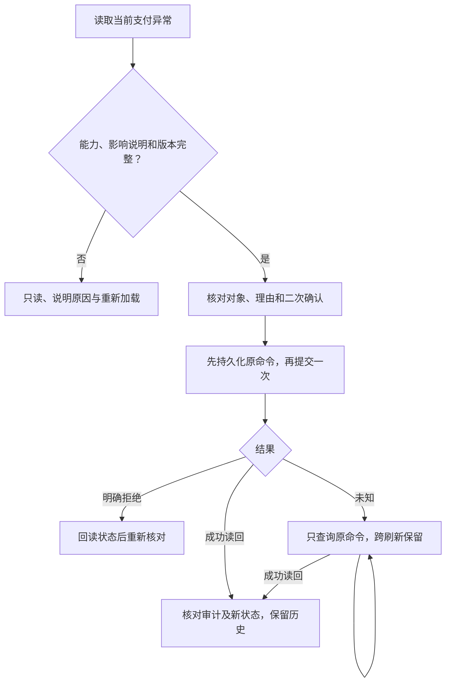

# 支付密码后台运营与现有客户资料原位接入

状态：用户明确要求真实现有客户资料原位接入，已获实施指令。本文件记录正式 PC 前端功能合同；服务端与数据库尚待同事实现，前端代码与本地测试不表示真实接口、解除或审计已生效。

依据：[支付密码主方案](https://github.com/agentabatiuo572-byte/uvel-docs/blob/main/handoffs/2026-10-28/app/18-payment-password.md)及 [后台运营合同](https://github.com/agentabatiuo572-byte/uvel-docs/blob/main/handoffs/2026-10-28/app/payment-password-20261030/ADMIN-OPERATIONS.md)。最新用户原位实施要求优先于早期“后台仅只读、不提供解除”的范围限制；禁止查看、代设或清除支付密码仍保留。

#### [FEAT-PAYPIN-ADMIN01] 支付密码查询、规则和人工解除

2026-10-31 范围修订：支付密码只用于钱包余额付款与修改原支付密码；HDPay 银行直付及 USDT-BSC 链上直付不要求支付密码，不受其未设置、输错或锁定状态影响。C5 规则页及 C1/M1/M3 共用支付安全卡片、解除确认均明示此范围。规则写权限独立为 `user_c5_payment_password_policy_write`；人工解除仍以服务端能力裁决，后端独立检查 `user_c5_payment_password_release`，不得借用登录解锁权限。钱包渠道费、网络确认费均为零；外部订单费用及资金异常处置由 D1 管理，支付密码解除不完成付款、不交付、不退款、不增加钱包余额。

**① 用户故事、目的与对齐**

作为具备查询权限的运营，我想在 C5 搜索支付密码异常并打开每条详情，以便核对锁因、验证记录与处置记录。作为具备服务端处置能力的运营，我想核对影响、填写理由并确认解除，以便恢复用户支付密码验证而不改变登录状态。作为所属客服，我想在现有客户资料和会话右栏查看同一支付密码异常，以便在客户范围内协助处理。

**② 后台界面、验收与异常路径**

- C5 `/users/security` 在既有页面内提供规则配置与支付密码异常列表，不创建独立 360 页面或新一级菜单。查询用户、状态、发生日期，支持分页与逐条详情。
- C1 客户列表打开的 `/users/search/{id}` 详情、共用详情组件的 `/service/customers/{id}`、M1 客户列表现有“客户详情”抽屉，以及 M3 会话右栏/既有完整档案均原位增加支付安全信息。
- Given 服务端返回完整能力、生效说明与原版本，When 运营填写 8–200 字理由并确认，Then 单次提交支付专属解除命令，成功须回读同命令、同用户、同异常、同操作与完整审计。
- 异常—无能力或未知类型：Given 能力、版本、生效说明缺失或异常类型未受支持，When 打开详情，Then 只读并说明原因，不凭按钮或已有客服写权限授权。
- 异常—读取失败：Given 网络、权限或回包异常，When 查询，Then 显示未确认与重试，不能显示“无异常”或“从未设置”。
- 异常—并发：Given 原状态已变或他人已解除，When 提交原版本，Then 服务端拒绝覆盖，客户端回读并要求重新核对。
- 异常—结果未知：Given 已提交而超时、坏包或显式未知，When 刷新或从其他入口查看，Then 保留原命令并阻止新提交；只能在原权限入口查询，未查到或处理中不等于未执行。
- 异常—归属变化：Given 会话客户、登录身份、读取范围或权限变化，When 旧响应返回，Then 不显示旧客户资料，不从 support 回退到全局接口。

**③ 数据字典、可控参数与生成规则**

| 对象 | 权威与字段 | 约束 |
|---|---|---|
| 支付规则 | 服务端版本、错误上限、窗口、锁定时长、上下限与生效说明 | 已批准默认 5 次/15 分钟/15 分钟；未提供范围/生效说明不可编辑，不自行补上下限 |
| 支付异常 | 服务端生成 id、真实 userId、type、state、version、原因、开始/截止、累计错误/窗口 | 与登录密码记录、计数、时间及解除命令独立；历史不删除 |
| 异常类型 | `PAYMENT_PASSWORD_LOCK` 与服务端已定义可人工处理的 `PAYMENT_PASSWORD_EXCEPTION` | 未知类型仅显示待确认，不开放动作；异常来源和允许解除条件仍须后端合同落实 |
| 动作能力 | `releaseAllowed`、`disabledReason`、`effectDescription` | 服务端按角色、客户归属、原状态动态计算；缺项 fail closed |
| 命令 | 原操作员、入口、真实用户、异常 id、操作类型、原版本、理由、confirmed、稳定命令键 | POST 前持久化；不能跨入口、跨客户、跨操作员换键重发 |
| 审计回执 | 原命令、用户、异常、操作、终态、审计 id、时间、操作者、理由及异常新状态 | APPLIED 必须完整且异常状态为 RELEASED；未查到/处理中继续查询 |

字段类型与接收边界唯一实现定义在 `lib/admin/payment-password-contract.ts`。仅投影允许字段，不下发密码、密码摘要、验证码、恢复证明或原始敏感地址。时间必须为含时区 ISO 8601。

**④ 操作动作、状态机与禁止动作**

记录从有效异常进入人工已解除或服务端确认自然到期；再次发生形成新记录。前端不根据浏览器时间自行解锁。仅服务端确认的可操作类型可解除；“解除异常标记”不能扩大为解除账户冻结、设备风险或登录锁定。

动作须读取原状态、影响和版本，理由必填 8–200 字，加明确确认；使用原版本 CAS 和幂等键。提交中禁连点；未知时可离开，但恢复只能查询原命令。已解除仍保留锁因、原时间、验证记录、操作者、理由和审计。

禁止查看、替用户设置或清除支付密码；禁止调用登录 `/security/unlock` 处理支付；禁止本地成功、通用解锁兜底、换键绕过待确认命令或仅凭 Toast 宣告审计落库。

**⑤ 交互四态与逐入口行为**

- 默认态：显示实际读取的规则、异常列表与详情；现有客户资料显示该客户支付安全摘要及详情入口。
- 空状态：明确无匹配记录或当前无支付异常，保留重新加载/筛选出口；不解释为没有历史。
- 加载态：按卡片、列表、详情独立显示加载占位；提交与查询显示进行中并防重复。
- 报错/极限态：读取失败就地重试；禁用动作显示原因；缺合同/未知类型只读；长原因和窄屏可以完整读取；返回与取消不发写请求。

**⑥ 点击流矩阵及确认弹窗**

| 触发 | 响应与出口 |
|---|---|
| C5 规则/异常列表 | 同页切换；原规则编辑保留；搜索、状态与日期独立控件 |
| 搜索/重置/分页 | 有范围的列表 GET，失败不补零，可重试 |
| 查看详情 | 同用户同异常 GET，展示类型、原状态、验证和审计；可关闭 |
| 解除锁定/异常 | 当前详情核对影响、理由、勾选；返回详情或确认提交 |
| 确认解除 | 持久原键后单次 POST；成功回执及新状态必须精确核对 |
| 查询本次结果 | 只读原命令；未查到/处理中继续保留，不创建新命令 |
| 现有客户资料/会话卡 | 注入对应 global 或 support port；不新建 360 route，不跨客服归属 |

**⑦ 一致性、接口、权限、审计与联动**

全局规则沿用 `payment-password-policy`。新增候选为用户 `profiles/{userId}/security/payment-password/summary`、C5 `security/payment-password-records` 列表、异常 `/{recordId}`/`attempts`/`release` 与 `commands/{key}`。support 对等接口均在 `/api/admin/content/support-workbench/customers/{id}/payment-password/` 内。具体后端授权与分页实现待同事确认；前端 BFF 仅放行明确路径/方法，不实施权限或数据库业务。

全局 C5 列表沿用 C5 查询权限；规则编辑仍需 C5 写权限及服务端 editable/范围/影响。客户详情读取遵循所在资料权限；支付解除能力由服务端单独判断，不能把 `user_c5_write`、`service_m3_write` 或只读权限直接当作解除许可。support 必须复核客户归属、原状态和操作范围，不能回退全局端口。

服务端原子执行权限、客户归属、CAS、幂等、状态/错误窗口更新与审计；解除是否清空对应窗口及凭证失效处理，以已批准合同及返回生效说明为准。真实接口、审计持久化、APP/H5 联动和数据库迁移均待后端接手；本地 fixture 不能证明已上线。

**⑧ 事件**

无新增用户侧事件；规则调整和人工解除产生后台审计，包含入口、操作员、目标、原版本、前后状态、理由、时间和原命令。查询关键字、密码或恢复证明不得进入额外行为日志。
