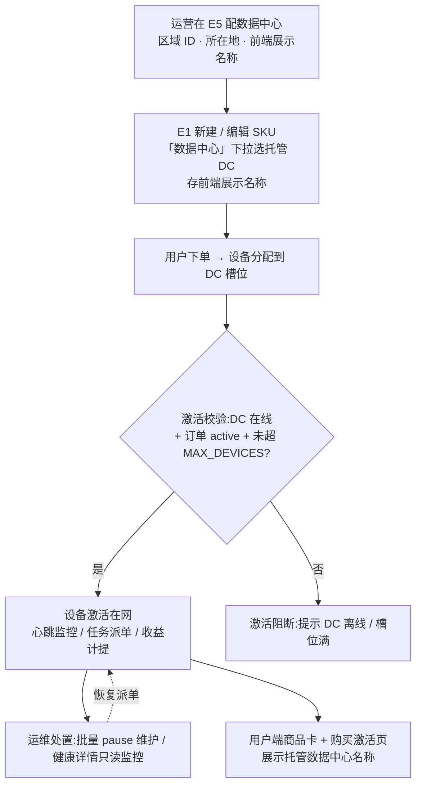

# Nexion 运营后台 · 产品更新日志

## 2026-11-12 · 修复 H4、I6、D7 待审批漏单和原操作恢复

- H4 旧活动奖励、转盘和 I6 课程待审批卡复用 A2 的规范动作映射，并核对对象；D7 按「放宽越南盾提现参数」和 current 配置识别待批单。后端未返回操作代码时仍显示真实待批单；D7 的结论、待批准提示和重复放宽阻断一起采用该队列。
- H4、I6 成功提交审批后刷新进度；业务数据读取失败时仍保留原操作提示和恢复入口，名称不可读时显示保存的原对象标识。
- E2、E5、E6 设备和任务原命令最新查询仍在处理中时，不开放核查结案，即使已超过 24 小时。

## 2026-11-12 · H4、I6 审批提交后不再误报「回执与原操作不符」；旧奖型 nex 的转盘档位暂不能编辑

- H4 旧活动奖励、转盘奖池、I6 课程这几种走审批的修改：提交成功后页面会核对回来的审批单是不是自己发的那一张。原来的核对要求审批单带操作代码，而后端对这几种单不返回操作代码，所以每一笔真实的申请都会被报成「审批回执与原操作不符」，记录一直留着。现在后端返回了操作代码才比较，没返回就按「本人发起、对象一致」认（和全站其他审批入口的做法一致）。
- H4 转盘：奖型存成旧名 nex 的档位，「编辑」暂时禁用并写明原因——编辑保存会把奖型悄悄改成 UVT；等后端修正数据（BUG-426）后再编辑。「删除」不变。

## 2026-11-12 · 后端升级同步的界面和文字收尾（H4 积分退役、审批说法、D1、G、A2）

- H4 活动中心（既有活动）：积分奖项行加「退役」入口和确认框，写清退役哪一档、为什么（App 抽奖会因奖池里有不支持的奖型整池校验失败）、不可撤销、退役后要用 UVT、USDT 或代金券把概率补足到 100%（调高概率要审批）；转盘卡顶部常显「App 抽奖现在用不了」的原因清单，奖型存成旧名 nex 的档位标成「旧奖型 nex」，写明是后端数据问题、已提 BUG-426，页面不提供改名或补概率。页面顶部新增「审批中和待核对的修改」：结果未确认、已超过 24 小时的原操作（含积分退役）和已建成待批的审批单常显，可核对原操作或去审批页查看。
- H4 旧活动奖励、转盘新建/编辑/概率/删除、I6 有奖励课程的首次发布/版本发布/回滚：确认框常显「怎么生效」——哪种方向要提交审批单、由另一位有审批批准权限的超级管理员批准、批准前不变、其余方向确认后立即保存。I6 课程区新增「审批中和待核对的课程操作」，页尾权限说明同步。H3 每周任务的「周冠军加奖」改称「周冠军展示文字」，写明只在 App 展示、系统不按它发奖。
- D1 充值与收款对账：异常详情删掉「ERC20 要财务人工处理、不能认领或退款」的旧说明和警示（三条网络走同一套流程）；运行总开关改写为本环境部署配置、一个开关管三条网络、开着也不一定发送；`CREGIS_EXCEPTION_DEPLOYMENT_UNVERIFIED`、`CREGIS_EXCEPTION_POLICY_CHANGED`、`CREGIS_EXCEPTION_NETWORK_UNSUPPORTED` 中文改对，退款五个错误码补中文。
- G2、G4、G7：参数确认框把「保存后立即生效」改成按方向的说法（放宽要审批、收紧立即生效）；临时恢复条改成一行运营看得懂的话（哪个参数、申请改成什么、状态、能做什么）；G 参数审批相关错误码去掉「超管」「命令号」等内部说法。
- A2 操作记录与审批：G 参数单显示参数名而不是键名，「回购参数调整」显示为「锁定计划参数调整」；转盘单对象显示「抽奖转盘奖池」；旧活动奖励单只比奖励、附提交时的活动状态；课程单只比两边都有的项，其余列为目标版本内容并译成中文；转盘新建/删除/概率和课程发布单的「谁能批准」写全。
- C5、M3：机型锁早期记录和接待结束旧记录的提示去掉「原号」「补发」「结案」等内部说法。
- 以界面和文字收尾为主；另新增 H4、I6 审批概览读取，并接入积分退役及原操作恢复入口。审批请求构造和后端业务规则沿用原实现。相关提交：9b009a8f、7cd3c6f5、043a345d、a807b750、1bf7eaf0、8bc361cb 及本条所在提交。PRD 章节由后续代码 worker 一并更新。

## 2026-11-12 · C2 注销说明里的「可用 NEX」改成「可用 UVT」

- C2 账户操作：完成注销确认框的「系统先查」、被拦下的原因说明和本页使用说明里，代币名称由 NEX 改为现行的 UVT（三处文字）；检查的内容不变。对应 PRD：运营控制台 PRD v1 注销一节同步。

## 2026-11-12 · C5、M3 原操作恢复补齐

- C5 机型锁原样重试被明确拒绝后，保留原记录并可经既有确认解除本页待确认；回执 404、403、幂等未定结果不授予解除资格。首次提交遇到 401/403 同样隐藏原理由、关闭详情并触发权限重查。
- M3 接待变更拒绝后和人工解除后重新读取接待状态；人工解除只移除选定命令，剩余旧记录的提示和查询入口保持可见。

## 2026-11-12 · A2、C5、M3 接入后端 66ecdb47

- A2 手机任务审批按后端动作字段显示新增、编辑、启用、停用，队列、详情、历史和原操作恢复一致；G2／G7 的另一位超管审批要求、G4 额外参数业务权及课程回滚动作按后端规则说明，仍使用逐单批准／驳回资格。
- C5 新机型锁解除保存完整原请求，24 小时内可按原操作重试并查询原解除回执；按 `response` 核对原对象和成功状态，404／403 保留原记录。旧未知记录只读回，超期新记录只查询；收起明细的提示与无权隐藏原理由保留。
- M3 新结束请求绑定本次 `sessionRef`，结果未知原号先查、仅原实例限时重发；旧无标识记录不补发到下次接待，超期旧记录在原号查不到且明确是后来接待时，保留旧证据并允许操作者独立结束当前实例。补充接待已变更的中文原因。

## 2026-11-12 · D1 开放 ERC20 异常款共享流程

- 按 D1-ERC20 决定移除 ERC20 认领／原路退款入口的单独硬禁，复用另外两网现有的签名、预览、提案、另一位复核和原请求恢复；请求内容及权限不变，网络仍由后端来源记录判定。
- 核实统一环境运行总开关覆盖三网；每网地址、策略与出款许可继续生效，总开关批准不等于必定发送。屏幕旧人工说明、unsupported 中文及帮助句按 code-only 分工留给视觉 worker。
- 对应 PRD：[D1 三网异常款与自动资金流](PRD/D1-USDT三网异常款与自动资金流-20261109.md)「PC 异常款入口同步」「运行总开关统一控制三网」。相关提交：本条所在提交。

## 2026-11-12 · 转盘审批差异与新奖项校验修正

- A2 按后端整池快照定位转盘目标奖项，对齐新建、修改、概率批改、删除的前后值；奖池签名与原快照单列为核对证据。新建奖项先明确校验概率、实际发放数量、每日数量，空值不补 0，十进制输入校验后无损提交；沿用原有差异组件与确认框。详见 [同步合同](PRD/H3-H4-I6-奖励审批同步-20261112.md)。

## 2026-11-12 · H3、H4、课程奖励审批后端同步（逻辑接线）

- H4 旧活动奖励以服务端预览判方向，跨资产正奖励等放大修改提交 A2；转盘新建、改奖型/数量、改概率及提高安慰奖的删除按后端判据走整奖池审批，收紧保留直接写。请求保留完整签名与十进制数量。
- 有奖励课程的首次发布、版本发布及回滚（包括等额、降额）提交专用 A2，零奖励保留直接生效；申请收录只提示待审批。A2 接入新的课程回滚动作名与 H4、课程的字段映射和批准人规则。
- 新审批及积分退役服务发送前保存完整原请求，未知后原框冻结，重试保留原号原内容；明确拒绝才解除，24 小时后保留且不重发。冠军奖励文字配置取消放大标记，其余 H3 奖励不变。
- 积分退役请求与恢复服务已准备；新入口、退役后补足合法奖池至 100% 的说明、旧确认说法及常显恢复入口仍待视觉 worker 接入，本条不宣称这些界面已完成。详见 [同步合同](PRD/H3-H4-I6-奖励审批同步-20261112.md)。

## 2026-11-12 · 原申请独立恢复与待审批日分红收紧

- G2、G4、G7 的最小原操作入口直接来自保存记录；加载和概览失败时仍能查询/原样重试，补发跨日后仍使用原批次，过期只查询。
- 原恢复被明确拒绝并解除后关闭恢复框；新提交重新检查当前开关、读取结果、权限和可用条件，不能沿旧恢复框绕过禁用。
- 本人已确认待审批的日分红提高申请仍保留原记录，同时允许按最新正数比例直接收紧；提高被拦，未知申请继续冻结。原提高提案的 revision 不变，由后端拒绝失效回放。
- 同步 PRD v3 和三页事实说明。功能入口复用旧样式，后续视觉重排和旧说明文字仍由视觉 worker 处理。

## 2026-11-12 · G2、G4、G7 原申请恢复与 G4 分红接线修正

- 原参数审批记录可按当前操作者完整枚举，状态、查询、原请求原号重试与终态解除均有接口。兑换暂停或新编辑被禁用时，已有恢复入口仍可达；过期只查不发。直写被 A2 锁拒绝后，后续提交重新由后端判锁，锁结束后可继续修改，不丢其他原记录。
- G2 读取允许拦截和队列订单的真实可空字段，三类拦截不再因 etaLabel 为 NULL 拖垮整页；必填和类型校验保留。
- G4 已有日比例提高及真实待付补发接到专用分红审批并携带 expectedRevision；补发快照支持单个 batchNo，代理继续拒绝其他查询参数。首次日比例和档位价流程保留。
- 创世认购配置按精确数值及同一 UTC 时刻核对规范化回执，1.00→1、.000Z→Z 不再误判未知，真正不同的值仍拒绝。
- 对应 PRD v3 的 G2/G4/G7 章节及三页事实说明同步更新；常显原记录提示和旧屏幕文字按任务分工交视觉 worker。

## 2026-11-12 · G2、G4、G7 参数放大方向接入审批（逻辑）

- 兑换额度调高、手续费调低和拒绝改排队，创世节点供应增加、旧系列提价、有效版税基点降低和四项说明配置变化，以及锁定计划奖励率或好友升级奖励倍率调高、扣款调低，改走 A2；反方向保留原直接写。直接写被后端要求审批时转提案，G4 三项决策编号不再丢失。
- 新审批先保存完整原请求和命令号，未知后保留并冻结输入，刷新可恢复，原号原样重试；401/403 等不当明确拒绝，超过 24 小时保留但不重发。已收录票仅查询，已决结果须重新读取当前参数；A2 补齐这三类票的批准和驳回权限映射。
- 保留原队列、暂停、档位价、日分红、首次收益比例、抽奖券核对与其他写入口。本批不改页面版式、旧「保存即生效」说明或新增查询控件，交视觉工作继续处理；后端空 divBase 旧值无法建票、G4 原票读取权限和不可达 legacy 单价入口已登记，未在前端绕过。
- 对应 PRD：《Nexion_运营控制后台PRD_v3》G2、G4、G7 章节；相关提交见本批 Git 记录。

## 2026-11-12 · E6 机型风控原保存核查与重试回执

- 机型风控保存结果未知后，查了仍未知或超过 24 小时，有调查权限的超级管理员可在现有核查结案框提交证据；证据不足保留原记录，后端确认后才解除。没有权限的人继续看到联系提示，升级前的旧记录仍只读回。
- 待确认条及原确认框按原操作重试完成后，显示后端原回执中的保存版本；当前设置和版本仍单独读取。
- 对应 PRD：v2 E6a；相关提交：本条所在提交。

## 2026-11-12 · E1/E2/E5/E6/B0 后端同步的界面和文字

- E2 任务池、E5 设备管理、E6 用户手机的结果未确认提示：「读回核对」改为「查原操作结果」，按命令号查后端，结果写在提示下面（后端查不到、仍在处理、仍未知、以失败结束），并说明查不到不等于没有执行、仍未知时重试只会得到同样的结果。查到已完成或核查确认后，提示换成一条可关闭的灰色说明，本页待确认解除。
- 超过 24 小时或后端也不确定时：有调查权限的超级管理员看到「核查结案」，弹窗写原操作、命令号和三种结论各自的后果，填核查依据（必填，512 字内）、选「已执行」时可填成功审计编号，勾选「确认后不能撤销」后提交；证据不够时后端记为「仍未知」并写在提示里。没有权限的人看到「请把命令号发给有调查权限的超级管理员」。三页同一套样子。
- E6 机型风控：结果未确认的提示新增「查原保存结果」和刷新后仍在的「按原操作重试」；重试或回执完成只说「原保存已完成」（有回执时写保存后的版本），当前读到的版本和设置单独显示，不再说「已生效」。回执查不到、缺少发起人来源、无权查看各有中文说明。确认框和使用说明里「命令号只用于审计」「不按命令号去重」的旧说法改为后端按命令号去重。
- E6 手机任务等审批：等待审批的提示下面写后端判定的审批类型和是否会让平台多付钱。
- E5 设备管理：状态分布下面新增「需要处理」（出错重试中、旧任务未结清、等待配置），只列不为 0 的状态，点一项按这个状态筛选；结论句加上需要处理的台数。名额按钮的读屏说明改为「只看这位用户的设备」，用户筛选标签写用户编号。
- B0 今日概览：设备卡新增「需要处理 N 台」（三项都为 0 时不显示），「待处理」列出每个不为 0 的状态，点进设备管理并带上真实状态筛选。
- E1 商品编辑：旧编号在售商品的提示改为说明可以直接改资料和下架、改任务等级时要补齐哪三项、旧编号不能设置月收益目标、下架后不能用原编号重新上架。
- 新增 E5_USER_ID_INVALID、核查结案十一个错误码和机型风控三个回执错误码的中文。
- 对应 PRD：v2 E1a、E2、E5、E6a 与 v1 B0（由代码 worker 同步）；相关提交：本条所在提交。

## 2026-11-12 · E1/E2/E5/E6/B0 后端同步（代码侧，界面接线待视觉 worker）

- E1 旧在售未知型号在目标与任务等级不变时允许普通维护；新建、重新上架及改目标／范围的保护保留，不补造缺失字段。
- E5 名额标记改绑 userId 精确筛选，沿现有搜索、筛选、清除、分页和网址恢复；E5/B0 同一概览读取新增三数，保留原四数口径，不另数列表。
- E2/E5 原读回入口增加按原命令号查询；共享证据核查客户端使用服务器 scope/hash 和权限、证据检查，UNKNOWN／查不到／403 不解锁。E6 暴露同一直接命令核查能力。
- 新 E6 风控信封支持 24 小时内原样重试和原保存回执查询，旧未知记录保持只读；A2 原操作恢复按请求币种检查专权，保存后端 type/amplifies。
- 新可见控件、三数展示与状态链接、风控重试／回执入口、证据框、中文错误及旧文案修正尚须视觉 worker 完成，不能把代码侧接入算作整项完成。
- 对应 PRD：v2 E1a、E2、E5、E6a 与 v1 B0；相关提交：本条所在提交。

## 2026-11-12 · 结果未知恢复的视觉收尾（C5、E4、E6、M1、支付安全详情、共用确认框与解除框）

- C5 安全与登录设备：页面上方有两笔及以上待确认（登录处置、全部设备登出审批、支付规则、支付解除、手机处置）时并成一块「N 笔原操作待确认」，一笔一行、各自的入口不变，不再把页签挤到下面很远；只有一笔时仍是原来的单条提示。外层没选中的那位用户的支付解除写成「user:6」，和异常列表同名；从这里回到原记录时详情的操作对象也写「user:6」。机型锁解除结果未知后，表格仍在时提示改用警示色，不再显示红色「机型锁未能读取或处置」。
- 支付密码异常详情（C5、C1 用户详情、M1、M3 共用）：完整的「解除结果待确认」按钮排到正文下面，命令号和时间不再挤成三行；详情没读成功又有待确认时，读取失败和待确认并成一条警示，「重新加载详情」在正文下面，「原操作已保留」不说两遍。
- E4 订单进度：页面上方「结果未确认」的按钮排到正文下面，正文占满整行；查询或重试后的说明另起一段。退款框「红线 100%」不再拆成两行。
- E6 手机算力配置：用户手机操作和机型风控保存「已取得操作回执，读回失败」的提示改为警示色（原来是成功的绿色对勾）；待确认条标题里的状态词整段换行。
- M1 客服工作台：作废邀请码拿到回执但重读失败时，成员表和「待分组客服」那一格显示「待刷新」（回执可能是作废成功，也可能是原操作没生效，旧码都不可信），页面提示改为警示色；作废结果还没确认时弹窗里的提示用警示色，明确被拒仍用红色；成员表操作列放得下「成员调组」「作废邀请码」一行；两位客户都有支付解除待确认时，页面上方的入口写明是哪位客户。
- B0 今日概览：导出资金数据结果未知后，刷新也在「今天的状况」下面常显一条警示「上次导出资金数据的结果待确认」，写发起时间、原快照和理由已保留，「查看原导出」回到原确认框核对（原理由冻结；24 小时内可按原操作重试）；重试成功后提示消失。只有能导出的超管看得到。
- E4 退款影响区：「模拟任务的运行关联暂无法核实」改为「任务的运行关联暂无法核实」（产品定：用户设备的状态不写「模拟」）。
- 共用确认框：结果未知提示里的命令号、请求号整串换行，不在「e- / domain-action」处断开。
- 只改显示，请求内容、校验、权限、显示条件和结果未知的处理不变；对应 PRD 的行为说法不变，未改 PRD。相关提交：55604a35、cb52e87f、7e9caac2、6ef1619a。

## 2026-11-12 · 真实写入验收后的三处修正

- E4 原操作每次重试前清除旧拒绝标记，再次结果未知时保留原请求且不能解除；支付解除恢复详情须先读取成功，读取未成功时持续提示结果待确认，隐藏本地原理由、版本、命令号和恢复操作按钮，原记录继续保留。

- E6 用户手机：强制激活和解绑手机的审批申请，对象改为设备编号（和用户设备页一致）；之前传的是手机实例号，后端按 `A2_BUSINESS_CONTEXT_MISMATCH` 拒收，申请建不出来。
- C5 安全与登录设备：支付密码规则调整、支付密码解除的待确认提示，停在「支付密码异常列表」时也显示在页面上方；机型锁解除的待核实提示在「手机机型锁」明细收起时显示在手机换机页签上方，点「查看原解除记录」展开。原记录、原样重试和只读回的规则不变。
- E4 订单进度：只有一个退款去向时（去向写成事实、不给下拉），提交退款审批不再报「请选择退款渠道」。
- 对应 PRD：运营控制台 PRD v2 的 E4 退款、E6 用户手机、C5 结果待确认三处行为说法不变，本次是让页面做到已写明的行为。
- E4 订单进度：只有一个失败结果时提交该固定结果，失败原因仍校验；推进、退款、取消和失败提案首次发送前保存完整原请求与理由，结果未知冻结原框，刷新后按原请求和原命令号恢复。旧的指纹记录只查询；E4 过期证据不再因手机页读取而删除，超过 24 小时保留且不重发（E3 本次不动）。
- C5 安全与登录设备：支付解除待确认按当前操作者的全部全域原记录恢复，不依赖外层选中用户；关闭异常详情、刷新或原记录退出当前异常列表后仍能回到原详情。已有恢复入口显示时不重复。
- M1 客服与分组：作废邀请码取得终局回执后先使受影响的旧码与版本失效，读回失败期间不给旧码再次作废入口；读回成功后使用最新资料。原样重试被明确拒绝并解除待确认后刷新资料。

## 2026-11-12 · 结果未知恢复逻辑修正

- E 域提案与旧设备命令共用唯一存储实例，已经收敛删除的命令不再被手机页旧缓存写回；各入口原有记录过滤与过期限制保留。
- 手机设备操作、机型风控保存及成员邀请码作废拿到回执后按成功清理；后续读回失败单独提示，不再说原操作被拒绝。个人邀请码重试的读回失败也不再走拒绝分支。
- 作废成员邀请码原样重试被明确拒绝后，可用既有解除框核对并解除；401、403 等非明确拒绝仍保留原记录。

## 2026-11-12 · 推送前视觉复走（E1、E2、E4～E6、H1、H2、I5、J1、K1、K3、L1、M1、M3）

- M3 专属会话与 M1 客户资料抽屉共用的客户资料：改版样式随组件加载，M1 抽屉不再退回旧样式（整行绿底、资金四宫格 2+1、快捷操作 3+1），两处一致；当前余额、累计充值、累计提现、首充金额和资金表按 M1 统计页的写法显示千分位、至少两位小数（「1300」→「1,300.00」）；风险研判底色统一中性，等级只用字色区分；各块之间统一 16px。
- E4 订单进度：退款框展开「商品与购买设备」后，右侧影响区的提示框和任务表不再被拉高留白；订单号在事实块里均匀折两行，不在「ORD-」后断开。
- E6 手机算力配置：用户手机「电量和心跳」列第二行常显距上次心跳多久，没采到写「心跳未采集」，完整遥测仍在气泡里；确认框里的实例号均匀折行，不在「PHONE-」后断开。
- 只改显示，请求内容、校验、权限和结果未知的处理不变。对应 PRD：运营控制台 PRD v2 E6「用户手机」一段（电量和心跳列）。相关提交：51479827、eadfef5a、3047e4c0、ecbb8936、3fd78d88、f133aa30。

## 2026-11-12 · 推送前视觉复走（A2、B0、C1～C5、D1～D7）

- 共用确认框：提交后结果未知（原操作可能已生效）的提示改用警示色，红色只留给明确失败；文案、按钮和恢复流程不变。
- 共用状态分布条：条和下面图例之间的间距由 4px 调为 8px，与其他图形一致。
- C5 安全与登录设备：使用说明「结果待确认」改为当前真实情况——登录处置、支付规则调整和支付密码解除在 24 小时内可按原操作重试，超期只查询；手机换机只查询原结果，机型锁只读回。手机换机与机型锁的时间改为本页统一的「2026-11-12 08:00」格式（E6 不变）。换机技术信息的六个字段显示中文名：换机事件号、记录来源、来源记录号、数据环境、沙盒运行号、关联对象号。
- C5 各确认框标题下的「立即生效」「批准后生效」改为与其他页面一致的实底标签（支付密码解除框在 C1 用户详情、M1、M3 共用，一并变化）；换机技术信息里为空的取值显示「—」，不再留白（手机换机策略页共用同一组件）。
- D3 资金储备与应付款：「资金流 › 明细」里两个折叠和面板标题对齐；应付款构成说明「几乎全是…」去掉多余空格。
- 只改显示，请求内容、校验、权限和结果未知的处理不变。对应 PRD：运营控制台 PRD v1「[C5] 安全 & 会话」2026-11-12 说明。相关提交：bc08e89d、e13337c4。

## 2026-11-12 · 客服组确认框校验显示修正

- 作废成员邀请码：输入过原因或尝试确认后才显示原因错误，保留原校验和提交规则。
- 从成员行打开调组：显示已读取的真实原组，预览核实后才显示组变更；提交内容和权限不变。

## 2026-11-12 · C5 旧状态清理与真实历史接线

- 概览重读时关闭登录锁定旧详情；短锁和长锁统一处理，读回失败保留待确认。
- C5、C1 用户详情、M1、M3 共用支付异常详情翻页或操作失权时，清除敏感详情和确认状态，重新核对权限；原待确认不删。
- 手机成功历史对象取后端 sourceId，申请与特批取 targetInstallationId；技术详情补真实来源与资源字段。原结果查询仅对签发、关闭、撤销三类操作开放。
- 使用说明与手机日期格式按 code-only 约束保留现状，交视觉 worker 更新。

## 2026-11-12 · C5 安全与登录设备视觉整修

- 用户身份卡用统一的用户图标底，登录锁定、两步验证、密码重置三格同一条值线；窄屏时「锁定中账户」放大后排在统计第一行；读不到统计时只写「—」，不带单位。只读账号不再显示空的「账户安全处置」一行。
- 手机换机：绑定与条件两列各按自己的行距排，面板里各块统一间距；当前申请的「不予授予／核实关联记录／确认一次授权」收进同一条操作行；三个明细切换改成一组分段；机型锁表格与面板边线对齐。
- 支付密码：用户支付密码状态并入事实区，「查看验证记录」放到标题行；支付安全摘要改成事实行并补回查询时间；异常列表的筛选条移到列表上方，有当前异常时结论用警示色；验证记录、锁定账户、更换用户和支付密码异常详情抽屉改为标准宽度（异常详情 C1 用户详情、M1、M3 共用）；异常详情的处置审计每条补回审计编号。
- 登录与改号规则调整框写明服务端允许范围。只改显示，请求内容、校验、权限和结果未知的处理不变。相关提交：be922e69 及本条所在提交。

## 2026-11-12 · 弹窗间距与确认框表单样式统一

- 改版页面的弹窗正文里，事实块、提示条、字段、勾选项之间统一为同一套间距，折叠块内同理；以前给单个弹窗打的间距补丁已收掉。
- 确认框里的业务表单（多字段修改、危险操作理由、披露辖区与矩阵、核实用户身份）在改版页面上改用新组件绘制，不再出现旧样式的红底等宽字提示框和旧输入框；未改版页面保持原样。
- 弹窗底栏按钮的禁用原因气泡改为向上弹出，不再挡住「取消」。只改显示，提交内容、校验、权限和结果未知的处理不变。相关提交：c4e9c7a8、eddbc311、1571403c。

## 2026-11-11 · C5 支付密码原操作恢复

- 支付规则和两类支付解除保存完整原请求与命令号；C5 在 24 小时内可按原操作重试，始终发送相同请求内容与命令号，超过时限或旧记录缺字段时只查询。
- 登录、权限、限流和幂等开放态保留原待确认；原操作重试被明确拒绝后，经「解除待确认」确认只清除本标签页记录，不撤销后端操作。
- 共用客户端旧接口保持可用；M1、M3、C1 的解除入口不增加恢复动作，仍沿用原确认与查询。

## 2026-11-11 · C5 操作授权与本人声明分开显示

- 重置登录密码、关闭两步验证、解除短锁和长锁分别显示本次操作的授权管理员、权限依据与检查时点；不再把管理员授权称作已有本人核验记录。
- 操作人独立勾选已另行核实本人，并在操作理由中写明核实方式和依据。提交内容、校验和权限判断不变；A1 原有核验表单保持原样。

## 2026-11-11 · E1 各操作按实际读取来源独立可用

- 商品目录、开放阶段和组合购折扣的读取失败只阻断使用该来源的操作；新增/编辑商品明确依赖开放阶段及审核契约，下架/删除不再被阶段或折扣失败阻断。
- 目录失败时保留阶段、开放计划、抢先购和折扣入口；需商品引用核对的删除阶段、新增上架条件及强制提前开放仍等待目录。E3 继续只控制抢先购调整。
- 仅调整可用条件和对应原因，提案内容、校验、权限、对象锁、原命令恢复及布局样式不变。PRD：v2 E1a 复查修正；重构说明来源表同步。相关提交：本条所在提交。

## 2026-11-11 · 恢复手机逐行遥测并校正审计动作说法

- E6 每行「电量和心跳」可打开全部遥测，未采集明确标示；状态问号只在暂停或异常行解释原因。列选择原键与可选列保留。
- A2 按后端 `fdc9f469` 修正系统拦截注销、到期事件清理、敏感导出留痕、原操作调查结论，以及恢复/绑定/交付和操作拒绝等 11 个动作名；原码、筛选和提交行为不变。
- PRD：v2 E6a 用户手机；v1 A2 审计动作中文名核对。重构说明同步；相关提交：本条所在提交。浏览器自检不代替独立验收。

## 2026-11-11 · M1 恢复流程与资料语义复查修正

- 保留群发“全部筛选结果”的预览恢复意图；随机名单有客户离池时逐客排除，其余客户继续预览。组范围调整核验原命令终态与新路由事实，维护查询失败保留旧名单，版本拒绝后先重读再确认。
- 维护历史使用原记录操作者，恢复未知统计及已观测说明和统计延迟文字；区分有效空池和筛选无结果，补创建组名称校验及待确认维护入口，统一操作名称。
- M1 客服资料入口不提供普通账户操作，无会话的标签及内部备注只读；无获准客服范围时说明暂无可查看内容。权限码与后端校验不变；本轮不调整视觉版式。
- 随机分配完成后，结果摘要继续显示原预览的选中人数，刷新客户池不会把原人数显示成零。

## 2026-11-11 · E1 新增上架条件商品选择不再截断

- 「新增上架条件」确认框中的商品选择字段占满一行，当前商品名和编号完整显示。仅在此框传现有整行字段配置，共用下拉组件及其省略样式不变。
- 商品选项、校验、权限、理由及提案内容不变。
- E1 重构说明同步，四组合截图与关卡结果见 `reports/visual/E-fix-r2/` 和同一worker报告。

## 2026-11-11 · 提现风险规则复查修正

- 覆盖卡突出缺项并支持按类别新建；历史放行或未知生效规则显示待核查，不计入正常检查。只读规则表隐藏空操作列。
- 成功读回后更新规则详情；读回失败关闭旧详情并持续显示原操作已成功。结果未知统一保留原请求、原样重试或读回核对；提交中、明确拒绝、过期及规则对象锁分别显示。
- 确认后果去重，停用最后一条的后果优先显示；编辑只在减少拦截的改动提示资金风险。触发原因用结构化字段显示中文，原原因保留在技术信息；比较符、表单和分布布局同步修正，冻结独立显示。
- 相关提交：本条所在提交。量尺按固定后端 fdc9f469 重建，旧样例证据撤回并重拍。

## 2026-11-11 · E 批第二轮遗留修正：手机状态、校准命中与折扣确认

- E5 状态筛选分组改为「运行、暂停、停用中」，去掉残留旧叫法。
- E6 停用中手机显示禁用「⋯」及结算后自动停用的原因；只有暂停或异常行带具体原因问号。Android 试算按后端芯片名与稳定键显示，缺失时明确说明名称未返回。
- E1 折扣确认去掉重复当前值，保留一处完整前后对照及输入；任一档调高才显示支出警示，未改继续禁提交。已核对当前后端提交与批准均不检查覆盖率。原提交内容、校验、权限和命令号不变，共用确认组件未改。
- 依据：后端 `fdc9f469`；各页重构说明同步。验证与截图见 `reports/visual/E-fix-r2/` 和本次 worker 报告。

## 2026-11-11 · 运营阶段设置视觉复查修正

- 当前月份和人工进度升为首屏主数字；正常覆盖率用中性色，当前月整行标记，矩阵宽度、数字精度与六阶段参考卡片调整到双宽双主题。
- 校准进度越界在字段处阻断；收紧方向随输入提示。未知、明确拒绝、部分保存及本地解除的文案、原值和拒绝原因保持一致，锁定输入显示禁用态。
- 合入集成分支共用确认框与 E/D 页修正，H1 确认内容去重、统一叫法与定位；业务请求、权限、幂等号及后端校验保持原契约。

## 2026-11-11 · 设备与商城四页视觉复审第二轮：列宽不跳、停用中行操作、确认框细节

- 设备管理：列宽排法不再读完才跳。第一次读取完成前不画表头文字和分列骨架，之后重读、翻页、筛选沿用上一次排法，只有新一页数据需要另一种时才换。停用中的行操作列和别的行一样放「⋯」，禁用，说明「停用中，结算后自动停用，暂时没有可做的操作」，不再写「收尾」。当前任务的时间位置条改为中性色，蓝色只留给状态。任务已关闭时行上不带问号（原因在页头和结论句）。
- 手机算力配置：手机任务结论句改为「N 个手机任务启用中」（取已读到的任务列表，不加请求）；0 条仍写「还没有启用的手机任务」，读取失败说法不变。
- 商品管理：审批状态抽屉底栏的两个按钮和链接留出间距。
- 共用确认框和菜单（各页同时生效）：已经常显后果句和批准人时，「执行摘要 … 查看详情」那一行改成贴着说明的「查看详情」文字链，不再像一行空标题；事实块没有内容时不留空的灰底；下拉框里的长名字单行省略；弹窗和抽屉里的数字框不显示浏览器自带的上下箭头；从行尾「⋯」菜单打开的弹窗或抽屉关闭后，键盘焦点回到「⋯」。
- 相关提交：本条所在提交。PRD：v2 E5 设备管理「页面与图形」「状态名称」两段；E6 重构说明首屏结论一句。

## 2026-11-11 · 设备与商城四页视觉复审修正，设备状态改称「任务已关闭」

- 设备管理：按产品要求，状态「模拟任务已关闭」改为「任务已关闭」，状态原因、页头只读说明、首屏结论（如「任务已关闭，20 台用户设备仅可查看」）、详情底栏提示同步改称；只改文字，状态判断和只读规则不变。订单进度退款说明里的「模拟任务的运行关联暂无法核实」说的是退款对任务的影响，不是这个设备状态，未改。
- 设备管理列表：当前页没有预估区间和当前任务时（任务已关闭时就是这样），收益列和任务列收窄，宽度分给设备、用户、状态，1440 下实例号完整显示，中间不再留一片空白；1024 下常见商品名不再被截掉型号；状态分布图例与分布条左边线对齐；详情浮层标题下的长实例号单行显示。
- 商品管理卡片：名称中间省略不再吞掉空格（「Pro v2」不再读成「Prov2」）；「售罄」与剩余数分开；「购买条件」图标和文字同一行；卡片上下间距与左右一致；开放计划表「计划开放」与「当前状态」之间留出间距。
- 任务池：任务表「时长」与「状态」之间留出间距；批量停用影响块里商品名、影响设备数、后果句的间距统一。
- 手机算力配置：任务名、手机名中间省略不再吞掉空格；任务表「每任务奖励」与「状态」、引导对比表「UVT/天」与「来源」之间留出间距，对比表数字列靠近名称；iPhone 机型目录「官方在售机型」不再折行；「查询原发布结果」里的查询按钮不再拉成整行。
- 相关提交：版式 `ebb636ab`，文字与文档为本条所在提交。PRD：v2 E1 商品卡说明、E5 设备管理「页面与图形」「状态名称」两段；E5 重构说明同步状态叫法。

## 2026-11-11 · C5 安全与登录设备重构

- 采用用户身份卡、登录状态带与四页签工作台，登录设备、登录与改号规则、支付密码和手机换机按任务分层；原候选与会话分页、两步验证、重置、短长解锁、支付异常、换机特批及机型锁入口保留。
- 全部设备退出接受 C2 或 C5 专权加 A2 提案权，仍由另一位超级管理员批准后生效。本人核验不再写成 KYC，解锁不承诺取消待改密或冻结限制。
- 登录处置保留完整原请求和过期记录，只在 24 小时内原样重试；机型锁未知只读回核对。共享手机号命令保留原原因码，明确拒绝统一判断，支付 pending 契约与 M1 同期修复统一集成。
- 统计读取失败显示未确认，时间统一业务时区，无权写入口隐藏；支付和手机明细改用共享抽屉、确认、时间线与折叠，不增加业务写接口。

## 2026-11-11 · 客服工作台改版

- 本人首屏改为四格待办及六位客户卡，最近会话、本人业绩、维护概况和逐日明细折叠保留；主管与总管理员以实时服务四格和角色页签处理分配、客户及分组。
- 统计表收为六列，次要数字、池尝试记录进入详情；池单客分配不改变批量选择，组目录与待分组互斥。保留全部原查询、下钻、支付安全、转绑、群发、邀请码与本人头像能力。
- 页签与非姓名筛选记忆，时间统一标北京时间，金额保留实际精度。修复转绑与随机的超时重发、宽泛拒绝清号、头像丢原号及支付解除未保存原理由和版本；随机与群发的重新生成预览明确为新快照，最终写入继续保留原操作恢复。

## 2026-11-11 · E1 关联权限与审批回执修正

- E3 抢先购设置缺权限或读取失败只暂停抢先购调整，显示「当前设置未读取」；其他 E1 修改仍按目录、阶段和折扣读取状态判断。
- 成功回执保留原命令号，页头刷新和打开商品资料或审批详情时查询真实状态；明确读到已批准、已驳回、已撤回或已过期后解除回执锁，未查到或失败保留锁并可重试。待确认存储里的未知原命令继续保留，不随回执刷新清除。
- 同步 E1 PRD；提交、理由、命令号及结果未知恢复规则保持不变。

## 2026-11-11 · 可用资金与应付款并入资金储备与应付款

- B2 全部能力由 D3 原四页签承接，删除重复业务页、专用样式及客户端写链。旧网址兼容到应付款与到期的七天窗口，今日概览/B1 入口按内容权限改到对应页签；前端移除重复菜单，后端公共菜单退役仍另批执行。
- 金额保留真实小数并按组对齐；补科目原始字段、窄屏每日构成抽屉、历史独立时间与完整年月、互斥明细及单一失败重试。D3 统计、环图、页内配置和缺价导出规则保留。
- 原 B2 两份待确认记录沿用原键/槽及完整请求，刷新/跳转不丢、不续期。CSV 拒绝保留状态和原因码，403/429 不开放解除，只有共用明确拒绝判据才允许人工核实后本地解除。
- 验证从真实应用入口进行，业务写请求均在页面拦截；不以页面模拟回执证明后端资金写入或审计去重。同步 PRD B2/D3、D3 重构说明及调用方登记。

## 2026-11-11 · 运营阶段设置改版

- H1 增加阶段线、人工进度尺与四格统计；完整七参数月矩阵保留，控制、覆盖和静态归因分组收起；1024 与深浅主题统一。
- 各参数按实际收紧直写或放大审批说明生效方式；总月数、两步校准及全部提案接原请求持久化、同号恢复、超 24 小时只核查；数字前置校验与键盘入口补齐。
- 三控制入口明确只保存配置、后端目前不执行；空覆盖不冒充 0 人。统一到账审查窗口、加强合规审查名称与三网大额窗口事实。E1/H1 来源统一、首装恢复和批准资格缺口按后端待办保留。

## 2026-11-11 · 提现风险规则改版

- K3 改为四类覆盖卡、缺项结论、六列规则表；触发记录进抽屉，详情和模拟摘要按需展开。保留原权限、分页、条件编辑及启停归档入口，补健康态刷新、网址恢复和这页怎么用。
- 六种写操作先保存完整原请求；未知结果跨刷新保留同对象保护，受限原样重试，明确拒绝人工核实后解除，超过24小时保留不重发。成功后列表读取失败不重发写入。
- 整数金额的小数补零不再拼成新金额，空值与合法0分开；零样本模拟保留四种处置数，未评估时不画比例。
- 说明与后端 fdc9f469 一致：累计命中按记录计数、模拟只当前active样本；资金检查缺口、历史金额币种与时间时区缺失明确标注，同步K3 PRD章节。

## 2026-11-11 · D1、D4、D5 显示与文案修正

- D1 只读资金检查不再要求业务参考号，创建准备单仍必填；原挑战取回但来源不在异常快照时常显查找与核查指引；暂停自动资金流程明确仅本网络。
- D4 草稿未应用时列明已应用条件；显示用户在所选时间范围内的账单总数；时间保留秒；读取失败改用读取提示；导出理由与共用 A2 规则一致。D5 按原因码识别覆盖率拒绝，修正解除提示尾字。
- 同步 D1／D4／D5 PRD 与重构说明，补全任务池子接口路径；历史实现文档注明复跑工具已退役，不恢复测试文件。

## 2026-11-11 · 查找用户、账户操作、今日概览与专属会话细节修正

- 查找用户冷开零结果不再默认显示未读到的余额列和设备选项；账户概况刷新失败只说明依赖该概况的列表入口暂停。
- 今日概览时段存储失败按既定规则回到今日，超过 5 项的待处理读取失败仍可独立重试；开关无有效配置只说明当前状态。专属会话按真实阻断条件说明身份、权限或坐席资料问题和下一步。
- 通用用户归因错误不再写死提现；网络费比例与上下限错误按后端含义说明。已集成的中性幂等冲突和按来源指路的任务格式文案保留。权限、提交、校验和结果未知处理保持原规则。
- PRD：v1 B0／C1／C2、M 专属客服中心功能契约；重构说明同步对应条目。

## 2026-11-11 · A2 操作记录与审批细节修正

- 导出说明明确不超过4个字符的标识全部隐藏；批准和驳回恢复条均说明后端在批准时检查业务权限。
- 补齐后端已知审计动作的中文名，原码保留在技术信息供筛选查询；动作名独立为数据表，并与现有页面的自动资金流程、放行提现、冲正调整、用户设备、账户组等叫法对齐。退款审批使用提案退款金额，缺失写「退款金额未读取」并继续禁用批准，不再用订单总额替代。
- 型号月目标审批写「批准后保存」，说明首次发布前的草稿在首次上架时发布、已发布型号影响新任务，保留原任务和历史到账。

## 2026-11-11 · E 页操作提示与排列修正

- 任务池随机添加将影响放关键信息层，数量、限定类型复选框和理由连续填写；说明统一使用复选框叫法。设备激活数入口明确按用户编号搜索，不承诺精确筛选；解除内容沿用共用间距，激活名额只显示一次，旧任务的 journal 改称任务执行记录。
- 商品裁剪上传结果未知时明确：裁剪图由页面生成，刷新后原图不能原样重试，应到商品详情核对，按原条件解除或联系技术核查。提交内容、校验、原命令号与未知结果恢复规则保持。

## 2026-11-11 · 共用确认与表单细节

- 确认框常显本次业务后果与独立的生效／批准资格说明，默认套话收进详情；补齐商品保存及设备处置后果，理由错误与字段控件同色，范围移至框下。放大资金提示统一警示图标与位置，危险影响句使用正文字体。
- 解除待确认统一说明只清本标签页记录，不代替后端核查结案，重新提交仍以后端校验为准；事实、拒绝与核实勾选留出间距。折叠块深浅边界一致，字段问号按空间上开或侧开，数字方向键对齐 min 步长网格，外部重置同步清拒收提示。请求内容、权限、校验与结果未知恢复保持不变。

## 2026-11-11 · E 批改版集成

- 合入商品管理、任务池、设备管理与手机算力配置四页改版，保留各页完整功能与原操作恢复；共享旧记录读取保留四页过期证据，旧槽位缺少完整原请求时仅供核查，超过 24 小时不能重发。设备管理与用户手机互认设备／整用户待确认锁，并指回保存原请求的页面恢复。
- 今日概览设备卡与设备管理统一称“用户设备，不含手机”，同步页面指南和 PRD；移除共用图形开发样例入口。

## 2026-11-11 · E1 代码与视觉复查修正

- 上架条件全部写操作统一商品目标锁，收到待审批回执后本标签页继续锁住同一对象的其他修改；媒体代理保留后端幂等原因及未知语义，通用409不换号。区分请求在途与结果未知，成功及按原号核对找到的待审批回执均带单号和对应商品入口；旧记录改为简明事实并保留完整复制。阶段源未读取时，上架条件摘要及规则数量显示未读取，不显示成零。
- 商品与关联配置独立读，失败只锁写并在对应区重试；阶段未读取时卡片不误报阶段冲突。在售无等级警示、托管全文、紧凑卡片、分组资料、1024两列表单、配置前后值与金额精度对齐。只读移除孤立更多和空操作列。
- PRD：E1a「2026-11-11复查修正」。共用确认组件的理由样式、详情套话、危险字体和放大提示色调留给协调人共用件小轮。

## 2026-11-11 · E1 商品卡片墙密度与操作布局

- 按已通过样例调整卡头为名称/状态、编号/档位、售价；缩略图只有图片或占位图标，营销角标贴角，标语最多一行，已停产才标生命周期。
- 卡底统一编辑、上/下架与更多菜单，商品资料和删除从菜单直达；禁用原因紧邻按钮。任务等级、月目标、库存同排对齐，次要条件合为一行，三种图形同宽，默认首屏完整第一排并露出第二排。
- 正常结论不再重复在售数量；每卡金额去后端补零而保留真实精度，波动与折扣比例只留实际小数，悬停/聚焦保留原值；确认和请求内容不变。
- 两张低频配置表按最新版式要求适配1024默认列，设备资格和操作同时可见；状态保持两行，完整阻断和长说明通过可聚焦提示查看。
- PRD：E1a「改版现行交互」。提交：本条所在英文提交。

## 2026-11-11 · E6 硬件目录与四个抽屉视觉修正

- Android 芯片档改用 rd 折叠与字段，表列和移动／编辑／移除对齐；iPhone 目录改为页面滚动、标准筛选及启停标签，行操作收为编辑加更多菜单，危险删除确认独占一行。
- 两种导入和两种编辑抽屉统一 540px，逐项列出导入内容与跳过／冲突，英文原文进入技术信息；新增机型未交互时不显示错误，保存门槛、完整草稿及审批请求保持不变。
- PRD：v2 E6b「硬件目录呈现」；提交与真实入口、请求对比、双宽双主题证据见本轮硬件实现记录。

## 2026-11-11 · E6 手机算力配置四分区改版与复查修正

- 确认框逐项列变化、常显手机处置后果与同次试算数，资金放大标警示并说明依据；成功提案合并为进行色等待行，未知与明确拒绝分开呈现。任务未改不能提案，任务操作统一「⋯」，只读收起操作列；档位范围贴框校验，换机统一四项名称与标准确认，读失败和依赖状态去重。
- 手机任务、档位与收益、用户手机、校准与风控按原权限分区；共享节奏统计、五档收益阶梯、校准分界轴与风控比例图；保留旧校准锚点、查询分页、硬件目录／导入／编辑、试算、换机和原发布查询。
- 补齐新建正奖励启用、提高奖励、已启用缩短时长及生命周期启用的放大提示；已有任务编辑启停只读。确认按实际批准资格说明，旧任务格式按业务来源指路。
- E6 写操作发出前持久保存完整对象／请求／理由／命令号，未知后锁原对象、只原样重试，过 24 小时仅核查；风控没有按号去重，未知后只读回。手机六台名额、全用户暂停和不退款／不补发边界保留，遥测 null 不误报断网或未充电。
- 金额按同组／同列真实精度对齐、最少两位，悬停／聚焦可查原值；确认和请求保留完整十进制原值。手机状态图标／色调分明，设备格最多两行，窄屏实例号中间省略；分界轴填满输入区，硬件空态与说明规范化。
- 任务、风控及换机数值错误放到对应字段下方；修复两种预设预览取消后不能重新载入的问题；长实例号原值气泡按视口留边；可选当前任务号保留后缀并能聚焦查全号，避免多行撑高。
- 复查修正：换机解除证据绑定原命令号；E域旧槽位仅为E6动作保留过期记录。五档配置只承诺后续校准及引导展示用途，已派任务按奖励快照结算；估算基准算力降低、另两项增加才标放大，确认与提案方向一致。
- 公共估算只承诺配置发布，在线兼容项只读。后端单币 A2 权限缺口 BE-E6-01 按协调人决定记为待后端，前端不授新权。
- 提交：本条所在提交 `Redesign E6 phone compute configuration`；PRD：v2 E6a／E6b。类型检查、生产构建与端到端／视觉验证证据见本轮 E6 实现记录和报告；未运行单元测试。

## 2026-11-11 · E5 复查修复

- 修正 SKU 名称按 `skuId` 映射；详情、商品筛选和可选列均显示目录名称，读取失败仍保留编码。
- 收益列／预估组按实际精度对齐且可查后端原值；重排详情的收益主数字、同级小标题、中文暂停原因与原错误／重试时间。
- 分布等待启动改蓝、两种灰明确区分，统计／图例常显点击提示；1024 设备格限两行，任务时间不越操作列。只读说明集中页头、满额标记改中性、共用问号移列头。
- 暂停／恢复确认以用户全部设备（含手机）为主对象；待确认行加标记、读回显示读到的状态、原号重试明确拒绝后主按钮为“解除待确认”。保留七种写意图和原请求恢复门禁。
- 活动单行展示并关联当前页可识别对象；筛选错误、读失败与空状态去重，分页用“台”，停用中行常显“结算后自动停用”。共享确认／解除框 F14、F18、F25 留协调人处理；异常细分计数待后端概览提供，本轮不加请求。验证与截图见 E5 REVIEW 及本轮报告，真实审批／资金执行不在本轮范围内。
- 本轮独立 TypeScript 与完整 E5 门禁 8/8 通过（页面代码 `1eb1f147`，149 秒）；新增 308 组、416 张截图逐张查看，31 项视觉表逐项复核，真实只读后端商品名称及实际审计角色通过。七意图未知恢复／原样重试／零写读回通过；S006／S007／S017 仅作诊断证据，不计合法业务样例。

## 2026-11-11 · E5 设备管理改版

- 用户设备改为数量结论、四格统计和真实状态分布，默认六列表；新增设备详情、更多列、分组状态下钻和网址筛选恢复。收益显示完整USDT精度及范围尺，当前任务显示读取时刻的时间位置，名额包含手机。
- 七种设备写意图保存完整原请求、理由和命令号；未知结果冻结对象，原样重试、明确拒绝后人工解除、24小时后只核查。E6用户手机保留原列表，复用相同动作与锁；不恢复机房登记或遥测。
- PRD仅更新E5章节；真实入口七种写意图未知恢复、23项旅程、5项边缘、四角色与五页侧栏核对通过；写请求均拦截，未写后端。71态四组默认/展开截图及逐条结果见重构说明和E5 REVIEW.md。 最终 TypeScript 与 E5 全关卡 8/8 通过（页面代码 c2409382，149秒）；71态576组合1284张图，含64组210张当前布局复拍。

- 产品复核：筛选控件同基线、状态分布独立面板、无筛选不高亮、原六列顺序和两行收益／任务布局；数字去补零但不舍弃真实精度。用户号旁增加含手机的已激活名额标记，点击通过现有关键词只查该用户。设备表改为静态colgroup和CSS比例／clamp列宽，删除canvas、探针、ResizeObserver及逐行省略计算。1024默认六列全部可见，收起表内范围尺、时间条及名额标记前缀；金额、任务时间、n/6和完整说明保留。更多列容不下时才表内滚动并固定状态／操作，1440／1680保持图形与常规实例号全文。实例号全文提示在E5范围内换行；默认操作列显式右对齐，四组表头／只读文字均对齐面板20px右内线。

## 2026-11-10 · E1 商品目录与上架条件改版

- 商品卡片墙、四项统计筛选、任务等级条、精确月目标范围、已售与剩余构成、阶段时间线；四区宽抽屉保留完整商品字段、媒体、兼容收益及未换汇参考测算，取消确认回到原草稿。
- 开放计划与阶段设置折叠切换，组合折扣改用配置行；抢先购读取失败不写成关闭，开放偏移明确为绝对值，强制两方向按专门权限提供。
- 金额与配置展示去掉补零，按同组真实最多小数位对齐且至少两位；悬停或聚焦保留原值，确认前后值和提交内容不变。
- 状态标签区分在售/启用、草稿、已下架/归档、等待开放和需补资料；时钟只表达等待，普通资格/试用/强制设置使用对应图标。
- 全部E1提案扩展原对象、内容、理由、版本和命令号持久恢复，继续兼容原月目标记录；未知对象锁、同号重试、明确拒绝后人工解除、24小时后保留不重发。媒体上传保存原文件摘要及参数，刷新后须重选原文件核对。
- 旧格式错误按商品来源指回本页。旧型号普通维护维持交接方向，后端限制未解除前照实显示拒绝。仅E1改版；PRD E1a现行交互说明优先于旧示意，验证证据见本轮E1实现记录与视觉报告。

## 2026-11-10 · E2 任务池卡片改版与原操作恢复

- 四张等级卡同步呈现启用量、构成、平均时长尺、理论节奏和三态商品使用；当前等级下保留完整筛选、分页、选择与批量启停，类型统一为六类图标标签。
- 复查修正：首读失败结束加载、成功只保留 toast，读回失败提示随恢复消失；批量影响与理由优先显示，名单折叠；全部启用画满比例条，卡片各行对齐，表格列宽封顶并在窄屏让出时长尺，未知/过期/明确重试拒绝各给正确下一步。
- 首屏联合四级商品引用，只有真正没有任何启用候选的商品才警示。新增查询网址记忆和页面指南，深浅主题与 1024 布局统一采用 rd 组件。
- 随机添加、批量启用及停用完整保存原请求、等级与任务快照、理由、命令号和操作者；未知结果冻结原意图、跨同标签页刷新恢复、原样重试，过期保留。停用影响读取失败可重读，写成功与读回失败分别提示；仅明确重试拒绝后人工核实可解除本地记录。

## 2026-11-10 · 同步任务池与三网自动资金控制到改版

- 合入 `d81af3cf..060e131d` 全部29个提交（任务池 PR #64 与 Cregis 三网自动资金控制）；D1 将三网配置、开关审批、任务跟踪与人工准备新名称搬入 rd 分层布局，保留原对象／内容／理由／命令号恢复。A2 接入任务等级、托管机房及手机任务池审批；E4 同步托管机房说法。
- 追加：B0 设备卡跟随后端 `fdc9f469` 的商城设备口径，主数为运行中，分项为等待启动和已停用，总数及不含手机的范围常显；等待启动按 E5 解释，仅用卡内提醒色，移除旧心跳设备提示。E4 前置说明统一使用「设备管理」。
- 追加复查修复：E4 完整迁入「设备管理」核对设备和托管机房标签的指引；E6 手机任务及商品提案完成说明按各自批准与业务修改权限写；D1 自动任务归集、付款及待核查／失败状态统一 Cregis 品牌名大小写与空格。A2 手机任务单的动作名因当前读模型无法可靠区分而保留「发布规则任务」，不根据前后值猜测启停动作。
- 改版合并提交 `565c9c1d`，D1 门槛修正 `e14dde1c`，A2 手机任务批准人说明 `bdf7e8eb`。共享任务表单新增的静态间距归入样式表，包含旧弹窗 portal 的 `.dkpage` 作用域；提示浮层复用字号/阴影令牌，旧四页结构与业务不变；D1 地址未配齐时保留 test 的禁用门槛；A2 优先使用后端逐单批准／驳回资格，旧响应沿已核对的权限表。
- E1/E2/E5/E6 以 test 功能为准，本轮不改版；保留E1月收益原请求持久化、同商品提交锁、原号重试、明确拒绝后人工解除和24小时后保留。菜单同步“任务池”“设备管理”；不回退上轮月收益关闭摘要、布尔原值、金额上限与型号提示。
- PRD：v1 A2、v2 E1a／E2／E4／E5／E6a、D1《USDT三网异常款与自动资金流》“改版集成”。后端只读核对 `fdc9f469`；源提交与实际验证边界见本轮同步提交及 reports/sync-t3/FINAL.md。更新日志两侧历史条目均保留并按日期倒序。

## 2026-11-09 · E1 存量未知型号维护恢复（review-fix4 R1／R2）

- 已存的未知型号商品即使带月收益目标，也继续在 E1 显示并可打开编辑、下架。编辑其他字段时，抽屉、直接命令和 A2 提案原样保留月目标／带宽；服务端不把原值回传误判为新目标。
- 新建、首次上架和重新上架仍拒绝未知型号；新增或改变目标／带宽仍拒绝。目录复用 `SKU_MODEL_UNRECOGNIZED_REASON` 显示型号限制。目标范围、任务池、托管、红线和双管理员审批规则不变。
- 验证：后端指定栈 package（跳过测试）、PC 类型检查通过；真实页面抽屉保留 30／10 提交 A2，经第二管理员批准标语编辑与下架；真实 API 验证目标新增／修改、创建／上架及旧票回放拒绝，种子商品编辑／下架／重新上架通过。未运行单元测试。
- 提交：本条所在 PC 提交 `fix(e1): preserve legacy SKU maintenance and targets`；配套后端 `fix(e1): allow unchanged legacy monthly target updates`。仅本地提交，未推送。
- PRD：[E1a 商品目录与编辑抽屉](PRD/Nexion_运营控制后台PRD_v2.md#e1a-商品目录--定价)。验证结果见本次 report-fix5.md。

## 2026-11-09 · E1 商品型号与交付设备身份统一（A-03）

- 商品型号、月收益目标和任务等级资格统一按商品编码 + 交付 product_type 识别，营销档位不再冒充型号。`aurora-x + Pro` 不可新建；`acc-x-box + Pro` 识别为 S1。五个种子商品的型号不变。
- 新建、首次上架和重新上架在直接命令、A2 预览／提案及批准回放均拒绝六类商城型号之外的身份，422 `SKU_MODEL_UNRECOGNIZED`；无效提案不建票，已有商品其他编辑和下架不增加此检查。PC 在商品编号字段提前提示并映射同文案；移除旧的不支持型号等级／目标分支。
- 验证：后端离线 package、PC 类型检查及生产构建通过；隔离栈真实双管理员创建／发布、App 购买、S1 fleet 与 SIM RUNNING、种子商品编辑／下架／重新上架及四类旧票拒绝回放通过。不改变 E3、交付类型、产能曲线或结算，未运行单元测试。
- 提交：后端 `45e88b72`；PC 为本条所在提交 `fix(e1): align SKU eligibility with delivered device identity`。仅本地 feat/task-pool，未推送。
- PRD：[E1a 商品目录 · 型号身份与准入](PRD/Nexion_运营控制后台PRD_v2.md#e1a-商品目录--定价)。

## 2026-11-09 · E6 手机档位与引导对比权限归属更正

- 按协调结论，移入 E6 的手机 5 档收益及新用户引导收益对比继续沿用原 E2 权限：`device_e2_read` 才加载和显示，档位调整按钮与提交须 `device_e2_write`。PHONE 任务仍用 E2，手机设备仍用 E5，校准／配置仍用 E6；后端权限不变。
- 更正 `8a20d188` 中的 E6 门槛及 `37a926ee` 中的后端对齐待办；本条对应 PRD v2 E6a「逐区授权」。`npx tsc --noEmit`、生产构建及静态门槛／差异检查通过；仅修改权限门槛及相关说明，按协调要求不重开浏览器。提交证据记录于 report-pc.md「Review-PC fixes」。

## 2026-11-09 · Review-PC 任务池问题修复

- E1 等级选择与保存使用固定 L1 初级／L2 中级／L3 高级／L4 旗舰，任务数与引用仅在有 E2 读取权时补充，接口失败不阻断保存。月收益目标恢复原六类型号资格，其他型号明确显示产能规则缺失原因，隐藏等级／目标输入并以同一原因阻止上架。
- E5 接受历史设备空托管标签并显示「—」，保留非空字符串校验。PHONE 参数编辑不传 catalog status，补齐生命周期操作错误的中文提示；正奖励启用及编辑提高奖励／启用时，确认与 A2 提案使用一致的「会多付钱」标记，单纯停用不标放大。
- E6 按 E2 任务／档位／引导对比、E5 手机设备、E6 校准／配置权限分别加载和显示，写入继续使用对应原权限。PC 的无显式菜单权限推导补 E6，后端显式菜单迁移为配套项，不改变后端原有权限。
- 提交：PC `8a20d188`；`npx tsc --noEmit`、生产构建及差异检查通过。ego 实际读取 E1/E5/E6；空标签、权限缩减、任务池读取失败与空 PHONE 池的确认流程使用浏览器临时响应替换，提案提交在网络前拦截，未写业务数据。F1 按要求仅静态核对，未走 :8142 的停用后编辑回放；后端菜单迁移见 `06e43652`。权限归属按上条协调更正，不再要求后端把档位接口改为 E6 权限。
- PRD：v2 E1a（固定等级、资格与 MD2）、E5②（可空标签）、E6a（PHONE 确认与分区权限）。详见 task-pool-plan/report-pc.md「Review-PC fixes」。

## 2026-11-09 · 任务池与设备管理

- E2 改名「任务池」：DEVICE 等级标签、商品引用、平均时长与约每日单量；随机添加 1–50 个、批量启停与停跑影响确认，固定 L1 初级、L2 中级、L3 高级、L4 旗舰，等级本身无增删改入口。直接生效并记理由，页面不显示金额、权重或旧饱和度图表。
- E1 使用「任务等级」多选与「托管机房」文字建议，上架至少一个等级及非空托管标签；有等级必须填月收益目标，不可清空。A2 参数与审阅标签同步，手机策略固定 PHONE，移除旧大类选择。等级帮助图标说明其在 App 商城的展示位置及「决定任务、不决定收益」；按当前选择只读预览「可运行初级 / 中级 AI 算力任务」。App 使用已发布 taskLevels，只展示等级，不展示任务名、时长或数量。
- E5 改为四卡、四筛选与紧凑商城设备表，按模拟任务状态显示本月收益及当前任务。补齐「等待初始化」（系统自动开始）和「旧任务未结清」（不能靠改任务池解决）的徽标与提示；「等待配置」仅表示商品等级没有可用任务。waitingActivation 等待桶包含待激活／等待初始化／旧任务未结清，卡片名改为「等待启动」，提示图标解释范围。动作收进「⋯」，理由各自填写；激活弹窗提示含手机的 6 台上限，ERROR 展示自动重试信息，SIM_OFF 只读。移除机房登记／批量暂停／健康卡片与对应五个高危操作、客户端、合同和静态依赖。
- E6 集中手机任务池、原 A2 新增／编辑／启停（HTTP 与 A2 参数携 `poolCode:"PHONE"`）、手机 5 档收益、引导对比及用户手机列表；校准面板保留。手机设备动作继续沿 E5 权限。说明使用可悬停／点击气泡，避免表格与弹窗堆叠小字。
- 本条替代同日历史记录中「有 DEVICE 等级仍可清空目标」的口径。类型检查与 webpack 生产构建通过；在集成后端 :8142 完成 E1/E2/E5/E6 实景、随机添加与停用影响、商品与 PHONE 新增／编辑／停用双管理员审批、设备暂停／恢复／停用和强制激活审批，并刷新回读、留图。首轮集成发现的 PHONE 启用回读仍停用、等待态显示等问题已在后端 `ad668d70`、`06e43652` 修复；运行中设备的解绑按设计拒绝（`SIMULATED_DEVICE_BUSY`），停止后可解绑。最终独立验收与冒烟见本日后续条目。
- 提交：PC `d0dcdf9c`（实现）、`cd7c5bfd`（文档）、`472010d7`（PHONE 契约）、`7da14c8e`（固定等级与 App 预览）、`154ed31d`（导航与确认层级）、`76ae47b7`（初始化／旧任务状态、提示气泡 Escape、A2 保留原手机 UVT 字段）、`5182d20f`（等待启动统计口径）、`515d5ea2`（错误徽标强调）、`dcb3ae4e`（长诊断气泡换行）。无测试文件删除；未运行测试链。经 PR 合入 `test`。
- PRD：[E1a 商品目录](PRD/Nexion_运营控制后台PRD_v2.md#e1a-商品目录--定价)、[E2 任务池](PRD/Nexion_运营控制后台PRD_v2.md#e2-任务池)、[E5 设备管理](PRD/Nexion_运营控制后台PRD_v2.md#e5-设备管理)、[E6a 手机](PRD/Nexion_运营控制后台PRD_v2.md#e6a-手机任务收益用户手机与校准规则)。
## 2026-11-09 · C2 已拒绝注销申请可重新审核或取消

- App 事实复核：App `34f28f5c`、Lite `7016a48e` 已恢复普通运营拒绝理由原样显示，系统码译中文、未知码通用说明；PC 说法及动作不改。重构说明和 PRD v1 [C2]⑤同步核对来源，复跑 C2 完整关卡的结果见 `reports/merge-c2d/FINAL.md`「C2 第 6 项复核」。
- 产品决定 3 定 A：已拒绝（含系统拦下）的注销抽屉增加「重新审核」「取消申请」。重新审核回到审核中，可再完成注销或拒绝；取消后账号不注销，用户可以再申请。确认框常显对象、前后状态及重新审核的原原因，理由 8–200 字；只认 `user_c1_write`，详情未读到或版本落后不给写入口。
- BUG-404 定 B：注销须先结清。可用 USDT、可用 NEX、提现冻结金额任一大于 0，或有未结束的提现、充值、兑换、质押、设备订单就拦下；财务读取失败写「当时读不到财务状态，没有注销」。结清后运营「重新审核 → 完成注销」，用户也可在 App 取消。页面不宣称余额会作废或不予退还；App 文案由另一任务同步。
- 产品补充：低于最低提现额或最低兑换量的零头余额，用户联系客服，由财务在 C3 写理由、经审批清零，再由运营重新审核、完成注销。C2 未结清原因旁的问号说明这一路径；有 C3 读取入口时复用现有 userId 跳转，没有则只写文字，C3 页面不改。
- 沿用 R1 按申请号保存原对象、内容、版本、理由与命令号并锁定；只有原样重试被 `isExplicitRejection` 认定为明确拒绝，才允许人工解除，429 继续保留。未改其他页、未合并 test。
- PRD：[v1 C2 ⑤ 注销申请及⑥结果未知与恢复](PRD/Nexion_运营控制后台PRD_v1.md)。实现 `0c98d75f`，换行核对 `210f9290`、`4da2da85`，指南 `38cde4b7`，零头余额路径 `e63cd3dc`；后端只读核对 `origin/test@abaf9207`。验证与截图见外部 `console-redesign/reports/visual/C2/FINAL.md` 第四轮；真实业务写入未提交。

## 2026-11-09 · 月收益审批第二轮修正

- A2 完整快照中未操作的关闭目标标志也显示「否」；允许试用沿服务端空值为否的规则。其他未证实默认值的空项保留「未设置」，不因相邻布尔值就推断原值。
- A2 通用错误展示保留月收益客户端已解析的金额上限和型号详情，避免被基础错误码中文覆盖；原错误码与明确拒绝判断保留。修正提交 `29d349e4`。
- 独立复查 F1–F3：M3 普通接待读取为 FREE／OTHER 时继续保留结束会话原命令；401／403／429、未知和幂等未定拒绝保号保锁，只有明确拒绝才开放人工本地解除。A2 关闭目标明确写后续新任务恢复按单计价，有目标才写按新目标建立任务，已建任务与历史到账不变。实现 `b6b36b0c`，PRD 同步 v2 E1a-MD2 与《M 专属客服中心功能契约》§3.1。
- 关闭月收益目标的 A2 队列摘要先显示关闭动作，再列改后的日产收益或年奖励率；开启、提高目标沿原摘要。详情与确认共用布尔前后值格式，缺少的布尔原值显示「否」，关闭为「否 → 是」。
- A2／E1 共用 `MONTHLY_TARGET_REWARD_OUT_OF_RANGE` 中文提示，说明任务奖励金额超出允许范围；回包提供上限及受影响型号时，保留上限精度并解析包括下架型号在内的名称，不把任务金额上限说成月目标上限。原结果判定、权限和 R1 不变。
- PRD：v2 E1a-MD2「月收益审批第二轮展示修正」「金额域拒绝提示」。实现提交 `7a957803`，基于 `5c196202`，后端语义核对 `abaf9207`；本轮 A2 关卡与视觉结论见 `reports/sync-t2/FINAL.md`「第二轮修改」，业务写仅页面内拦截验证。

## 2026-11-09 · 同步 TEST 月收益与改版页面

- 合入 PC `origin/test@d81af3cf` 的 23 个提交（PR #63：`ebfd8139`、`99820f75`、`958e5737`，客服 `efa0837f`、三网 `a91d2761`、B38 `e57c2c1c`）。A2 保留队列、详情差异表与批准确认，新增月目标 USDT、波动 ±% 和关闭目标的中文前后值、千分位与真实权限判断；关闭时同票恢复的手填收益保留 USDT/日或年率 % 单位。
- E1／E2／E5 沿用旧页面，月收益表单、任务池拒绝与设备月进度保留在改版外壳内。月收益商品提案补齐 R1：保存完整原请求、理由与命令号，同商品锁定，原样重试，明确拒绝后才允许核实解除；超过 24 小时保留记录。M3 合并按客户／命令恢复与 Unicode 理由修复，保留原重试期限。
- D5 保留改版配置行、说明气泡和折叠，使用已同步的三网统一审查文字，不恢复旧右栏。B38 命令核查和汇率预检代理仅合入，页面办理入口留待下轮。后端核对目标为本地 `abaf9207`，页面／关卡结果以本轮汇报为准。
- PRD：v2 E1a-MD2「改版集成的月收益原操作恢复」、E1a③／⑦、E2 结算口径、E5②；v1 D5 与《D1-D5 USDT 分网络资金控制》三网说明；《M 专属客服中心功能契约》§3.1；《B38 后端九项交付契约》。本条不表示真实资金链或公共 TEST 联合验收通过。

- 集成提交：`66a7767c` 合并23提交，`37036b30` 保留旧页样式／更正D5 PRD残句，`51b60bf4` 月目标批准时点，`c3a2dcd1` 商品审批拒绝码中文，`465358d9` 关闭目标时手填收益单位。本地只读预览已核对 E1/E2/E5 侧栏与弹窗、A2 月目标假单／权限／R1、D5 三网及 M3 范围恢复；业务写请求在页面内拦截。

## 2026-11-09 · 每设备月收益目标（PC 候选，待联合验收）

- E1 为 Cloud Share、S1、Pro、Pro v2、Rack P1、Rack P2 增加月收益目标与允许波动；填目标时隐藏手填 USDT／参考年奖励率，显示预估日收益和精确月金额，清空时同票必填手动收益。商品目录卡片复用目标收益格式，硬件显示预估日产与精确月目标，Share 显示按目标及波动计算的日区间与精确月目标，只读运营可直接查看。手机不显示或发送目标字段，UVT 沿用原规则。
- 目标字段单独修改也进入现有 A2，摘要显示两项前后值；审批详情与批准确认沿用系统保存的完整前后值，中文显示月收益目标（USDT）、允许波动（±x%）及关闭月收益目标（是／否）。放大判断使用服务端结果；开启、清空或提高目标区间上限在批准执行时检查兑付覆盖率。E1／E2／A2 接入任务池拒绝提示，按接口型号列表解析名称并显示调整要求；型号列表缺失时明确提示信息缺失。
- E2 固定基础奖励说明目标型号仅用作任务间比例。E5 新增只读「本设备月」进度，提示中展示设备月起止、当前产能、目标关闭及本周期配置变更；区间标明预估，空值显示「—」。商品与客服商品读取同步使用目标对应的收益展示。
- PRD：[v2 E1a ③／MD2／⑦](PRD/Nexion_运营控制后台PRD_v2.md#e1a-商品目录--定价)、[E2 结算规则](PRD/Nexion_运营控制后台PRD_v2.md#e2-收益--任务引擎)、[E5 ②](PRD/Nexion_运营控制后台PRD_v2.md#e5-设备运维)。类型检查、构建与分支后端实景验收分别记录；本条不表示已完成联合验收。
- 待协调：当前后端关闭目标后不返回预估区间，PC 保留已入账额、区间显示「—」；A2 异常包装是否完整保留受影响型号列表须在联合验收前核对。
- 提交：PC `ebfd8139`、`aa17b7e1`、`99820f75`、`958e5737`；后端 `963cef1d`、`085e3ea9`、`90c176ca`、`40f5c1ee`（后端 PR #45、PC PR #63，以 --merge 合入 test）。

## 2026-11-09 · D1 命令恢复与 C3 后端语义同步

- 只读核对后端 `origin/test@8e48596d`。D1 补充地址、地址池保存、完整对账、入金复核发起／决定、所有权签名原文六类已保留原结果，页面按接口清单开放原命令号、原请求体重试；预览／预检仍只核对。读回现状不解除，明确业务拒绝才可人工解除，429 等继续保留；签名原文重试成功接回原挑战流程。另补齐初次生成原文／预览未知时的页级通知和原入口锁定，关闭抽屉即可按原号恢复。
- C3 删除已退役的大额请求发起分支及 client；普通大额调整仍按原财务主管／超管权限发起并待另一人批准。旧大额未确认记录保留内容与对象锁，只供核对。新增创建冲突 `C3_ADJUSTMENT_CREATE_CONFLICT` 中文，不再误称已冲正。B43 前向迁移已移除 SUPPORT 全部 C3 权限和菜单绑定，与 B30 一致。
- PRD：v1 §3.2.1 的 D1 恢复说明、[D1]④、[C3]③／⑤；《开发落地规格》C3 API 表；RBAC 矩阵 C3 与 RBAC-OPEN-004；《D1-D5 USDT 分网络资金控制》仅 D1 恢复段。B36 今日概览、B37 部分退款、B43 C2 新读取及 B39 最近充值提现本轮未接。
- 独立复查 M2：生成原文与核对签名仅同步待确认和原入口锁，不再额外刷新异常列表，避免读取失败卸载抽屉、丢掉目标用户、原文、签名和证据；实际提交处置提案仍按原流程刷新。PRD v1 [D1]④恢复段同步，实现 `db5edf52`。
- 相关提交：实现 `ebbcfa89`，初次未知通知与锁定 `5b9f8ea0`，PRD `11e884ee`。验证记录见外部 `console-redesign/reports/sync-be2/FINAL.md`；不以页面内模拟声明真实资金或供应商执行通过。

## 2026-11-09 · 操作记录与审批改版及五轮复查

- 页面分待审批、操作记录（全部记录／审批结果）、机制设置。无筛选队列总览与已筛选记录分开读取、分别报错；应急整组优先、资金类其次，通常五列，完整变更按单值／多项／成组／新建呈现。本人行内只撤回，确认框叠在抽屉上；页面统一叫批准／驳回／已批准／已驳回，原操作码和记录名保留。
- 操作记录按后端结果展示，不二次过滤；六个原条件及新增页签／视图／类型／角色／分页记网址，日期颠倒不查询，上限改为真实200条。审批结果按筛选写累计，不称本周；本页九个动作名中文。导出仅在记录页签，按已应用条件及理由生成最多5,000条CSV，未知导出也保留原命令，不再宣称下载链接24小时有效。
- **第五轮已定规则**：能从后端规则确认的工单类型，批准与驳回分别按对应权限判断；识别不了的类型、旧原单缺失或摘要条件不明时，已知条件仍须满足，保留入口并提示「这类单的业务权限由后端在批准时检查，没有权限会被拒绝并写明原因」。当前查看者可批／可驳的权威回执待后端B44。E5强制激活／解绑的增长委托例外仍须A2批准权，不能写成默认增长可审批；G4仅改价不附加总量写权，D7仅明确强制倒挂才附加批准权限。
- 退款批准及原样批准重试必须先读到金额，读不到禁用，驳回不受金额门槛影响；批准退款标不能撤销，驳回改普通确认、可重新发起。当前A2仍取订单原金额，未消费工单B37实退金额（B4-01），少退单可能显示整单金额，本轮仅记录。J4可能部分执行、手机规则未来生效和北京时间分别说明。后端业务权限拒绝首次留框、不新增待确认，原重试遇403继续保号且不给解除。
- 批准／驳回／撤回、参数、清理、导出先存原命令，未知锁对象；原重试只在明确业务拒绝后允许人工核实并本地解除，读回不授予资格，满24小时不重发。旧记录优先从队列补齐原单信息，缺原单按已存信息及后端检查恢复，不改原号、理由、首次时间，退款仍须金额。机制五行及清理范围明确，字段版本直接给下一版、已v4禁用，清理0条禁用，最多2,000条先归档再移出在线列表。核查结案UI仍未接入。
- PRD：v1 [A2] ①–⑧及§3.2.1／§3.3／§9.2相关索引；开发落地规格A2接口、参数、§5.2及确认框索引；RBAC矩阵A2。第五轮运行和视觉验收由集成worker另做，本次文档不作通过声明。
- 相关提交：`3d298833`、`23a11085`、`40d71a40`、`b7ef2153`、`1bbc8d65`、`19bc783b`、`e6ad61d4`、`1e1bb8cb`、`665674db`、`e87d18d0`、`6c3088fe`、`f858da45`；集成基准 `69865a90`。

## 2026-11-09 · B38 第一组审查后恢复修正

- 银行卡订单面板刷新同时重读列表、旧三态计数及全量 `bankManualReviewCount`；页头和页签沿“全量人工数＋各旧三态减交集”的并集口径，任一来源读取中或失败保持未知，不沿用旧全量数冒充刷新结果。
- 资金储备与应付款、免费试用设置、法律条款与风险披露、紧急停用开关、多账户风险排查、关键指标、用户详情七页的原样重试解除资格统一按 `isExplicitRejection`。401／403／408／425／429、全部 `IDEMPOTENCY_*`、未知／不可读响应及本地错误不授予解除，读回也不授予；原内容、理由、操作者、编号和对象锁继续保留。H2读不到存储只停发，不删除或声称原操作已结束。
- I5和用户详情保存拒绝状态及原因元数据，旧布尔标记不作证据；有效拒绝可跨刷新，下一次非明确拒绝撤去资格。用户详情legacy缺理由记录仅可读回，无重试或解除；错误包装保留原状态与原因。通知时间校正也采用同一判定，快照／证据等既有收敛分支先要求明确拒绝，其他失败保留原证据、理由和请求号；解除提示只清本地、后端结果及锁不变。
- D1页面仍归为不可原号重发的补地址、地址池保存、完整对账、入金复核、签名原文五类，只读回事实；取消原“核对后解除”，记录留至关标签页。既有后端origin/test已新增这些端点的幂等适配，PC未接入，未据此开放重发。可重发操作仍须原重试明确拒绝才可本地解除；D5/D7共用恢复沿前批修复，本次不重复计成果。
- 更正同章旧后端状态：BUG-403在fa6286a5的三网表必败为历史事实，现有origin/test@8e48596d已按真实网络数量校验；源码对齐不代表本次完成真实紧急停用验收。B38-A末轮通知校正运行验收及集成全量关卡由对应worker报告。
- PRD：v1 §3.2.1、[C1]用户详情及通知时间校正、[D1]计数／④恢复、[D3]、[H2]⑤、[K1]恢复、[L1]导出；开发落地规格J1页面恢复及§5.12 I5；D1/D5分网络文档仅D1恢复和历史缺陷；B38契约D1待人工接入说明。未恢复退役v4副本。
- 相关提交：`50536d6b`、`5c5090f3`、`26055f69`、`39573bec`、`c2570a59`；集成基准 `69865a90`。

## 2026-11-09 · 共用错误中文：创世节点审批说明

- `G4_CATALOG_MAKER_FORBIDDEN` 从笼统的发起资格不足，改为说明发起人缺价格档位权限或账号停用，该单不能提交或批准，须由有权人员重新发起；G4发起页及A2收到此码均使用该句。`G4_CATALOG_APPROVAL_FORBIDDEN` 另明确另一位有批准权、价格权的超管处理，改总供应量还需G4写权。只改错误显示，不增加授权。
- 已逐项核对协调人选定的合并版本：C1搜索码、`IDEMPOTENCY_PREVIOUS_REQUEST_FAILED`、`IDEMPOTENCY_RETRY_CONFLICT`、`E4_REFUND_APPROVAL_FORBIDDEN`、`LEGACY_UNKNOWN_RESOLUTION_UNAVAILABLE` 在69865a90沿用上一批中文，没有再新增业务变化，不把保留原句记作新功能。前次操作失败提示核对，重试冲突提示稍后核对，退款仍要求另一位真实有权超管，旧任务服务不可用仍保留原单。
- PRD：v1 [A2]④及A2-MD2的权限拒绝与G4条件；既有C1筛选、共用未定分类及v2 E4权限规则保持。
- 相关提交：`6c3088fe`、`f858da45`；合并裁决按 `69865a90`。

## 2026-11-09 · 查找用户与查看资料改版及三轮复查

- 列表改用独立的注册、高风险、冻结统计；冻结只计 FROZEN。关键词停 300 毫秒查询，十二项更多筛选点查询或 Enter 生效，非负小数、上下限及日期校验，已应用条件和分页记网址。无风险读权不发送风险筛选；默认六列按权限裁剪，设备为可选列，余额保留原小数，团队等级在 App 可见。
- 导出只认 `user_c1_export`；风控默认无导出，不能把有权导出时的 15／9 列格式当成新增授权。0 条、读取失败或条件有误不新导出；最多 5,000 条，超限框突出实际导出数。理由本地及后端校验，结果未知锁新导出，按原号、原筛选、原理由恢复；丢风险读权不能删条件重发，点击重试时再查 24 小时期限。
- 解除在同一个框换视图，须原重试明确拒绝及人工核实，仅清浏览器记录；下载成功只称「名单已生成，已发起下载」，生成时已记导出，不保证浏览器保存。共用浅色条件条描边、面板问号对齐与解除说明同步；C1 六个金额筛选仍是原生数字框，未套共用 NumberInput。
- PRD：v1 [C1] ①–⑧相关列表／导出、§3.2.1 共用显示及恢复、§3.3／§9.2 索引；开发落地规格 C1 索引；RBAC 矩阵 C1。用户详情及既有实体下钻不重新改版。
- 相关提交：`d4883e1d`、`aa8a1e58`、`8f9cbde8`、`f943655c`、`7d80ecba`、`19717e33`；挂载整合修复 `ba259fe1`；集成基准 `2d30284f`。

## 2026-11-09 · 账户操作四页签及三轮复查

- 分账户处置、注销申请、用户数据只读视图、账户名单；待处理注销数与四格统计取全量，失败写未知。账户表只列最近注册 50 个样本，精确查找后在抽屉核对冻结来源、资金和登录记录；只读账号无空操作列。BANNED 为封禁，C2 的 DISABLED 为已注销，风险写法与用户详情一致。
- 「退出全部设备」留在抽屉，认 C2 或 C5 退出码加 A2 提案权，另一位有权超管批准前设备不下线，记录名仍用“强制登出”。原操作恢复仅在明确拒绝且非 404 时清除，C5 共用；财务兼容冻结／恢复提案先存原命令，严格按原号核对，仅 `404 A2_PROPOSAL_NOT_FOUND` 可原样再提交，查不到原回执或要求核查继续保留，不保证原结果可重放。
- 信任名单目前只记录、不放宽检查；加入另一类会替换，先读现名单，禁入改信任明确等于解除禁入，能否登录仍看账户状态。禁入使 App 无法登录并退出全部设备；冻结联动提现，恢复不查覆盖率、提现回原状态且须重新登录，账户组／充值异常冻结回来源处理。名单日期取业务日末，错误贴字段。
- 注销读写只认 `user_c1_read/write`；理由移确认框，完成为不可撤销危险操作，资金或业务未结及财务读失败都按后端 BLOCKED 结果说明。受阻后后台“重新审核／取消申请”、BUG-404 的 App“余额不退还”与后端有余额拦下仍待产品定；后端已有原申请理由而页面尚未消费，未写成已补 UI。共用确认摘要影响句独占一行，输入及日期错误橙框。
- PRD：v1 [C2] ①–⑦、[C5] C5-MD1 的同一退出流程、§3.2.1／§3.3／§9.2；开发落地规格相关 C2 索引、API、参数及动作表；RBAC 矩阵 C2。
- 相关提交：`02c7d79e`、`6186c4a5`、`7c264e87`、`e6e421f7`、`5beb643a`、`0c52582d`、`5efbde23`、`4066cd9c`、`6693a9c1`、`af9df172`；集成基准 `2d30284f`。

## 2026-11-09 · 余额与资产调整改版及四轮复查

- 页面为待批结论、账户候选与表单／余额试算、待批队列、折叠历史；无批准权时待批数用中性普通数字，无发起权时仅试算。候选搜索中不选旧项，支持键盘滚动和输入法；历史总笔数随资产筛选，全资产已批准数独立显示，最近提交只在第 1 页。
- 原调整全部待另一人批准；财务最多 500、财务主管／超管最多 10,000 USDT 等值，客服默认没有 C3 权限。默认 USDT、增加、客服补偿，金额空；原因 8–200 字不带链接、凭证 3–255 字不以 `{`、`[` 开头，确认框备注选填且不保存。共用数字框整次拒收非法事件、保留原值；输入 `1e3` 与整段粘贴的逐事件结果分别说明，页面六位精度不变。
- 批准估算余额不足、增加余额覆盖率不可靠或预计低于红线时禁用；服务端批准再查，资金不足可转已驳回且余额不变。冲正仅已批准原单、一次等额反向直接执行，**不检查兑付覆盖率**，扣后余额不得为负；更正旧的冲正红线预检描述。
- 按对象持久保存原命令，未知只原样重试，明确业务拒绝才可本地解除；财务 C 域审计无权时请有权同事核对。原重试成功只清仍完全一致的申请草稿，读失败不冒充写未知。C3 自有全 `IDEMPOTENCY_*` 留号逻辑仍存在，不把共用八码分类误报为已收窄此页终态处理。
- PRD：v1 [C3] ①–⑧、§3.3／§9.2；开发落地规格 C3 索引、参数、API及动作表；RBAC 矩阵 C3 与旧客服待定行。
- 相关提交：`2a478cf4`、`756f6d84`、`1f7d2f2c`、`60706661`、`4c91b4be`；共用数字框合入 `7f61b643`（实现 `f9eb5cbc`、`3056e001`，前条历史保留）；集成基准 `2d30284f`。

## 2026-11-09 · B38 第二组：汇率审批、订单退款与未定结果分类

- 汇率设置先填单项、整组比方向：基准上调或最终充值买入价下降走预检及 A2，其他方向直接保存。只有基准上调提交／批准双查可靠覆盖率，单纯降低充值价仍须审批但不称做过该资金检查；实际有权的另一位超管批准前配置不变，旧单不回写。当前值、原审批状态、待批值分开，`applied` 仅是该单已批准，不能替代当前值回读；冲突保留输入、读最新并重写理由。
- 订单退款入口及原重试按退款码加提案码，后端核真实超管或 FINANCE_LEAD 授权来源，另一真实有权超管批准／驳回；默认增长无退款权，合法兼任不按主角色排除。直退接口不能绕过 A2。同单采用较新详情状态，普通购买设备已完成任务结算一次、未完成停止、已到账保留；运行未知与持久停止／到账分开，试用、赠品、促销继续原规则。
- 退款详情列任务项数与两币事实，确认框用四列表并与订单事实并排，商品细则折叠，促销对象／金额／追回及损失承担常显，理由首屏可填写。原提案严格查询，存储丢失／读取故障仅停发并保留原信封、编号、理由、时间及对象锁，不声称原操作已结案。解除只清本地；D6 直接保存“后端必阻新提交”的 N1 提示保证过度，登记而未改代码。
- 共用 `isIdempotencyOutcomeOpen` 精确八码，新增认领／成功／失败状态丢失、要求调查、重试／重新认领冲突；不是所有 409 或所有幂等前缀，核查终态及键冲突等不在列表。d-client 普通写入／D3 导出、user360 普通写入／换购及 A2 现有链传播到 D1／D2／D5／D6／D7／E4／C1／C3 等；已用共享判据的 K1／J1／H2／I5／L1 等同步识别，单用 HTTP 状态的路径不自动接入。原号、期限、权限和明确拒绝门槛不放宽；另补九类共用审批错误中文及核查结果说明，不增加核查办理入口。
- PRD：开发落地规格 §4.4 D6 及相关 API／权限索引；v2 [E4] ②、④–⑦及执行事件；v1 §3.2.1 分类／各消费者范围与解除说明；RBAC D6／E4；B38 九项契约仅对应 D6／E4 接入及权限段。A2 改版与 B38 第一组仍按协调人要求暂缓。
- 相关提交：`d4bc141e`、`c8eab423`、`6ccfa7f5`、`db9e98a7`、`2279a9b0`、`bd4e2a1e`、`b87fa21a`、`df222991`、`499c9cec`；本组收尾合并 `f8a0912f`，集成基准 `2d30284f`。

## 2026-11-09 USDT 三网补齐

后续术语补齐：用户要求将人工区的归集/原付款词统一为「归集到cregis」「cregis转平台收款钱包」，覆盖导航、准备卡标题/地址角色/说明、两种操作类型、记录类型及确认文案；右侧自动开关与对应自动流程统一为「自动cregis转平台收款钱包」。原始审计理由保持原文。只改显示，人工准备仍不转账、自动发送仍关闭；自动归集生效后新入账充值无需逐笔准备单，首次启用前历史充值不补处理。见同一 [D1 PRD](PRD/D1-USDT三网异常款与自动资金流-20261109.md)。

本轮 PC #334（`38f36d0b`）已发布 TEST；最终生产构建、三网切换、ERC20 自动流程刷新、自动与人工完整名称、历史类型、两种创建摘要预览并取消、自动暂停摘要预览并取消通过。没有创建准备单、修改资金策略或发送资金；独立评分 9.4 / 9.4，平均 9.4。

名称补充：按用户指定，D1 自动流程卡将「自动归集」改为「自动归集到cregis」，「自动甲方付款」改为「cregis转平台收款钱包」，并同步状态、地址角色、确认与任务文案。三网及嵌入式/独立式共享；只改显示名称，资金路径、毛额/净额、地址、禁用条件和双人复核保持原规则，自动发送继续关闭。见 [PRD 名称调整](PRD/D1-USDT三网异常款与自动资金流-20261109.md)。

名称验收：PC #333（`eebe3514`）已发布 TEST；生产构建、实景重载/三网切换/刷新、禁用状态及暂停摘要核对后取消通过。独立综合评分 9.4 / 9.5，平均 9.45。未提交资金策略，真实自动转账仍未验收。

补齐 ERC20 异常款认领/原路退款以及 ERC20、TRC20 自动归集与甲方净额付款，后台自动流程按三网隔离。后端 #516 与最终 PC #332 已发布 TEST，三网切换/刷新、地址与 Gas、匿名拒绝、关闭及缺地址禁启用、ERC20 暂停的分网数据库结果已核对；自动流程卡的警示图标、左右操作分组、任务分隔与居中空态实景复验通过，独立评分 9.2 / 9.3，平均 9.25。代码与数据库验证不替代真实资金验收；客户端订阅页显示自动归集/签名未开通，API 自动发送能力仍须核实，TRC20 甲方地址尚未确认，退款费率待配置，自动流程保持关闭。ERC20 地址已按客户端白名单核对。见 [PRD](PRD/D1-USDT三网异常款与自动资金流-20261109.md)。
## 2026-11-08 · BUG-163 原操作恢复与组理由（候选，实景待验收）

- M3首次分配、M5待分配策略的重放拒绝继续保留原操作；M1主管池个人分配和组范围调整收到权威FAILED后结束旧冻结，按当前授权资料重新预览，不再要求当前归属/版本等于旧快照。
- M3首次联系、回复和结束接待仅将明确的 `SUPPORT_COMMAND_NOT_FOUND` 视为无回执；查询错误不追加写入。结束接待晚回包只收尾原客户/命令，不清另一客户的待确认、错误或进行中提示。
- M1组管理、组路由及共享的A1客服/主管资格理由支持完整8–200个Unicode码点，移除UTF-16截断；原权限、版本、审计及其他理由入口保持原规则。局部状态设计已在源码修改前生成，沿用现有布局、头像与消息样式。
- PRD：[M客服功能契约 §3.1](PRD/M-专属客服中心功能契约.md#31-bug-163原操作恢复与组理由2026-11-08)、[v1 A1](PRD/Nexion_运营控制后台PRD_v1.md)。本条仅记录已确认五组的候选实现；隔离TEST页面、整体业务和独立验收待完成，未宣称通过或关闭整单。

## 2026-11-08 · B42 三网统一提现审查（候选，待 TEST 页面验收）

- D5 将 TRC20 / BEP20 / ERC20 统一为同一套审查说明，删除 TRC20 每笔阶段等待及强审人工豁免。加强审查关闭时沿用小额免审线、大额强审门槛与 K3/K4，不附加阶段等待；开启时全部须人工复核，只有本金严格超过服务端门槛（本轮 1,000 USDT）才从原提交时间起等 N 天，N=0 仍须人工。
- 右侧加强审查、大额审查窗口、当前执行规则与顶部小额卡、左侧提示和小额免审线帮助同步；沿用原字号、布局、参数、手续费、网络开关与审批按钮。缺门槛仍显示待核实，权限、版本与错误恢复不变。
- PC PRD 与 TRC20 接入说明同步为三网同一规则；旧未发送单转换、审批证明、到期回人工及首次出款条件不再保留 TRC20 特例，原钱包预留和已发送原 CID 恢复继续保留。此条替代下方同日历史实现中的 TRC20 独立阶段等待口径，不表示后端或真实资金链路已验收。
- PRD：[D1 / D5 当前契约](PRD/D1-D5-USDT分网络资金控制-20261107.md#d5加强合规审查与大额审查窗口2026-11-08)、v1 D5。构建、类型检查、TEST 页面与业务链路分别记录，验收通过前不核销 B42。

## 2026-11-08 · 免费试用设置链接与提现审核展示修正

- 免费试用设置：目标商品参数行的入口写「到商品管理与上架条件查看」；商品编号不在可选列表时，不可用提示中的入口写「到商品管理与上架条件核对「允许试用」」。两处使用菜单全名，保留商品编号与原可达性判断。
- 提现审核：开启可选列后，资产 / 链、手续费、账户状态依次排在状态之后，后接生命周期 / 异常及操作；表头和数据顺序一致。窄屏优先显示关键列，默认列、横向滚动和固定列方式不变。
- 提现审核账户状态：`banned` 显示「封禁」，`restricted` 显示「受限」，不再显示「未知」。共用映射同时用于抽屉、列表可选账户状态列、放行禁用原因及确认说明；空值与其他未知状态的兜底保留，放行门槛不变。
- PRD：v1 [H2] ③(a) 配置页商品入口；[D2] 页面现状的表格与账户状态显示。
- 相关提交：`bf95fb2a`、`a3804eed`；集成基准 `3bd85b29`。

## 2026-11-08 · 数字输入与审批恢复修复

- 修复共用数字框删去非法字符后可能拼成另一个数的问题：科学记数法、空格、单位、字母、多余小数点、错误逗号分组及输入规则不允许的负号，现整次拒收、保留此前已接受的值，在框下提示并关联读屏说明。合法千分位照常使用，已分组的数字中局部粘贴数字后重新分组；不把 `1e2` 改成 12。此条取代上一轮「改版组件整理（第二轮）」中的输入过滤描述，历史原文保留。
- 拒收后原值合法仍可继续，确认框展示保留值；先清空再拒收则仍空。D1 手续费框可暂时输入负号，由原非负金额校验禁止保存；各页原金额范围、整数、精度、步长、百分数换算和跨字段限制不变。涉及 D1、D5、D6、D7 及 H2、I5 等使用共用数字框的页面。
- 修复已有结果未知的审批命令恢复：精确查无原审批单后，用原号、原配置和理由重试，遇到 401、403、408、425、429、`IDEMPOTENCY_*`、无原因码、结果未知或本地错误等非明确拒绝，仍保留原记录，不换号。影响 USDT / 越南盾提现参数及其他共用参数审批页。
- 保留原有清理资格：仅查询查无原单不清记录；原样重试时的查询精确返回 `A2_PROPOSAL_NOT_FOUND`、随后提交被后端带原因码的 4xx 明确拒绝，才自动清除该本地审批记录。原记录仍保留时，页面已有的人工解除入口另按明确拒绝及人工核实规则处理；两条路径不混同。首次新命令的清理、查到原单后的回读、原权限、版本和审批规则不变。
- PRD：v1 §3.2.1 数字、共用参数审批恢复；[D1] ③资金数字输入；[D5] D5-MD1；[D7] 修改抽屉、结果未确认；[D1 / D5 USDT 分网络资金控制](PRD/D1-D5-USDT分网络资金控制-20261107.md) D1 数字输入、D5 调整抽屉和结果未知；开发落地规格 §4.4 D6 修改框。
- 相关提交：`f9eb5cbc`、`3056e001`；集成基准 `3bd85b29`。

## 2026-11-08 · 改版组件整理（第二轮）

- 页面操作提示条移到顶栏内，距视口顶 8px、居中，不再盖页标题和页头按钮；普通宽度抽屉开着时在左侧剩余区域居中，宽抽屉仍在视口居中。框内提示位置沿用原规则。弹窗、抽屉底栏按钮的禁用原因气泡向左展开，避免盖住理由字数。
- 弹窗填过内容后第一次按 Esc，底栏提示「再按一次 Esc 关闭，已填的内容不保留」，再按一次才关；继续输入后重新计次。填过内容后点空白仍不关，搜索框不算填内容，页面自有的抽屉离开确认照旧。
- 数字输入框显示千分位，按范围与当前内容定宽、单位紧跟数字；输入只保留数字、一个小数点及范围允许的开头负号，上下方向键按步长加减并受上下限约束。留空、半截和 0 原样交页面判断，不统一当成 0；隐私政策段落顺序沿用原来的半截按 0 处理。
- 浅色输入框、下拉及确认框理由等字段改为白底细描边，禁用、只读仍灰底；「这页怎么用」分区标题高一层，每件事的小标题和步骤分开。表格单号格第二行的时间、用户和名称用正文字体加等宽数字，单号、哈希保留等宽字体；配置说明的读屏整句不再重复补句号。
- 改值框的范围和错误放在新值框正下方、左对齐；汇率设置调基准价或买入点差时，事实区「买入价」随有效输入显示「现在 → 改后」。充值与收款对账的 USDT 四个分区改下划线页签。汇率设置和多账户风险排查共用版本冲突提示，原文及「读取最新」行为保留。
- 充值与收款对账、提现审核、USDT 提现参数、汇率设置、越南盾提现参数统一重试后的解除判定：只有后端带原因码的 4xx 明确拒绝，人工核实原操作结果后才能解除待确认；401、403、408、425、429、`IDEMPOTENCY_*`、结果未知、处理中、响应读不懂、本地错误不算，原命令保留，可在权限和有效期等条件允许时再重试。USDT 提现参数的收紧记录超过 24 小时也不能解除，与放宽一致；首次提交被拒后的保号规则不变。
- PRD：v1 §3.2.1 确认框覆盖率以外的版面、关闭及范围提示位置；[D1] ② USDT 第二层页签、④ 结果未确认；[D2] 页面现状和结果恢复；[D5] D5-MD1；[D7] 结果未确认；[D1 / D5 USDT 分网络资金控制](PRD/D1-D5-USDT分网络资金控制-20261107.md) D1 与 D5 结果未知；开发落地规格 §4.4 D6 修改框、结果未确认。其余外观和内部共用件整理记录于本条，不逐页扩写 PRD。
- 相关提交：`71975c6d`、`ec70d4af`、`76e998c2`、`40e8bbfc`、`220b3455`、`3e42e39b`、`fdea7e14`、`56999a6c`、`bb58f655`、`84da5e27`、`36e4dabb`、`227ed17a`、`34bd60d5`、`6519dca8`。

## 2026-11-08 · TRC20 搬进改版页

- 充值与收款对账：收款状态、出款能力、地址池和最近完整对账展示三网；收款开关固定 BEP20、ERC20、TRC20 三行，旧响应缺 TRC20 时写尚未配置、待核实，不能调整、补池或对账。只有返回了分网络池却缺某网才写「尚未配置」；整个地址池没返回时写暂不可用。共同充值规则和全局出款总闸改三网说明，TRC20 另须固化区块核验；自动归集、甲方付款及准备仍只适用于 BEP20。TRON 节点、地址能力和首次空库存对账失败原因改中文。
- 订单付款方式、手续费表、记录与详情加入 TRC20；旧响应缺渠道时补不可编辑的一行，计入付款方式和未配置数，不补默认费用。TRC20 详情明确用户另付 TRX、能量和带宽，不计入平台费用。
- 提现审核：「Cregis 打款核对」及通用操作限制覆盖三网，恢复只查、绑定本单原 CID，不新建出款；原阶段窗口缺失或不完整按 `TRC20_WINDOW_SNAPSHOT_UNAVAILABLE` / `_INVALID` 中文提示，保留原单核查。
- USDT 提现参数：「随运营阶段变化的设置」为六行只读折叠，在阶段、窗口、加强合规后增加后端大额门槛和两行「现在怎么审」。门槛读不到时 BEP20/ERC20 规则待核实，TRC20 仍按读到的窗口说明；问号与指南同步，App 选 TRC20 的提示叫「TRC20 提现规则」。已合并的旧版右栏、两网表和两网共同上限描述在 PRD 中统一清理。
- 当前后端行为仍是 TRC20 每笔等提交时窗口、不进加强合规；BEP20/ERC20 加强合规开着时全部人工，严格超过后端门槛才附加窗口。**产品已定三网同一规则，待后端 B42**，本条不代表统一规则已上线。**已知 BUG-403**：后端三行开关表下「紧急停用三网」因仍校验更新 2 行而必定失败、整笔回滚，待后端修复。
- PRD：[D1 / D5 USDT 分网络资金控制](PRD/D1-D5-USDT分网络资金控制-20261107.md) D1、D5 六行折叠与加强合规 / 大额窗口、D2 原单核对；v1 [D1] 待实施、②、③，[D2] Cregis / 窗口说明及③合规门槛，[D5] 现行参数口径、②、③、⑤、⑦及阶段现值。
- 相关提交：`4f62f911`、`5e5a5168`、`4912d33d`、`b5e615cf`、`dec148d5`、`cecbfda6`、`ab4da843`、`2fcc7d7c`、`9272038e`、`7f46c3a6`；集成基准 `c920fcc9`。

## 2026-11-08 · 红线、健康线、黄线按配置原值显示（更正）

- 配置阈值按原值写，不补零、不取整，例如 100% 和 100.5%；接口给比例时先换算为百分数，去掉浮点尾数。涉及关键指标、资金与应付款总览、风险提醒、余额与资产调整、提现审核、USDT 提现参数、订单进度、行情、财务报表、铃铛和共用确认框。财务报表阈值统计补上 %。计算和门禁比较仍用接口原值。
- 更正本日旧条目「同一个东西只用一个名字」及「USDT 提现参数改版」中红线也写一位小数的描述：「兑付覆盖率 753.8%，红线 100.0%」现应写「兑付覆盖率 753.8%，红线 100%」。共用确认框、D2、D5、E4 的兑付覆盖率仍一位小数。旧条目「待定：红线这类配置值的百分比写法…等统一定」已被本次按配置原值显示的规则取代；历史条目原文保留。
- PRD：v1 §3.2.1 覆盖率与配置阈值、[D2] 详情和 D2-MD1、[D5] D5-MD1；[D1 / D5 USDT 分网络资金控制](PRD/D1-D5-USDT分网络资金控制-20261107.md) D5 确认框覆盖率行；v2 [E4] 详情与 E4-MD1。其他页面共用该阈值规则，不逐页复制例句。
- 相关提交：`1926c0aa`。

## 2026-11-08 · 订单进度兑付覆盖率与充值越南盾金额

- 订单进度详情的判断要点、问号读屏名、资金事实、退款阻断原因及退款框统一叫「兑付覆盖率」。三项资金读数不全时明确写「兑付覆盖率暂时读不到，暂不能退款」「要先读到兑付覆盖率才能退款」；覆盖率一位小数，红线按配置原值。退款批准时再检查当前及执行后覆盖率的规则不变。
- 充值与收款对账：订单付款详情锁定汇率、应付越南盾，银行卡充值表头、判断要点、待核对及人工确认入账金额，VietQR 金额范围报错统一写 ₫，如「1 USDT = 26,390 ₫」。保留汇率对名称「VND/USDT 基准价 / 基准汇率」和引用 App 原文「每 USDT 兑换 VND」。
- PRD：v2 [E4] ②详情、④a 退款入口及 E4-MD1；v1 [D1] ②订单付款、银行卡充值；[D1 / D5 USDT 分网络资金控制](PRD/D1-D5-USDT分网络资金控制-20261107.md) D1 付款详情及越南盾显示。
- 相关提交：`a6ee31b6`、`e609ddc1`。

## 2026-11-08 · 同一个东西只用一个名字：买入价、兑付覆盖率、页面名

- 汇率设置：用户下单用的价统一叫「买入价」，和越南盾提现参数一致；参数仍叫「买入点差」，「牌价」只在引 App 那一行的名字时出现。汇总带、结论、待确认条、问号、修改框、调整记录和「这页怎么用」都改了，规则和数值不变。读不到值时重试被拒的提示改成「先读到汇率设置，再展开下面的「调整历史」…」。
- 提现审核：银行卡提现详情的锁定汇率写成「25,400 ₫/USDT」。「提现已关停」的说明改成「恢复后重新检查派发条件，符合的继续派发」：BEP20、ERC20 在加强合规审查开着时，派发前还会核对合规人工审批，没有的回人工审核。
- 兑付覆盖率：确认框里的覆盖率一行统一叫「兑付覆盖率」，覆盖率和红线都写一位小数（例：兑付覆盖率 753.8%，红线 100.0%）；低于红线时写「兑付覆盖率 X，低于红线 Y，提交会被拒绝」，按钮灰色原因写「兑付覆盖率低于红线，暂时无法提交」。涉及 USDT 提现参数、越南盾提现参数的放宽框，紧急停用开关的恢复框，提现审核的放行框、详情和低于红线提示，订单进度的退款框；订单进度详情里的红线也改成一位小数。
- 页面里指向别的页的链接都用菜单名：「充值对账」「资金储备」「操作记录」「数据导出」「资金账单」「资金总览」改成「充值与收款对账」「资金储备与应付款」「操作记录与审批」「数据导出与监管报告」「账本与账单核对」「资金与应付款总览」；各页待确认条里的「到操作记录核查」改成「到操作记录与审批核对」。写动作的链接（如「查看或恢复业务开关」「修改历史」「去修改」）不变。页底相关页面放不下时，第二行和第一个链接对齐。
- USDT 提现参数：「加强合规审查」的显示位置写 App 真实文字「提现合规复核」。
- 充值与收款对账：对账差异挂账结果未确认时，别的页签顶部写「有 N 次挂账结果未确认」。
- 全站确认框：展开执行摘要后，摘要的值和关键信息的值对齐在同一条线；解除待确认框两句话各占一行，不在词中间折行。
- 待定：红线这类配置值的百分比写法和规范 05 TX-23「配置值按原值显示」冲突，今日概览、紧急停用开关统计带里的红线仍写「100%」，等统一定。
- PRD：v1 §3.2.1 改版确认框规则（覆盖率、解除待确认、执行摘要对齐、站内链接用菜单名）、今日概览资金状态和资金明细入口名、[D1] 跨区提醒、[D2] 页面现状（详情、关停范围、结果未知、确认框）和放行确认框、[D4] 相关页面、[D7] 相关页面；[D1 / D5 USDT 分网络资金控制](PRD/D1-D5-USDT分网络资金控制-20261107.md)「D5」相关页面和确认框覆盖率行；v2 [E4] E4-MD1 退款确认框；开发落地规格 §4.4 BANKQR 段；RBAC 矩阵 D6 行名称。
- 相关提交：`0e8f65d4`、`1406af89`、`83fd89db`、`0d383200`、`8a5b9c35`、`287af2b6`、`b3b9abe4`、`dc98019d`、`3d6a351f`、`82c0c109`、`075db1d9`、`dfae01b6`；合并提交：`25fb43c3`、`9d180c49`。

## 2026-11-08 · 账本与账单核对改版

- 页面改名「账本与账单核对」，两个页签「全平台账单」「按用户查账单」；只有按用户读权的账号没有页签，直接按用户查。打开和点「刷新」时读取。
- 全平台：一句话写当前条件下处理中、失败各几条（失败含已拒绝，不随状态筛选变），可一键只看；列表空或读取失败时不放这句。表格六列（账单、类型、金额、状态、时间、操作），备注进「显示更多列」并排在时间后面；长账单号中间省略，留最后一段。带账单号进来写「已定位账单」或「没有找到账单」。两个页签的时间框都写「开始时间（北京时间）」「结束时间（北京时间，不含）」；状态下拉排在关键词前。
- 按用户：结论句「余额核对：n 处对不上」，第二行分开写几条账单对不上、哪个币种钱包差多少；汇总带四格，不和钱包比时后两格换成「这段时间 USDT / UVT 净变动」，口径含全部状态的账单。设了开始时间只核对逐笔，不和钱包比（BE-09 期初余额交付前的临时保护），结束时间早于现在同样不比，结论第二行写原因。每一行的「按上一笔算应为」和「差额」在抽屉里。用户不存在显示灰色空状态，不当失败。「查看账户」改名「查这个用户」。
- 备注和明细：按后端现在写的备注和业务类型译成中文，认不出的明细写「其他业务」、认不出的英文备注写「系统备注（详见技术详情）」，原文和原码在技术详情和提示里。
- 导出 CSV：有导出权限才显示；读取中、失败、条件有误、0 条、超过 10 万条时禁用并写原因；确认框写条数、范围、去向和隐藏内容，理由必填。读取失败写「…读取失败，不显示旧数据」。
- 共用件：可点行的表格键盘焦点框变完整；有固定列又要横向滚的表出现固定列影子；筛选条「条件未应用」和原因排一行，填错的框描边改橙黄（提现审核等页同样变化）；账单相关的 12 个报错改显示中文，其中 `USER_ID_INVALID` 以前没有中文，别的页收到也显示新句子。
- 空列表原文「暂无匹配账单流水；空数据不代表已经对平」不改。账单调整（D4-MD1）不在这次改版里。待后端：BE-09 期初余额；BE-RBAC 客服只读授权用户的范围校验。
- PRD：v1 §2 模块表 D4 行、D 章开头、v1 D4 标题、「待实施（B38／BE-09）」、客服段、② 后台界面（重写）、查询提示、③ BillType 行、④ 导出与核查两行、④a 导出 / 核查 / 查看三行、⑤ 读取与导出接口、⑥ 导出行；开发落地规格模块表 D4 行；RBAC 矩阵 D4 行名称。
- 相关提交：`2c6de2d4`、`e06dd9e3`、`9e60043a`、`f17ee2e8`、`15e14ed6`、`79d1a8b6`、`131b4793`、`480cc813`、`c93fe553`、`a6b592d7`、`a90d9c4d`；合并提交：`1ed1e0c2`、`6815782b`。

## 2026-11-08 · USDT 提现参数改版

- 页面一句结论，下一行都带「兑付覆盖率 X，红线 Y」；有结果未确认、覆盖率不够、用户不能提现、放宽等批准时按先后放大或上色，只有审批列表、网络状态都读到且没有要处理的事时才说「没有要处理的事」。配置分「额度和时效」「网络和费用」两组，每行名称、问号说明、当前值和「调整」；运营阶段三项只读折叠。
- 「调整」打开右侧抽屉整组修改：额度和时效四项、三个提现网络、三个网络确认费、UVT 抵扣率各一组。一项放宽整组提交审批，另一位超管批准后生效，提交和批准时各查一次兑付覆盖率；全部收紧立即生效。抽屉底部写「已改 n 项」和「含放宽 · 批准后生效」或「立即生效」；有改动时关闭或刷新先问。每个网络单独「关闭通道 / 申请开启」的做法取消。
- 提现网络每行写实际状态：「开启 · 用户能用」「开启 · 用户现在用不了」（写原因）或「关闭」。判断和 App 提现一样，加上「紧急停用开关」的提现开关，读不到写「—」。关闭网络的说明改正：接打款服务时，这个网络上还没交给打款服务的提现也暂停打款。
- 小额免审线、到账审查窗口、加强合规审查、到账时效的说明按后端和 App 当前行为改：窗口对 TRC20 每笔适用，BEP20、ERC20 只在加强合规审查开着且单笔超过 1,000 USDT 时适用，风控延迟、冻结照旧；加强合规审查开着时 BEP20、ERC20 都进人工审核、不走小额自动过审；App 提现进度页把到账时效的截止时间写成「预计处理时刻」。
- 结果未知：收紧结果没确认时整页暂停修改，放宽没确认时只暂停放宽、收紧照常；收紧按原操作重试，放宽先查原审批单（财务主管能查自己发起的单），明确查不到才重试；只有后端明确拒绝重试后才能解除待确认；超过 24 小时不能再重试，记录保留核对。
- 共用件：确认框覆盖率行统一为「兑付覆盖率 X，红线 Y」，两个数都一位小数（越南盾提现参数、紧急停用开关的放宽框同样变化）；表单里的二选一分段控件加底槽；面板顶上的提示条和下面的配置行隔开。
- 待后端：D5 读接口直接返回提现总开关；财务主管读待批审批（BE-RBAC）。
- PRD：v1 §2 模块表 D5 行、D 章开头、v1 D5 标题、「现行参数口径」（新增到账审查窗口、加强合规审查、小额免审线、到账时效四条）、「页面」、②、③、④、④a 动作表、D5-MD1、⑤ GET 字段、⑦；[D1 / D5 USDT 分网络资金控制](PRD/D1-D5-USDT分网络资金控制-20261107.md)「D5：USDT 提现参数」；开发落地规格模块表 D5 行、§4.4 到账时效行；RBAC 矩阵 D5 行名称。
- 相关提交：`a51db4fa`、`ab377f60`、`f70a6961`、`4b69e521`、`9e2f793d`、`cff4edb6`、`92e39d53`、`62aa341a`、`05ca4e0f`、`b421ec5c`、`0d7baa88`；合并提交：`fafce058`、`7187546d`。

## 2026-11-08 · 充值与收款对账改版

- 页头一句话回答有没有要处理的事，四个页签（订单付款、银行卡充值、USDT 充值、充值流水与对账）各标数量，0 弱化，读不到写「—」；USDT 有未解除的紧急或严重告警时整句变红，USDT 页签名后有告警图标。没有要处理的事时写「没有发现要处理的事」，第二行说明不含银行卡本地待人工核对的订单，图标底保持灰色。别的页签有没做完的事（含开关的结果未确认和待复核）时顶部提示并可返回。
- 每个页签列表在前、设置收起；单条详情都进抽屉，可切上一条下一条；主列表 5 列，1024 下状态和操作列看得全。付款详情有只读「刷新」，链上到账写交易号、日志序号、区块号、区块哈希，长值可复制。
- USDT 区：4 格汇总带、收款状态折叠、四个子页签；没接入收款服务时只写一处原因，汇总带写「未开放」，其余写「未接入」；服务商统一叫「收款服务」。异常表待处理灰字，回调处理失败红，结果未知橙，系统处理中蓝；六类读取各自失败各自提示。告警从「未解除告警」一格打开，写中文类型。
- 收款与出款开关：BEP20、ERC20 各一行，每行「调整」单独提交、由另一位管理员复核，不能复核自己的申请；全局暂停时按网络申请恢复；全局链上出款总闸单独审批；紧急停用两网。修改和复核框都写现在的值和改后的值。
- 对账差异：入口、标题、按钮都叫「挂账」；结果分金额与笔数一致、待挂账、已挂账 · 差异仍在三种，挂账不算对上。充值流水可按用户编号精确查，关键字只查充值单号和交易号，金额按每行币种写；银行卡订单在「银行卡充值」里看。
- 付款手续费三种方式一张表，只有超级管理员能改；共同充值规则写「超级管理员批准后生效，超管发起的由另一位超管批准」。历史累计只说明不完整。ERC20 异常入金写明先由财务人工处理，认领和退款入口禁用。无效的银行卡费率入口下线。到账时间改用日期时间选择。
- 结果未知的写操作：同一对象不能再发新命令；能按命令号去重的可按原操作重试，后端明确拒绝后才能解除；补充地址、地址池、完整对账、入金复核、签名原文这几项后端不去重，只给读回核对，核对后解除；超过 24 小时不能再重试，也不自动解除；浏览器存不下不发。写操作的报错都显示中文，原码在提示里。
- 权限、版本号、双人复核、证据比对和后端接口都没变。
- PRD：v1 §2 模块表 D1 行、D1「① 目的 & 对齐」「② 后台界面」「③ 可控参数」「④ 操作动作」（含结果未确认）「④a」D1-MD4、「⑤ 接口」「⑥ 权限 & 审计」；[D1 / D5 USDT 分网络资金控制](PRD/D1-D5-USDT分网络资金控制-20261107.md)「D1：充值与地址设置」；页面名同步到开发落地规格模块表、RBAC 矩阵 D1 行、v2 E4 两处。
- 相关提交：`c9709c1d`、`0759b2bd`、`f3878948`、`72e28341`、`4f5e3854`、`6e625feb`、`b3255389`、`d7b1dc3a`、`7ca2a362`、`988e97f3`、`15b335f9`、`1519a42a`、`5874f37a`、`84d763bc`、`6af1186a`、`05205c89`、`f0f36743`、`527e890c`、`7bec9e41`、`404a37c1`、`fa44c3ab`、`09bb9f59`、`80e1d34d`；合并提交：`b4b624c6`、`51688a3c`、`d72a0d6c`、`09f3385a`。

## 2026-11-08 · 汇率设置改版

- 页面一句结论、买入价、最近调整、三个报价参数（基准价、买入点差、报价有效期），调整历史收起，页底一行相关页面，新加「越南盾提现参数」入口。汇率写「数字 ₫/USDT」。原「当前报价」改名「买入价」。
- 调整历史三列，时间按业务时区写到分钟，只列改了的项，理由在第二行，最近 50 条，手机号形式的操作者打码。点一行看三项完整的前后值、当时的买入价和理由全文。
- 生效范围写准：基准价影响之后的新付款单和新的提现报价；买入点差只影响新付款单；报价有效期只管充值页「银行卡支付」新建的付款单，买设备的银行卡付款报价最长 15 分钟、提现报价都不受它影响。三项都立即生效，已下的单不变。资金审批待后端 BE-02，未上线。
- 修改框：改后的买入价随输入预览并加粗；相同值和超出范围当场挡住；报价有效期框单独写影响范围；版本冲突在框里读最新后重开，并说明理由已清空。
- 写入结果未确认时：页面上方常显待确认，只能按原操作重试。重试被拒后写清怎么在调整历史里核对，再解除。超过 24 小时不能重试、不能解除，由财务负责人核对。读取失败写「读不到汇率设置」，不说「结果未确认」，不显示旧值。
- 可读角色：财务、财务主管、风控、审计、超管；有 `finance_d6_manage` 的账号和超管可以调整。
- 共用件带来的全站变化：浅色下 0 和「—」弱化；问号气泡不盖数字；链接悬停变实线；解除待确认框的说明句改为「这一步不改任何数据，也不记操作记录」。
- PRD：开发落地规格 §4.4「D6 汇率设置」、模块表 D6 行。
- 相关提交：`749c12b7`、`1dba9459`、`2a34d6bc`、`a0d87bf6`、`1b89bcae`；合并提交：`88c65cd5`。

## 2026-11-08 · 越南盾提现参数改版

- 默认只显示名称和值，「修改参数」打开抽屉，8 项整组修改。只要有一项放宽，整组提交审批，另一位超管批准后生效；全部收紧直接保存，立即生效。抽屉底部实时写走哪条路和挡住的原因。
- 汇率写「数字 ₫/USDT」，句子里写「1 USDT = 数字 ₫」。卖出价按用户实际报价显示，不取整（例如 25,643.8 ₫/USDT）；买入价仍取整到十位。
- 单笔最低金额按配置值生效，不另设 20 USDT 底线。重报价偏差阈值保留，写明当前不起作用，保存后整组版本照样更新。金额单位改成 USDT，五个字段改名：提现报价有效期、最低手续费、手续费封顶、单笔最低金额、单笔最高金额。
- 结论句只说 HDPay 设置是否可用；读取失败时整页显示失败，不留旧值。
- 结果未确认：放宽和直接保存都常显在页面上方，只能按原操作重试；回执读不懂也算结果未确认，重试成功后重新读取当前参数；只有明确查不到原审批单才算没有原单；重试被明确拒绝后才能「解除待确认」；超过 24 小时继续锁住，等人工核查结案，提示写这个账号能走的路。
- 看不到审批列表的账号（财务主管）不显示「没有要处理的事」，提交放宽后显示刚提交的单。版本冲突时保留自己的改动，列出别人已改的项。
- 强制保存两步同名「强制保存倒挂的价格」，确认文字输错当场提示，备注写明不会保存。抽屉有改动时，关闭、刷新、点页内链接都先问。
- 待交付：财务主管看待批进度要等 BE-RBAC；过期人工结案要等 BE-03。
- PRD：v1 §2 模块表 D7 行、v1 D7「①」「② 后台界面」「③ 可控参数」「④ 操作动作」「⑦」「⑧」；开发落地规格模块表 D7 行、§4.4 BANKQR 段。
- 相关提交：`9bd2861b`、`cac31dcc`、`75144654`、`b9993ad7`、`b4b737f3`、`591680c6`、`4e095578`；合并提交：`06cd2ae9`、`88c65cd5`。

## 2026-11-08 · B38 九项后端契约（候选，未发布验收）

- 同步 D6 汇率资金审批、未知结果受控核查、RBAC、退款任务、D4 期初、历史充值异常、银行卡待人工计数、提现实际网络状态和 K1 权威用户编码的后端口径。
- 用户最新要求先只改后端，本批没有页面 UI 改动；配套页面未接入与后端验收分别记账。用户另已明确未知核查仅超管、仍须原业务权限及权威凭据；不增加财务／风控结案权或付款／退款能力。
- 管理端服务器为汇率预检和核查补同源接口转发，沿现有登录／首次改密门槛及后端授权；没有新增页面或控件。
- 正式 TEST 只读历史异常盘点为 0 条，不以空集或编译证明清理能力。实际提交／发布／业务结果以交接台账为准，未通过不划掉。
- PRD：[B38 后端九项交付契约](PRD/B38-后端九项交付契约-20261108.md)，权限矩阵同步本轮明确范围。

## 2026-11-08 · TRC20 三网资金接入增量

> 本条保留当时实现记录；D5 的 TRC20 独立阶段等待、人工豁免与阶段快照条件已由上方 B42 三网统一规则替代，现行要求见 D1 / D5 当前契约。

- D1 在原资金状态、独立充值审批、地址池、共同规则及付款费率／记录／详情中加入 TRC20，三网总闸和紧急停用说明同步；沿用原字号与控件。旧两网响应可读，缺失 TRC20 显示尚未配置且不可操作，不默认开启。
- D2 三网按真实供应商原单字段展示 CID 核对和恢复，未知或已发送单不提供通用重发／退款动作；既有 BSC 自动归集及甲方资金准备明确只适用于 BEP20。
- D5 在原参数行区分 TRC20 每笔自提交起 N 天的阶段窗口与 BEP20/ERC20 的加强审查大额条件；加强审查人工要求仅限 BEP20/ERC20，TRC20 保留原免审与风控判断。顶部小额卡、左侧提示、右侧说明和摘要统一按网络表述，不给三网贴全部人工标签；小额免人工不免阶段等待，N=0 不额外等，到期或批准不代表到账。实际开放仍取服务端，不因配置开而宣称可用。
- 原单阶段 N 天快照缺失或不完整时，沿用 D2 既有错误提示明确停止审批／出款并核查原单；不按当前 H1 天数回退，不追改历史，不新增操作入口。
- PRD：[D1 / D5 USDT 分网络资金控制](PRD/D1-D5-USDT分网络资金控制-20261107.md)。本条为已确认实现范围；TEST 发布、实际页面及真实链上资金验收分别记录，不以构建和类型检查替代。

## 2026-11-08 · D5 BEP20/ERC20 加强合规审查与大额窗口

- 右侧按运营阶段、加强合规审查、大额审查窗口、当前执行规则排列，沿用原参数行字体与样式，保留 H1 只读跳转。
- 当时两网范围的顶部小额卡与左侧绿色提示同步说明低风险且未开启加强审查才可自动审核、开启后须人工复核；现行三网统一说明见上方 B42，原布局、字号、参数与按钮保留。
- BEP20/ERC20 关闭时沿用普通小额与风控规则、不附加 H1 等待；开启时全部新单须人工复核，小额免审暂停，只有金额严格超过服务端门槛才附加 N 天。0 天仍须人工复核，到期不代表到账。
- 金额门槛、开关与天数全部取服务端；旧接口缺门槛时显示待核实，不使用演示值。审批、权限、版本和既有错误恢复保持原流程。PRD：[D5 当前契约](PRD/D1-D5-USDT分网络资金控制-20261107.md#d5加强合规审查与大额审查窗口2026-11-08)、v1 D5。本条记录实现范围，系统流程与 TEST 页面另行验收。

## 2026-11-08 · TEST 自动完整对账周期修正

- TEST 自动完整对账周期从 15 分钟修正为 5 分钟，保留最近成功和对账覆盖进度的 15 分钟安全门槛；对账异常及其他安全条件仍按原规则暂停提现。
- 此项仅调整后端运行参数，不改 D5 页面、运营开关或审批。按多轮自然对账记录和真实 D5 状态验收，不能用手动对账填补周期空档。
- PRD：[D1 / D5 USDT 分网络资金控制](PRD/D1-D5-USDT分网络资金控制-20261107.md)。

## 2026-11-08 · A2 完整变更统一信息卡

- 所有工单详情与执行确认中的「变更前／变更后」使用上下两块信息卡，沿用现有卡片的背景、圆角、内边距和正文，配灰色小标签。
- 两处共用组件和样式，长内容保留换行并完整展示；数据、格式化、权限和执行行为不变。PRD：v1 A2「完整变更呈现」。正式 TEST 两处页面及大使／非大使工单实景另行验收。

## 2026-11-08 · D1 分网络资金开关字体统一

- 分网充值、待复核与紧急停用区域按相邻充值设置统一字体：区块标题 14px、正文和状态 12px、网络名称及总闸小标题 13px，小按钮沿用本页 11.5px。
- 仅修正字体层级，开关、审批、权限和业务文案不变。PRD：[D1 / D5 USDT 分网络资金控制](PRD/D1-D5-USDT分网络资金控制-20261107.md)。

## 2026-11-08 · D5 提现网络状态与操作说明

- 提现网络沿用同页参数行的字号、间距、虚线分隔和小按钮，移除重复状态卡片。
- 「当前配置：已开启 / 已关闭」与「关闭通道 / 申请开启」按钮分开；实际可用性和原因仍按服务端显示。每次只调整所选网络，审批及资金闸保持原流程。
- PRD：[D1 / D5 USDT 分网络资金控制](PRD/D1-D5-USDT分网络资金控制-20261107.md)。

## 2026-11-08 · BE-27 A2大使批准说明

- 仅大使批准票的详情和执行确认提示材料、金额与覆盖率重核，以及不满足条件时原申请和所选预算额度不变；执行人说明为另一位有审批／大使批准权限且未参与本版核验的管理员。
- 其他票文案、实际权限、存储gate及审批流程保持原样。PRD：[BE-27区域大使材料核验](PRD/BE-27-大使材料核验-20261107.md)。

## 2026-11-07 · 用户详情最近一笔充值与提现

- 累计充值、累计提现下显示最近一笔的时间、完整金额与状态，点金额打开该笔抽屉；状态统一用标签，正常结束状态灰显，长状态换到时间下面。已核对小计说明移入问号；无记录和读取失败分别显示，不把失败当没有记录。
- 最近充值可读 D1 时按发起时间取，含待确认、失败和停用前的国际卡充值，当前不含银行卡；无 D1 读权或客服入口显示「最近一笔到账」，按本页已入账记录的确认时间取。最近提现按创建时间从列出的最多 30 条中取，各状态都算，问号说明风险排序及样本限制；银行卡最近充值和全历史最新提现待 B39 后端补齐。
- 充值抽屉补发起时间，失败和异常时按权限给充值对账入口；充值列表不含银行卡，确认总额含。用户详情提现状态与提现审核的单条叫法一致，银行和 ERC20 丢失确认分别说明；旧 `PENDING` 显示已提交，不再算等待处理，未识别状态写未知状态。
- PRD：v1 C1②(b) 用户详情的累计小计、最近一笔、充值与提现记录、B39 待实施及操作记录入口。
- 相关提交：`0c7b6fa3`、`3dbd7109`、`1a87b05f`；合并提交：`870fbb4e`。

## 2026-11-07 · 业务开关显示顺序

- 紧急停用开关的业务卡与功能开关总表统一按提现、试用、兑换、创世节点、质押显示，暂不可用的业务永远排在可用业务之后。
- 今日概览「风险与开关」中的已关停业务沿用同一顺序；暂不可用业务仍不列出、不计数、不提醒。
- PRD：v1 J1 紧急停用开关、B0 业务开关。
- 相关提交：`3f6fd7c7`。

## 2026-11-07 · 今日概览复查修改

- 提现卡分开写已完成和当前系统处理中，后者与提现审核同组；待审核优先只写在待处理，目标页不可达时才在可见提现卡内保留。净入金下面改比例条，不重复两边金额；注册卡写「上线以来累计」，活跃卡用灰，口径改为使用有效登录状态访问 App 或 H5 的去重人数。
- 充值各渠道的今日金额和笔数回到「资金进出」，银行卡渠道统一叫「银行卡」；充值明细独立读取和重试。已读到的设备异常始终进待处理，目标不可达时说明交给设备负责人；没有活跃卡时在待处理写异常及在线台数，异常为 0 时才另列设备信息。
- 列数按三个时段里最长金额固定，长金额在窄内容区改两列，不折行、不缩字；切时段列数及卡高不变。周、月显示具体起始日期；本月资金卡写暂不对比上月，只在入金卡解释原因。只有注册、活跃两卡时不放时段切换，说明不再讲时段对比。可点卡加箭头和悬停反馈，折叠读取中收成一行，提现在途用「笔」。
- PRD：v1 B0 权限、待处理、经营数据、图表、资金安全与读取。
- 相关提交：`e2c0d14b`、`5396f6a9`、`16f55047`。

## 2026-11-07 · 十页集成复审修改

- D2 确认摘要不重复撤销和退款后果，统一写打款成功才算完成；拒绝原因分类、申请时运营阶段和批量风险列说明对齐。J1 结论第二行只留下一步和批准前仍关停，审批人放页头，默认关停摘要写由另一位有权超管批准；问号补不能自批和业务卡待批状态。
- K1 统一叫「建议冻结的关联程度」，权重合计写「合计 N，要等于 1.00」，影响说明放在下面；空收益审核显示灰色 0。表格第二行链接跟随弱字色，悬停、聚焦变亮；页签读到 0 也显示灰色。
- D3 明说 UVT 缺价，两种导出框各自说明留空位置：应付款 CSV 留空 UVT 金额和各类占比，对账 CSV 留空应付款与差额金额。登记注入的确认说明只留已到账登记、不会转账。L1 明确首笔收益到账和浏览商城按分子人数判断样本，无法判断时提示先扩大范围，规则进问号；明细和表格统一写「开放批次」。
- E4 的执行摘要和详情退款提示只在本单确有赠品设备时写收回及平台承担，设备明细未给时写按促销规则处理；购买者写「购买者（本单用户）」。用户详情结论按钮按实际落点命名，记录置换的确认按钮写全动作，设备规格并入实例第二行。
- H2 领取条件拆开说明，门禁记录空时不提，有记录才说明只做记录、不影响领取；购买折扣统一叫购买减价，退役改称停用。审批行去掉重复编号，只有停用前的强制扣款待批才写批准也不会扣款。M3 计数口径进结论问号，本页资料入口统一叫「在本页展开资料」，弹窗叫「客户资料全部分组」；超时设置及报错统一写待回复提醒、严重超时、无人发言结束接待。
- I5 页面统一叫适用范围、未确认用户，原审批动作名和接口字段保留；已有宽语言草稿显示原语言范围及暂不能录入，不再空白。从宽语言底稿新建草稿时默认中、越、英三语，字段下说明原版本另外 N 种语言不能录入；此类草稿的抽屉和保存框不再提示与已发布版本内容相同，旧版本和已有草稿不因本次新建默认值调整而改变（闸门 2 决定 32）。生效版本设置的后果只在默认摘要写一次。
- PRD：v1 §3.2.1、J1／L1／I5、C1②(b)、D2 页面与确认摘要、D3 CSV 估值边界／D3-MD2、H2③／④／MD1／MD3／⑥、K1②；v2 E4-MD1；M 功能契约 §6。
- 相关提交：`639d9e1e`、`6ce5df6a`、`8ac5503f`、`c8e4600e`、`fb31af59`、`65910af8`、`0903db4d`、`2668269b`、`7036bac1`、`213ecac7`、`f913090a`、`a6e9c50a`、`0f456990`、`726d4442`、`c2c3522f`、`51272deb`、`a4804fe9`、`a46e71f3`、`08597583`、`1567602e`、`8aca21b7`、`39484f0c`、`d13bba3b`；集成合并：`bbb244cd`。I5 三语新草稿补充：`527f1264`、`b4e06ded`。

## 2026-11-07 · 统计数字放大

- 普通统计数字改为 24px，每条统计最重要的一个数用 40px，每屏最多一个；不带数字的文字不放大，0 和「—」继续弱化。长金额不折行、不缩字，放不下时整格换行；内容区窄时关键数字独占一行。
- D3 资金概况的可用储备、J1 在线业务、L1 没有未达标时的已达标数成为关键数字；D3「应付款与到期」的差额恢复大字。资金安全结论整句一个字号，不再单独放大天数。
- PRD：v1 §3.2.1 外壳的显示规则、D3②资金概况与应付款到期。
- 相关提交：`426c2ae3`；合并提交：`ee10d93b`。

## 2026-11-07 · 今日概览经营数据第一步

- 首屏经营数据改为入金总额、提现总额、净入金、销售额、注册用户、活跃用户六张卡，切今日、本周、本月并按账号记住选择。对比只写昨日全天、上周全周；本月销售额写上月全月，资金三卡不写上月，不算百分比。注册累计和三个新增不随时段变，活跃只有今日、昨日数据。
- 待处理改两列，同排等高，长说明折行；资金安全放标题行右边。设备异常大于 0 就进待处理，台数优先在活跃用户卡显示；设备读不到在卡内给重试。六卡单独占整行，金额写全，加载及切时段不跳版。
- 储备净流入移到「资金进出」标题行，与净入金分清；有入金卡时不重复今日充值合计。用户与转化不再重复累计用户。无人设置过的开关也统一写「已关停」，原因留在问号。
- 当前金额、注册人数仍含测试账号，外部直付购机尚未算入入金；完整在途、同时段对比、总计、周月活跃等等待 B36。增长当前只见注册、活跃两张卡，销售额开放待后续交付。
- PRD：v1 B0 首屏、权限、状态句、待处理、经营数据、图表、资金安全、业务开关、读取与待实施。
- 相关提交：`214f25a0`、`187896e7`、`ab0aa930`、`233e5637`、`9900fd2a`、`a2b0b3de`。

## 2026-11-07 · 闸门 2 页面与规则定案

- D2 冻结默认 7 天，长期项改称「自定复查（到期回待审核）」；列表和详情的用户编码按已有权限跳用户详情，单笔及批量放行最终确认统一危险样式。D3 写清试用压力影响预测与等级、关注不等同概览告警，缺价时仍可导出，金额留空并标估值状态。
- 用户详情「设备置换」改为「回收并记录置换」，只回收旧设备并记已完成置换单。H2 门禁表只展示、不控制领取，帮助按真实固定条件写；提前购买率只算按提前购买规则结算的账号，立减为 0 时试用期内购买也不计入。
- I5 隐藏不可用的九语选项，本轮只录中、越、英三语，历史宽语言版本仍核查引用异常。J1 关停不标不能撤销，写恢复需另一位有权超管批准。L1 第 6 项统一叫「站内通知点击率」，下钻回包不覆盖成旧名。
- D1、D4、D5、D6、D7 的下一批页面改动标为待实施；USDT 最低额固定 20、余额比例 50%–100%、VND 最低额按配置值、到账审查窗口每笔适用等现行规则同步 PRD。D6 调价审批、受控人工核查结案及权限统一等待 B38；订单可改退款金额等待 B37，App／H5 牌价及订单过期说明等待 APP-40，不记为已交付。
- PRD：v1 §1.6、§3.2.1、I5／J1／L1、C1、D1／D2-MD1～MD7／D3／D4／D5／D7、H1④、H2③／④／⑥、K1 收益跳转待实施；v2 E4-MD1 待实施；参数治理 PAR-095／PAR-100；开发落地规格 §4.4。53 条去向及保留旧规格见《2026-11-07 三批页面与 PRD 对齐》。RBAC 矩阵等待 BE-RBAC，本次不改。
- 相关提交：`dbe8585a`、`8e05ce93`、`7096ca4c`、`796f1fd1`、`e259da4c`、`4006bdc3`、`a16a7ef4`。

## 2026-11-07 · 新手说明与业务口径修正

- M3 写清客户看到的发送人姓名、导航与当前收件箱的计数范围，「其他客户」「组内其他客户」排除本人名下客户；「无人发言结束接待」只让出接待权，对话和待回复保留。本页展开资料与整页档案入口分清，超时策略先核对修改再确认保存。
- L1 说明每项样本至少 5 个及各自取数口径，扩大时间范围不保证够样本；调整和保存只改本机显示。H2 购买优惠写「减 N%」，抵购机款上限填 0 表示不能抵款，每日名额和实际剩余以人数显示。
- E4 明确购买设备停用条件、已发赠品收回及赠品已到账收益由平台承担；退款前没有损失估算，实际金额去执行后奖励台账核对。D2 写清放行不等于完成、延迟与冻结的到期后果、拒绝及退款全额退回且手续费不扣；D3 登记只记录已到账资金，不会转账。
- J1 关停和补录告警常显下一步及恢复审批人。K1 结论限定待判定账户组，关联程度写明 0–1 分，权重合计须为 1.00、下次检查重算但不改组状态，收益审核成功读到 0 也显示。用户详情区分在线登录设备，结论入口写查看提现记录或查看首项问题。
- I5 改称未确认用户、确认进度和生效版本设置，确认是用户阅读记录，不是运营待办；适用范围可为地区或监管机构，适用国家决定用户人群。
- PRD：v1 I5／J1／L1、B0 后续统一开关显示、C1②(b)、D2 页面与 MD1～MD7、D3-MD2、H2③／④／MD1、K1②；v2 E4②与 E4-MD1；M 功能契约 §6。
- 相关提交：`8f72a7ca`、`79c94ded`、`5be738d4`、`22ff6aed`、`da3d80be`、`4ca71027`、`4f31d81c`、`af643a85`、`c3cf8526`、`61d07521`。

## 2026-11-07 · 今日概览与页面细节修正

- 今日概览不再把质押算进没有开启的业务，列表、计数、提醒和默认展开都排除暂不可用项，紧急开关告警和铃铛同步。全部开着时写实际业务数；「未设置」气泡改为到紧急停用开关提交恢复审批。「查看或恢复业务开关」回到开关那一行，读取失败或加载时放在对应块下面。
- H2 已延长状态写「这条试用延长过，到期时间以这条记录为准，不用处理。」
- H2、K1 和用户详情的分组导航回到顶部时高亮第一组。
- L1 规则表的「计算方式」放不下时折两行，两行均衡，上线批次留在屏内。第 6 项计算方式和解读统一写 Nova 站内通知事件，不代表手机系统推送送达率。
- J1 可用业务全开但有恢复申请待审批时，结论写待审批数量并提示到业务卡核对原审批，包含历史质押申请。「暂不可用」标签加圆圈斜线图标，卡片、总表和刷新失败时保留的上次状态卡一致。
- 用户详情其他业务只写理由，原始状态进问号。有历史试用保护的已绑定卡保留灰色「解绑」，悬停写不能解绑的原因；试用购买和历史通知说明统一写 H5。
- PRD：v1 §3.2.1、B0 业务开关与待处理、C1 用户详情／历史试用支付方式／操作结果与记录、H2 ③／④状态、K1 ②规则与名单、§3.3 J1、L1 第 6 项与折叠组；v2 E4-MD1 同步短句合并规则。
- 相关提交：`ec777997`、`04f1e353`、`1493708d`、`6d16d31f`、`2026d600`、`d7c13b9d`、`753cf11d`、`20f19f6f`、`a6a15577`。

## 2026-11-07 · 第二波功能回归修复

- D3 当前可用储备为 0 时不再显示确定的注入后余额，提示登记后以刷新结果为准。D2 只把五个明确系统责任值译成「系统自动」，保留全大写人工责任人。B0 读取失败时仍可进入紧急开关。
- E4 相同后果屏上只写一句，不同币种的完整规则都在问号里；奖励台账编号恢复复制入口。
- 用户详情按事件类型翻译账户状态，其他业务只写理由，原始状态进问号；去提现审核带原单号和全部状态范围。M3 切换客户不再继承旧的全部资料打开请求。
- I5 只有映射已发布、版本可读且引用无异常才标生效中，异常映射引用草稿时保留草稿状态。原审批未找到的错误补齐中文原因。
- L1 Nova 正文、公式及解读统一站内通知事件口径。J1 可用业务全开但有恢复待审批时仍提示数量，历史质押申请也计入。
- PRD：v1 B0、C1 操作结果与记录、D2 详情记录、D3-MD2、I5／J1／L1；v2 E4-MD1；BE-08；M 功能契约 §6；开发落地规格域 J、§5.12。
- 相关提交：`8fded167`、`8b9e8359`、`ef018f1c`、`7c07ad94`、`28a005bf`、`eefdf3d3`、`e6f3416c`、`2b29c17d`、`56f49d42`、`38dcbfb0`、`289b4eb0`、`2026d600`。

## 2026-11-07 · 用户端事实与运营文字更正

- 提现关停明确停止新申请、审核放行和未派发的链上打款；已提交打款方的链上单继续核对原结果，不能保证撤回。试用关停停止新领取和转购，已有记录继续展示，用户仍可取消。
- 用户详情「可提余额」改「钱包可用余额」，实际可提现金额和资格以用户提现页实时检查为准。历史通知入队不代表手机送达，App 系统通知受权限及投递结果影响，H5 看站内通知。
- L1 Nova 指标按站内通知发出与操作事件的去重用户计算，不代表系统推送送达率。无分母提示、公式、正文及解读统一事件口径，数值算法和事件键不变。
- H2 名额耗尽只关闭新领取，已有试用进度或抵扣卡仍显示；冷却期显示结束说明。天数、24 小时内提示、宽限倒计时、提前立减的位置按现行 App 更正；同步领取快照、购买配置及百分点规则。
- 历史换绑新入口、延长两项及支付密码重置的决定见同日「质押、换绑通知与试用延长入口调整」。N01～N10 均按现行文字同步。
- PRD：v1 §3.3 J1／L1、C1 ②(b)、D2 退款确认、H2 ①／④；开发落地规格域 J、§4.6；操作清单 H2 生命周期。
- 相关提交：`8a4e5ac4`、`cdff761b`、`030b32fd`、`77b4d348`、`0bb66314`、`2026d600`。

## 2026-11-07 · 风险披露确认失效与历史拦截数

- 发布只封存版本，切换生效另行审批。版本或适用国家变更生效后，新旧国家用户原来的确认失效，并生成紧急级通知。
- App 不强制确认，不确认不影响任何操作。待确认人数只做记录，风险披露不能代替业务关停。
- 首屏只留当前版本待确认用户、生效地区两个数字，生效版本表去掉拦截数。近 7 天拦截总数移到「需要先确认的操作」折叠，注明历史记录；分地区的数留在地区抽屉。
- PRD：v1 §3.3 I5；开发落地规格 I5 接口、§4.12／§5.12、权限与规则汇总；操作清单 I5 四项。
- 相关提交：`55dad5bb`、`a61038fa`、`c96b5317`。

## 2026-11-07 · 质押、换绑通知与试用延长入口调整

- J1 质押卡保留并写「暂不可用」，不提供新关停、恢复或批量勾选，在线业务统计排除质押。历史审批、结果未知及补录仍可核查和按原命令恢复，代码保留。
- 用户详情移除「发送换绑通知」的新发起按钮和确认框，旧结果未知记录仍可恢复核对。试用支付方式改称历史记录，当前试用无需绑卡，购买由用户主动确认；有历史试用保护的卡仍不能解绑。
- H2 移除「延长天数」「高质量阈值」的展示、计数、分组、说明和新保存入口，参数目录从 16 项减为 14 项，保留提前购买立减；隐藏旧自动扣款字段和实际剩余派生值不计入目录。后端保留字段，历史已延长记录及原操作恢复保留。
- 用户详情和 M3 共用支付安全说明改为「支付密码无法恢复，只能重置」；用户验证身份后自行重设，运营不能查看、代设或清除密码，去掉人工核验承诺。
- PRD：v1 §3.3 J1、C1 ②(b)与处置范围、H2 ④／H2-MD1／TrialConfig 汇总；BE-08；开发落地规格域 J、TrialConfig／TrialSession、H2 接口、§4.6／§5.10；M 功能契约 §6；支付密码后台运营规格。操作清单同步历史换绑、H2 与 J1。
- 相关提交：`8a4e5ac4`、`cdff761b`、`77b4d348`、`030b32fd`。

## 2026-11-07 · 多账户风险排查看图复审

- 列表去掉操作列，处置只在选中组；待审批只留标签，原动作、提交人和时间写在选中区。收益待审并入结论第二行，其他页签用提示条。
- 页头只留读取时间、问号、刷新，上次成功检查进问号；失败只留「重试」。账户明细改记录列表，关系图写全账户号，图例只留图上有的。
- 收益表分开处理状态、金额、操作，时区只写一次，去掉块内刷新。规则单位统一「个账户」，H5 开关写开启、关闭，固定项写「不可调」。确认摘要去掉重复影响，允许名单的覆盖率检查时机写成一句弱字，轻提示按类型上色。
- PRD：v1 K1 ②、④a、页头及确认框说明。
- 相关提交：`9fcc82d2`、`08d2e83a`、`df48c40c`、`470fab9c`、`25866eb1`、`2565293d`。

## 2026-11-07 · 紧急停用开关看图复审

- 结论不再放大数字，逾期排前，恢复受阻原因写进结论；统计叫「自动或批量关停」。卡片只留状态标签，按钮写动作，受阻时禁用并说明原因。
- 关停、批量关停和补录框去掉重复小标题，触发依据占整行；只选一项直接写业务名。恢复摘要写批准前后结果，展开不重复标题和事实，总表合并业务名称与控制能力。
- 页头读取时间与其他页面统一。首次读取失败只留重试，刷新失败保留上次状态和时间，不给控制入口。指南去掉内部模块和规则代号，轻提示按类型上色。
- PRD：v1 §3.3 J1；BE-08 J1 恢复审批；开发落地规格域 J 页面行为。
- 相关提交：`a9ba81ea`、`72f7c26f`、`470fab9c`、`cf29e0c2`、`31c327ab`、`e9eac73e`。

## 2026-11-07 · 法律条款与风险披露看图复审

- 三个页签的读取时间和刷新进页头，失败只留「重试」。披露版本状态全页同词，编辑器一章一节一个折叠，查看入口写「查看全文」。
- 撤回法律条款和删除隐私语言进三点菜单，危险操作在底栏左侧。归档、撤回常显红字后果，审批按钮写具体动作；发布差异合成两个折叠，摘要去掉重复影响。
- 地区历史用记录列表，受限动作用配置行，国家已选在前。隐私用「开头说明」「保存后预览」，保存后状态放底栏，技术信息改记录列表，轻提示按类型上色。
- PRD：v1 §3.3 I5 现行页面。
- 相关提交：`556782bc`、`95620d9a`、`bb2353fb`、`cf29e0c2`、`84de678b`、`5f62e6be`、`40bf7298`、`7058d5bc`。

## 2026-11-07 · 用户详情看图复审

- 组内块头收成一行，有事时摘要写清事项和数量。结论先写最重要的两件，其余写数量；一般写操作待确认在独立条写一次，支付安全解除待确认仍算安全事项。导航区分异常、待处理、加载失败。
- 单条抽屉满高，金额和状态排前面，提示颜色跟记录结论走，提现常显中文原因；「请到…核对」在有权限时给入口。设备回收在表格和抽屉都用描边红。
- 后台操作记录写中文事件，成功不重复写，原始代码进问号。充值、提现各用对应图标，冻结用雪花，两步验证统一写开启、关闭。主要记录表的次要字段并入第二行，支付方式和不超过 10 条的收益隐藏分页。
- 外壳面包屑先截中间段，优先保留末段；兑付覆盖率读不到时用中性色、无状态底。
- PRD：v1 §3.2.1 外壳显示与记录规则；C1 ②(b)用户详情、「列表与读取时间」「资料与安全的读取边界」「操作结果与记录」。
- 相关提交：`7dbd9124`、`c8c202f2`、`e8beae96`、`3b6a4843`、`027c31d4`。

## 2026-11-07 · 专属会话看图复审

- 结论压成一行，收件箱控件收成两行；状态只露待回复、待分配，其余进「更多」。主管范围与按客服筛选合成一个下拉，超时一律橙黄。当前客户滚到可见，不在列表时写明并给查看入口。
- 右栏支付安全与用户详情共用，无异常时一行。说明进问号，动作统一「详情」「管理」，块之间靠留白，快捷操作图标在左。
- 「全部资料」的账户资金按币种分列，读不到的资金项目合成一条提示；账户入口分查看和处置，冻结账户用描边红，空值写「—」。1024 也能从对话头「…」打开。
- 超时策略、快捷内容、主动联系和群发改用统一控件。选择层只滚结果列表，不切半行，商品有价格时显示。发送待确认用橙黄，服务不可用写读不到什么，消息读取失败只留一处。
- U 开头的编号统一叫用户编码，数字 ID 叫系统编号；待分配写中文，归档和群发名单写用户编码，群发图片用「选择图片」。
- PRD：M 功能契约 §6「专属会话页是三栏」「全部资料框」「主动联系本人客户」「圈选客户群发」「圈选群发四步」「快捷回复模板」。
- 相关提交：`8848c669`、`e8beae96`、`3b6a4843`、`799522cc`、`210f37ef`、`1f588642`、`116dc696`、`b3677e20`、`501af4a8`。

## 2026-11-07 · 关键指标看图复审

- 刷新移到读取时间旁。样本过小和暂无法计算时当前值写「—」，状态只写一次；小样本解读写「人数太少，不下结论」，缺数据写具体原因。
- 对比图右侧列最新值和距目标，轴写「100 = 等于目标」，勾选项与八项指标表同序。指标规则表去掉状态列，算法一句话，公式进问号。
- 导出框常显文件格式 CSV 和文件内容。接近范围框按钮写「应用」，折叠叫「状态怎么判定」。暂无法判断说明为暂无法计算与样本过小的合计，轻提示按类型上色。
- PRD：v1 L1「查询条」「概览卡」「状态」「八项指标」「折叠组」「导出」。
- 相关提交：`d7a8ebe9`、`43ed0386`。

## 2026-11-07 · 免费试用设置看图复审

- 列表和确认框的试用记录编号中间省略，详情标题旁可复制，悬停看全值。待审批只留标签，动作、提交人和时间写在详情。强制取消用描边红。
- 宽限中、已延长用蓝色进行中，历史扣款失败用灰色并说明不用处理。
- 修改框直接写今日实际剩余名额，商品框先写现在的商品，可选条件和商品编号进这一行的问号。高质量延长阈值说明填 0 的含义，各项影响分别写本项作用。
- 「这页怎么用」的系统检查分条，七种状态使用列表中的标签。
- PRD：v1 H2 ③(a)(b)、④高质量延长阈值与状态、H2-MD1。
- 相关提交：`9290c0d1`、`a0f3b82d`、`609492cd`。

## 2026-11-07 · 订单进度看图复审

- 细分状态收进「更多筛选」，列表待审批只留标签，动作、提交人和时间写在详情。1024 保留六列，长商品名省略，金额表头写「金额 USDT」。
- 判断要点写当前结果，失败原因单独一行，待审批不重复。状态轨迹只有一条时写成事实，设备和资金记录按完成、等待分色。
- 确认框第一行写当前状态、状态变化或退款金额。退款框促销奖励一条一行，金额、对象、结果常显，相同后果合成一句，台账号和规则全文进问号；用户可见的原因写在字段名上。内容超过一屏时只滚框体一层。
- 「这页怎么用」的退款规则分「能退哪些」「退了以后」，轻提示按类型上色。
- PRD：v2 E4 ②查询／订单表／详情抽屉／待审批与记录、④确认框、E4-MD1。
- 相关提交：`7611c97b`、`286d1320`。

## 2026-11-07 · 资金储备与应付款看图复审

- 够付一年以上时结论整句一个字号，档位带只标当前档；关注不是当前档时用灰。累计注入放在可用储备下面，储备组成收起，数据来源折叠内写一行。
- 应付款与到期先写差额，状态标签在金额下面。只有一天到期时写一句话，峰值并入图标题；最大一类占九成以上不画环。每日明细的 0 弱化。
- 入口、抽屉和确认框统一叫「登记储备注入」，输入框带单位，写现在和登记后的可用储备；理由上限扣除凭证类型前缀，链上 188 字、银行 189 字。保存条贴底，应付款选项三列排；预测设置仍先写窗口和算法，再写计入的金额。
- 危险态的「去紧急停用开关」用描边红，主数据读取失败只写一条。导出确认写范围、下载去向和操作留痕。
- 后端 `99a6a830` 的 CSV 已有 `valuation_status`，缺价金额留空。PC 继续禁用缺价导出，原因改为「导出的应付款不完整」。
- PRD：v1 D3「CSV 估值边界」、②资金概况／应付款与到期／预测设置／导出、④a、D3-MD2；BUG-333 缺价显示。
- 相关提交：`7e010ea0`、`9986b331`、`58673935`、`37be05d1`；后端 `99a6a830`。

## 2026-11-07 · 提现审核看图复审

- 判断要点写这单为什么要人审；打款结果不明时常显「不要重新放行」。风险规则名称在左、值在右，费用先写算式，收款与用户信息合成一组。
- 状态历史分现在和经过，事件写成动作，最新在上。操作记录的年份按提交日期推算，说明进问号，没有操作人就不写。提现历史标出当前这笔，原始记录用文字链。
- 手动退款用描边红，确认框写打款结果和交易哈希。详情读取失败只在抽屉写原因，底部说明已暂停处理。
- 放行确认的收款地址紧跟金额，用户写昵称和编码，风险与命中规则分行，输入范围和时区放在字段下面。
- 列表金额表头写「金额 USDT」，和风险列拉开，分页行不再写收起的列。流转表改三列，提现已关停的问号跟着标题。补齐退款相关拒绝的中文原因与下一步，轻提示按类型上色。
- PRD：v1 D2「汇总数字」「表格」「详情抽屉」「提现开关关闭时」「确认框」「详情记录」。
- 相关提交：`0d8eec74`、`15e01cfe`。

## 2026-11-07 · 今日概览看图复审

- 今日经营够宽时一行四格，较窄时两两一行；销售额有数时优先放大，较窄时独占一行。待处理只有一行时和今日经营上下排。设备全部没有心跳不再重复数字。
- 风险与开关的查看入口改文字链，放在开关那一行。状态句已给的业务开关、资金总览入口不再重复。
- 资金明细的应付款金额右对齐，只有一天到期时写一句话。资金数据读取失败在首屏只写一处并带重试，不因失败给折叠上色或自动展开。
- 关键指标框的样本过小只写一处，去掉内部编号，查看入口用文字链。导出框的 JSON 格式按普通事实显示，结果未确认的说明收进折叠。
- PRD：v1 B0「状态句」「今日经营」「图表」「业务开关」「关键指标折叠」「读取」「导出」。
- 相关提交：`aa3a0c82`、`97b0b3fc`、`3972774e`、`eea21099`。

## 2026-11-07 · 原BE-27 区域大使材料核验

- F4原申请增加材料详情、分类附件与缺项、业务／财务独立核验和补材料、核验历史及原命令恢复。批准确认展示单类别、申请额、认可额和材料版本；材料未齐、版本过期或职责不符时禁批。
- A2同票展示当前材料与提案版本、金额及两核验摘要，旧版本批准票不可执行；A1/A6显示两项独立核验授权，不扩普通增长或财务主管的最终批准权。
- A2按原命令的明确申请意图区分批准／驳回，避免说明文案影响版本展示。F4单独显示提案阻断原因；材料核验的原键回执支持超过24小时后继续恢复并收敛，不换键重做未知操作。
- 新批准仅登记所选一类额度，历史已批准额度不重分。批准与核验按当前服务端事实及原覆盖率门执行，不产生实际钱包付款。
- PRD：[BE-27区域大使材料核验](PRD/BE-27-大使材料核验-20261107.md)、v2 F4c、开发落地规格及RBAC矩阵。本条记录候选实现；TEST实景与完整业务结果另附验收证据。

## 2026-11-07 · USDT 分网络充值与实际提现状态

- D1 新增 BEP20、ERC20 独立充值开关，显示实际状态和未生效原因，沿用双人审批、版本校验和紧急关闭；全局出款上限独立审批，分网出款继续在 D5 管理。
- D1 对本人申请禁用通过及拒绝并说明需另一管理员处理；资金开关提案、复核、紧急停用结果未知时可按当前管理员的原路径、参数与请求号恢复，不另建提案。恢复后重读真实状态，读取失败不宣称已核实。
- D5 区分配置开启与实际可用，显示逐网原因及 D1 入口；与 App 提现、换绑共用后端实际网络判断。
- App / H5 Lite 充值使用不分配地址的 policy，费用随网络读取；下单、充值、提现和换绑均受实际网络控制。
- PRD：[D1 / D5 USDT 分网络资金控制](PRD/D1-D5-USDT分网络资金控制-20261107.md)。

## 2026-11-07 · H2 移除试用邀请弹窗设置

- App 不展示试用邀请弹窗，PC 移除启用开关、延迟、冷却、单会话上限四项配置，以及「紧急关闭试用邀请弹窗」按钮和确认框。
- 后端仍返回的四项旧参数在页面分区前过滤，不展示、不计数、不提供保存入口；TrialConfig 参数目录按 PC 口径调整为 16 项。后端本次不改，其余 H2 参数保存、试用生命周期及审批流程保持原规则。
- M5 专属客服主动推送保持原样。
- PRD：v1 H2 ④／④a／⑤、TrialConfig 汇总；开发落地规格 TrialConfig、§4.6。
- 相关提交：`d9576a89`

## 2026-11-07 · 共用组件看图审查修正（HD-VIS-SHARE）

- 确认框：理由框不再吸底，点开查看详情不盖字段；内容超过一屏时框体一层滚动，内容在底栏前渐隐。取消和确认同一套按钮，确认按钮不带勾，理由框到底栏 16px。展开的摘要不重复标题和说明，和事实区同一条值线；业务表单下拉用统一控件，输入框高 32，同行顶边齐；大字只给数字。
- 禁用按钮、输入框和下拉不靠透明度，所有样式一个中性灰，两套主题强度一样。勾选框按 Ant Design 重做，深色不再暗底暗边，文字对准中线。告警横幅和提示条两套主题都是浅底加同色细边，去掉浅色左色条（今日概览的页面样式待删）。
- 折叠的告警色只给这一行摘要，子项不再串色。轻提示按成功、失败、结果未知上色，表格读取失败红字。重试统一文字链。
- 「这页怎么用」的技术信息和页面折叠同一个样子，一句一行；三件事逐步列出。
- 列表和抽屉：表头全角括号不再差 8px，选中行没有竖缝，浅色贴边表格边线连续，「显示更多列」没选时不写「已选 0」。判断要点标签和值各一条线，时间线和记录列表时间写法统一、时区只写一次，「查看全部」对齐记录行。抽屉头有分隔线，宽抽屉 1024 不露侧栏碎片，底栏问号贴着按钮，长正文框随内容长高。
- 配置页值紧跟名称，1024 分组导航吸顶、改文字加下划线，紧急关闭卡排到第一组后面。三格统计窄屏留一行，切页签不横跳，阈值尺的字对准刻度，折叠行高恢复。
- PRD：v1 §3.2.1 显示规则、控件规则、确认框常显和版面、指南、时间线和记录列表。
- 相关提交：`2d773e06`。

## 2026-11-07 · 最终验收修正（HD-FIX7）

- D3 对账／应付款 CSV 与旧 B2 导出在主读取无法估值时禁用，常显金额低报原因；价格恢复后可再导。后端 CSV 旧金额字段问题仍交后端。其他高流动资产统一说明暂不参与储备计算。
- L1 详情区分全空、真实全零与受保护时段，空缺曲线保持断线。J1 已知恢复待审批后在业务卡保留状态、审批号和核查入口，禁止新申请；重新进入从现有 A2 投影恢复。
- M3 待确认原操作查询不随历史折叠隐藏，无资格时只读核查，404 不新建；查回成功直接展示当前结果。补齐会话归属窄屏展示、主动联系名单对齐及权限说明层级，同步 A／B／C 组指出的事实来源与采用说明。
- PRD：BUG-333、BE-08、BE-19 L1/B0、v1「HD-FIX7 群发待确认核查」。
- 相关提交：`ba0a6272`。

## 2026-11-07 · 免费试用参数、取消审批与历史扣款核查

- 试用记录保留服务端待审批动作、提交人和时间，批准前保持原状态，暂停同记录的新操作。强制取消说明谁审批、取消与冷却后果；确认框显示前后状态，用户和编号只写一次。
- 强制扣款移除新发起及重试入口，历史申请只查原审批号；购买须用户在 App 或 H5 主动确认。顶部显示今日实际剩余名额，抵扣上限在参数行区分不设上限、0 和正数。
- 参数表只保留一套：折扣率按 0–100% 输入，1 表示 1%；宽限、延长和收益抵扣上限按领取快照，购买折扣按购买时配置。补齐提前购买立减及整期结算条件、只读项、数值拒绝保留输入和原命令恢复。商品编号逐项可复制，固定理由栏不遮挡。
- PRD：v1 H2 ②–⑧、H2-MD1/MD2/MD3；开发落地规格 H2 接口索引与 §5.10。
- 相关提交：`84445917`、`cb974d2f`、`627d6a10`、`aa4fd460`、`0c4928a1`、`2117f160`、`fe51cc91`、`91be14ed`、`bf2bccd8`、`70dc21aa`。

## 2026-11-07 · 多账户风险规则、覆盖率门槛与回执恢复

- 规则与名单分风险判断、H5 注册防刷与新人礼、收益审核、IP 允许名单四组。审核起点为 2–50 且不大于锁定起点；退役名额、窗口和绑手机参数不再展示或参与计算。H5 参数按服务端可写标记、范围与原值确认保存，后果常显。
- 解除误判、判正常在批准执行时检查覆盖率；放宽上限、名单和收益规则在保存时检查。规则变化保留既有待判定组与成员限制，须人工处置。待审批期间锁同组处置与备注，原回执按本人、对象及规范动作名核对，未找到、不匹配或过期均保留证据。
- 页头区分读取时间和最近完整成功检查；处置账户、异常状态及新人礼检测逐条展示，保留遗漏数量和仅恢复本组冻结的范围。
- PRD：v1 K1 ②–⑤、K1-MD2/MD3；BE-47 K1 账户组覆盖率操作提示。
- 相关提交：`d0f1b918`、`b208a972`、`ee86e29f`、`5109e3a5`、`06c77942`、`89fd08c2`。

## 2026-11-07 · 今日概览、提现与资金储备的统计和核对

- B0 净流入及 D3 资金流统一为储备账口径，区分非银行放行扣储备、银行付款成功结算，保留返还及冲正。B0 指南区分页头留痕 JSON 与资金总览对账 CSV，写明权限、原快照和请求号恢复；导出确认常显文件格式与快照范围。
- D2 模拟到期按开发能力、动作权、冷却来源与未来复查时间判断，说明四种结果；每日上限、地区、冷却和用户状态拒绝给出原因与下一步。大额单按本笔主管要求说明；CID 和期限错误只在字段显示，批量全未执行保留输入，混合结果分组且不重复轻提示。
- 冻结、解冻、手动退款只保留一套当前角色和状态规则；ERC20 失去确认继续冻结、占额度，原退款重试也阻断。提现关停暂停尚未提交通道的派发，已提交通道继续核对结算。历史、风险明细用记录列表，状态与操作记录用时间线，缺年份或主体明确缺项，保留原文。
- D3 预测后无法估值不能提交，未知金额不当 0；其他可用资产开关禁用且不计入有效配置。影响预览只突出真实变化，说明占整行、来源逐项显示、资金明细分别折叠；后退支持继续编辑、放弃和保存后继续。当前 CSV 仍未完整处理缺价，明确记录该边界。
- PRD：v1 B0、D2（含 MD1–MD7）、D3（含 MD1）；PCN-29 B0 导出留痕。
- 相关提交：`279bbcf9`、`59d28b00`、`0e2b1c1d`、`a45467d2`、`5f4678cd`、`2f9e752a`、`d811ea50`、`d30b8ac6`、`d2bb96ed`、`be5feb5f`、`ea295d7c`、`0b4cc4f1`、`e3de0e65`。

## 2026-11-07 · 订单待审批判断与退款设备范围

- 列表结论只说明等待交付或退款核对的数量，详情下一步与退款判断优先说明待审批；新操作受锁，原提交继续可核查，失去写权限时禁重试并保留原因。
- 关联设备按数组逐台区分购买设备、赠品和持有状态，资金记录逐项显示，状态轨迹用时间线。退款只停用仍属原购买者且未退款、回收的购买设备，赠品另走售后规则；已到账设备收益不扣回，试用奖励可能追回，促销追回及平台承担后果常显。
- 取消、失败、推进框先写订单和状态，金额普通显示；退款金额突出，促销奖励独占整行记录列表。
- PRD：v2 E4 ②、④、E4-MD1；BE-45 E4 订单待审批。
- 相关提交：`84445917`、`627d6a10`、`6f9b1824`、`7b7be100`、`7eeca220`、`bf2bccd8`。

## 2026-11-07 · 关键指标区分保护、缺数据与真实零值

- B0、L1 按服务端标记保护小样本，不显示相关值、分子分母或达标结论；趋势保留空缺，真实 0 保留，不跨缺口连线。L1 分别说明缺数据和小样本数量，未绘制指标逐项解释原因，只有真实全零才写每段均为 0。
- 导出只承诺可用数值，受保护项及趋势点保留保护标记、数值留空；失权禁重试，过期保留核查。接近目标范围只改本机显示；规则、指标解读与文件内容占整行，算法仍在原折叠查看。
- PRD：v1 §3.3 L1、B0 关键指标；BE-19 L1/B0 关键指标小样本。
- 相关提交：`84445917`、`34ef541c`、`279dac93`、`75a65b31`、`91be14ed`、`7eeca220`、`1ead7743`。

## 2026-11-07 · 业务恢复申请与法律内容原操作核查

- J1 资金恢复只采信服务端估值可靠性与恢复许可；不允许时引导核对资金与估值，不一概归因低于红线。未知恢复申请先查原单，同号重试被拒仍保留证据，超过 24 小时只查询；批量关停逐项显示业务与状态变化，解释标题为「恢复业务怎么操作」。
- I5 法律、隐私过期记录保留对象锁并引导核对；隐私草稿、发布与撤下按公开接口及英语回退说明。映射版本、历史回退和法律章节标识逐条显示，隐私技术原文默认收起、可选择复制。
- PRD：v1 §3.3 I5/J1；开发落地规格域 J 与 §5.12；BE-08 J1 恢复审批。
- 相关提交：`e5d4dabd`、`a8d013b7`、`22778f87`、`9b079c65`、`89fd08c2`、`98687cb8`、`a32d0a58`。

## 2026-11-07 · 专属会话与用户详情的结果和记录

- 小窗图片可进入原专属会话；发送权限变化的反馈在小窗关闭后仍可见。标签、备注和策略等已确认成功与后续读取失败分别说明；用户详情成功结果进入视口，设备忙与回复范围拒绝使用具体原因和下一步。
- 群发撤去写权后仍可查原批次，未找到不新建；创建、取消及重试按当前权限与原版本处理。已选、候选、发送、排除及历史批次互斥显示，恢复原步骤和草稿，归档名单逐客列示。
- 用户详情记录一次展开一组，数字及锚点直接定位；后台操作与通知证据用时间线，保留原始内容、UTC 及编号。M3 服务、维护、备注按事件分层，周期开启时间与状态分开，历史会话逐条可返回；合并维护记录保留各组总数，不误报总条数。
- PRD：v1 C1 用户详情；M 专属客服中心功能契约 §6。
- 相关提交：`b42e7c71`、`eccdf4b3`、`241f15d7`、`bdc188f0`、`abc90767`、`4c2399e8`、`6eb9b1b8`、`f0182e44`、`eff328c7`、`dff4abb6`、`c5c03702`。

## 2026-11-07 · 共用反馈、草稿保护及记录展示

- 连续确认清除旧提示，新消息在框内参与布局，页面卸载后轻反馈保留；悬停暂停计时。D3 和 I5 编辑器后退支持继续编辑、放弃、保存后继续，保存未确认不离页。
- 完整客户档案正文、指南及解释气泡跟随主题；结论解释可指定标题，指南默认收起技术信息且不展示页面编号。地区代码失焦显示错误，修正立即清除。
- 成组事件用时间线，同类对象用默认五条、可展开的记录列表，保留业务时间、主体打码及可复制编号；修改提示和错误占整行。
- PRD：v1 §3.2.1、C1、D3、§3.3 I5；M 契约 §6；开发落地规格 §5.12。
- 相关提交：`44eb8e2c`、`5b06ee03`、`c6ab2b87`、`28324588`、`a0d741c8`。

## 2026-11-07 · M3 实时通信后端合同与在线续租对齐

- 中央 M3 契约按后端已发布 `main` `4360ad17` 对齐，明确共享 Redis 短 TTL 一次性票据及跨进程 Stream 失效通知。每帧、心跳和投递前的正常身份与权限复核继续生效。
- 按 App/H5 `main` `d81dcc18` 补齐原连接 `reauth` 及未就绪、不支持、失败和超时后的原重连处理。资源构建、正式站点切换、签名安装包和真机验收分别留存回执。
- 在线状态续租在当前帧线程内沿用连接互斥、资格与 Redis 租约逻辑。可靠事件继续使用单线程有界队列及既有 gap-reset 恢复，过载日志内容限定为队列长度和连接数。
- 明确单 JVM 连接上限、待认证配额和容量 profile 的环境边界，放行额度调整分别完成在线、查询、资金和事件验收。
- PRD 见 [M3 会话实时通信契约](PRD/M3-会话实时通信契约.md)。

## 2026-11-06 · test 第三次合入改版（HD-MERGE-T3）

- J1 关停仍立即执行；恢复改为提交 A2 应急审批，另一位有 A2 审批和 J1 恢复权限的超级管理员批准后生效。提交后仍显示已关停，发起人不能批自己的单。资金业务批准时重查覆盖率，失败保留待批工单；试用免查。
- J1 恢复框、生效标签、按钮、结论、状态说明与页面指南同步审批路径。结果未知沿用 test 的原命令号和原请求，显示为改版待确认条，先查原单；超过 24 小时只查询。业务卡、折叠总表、补录和批量关停结构保留。
- 菜单名称和顺序按 B31 更新，平台基础排在客服中心后；页面名引用同步，保留改版页面识别、角色称呼与指挥台落地规则。C1 和 H4 入口按 B30 操作权限码显示。
- D3 应付款导出认 B2 或 D3 导出权限，对账导出只认 D3 权限；沿用改版确认框、8–200 字理由、POST 审计及跨刷新原命令号恢复，B2 共享同一导出记录。
- A4 登记事件、字段和模块接 A2 审批，保留共享恢复逻辑和跨页入口授权；G4 首次配置每日收益比例接双人审批。C3 执行后余额、G2 批次结果与原命令恢复、D1 双版本、C2 准确会话数、H7 处置审批和 L5 审批资格等 test 功能一并保留。
- D2 延迟和冻结的单笔、批量复查时间统一按北京时间 UTC+8 显示和提交，保留改版字段排布、手填保留、期限联动与 A3 业务日界校验。

## 2026-11-06 · 财务报表明确本期确认与申请口径（BUG-356，S38）

- L3 将「兑付率」统一改为「本期确认 / 本期申请」，不附加「(本期)」；说明可以超过 100%，本期确认可含前期申请，在途余额衡量尚未完成的应付款。
- 统计卡、兑付报表、公式、告警说明及降级历史提示同名；不改计算、数据或权限。
- PRD：开发落地规格 §4.14「L3 本期确认 / 本期申请」。
- 相关提交：`f0ada832`

## 2026-11-06 · 账户操作明确展示用户数据（BUG-355，S32）

- 动作、标题和横幅统一为「用户数据只读视图」，说明展示四组用户数据，并非用户看到的 App 页面；四组标题分别使用首页数据、钱包数据、设备数据和用户资料。
- S32 后续：页面简介、记录总数、到期提示、错误说明、术语解释和操作显示名称同名；PRD 原因码默认值对齐 `USER_ISSUE_REPRO`，后端钱包提示留给后端处理。
- 仅修正文案，沿用只读会话、限时、权限和操作码。
- PRD：v1 C2「用户数据只读视图」、C2-MD4 及接口视图说明。
- 相关提交：`b69528e6`、`53e7d139`

## 2026-11-06 · 双账本状态文案按净差额判断（BUG-179 验收补正）

- 两本账对照的「有富余 / 刚好够 / 不够付」按储备减应付款的净差额判断，与净额标签一致；差额 −1 USDT、覆盖率舍入为 100% 时仍显示「不够付」。
- PRD：v1 B1「后台界面」净差额三态说明。
- 相关提交：`05fc25fa`

## 2026-11-06 · 试用、任务和活动的明确拒绝保留输入（BUG-257 验收补正）

- H2 天数与自动推送数值超出范围时说明原因和重试方法；名额超过 1000000 或整数项填入小数时保留确认框、原输入和理由。
- H3 任务状态不允许操作、完成条件被更新时说明本次未生效，提示刷新「用户任务管理」核对；H4 非进行中活动设主推时说明状态限制。均保留确认框和理由。
- 按 S25 将扣款失败概率设为系统只读；阶段开放、试用设备价格、期末自动扣款、实际剩余名额同样不提供「调整」入口。
- PRD：v1 H2「数值范围拒绝提示」「系统只读参数」及参数操作说明，v3 H3「状态与完成条件拒绝」、H4「主推状态拒绝」。
- 相关提交：`d5b9d604`

## 2026-11-06 · 全设备强制登出改为另一人审批（BUG-349）

- 账户操作和安全与登录设备的全设备登出提交同一 A2 审批命令，明确「批准后生效」，发起人不能自审；指定设备登出保持原流程。
- 结果尚未确认及三种原操作 409 均保留理由、请求内容和操作编号；恢复先按原键精确查询并核对本人和用户，操作类型仅在回执携带时比较，为空可正常确认。超过 24 小时只查询，不重发、不换键；丢失响应显示中文未知结果和「重试原操作」，不显示原始错误码。
- C2、C5 新提案均只要求 C2 强退权加 A2 写入/提案权，不额外要求 C5 全设备强退权；已有本人原记录时，两页都保留恢复入口，权限拒绝不删除记录。
- 只有 C2 权限的账号暂不能提案；后端需补齐该角色的提案授权，并封住直接 revoke-all 接口绕过审批的入口。
- PRD：v1 C2-MD3、C5-MD1 及权限/接口说明。
- 相关提交：`339fd114`、`02639aea`、`90338375`

## 2026-11-06 · ERC20 失去确认时保留冻结并禁止退款（BUG-343）

- ERC20 的 TX_ORPHANED、DEAD 单据在列表与详情显示「冻结 · 仍占提现额度」，移除退款入口；遗留退款原操作在确认入口拒绝，保留记录、不发退款请求。
- 「冻结」仍查询 FROZEN，筛选下说明丢失链上确认的 ERC20 单需到「打款异常，需人工核对」查看。其他渠道和状态沿用原规则。
- 后端直接退款拒绝及真实冻结、额度占用仍需后端完成验证；前端不修改资金数据。
- PRD：v1 D2「完整提现状态机」、D2-MD6。
- 相关提交：`58639479`、`e07ea2c6`

## 2026-11-06 · 提现冻结期限按后端枚举显示（BUG-344）

- 提现详情正确显示 7D、14D、30D、45D 和 LONG_TERM 对应的冻结期限；K3_DELAY_ONCE 显示「到期复核后再延迟一次（以复查时间为准）」。
- 冻结表单恢复中文期限选项，提交仍为原值 7d、14d、30d、45d、LONG_TERM。
- PRD：v1 D2-MD3「冻结期限」。
- 相关提交：`0d85ce51`、`e07ea2c6`

## 2026-11-06 · 首页告警渠道与可用能力一致（BUG-345）

- 首页差额卡告警渠道显示「站内」。风险提醒页邮件继续禁用并显示「暂不可用」。
- PRD：v1 B1「告警通知渠道」。
- 相关提交：`7e6eabc8`

## 2026-11-06 · 转盘保存后正确显示奖励类型（BUG-347 后续）

- H4 转盘列表补齐 `uvt`、`coupon` 标签：保存后的 UVT 档显示「UVT奖励」，代金券档显示「代金券」。
- 奖励类型值、后端和保存流程不变。
- PRD：v3 H4「旧转盘奖项编辑与列表标签」。
- 相关提交：`c49c8847`

## 2026-11-06 · 有奖励课程说明发布或提高奖励的回滚需要审批（BUG-190 后续）

- 有奖励课程被要求审批时，说明发布或回滚到奖励更高的版本需要审批，当前页面尚不支持提交该审批，暂时无法在这里操作；保留理由，不报成功。
- 只补拒绝文案，审批流程接入仍归 BUG-286。
- PRD：开发落地规格 §9.9「有奖励课程发布与回滚拒绝提示」。
- 相关提交：`b9cf930c`、`1acc121b`

## 2026-11-06 · 数值范围拒绝说明原因与重试方法（BUG-257 后续）

- H5 成长奖励触发天数为 0、H2 每日收益为负数被拒绝时，提示数值超出允许范围、本次未保存，并说明核对上下限后修改重试；保留输入及理由。
- PRD：v1 H2「数值范围拒绝提示」、v3 H5「成长奖励天数范围拒绝」。
- 相关提交：`533921a0`

## 2026-11-06 · 活动状态选项显示中文（BUG-350）

- H4 既有活动状态选项显示「进行中」「已结束」，提交值仍为 `ongoing`、`ended`。
- PRD：v3 H4「活动状态选项」。
- 相关提交：`cd597033`

## 2026-11-06 · 试用抵扣上限区分空值与零（BUG-346）

- H2 试用收益抵扣上限在参数行显示：空、null 或空白为「不设上限」，0 和正数仍显示原金额。顶部展示今日实际剩余名额。
- PRD：v1 H2「试用收益抵扣上限显示」。
- 相关提交：`fe51cc91`

## 2026-11-06 · 试用抵扣上限卡片区分空值与零（BUG-346）

- H2 顶部抵扣上限卡片在空值时显示「不设上限」，与参数行一致；0 和正数仍显示原金额。
- PRD：v1 H2「试用收益抵扣上限显示」。
- 相关提交：`fe51cc91`
- 保留 test 原历史条目；当前改版 H2 的抵扣上限在参数行，顶部展示实际剩余名额，见上一条及现行 PRD。

## 2026-11-06 · 旧转盘奖项只改名称可保存（BUG-347）

- H4 旧 `nex` 奖项打开编辑时选用 UVT，直接修改奖名即可保存并读回 `uvt`，无需手动重选类型；不迁移数据。
- PRD：v3 H4「旧转盘奖项编辑」。
- 相关提交：`480c5246`

## 2026-11-06 · K1 注册、收益规则与检查时间

- K1 显示最近一次完整成功的多账户检查时间。成功零命中也更新，首次成功前提示暂无记录。
- H5 注册人机验证、每设备 24 小时上限和新人礼首购解冻从 A3 移到 K1。K1 读权查看，超管填理由修改，A5 链接指向 K1。
- K1 和 A5 移除已退役的三个收益释放参数。待审起点至少为 2，且不得超过冻结起点。人工放行继续沿用原流程。

## 2026-11-06 · 团队平衡奖励超精度输入立即禁用提交（BUG-338）

- 门槛超过 6 位小数、比例超过 10 位小数时，立即禁用「确认提交」，输入旁显示范围及小数位限制；上下限用普通十进制显示，比例范围为 `0.0000000001～20`。保留输入，不取整或四舍五入。
- 保持原数值范围、提交时精度复核和双人审批；合法边界门槛 `0.000001` / `5000`、比例 `0.0000000001` / `20` 仍可提交。
- PRD：v2 F3「配置输入与结算单位」、F3-MD1 / F3-MD3。
- 相关提交：`32a37b46`

## 2026-11-06 · F5 推荐奖励导出权限

- F5 按专用授权显示导出按钮，查询仍按原读取权限开放。
- PRD：F5 推荐奖励导出权限。

## 2026-11-06 · A2 审计日志脱敏 CSV

- 操作记录的新导出返回脱敏 CSV，已生成的旧文件可用原键按原格式取回。
- PRD：A2 操作记录 CSV 导出。

## 2026-11-06 · H3／H4／H5 退役入口

- H3 仅保留历史月度挑战，任务去完成不再新选质押和创世认购。
- H4 转盘历史积分档只读，其他档的概率合计仍包含历史值。
- H5 已停用的连签权益只读，收益检查间隔使用超管专属权限。
- PRD：H3、H4、H5 退役入口与检查间隔。

## 2026-11-06 · A6 角色说明与实际授权对齐（BE-05）

- 配置运营显示「查看运营总览的部分页面」，只读审计显示「全域只读，可导出脱敏文件」。详情备注与编辑抽屉回显同步后的角色备注。
- PRD：B30 角色菜单与操作权限。

## 2026-11-06 · D1 付款详情双版本

- D1 付款详情显示付款单版本和锁定费用版本。Cregis 入金复核确认框明确另一位管理员复核后生效。
- PRD：D1 付款详情双版本与入金复核。

## 2026-11-06 · B30 双人审批与历史记录限制

- J1 恢复走紧急 A2 审批，A4 新事件、字段和域扩展由另一位超管批准，H7 删除和批量作废由另一位有权限的管理员批准。
- K3 历史「放行」规则保留停用、归档，H3 已归档任务三语只读。
- L5 待审任务向本人说明需要另一位管理员审批，历史发起记录无法确认时显示待核。
- PRD：BE-08、A4、H7、K3／H3 与 L5 的 11 月 6 日条目。

## 2026-11-06 · test 合入改版：缺价状态、审批控件与真实行为说明

- 保留 rd/wave2 的页面结构、组件、资金等级和 DP-06。BUG-333 的 B1／B2 缺价显示与估值字段完整合入；D3 接到资金概况总额、应付款与到期的九类表／抽屉／构成图／覆盖率、独立配置口径的当前差额，不恢复旧差额曲线。缺价不显示富余／不足结论，储备、非 UVT 金额、到期预测继续显示。「查不到价格按 0 算」的临时提示改为估值状态说明，收进提示图标。
- A2 保留登录用户名与系统本人标记判断，本人工单的执行／取消禁用及撤回权限、禁用外观、新 `coverageCheckOnApproval` 字段和对应批准说明。G3 保留紧凑字段、单位和理由计数的关联及过期只查询的修复；共享确认框保留改版的失焦／提交后报错。
- H2 的百分比单位和小数输入沿用改版控件；核对后端仍对 `(0,1]` 按比例计算，保留真实旧值展示和歧义区间限制，不写「填 1 表示 1%」。K1 的批准前不执行、失败后状态不变说明收进生效标签；当前后端仍无 BE-47 新检查，白名单及上限变化仍可自动清除待判定组，按真实行为保留说明。test 的 BE-47 目标及版本依赖留在 PRD。
- 后端核对版本：`origin/test` 的 `e4ac02a3`；其中 liabilities／net-exposure 尚未返回 BUG-333 新估值字段，前端保留旧结构兼容，业务验收需对应后端版本。本次仅做 TypeScript 与 diff 检查，不构建、不启动服务、不运行测试。
- test 相关提交：`73ba8bd7`、`78cefe15`、`e0ee8ad9`、`a5114624`、`71669629`、`54dc41fe`、`48c0f6e6`。两边历史条目均保留。

## 2026-11-06 · 第三轮补修：确认框、提现、试用、风控、合规和客服

- 确认框：资金信息移到业务字段前，矮屏增大可用高度，固定理由区不再遮住内容；短词、开关、单行事实不用底块，数字输入撑满。生效图标换成闪电和日历时钟；填过或选过内容后 Esc 与点空白都不关闭，×、取消照常；多字段范围和格式错跟字段，不再重复提示，下拉统一。解除待确认改成「确认原操作的结果后再解除」。补审批、提现、订单、试用、风控、应急等拒绝原因；同一对象有待批单时写明等什么、去哪看。退款框修复有促销奖励读权时打开崩溃，覆盖率和奖励信息都排在业务字段前。配置行靠留白分组，顶栏角色按表写财务主管、风控主管。
- 提现审核：账户非正常、冷却未结束时放行入口禁用并写原因，低于覆盖率红线常显提示；单笔、批量放行失败后按最新覆盖率、开关与读取结果更新确认框，不能按旧依据再发。批量关键金额扣除转人工单，转人工金额另列。延迟、冻结框重排，天数及 CID 格式错误跟字段；拒绝与退款框标题写「拒绝提现并退款」「手动退款」。冻结到复查时间自动回待审核，系统冷却到期重新检查，这页怎么用不再写固定金额。重试按当前动作权限，成功响应读不懂也保留为待确认。
- 提现角色门槛补齐：有动作权限但角色不足时，冻结、解冻、手动退款入口禁用并写需财务主管、风控主管或超级管理员；批量冻结同样禁用。拒绝提现并退款不套这条限制，大额放行沿用原规则。
- 提现关停范围改实：J1 提现单项、含提现的批量关停框在关键信息写「已放行的单还会打款」，提现审核、业务控制说明和页面指南同步边界。BE-44 未交付前只挡新申请和审核放行，不再承诺全站停止打款。双账本总览、可用资金与应付款余下的「财务负责人」改成「财务主管」。
- 资金储备：只读账号能展开待生效版本与当前值的差别；分类详情分开写计入差额、计入到期，按科目及总开关判断；查不到价格按 0 算但页面无法逐笔识别；没有到期不再写精确 999 天。未保存离开先问，可继续、放弃或保存后继续；补齐 D3 对合入后离开保护函数的第三参数，修复集成后的类型错误。旧可用资金与应付款的导出改用带理由、原操作号与操作记录的 POST，结果未知可恢复；保存前确认记录存得下。
- 免费试用设置：购买折扣率禁止填写大于 0 且不超过 1 的区间，旧值显示实际折扣；提前购买立减写明开启整期结算；当前商品退出候选时提示不可用。调整框标题写影响谁，商品用单选列表、可选与不可选分开、价格加千分位。强制扣款写明后端固定拒绝、批准后不会扣款；强制取消、紧急关闭补不能撤销，强制操作按钮只写提交审批。紧急关闭在理由规则读取中不能提交，读失败按 8–200 字继续；冷却写取消或到期结束后。订单取消、标记失败补危险样式，谁来批准移入生效标签提示图标。两页待确认可查提案时先查，明确查不到才重试，失去写权不能重试，成功提示保留原文开头。
- 覆盖率默认句逐路径核对后端 2912398b：H2 参数、取消、紧急关闭不承诺覆盖率检查，强制扣款路径也不查；J1 恢复提现、兑换、创世节点、质押在提交执行前查，试用恢复不查；D2 单笔与批量实际放行时查，模拟冷却到期改用既有 `coverageCheck`，写重新检查、尝试自动放行时才查，低于红线转待审核。订单退款写批准执行时才查。
- 多账户风险排查：待判定、可疑、已冻结或人数达到锁定起点时，全组已有余额也不能提现；锁定起点立即影响已有余额，三个上限在下次检查起影响成组与提现，允许名单可能使待判定组消失或重建。解除误判只恢复因该组冻结的账户和提现，封禁、受限不恢复；批量冻结只动正常账户并退出登录、暂停待处理提现；人工放行收益不解除账户组限制。判定正常、解除误判如实写批准时不检查覆盖率。待确认先查原提案、明确查不到才能重试，重试按当前权限，日期写全；版本冲突读到最新前不能保存，批准规则进标签提示图标。关键指标累计数导出写当前累计，文件补分子分母，待确认日期写全。
- 紧急停用开关：有结果未知时结论不再写没事；备付金改用包住当前值的阈值尺；补录触发值和阈值带单位与千分位，R1 挤兑红线与恢复红线分开解释。调参冲突在框内读取最新、保留新值、清空理由，失败可再读。
- 法律条款与风险披露：法律草稿继承完整节，少于现行版时发布入口禁用；撤回 en/GLOBAL 写清回退范围。三个编辑器换稿先问，按段落合并冲突，读最新失败不丢稿，读回切原语言和地区。归档映射不标生效中；待确认是否拦截按受限动作写。发布只比较共有语言，核对勾选在理由上方；九语新增录入暂禁，日期默认今天、过去日期及相同内容只提示；地区归档标不能撤销。隐私另存草稿不改公开版、删除语言先确认，技术信息默认收起。
- 用户详情与专属会话：升级前待确认记录保留，对象继续锁住，缺理由不能重试但可核对或解除；恢复按当前入口、写权限，客服入口只读回。登录安全读失败不再算正常，核对清单只列实读项目；支付详情解除按独立权限，关键数字中的团队规模、设备数正文不重复。回收、置换写明资金、收益、新设备、通知和仅作记录的置换单。会话各处置框写自己的后果，403 提示留页顶，无权快捷入口写原因与谁办，快捷回复区分没有与没匹配，超时策略错误跟字段。群发用共用组件，名单写已确定，等级、币种、标签可手输，结果写姓名和编号、单层滚动、日期按业务时区；客户资料按入口展开，风险与设备口径和右栏一致，小窗和流水去掉开发词。
- PRD：v1 §3.2.1、I5/J1 索引现行行为、[B2] 导出与接口汇总、[C1] 用户详情与写操作、[D2] 动作/状态/MD1～MD7、[D3] 预测设置/注入/导出、[H2] 参数/流程/MD1～MD3、[K1] 收益审核/规则与名单/MD1～MD3、[L1] 导出；v2 [E4] ②、④、E4-MD1；《M 专属客服中心功能契约》第 6 节；《开发落地规格》域 J 页面行为、I5/J1 状态说明、9.9a。
- 来源：fix3-share、fix3-d、fix3-e、fix3-k、fix3-j、fix3-m 的 DONE.md；本条汇总本批补修，前文已记的保存前影响预览、动作名恢复及通用尺寸不再重记。未提交。

## 2026-11-06 · 合入 test：资金储备保存前影响、退款奖励影响，操作名改回原文

- 资金储备与应付款（新页面）接上预测设置的保存前影响：点「保存预测设置」先读系统影响，按钮写「正在加载配置影响预览…」。成功才开确认框，改动项下面常显配置影响预览（7 / 30 天到期预测、配置储备、配置应付款、净差额、配置覆盖率的改前、改后、差额，改后值蓝色），配置口径的说明进提示图标，退出分母的科目橙黄写在表下面。失败不开框，原因写在按钮旁，再点重试。改后无法估值不开框，影响和原因写在按钮旁，可以直接改。别人先保存时读最新，自己改的字段留着，再看新版本的影响；框里「读取最新」后也要重新预览才重开。旧 90 天写「90 天（旧配置，请选择 7 或 30 天）」。
- 订单进度：退款确认框在退款原因下面写促销奖励影响，读失败时写明仍可提交。批准规则的长句进提示图标。操作记录与审批里的同一块也换成共用样式。只有退款一个动作时按钮放右边。
- 确认框内容超过一屏时，理由框留在底部看得到，上面的内容在它后面滚。
- 可用资金与应付款的影响预览换成共用表格，覆盖率一位小数。
- 操作名改回原文，只进操作记录和后端提案，框上照旧写短标题：`调整应付款预测设置`、`导出`（资金储备），`放行提现 · 单号` 这一类、`批量执行 · 动作`、`核对 Cregis 打款单 · 单号`、`查询银行打款结果 · 单号`、`模拟冷却到期 · 单号`（提现审核），`强制触发扣款 · 编号`、`调整试用参数 · 接口原名`（免费试用设置），`编辑披露草稿 · 风控提交`、`新建披露版本 · 风控提交`、`编辑适用地区 × 版本映射`、`发布已存披露草稿 · 地区`（风险披露）。
- PRD：v1 B2-MD1、[D3] 操作表、D3-MD1、接口；v2 E4-MD1。
- 相关提交：本条所在的提交和 `cd4b3e5d`、`f587b084`

## 2026-11-06 · 改版页面全部按成熟规范改齐，量尺和关卡逐页过

- 共用组件按 Ant Design 的默认值改：按钮、输入框、下拉高 32，小号 24，大号 40；圆角面板 8、控件 6、标签 4；面板上下内边距 16；表格单元格上下 12、左右 8；间距只用 4、8、12、16、20、24、32、48；字段项距 24，字段名和错误 14/22。弹窗、抽屉、下拉、提示有投影，页面上的面板没有。提示 0.1 秒打开，轻提示 3 秒消失，样式换成共用的。
- 操作反馈：提交中的按钮没有文字时转圈。只有图标的按钮悬停和聚焦都写它是什么。更多菜单加 Home、End。表格里被切掉的文字键盘也能看全文。操作列默认右对齐，窄屏固定在右边，免费试用设置的试用记录在 1024 不再被挡。
- 读屏：页签和内容面板互相指向，字段的标签和错误连到下拉，抽屉不再声明模态、Tab 走到头回到页面。
- 版面：看板里并排对等的两块等高，主从结构不要求，放不下时按内容上下排，不再按窗口 1366 切。统计条铺满整行，带重点数字的也一样。步骤条按上游排法，第一步贴左。配置行名称比值弱一档。折叠里的内容和标题对齐。抽屉只有危险决定时放右边。
- 今日概览：关键指标折叠里暂无法计算和已达标的指标名排成列表；风险与开关的按钮颜色和别的次按钮一样。
- 关键指标：服务回复结果未知时导出不再自动多发一次（之前同一个幂等键连发两次，后端按键回放，没有多建任务）。样本过小时解读写「样本过小，不下结论」，原因进提示图标。
- 免费试用设置：全部展开时不再横向溢出 11px。
- 资金储备与应付款：待确认条和别页一样是橙黄；应付款抽屉占比一位小数；资金流的口径说明进提示图标；预测设置底部状态在左、按钮在右，和抽屉底部一样。
- 多账户风险排查：人工放行金额至少两位小数。
- 紧急停用开关：红线写 100%，不写 100.0%；页头说明短一句。
- 专属会话：分配专属客服被拒时文案不再重复一句；发送按钮 32 高，贴输入框底部；工具条按钮内边距、列表标签字号和别页一样；发送页面链接的列表和标题左对齐；客户资料的分组加箭头；保存按钮换成共用按钮，灰着时写原因。
- 用户详情：处理入口的按钮挪到标题栏右边。
- PRD：v1 §3.2.1、[B0] 关键指标折叠、[L1] 八项指标和导出结果未知、[C1] (b) 用户详情页、[D3] 结果未知和应付款与到期、[K1] 3a。紧急停用开关的红线写法在 §3.2.1 已有。
- 相关提交：本条所在的提交

## 2026-11-06 · 弹窗信息分级铺到全部改版页面

- 今日概览、提现审核、资金储备、订单进度、免费试用设置、关键指标、多账户风险排查、紧急停用开关、专属会话（含客户资料）、法律条款与风险披露、用户详情的弹窗、确认框和抽屉表单都接上四层分级。标题只写动作和对象，页面分组和长单号挪进关键信息，操作记录里的名字不变。
- 关键数字：单笔金额，批量写合计金额，多账户风险排查的批量冻结和解除误判写涉及账户数，群发写发送给多少位客户，每框最多一个。强制扣款的金额批准时才算，不做关键数字。
- 后果标签：生效方式都是蓝色；紧急停用开关原来的红色和橙色标签改成蓝色。不改线上的写操作用灰色标签：保存草稿、业务继续关停、只改你看到的显示。拒绝、手动退款、解绑、设备置换和回收、删除、归档映射、撤回发布、人工放行、储备注入加红色「不能撤销」，事实区不再写这一行。
- 改一个值的框：多账户风险排查其余规则、紧急停用开关的阈值、关键指标的接近范围都用「现在 → 改后」合成一块，范围只写在输入框下面。状态变化写成现在到改后，改后蓝色。
- 提示：提交失败红色，结果未知和被别人改了橙黄，填错橙黄且失焦或点过提交才报。框留着时失败只写在框里，不再同时弹提示。业务表单的字段名旁能放提示图标。
- 覆盖率一位小数，红线原样写 100%：提现放行、订单退款和放行入口的禁用原因都改了。
- 解除待确认各页共用一个框，写原操作和统一的那句话；用户详情原来的两段说明进提示图标。
- 专属会话：超时策略、分配专属客服、标记已解决、客户资料、圈选群发四步、支付密码异常详情都按分级重排；群发结果未知改成橙黄一条，不再红黄两条。超时策略加载失败的框补了关闭按钮。
- 法律条款与风险披露、紧急停用开关、用户详情的表格操作列改成右对齐，贴表格右边（规范 ST-02）。
- PRD：v1 §3.2.1、[L1]、[C1] 写操作（现行界面）、[D2-MD1]、[D2-MD2]、[D3-MD2]、[H2-MD3]、[K1] 3b；v2 [E4] ④ 操作动作；M 专属客服中心功能契约「会话超时策略」。
- 相关提交：本条所在的提交

## 2026-11-06 · 弹窗信息分级：一眼分清什么操作、关键数字、要填什么、哪些是辅助

- 改版页面的弹窗、确认框、抽屉共用：文字分四层。标题只写动作和对象，前面有图标底（默认灰，不能撤销或直接动钱的最终确认是红底警告图标）；这次操作的对象和数字放在一块浅底里，是框里最大最亮的字；要填的字段名比只读标签醒目，必填写红星号，输入内容亮、占位弱；范围、字数、说明最弱，同一件事只写一处。之前除了标题全框一个灰色、一个字号。
- 后果有颜色：生效方式（立即生效、批准后生效、次日某时起生效）挪到标题下面，是蓝色标签；提交后收不回来的操作加红色「不能撤销」标签；改后的值用蓝色，表示还没生效，现在值弱一档；红只给危险确认、提交失败和真危险的后果，填错了改用橙黄。
- 改一个值的确认框（免费试用设置的各项参数、多账户风险排查的风险判断标准）：现在值、新值输入合成一块，数字放大，不再有带表头的差异表、「这一项」「还没改动」和「当前 3」的占位；范围只写在输入框下面；没改时确认按钮禁用并写原因。多账户风险排查这四项填了才写「放宽」或「收紧」和这次的具体影响。
- 多项修改（资金储备的保存预测设置）：只列改了的项，其余收进「其余设置 · N 项不变」；取消某类应付款、不计入 USDT 储备的后果写在这一行下面，不再在框顶铺横幅。
- 提现放行、订单退款：金额是框里最大的数字。退款标题只写「退款」，订单号写在金额下面；「不能撤销」从事实区挪到标题下的标签。放行的「打款前可以冻结，打款后不能撤销」用橙黄。
- 操作理由写「操作理由 * 至少 8 字」，上限在输入框右下角的字数里，不再写「必填，8–200 字」。业务字段的「· 必填」改成红星号。确认框里页面自己写的覆盖率一行，检查说明收进提示图标。抽屉底部「现在不能做的原因」改用主文字色。
- 四个确认框合入了同批修复分支（rd/fix-share、rd/fix-d、rd/fix-e、rd/fix-k）的内容，分级做在它们上面。其余弹窗的标题和关键数字还没逐页补。
- PRD：v1 §3.2.1、[D2-MD1]、[D3-MD1] 现行实现、[H2-MD1]、[K1] 3b；v2 [E4-MD1]。
- 相关提交：`a6316fd4` 和本条所在的提交

## 2026-11-06 · 弹窗走查修复：确认框共用规则，七页弹窗功能、文字和结果未知

- 所有改版确认框：账号缺这项权限时提示「这个账号没有这项权限」，关闭弹窗，重新读取权限，页面上的操作按钮随之收起，业务规则的拒绝仍在框内说明。理由字数写在输入框角落，确认按钮不可点时鼠标移上去写明缺什么，刚打开不报错，离开字段或点过提交才用警告色在字段下写原因。提交中 × 也不可点。填过内容后点空白不关闭，×、取消和 Esc 照常关闭。
- 所有改版确认框：数字范围统一写「1–90」「0–1,000,000」，校验提示不再写「步长」。只改一个值时写「现在 → 改后」，不再画差异表。覆盖率一位小数，不低于红线时收成一行「覆盖率 753.8%，红线 100%」，说明进提示图标，不再写「请谨慎」；低于红线仍是警告。
- 待确认：结果未知的记录满 24 小时后保留，记录和对象锁都在，不能再重试，待确认条写明到「操作记录与审批」核对；到期或读不到记录都不自动解除，也不重发。解除待确认和按原操作重试用统一文字。
- 外壳：查找功能页面不再显示页面编号，编号仍可搜索，可以搜到今日概览。账号菜单焦点在菜单内时 Esc 也能关闭并回到账号按钮，Tab 不再落到隐藏的关闭按钮。主题开关改成普通按钮。
- 提现审核：提现关停、覆盖率低于红线、银行收款账户不合格时，放行入口直接禁用并写明原因和去哪解决，不再开框。达到大额门槛的放行只有财务主管能做，其他账号入口禁用，批量里算不适用。确认框常显风险、覆盖率、能否撤销，标题写动作，单号放事实区；批量框写合计金额、对象清单、不适用笔数和转人工笔数。延迟、冻结的时间不合规时不能提交。列表放行后留在列表。无权限的详情写明要找哪个角色。
- 资金储备与应付款：储备注入写明登记后不能撤销，抽屉校验改成失焦或点下一步才报错。预测设置没改动不能保存，确认框只列改动项，别人先改时可在框内读取最新并保留自己改的字段。导出框写明导出范围。旧页「可用资金与应付款」的预测记录过期规则和这页一致。提现审核和这页的「财务负责人」统一改成「财务主管」。
- 订单进度：退款、取消、标记失败、推进四个确认框常显金额、用户、商品和谁来批准，标题行写这次的真实影响。退款去向、失败结果只有一个值时写成事实。标记拒付写明之后不能再退款，标记开通失败写明已付的钱之后可以走退款。退款被资金挡住时按钮写「暂不能退款」，说明换成阻断原因。待确认条增加「查询原提案」。下单时间写真实时间，数量带单位。
- 免费试用设置：参数修改和紧急关闭结果未知时转成待确认，同一项锁住，只能按原内容重试。强制扣款框常显状态、累计收益、金额规则和不可撤销，名称统一为「强制扣款」。紧急关闭说明改成实际效果，关闭后开关不能再调。目标商品框改成列表，不可选的原因写全。试用邀请弹窗相关名称统一，冷却和次数不再写没有意义的上限，延长天数、再次试用冷却天数从 1 起填。
- 多账户风险排查：解除已冻结的账户组时写明批准后这些账户解除冻结并列出账户。人工放行收益用危险样式，写明前后状态和「放行后不能撤销」。处置、复审备注、收益规则被别人改过时写「这项刚被别人改过。」，可「读取最新」后再提交。收益规则里名额、统计时间、绑定开关写明现在不影响收益、放宽时仍检查覆盖率，放宽警告只留给审核起点和锁定起点；框内按前后关系校验，名额没有别的值可填时禁用调整。人工复审备注走修改框，字段名「复审备注」。修改框说明收进标题旁的提示图标。账户组处置的待确认条增加「查询原提案」。
- 关键指标：导出成功提示改成「已提交导出，生成后到…下载」，确认框加生效标签，理由占位按用途写。接近目标的范围填错写原因，说明进提示图标。自定义时间开始晚于结束时写原因。
- 订单进度、免费试用设置、多账户风险排查：提交审批成功提示写明谁来批、去哪看进度。
- PRD：v1 §3.2.1（全局搜索、账号菜单、主题开关、确认框共用规则）；[L1] 状态、查询条、导出、导出结果未知；[D2] 页面现状、D2-MD1、D2-MD3、D2-MD4、D2-MD7；[D3] 结果未知、④a、D3-MD1、D3-MD2；[H2] ③、④ 参数表、④a、H2-MD1～H2-MD3；[K1] ②、③ 页面说明、④、④a、K1-MD1～K1-MD3；v2 [E4] ②、④、④a、E4-MD1；交互与确认机制 SPEC 的普通确认失败、D2 Follow-up 3。
- 相关提交：`968fba31`、`3b836393`、`7b23b89e`、`d1c39f5d`、`8d01ebca`、`24237ec3`、`523eea54`、`be351cff`、`b21d18a7`、`c8f4c5a5`

## 2026-11-06 · 法律条款与风险披露按审查修正

- 调整映射：只改适用国家也写明新旧国家的用户要重新确认并收到通知。之前只说换版本才要确认，和实际不符。
- 编辑版本、法律草稿、隐私政策时点侧栏等站内链接，先问继续编辑、放弃改动还是保存后继续。浏览器前进后退不拦。
- 法律条款：地区填错或还没读取时，不显示旧地区的版本和写入口。当前范围没有已发布版本时只写这个事实，不再说应用不提供，App 可能回退到英文或 GLOBAL。
- 待审批跟着 10 秒更新一起读。账号看不到或没读到时，结论句写明，不算没有待审批。
- 已归档的映射不算生效地区。少于 5 人的地区写「样本过小」，不画进度条。
- 隐私政策：只读账号能在全文抽屉看段落 ID、顺序和结构化内容。
- 结果未确认：对象有待确认时新建入口也锁住，新操作不会覆盖存下的原操作；响应读到一半断开算结果未知；超过 24 小时不能再重试，记录保留，解除只在后端明确拒绝后才有。
- 改动冲突：写「这项刚被别人改过。」，点「读取最新」后自己改过的字段保留，其余取最新。法律条款和披露草稿的冲突补了中文提示。
- 说明文字收进提示图标，时间统一按业务时区显示，帮助按真实按钮写，同一个数不再重复出现。
- PRD：开发落地规格 5.12「I5 页面」。
- 相关提交：`fad0ac20`、`b84fbf10`

## 2026-11-06 · 用户详情：结论只说能证明的事，未知结果闭合

- 首屏结论：正常时写「账户正常，已核对的项目没发现问题」，句尾写核对了哪些，不再写「暂无要处理的事」。解绑后仍可能被扣款的卡按全部支付方式算，不再受「显示已解绑」和翻页影响。已读到的提现异常、等待处理的提现、设备异常、订单异常进结论，所在折叠组默认展开。客服只有风险档没有分数时，高风险也算。账单流水读不到时写读不到，收益和兑换不再显示 0 或没有记录。
- 累计充值、累计提现、确认总额、完成总额、申请总额改成「能核对到的小计」，不再写全部；部分数据时数字下写「已核对小计」。
- 结果未知：超过 24 小时不能再用原号重试，记录不删，对象继续锁着，待确认条写去操作记录与审批核对；到期或查不到都不自动解除，解除只在重试被明确拒绝后才有，刷新后还在。通知时间校正的待确认常显在页面上方，点「打开时间证据」回到抽屉；提交前先存好原命令，存不下不发。
- 权限：有独立支付密码解除权限的账号不再写「只能查看」，没有这项权限时不显示解除按钮。禁用原因写在按钮旁。
- 展开后折叠标题不再重复下面的数，结论句不再重复下面的数字。只有风险问题时结论句的按钮去风险评分规则。
- 完整客户档案加「这页怎么用」，页名和说明按客服写。
- PRD：v1 [C1] ② (b) 用户详情页（现行界面）、写操作（现行界面）。
- 相关提交：`64a001a7`

## 2026-11-06 · 用户详情改版：详情页样板

- 用户详情（和完整客户档案同一页面）按详情页重排：页头带返回入口、名字、编码、状态和等级；一句话说有没有要处理的事；最多 4 个关键数字，点击定位并展开；处理入口；风险与资产；分区导航；安全、资金、设备与收益、团队与互动、记录五个折叠组，默认收起、标题写摘要，有异常或读取失败时默认展开。内容区跟随深浅主题；完整客户档案用新排法，隐藏处理入口和写动作，内容区在迁完客服中心前保持深色。
- 单条记录点行从右侧打开抽屉，上一条下一条可切换。金额写明币种，按接口原值显示，不再用 `$`，非零小数不再变成 0。登录、设备、通知等状态和操作记录外的内部码写成业务词，风险标记不再显示内部码。
- 写操作：确认框常显对象和前后值，按钮写清立即生效，解绑、置换、回收用危险样式。明确失败留在框内写原因。结果未知时页面上方常显待确认，这个对象的写入口禁用，只能读回核对或按原操作重试，重试被明确拒绝后才能解除；刷新后还在。刷新时写入口禁用并写原因，旧资料不闪。通知时间校正同样处理。
- 提现入口称呼统一为「提现审核」。去处理的链接把用户详情自己作为返回来源。账号在这页没有写权限时页头写「当前账号在这页只能查看」。加「这页怎么用」。
- 关键数字最多 4 个：角色能看到 5 个时团队规模进「团队与互动」的摘要。累计金额和对应的确认总额、完成总额、申请总额是同一组数，折叠里收进提示图标，不重复显示。
- PRD：v1 [C1] ② (b) 用户详情页（现行界面）、写操作（现行界面），⑥ 账户操作入口、C1 的处置范围，⑦ 处置范围。
- 相关提交：`07bbb02b`

## 2026-11-06 · 本人工单提前禁用执行与取消（BUG-328）

- 操作记录与审批用登录用户名精确识别本人，保留系统本人标记，不再比较显示名；不同账号同显示名仍可正常审批。
- 本人工单的列表行与详情保留禁用的「执行」「取消」，说明「这是你发起的，需要另一位管理员处理」；列表用 title 保持紧凑，两处撤回沿用原权限。
- 系统自批限制与审批权限保持。账号名为纯数字或历史身份对应不上时，页面不猜测，仍由系统拒绝，等后端提供可靠的本人标记。
- 「平台基础」下的禁用按钮现在显示为不可点。
- PRD：v1 §2.2 A2 ②(b)、④、④a / A2-MD2、A2-MD3。
- 相关提交：`e0ee8ad9`、`a5114624`。

## 2026-11-06 · 退款确认展示促销奖励影响及效果页损失（BUG-271）

- E4 退款和 A2 执行确认常显订单全部促销奖励、受益人及 D06 影响，按执行时余额追回，不预估金额；区分加载、无奖励、无权限和失败，支持重试与完整分页。
- 奖励影响无权限或加载失败时说明仍可提交/批准退款，保留双人审批和系统售后执行。
- 活动效果主页面按资产展示已冲正、未追回损失，分组明细同名；零保留零，未知不填零，赠机成本资料未提供仍显示未知。
- PRD：growth-promotions ADMIN ADM08/ADM09、PRODUCT §P7.2 及指标。
- 相关提交：`cde33092`

## 2026-11-06 · E4 订单待审批（BE-45）

订单列表和详情显示待审批动作、提交人和时间，审批期间停用该订单的新处置。发起人仍可用原命令号查询原提交结果。

## 2026-11-06 · 促销售后结案与损失说明（BUG-266）

- 奖励详情按 D06 显示「售后已结案」，分资产显示平台承担的未追回损失，保留实际追回与原发放凭证。
- 补齐仍可到达的奖励处置、凭证核对与活动归档失败说明，提供实际核对菜单。
- PRD：growth-promotions ADMIN ADM08、PRODUCT §P7.2。
- 相关提交：`7785236d`

## 2026-11-06 · 预测设置保存前展示系统影响（BUG-171 / PCN-24）

- 「可用资金与应付款」和「资金储备与应付款」保存前展示改前、改后及差额、配置口径覆盖率、退出分母科目和生效时间；只有本次草稿及版本预览成功才可确认。
- 加载、失败及修改后禁确认，支持重试；版本冲突重新加载并要求新预览。改后无法估值禁确认，可返回修改；无应付款允许确认，只有改前无法估值也允许确认。
- 新预测窗口只选 7 / 30 天，旧 90 天保留显示并要求重新选择；保存理由、命令号和结果尚未确认行为沿用原流程。
- PRD：v1 B2-MD1、D3-MD1 及对应接口。
- 相关提交：`bc786887`

## 2026-11-06 · 团队平衡奖励统一百分比展示及数字错误提示（BUG-192）

- 存量裸值按百分数显示，裸 1 为 1%、裸 0.13 为 0.13%；按系统范围与精度拒绝的旧值显示「比例尚未确认」，不再猜测比率或隐式舍入。
- 保持 T14 输入限制及双人审批流程；门槛和比例输入旁显示范围及精度。补充系统拒绝非法门槛、比例及空团队配置的中文原因和修改入口。
- PRD：v2 F3「配置输入与结算单位」、F3-MD1 / MD3 及接口。
- 相关提交：`747fc958`

## 2026-11-06 · 账号恢复如实提示并提交新建审批（BUG-294、BUG-297）

- 可用超管不足两人时，新建超管通过 A2 提案；新建、提升和启用均须另一位超管批准，无第二位时明确请运维执行服务器恢复，页面不能自批。
- 新建恢复提案明确批准后才创建，随后在账号列表点「重置密码」并交付临时密码；正常创建、原提交记录及临时密码展示保持。补齐状态变化后旧页面遭拒的处理提示。
- 重置密码保留账号列表行原入口、权限、恢复限制及身份核验；A2 将服务器恢复记录显示为中文，现有详情可查看执行人及原因。
- PRD：v1 A1-MD1；RBAC 矩阵「A1 账号入口与登记草稿」。
- 相关提交：`49c1cb62`

## 2026-11-06 · 手机校准发布使用系统方向（BUG-280、BUG-307）

- 试算同时加载完整草稿的资金方向，两项成功且仍与草稿一致才允许提交审批；编辑、刷新或方向加载失败须重新试算。
- 确认框和提案使用系统返回的方向，仅放大时提示多付钱并检查覆盖率，不在页面计算方向；原发布参数、命令号及审批流程保持。
- PRD：手机校准发布规格「发布方向与确认」。
- 相关提交：`18e31401`

## 2026-11-05 · 紧急停用开关改版

- 打开先看一句话：全部开启、已关停几个、几项待补录、几项已逾期。逾期时结论条变红，写业务和截止时间，最多 3 条。覆盖率低于红线时结论条写暂不能恢复和去哪补足。
- 五张业务卡成了控制区：关停、恢复、补录都在卡上，原来这些按钮在第二屏的总表里。卡上只留名称、状态和动作，控制范围、资金影响、最近变更和点了会怎样收进名称旁的提示图标。批量关停放在业务卡下面。
- 总表、应急处置参数、自动关停规则收起，字段说明、生效时间和规则条件都在提示图标里。备付金检查在有业务已关停或覆盖率低于红线时展开，档位带只分能不能恢复，末端写真实边界。这页不写「正常」，接口给的黄线是红线加 25，不是资金总览的健康线。红线数值只在统计条和确认框。没有待补录时，规则组的摘要写「当前没有待补录事项」。
- 确认框写清后果，业务、状态变化、触发值这些常显，不靠收起的摘要：关停和批量关停「立即生效」，按钮红色；恢复「立即生效」，这是现在的真实路径，恢复改审批要等后端；补录「业务继续关停」。每个操作的影响都按实际写，试用恢复不再说会占用储备（BUG-117）。
- 紧急关停在理由规则读不到时按 8–200 字继续（Q-06），恢复和调参不放开。
- 提交结果未知时关框，页面上方出现待确认条，这项的入口锁住，只能按原操作重试，刷新和读取失败时都还在。超过 24 小时不能再重试，条和入口锁都留着，写明到操作记录与审批核对。重试被后端明确拒绝后才能解除，解除不发请求，不写操作记录。
- 对账缺口规则的说明跟当前阈值，改完阈值不再写旧的 50,000 USDT。
- 刷新中写入口禁用并写原因。页头写数据时间，写明这页不自动更新。
- 没有恢复权限的账号在提示图标里写请超级管理员恢复。审计账号页头写只能查看。全部业务已关停时批量条写明，按钮禁用。
- 被拒时写清原因：补上关停冲突、补录已完成、事件已变、参数被别人改过等 6 种提示。
- 这页加了「这页怎么用」，内容区跟深浅主题走。覆盖率写一位小数，名称统一成兑付覆盖率，和红线的差值不再把 0.4 写成 0。补录表补上触发时间。
- J2～J4：收到幂等处理中或结果未知时，不再当失败，命令号保留。
- PRD：开发落地规格第 3 章域 J，改单闸和自动熔断两行，加 J1 页面行为。
- 相关提交：`0b485a09`、`0f9f80ca`、`d5d7b46a`、`a8279a9f`

## 2026-11-05 · 专属会话改版

- 专属会话：三栏新界面，内容区跟深浅主题走。最上面一句话写几位客户在等、几位超时、最久等了多久，按钮打开等得最久的客户。
- 收件箱：客户行三行，待回复排第一，状态分段写进网址；超时策略、批量归档收进「…」。
- 时间全部按业务时区，消息按日期分隔。会话图片点开放大。商品核对链接改用 `sku`，能定位到这件商品。
- 客户资料：摘要分层，支付安全没异常时一行带过，金额写完整数字。弹层改名「客户资料」，入口改名「查看完整客户档案」。
- 不能做的动作入口直接禁用并写原因：主动联系、群发、标记已解决、归档、批量归档、分配、首次联系的商品和链接。
- 确认框：标记已解决、归档、批量归档、删除备注写明客户和对象，失败原因写在框内。超时策略只读时只有「关闭」。
- 风控、审计账号进这页时写无权限，不再写服务不可用。断线时写「连接已断开，正在重连」。
- 说明文字收进提示图标（DP-06）；群发的次要筛选收进「更多筛选」。
- 结论句写当前筛选范围，另一范围的待回复和待分配写第二行；范围和客服筛选写进网址。
- 没有本人客户时仍能进群发看已有批次和原操作；入口判断跟着会话和名册更新。
- 理由规则统一：超时策略、分配、群发、支付解除和确认框同一份政策，超时策略改为 8 字起。支付解除提交中锁住理由和勾选。
- 结果未知的记录满 24 小时不再被清掉，不能再用原号重试，待确认条写明去操作记录与审批核对。
- 小窗时间改中文，待确认恢复卡在这页不再挡发送按钮。最近服务记录按业务时区。历史会话写明可看和总数。UID 改用户编号，总管理员改超级管理员。
- PRD：M-专属客服中心功能契约，转绑入口名、接待页面说明、M3 页面说明、超时策略理由。
- 相关提交：`d32f04d0`、`fe5354a1`、`e75831fb`

## 2026-11-05 · 说明文字收进提示图标，页面只留名称、值和动作

- 改版页面共用：新的提示图标和气泡。解释性文字不铺在页面上，图标紧挨着被解释的东西，鼠标悬停、点击、键盘都能打开，Esc 关闭回到图标；气泡分行写这是什么、显示位置、生效时间、改了会怎样。区块标题旁只留数据型小字（范围、单位、数量、时间），解释改成标题旁的提示图标；统计数字的口径、折叠组的长说明、按钮旁的后果说明、筛选旁的提示、页面常驻表单的字段说明都收进图标。结论句留着，第二行只写建议和该做什么，怎么算的进句尾图标。
- 免费试用设置、多账户风险排查「规则与名单」：配置项一行一项，只有名称、提示图标、当前值、动作，不再有第二行说明；显示位置、生效时间、改大算放宽还是收紧进气泡。规则页签顶部的「保存后立即生效，不走审批」提示条收进三块标题旁的图标。试用邀请弹窗卡只留状态和按钮。
- 今日概览、提现审核、资金储备与应付款、订单进度、关键指标：应付款九类表去掉「说明」列，改成类型旁的图标；累计注入改成一行数字；预测设置的字段说明、差额口径、资金流口径、到期图说明进图标；导出、保存为视图、分组方式、自定义范围的提示进图标；批量操作条的提示进已勾选数旁的图标；抽屉底部只留现在能不能做，操作后果进按钮旁的图标。
- PRD：v1 §3.2.1、[B0] 状态句表第 5 行、[D2] 汇总数字、[D3] 资金概况、应付款与到期、预测设置、[H2] ③、[K1] 3b、[L1] 查询条、导出和所选指标明细；v2 [E4] ② 1。
- 相关提交：`a8371c1e`

## 2026-11-05 · 法律条款与风险披露改成版本发布页

- 这页分成风险披露、法律条款、隐私政策三个页签，按权限给页签，网址记住当前页签。只有法律条款权限的账号不再受风险披露读取失败影响；两边都没权限时显示无权限，不再写「请刷新重试」。
- 风险披露：打开先看一句话结论和三个统计。草稿、已发布未切换的版本、审批中的操作集中在「草稿和待审批」，没有时不占地方。重新确认进度并进「各地区生效版本」，同样的数不再出现两遍。版本列表、适用地区目录、需要先确认的操作默认收起。
- 风险披露的版本查看和编辑改成抽屉，中文、越南语、英语分页签，切语言不丢内容，缺内容的语言写「缺失」。换地区、关闭抽屉时有未保存内容会先问。详情上写清三步：写草稿、发布封存、切换生效。
- 发布确认框：改过的章排前面并显示现在的内容，没改的章收起。调整映射：地区不再是只有一项的下拉，适用国家改成勾选，没有改动不能提交，换版本时写明多少用户要重新确认。新增映射只列还没配置、且有已发布版本的地区，没有可选时按钮禁用并写原因。
- 确认按钮写清后果：提交审批的写「提交审批，批准后生效」，立即生效的写「确认发布，立即生效」。不再写「风控提交」「内容同事不能发布」这类和实际权限不符的话。
- 内容账号没有提交审批的权限，发布、切换版本、地区启停、受限动作的入口按真实权限隐藏，页头写明。
- 法律条款：当前生效版本和草稿分开放，理由移到确认框，有未保存改动时不能发布。发布框显示前后节数，节数变少时提醒。撤回框写明回退结果。
- 隐私政策：按语言看内容，「版本」拆成正文版本和修订号。保存按钮按状态写「保存草稿」「保存并发布」「保存并撤下」，发布改过的内容没换版本号时当场提示。
- 三个页签的写入结果未知时，页面上方常显待确认，刷新还在，对象锁定，只能按原操作重试，重试被后端拒绝后才能解除。
- 语言范围显示中文名，迁移账号显示「系统迁移」。
- 「这页怎么用」写了这页的流程和术语。
- PRD：开发落地规格 5.12「I5 页面」。
- 相关提交：`d1c4403f`

## 2026-11-05 · 确认框执行摘要默认收起，试用目标商品说清楚为什么改不了

- 改版页面的确认框：执行摘要默认收起，标题行写这次的影响，点「查看详情」展开。金额、对象、前后值移到框里常显的位置，不靠摘要：提现审核的用户和金额、资金储备的注入金额和预测设置前后值、订单退款金额、试用强制操作的用户和试用编号。
- 免费试用设置：没有别的可选商品时，「调整」禁用并写明要先到「商品管理与上架条件」开启「允许试用」，这一行写「现在只有这一个可选」。之前打开弹窗只有一个选项，提示「新值和当前值一样」，改不了也不知道为什么。
- 确认框里选中的选项统一用品牌色，不再是橙色。
- 相关提交：`fc8a7f34`

## 2026-11-05 · 订单「要处理」算上开通失败，切回页面重读详情，资金储备导出说明

- 订单进度：开通失败的单算进「要处理」。只有开通失败时写「有 N 单开通失败待退款」，和等开通、激活的单同时有时写「有 N 单要处理」，提示里分开写数量，按钮分别去进行中和开通失败。按状态计数，退款后这单不再算。
- 订单进度：切回这页时抽屉开着，当前详情也一起重读，列表和详情都读完才解锁。旧详情留在屏幕上不闪；详情读失败时清掉旧详情，抽屉和已打开的确认框保持禁用，重试成功才恢复。
- 资金储备与应付款：导出确认框改成实际情况，确认后浏览器直接下载，不生成任务，没有下载链接。
- PRD：v2 [E4] ② 第 1、4 条；v1 [D3] 导出。
- 相关提交：`979fded9`

## 2026-11-05 · 合入 test 到改版分支

- 改版页面（今日概览、提现审核、资金储备、订单进度、免费试用设置、多账户风险排查、关键指标）的界面和结构保留，test 的行为修复带到新界面。
- 确认框：每个操作都声明自己是什么类型，不再按文字猜摘要，备注或标题里的词不会再改变摘要。改版页面按 test 对同一动作的分类补齐：资金储备的注入算资金、导出算导出，订单进度的退款算资金，多账户风险排查四种处置分别算判定、安全、资金、备注。写了专属影响说明的操作仍用专属说明。
- 确认框：重试原操作时框里的输入全部锁定，理由和业务字段恢复成原值（test 的修复），同时保留改版的提交中锁定和不能再提交的原因。
- 提现审核：浏览器存不下这次重试时，不再删掉已有的原操作记录。test 的单笔审核保真、批量重叠拦截、记录没了停止重试，改版的待确认流程已经做到，没有重复搬。
- 免费试用设置：确认框接上 test 的新人礼和邀请奖励审批参数。
- 保留哨兵：G3 市场命令和 F1 政策变更进台账。
- PRD：随 test 合入，改版章节没有改动。
- 相关提交：`d74cb8ab`

## 2026-11-05 · 订单退款说明和开通失败退款，试用邀请弹窗说明

- 订单进度：退款确认框写明这单设备已到账的收益不扣回。试用转购买的单加一句转购买时发的试用奖励最多收回钱包里没花掉的部分，活动奖励按活动规则处理。
- 订单进度：已付款的开通失败单加退款入口，走现有退款提案，权限、覆盖率、不可撤销说明和普通退款一样。抽屉多一行退款条件，「这页怎么用」和底部说明同步。
- 订单进度：结论句「要处理」的口径写进 PRD。按代码核实，已支付、开通中没有自动推进，都要人工，计数不变。
- 免费试用设置：试用邀请弹窗卡片、紧急关闭确认框、高级设置「邀请弹窗」四项都写明 App 和 H5 现在不自动弹，暂不影响用户，功能留着。
- PRD：v2 [E4] ② 第 1、4 条、动作表、[E4-MD1]；v1 [H2] ③ 参数表、实时性分区、auto-push kill switch，⑥ 开始试用的检查。抵扣上限按代码改：`trialOffsetCapUSD` 领取时锁定，只影响新试用；`discountCapUSD` 购买时按最新值算。
- 相关提交：`35fcd9bb`

## 2026-11-05 · 四个样板页收尾：结果未知分类、订单重读锁、权重框和金额显示

- 订单进度、免费试用设置、多账户风险排查、关键指标：按原操作重试时收到「相同操作正在执行」或幂等结果未知，不再算被拒绝，继续保留，不给「解除待确认」。第一次提交收到这两种回复也转成待确认。
- 免费试用设置、多账户风险排查：每次重试前清掉上一次的说明，不再留着过期的「重试被拒绝」。
- 关键指标：创建导出任务的回复读不了（不是 JSON、空内容、读取中断）、缺业务码、业务码 5xx，都算结果未知，保留原号和原请求，不再当明确失败。4xx 和业务 4xx 仍留在确认框。
- 订单进度：列表在读（含切回这页的自动重读）或读取失败时，抽屉的动作和已打开的确认框都禁用，写「正在读取最新订单状态，读完才能操作」或「订单列表读取失败，重试成功后才能操作」，读成功后恢复，已填内容留着。
- 订单进度：金额收到几位小数写几位，不再封顶 8 位，超长小数不再让列表报错，极小金额不再显示成 0。本页已激活合计收回到原始金额的位数，不带浮点尾巴。
- 多账户风险排查：关联权重的空框不再当 0，填坏的数字和空框分开提示，0 仍是合法值；合计和有没有改动按实际发送的两位小数算，舍入后没变不能保存，舍入后合计不是 1.00 也不能保存。
- 免费试用设置：强制扣款的确认框按钮红色、标题警告图标，上一版漏传了这个参数。
- 错误提示：补上幂等结果未知的中文说明。
- PRD：v1 [L1] 导出结果未知；[H2] ③ 强制操作；[K1] ③ 关联判定权重、确认框和结果未知；v2 [E4] ② 第 3、4、6 条。
- 相关提交：`a0856554`

## 2026-11-05 · 样板页视觉复审：结论条、统计条、确认框和窄屏排版

- 四个样板页和前三页共用的改动：一句话结论正常态 16px 一行不放大，有异常或带关键数字才放大，横幅里的「未达标」和表格同色（红）；统计数字是 0 或「—」时字色弱、图标底灰、不放大，四格顶对齐，内容区窄时两格一行；主表配明细的页面（关键指标、多账户风险排查）窗口 1366 以下上下排，点一行后滚到明细；表格放不下时横向滚动，两侧影子提示还有内容，右对齐列的格子贴右边，悬停不盖选中色；面板标题行放不下时动作换行；走势图纵轴包住全部值和目标线，离 0 远时从整齐的低值起；步骤条最宽 640。
- 浅色主题：次按钮改成浅底描边，十几个「调整」不再压过红色紧急按钮；贴边表格的面板边线不再在表头处断开。
- 外壳：侧栏当前页所在的模块收起时也标出（底色、加粗、品牌色点）；两套 Logo 提前加载，切主题不空一下；面包屑放不下时先缩前面的层级，当前页名不截。
- 确认框：不能撤销或直接动钱的操作确认按钮红色、标题警告图标，新增紧急关闭试用邀请弹窗、强制扣款（退款、拒绝原来就是）；能解除的处置和判断类动作不用红。
- 免费试用设置：一切正常用结论条，不再写在页头时间行里；窄栏先放分组导航再放紧急关闭卡，窄宽时卡里的状态、说明、按钮排一行；配置项改两行：名称后面跟显示位置，下面一行这是什么、什么时候生效。
- 多账户风险排查：关联程度没到建议线用灰色，不用绿；「已冻结」橙黄，全站一致；操作列左对齐；判定为正常、解除误判改次按钮。
- 关键指标：读取失败写「网络连接失败，没有读到数据」，不再写「操作结果未确认」。
- 订单进度：正常态结论一行；抽屉副标题去掉悬空的点（提现审核同）。
- PRD：v1 §3.2.1 外壳的显示规则；[H2] ③(a)(d)；[L1] 结论、八项指标、所选指标明细；[K1] ② 和动作表；v2 [E4] ② 结论和汇总。
- 相关提交：`d56530bb`

## 2026-11-05 · 旧可用资金页能恢复结果未知的保存，两页记录保持一致

- 可用资金与应付款：预测保存结果未知后，页面上方留待确认条，写基于的版本、预测窗口和理由，确认前「调整预测配置」不可点。「按原操作重试」同号同内容，不能改，只有成功才解除；重试被明确拒绝时写原因，多一个「解除待确认」，解除不发请求，不写操作记录。没有资金储备菜单的账号不再被锁死，导航和权限不变。
- 资金储备与应付款、可用资金与应付款：两页共用的预测记录保持一致，一边解除或成功后，另一边不会再把记录写回。
- 资金储备与应付款、可用资金与应付款：重试收到「相同操作正在执行」或结果未知时仍算结果未知，不给解除。
- PRD：v1 [B2-MD1] 预测参数配置；D3 结果未知。
- 相关提交：`6229ca7b`、`31235e23`、`7d2d4ee4`

## 2026-11-05 · 资金储备结果未知后不能再改原操作，跨页读权限和目标页一致

- 资金储备与应付款：储备注入、预测设置保存和 CSV 导出结果未知时确认框关闭，转到页面上方的待确认，刷新后还在。理由、金额、凭证和配置都不能再改：注入表单清空，这个凭证号在确认前不能再登记；「预测设置」页签只读；这种导出不可点。第一次提交被明确拒绝时仍丢号，留在确认框改了再提交。
- 资金储备与应付款：按原操作重试被明确拒绝时不删记录，条上写原因，多一个「解除待确认」。确认框写明先到操作记录核实原操作的结果，解除后可以重新提交，原操作不再重试；解除只放开本页的锁，不发请求，不写操作记录，资格按命令号记。原记录已结束或过期时不再发送。
- 可用资金与应付款：和资金储备共用预测保存的记录。结果未知时弹窗关闭，提示到资金储备核对；有未确认的保存时不能再提交。
- 跨页链接：读权限和目标页自己接受的一致，几个码有一个就行。资金储备认 D3、B2、B1 的读权，可用资金与应付款认 B2、D3 的读权，资金与应付款总览的「可用储备」卡片不再被误隐藏。铃铛的地区访问限制、账户处理入口带上自己的读权。
- PRD：v1 §3.2.1 外壳的显示规则；[B2-MD1] 预测参数配置；D3 请求失败反馈、结果未知；[D3-MD1]、[D3-MD2]；D3 动作表。
- 相关提交：`dee15f78`、`0e5fcee5`

## 2026-11-05 · 订单进度按新手走查修正

- 首屏：最上面一句话直接写有没有要处理的事。已支付、开通中有订单时写「有 N 单等开通或激活」并给入口，没有时写「没有要处理的订单」。
- 汇总：去掉首屏的本页已激活金额，改到分页旁，写明只算这一页。流转中改叫进行中。
- 列表：状态提到第二列，打开抽屉也看得到；订单号中间省略，悬停和抽屉看全值；已结束的单不显示下单至今。订单号开头和状态分组点表头看解释。
- 退款：确认框和退款按钮旁写清设备停用、不再归用户。说明改成钱实际怎么退，不再写「充值记录」；提交前不再写「核对新值」；订单号和覆盖率不再重复。
- 词：开通中写明设备在平台机房托管，已入库写明进了设备仓库但还没激活。
- PRD：v2 [E4] ②后台界面、E4-MD1。
- 相关提交：`b7c79486`、`7fe9a38e`

## 2026-11-05 · 订单进度按独立审查修正

- 金额：列表、抽屉、确认框都写完整金额加 USDT，不再用 `$`，不舍入。本页已激活金额取整显示，写明取整，点开看完整金额。退款计算不变。
- 结果未确认：提交结果未知时，原内容、理由和命令号存下来，确认框关闭，页面上方常显待确认条，这单不能再操作，只能按原操作重试。重试被后端明确拒绝后才能解除；解除只放开本页的锁，不发请求，不写操作记录。
- 汇总：换搜索词时，流转中和失败先进入读取中，新数读齐才显示。
- 去重：订单总数并到分页，状态分段不再带数量，筛选条不再写「当前筛选 N 单」。
- 开通失败不再写成分配数据中心超时，结果行的具体原因取自状态轨迹。
- 退款：覆盖率读不到时写「资金覆盖率暂时读不到，暂不能退款」，和资金不足分开，都不能退款。
- 详情读取失败时保留「按订单号查账单」。列表读取失败时，已退款这类订单不再被说成已交付。
- PRD：v2 [E4] ②后台界面、④a 动作触发、E4-MD1。
- 相关提交：`bd30dfa3`、`17c3d98b`、`5faa718b`、`fa299e75`

## 2026-11-05 · 订单进度改版

- 页面：订单进度换成新版列表页，跟深色、浅色主题走，加「这页怎么用」和页头「刷新」。
- 汇总：流转中订单和失败订单改算全部订单（跟着搜索词变），以前只算当前页；本页已激活金额仍算当前页，名字写明；订单总数写明是当前筛选。
- 筛选：11 个状态分成流转中、已交付、失败、已结束 4 组，带数量，组内可再选单个状态。搜索改成停止输入 300 毫秒后查询。筛选、页码、每页条数写进网址，刷新不丢。
- 列表：默认 6 列，数据中心进「显示更多列」，账号记住选择。流转中的订单在状态下面写等什么。失败时有「重试」，空时写原因并给「清除筛选」。
- 详情：抽屉浮在列表上，列表不变窄，被点的行高亮，点另一行直接切换，有上一条、下一条。开头是步骤条和判断要点（下一步、对象、金额、付款来源、退款条件），订单信息、状态轨迹、资金记录收起，动作固定在底部，退款和主按钮分开。
- 更严的地方：详情没读完或读取失败时，取消订单、标记失败结果也禁用（以前只禁退款和推进）。已结束的订单不再显示会变的覆盖率。
- 确认框：四个操作的确认按钮改成「提交审批」，带「批准后生效」标签；退款用危险色，多列用户、商品和「不可撤销」。权限、门槛、审批路径没有变。
- 文字：资金记录的「查看 D4 流水」改成「到账本与账单核对查看」。状态流程示意移到列表下面并收起。页底的退款说明移进折叠组、抽屉底部和「这页怎么用」。
- 共享：新增只读步骤条 `Steps`。
- PRD：v2 [E4] ②后台界面、④操作动作、④a 动作触发、E4-MD1。
- 相关提交：`87534062`

## 2026-11-05 · 多账户风险排查按审查修正

- 金额：收益列表和人工放行确认框按接口精度写全，非零不再显示成 0。
- 账户：组里有已受限或状态未知的账户时，判断要点写出是哪些账户和什么状态，账户明细默认展开，处置确认框也列出来。批量冻结列全已读到的成员，读不全时写清差几个。
- 审批：四种处置的确认框写清由超级管理员批准，超管发起的由另一位超管批准，批准前这组不变。
- 结果未知：所有写操作都先存原对象、内容、理由和命令号。结果未知时关框，页面上方留待确认条，这个对象不能再操作，只能按原内容重试。重试被后端明确拒绝后才能解除，解除只放开本页的锁，不发请求，不写操作记录。
- 修改框：四类框用同一套理由规则和字数算法，规则读不到不能提交。明确失败留在框里写原因、保留输入，提示条不再重复。提交时输入全部锁定。数值新值留空，没改动不能保存。框里写这一项的具体影响和生效时间。收益规则被别人改过时给「读取最新」。
- 规则与名单：换成配置行和分组导航，定位写进网址。
- 读取：账户组和规则、收益记录各写各的读取时间。收益读到 200 条上限时写明可能更多。读取失败时筛选和清除筛选还在。换条件时不显示旧行，刷新时依赖最新数据的动作先禁用。超出范围的页码读取成功后校正。
- 这页怎么用：写操作步骤标明要有权限。
- 选中组：动作放在判断要点上面，有待审提示和结论句时也在首屏。
- 首屏：账户组排查第一句话说有没有要处理的事，用监控中减去已冻结算等判定的组数。没有时写「现在没有风险账户组，不用处理」，不再写调整筛选。「新人礼拦截」点开说明和其他数字无关。
- 用词：统一叫关联程度，建议线写两位小数，排序下拉加标题。「第几个关联账号」改成「同组账号数达到多少」，写明按总数算、不分谁先注册。去掉「正式环境」，「下次检查」写成约每分钟一次。
- 规则与名单：上方写清这里的修改立即生效、不走审批，按钮写「保存并立即生效」。修改框写改大算放宽还是收紧。处理规则改成从上往下四条。「同组正常放行的手机号数」「批量放行统计时间范围」「正常名额是否需要绑定手机号」写明现在不影响收益。
- PRD：v1 [K1] ② 后台界面、③ 可控参数、④ 操作动作。
- 相关提交：`55e24cf5`、`e167e8c7`、`ab49fda1`、`bd973ba5`、`77a902e5`、`11e90467`、`35f12ce8`、`c0839e33`、`c7ef7293`

## 2026-11-05 · 多账户风险排查重做成工作台页

- 分三个页签：账户组排查（默认）、收益审核、规则与名单。页签、筛选、排序、页码和每页条数写进网址，刷新后回到原处。规则不再排在账户组前面。
- 账户组排查：四个统计下面是筛选和账户组表。列表和选中组并排，选中区先写关联程度、判读、收益影响和动作，关系图、账户明细、新人礼重复发放收进折叠，标题写结论，有异常时默认展开。行内露第一个处置，其余在更多菜单。选中组里新增「判定为正常」。
- 收益审核：有待审核时页签显示数量，页签上方写笔数和「去处理」。总览读取失败时列表还在，人工放行禁用；原来整页隐藏。
- 规则与名单：判断标准、收益审核规则、IP 允许名单在一页，调整弹窗写当前值和新值。规则全文收进「处理规则」。
- 确认框：标记可疑、复审备注、移出允许名单换成和冻结、解除误判一样的确认框，理由字数改由理由规则判定。四种处置写「批准后生效」，确认按钮写「提交审批」，常显对象、依据、关联程度、状态和账户范围；批量冻结列出账户。判定为正常、解除误判写明新增收益改按同组账号数处理。
- 状态「解除误判」改叫「已解除」，和筛选一致。账户组明细里的账户号在有用户详情读权限时可以点，点进去能返回。
- 这页进入深浅两套主题，加了「这页怎么用」。接口、权限和提交路径不变。H5 三项等后端 BE-32，这次没搬。
- PRD：v1 [K1] ② 后台界面、④ 操作动作、④a 动作触发总表。
- 相关提交：`1e828da6`

## 2026-11-05 · 免费试用设置：读取中禁写，强制操作结果未知可恢复

- 读取中：刷新和翻页时内容留着，但「调整」、紧急关闭、强制操作和点行都不可用，页头写原因。
- 强制取消、强制扣款结果未知：关框，页面上方常显待确认，这条记录确认前不能再操作，只能按原操作重试，用同一命令号、内容和理由。能看操作记录的账号可以按命令号查原提案。重试被后端明确拒绝后才能解除待确认；解除只放开本页的锁，不发请求，不写操作记录。
- 修改框：填坏的数字不能提交；试用收益抵扣上限要点「不设上限」才清空，0 还是上限为 0；新值和当前值一样不能保存。
- 币种：这页的金额都写 USDT，不再混用 USD 和 $。协议键不变。
- 文字：每日名额上限是 0 时不再写次日恢复；开始和到期时间按业务时区显示；试用记录摘要不再重复进行中数量。
- 全后台确认框：提交中锁住框里全部输入和选项，失败后恢复。普通确认框按 A2 理由规则和可见字符计数，显示字数，规则读不到时按 8–200 继续。
- 看得懂：页头写进行中的试用由系统自动结束。试用记录上方写宽限中是正常状态、到期自动结束、不扣款，以及强制取消和强制扣款什么时候才用。紧急关闭卡片写明这页不能重新打开，开启中换成不带斜杠的铃铛。
- 优惠：常改参数下面写清三种优惠可以叠加和实付怎么算，修改框里写各管什么。「高质量延长阈值」写清高质量是什么，「提前购买」写明是占已开始试用的比例。
- 单位：自动推送延迟写秒，接口仍存毫秒；记录里的收益写全 USDT 和 UVT；商品写「商品编号」。
- 确认按钮写出后果：「确认修改，立即生效」「确认关闭，立即生效」「提交审批，批准后生效」。
- 帮助：列出系统固定的开始前检查，不再写「四项检查」下面没内容。
- 强制扣款：确认框不再说批准后一定扣款。现行后端批准后固定拒绝，待产品决定。
- PRD：v1 [H2] ③界面与信息架构、④数据与参数的金额单位、④a 动作表、[H2-MD3]。
- 相关提交：`648acbfb`、`8e259fdc`、`a38be67a`、`eb864214`

## 2026-11-05 · 免费试用设置改成配置页样板

- 打开先看状态：页头一句「试用正常开放，没有要处理的事」。紧急开关关闭、目标商品不可用、运营阶段不开放、今日名额读不到或用完时改成提示条，写原因和去哪解决。
- 四个数字：进行中的试用、试用转购买率、今日实际剩余免费名额、拦截反复薅试用。「抵扣上限」不再放统计卡，值在参数里。没有分母时显示「—」，不当 0。
- 参数分三处：常改 6 项常显，其余 11 项进「高级设置」，别处决定的 3 项进「只读项」。每项写这是什么、什么时候生效和显示位置，改一项存一项。没有修改权的账号不显示「调整」。
- 名字：「抵扣上限」改叫「购买折扣上限」，和「试用收益抵扣上限」分开。
- 修改框：单位写在框里，范围当场校验，写怎么填和改了会怎样。抵扣上限留空仍是不设上限。
- 扣款失败概率系统只读，去掉「调整」。
- 紧急关闭放右侧窄栏，和分组导航一起滚动时钉住，已关闭时写明这页不能重新打开。
- 试用记录默认收起，编号改成试用记录编号，和确认框一致，不再显示卡凭证。点一行看详情，抽屉里有开始和到期时间。
- 强制取消、强制扣款：确认框写批准后才生效和实际影响，扣款提示改成「这项操作会直接扣用户的 USDT」。提交失败不关框，理由留着；结果未知时重试用同一命令号。
- 门禁和七种状态的说明进「这页怎么用」。没有检查项时写「未配置检查项」。
- PRD：v1 [H2] ②角色与权限、③界面与信息架构、④a 动作表、[H2-MD1]～[H2-MD3]、⑤操作与流程、⑥风控与边界第一条。
- 相关提交：`5ddbeb58`

## 2026-11-05 · 关键指标：样本过小不算未达标，说明放到控件旁

- 小样本：分母少于 5 写「样本过小」，不显示数字和走势，不算未达标，不进结论，归到暂无法计算，和今日概览同一条规则。导出文件里的数还没隐藏，要后端做。
- 词：解读按缺的是什么写成人话，不再写「权威分母」；「已成熟注册 同批用户」改「注册满 7 天的人数」；不再写「不会用 0 补齐缺失周」；「启用批次」改「上线批次」，写「第 1 批」；「应用切片」改「应用筛选」；全页只留「暂无法计算」；「黄灯预警偏移」改「接近目标的范围」，入口写「调整接近范围（只改显示）」，「黄线」改「接近线」。
- 表：八行去掉公式，「怎么算」放进明细。暂无法计算和样本过小的当前值写「—」。
- 状态：概览卡不再写绿灯、黄灯，和表里同一套名字。
- 折叠：所有指标都没有走势时，叠加图整块不显示。
- 运营阶段：卡片写阶段名，比如「P1 · 拉新期 · 第 1 月」。
- 导出：改成次按钮，导出不是这页的主任务。
- 控件旁：页头写「这页只能查看，不会改任何数据」，保存为视图旁写「只存在这台电脑的浏览器里」，导出旁写「要填理由，生成下载任务，留操作记录」。
- PRD：v1 [L1] 小样本、结论、概览卡、状态、八项指标、所选指标明细、折叠组、导出。
- 相关提交：`eba072da`、`f90842f9`、`7210d7b7`

## 2026-11-05 · 关键指标按审查改：查询条件、保存视图、走势图、导出恢复

- 查询：「刷新指标」、移除条件、清除筛选用已生效的日期，失败后重试用失败那次的完整条件，不再带上改了没应用的日期。只有点「应用切片」「应用自定义」或按 Enter 才读输入。
- 保存视图：存屏幕上已生效的条件，不存没应用的输入。每次查询后网址都写时间范围，近 7 天也写，刷新不再被本机视图盖掉。网址没带条件时按保存的视图。
- 走势图：叠加图标题改成「这几项相对目标在变好还是变坏」，写明高于 100 是好于目标和两种算法，不再比谁离目标远。购买转化不再换算成指数，选中时单独画真实值和健康带上下限。每段都是 0 时写一句话，不画迷你线、走势图和叠加线。
- 导出：确认框写接收人和文件行数，提交中理由锁住。结果未知时页面上方常显待确认条，刷新后还在，只能按原操作重试，不能发起新导出；重试被后端明确拒绝后才能解除，解除只放开本页的锁，不发请求，不写操作记录。提交成功或未知时给「数据导出与监管报告」的入口，进不去时写找有权限的同事。
- 八项指标：方向键、Home、End 移动并选中，Tab 只停在当前行。
- PRD：v1 [L1] 查询条、八项指标、所选指标明细、折叠组、导出、导出结果未知。
- 相关提交：`d25fea11`、`83d788d2`、`670323a4`、`44f600b7`

## 2026-11-05 · 关键指标改版，未达标和暂无法计算分开

- 关键指标：第一句写有几项未达标；四张概览卡改成已达标、接近目标、暂无法计算、当前运营阶段，未达标和缺数据不再相加。八项指标从八张卡改成一张表，未达标排最前，点一行右边看明细，不用往下翻。默认选中排在最前的一项。
- 查询：「当日」改「近 24 小时」，「滚动 7 天」「滚动 30 天」改「近 7 天」「近 30 天」。四个切片和注册周、注册月、显示运营阶段切换进「更多筛选」，「清除切片」改「清除筛选」，生效的切片显示成条件条。时间范围和切片写进网址，优先于保存的视图。超过 400 天、未来日期、注册周格式不对时就地提示，不发请求。
- 明细：当前值和目标画成阈值尺，走势图写清是所选时间范围等分六段，不再写「按注册周统计」。点指标读明细时用已生效的条件，不再带上没应用的输入。明细读取失败可以就地重试。
- 折叠：趋势叠加、指标规则表默认收起。叠加图纵轴包住全部值，不再截到 80–125，缺趋势的指标写明没有画。页底说明进「这页怎么用」，末尾放相关页面。
- 导出：没有导出权限时不显示按钮，页头写只能查看。点导出先填 8–200 字理由，确认框写文件内容和范围，提交后提示到「数据导出与监管报告」下载。
- 黄灯偏移：入口移到「接近目标」卡，改成普通小窗，不再显示执行摘要。
- 读取：页头写读取时间和「打开时读取，不自动刷新」，去掉「约2分钟」。刷新失败保留旧数据时写明是几点的数据，可重试。读取失败不再写「结果尚未确认」「不要重复提交」，这一条对数据与分析六页都生效。
- 数据与分析六页：点页面不再触发整页重读。原来活动上报换了会话对象就重读一遍，页面闪一下，刚选的明细被清掉。
- 主题：关键指标的内容区跟深浅主题走。
- PRD：v1 [L1] 关键指标（新增）。
- 相关提交：`5caeb66d`

## 2026-11-05 · 多账户风险排查重做成工作台页

- 分三个页签：账户组排查（默认）、收益审核、规则与名单。页签、筛选、排序、页码和每页条数写进网址，刷新后回到原处。规则不再排在账户组前面。
- 账户组排查：四个统计下面是筛选和账户组表。列表和选中组并排，选中区先写关联程度、判读、收益影响和动作，关系图、账户明细、新人礼重复发放收进折叠，标题写结论，有异常时默认展开。行内露第一个处置，其余在更多菜单。选中组里新增「判定为正常」。
- 收益审核：有待审核时页签显示数量，页签上方写笔数和「去处理」。总览读取失败时列表还在，人工放行禁用；原来整页隐藏。
- 规则与名单：判断标准、收益审核规则、IP 允许名单在一页，调整弹窗写当前值和新值。规则全文收进「处理规则」。
- 确认框：标记可疑、复审备注、移出允许名单换成和冻结、解除误判一样的确认框，理由字数改由理由规则判定。四种处置写「批准后生效」，确认按钮写「提交审批」，常显对象、依据、关联程度、状态和账户范围；批量冻结列出账户。判定为正常、解除误判写明新增收益改按同组账号数处理。
- 状态「解除误判」改叫「已解除」，和筛选一致。账户组明细里的账户号在有用户详情读权限时可以点，点进去能返回。
- 这页进入深浅两套主题，加了「这页怎么用」。接口、权限和提交路径不变。H5 三项等后端 BE-32，这次没搬。
- PRD：v1 [K1] ② 后台界面、④ 操作动作、④a 动作触发总表。
- 相关提交：`1e828da6`

## 2026-11-05 · 无权页面不再静默跳走，跨页链接统一按可达显示

- 外壳：直接打开没有权限的页面时，侧栏和顶栏留着，主区写「没有这个页面的查看权限」，说明账号没有开通哪一页、要用去找超级管理员，按钮「返回有权限的页面」回到这个账号的落地页。页面内容不加载。打开 `/` 的规则不变。
- 侧栏：静态菜单里平台基础排到最后，后端没给排序时按这个顺序。后端给了排序时按后端，现在后端仍把它排第一，等后端调整。菜单编码和路由不变。
- 跨页链接：目标页在这个账号的可见菜单里、并有目标内容的读权限才显示，判断去掉查询串，超管没有捷径。进不去时只去掉可点的动作，说明文字和数字留着。铃铛里的告警行留着，只是不能点，「查看全部操作记录」按同样条件显示。
- 导航名：I5 改成「法律条款与风险披露」，G2 改成「兑换额度与规则」，后端菜单还是旧名时侧栏也显示新名。
- 资金储备与应付款、可用资金与应付款：预测天数不再提供 90 天。已有 90 天的还看得到，要先改成 7 天或 30 天才能保存，其他修改留着。服务端拒绝等后端。
- 用户详情、财务报表：指向提现审核的旧称改成「提现审核」。今日概览、资金与应付款总览里的「待审核提现」是指标名，不改。
- 提现审核：大额放行和手动退款的核实改成默认不勾的复选框，占满一行。复查时间手动改过后不再被期限覆盖，不匹配时当场提示。批量全部被拒时留在确认框，结果窗按原因列出没执行的单。别人先处理时，单笔留框刷新成最新状态，其余操作关框提示。这些行为来自 test，已接到改版页面。
- 今日概览：关键指标按严格比较判定，等于目标不算达标，目标写成 `> 95%`。
- PRD：v1 §3.2.1 外壳的显示规则；[B2-MD1] 预测参数配置；[D2] 放行、手动退款确认框。
- 相关提交：`1d5d3ca8`、`9c01251a`、`35afccda`、`7d530d02`、`7efe9a68`、`999cc4e3`、`fb2ad9d8`、`bd7ab16d`、`8f1974e3`、`fe22649a`

## 2026-11-05 · 提现待确认可人工解除，设备全部没心跳进待处理

- 提现审核：结果未知的操作按原样重试被拒后，待确认条多一个「解除待确认」。确认框写明先到操作记录或打款方核实原操作的结果；解除后这笔可以重新处理，原操作不再重试，系统仍按这笔现在的状态校验。解除只放开本页的锁，不写操作记录，也不用再等 24 小时。
- 今日概览：全部设备都没有心跳时进待处理，写「设备全部没有心跳 N 台」，点进设备运行管理；其余时候设备异常仍只在今日经营里提醒。
- PRD：v1 [B0] 待处理、今日经营；[D2] 结果未知。
- 相关提交：`1d2ea4c5`

## 2026-11-05 · 图表改成图在左、数据在右，不再横向拉满

- 图和数据左右分区：图在左、宽度有上限，数据在右、名字和数字挨着；窗口窄时上下排。条和尺最宽 320～420px，数字紧跟在条右边；柱图每根占位最宽 96px。
- 资金储备与应付款「应付款 · 9 类」：环图在左、九类明细表在右，表格第一列的色点就是图例，不再单独列图例，金额和占比只在表里写一遍。储备组成的图例改成名字和数字挨着的小表。
- 今日概览：风险与开关的提现压力尺在左，异常账户、提现在途、平均风险分在右；两条比率都是 0 时不画尺，一句话写两个数和黄线、红线；资金明细只有一类应付款时写「全部是 X，金额」，不画条。
- 主题：账号记住的主题在页面绘制前生效，登录后不会先按本机选择画一次再改。
- PRD：v1 [B0] 图表段；[D3] ②后台界面的应付款与到期、九类分解。
- 相关提交：`07c3d6fb`

## 2026-11-05 · 提现审核的大额门槛全部以后端判定为准

- 放行确认框要不要「大额放行核实」，打开前现读这笔的详情，读不到时不打开并提示重试；解冻后写回的「达到大额门槛，需人工复核」也按后端判定，页面上不再有写死的 1000。
- 配合后端 BUG-288 的修复。发布时先上后端。
- PRD：v1 第 6 章 [D2] 的小额自动放行、D2-MD1 输入区。
- 相关提交：`11bc4a99`

## 2026-11-05 · 深色和浅色都保留，顶栏加主题开关

- 产品决定两套主题都保留，取代 11-04「后台只保留深色主题」的说法。顶栏新增开关：太阳「浅色」、月亮「深色」，有文字；默认深色，每个账号的选择记在本机，登录后按账号恢复，登录页右上角同一个开关。切换和首屏都不闪屏。网址参数 `?theme=` 不再当入口，只给截图和验收脚本用。
- 浅色打磨：白面板、统计条、折叠组、结论和提示条加 1px 边；告警横幅改成左侧 3px 状态色竖条加很浅的底，不再是粉和桃色大块；浅色数字一律正文色，身份靠实色图标底和图表色。
- 还没按改版规范迁移的页面，切到浅色时只有侧栏和顶栏变浅，内容区保持深色，等迁移批次逐页换。现在跟主题走的只有今日概览、提现审核、资金储备与应付款。
- PRD：v1 3.2.1 外壳的显示规则（主题）。
- 相关提交：`9cc60acb`

## 2026-11-05 · 首页改名「今日概览」，三页该用图的地方做成图

- 「指挥台」全部改成「今日概览」：侧栏、面包屑、页头、「这页怎么用」和 PRD。网址不变，仍是 `/`。
- 今日概览：资金明细里「红线 · 健康线 · 比红线高 N 个点」一行字改成覆盖率阈值尺，刻度从 0 到包住覆盖率的整数，红线、健康线画竖线并写数值；应付款最多的几类改成排序条；风险与开关的两条提现压力比率和黄线、红线放在同一把阈值尺上；注册到提现各步人数改用同一种排序条，少于 5 人的一步写「样本过小」。今日经营的四个数没有真实历史，不配小趋势。
- 资金储备与应付款：储备组成在两类都有钱时画环图，中间写可用储备总额，图例写每类金额和占比，只有一类时仍写「全部是 X」；资金安全等级改成档位带，四档等宽、边界写在下面，标记落在当前档并写可覆盖天数，未来 7 天没有到期时只标当前档；「应付款 · 9 类」改成环图（金额最大的两类加「其他 N 类」，中间写合计），面板副标题不再重复合计。差额不画走势。
- 提现审核不加图：三组状态的数量已经在分组控件上，风险分只有当前页，画成图不比数字直观。
- 图表都有读屏能读到的结论句；全是 0、只有一类、样本过小时不画，写一句话。
- PRD：v1 [B0] 今日经营、图表、资金安全句；[D3] ②后台界面的资金概况、应付款与到期、水位分级颜色、九类分解。
- 相关提交：`dcfdb792`

## 2026-11-05 · 「资金储备与应付款」按独立审查和新手测试调整

- 修复：预测设置的勾选文字竖排、和下方内容重叠。原因是三页合并后样式类名冲突。
- 凭证号恢复原值提交，后端判重和以前一样。凭证类型写在理由前面，随操作记录保存，理由上限相应减少。凭证号重复时写清楚「这个凭证号已经登记过」。
- 危险、预警和资金数据读取失败改成页级提示，放在页签上面，切到哪个页签都看得到。正常时不打扰，结论只在资金概况。
- 差额曲线取消，序列用今天的应付款往回推，不是真实历史。「应付款与到期」改写当前差额和口径，7/30/90 天查看窗口一起取消，有真实快照后再恢复。
- 够付一年以上写「1 年以上」，精确天数在问号里，指挥台和财务报表同一写法。
- 资金状态全站写「正常」：指挥台、「资金与应付款总览」的说明、紧急停用开关的图例。「健康线」是阈值名，不变。
- 这页的时间统一写「2026-11-05 14:30（北京时间）」，去掉统计时间后面多余的「·」。
- 九类表的「说明」写这类钱是什么，详情抽屉同步。覆盖率不再用品红。注入按钮资金正常时是次按钮，抽屉写明下一步要核对和写理由。
- 补了几处白话：正常时写「资金够付，这页无需处理」，不再写「正常运营」；到期为什么可能比待处理提现少；覆盖率和可覆盖天数各看什么；通知方式是这一档的；财务注入不算入金；预测设置改错了怎么改回去。
- PRD：v1 [B0] 资金安全句；[D3] ②后台界面、②4、③可控参数、④a 动作触发总表、D3-MD2。
- 相关提交：`a2c33716`

## 2026-11-05 · 提现审核按评审和新手测试修正

- 放行确认框常显实际收款网络和完整地址，大额核实就在它下面选；批量放行逐笔列出。详情的判断要点也显示完整地址。
- 结果未知时，读回只给这笔现在的状态，状态变了不再解除待确认，也不删原命令。原样重试成功才解除，被拒也继续保留。待确认条可以到操作记录核查。
- 提现开关关闭时，页面顶部写「提现已关停」，详情和放行弹窗写明现在放行不会生效：系统会拒绝，单子留在待审核，钱不动。放行确认按钮禁用，批量放行同样处理。
- 「拒绝并退款」「手动退款」不能撤销，确认按钮用危险色。拒绝原因默认不选。
- 时间按业务时区显示并只标一次，读取时间、列表、详情、待确认条写法统一。冻结和延迟的复查时间默认值按业务时区算，不再早 8 小时（BUG-289），改等待天数或冻结期限时跟着变（BUG-290）。
- 长提现单号完整显示。行内决定改成按钮样子。覆盖率正常时放行弹窗的提示不再是红色，改写「放行后这笔钱会打给用户」。
- 解冻后原因被清空的大额单写回「达到大额门槛，需人工复核」。风险分明细、提现历史、固定网络费写成白话。已结束分组不再写「可单笔或批量处理」。流程表说明审核拒绝是旧单才有的状态。
- PRD：v1 第 6 章 [D2] 的页面现状、D2-MD1、D2-MD2、D2-MD7。
- 相关提交：`fcecbb92`

## 2026-11-05 · 改版基础组件审查修复

- 新下拉：必填时没选不能提交；可选的「全部」继续能选，提交的是空值。下拉展开时被禁用，恢复后不再自动展开。
- 旧下拉（HDSelect）在新弹窗和抽屉里：第一次 Esc 只收起下拉，第二次才关弹窗或抽屉。未迁移页面的行为不变。
- 侧栏：页名前的点继续表示页面状态，当前页另用底色和右端的品牌色点标出，两者互不替代。
- PRD：v1 §3.2.1 外壳的显示规则。
- 相关提交：`444fbe5c`

## 2026-11-05 · 指挥台按审查和新手测试修正

- 风险事项不再按严重度过滤：等待重新评分、中风险账户这类要处理的事进待处理，只去掉覆盖率的正常结论行。目标页不可达的行不显示。
- 只有紧急开关读权限的账号，待处理写「没有开启的业务 N 个」，提现没开时状态句照说。紧急开关告警读完前不下「一切正常」的结论，读取失败写「紧急开关读取失败，状态不确定」。不增加任何权限。
- 落地规则只在登录后用一次，配置运营、客服这类账号刷新或书签直达指挥台不再被送走。一块都看不到的账号仍进自己的第一个有权限的页。
- 说法统一：资金写「正常」，和资金储备页一致。提现开关没配置时写「提现开关未设置」，不写已关停。铃铛分不出两种，写「没有开启的业务 N 个」。「挤兑比率」改成「近 24 小时提现申请占储备」。
- 铃铛只放要处理的事，正常的覆盖率和风险结论行不再算告警。铃铛数字等于告警条数加待确认条数，和抽屉副标题一致。抽屉标题改「告警和待确认操作」。
- 提现关停不进待处理，由状态句说，第二行写原因，给「查看或恢复业务开关」入口。资金正常时写明不是钱不够。
- 「资金安全」一行改成「展开明细」和向下箭头，再点收起。
- 设备全部没有心跳时写「现在没有设备有心跳」，问号写明没有告警线、不进待处理、去哪看。
- 页头写「读取（北京时间）」，时区跟业务时区配置。顶栏的钟仍是 UTC，「这页怎么用」写明。
- 可覆盖天数超过 365 天写「可覆盖超过 1 年」，准确天数在问号里。「近 8 天储备账没有进出」写明只算什么，「今日提现」改「今日提现申请」。
- 术语和问号按新手「懂业务、没用过后台」重写：覆盖率、红线、健康线、可用储备、运营阶段、提现在途、风险分、净流入。「L4→L5 推广」「Nova 推送点击」换成白话，全站生效。
- 业务没开都用橙色，和状态句一致。待处理和今日经营两列等高，列表的数字紧跟标签。
- PRD：v1 §3.2.1 外壳的显示规则，第 4 章 [B0] 指挥台。
- 相关提交：`afa29697`

## 2026-11-05 · 指挥台改版，开放给所有运营角色

- 首页改成一屏看完：一句话状态、待处理、今日经营 4 个数、资金安全一句话，下面 5 行带结论的折叠摘要。默认一屏，全部展开约两屏。
- 所有运营角色都能进，每块看自己的读权限，没有权限的块不出现。不再要求五项 B 读权限才能看整页。一块都看不到的账号不显示入口。
- 落地页：看得到待处理或经营数的账号落指挥台，客服落客服工作台，其余落第一个有权限的页。客服和配置运营从侧栏点「指挥台」能留在这页。
- 今日经营是新增内容：销售额、新增用户、资金净流入、设备异常，和昨天全天并排，不算百分比。
- 待处理改成 7 类来源，0 的行不显示，读不到写失败和重试，认不出角色的待审批写「其他」，不再丢弃。「待审核提现」只算待审核，不再混入已拒绝和失败的单。
- 每块各自加载、各自报错，一块失败不挡别的块，也不再因为资金接口失败整页不显示。页头写读取时间和「刷新」。
- 没有配置的业务开关显示「未设置」，不再说成已关停。提现开关没配置时状态句写「提现已关停」并说明系统按关停处理。
- 提现压力拆成两个比率分开写，按后端黄线红线上色。差额为 0 写「刚好够」。
- 用户转化少于 5 人写「样本过小」，关键指标分母少于 5 归到暂无法计算。Day7 指标名称改成第 7 天，红线解释改成「跌破会告警，不会自动收紧提现或暂停业务」。
- 取消：13 张模块卡、覆盖率刻度条和变化量、差额趋势和跌破预测、告警渠道、「实时」徽标等 14 项，理由见指挥台重构说明 7.10。
- 「导出资金数据」暂时下线，等后端补齐权限、理由和记录（BE-21）后再上，要资金数据用「资金与应付款总览」的对账导出。
- 关键指标详情改用共享弹窗，「查看关键指标」改成真链接。
- PRD：v1 §3.2.1 外壳的显示规则，第 4 章新增 [B0] 指挥台。
- 相关提交：`5494cfbd`

## 2026-11-05 · 「资金储备与应付款」改版，合并「可用资金与应付款」的内容

- 页面分成四个页签：资金概况、应付款与到期、资金流、预测设置。当前页签和时间窗写进网址，刷新不丢。
- 打开先看一句话：「资金安全：正常，可覆盖 N 天」。未来 7 天没有到期时写「未来 7 天没有到期」。预警变橙，危险变红并给「去紧急停用开关」入口。可用储备金色，应付款青色，7 天到期紫色；危险时到期金额变红。
- 金额统一写「1,234.56 USDT」。全是 0 的图改成一句话。构成图只画前 3 类加「其他」，九类全量表还在。「9/9 类有金额」改成写实际有金额的类数。「近 8 个时段」改成「近 8 天」。
- 读取分开：差额曲线和资金流各自读取，失败只影响那一块，能单独重试。主数据读取失败时不留旧水位，写「资金状态：暂时无法判断」。没有资金流读权限的账号看不到这个页签。差额曲线写明应付款固定用今天的数，不是每天当时的真实差额。
- 导出分开判断：「导出对账 CSV」放页头，只认 D3 导出权限；「导出应付款 CSV」放九类明细上，认 B2 或 D3 导出权限。只有 B2 导出权限的账号要等后端 B30 第 36 项上线才能导出成功。确认框不再写「下载链接 24 小时内有效」。
- 登记储备注入改到页头按钮，在抽屉里填，带上「凭证类型」。金额超过两位小数直接拒绝，不再四舍五入。
- 预测设置：切页签、切窗口不再丢未保存的修改，有修改时点「刷新」先问。保存前的确认框列全部 16 项的前后值，取消某类应付款时写这类现在的金额。去掉 90 天选项，差额曲线的 90 天窗口保留。提交前的金额差值预览要后端预检接口，这次没做。
- 结果未知：注入和保存预测设置结果未知时，页面上方留提示，刷新后还在，可以刷新核对或按原操作重试。保存沿用「可用资金与应付款」的命令记录。
- 「可用资金与应付款」这批不下线，菜单停用和旧网址跳转等后端 B31。「资金与应付款总览」的注入入口等它改版时再改成跳转。
- PRD：v1 [D3] ②后台界面、③可控参数、④操作动作、④a 动作触发总表、D3-MD1、D3-MD2。
- 相关提交：`2bc287e6`

## 2026-11-05 · 提现审核改版

- 「待审核提现」改名「提现审核」。打开先看「要处理」的笔数，状态分成要处理、系统处理中、已结束、全部四组，默认要处理，组内用下拉细分。
- 表格默认 5 列加操作列，其余放进「显示更多列」，选择记住。点一行从右侧滑出详情，先看判断要点，其余按主题收起，放行、拒绝并退款、延迟、冻结固定在底部，上一条、下一条连着处理。
- 筛选、分组、排序、页码写进网址，刷新保留。条件没点查询时写「条件未应用」。「高级筛选」改名「更多筛选」，最低金额大于最高金额时不查询。
- 大额放行的「地址与风险信息」、手动退款的「已核实」默认不选，必须人选了才能提交（BUG-287）。
- 放行弹窗写明当前覆盖率和红线，提交时系统会再查一次；确认框的影响和提交前检查写这个操作的真实内容，确认按钮写动作。批量冻结、延迟、拒绝不再写放行那句话。
- 单笔提交时单据已被别人处理：弹窗刷新成最新状态，确认按钮禁用，写清这笔现在是什么状态，不再显示「加载失败、已暂停所有操作」（BUG-291）。批量结果逐笔列出成功、大额转人工和状态已变化的单号。
- 结果未知时页面上方出现待确认条，刷新后还在，这笔确认前不能再操作，可以读回核对或按原操作重试。
- 有提现审核读权、没有 USDT 提现参数读权的账号，列表照常，额度写无权限，放行禁用并写原因（Q-16）。ERC20 打款异常不显示手动退款（S04）。
- 「生命周期 / 异常」和操作记录写白话，`period=7d`、`code=OTHER`、内部操作码不再显示，原始记录放在详情最后。待审核单不再显示复查时间。金额去掉 `$`。「每日提现次数上限」可以跳到「USDT 提现参数」。
- 状态说明改对：拒绝并退款一步到「已退款」（BUG-293）。「这页怎么用」写明小额提现冷却后自动放行，不进要处理。
- PRD：v1 第 6 章 [D2] 的页面现状、D2-MD1、D2-MD2、D2-MD6、D2-MD7。
- 相关提交：`38ca77da`

## 2026-11-05 · 改版外壳按产品决定调整

- 顶栏：窗口宽度 1280 及以上显示搜索文字、「兑付覆盖率」标签和 UTC 钟，低于 1280 收起。
- 单条详情抽屉：开着时点列表里另一行直接切到那一行，不关抽屉；点空白处或页面其他地方才关；提交中抽屉外面点不了。
- 「团队奖励设置」不再单独改侧栏、顶栏和内容宽度，和其他页共用外壳，页面内容不变。
- 浅色主题的 Logo 用品牌包横版 on-light，侧栏折叠时用符号图。
- PRD：v1 §3.2.1 外壳的显示规则。
- 相关提交：`4974c1d8`

## 2026-11-05 · 改版外壳和第一批基础组件

- 外壳换新外观：侧栏改成树形，图标按业务类别上色；顶栏、面包屑、登录和校验门页、告警抽屉同步换样。登录、权限、菜单和落地页的判断不变，顶栏各项的显示条件不变。
- 侧栏、面包屑和页头不再显示域字母和页面编号。命令面板仍可按编号搜，分组标题只写域名。首页入口和面包屑写「指挥台」，客服客户档案的面包屑写「完整客户档案」。
- 页头统一成一种：标题、「这页怎么用」、一句说明，动作放右侧。旧页面的共用页头不改页面文件就生效，「资金与应付款总览」「平台参数管理」的手写页头同步换掉。
- 新增 `app/components/rd/` 组件和 `--rd-*` 配色，供逐页迁移。新页面的单条详情默认关着，点一行才从右侧浮出，不用暗遮罩，列表不变窄，被点的行保持高亮。
- 旧页面的确认框行为不变。迁到新组件的页面，确认框的执行摘要常显。
- 临时比较入口：网址加 `?theme=light` 或 `?theme=dark`，选定主题后删除。
- PRD：v1 §3.2.1 外壳的显示规则。
- 相关提交：`eace6fad`、`02a7b80d`、`3d9dbec8`

## 2026-11-05 · 促销售后规则和主管资格管理规格

- 促销售后（D06、D01）：`growth-promotions/PRODUCT-PRD.md` 的退款处置表和 P11 写明退款时赠品设备一律收回并停任务，USDT、UVT 按同币种余额冲回，没追回的部分由平台承担并结案，活动可以归档；做过体验并退款的用户算用过首购。代码修复见 BUG-265、BUG-266。
- 主管目录（结构梳理 X25 选 A）：`M-专属客服中心功能契约.md` 第 3、5 节不再要求主管目录，主管资格在「运营账号与权限」逐个账号管理，组和负责人在「客服与分组」查看。

## 2026-11-05 · H8 新人礼与邀请奖励参数审批（BUG-286）

- 三项基础额上调、切换为符合资格直接发及启用奖励，使用现有确认框提交 A2，另一位有权超管批准后生效；待审期间保持现值，收紧仍直接保存。
- 确认框展示当前与拟改基础额、当月倍率及参考有效额；批准时后端重算。重开未确认操作回填原输入与理由，只能查询或原样重试原命令，保持账号及字段隔离。
- 现有结算入口、首笔实付冻结、历史结算及其他 H 页保持原合同。PRD：[H8 参数审批](PRD/H8-新人礼与邀请奖励参数审批-20261105.md)。

## 2026-11-05 · F1 条件放宽与资金奖励增加审批（BUG-286）

- 现有五项条件、奖励新增及编辑确认框按实际方向显示前后值与“提交审批”；另一位有审批权的超管批准前维持原配置。无本级资金奖励的有效条件放宽同样审批。
- USDT/UVT 金额与 B1 估值价格保持精确文本；跨币种价值增加才审批。收紧、等值、非资金编辑和移除即时保存，历史已发奖励保留。
- 丢响应及重开按账号、等级、动作恢复原值、理由、版本和命令号；未知结果不得改值换号。本人原键查询沿用 F1 写权。
- 按本轮补充确认，仅原等级奖励区域存在本人未确认移除命令时显示“移除奖励结果待核对 · 核对原操作”；刷新后原 chip 已消失仍可重开原框，锁原奖励、理由和请求编号并原样重试。完成后入口消失，换账号不显示他人记录；不恢复奖励、不新增审批或权限。设计来源见 F1 PRD 局部恢复说明。
- PRD：[F1 条件与奖励审批](PRD/F1-条件与奖励审批-20261105.md)。必要类型与构建检查、主 Agent 页面验收分别留存本轮证据，不以静态检查代替实景。

## 2026-11-05 · G3 价格提高与首次排程提交审批（BUG-286）

- 每日目标价、上涨概率、当前价提高及首次自动推进配置在原确认中显示精确前后值并提交审批，另一位有权超管批准后生效；降低及已有排程普通调整保留直接保存。
- 区分批准后更新周计划、批准后立即发布现价、首次排程批准后安排后续推进而不当场改价；不增加未来应付款预测。
- A2 保留现有完整变更内容，仅这四类 G3 票的批准确认使用服务端已保存的生效时点。
- 四入口按账号、对象与字段保存完整原请求、理由、expected 基准和命令号；未知结果重开回填锁定，审批只查或原样重试，直接保存只原样重试，过期停止重试。
- PRD：[G3 价格与首次排程审批确认](PRD/G3-价格与首次排程审批确认-20261105.md)。实际页面及独立视觉验收由本批主任务继续完成。

## 2026-11-04 · 资金动作及批准后资金处置保留核对提示（BUG-161 Follow-up 1）

- A2 按工单业务类别选择执行摘要；Cregis 各调用分别声明资金、配置、安全或应急类别，不再由共用入口统一显示普通记录。
- 资产调整批准/冲正、银行打款结果查询、奖励冲正/暂停、恢复七层结算及自动任务重试等资金分支恢复资金核对提示；拒绝、撤回与只核对原 CID 的分支保留各自类别，不改变审批或执行行为。
- 人工晋升按目标等级奖励与升降级选择更新摘要；补齐资产调整申请、测试提现冷却释放、预算授予及好友奖励恢复等资金分支。好友奖励恢复说明与现有结算组行为对齐。
- PRD：开发落地规格 §0.3；v2 F5 §④a、§⑦。
- 相关提交：`b243b81c`

## 2026-11-04 · 确认摘要明确操作类别与证据归属提示（BUG-161、BUG-269、BUG-163 文案项）

- 全域确认入口显式声明摘要类别，移除按说明文字猜测；修正清理记录、审批取消、内容恢复、风险评分等错配，正确类别的既有摘要保持原句，不改变操作、权限或提交行为。
- 政策证据不可用时说明普通记录须属于当前批准人，并说明第二位批准人如何准备证据、请发起人重新创建草稿；保留已批准增长域审批记录的合法来源。
- 客服组管理查询原操作的提示将「服务端」改为「系统」，保留原操作与未确认语义。
- PRD：开发落地规格 §0.3；促销管理 ADMIN-PRD「政策批准的证据归属提示」；M 专属客服中心功能契约 §3。
- 相关提交：`eb823abe`

## 2026-11-04 · 活动核对等待历史版本成功加载（BUG-270 Follow-up 1，第 4 项）

- 活动资料与历史版本均加载成功后才恢复确认；历史加载失败时保留原理由及框内「重新加载并核对」，可直接重试。
- PRD：促销管理 ADMIN-PRD ADM07 版本冲突恢复。
- 相关提交：`4295a217`

## 2026-11-04 · 候选内容冲突后须重新核对并开框（BUG-270 Follow-up 1，第 2 项）

- 框内重新加载仅用于暂停等活动状态操作；候选审核、发布等冲突时关闭旧框并刷新候选，核对最新内容后须重新打开确认，禁止在旧框改绑未见修订号。
- PRD：促销管理 ADMIN-PRD ADM07 版本冲突恢复。
- 相关提交：`26b6a742`

## 2026-11-04 · 单笔原操作记录失效时停止重试（BUG-304 Follow-up 1，第 3 项）

- 确认框与提示入口的重试绑定原编号；记录已结束、过期或被移除时不发请求、不新建编号，关闭并重新加载列表说明结果。
- PRD：v1 D2 重试记录失效；共享存储及 TTL 不变。
- 相关提交：`091c3cec`

## 2026-11-04 · 未确认批次阻止交叠单笔操作（BUG-304 Follow-up 1，第 1 项）

- 单笔入口与提交前均检查交叠的未确认批次，拒绝另建单笔编号，并引导操作员使用页面上方的原操作提示。
- PRD：v1 D2 单笔与批量互斥。
- 相关提交：`35d634f8`

## 2026-11-04 · 课程只读角色不再请求词条历史（BUG-298，Jason，T01）

- 课程视图停止发起无关词条历史请求，只有课程读权的角色正常查看课程与版本，不再弹出词条权限失败。
- PRD：开发落地规格 §9.9 课程与词条历史读取隔离。
- 相关提交：`e9b811f0`

## 2026-11-04 · 节点总量边界说明明确方向（BUG-298，Jason）

- 按实际拒绝条件明确总量须大于最后档位起点，并提示调高总量或先调整档位；不改变数值规则。
- PRD：G3-G4 配置拒绝提示。
- 相关提交：`6cf3354a`

## 2026-11-04 · 报表状态提示不承诺保留不存在的输入（BUG-298，Jason）

- 共享报表状态变化提示仅说明原因和重新加载任务列表，不再对行内无表单操作承诺已保留输入。
- PRD：开发落地规格 §5.13 无表单动作的失败提示。
- 相关提交：`4aa4495e`

## 2026-11-04 · 团队导出明确拒绝后可修正重提（BUG-298，Jason）

- 创建团队明细报表被明确拒绝后释放原编号，修正追溯次数后使用新编号；未知结果及创建成功后的下载处理保留。
- PRD：开发落地规格 §5.13 团队明细导出修正。
- 相关提交：`dc2548b9`

## 2026-11-04 · 披露英语字段随语言范围标注必填（BUG-298，Jason）

- 所选范围包含英语时，英语正文与七章标题、正文显示必填；其他范围显示选填，与现有校验一致。
- PRD：开发落地规格 §9.9 披露英语字段。
- 相关提交：`9de4b078`

## 2026-11-04 · 披露映射摘要按实际切版说明重新确认（BUG-298，Jason）

- 映射维护仅在生效版本实际变化时说明用户须重新确认，不再一概承诺切换版本。
- PRD：开发落地规格 §9.9 披露映射摘要。
- 相关提交：`b6067d11`

## 2026-11-04 · 审批页脚对齐超管批准规则（BUG-298，Jason，T02）

- 页脚明确需审批操作由有批准权的超管处理，发起人不得自批，超管发起也须另一位超管批准。
- PRD：v1 A2 批准权限与页脚说明。
- 相关提交：`05658fe2`

## 2026-11-04 · 活动版本冲突可在确认框恢复（BUG-270）

- 版本冲突后可在原框重新加载，保留理由并显示可见差异；核对后再次确认才发送最新版本，加载失败及状态不适用时不提交。
- PRD：促销管理 ADMIN-PRD ADM07 交互四态与版本冲突恢复。
- 相关提交：`07dc35a9`

## 2026-11-04 · 单笔提现未确认结果固定原操作（BUG-304）

- 单笔审核的原理由、业务字段、操作人与编号一起保留；结果不明时锁定表单，重开或刷新后仍恢复并重试原操作。
- 确认成功不再发送；明确拒绝释放编号并允许修正；同单据其他操作与交叠批次先等待原结果。
- PRD：v1 D2 单笔未确认结果恢复。
- 相关提交：`ef12f557`

## 2026-11-04 · 放宽审批重试保持原理由和配置（BUG-305）

- 共享确认框及风险提醒阈值框在查询未命中后继续锁定原输入；查询、原样重试保持可用，明确拒绝后允许修正。
- PRD：v1 B1、B5 放宽审批恢复。
- 相关提交：`3ef0c0f0`

## 2026-11-04 · 人机验证确认展示真实当前状态（BUG-306）

- 紧急关闭确认的当前值显示「开启」，默认恢复时限只作为本次所选目标；切换时限不会改写当前状态。
- PRD：v1 C6-MD3 人机验证紧急关闭 / 恢复。
- 相关提交：`9ea0949c`

## 2026-11-04 · 确认框校验标点与覆盖率说明去重（BUG-258 Follow-up 1）

- 校验原因仅在汇总列表拼接时统一末尾句号，避免出现连续句号，不改字段反馈本身。
- 放大方向在无覆盖率数值时保留一句提交检查说明，移除重复的实时检查句子。
- PRD：交互 SPEC §2.2 校验原因与覆盖率说明。
- 相关提交：`b7e9d6a4`

## 2026-11-04 · 幸运概率仅上调时提示多付钱（BUG-258 Follow-up 1，T11）

- 按系统既有规则比较同一档概率的前后值：上调提示并标记放大方向，下调与原值不提示。
- 确认框与提案使用相同方向；审批、概率范围与合计校验保留。
- PRD：v3 H5 幸运概率资金方向。
- 相关提交：`3afaf6ce`

## 2026-11-04 · 资金储备操作失败在原确认框说明原因（BUG-257 Follow-up 1）

- 储备注入、预测设置与 CSV 导出失败交由普通确认框显示一次原因，保留输入；不再把提交错误放在遮罩后的页面。
- 结果未知的原操作编号及重试处理保留，导出失败也不再静默返回。
- PRD：v1 D3 请求失败反馈。
- 相关提交：`bbb736dd`

## 2026-11-04 · 概率校验与提交保持同一数值（BUG-258 Follow-up 1）

- 签到幸运概率不再截取数字前缀，0.5 按 0.5 提交；H4、H5 均拒绝科学计数法，避免显示值与操作内容不一致。
- 原范围、合计与系统审批校验保留。
- PRD：v3 H4 概率输入与提交，适用于 H4 / H5。
- 相关提交：`adbae0da`

## 2026-11-04 · 配置警示按修改方向显示（BUG-280，前端部分）

- 设备使用与升级置换按拟改前后曲线与折抵阶梯判断，收紧和不变不显示多付钱提示；等级票数仅调高时提示。审批和系统校验保留。
- 手机校准及 E3 的 A2 固定放大标记仍需系统侧调整，本项尚未完全关闭。
- PRD：FEAT-DEV01 管理操作闭环；开发落地规格 §4.9 票数确认提示。
- 相关提交：`1d96d6f4`

## 2026-11-04 · 创世节点与周价格曲线给出具体失败原因（BUG-278）

- 补齐总量与档位冲突、已售数量限制、非法档位、覆盖率不可靠及周曲线异常六类提示，说明下一步并使用实际菜单名。
- PRD：G3-G4 配置拒绝提示。
- 相关提交：`94e803db`

## 2026-11-04 · 刷新与后页加载失败允许恢复（BUG-259、BUG-260）

- 运营阶段加载失败不再提示「已刷新」；成功加载后才显示成功反馈。
- 新人礼发奖记录的后页加载失败在列表旁显示原因，保留已有记录和游标，重试加载原后页。
- PRD：v1 H1 刷新反馈；H8 注册奖励结算记录。
- 相关提交：`f84e1b24`

## 2026-11-04 · 配置确认区分合法留空、概率错误与执行失败（BUG-255、BUG-257、BUG-258）

- 试用抵扣上限允许清空为不设上限，0 和正数分别保存。
- 普通确认失败时保留输入并显示原因；已有错误反馈与结果尚未确认的核对路径保持原样，不重复提示。
- 转盘实时合计须等于 100%；签到幸运概率每项在 0–100%，两档合计不超过 100%，不合法时禁用确认。合法签到提案等待请求结果，批准后生效。
- PRD：v1 H2 抵扣上限；v3 H4 / H5 概率与检查间隔；交互 SPEC §2.2 错误态。
- 相关提交：`f84e1b24`

## 2026-11-04 · 转盘与成长奖励允许合法留空（BUG-253）

- 非券转盘奖项无需代金券 ID；代金券奖项仍必填。成长奖励运营备注标为可选，支持保存空字符串。
- PRD：v3 H4 转盘奖项可选字段、H5 成长奖励备注。
- 相关提交：`f84e1b24`

## 2026-11-04 · 导出结果未知时关闭提交入口（BUG-241 Follow-up 1）

- 报表创建丢失响应或遇到 5xx 时关闭理由框，重新加载数据，并提示结果尚未确认、任务可能已创建，先到「数据导出与监管报告」核对原操作再提交，防止直接在原框重复创建任务。
- 确定拒绝继续留框显示错误并保留字段；成功仍关闭。不增加命令存储，不改变自动重试使用同一请求号的行为。
- PRD：开发落地规格 §4.14「L3–L5 理由确认结果」。
- 相关提交：`a0286cbe`

## 2026-11-04 · 行为跳出率按大于 50% 标红（BUG-251）

- 按 T16 / L-D18，恰好 50% 保持橙色，超过 50% 才标红；图例和比率数值不变。
- PRD：开发落地规格 §4.14「L6 跳出率颜色」。
- 相关提交：`85d3cb80`

## 2026-11-04 · 导出与行为页区分加载、失败和空结果（BUG-240、BUG-250）

- 行为页页头在加载、请求或解析失败时准确说明状态并继续禁用导出；成功没有活动才称暂无生产事件。
- 导出记录失败不再声称没有记录，并提供重新加载入口；真实操作记录不变。
- PRD：开发落地规格 §4.14「L5 / L6 加载状态」。
- 相关提交：`e6dba897`

## 2026-11-04 · 理由确认保留表单直到结果明确（BUG-241）

- 财务明细、团队明细及导出页共用现有确认框等待结果；成功关闭，422 / 409 留框显示错误，保留理由和字段。
- 未知结果明确提示尚未确认，并先核对原操作；不宣称成功或保证重新提交不会重复。
- PRD：开发落地规格 §4.14「L3–L5 理由确认结果」及交互与确认机制改写 SPEC §2.2 错误态。
- 相关提交：`58855d69`

## 2026-11-04 · 财务报表非法日期可原页恢复（BUG-249）

- 后端继续拒绝超过一年的自定义范围；失败页保留周期和日期筛选，可修正后应用或切换有效周期。
- PRD：开发落地规格 §4.14「L3 非法范围恢复」。
- 相关提交：`58855d69`

## 2026-11-04 · 财务与账单导出入口对齐实际权限（BUG-233、BUG-243、BUG-244）

- 财务汇总、脱敏明细和八类账单分别按对应权限显示入口，角色提示与可执行动作一致。
- 财务任务下载和重新发起按任务是否含隐私匹配明细或汇总权限；后端检查和导出内容不变。
- PRD：开发落地规格 §4.14「L3 / L5 导出权限」。
- 相关提交：`35de83b1`

## 2026-11-04 · 导出页说明实际能力与可见字段（BUG-229、BUG-245）

- 副标题说明按授权提供四类汇总、八类账单脱敏明细和当前披露报告；非关键指标导出缺少时间范围时提示「时间范围」，保留必填检查。
- PRD：开发落地规格 §4.14「L5 能力与必填提示」。
- 相关提交：`f106c881`

## 2026-11-04 · 黄灯偏移说明以最后保存的设置为准（BUG-237 Follow-up 2）

- 刷新恢复最后保存的设置；仅在没有保存视图时回默认值。新的未保存调整不会覆盖原有保存值。
- 示例：保存 15% 后应用未保存的 20%，刷新恢复 15%；保存行为和偏移值域不变。
- PRD：开发落地规格 §4.14「L1 本机视图」。
- 相关提交：`3567977b`

## 2026-11-04 · 留存与交叉查询保留内容和滚动位置（BUG-239 Follow-up 2）

- 筛选查询使用独立加载状态；只有筛选查询可切换整页查询中视图。
- 留存窗口、曲线和交叉分析查询保持原内容挂载与滚动位置，控件禁用行为沿用原规则。
- PRD：开发落地规格 §4.14「L2 注册分组与查询状态」。
- 相关提交：`770c8843`

## 2026-11-04 · 恢复无注册概览的阶段人数降级页（BUG-238 Follow-up 2）

- 合法空组说明仅用于筛选查询结果；未筛选概览继续展示各阶段独立累计人数并允许对应导出。
- 筛选为空、查询中或失败时统一禁用页头导出，阶段人数降级导出也不能绕过此限制。
- PRD：开发落地规格 §4.14「L2 注册分组与查询状态」。
- 相关提交：`e6570c45`

## 2026-11-04 · 关键指标等于单侧目标不算达标（BUG-242 Follow-up 1）

- 按 S41 / L-D24 严格比较：高于目标或低于上限才亮绿灯，等值沿用原黄灯判断；购买转化健康带两端仍达标。原始指标值、L1 目标文字和图表数据保持不变，状态汇总随灯色更新。
- 同步首页验收墙、详情与域速览的严格判断和目标文字，校准绿灯、黄线及趋势目标边界说明；KPI 固定导出列不变。
- PRD：开发落地规格 §4.14「L1 达标状态」。后端仍含等值达标的状态与首页摘要字段，待后端同步，详见本批报告。
- 相关提交：`c9abff92`

## 2026-11-04 · 用户转化导出确认支持完整键盘操作（BUG-248）

- 简单确认打开后焦点进入弹窗，Tab 和 Shift+Tab 在框内循环；Esc、取消关闭并恢复打开按钮焦点，均不创建任务。
- PRD：开发落地规格 §4.14「L2 聚合导出简单确认」；同节同步对齐现有五个留存窗口、禁止明文导出及 10 万行硬限，不改变运行行为。
- 相关提交：`58c80a1a`

## 2026-11-04 · 用户转化与留存区分注册组及查询状态（BUG-230、BUG-232、BUG-238、BUG-239）

- 最新组标题直接显示真实注册周或月，不把历史组称为本期；漏斗首级与后续零分母分开说明，空转化率不补 0%。
- 查询期间显示查询中；没有注册组的合法空结果保留筛选栏、不可计算说明与禁用导出，网络和协议失败继续显示失败。
- PRD：开发落地规格 §4.14「L2 注册分组与查询状态」。
- 相关提交：`59f813a7`

## 2026-11-04 · 关键指标说明实际不可计算原因与加载失败（BUG-236、BUG-246）

- 创世节点售罄天数区分没有购买记录与已有购买但未售罄；保持分子、分母 1,000、指标空值及统计方式。
- 概览加载失败后，页头导出提示显示失败，保持禁用；不再提示继续等待加载。
- PRD：开发落地规格 §4.14「L1 不可计算与加载失败」。
- 相关提交：`95bb3406`

## 2026-11-04 · 关键指标偏移应用与保存规则一致（BUG-237、BUG-247）

- 黄灯预警偏移只接受 5%–20% 的整数，小数直接拒绝，不静默取整；应用与本机视图保存一致。
- 说明区分未保存调整与已保存视图的刷新行为，保留本机保存恢复能力。
- PRD：开发落地规格 §4.14「域 L — 数据 BI」的黄灯偏移与本机视图。
- 相关提交：`c95c974c`

## 2026-11-04 · 批量原操作记录缺失时停止重试（BUG-291 Follow-up 3）

- 页面重试先检查原编号的有效记录；缺失或过期时不再次发送，移除提示、刷新列表，并提醒先核对列表。
- 新批量确认和升级前缺少载荷的记录规则不变。
- PRD：交互与确认机制改写 SPEC [D2-MD1]「重试结果」。
- 相关提交：`846713ef`

## 2026-11-04 · 提现批量逐笔拒绝显示原因，全部业务拒绝保留表单（BUG-291 Follow-up 2-3）

- 批量结果按真实拒绝原因分组显示中文说明、数量和单号，只有明确状态推进才标为状态已变化。
- 没有成功或转人工且存在业务拒绝时保留确认框供修改；部分成功显示成功、转人工、未执行数量与未执行原因。
- PRD：交互与确认机制改写 SPEC [D2-MD1]「批量明细」。
- 相关提交：`c7df18d4`

## 2026-11-04 · 未确认批量只从原操作提示重试，禁止重复选单（BUG-291 Follow-up 2-2）

- 批量结果未知后关闭可编辑确认框，页面提示成为唯一重试入口，始终发送已保存的动作、单号、理由、字段与编号。
- 新批次包含任一未确认提现单时拒绝开框，指向原操作提示；逐笔表单交互不变。
- PRD：交互与确认机制改写 SPEC [D2-MD1]「错误态」。
- 相关提交：`a27684c9`

## 2026-11-04 · 提现重试被登录权限拦截或仍处理中时保留原操作（BUG-291 Follow-up 2-1）

- 携编号收到仍在处理或结果未知时继续保留编号；已有编号的逐笔、批量重试遇到 401/403 也不结束原操作。
- 批量原载荷随编号保存，同一操作员恢复登录后继续核对与重试；成功或明确业务拒绝才清除。
- PRD：交互与确认机制改写 SPEC [D2-MD1]「重试结果」。
- 相关提交：`b8e2a81a`

## 2026-11-04 · 提现拒绝区分账户冻结，批量未确认持续提示（BUG-291 Follow-up 1）

- 用户冻结时明确到账户操作核对；核对与模拟条件不符不再被误报为提现已由他人处理。
- 批量结果尚未确认时，弹窗和页面独立提示均警示不要改选或新建批次。关闭弹窗后保留提示，可按原字段和编号重试原操作，收到明确结果后清除对应提示。
- PRD：交互与确认机制改写 SPEC [D2-MD1]「错误态」。
- 相关提交：`3e3de6e5`

## 2026-11-04 · 退款核验使用本人声明，缺少核验时明确提示（BUG-287 Follow-up 1）

- 手动退款核验文字改为「我已核实钱没有打出去」，保持默认未勾选；大额放行或退款缺少核验被系统拒绝时，说明应勾选的项目。
- PRD：交互与确认机制改写 SPEC [D2-MD1]「人工核验」。
- 相关提交：`dd603127`

## 2026-11-04 · 提现复查信息被拒绝时说明具体要求（BUG-290 Follow-up 1）

- 延迟与冻结的责任人、期限或复查时间被系统拒绝时，弹窗说明填写要求，保留输入供修改。
- PRD：交互与确认机制改写 SPEC [D2-MD1]「延迟与冻结」。
- 相关提交：`8baccb38`

## 2026-11-04 · 拒绝提现的状态说明与即时退款一致（BUG-293）

- 「拒绝并退款」直接流向「已退款」，说明余额立即退回；逐笔与批量确认同步说明最终状态。
- 「审核拒绝」标为历史遗留记录的手动退款来源，正常拒绝请求不在该状态停留。
- PRD：交互与确认机制改写 SPEC [D2-MD1]「拒绝与退款」；同节同步更正当前覆盖率展示和已退役 KYC 的旧描述。
- 相关提交：`7e11d3de`

## 2026-11-04 · 提现状态冲突关闭旧确认框，提交拒绝留在原框（BUG-291）

- D2 所有写操作统一处理明确的 409 状态冲突：提示已被他人或系统处理，关闭确认框，刷新列表和已打开的详情。
- 其他业务拒绝及结果尚未确认保留弹窗；未知结果沿用原操作编号。只有页面加载失败显示暂停操作横条，提交失败不再冒充加载失败。
- PRD：交互与确认机制改写 SPEC [D2-MD1]「错误态」。
- 相关提交：`b65e0b07`

## 2026-11-04 · 提现人工核验默认未勾选，复查时间随期限更新（BUG-287、BUG-290）

- 大额单笔放行和手动退款改为默认未勾选的核验框，只填理由不能提交，明确勾选后才发送核验结果。共享下拉初值不变。
- 延迟与冻结的复查时间随天数或期限更新，手动修改后保留并就地提示不匹配；长期冻结须安排未来一年内复查。队列、详情、批量共用同一规则。
- PRD：交互与确认机制改写 SPEC [D2-MD1]「人工核验」「延迟与冻结」。
- 相关提交：`e0da24cf`

## 2026-11-04 · 账户操作强制登出使用一致的权限（BUG-206）

- C2 强制登出改用账户操作接口，按钮和执行均校验 C2 强制登出权限；仅有该权限的账号可执行，无权限不显示入口且接口拒绝。
- 未知结果继续按目标恢复原理由和编号，锁定理由并重试原操作；明确拒绝释放编号，重试遇到登录或权限失效继续保留。无在线设备、审批占用和理由不合规均显示可读原因。
- C5 保留安全接口、自身权限和显式操作编号；不迁移旧路径的待确认记录。
- PRD：主文档 [C2] ④操作动作、[C2-MD3]、⑤接口、⑥权限与操作记录，以及接口总表 C2 强制登出。
- 相关提交：`81d34dfb`

## 2026-11-04 · 强制登出重试遇到登录或权限失效仍保留原操作（BUG-283 R2）

- 已有待确认登出操作的重试遇到认证或授权失败时，保留原理由和编号；同一操作员重新登录或恢复权限后继续原操作。
- 登录和权限拦截不能证明原操作未执行；确认成功或收到系统的明确业务拒绝（含缓存拒绝）才释放该操作编号。
- PRD：主文档 [C2-MD3]「错误态」。
- 相关提交：`f79a2182`

## 2026-11-04 · 强制登出按原操作恢复，成功后只重试加载（BUG-283 follow-up）

- 强制登出成功后，即使账户详情加载失败也关闭确认框、提示成功；错误区域只重新加载，不再发送登出请求。
- 结果尚未确认时，按用户恢复原理由与编号并锁定输入；关闭、刷新、切换用户后返回均继续原操作，不同用户独立保存。
- 成功或明确拒绝（含重试返回的缓存拒绝）释放编号；结果未知或仍在处理才保留。C2 路由与权限、C5 显式传入编号的调用不变。
- PRD：主文档 [C2-MD3]「布局结构」「错误态」「成功反馈」。
- 相关提交：`281635f2`

## 2026-11-04 · 通知取消与课程发布入口核对实际权限（BUG-189、BUG-190）

- 紧急通知取消同时检查普通写权限和紧急执行权限，普通通知取消保留写权限入口，无写权限只读。
- 课程初次发布、版本发布与回滚均要求课程写权限和奖励调整权限同时具备；原状态、理由与兑付覆盖率门保留。
- PRD：开发落地规格 §5.12「通知 campaign」、§9.9「通知取消与课程发布权限」。
- 相关提交：`552683ca`

## 2026-11-04 · Nova 模板操作遵守真实生命周期（BUG-187）

- 发布仅对草稿开放，归档仅对已发布模板开放；归档后不再提供发布入口，草稿不再提供归档入口。
- 原写权限、确认理由及系统的内容检查保留。
- PRD：开发落地规格 §9.9「Nova 模板状态入口」。
- 相关提交：`552683ca`

## 2026-11-04 · 风险披露核对覆盖英语并明确生效时点（BUG-180、BUG-182）

- 发布核对将英语标题和正文纳入章节差异数，提供中、越、英三语预览和核对确认；同一草稿版本信息与审批门保持有效。
- 草稿表单说明发布批准后仅封存，另行批准切换生效版本映射后才要求用户重新确认。提现、质押不再提供纳入入口，空受限范围和历史拦截分开说明。
- PRD：开发落地规格域 I 接口表、§4.12「披露 acceptedVersion 模型」、§5.12 披露状态、偏差表 #10–11、§9.9「披露发布核对与生效」。
- 相关提交：`c18edfa2`

## 2026-11-04 · 审批总览失败不再显示零值与空记录（BUG-295）

- 总览加载中或失败时暂不展示依赖它的统计、待确认操作、操作记录、处理历史及记录设置；失败显示原因与重试。
- 重试成功后才恢复数据和操作入口，真实空列表、真实零值仍正常显示。
- PRD：主文档 [A2] ②「总览加载状态」；同节同步更正旧的本人可审批、各角色负责人可审批描述。
- 相关提交：`ebeedf99`

## 2026-11-04 · 恢复期间开放超管提升与合格启用入口（BUG-294）

- 有效超管不足 2 人时，允许把其他账号提升为超管，仅允许启用已绑定两步验证的超管；资料、普通角色变更、普通启用及其他非恢复写入口关闭。
- 提升和启用仍提交到操作记录与审批，批准后生效，失败保留表单。不改审批和接口权限；实际单有效超管的第二审批人问题待协调后端恢复机制。
- PRD：主文档 [A1]「双超管恢复范围」「执行边界」、[A1-MD3] 和 [A1-MD4]。
- 相关提交：`39e229a9`

## 2026-11-04 · 强制登出等待结果并复用原操作（BUG-283）

- 账户操作的强制登出等待请求完成；失败保留确认框和理由，结果尚未确认时在框内说明原样重试。
- 默认命令接入现有待确认命令存储；响应丢失后的重试使用同一编号，不再次撤销用户随后新建的会话。现有 C5 接口与权限边界不变。
- PRD：主文档 [C2-MD3]「错误态」「成功反馈」。
- 相关提交：`56617746`

## 2026-11-04 · 订阅加载失败可局部重试，预测保存错误留在弹窗内（BUG-281）

- 风险提醒的订阅区加载失败时显示原因与重试，不显示默认设置；重读成功前禁用保存，其他风险内容仍可查看。
- 资金预测配置保存失败或结果尚未确认时，原因显示在当前弹窗内并保留输入；沿用原操作编号重试规则。
- PRD：主文档 [B5] ②「告警订阅配置」、③「告警订阅渠道」和 [B2-MD1]「提交失败」。
- 相关提交：`c2d08016`

## 2026-11-04 · 首页差额为零准确显示持平（BUG-179）

- 首页覆盖率卡和储备差额卡明确区分不足、持平、有余；储备等于应付款时显示持平和刚好够付。
- PRD：主文档 [B1] ②「净敞口曲线」及首页差额文案。
- 相关提交：`de8eefa1`

## 2026-11-04 · 开发者申请按逐动作权限开放入口（BUG-141）

- 批准、驳回、撤销分别核对对应权限及申请状态；只有读取权时不显示写入口，也不能进入备注流程。
- 服务端逐动作鉴权、申请状态流转和现有授权保持原样。
- PRD：权限矩阵 §3.1「A9 逐动作入口」。
- 相关提交：`a9792ed5`

## 2026-11-04 · 操作确认分类数跟随实际清单（BUG-143）

- 清单标题和记录设置使用实际分类数，空响应显示暂无分类说明及明确空态，不再固定显示九类。
- 空说明不代表无需审批；审批、直接执行和动作权限仍按实际操作路径执行。
- PRD：验收用例库 §4.1「A2 分类说明验收」及 AC-A2-01。
- 相关提交：`8f7da7fb`

## 2026-11-04 · 新建菜单说明真实导航显示条件（BUG-137）

- 新建确认说明保存后立即生效，但侧栏还取决于已上线页面的导航登记、菜单标识 / 页面地址 / 所属模块匹配及账号授权。
- 明确新增菜单不会自动生成页面或授予访问权，不再无条件承诺出现在侧栏。
- PRD：权限矩阵 §3.1「A7 菜单登记与导航可见性」。
- 相关提交：`2926de69`

## 2026-11-04 · 事件登记域名和采样范围说明与系统一致（BUG-135、BUG-144）

- 登记新事件只提供符合命名规则的业务域，不再把应急批次中的完整事件名作为可提交业务域；批次事件和登记状态仍保留。
- 采样错误提示写明浏览、会话允许 0%–100%，资金、风控、转化固定 100%，不改变实际数值校验和保存规则。
- PRD：埋点与可观测设计 §3「命名与 Registry 门禁」。
- 相关提交：`89d95161`

## 2026-11-04 · 账号写入口遵守动作权限并保留失败草稿（BUG-136、BUG-139、BUG-142）

- 新建、编辑、改角色、重置两步验证、重置密码及启停入口保留对应动作权限判断；资料编辑、改角色、重置两步验证及启停提案还须具备 `platform_a2_write`，不以仅有 `platform_a2_proposal_create` 放行。直接执行的新建账号和重置密码另须可信登录会话角色为超级管理员。提案发起条件与审批执行条件分别判断，既有目标状态和治理限制继续生效。
- 列表和详情共用资料编辑阻断条件，有效超管不足 2 人时均不能进入普通资料编辑；恢复动作的范围不变。
- 登记权限失败、结果尚未确认或取消确认都保留五项草稿，只有成功登记才清空。
- PRD：权限矩阵 §3.1「A1 账号入口与登记草稿」。
- 相关提交：`11e29187`、`b587a0da`

## 2026-11-04 · 套利检测的升级置换参考支持局部重试（BUG-131）

- 升级置换首档抵扣加载失败或无权限时显示原因和「重试」，不再停留在“加载中”；本页检测区继续可用。
- 参考成功时显示真实比例（含 0%），未提供比例时单独提示；重试只加载该参考。
- PRD：v1 [K2]「升级置换首档抵扣只读参考」。
- 相关提交：`d94e60da`

## 2026-11-04 · 风险评分页头区分可调规则与操作权限（BUG-127）

- 风险分档与自动升级线以生效模型为准，页头不再将默认 40 / 70 / 85 写成固定规则。
- 分别说明有权限者起草、具备写权限的超级管理员发布，以及手动改分和恢复系统评分的独立权限。
- PRD：开发落地规格 §4.7「域 K — 风控」评分参数与页头权限口径，同步五维权重及实际分档字段。
- 相关提交：`2bee9a31`

## 2026-11-04 · 账户操作带入用户显示真实入口（BUG-204）

- 用户详情、客服工作台与专属会话客户卡带入账户操作时显示各自来源；客户卡使用承载页面传入的来源和返回地址，未找到用户时也指引回到对应入口核对编码。
- 篡改防御监控入口继续显示原来源，缺失或未知来源只提示核对用户编码。
- PRD：v1 [C2] ② 带入用户的来源。
- 相关提交：`0d383318`、`d7a3c5bd`、`52d8eff3`

## 2026-11-04 · 用户详情账户处理入口核对目标菜单（BUG-202）

- 用户详情的「冻结 / 解冻账户」同时核对目标读取权与当前会话菜单授权，不再展示点击后离开用户上下文的无权链接。
- PRD：v1 [C1] ④ 账户操作入口。
- 相关提交：`c66a8720`

## 2026-11-04 · 退役质押配置只保留历史查看（BUG-227、BUG-228 / PCN-15）

- 移除参数编辑、App 显示或隐藏、开售、停售、暂停及解除暂停入口和对应确认流程。
- 保留原档位与持仓状态清单，只读展示历史条件；不再出现范围混用的调参预览或恢复后可买的承诺。
- 页面不等待 BE-11 上线；后端统一拒绝质押写入仍由 BE-11 负责。
- PRD：v3 [G1] 质押产品配置。
- 相关提交：`f885bf47`、`b15edcb2`

## 2026-11-04 · 创世节点写成功后单独处理刷新失败（BUG-226）

- 主页面收到成功写回执后关闭确认框；概览加载失败明确提示「操作已成功，页面刷新失败」。
- 标明刷新前的数据并暂停相关修改，局部「重试刷新」只加载数据；成功后恢复，不引导重复原写入。
- PRD：v3 [G4] 写入结果与刷新。
- 相关提交：`ed521bcc`

## 2026-11-04 · 兑换队列说明区分资金预占与历史订单（BUG-217）

- 排队说明明确预占会减少可用余额、成交不重复扣款、取消退回预占来源资金并记退款账本。
- 无预占记录的历史订单在成交时扣款，取消不扣款也不退款；取消确认使用同一规则。
- PRD：v3 [G2] Queue 视图。
- 相关提交：`02200ef8`

## 2026-11-04 · 缺排程保留价格管理能力并明确时区示例（BUG-213、BUG-214）

- 空排程显示「未配置」，保留价格、暂停和补配置入口；首次配置提交真实空基准，允许保存默认排程。
- 示例使用「每日 08:30 Asia/Shanghai 自动推进」，明确时区紧随时刻、未填按 UTC；保存后显示系统读回的时刻与时区。
- PRD：v3 [G3] 缺排程、[G3-MD2] 排程控制变更。
- 相关提交：`68ff74d2`、`61a09308`

## 2026-11-04 · 合法价格与奖项数量通过十进制步长校验（BUG-212）

- 数字确认框的单字段和多字段校验使用十进制整数计算步长，合法价格 0.29、0.57、1.1 及历史奖项数量 50 不再被浮点误差拦截。
- 保留范围、精度和同值限制，不静默舍入，不改变业务授权或后端守卫。
- PRD：v3 [G3-MD1] 数字校验。
- 相关提交：`bf60e79e`

## 2026-11-04 · 产能 100% 下限保留实际增长（BUG-151 复核）

- 恢复原曲线的实际月值，100% 下限不再被当作上限；有正增长时按最大产能至 100% 的非零范围绘图。
- 只有整条曲线均为 100% 时保留顶部平线；低于 100% 的绘图公式及布局不变。
- PRD：任务产能节奏「验收准则」。
- 相关提交：`dea13312`

## 2026-11-04 · 升级置换开关说明区分开启与关闭（BUG-148 复核）

- 确认详情保留批准后生效，明确开启后允许显示入口、关闭后隐藏；开启仍须满足设备及购买资格。
- PRD：升级置换阶梯「权威定价」。
- 相关提交：`4f975be3`

## 2026-11-04 · 设备配置只说明已核实的发布结果（BUG-147 复核）

- 在线系数及收益估算参数的页面、详情与确认说明统一为批准后发布到公共配置，删除下次结算使用、在线加成到账和 App 收益估算消费的承诺。
- 手机校准与预约发布时间、风控立即保存及换机资格检查分别按现有路径说明，不改变任何结算或审批实现。
- PRD：v2 [E6a] 当前生效路径与换机策略参数范围。
- 相关提交：`e6ddd9e7`

## 2026-11-04 · 产能下限 100% 按实际值绘图（BUG-151）

- 合法的 100% 下限不再截成 99%；整条曲线均为 100% 时在顶部显示水平线，有增长时按实际月值绘图，避免坐标除零，纵轴不重复标注 100%。
- 普通下限继续使用原曲线计算和坐标公式，不修改配置、审批或收益结算。
- PRD：任务产能节奏「验收准则」。
- 相关提交：`a85dfd04`

## 2026-11-04 · 任务负载图例明确 75% 包含边界（BUG-153）

- 高负载写明 ≥75%，中负载写明 ≥40% 且 <75%，与现有分组一致；仅修正文案，不改计数或任务数据。
- PRD：v2 [E2] ② QUEUE_SATURATION 配置与负载图例。
- 相关提交：`3427b905`

## 2026-11-04 · 商品空开放阶段显示真实未选状态（BUG-150）

- 旧商品未填开放阶段时显示「请选择开放阶段」，运营可明确选中唯一合法阶段，再通过该项校验；保留未选、任务大类及其他商品校验。
- PRD：v2 [E1a] ② SKU 详情编辑抽屉。
- 相关提交：`06d60bae`

## 2026-11-04 · 取消激活提示区分等待结算与完成（BUG-149）

- 返回待停用时提示仍在等待当前任务结算；已完成停用时才提示设备已取消激活，与刷新后的列表状态一致。
- PRD：v2 [E5] 取消激活结果。
- 相关提交：`0dd10844`

## 2026-11-04 · 设备产能方向与配置生效说明修正（BUG-145、BUG-147、BUG-148）

- 产能手册按有符号月变化解释调高与调低，补充负值、0、正值及 -6% / -3% 的例子。
- 设备使用与升级置换的手册、步骤、页脚和确认说明统一为另一位超级管理员「批准后生效」；换新提交时重新计算报价，已完成交易不回溯。
- 算力与设备配置区分风控「立即生效」、其他参数「批准后生效」及校准预约发布的时间边界。
- PRD：任务产能节奏「权威配置 / 管理操作闭环」、v2 [E6a] 参数与当前生效路径。
- 相关提交：`244fdfcf`

## 2026-11-04 · 风险提醒区分加载失败与主动取消（BUG-174、BUG-178）

- 站内告警独立显示加载中、失败与成功空结果，失败后区内保留原因和重试；重试只重新加载收件箱，确认已读后的重读也使用同一流程。
- 标记信号已处理或已解决时，取消理由框直接结束，不再误报字数错误；实际提交仍校验 8–200 字。
- PRD：v1 [B5] ②后台界面「我的站内告警」「近期风险信号的处理状态」。
- 相关提交：`cbcf41c8`

## 2026-11-04 · 预测配置理由错误在弹窗内提示（BUG-177）

- 空白或不足 8 字的操作原因在弹窗字段旁显示校验提示，保留已填原因和配置；修改后可继续确认，不再误报页面加载失败。
- PRD：v1 [B2-MD1] 预测参数配置；同步更正现有两步弹窗、9 类科目、次日生效和保存后返回差值的说明。
- 相关提交：`e1cd5e27`

## 2026-11-04 · 团队平衡奖励未知值分类与时区名称修正（BUG-192、BUG-198）

- 当前比例无法确认或门槛为空时，不声明资金收紧，提交沿用配置键的既有资金分类；仍不把空值当作 0，不增加旧比例格式解析。
- 实际归零显示与「业务时区」卡一致的增长与团队时区名称和 UTC 偏移，例如「越南时间 UTC+7」；不借用其他模块的时区名称。名称缺失或加载失败显示「业务时区尚未确认」，不直接显示时区标识。
- PRD：v2 [F3] 配置输入与结算单位、归零说明与实际边界；只调整显示与提案分类，不改业务日历或历史。
- 相关提交：`33d1ba9a`

## 2026-11-04 · 团队平衡奖励方向判断与业务时区复核修正（BUG-192、BUG-198）

- 门槛和比例提交显式携带资金方向：降低门槛或提高比例才标记放大，收紧不再因确认框状态丢失而误标。
- 无法解析的当前比例继续显示「比例尚未确认」；空当前值不按 0 比较，不再误触发上调警告和低覆盖率拦截。已有数值的方向判断保持原义，不扩展旧格式解析。
- 实际归零时区显示业务日历当前有效的增长与团队时区；加载失败或未确认时明确显示「业务时区尚未确认」。只修正显示，不修改日历或历史。
- PRD：v2 [F3] 配置输入与结算单位、归零说明与实际边界、②后台界面。
- 相关提交：`0cdb0114`

## 2026-11-04 · 团队平衡奖励数值与归零说明修正（BUG-192、BUG-198）

- 门槛须大于 0、不超过 5000；比例按百分比填写，大于 0、不超过 20%。数字、范围与精度不合法时拒绝提交，不取整、不四舍五入；输入 1 提交 1%。
- 显示实际比例，提交后明确批准后生效。确认框仅按放大方向提示资金影响，空输入不再被当作 0 触发方向警告。
- 实际归零按系统业务日历；当前越南时间与已存说明分别显示，旧 UTC 文本不再冒充有效边界，历史不重算。
- PRD：v2 [F3] 配置输入与结算单位、归零说明、②界面、③参数、F3-MD1、F3-MD3。BUG-192 的服务端保护及完整审批结算验收仍待后端处理。
- 相关提交：`05750258`

## 2026-11-04 · 角色管理生效说明对齐审批决策（BUG-134、T02）

- 新建和名称、备注修改明确为「立即生效」；启停、授权和删除明确由另一位管理员「批准后生效」。页头与确认框一致，不改变执行路径。
- PRD：RBAC 矩阵 §3.1 A6 当前执行路径。
- 相关提交：`6c301142`

## 2026-11-04 · 团队激励池票数键盘入口修正（BUG-201）

- 票数入口改用原生按钮，支持 Tab、Enter 和空格；无调整权限时禁用。
- PRD：v2 [F4] 票数入口说明。
- 相关提交：`a1f63516`

## 2026-11-04 · 头衔与榜单奖池审批反馈修正（BUG-194）

- 各级头衔、各榜奖池确认框及提交反馈统一写「批准后生效」，批准前继续使用原设置。
- PRD：v2 [F1] 头衔审批说明、[F4] 奖池审批说明。
- 相关提交：`d8822abf`

## 2026-11-04 · 抽奖券目标张数与核对编号分别提交（BUG-221 跟进）

- 抽奖券确认框把目标张数作为修改值提交，核对编号保留在业务字段，不再误把编号当张数。
- 沿用现有错误文案表，短编号和超过月容量分别显示实际拒绝原因，保留输入供修改后重试。
- PRD：[运营控制后台 PRD V3](PRD/Nexion_运营控制后台PRD_v3.md) [G7-MD2] 提交与拒绝说明。
- 相关提交：`baed8b7d`、`11f163dd`

## 2026-11-04 · 新增创世价格档位移除未实现的保护承诺（BUG-225）

- 非首档新增确认只说明保存档位配置及目录就绪条件，移除固定覆盖率保护和自动增加节点总量的承诺；不改变目录权限、版本、就绪校验或内部入口。
- 开售时必须检查覆盖率的已批准规则记录为后端待补项，前端不新增保护承诺。
- PRD：[运营控制后台 PRD V3](PRD/Nexion_运营控制后台PRD_v3.md) [G4] ②价格档位目录。
- 相关提交：`8c0e3cb9`

## 2026-11-04 · 锁定计划页脚明确锁期归属（BUG-223）

- 页脚明确锁仓期限在本页修改、仅影响新订单，已有订单保留原期限；限时锁定计划倍率由「运营阶段设置」控制，本页只读展示。
- PRD：[运营控制后台 PRD V3](PRD/Nexion_运营控制后台PRD_v3.md) [G7] ②锁定计划配置面。
- 相关提交：`bf87f3ba`

## 2026-11-04 · 价格手动设置说明区分有效期（BUG-220）

- 偏离告警阈值和初始成本价的确认说明改为持续保留至再次修改，不再误称会随下次价格计划切换失效；手动设置区同时区分临时价格、波动幅度和持久配置。
- PRD：[运营控制后台 PRD V3](PRD/Nexion_运营控制后台PRD_v3.md) [G3] ②手动设置区、③可控参数。
- 相关提交：`061896af`

## 2026-11-04 · 兑换与锁定计划确认按实际方向说明（BUG-219、BUG-221）

- 兑换额度上调、手续费下调，以及锁定计划奖励率或好友倍率上调、扣款下调时才提示资金流出与覆盖率检查；收紧、原值不再误报。超额处理方式仅从拒绝改为排队时提示。
- 抽奖券确认改为实际的奖池月容量和核对编号条件，不再承诺兑付覆盖率保护；内部页面入口保持现状。
- PRD：[运营控制后台 PRD V3](PRD/Nexion_运营控制后台PRD_v3.md) [G2-MD1–MD3]、[G7] 确认说明与 [G7-MD1–MD3]。
- 相关提交：`1d73ce31`

## 2026-11-04 · 用户名单原操作重试与新导出分开（BUG-209 复核修正）

- 原操作编号与首次提交的筛选、理由一起保留。未完成下载时原理由只读，关闭确认框并改筛选后仍可原样重试；需要更改条件或理由时明确发起使用新编号的新导出。
- 确认框就地显示失败原因与原操作结果尚未确认，成功仍下载并关闭。原样重试恢复同一次导出，发起新导出不会撤销原操作可能已生成的文件或记录。
- PRD：[运营控制后台 PRD V1](PRD/Nexion_运营控制后台PRD_v1.md) [C1] ④导出结果恢复、④a确认框与动作触发、⑤导出接口，清除「无确认框 / 直接导出 / 空结果禁用」的旧说明。
- 相关提交：`3e0b2fce`

## 2026-11-04 · 账户组收益结论按状态与人数显示（BUG-128 复核修正）

- 「收益影响」按状态与实际账号数先判断锁定、再判断审核；已解除或正常的账户组达到锁定起点时仍显示「锁定奖励」，不再一概显示恢复正常。规则未加载时显示「尚未确认」。
- PRD：[运营控制后台 PRD V1](PRD/Nexion_运营控制后台PRD_v1.md) [K1] 关联账户收益审核与详情收益影响。
- 相关提交：`21fb9867`

## 2026-11-04 · 课程版本刷新与失败状态复核修正（BUG-181、T09）

- 课程版本列表统一由页面加载流程刷新，提交回调不再重复请求；写入成功提示与列表状态分开，列表失败不覆盖成功反馈。
- 版本区加载失败显示原因和重试，不再显示暂无历史版本；加载中或失败时禁用版本写操作，成功返回空列表才显示空态。
- PRD：[开发落地规格](PRD/Nexion_运营控制后台_开发落地规格.md) §9.9 提交结果。
- 相关提交：`42be748a`

## 2026-11-04 · 条款范围归一化复核修正（BUG-185、BUG-188）

- 适用法律地区统一去首尾空格并转大写，用于范围显示、加载、版本匹配和新建草稿；输入 GLOBAL 后带空格仍显示已有版本。
- 空白、未完成或非法代码显示填写提示，不加载、不显示暂无版本，也不允许新建草稿。
- PRD：[法律条款 CMS](PRD/specs/NEXION-LEGAL-TERMS-CMS-v1.md) PC 管理页加载状态。
- 相关提交：`d282dc0e`

## 2026-11-04 · 账户组详情收益影响说明补齐（BUG-128 文案补漏）

- 「待判定」「可疑」账户组的收益影响改为「锁定奖励」，明确新增收益直接锁定；详情内的当前规则摘要同步状态及冻结起点的优先顺序，与主处理规则和实际分流一致。
- PRD：[运营控制后台 PRD V1](PRD/Nexion_运营控制后台PRD_v1.md) [K1] 关联账户收益审核与详情收益影响。
- 相关提交：`b5348883`

## 2026-11-04 · 支付密码规则理由长度修正（BUG-210）

- 规则调整理由明确为去除首尾空白后 8–200 字，保存按钮和提交入口共用校验，避免超长理由进入系统拒绝路径；超长原文保留供修改，不截断有效理由。
- PRD：[支付密码后台运营](PRD/specs/FEAT-PAYPIN-ADMIN-OPERATIONS-20261031.md) ②全局支付规则调整，并修正状态与⑦中「规则接口尚待实现」的旧描述。
- 相关提交：`abf4946a`

## 2026-11-04 · 用户名单导出失败恢复修正（BUG-209）

- 导出失败保留确认框、理由及原操作编号，提示原因并允许核对后重试；成功仍下载 CSV 并关闭确认框。
- PRD：[运营控制后台 PRD V1](PRD/Nexion_运营控制后台PRD_v1.md) [C1] ④导出动作与导出结果恢复，同步修正旧文档「无需确认」的描述。
- 相关提交：`b72f37d3`

## 2026-11-04 · 用户名单高风险筛选修正（BUG-203）

- 「高风险」快捷项的条件不会再被空风险下拉值覆盖，列表和脱敏 CSV 保持相同范围；风险下拉与快捷项同步，更改下拉后按新条件查询，刷新保留选择。
- PRD：[运营控制后台 PRD V1](PRD/Nexion_运营控制后台PRD_v1.md) [C1] ②风险筛选一致性。
- 相关提交：`915783b8`

## 2026-11-04 · 信任中心回滚版本对照修正（BUG-186）

- 当前版说明、新值区和当前→目标对比统一使用真实当前版本；切换候选只改变目标。回滚仍须审批执行，保留当前版本及状态校验。
- PRD：[开发落地规格](PRD/Nexion_运营控制后台_开发落地规格.md) §9.9 信任中心回滚对照。
- 相关提交：`674d4d76`

## 2026-11-04 · 词条发布检查使用真实草稿（BUG-183）

- 缺语言、三语变量不一致、占位文字或旧品牌时显示原因并禁止发布；合格草稿确认框显示实际检查结果与变量，移除未执行的禁词扫描勾号。
- 保留通用理由门、系统质量校验和版本校验，不扩大新增六语编辑范围。
- PRD：[开发落地规格](PRD/Nexion_运营控制后台_开发落地规格.md) 域 I 数据契约与 §9.9 词条发布检查。
- 相关提交：`5fae66f8`

## 2026-11-04 · 合规内容加载范围与状态修正（BUG-185、BUG-188）

- 法律条款切换语言或适用法律地区后清除旧版本、正文与理由；失败不再显示或操作上一范围，刷新恢复后只显示当前范围。
- 条款与隐私加载失败显示「尚未确认」及原因，与成功空结果区分；隐私未加载成功不再显示版本 0，不推断 App 没有公开内容。
- PRD：[法律条款 CMS](PRD/specs/NEXION-LEGAL-TERMS-CMS-v1.md) PC 管理页加载状态；[配置文案与隐私政策](PRD/specs/FEAT-PC-CONFIG-COPY-20261027.md) §2。
- 相关提交：`697f18c9`

## 2026-11-04 · 内容提交按真实结果留窗（BUG-181）

- 文案、通知活动、信任草稿、风险披露与教程相关提交等待实际结果；提交中防重复，拒绝、冲突或网络失败保留窗口及输入并显示原因，成功后关闭并更新列表。课程奖励仍在审批后执行。
- 课程版本写入成功后列表加载失败时仍确认写入成功，提示刷新核对；重复适用地区代码明确提示改码或编辑已有地区。
- PRD：[开发落地规格](PRD/Nexion_运营控制后台_开发落地规格.md) §9.9 提交结果。
- 相关提交：`2a336c4d`、`ad8a7000`

## 2026-11-04 · 收益锁定说明与规则模拟文档复核修正（BUG-128、BUG-130 跟进）

- 多账户风险排查：按实际分流顺序说明新增收益锁定——账户组待判定、可疑、已冻结，或账号数达到冻结起点时直接锁定收益；其余再按审核起点分流。区分收益锁定与账户冻结，删除人工冻结前置和短时间放行超限触发的错误描述。
- 提现风险规则：PRD 动作表与触发表改为已实现的模拟运行入口、编辑权限、必填理由确认框、真实模拟 API 和结果展示，去掉「本批不实现、无弹窗」的旧描述。
- PRD：[运营控制后台 PRD V1](PRD/Nexion_运营控制后台PRD_v1.md) [K1] 关联账户收益审核、[K3] ④操作动作与④a动作触发总表。
- 相关提交：`a514ba43`

## 2026-11-04 · 奖励记录筛选与加载状态修正（BUG-196、BUG-199）

- 普通筛选和奖种、状态卡一样清空已选行，批量补发计数以当前列表为准。
- 已加载结果更新期间显示提示，统一禁止重复查询、选择、导出及处置；完成后恢复，失败显示错误和重试。
- PRD：v2 [F5] ②后台界面、④a交互与弹窗规格。
- 相关提交：`9581fb0c`

## 2026-11-04 · 团队奖励重载与未知状态修正（BUG-197、BUG-200）

- 「放弃修改并刷新」实际加载政策，成功后按读回版本重置草稿；失败保留草稿和错误提示。
- L1 旧 UVT 系数区分好友奖励设置加载中、加载失败和尚未确认；只在已知拆分启用时说明已改用拆分。
- PRD：v2 [F2] ④动作与验收、④a点击流。
- 相关提交：`cd52cab3`

## 2026-11-04 · 提现风险规则写入反馈修正（BUG-130）

- 新建、编辑、启停和归档的写入成功与后续列表加载分开处理：写入已成功但列表加载失败时关闭确认框，保留成功提示并说明刷新列表，不再报操作失败。
- 明确写失败仍保留确认框和输入；结果尚未确认时先核对操作记录，重试沿用原操作编号。
- PRD：[运营控制后台 PRD V1](PRD/Nexion_运营控制后台PRD_v1.md) [K3] 写入与列表加载反馈。
- 相关提交：`ac1342df`

## 2026-11-04 · 关联账户收益放行说明修正（BUG-128）

- 「多账户风险排查」处理规则改为只能人工审核后放行，与同页「仅人工放行」一致；不再承诺已退役的应用在线证明放行，旧模式的 410 拒绝保持不变。
- PRD：[运营控制后台 PRD V1](PRD/Nexion_运营控制后台PRD_v1.md) [K1] 关联账户收益审核；[开发落地规格](PRD/Nexion_运营控制后台_开发落地规格.md) §4.7 SPEC-7 收益释放参数。
- 相关提交：`fab7952b`

## 2026-11-04 · 角色详情与生效说明修正（BUG-132、BUG-134）

- 切换角色后不再保留上一角色的可操作详情；加载失败显示原因并支持重试，成功后只操作当前角色。
- 页头区分新建/名称备注保存后生效与启停/授权/删除待「操作记录与审批」确认，沿用当前流程。审批范围的后续产品裁决不在本次改动中。
- PRD：[权限矩阵](PRD/specs/NEXION-PC-RBAC-MATRIX-v1.md) §3.1 A6 当前执行路径。
- 相关提交：`40ec3d22`

## 2026-11-04 · 客服中心入口、明细和结果恢复修正（BUG-114、040、119、116、118、120、052、056、121、122）

- 正式转绑（BUG-114、BUG-040）：M3「正式转绑客户」和「维护状态与正式转绑」直接打开该客户的转绑表单，超级管理员、纯主管和兼任主管都不用切页签；主管只看到客户所在组的可接待专属客服。客户不在主管负责组内时不显示入口，直接打开链接只显示拒绝说明。系统明确拒绝时写明原因，不再显示结果未知；结果未知时锁定编号、目标和理由，刷新后先查询原操作。
- 本人头像（BUG-119）：有效主管（含没有个人服务资格的纯主管）在客服工作台页签栏更换本人头像，普通专属客服入口不变。
- 明细（BUG-116）：维护进展、维护趋势和资金明细沿用 `e5fc7c68` 的明细抽屉；补上系统未返回查询版本时只列前 10 位客户、列表合计对不上统计的问题，现在一次最多列 100 位并写明人数。
- 提现真实 0（BUG-116 跟进）：提现读取完整且没有记录时，「资金」的成功提现金额、成功提现实到、处理中提现金额和明细抽屉都显示 0；读取不完整或不可用时仍显示未知。提交 `f8e28113`。
- 维护发送（BUG-118）：选了「联系维护」时列出旧会话的待回复目标，只显示会话编号，勾选的才随本条处理；元数据未知时不能发送。
- 结果恢复（BUG-120、BUG-052、BUG-056）：M3 首次分配和 M5 待分配设置沿用 `e5fc7c68` 的原操作恢复。「结束会话」结果未知时按操作员和客户保留原编号，刷新或切换客户后先查询原操作。M5 服务规则的原操作超过 24 小时后只能查询最新结果。
- 审查修正：转绑只有系统明确回复没有这次操作的回执才能按原操作重试，查询被范围拒绝、读回失败或重试被拒绝都保留原操作；查到失败时表单加载最新归属，不再锁死（`2b86b2f6`）。M5 分组名单失败时，已选未保存的分组显示出来，名单恢复前不能保存（`9c61e5a7`）。「联系维护」只在到期时提供，新的维护消息发送前页面再次核对，已不到期时不发送并保留原文；系统接口暂无到期校验（`d70a6f1e`）。资料栏的「维护状态与正式转绑」和「•••」菜单同一规则（`54b8f574`）。
- 提示（BUG-121、BUG-122）：图片按钮按系统返回的原因说明，规则未配置时不再写成存储未就绪。M1 客服名单、M5 分组名单加载失败时显示失败和重试，不再显示 0 或只剩「不设置」。
- 提交：`90c49dd8`、`6ccd54d6`、`83cbc144`、`1878f40c`、`8be3148b`、`347a2fad`、`1e4b4e23`、`7dc466f9`、`5e6c1638`（基于 test `e5fc7c68`）。
- PRD：[M 专属客服中心功能契约](PRD/M-专属客服中心功能契约.md) §3「管理写入」、§5「各可见统计数字」及页面状态、§6「头像更换」「旧段待回复目标」「图片」。

## 2026-11-04 · 客服中心与资金、风控页面的校验、显示和文案修正（BUG-034 等 13 项）

- 客服中心
  - 我的邀请码（BUG-034）：分享地址含中文等非 ASCII 字符时，二维码内容改用百分号转义，扫码能打开；已转义和纯 ASCII 的地址不变。
  - 新用户欢迎语（BUG-126、BUG-057）：字数按 Unicode 字符计数，与后端一致；接口缺少修改时间、修改人或理由时按响应无效处理，这三项为 null 时才显示「尚未修改过」。
  - 业绩榜（BUG-115）：全部排名、前三名和我的进度显示资格标记：在岗、已停用、已移除、待交接、资格未确认。
  - 确认框执行摘要（BUG-117）：客服中心的确认框由发起方说明操作类别，不再按文字猜测。更换头像、结束和归档会话、删除内部备注、删除常见问答、会话类别启停不再显示成账号安全、资金或应急影响。其他业务域暂仍按原方式生成摘要。
  - 客服资格说明（BUG-124）：去掉「当前页仍可调整会话承载量与在线状态」，这些控件已退役。
  - 知识库选择层（BUG-125）：区分加载中、加载失败（可重试，选择层不关闭）、确实没有内容和搜索无匹配，不再把读取失败显示成没有问答。
- 系统配置（BUG-093）：应用体验配置点「刷新」拿到无效数据时，和首次加载失败一样隐藏表单，刷新成功后恢复编辑。
- 异常套利与刷量排查（BUG-103）：刷榜阈值去掉不起作用的「和什么比」选项，固定显示「全体增长中位数」。阈值文本格式不变，已存的基线词原样读取和保存。
- 账本与账单核对（BUG-104）：用户编号或时间不合法时不再声称已停止展示旧数据，改为说明这次没有查询，并写明表格仍是哪次条件的结果；按用户查账单同理，并写明保留结果用的时间范围，没有限制时写「不限时间」。读取真实失败时，提示只说明被清空的那一块。导出失败时确认框不关闭，保留理由并显示原因，账单不受影响。
- 提现参数配置（BUG-106）：网络确认费输入时校验 0–25、每档 0.5，不合法时不能提交；0、0.5、25 仍可用。
- 待审核提现（BUG-107）：最低风险分只接受 0–100 的整数，其他输入不发查询，并在字段旁提示范围。之后的翻页、切状态和操作后刷新按上次生效的值查询，同时把输入框改回这个值，并说明刚才的输入没有生效。
- 检查脚本（BUG-113）：OPS-E-18 的 App 证据更新为当前实现；`docs/h9-home-display.md` 补上 `activeJobsBase` 值域 [0, 100000000]；渠道比对改为确认国际卡的全部入口都返回 410（`CARD_TOPUP_CHANNEL_RETIRED`），不再比对它的旧限额。
- 客服工作台月份窗口（BUG-005）：在副本库切换业务时区后核对，页面窗口与后端日历一致；月份读取失败的提示不会被统计加载清掉，无需改动。
- 提交：`ef408f57`、`c16e432c`、`8aaf9414`、`ec916fa8`、`5d618fef`、`4962bbdf`、`674984ca`、`1c8fbe8b`、`79406e46`、`54327f0c`、`b9d67d2c`、`8de1324c`、`123d16a7`、`727bf1e5`、`94f57795`、`0a51c4d9`、`d700ab93`（基于 test `e5fc7c68`）。BUG-035 的页面实现以 `e5fc7c68` 为准，这里只在 PRD 补了规则。
- PRD：[M 专属客服中心功能契约](PRD/M-专属客服中心功能契约.md) 本人邀请码、M3 内容选择层、新用户欢迎语、M6 公开投影，以及新增的确认框执行摘要说明；[运营控制后台 PRD V1](PRD/Nexion_运营控制后台PRD_v1.md) [A3] 应用体验配置、[D2] 队列列表、[D4] 查询提示与导出账单、[D5] 手续费模型、参数表、D5-MD1 与接口里的网络确认费、[K2] 刷榜阈值与比较方式。

## 2026-11-04 · 正式退役 D1 旧充值通道

- D1「充值对账中心」里已隐藏的旧充值通道区从 PC 删除：国际卡渠道行、主备 PSP 切换、刷卡风控参数、人工回单登记、五类回单队列及匹配入账 / 按实收核销 / 登记退回、收款账户池、轮换策略、容差和回单宽限的编辑入口、BIN/IP/设备锁定、拒付追回、「卡费缓冲」和「卡段 / IP / 设备锁定」统计卡片。隐藏开关 `LEGACY_CHANNELS_VISIBLE` 同时删除，不再能改回恢复。
- 依据：产品未上线，没有历史回单和拒付；后端已禁止新建人工转账单和国际卡支付，当前 App 不再产生这两类交易。
- 用户看到的 D1 各页签、D3、B1、B2 不变：HDPay 订单列表、人工确认入账、回单图片上传、「银行卡支付」渠道行和单笔上限、充值流水、差异核销、未知结果恢复、订单付款、USDT 充值照常。D1 打开时仍读取 `topup/overview`、`topup/flows` 和 `vietqr/overview`。
- 单笔上限继续按整组配置提交，后端要求的容差、宽限、轮换策略、确认数字段按读回值原样带上，只是不再能编辑。
- PC 代理不再转发 `vietqr/accounts`、`vietqr/receipts`、`vietqr/reconciliations`、`topup/psp/primary`、`topup/card-risk`、`topup/bin-locks`、`topup/chargebacks`、`topup/channels/*/min-amount`，这些路径现在返回 404。后端接口的关闭由后端单独处理。`nx_topup_fee_buffer_*` 账本仍由 G2 兑换写入，不受影响。
- 能力台账 `docs/ops-actions.manifest.json`：OPS-D-11、12、13、21、24 改为已退役；OPS-D-08、23 收窄为现行部分。
- 银行卡支付的旧称改正：单笔上限弹窗标题「调整银行转账参数 · 单笔上限」改为「调整银行卡支付参数 · 单笔上限」，弹窗说明「只对之后的新回单和新付款单生效」改为「只对之后的新付款单生效」；无单独上限时的提示改为「银行卡支付的单笔上限在下方「银行卡支付参数」调整」（原来指向已不存在的「银行转账渠道参数」）；渠道操作失败的兜底提示改为「银行卡支付渠道操作失败」。
- 提交：本次提交（基于 `4b6d9a3d`）。
- PRD：[运营控制后台 PRD V1](PRD/Nexion_运营控制后台PRD_v1.md) [D1] 全章及模块索引 D1 行；[开发落地规格](PRD/Nexion_运营控制后台_开发落地规格.md) 模块索引 D1 行、接口表 D1 行与「D1 落地约束」、§4.4 D1 参数、权限矩阵 D1 行、弹窗表 D1-MD2/MD3；[VietQR 对接规格](PRD/specs/PAY-VIETQR-APP-PC-INTEGRATION-SRS-v1.md) 新增「现状」，标注「PC 对账收紧」已退役。

## 2026-11-04 · E1「手机类别可跑任务」读取失败时显示中文说明（BUG-112）

- 「设备与商城 → 商品管理与上架条件」里的「手机类别可跑任务」卡片，首次加载或点「刷新」失败时，以前直接显示接口返回的原始错误信息，可能是英文或技术报错；现在统一显示「任务策略加载失败」。
- 错误文案守卫 `error-copy-throat-sentinel` 恢复通过。
- PRD：E1 章节没有描述这张卡片的报错文案，未改动。

## 2026-11-04 · 后台只保留深色主题

- 后台界面上一直没有主题切换入口，浅色也从未维护，多个业务域写死了深色专用颜色。现在删掉浅色主题和主题切换：`app/globals.css` 的 `:root` 只保留深色取值，页面不再依赖 `data-theme` 属性；删除 `theme-provider`、主题 store（本地存储键 `nexion-admin-theme-v1` 不再读取，存过 light 的浏览器照常显示深色）和浅色 logo `uvel-mark-light.png`。
- 页面外观、功能和文案不变：76 个菜单页、用户详情页、登录与两步验证页，以及 M1 客户列表、M3 会话、E1 商品抽屉三个交互状态，改动前后的计算样式逐元素一致。
- 检查脚本同步：原生下拉配色守卫（`interaction audit`）改为检查深色 `color-scheme`；F2 验收脚本去掉浅色分支，必需检查项 `F2-theme-narrow` 改名 `F2-narrow`。
- 促销视觉验收同步收敛为深色：设计基线升级为 `admin-r1-20261104-v5`，画板只有深色，渲染与 v4 的深色画板相同；视觉采集的必需用例从 398 个减为 200 个，全部是深色，不再用深色截图填 light 用例。当前导出在 `docs/design/growth-promotions/evidence/admin-r1-design/v5-dark-only/`，v4 历史证据保留不动。
- 提交：`93b2ce13`（基于 test `61900528`）。
- PRD：`docs/PRD` 没有后台主题切换或浅色主题的描述，未改动。

## 2026-11-04 · 后台中性用语补充（转让手续费、释放、邀请次数）与审查修正

- 创世节点（G4）：「转让版税」改为「转让手续费」（与 App 同名，从卖方成交价中扣除），转让记录列同步；「排放」改为「释放」（J1 处置方案提示、术语提示、重跑批次动作名）。
- 按人数层级描述的设置改为说明它实际计的次数：L4 团队关系导出「向下追溯的邀请次数」（1 次只含直接邀请的好友）；客户资料推荐团队列「相隔邀请次数」；M5「自动继承的邀请次数上限」（「限定次数 / 不限制」），继承上限提示同步。接口字段（`maxInheritanceDepth`、`depth`、`level`）不变。
- 审查修正：锁定计划提前解锁的说明与 D4 账单备注写明「本单已发且未使用的抽奖券作废」；K2 刷榜阈值在执行摘要和保存提示里也显示「全体增长中位数（同基线）」，提交的仍是原值；Cloud Share 商品在 A2 审批里的收益展示串显示为「参考年奖励率 …」，写回的原值不变；充值规则与锁定计划说明去掉「服务端」和内部步骤描述。
- 提交：`c33ba6c8`（基于 test `48f4dea5`）。
- [App 业务术语详解](PRD/specs/UVEL-APP-BUSINESS-GLOSSARY-v2.md) E 节（创世节点与创世市场）按 App 现行用语更新：E-21「转让版税」改为「转让手续费」（从卖家成交金额中扣除，附示例），二级市场 → 转让市场，排放 → 释放，地板价 → 最低挂单价，一级认购 / 预售 / 公售 → 认购 / 优先档 / 公开档，领导池 → 团队激励池，上所 → 上线交易。
- PRD：[M 专属客服中心功能契约](PRD/M-专属客服中心功能契约.md) §6「自动继承」「客服邀请码绑定」；[PRD V3](PRD/Nexion_运营控制后台PRD_v3.md) 第 12 章「后台用词」。

## 2026-11-04 · 后台去掉投资与多层级用词，和 App 用同一套名称

- 菜单与页面名：F2「团队分成」→「团队奖励设置」，F3「左右团队业绩结算」→「团队平衡奖励」，F5「佣金记录核对」→「奖励记录核对」，G7「复投激励」→「锁定计划」。数据库里 G7 的原始菜单名「复投激励」视为默认名，侧栏显示「锁定计划」；运营在菜单管理里自定义过的名称照常显示。
- 团队奖励（F 域）：奖励类型统一为好友购买奖励、好友设备收益奖励、团队购买奖励、团队平衡奖励、同级奖励、好友升级奖励、团队激励池、创世节点收益。直推 / 直属 → 直接邀请的好友，下级 → 团队成员，上级 → 邀请人，业绩 → 订单额，安置 → 分组（「成员分组」分到 A 组或 B 组），佣金 → 奖励。团队购买奖励按 L1–L7 编号配置，页面不再写「第 N 层」「七层」。F3 未匹配处理的取值「每次对碰清零」仍按原值提交，页面显示「每次匹配后清零」。
- 金融产品（G 域）与资金页：年化 / APY → 参考年奖励率，利息 → 质押奖励 / 锁定奖励，本金 → 锁定金额（提现、兑换、充值写「金额」），提前赎回 → 提前解锁，罚款 → 扣款，创世节点分红 → 创世节点收益，每日收益率 → 每日收益比例，二级市场 → 转让市场。B2 / D3 / L3 负债名、D4 账单类型、客服客户档案、K / L 报表和术语提示同步。
- 只改显示文案：接口字段、枚举值、权限码、路由、参数键不变；后端下发的标签（菜单与权限显示名、F5 来源说明、排行榜「USDT 佣金」、B3 / L2 漏斗阶段名、L1 指标名等）由后端单独改名，前端没有按这些文字做匹配。
- 后端保留原值、前端仍按原值匹配的几项，只换显示名：A2 动作「七层结算启用 / 暂停 / 恢复」显示为「团队购买奖励结算启用 / 暂停 / 恢复」（操作记录与审批、首页待办、通知、F2 状态卡）；客服话术分组「复投」显示为「锁定计划」（M3 / M5）；K2 刷榜对比基准「同层级均值」显示为「全体增长中位数（同基线）」——后端实际都按本期全体未标记用户的增长中位数比较；B2 / D3 负债的五个后端名称显示为统一的负债显示名；F5「已拒绝」显示为「未发放」。F4 提前结算暂停提示改为「团队激励池设置不完整：…」，模块健康检查白名单同步更新。
- 提交：`fbffdec1`、`223c7645`、`67ac57d6`、`385cac91`；端到端与验收脚本的页面标签同步：`9649c662`。
- PRD：[运营控制后台 PRD V1](PRD/Nexion_运营控制后台PRD_v1.md) 子模块索引 F / G 两表；[PRD V2](PRD/Nexion_运营控制后台PRD_v2.md) 第 11 章开头（新增「后台用词」）及 [F2]、[F3]、[F4]、[F5] 节标题与页面说明；[PRD V3](PRD/Nexion_运营控制后台PRD_v3.md) 第 12 章开头（新增「后台用词」、更正「中性运营语言」一条）及 [G1]、[G7] 节标题与页面说明；[开发落地规格](PRD/Nexion_运营控制后台_开发落地规格.md)模块索引 F2 / F3 / F5 / G7 行与 H1 dial 表 G7 引用。

## 2026-11-04 · 按产品决定移除 H4 持币活动

- 移除 `holding` 活动（原 NEX Holders Share）的创建选项、专属类型标签、最低持币额/连续天数/平分奖池规则和说明；后端同步删除该类型及钱包余额变化触发。
- 旧活动行按未知类型显示“其他活动”，玩法区显示“其他活动（已停用）”且不可选择；其他记录继续渲染。Genesis 持仓、G4 节点配额、设备持有权益及客服接待中页签保持原义。
- H4 PRD、开发落地规格与首页活动规格同步为七种类型、九项活动，并移除失效的持币结算及本地 evaluator 说明。

## 2026-11-04 · E1 每件算力点单独修改（BUG-088）

- 商品编辑抽屉只修改「每件算力点」即可保存，改回原值后按钮恢复禁用；编辑留空保留原值，不单独构成修改，新建留空仍按售价 × 10。
- 派生的「收益展示串」不单独算作运营修改，Cloud Share 打开抽屉不再因此启用保存。有真实字段修改时，保存仍刷新 Share 展示串；前端提交的变更摘要列出算力点整数前后值及需要刷新的展示串，A2 详情展示服务端保存的完整前后值。详见 [E1 商品编辑抽屉与确认](PRD/Nexion_运营控制后台PRD_v2.md#e1a-md2-商品编辑抽屉与确认)。

## 2026-11-04 · 应用体验配置新增「界面语言」开关（A3）

- 「系统配置 → 应用体验配置」新增「界面语言」一节，按固定顺序列出 9 种语言（中文、English、Tiếng Việt、Bahasa Indonesia、Bahasa Melayu、Filipino、Русский、Қазақ тілі、Oʻzbekcha），每行显示语言本身的写法、中文名和代码。中文、English、Tiếng Việt 是基础语言，始终开启、不能取消；其余 6 种可勾选开关。
- 随卡片原有「保存」一起提交，沿用同一保存理由、版本号和操作记录；权限与卡片其他部分相同。关闭后 App 与 H5 Lite 用户在语言列表里看不到该语言，正在使用它的用户改用英文。
- 需要后端 B26（uvel-docs 交接 20）才能开关：在此之前该节只读、全部显示为开启，并提示「系统支持后，可以在这里开关界面语言，现在只能查看。」保存时不提交该字段，卡片其余保存行为不变。读取到的语言列表无效时整张卡片按数据异常处理；保存后返回的列表与提交的不一致时提示刷新核对。
- 提交：`d92e3073`。
- PRD：[运营控制后台 PRD V1](PRD/Nexion_运营控制后台PRD_v1.md) §2.3 A3「② 后台界面」(d) 应用体验配置 · 界面语言、「⑤ 接口」应用体验配置。

## 2026-11-03 · 设备规则收益的集中结算

隔离 TEST 候选在取满 500 个到期槽且实际推进任务后，约 1 秒即处理下一批。未取满但已有进展时，按批次结束时间检查还有没有到期槽，有则继续，空闲时仍每 30 秒检查。规则任务完成通知正常发布，H3 将其记为跳过，设备收益照常入账。客服资金历史改为分批核对，统计按工作进展续锁。隔离同秒 12,000 笔、错峰 24,000 笔和重启续单 6,000 笔均逐单对平。[设备收益 PRD](PRD/specs/FEAT-COMPUTE-V2-random-dispatch-minute-settlement.md)

## 2026-11-03 · 通知列表并发读取与换设备购机恢复

同一账户读取[通知列表](PRD/specs/FEAT-APP-NOTIFICATION-CATEGORY-PAGINATION-20261031.md)时，已到期的普通通知逐条淘汰，关键通知继续保留。[普通购机和组合购](PRD/specs/FEAT-APP-PURCHASE-PAYMENT-FLOW-20261031.md)在另一台设备重试时按账号和实际购买条件找回可付原单；同条件的旧报价只在服务端确认关联后恢复。

## 2026-11-03 · E1 商品抽屉的可跑任务类型

- 新增与编辑商品时，六类任务改为可整块勾选的两列选项，窄屏可变为单列。标题显示已选数量；编辑时回显该商品的任务范围。详见[任务配置 PRD](PRD/specs/FEAT-COMPUTE-V2-random-dispatch-minute-settlement.md)。

## 2026-11-03 · 赚取页任务中心「全球作业基座」与全球网络分布比例（H9）

- 「首页与网络展示设置」新增「赚取页任务中心」模块，提供「全球作业基座」输入：留空或 0–100,000,000 的整数。发布后，App / H5 Lite 赚取页任务中心「N 个全球作业进行中」显示真实进行中作业数加上这个数；留空保存表示不发布，只显示真实作业数。只用于展示，不参与任务派发、结算或资金。
- 非数字、小数或超出范围就地提示且不能保存；保存沿用 H9 原有的前后值对比、理由、版本校验与审计。
- H9 管理接口和 App 公开配置使用同一份作业基座。旧客户端省略该字段时保留发布值，显式清空后赚取页与地球页恢复显示真实作业数。
- 「全球网络」与首页用同一个配置入口：在线节点总数就是「首页数字增长」的在线设备（与介绍页、网络脉搏同一个数），进行中任务总数就是赚取页任务中心的数（真实进行中作业数 + 全球作业基座）。各中心「在线节点基数」改为「分布比例 %」（0–100、最多两位小数），下方显示实时合计，8 个中心合计不是 100% 时提示且不能保存；去掉节点数、节点浮动上限和并发任务占比上下限输入，保留数据变化间隔、每任务小时处理量上下限、延迟浮动上限和各中心基础延迟。
- 管理端与 App 读取八个中心同一组分布比例。存量节点数按最大余数换算，合计 100%；旧客户端更新延迟或吞吐时保留运营已发布的比例。
- 提交：`1792975a`（全球作业基座）、`3f8d30f4`（全球网络分布比例）。
- PRD：[H9 首页与网络展示配置](PRD/H9-首页与网络展示配置-20261028.md)「模块与入口」「赚取页任务中心（2026-11-03）」「全球网络」。

## 2026-11-03 · 手机与 IDC 模拟任务配置（公共 TEST 主链通过、Python 算力退役）

- 唯一现行方案改为 [uvel-docs 22 设备模拟任务低负载方案](https://github.com/agentabatiuo572-byte/uvel-docs/blob/main/handoffs/2026-10-28/app/22-simulated-tasks-low-load.md)，此前 RULE_CYCLE 与手机真实模型过渡方案已被替代；原主规格第 1–10 节保留历史，不继续扩展。
- E2 通过原新增/编辑与 A2 发布任务类型的固定分钟时长、固定基础奖励、USDT/UVT 和启停。E1 商品可勾选具体可跑类型，手机维护 `phone` 类别的同一策略；各类型等概率抽取，不新增权重、等级或假手机订单。商品上架校验至少一个完整启用类型，草稿不影响已有运行。
- 新配置及接口的资产值统一为 `USDT|UVT`，E2 下拉与类型／手机策略回读同步使用 UVT。已存 NEX 类型历史不重写，仅在读取边界兼容；新增 forward 迁移扩展配置历史约束，保留原金额、钱包／账本约束及旧内部列名，不改已发布迁移字节。
- 类型、商品策略与 E3 发布追加带生效时刻的历史版本，延迟补算采用逻辑开始时刻适用版本；运行中任务保留快照，缺失历史报配置错误。继续使用原模块权限、A2 审核、商品 CAS 与审计；旧真实任务/凭证保留原路。
- 用户已授权公共 TEST 部署、迁移、自行合理配置及旧新链切换。backend #451／`a223d645` 已实际部署、四项 SIM 迁移完成；6 类型及 7 项商品／手机范围经 13 项正常双管理员 MFA／A2 审批，实际时长 10／10／20／20／30／30 分钟，奖励与范围见[主规格现行进度](PRD/specs/FEAT-COMPUTE-V2-random-dispatch-minute-settlement.md)及唯一文档 22。长期日收益期望不是到账保证，cloud-share 原 3 UVT／日保持；P2 off 草稿及无活跃设备的历史测试商品未改。
- 用户最新裁决已执行：取消 34 个旧 V1 和 5 个未 STARTED V2 未结算排队项，原件、触发器及 18 个事件（含 5 VERIFIED 原批次）保留，wallet row hash 不变；无未闭合旧任务或无效分摊。PID 3626775 已实证 SIM=true、V2=false、test-cloud=false，5 IDC＋手机均新 SIM RUNNING 无 error。旧冲突原件与 MQ／Redis 坏重放保留停用，未清 key／跳 offset，未新增隔离功能。
- 公共手机 1383 首笔自然周期 USDT 0.001319 已入账，五台 IDC 首笔主链 PASS：最初四笔 10 分钟共 0.016527 USDT，各一套任务／凭证／账本／收益／资金操作与 leg 闭合；第五台 P1／1210 的 LL 20 分钟任务 `SIM-89636B168C374E089FCA5AEE889D56FA` 已 COMPLETED／CREDITED 0.388889 USDT，UTC+8 到期 01:43:18.460647、入账 01:43:31.042963，receipt／ledger／earning／fund operation 各 1，journal delta=quote，proof NULL。五云首笔合 0.405416 USDT，仅覆盖 EM／SP／LL；旧运行模型在到期前已停。真机任务进度、新周期、凭证列表与详情主链 PASS，证据 `artifact/native-debug-20261103/new-rule-task-receipt.png`。
- Python 算力永久退役 APPLY exit 0，retirement `b07f8aea51924a33a182362253ca0aa4`；`/var/lib/uvel-task-control/compute-retirement.json` SHA256 `cf920ab9a76f42bfa72869c1f050febd11645daf918ba9d0d3517ab4e59c5767`。committed 26600275968→15032385536 bytes，3 worker＋observer 条件永久停用，原 journal 封存，9 模型容器 restart=no；独立 ollama／RAG 未动。隔离 PASS 保留；当次未覆盖千人压测、客服资金汇总、其他型号／全部类型和公共后台一小时。后续容量与资金汇总结果见方案 22，不作全量或 prod 通过结论。本轮未运行单元或独立集成测试。
- 最终时点新链 RUNNING 27／COMPLETED 27／errors 0，用例账号 6 台设备 RUNNING；worker disabled／PID 0、observer static／PID 0 且条件阻止启动，ollama／RAG healthy，allowNewActivations=true／draining=false／HALTED absent。旧 CI maintenance 只读 plan 按预期拒绝 `COMPUTE_PERMANENTLY_RETIRED`（exit 1），未尝试 restore。以上非压测，不外推 IG／FT／VG 或 UVT 日奖已验收。

## 2026-11-02 · 新用户欢迎语（M5 配置与 M3 标记）

- 新用户注册后，系统在其客服对话里自动发一条欢迎语：有专属客服的显示为该专属客服发出；没有专属客服的照样发送，App 保持「待分配客服」状态，分配后由专属客服在同一对话接续。按注册时的账户语言选中/英/越（其他语言用英文）；已发出的消息不随文案修改而变；不算首次联系、维护、服务绩效或客户活跃，不产生待回复，也不开始接待。
- 「服务规则与话术」→「服务规则」最下方新增「新用户欢迎语」卡片：中文 / English / Tiếng Việt 三个多行输入框，各带字数，每种语言 1–500 字，为空或超长就地提示且不能保存；底部显示当前版本、最近修改时间、修改人和理由。总管理员「预览并保存」时按语言对比原文和新文、填写理由后保存；其他管理员先改过时提示最新内容并保留草稿；结果未确认时可查询上次结果或按原操作重试，刷新后仍可继续。其他能打开本页的账号只读。
- 「专属会话」里欢迎语那条消息的作者名后显示「自动欢迎语」标签，提醒客服这条不是本人输入。注册时没有专属客服发出的欢迎语显示为「系统」，不借用之后分配的客服名字，也不显示「作者身份未确认」。
- 欢迎语保存结果未确认超过 24 小时后，不能再按原操作重试，只能查询上次结果或加载最新内容核对后重新提交。
- 需要后端 B16（uvel-docs 交接 20）才生效：注册时写入欢迎语、消息 `origin` 字段、`GET/PUT /api/admin/content/support-agents/welcome-message`。上线前该卡片显示「新用户欢迎语暂时加载不了」并可重试，服务规则其他部分照常；M3 不显示标签。
- 提交：`fc7e559d`（页面与接口）、`f6bf70ce`（无作者欢迎语显示与 24 小时重试期限）。
- PRD：[M 专属客服中心功能契约](PRD/M-专属客服中心功能契约.md) §1 入口表、§6「新用户欢迎语」、§8 验收表；[开发落地规格](PRD/Nexion_运营控制后台_开发落地规格.md)域 M 端点表（新增欢迎语与待分配策略接口、消息 `origin`，更正超时策略描述）。

## 2026-11-02 · 云端六类规则周期与完整凭证（历史候选，已被 uvel-docs 22 替代）

- 新云端任务按现有 E2 六类配置随机选任务、六位奖励报价和秒级时长，随原任务/代际冻结；服务端到期自动完成并复用 Redis、MQ 和60秒 SQL资金链。刷新、重试或重启恢复同轮，不重抽、不重复入账；关闭手机不影响已激活云端继续运行。
- 独立开关 `nexion.compute-v2.rule-cycle-enabled` 默认关闭，沿已有 enrolled 设备范围显式启用，环境名不硬编码；可用于 prod 上线前联调，本轮未发布 prod。E2 已有类型/权重/奖励/时长字段，不新增 PC 配置页或审批旁路。
- 凭证 JSON/审计元数据区分 `executionMode=RULE_CYCLE, modelExecuted=false, proofKind=RULE_SETTLEMENT`，哈希对应实际规则/结算内容；页面沿原名称、状态、进度、金额和完整凭证布局，不新增“测试数据”“未执行模型”等提示。原真实任务和模型凭证按原执行、独立验真、退出与结算路径收尾；手机仍为真实 MiniLM/WASM 本机计算及独立 ONNX 验真。
- PRD：[随机派单与分钟结算](PRD/specs/FEAT-COMPUTE-V2-random-dispatch-minute-settlement.md)第10节，含本轮E2E验收矩阵。此前56单手机、backend450/App367等WIP阶段证据已保留；本轮规则周期仅为test分支候选，部署、页面、恢复、资金幂等和6000逻辑槽轮询均待实际结果，不提前宣称验收通过。

## 2026-11-02 · 算力证明完整金额精度与手机业务验收

- 算力证明列表、详情主额和收益分项按实际有效小数位完整展示，不固定两位或六位、不补零、不截断：`0.00002` 保留五位、`0.12` 保留两位、`0.000027` 保留六位。仅修改算力证明展示，钱包、支付与账本金额不变；App test为af95706d，页面实景复验另记。
- 手机任务TK-1793604640744经A2票474由不同管理员正常批准并回读；backend450/2fa8924e及App367/9613a86f正常发布。真机基座已真实执行56单、10分钟批次，合计1391微USDT，钱包/分摊/凭证/ledger与资金journal一致、无重复、UVT0，独立审计通过。
- 资格读取中的READ ONLY事务与既有账号安全锁冲突已最小修复为同一普通事务，保留全部安全判断；backend test为6f86fcdd，发布后实景复验另记。云六类经济闭环、故障恢复、6000逻辑状态及新2h/24h长稳仍待实际验收。

## 2026-11-02 · 六类真实模型与手机本机算力（实施中）

- 扩展 Compute V2 为真实 IG/VG、文本生成、LoRA 微调、语音识别及独立模型校验，保留旧 BGE 在途兼容。每单冻结类型、模型版本/摘要、实际输入、权重抽选与 E3 报价；协议3完成验真后复用原 VERIFIED/MQ/一分钟 SQL 结算。
- E2 新增的五项云端配置已由 superadmin 发起、suadmin 在 A2 正常审批并回 E2 完整回读，票号632/268/515/75/794。沿原类别报价和12/48/80/48/8GB资格，统一S1+、权重1、固定预计18/900/12/1800/30秒、超时3600秒。云端allowlist已部署为旧BGE短文本加五项新类型；手机另有正常批准的票474/configTK-1793604640744。
- 手机本机EM使用真实MiniLM/ONNX WASM，按当前安装绑定、execution owner、校准、心跳、电量/联网及实际引擎就绪判断资格，7GB手机采用独立minVram0，不更改云端BGE8GB。每单两行token输入各插八个随机挑战；结果未知按原bundle回执恢复，已FAILED/RECOVERING且无待确认VERIFIED的同代际返回FAILED，再由真实Worker退出确认释放许可。
- 手机权重改为固定官方HTTPS revision首次下载、App私有持久缓存及每次Worker SHA校验，APK/WGT只携带ORT/Worker和许可证。HBuilderX5.33真机已完成首下载90,405,214字节和完整进程重启后cache复用（新增下载0字节），两次生产Worker推理199/202ms并分别独立ORT复算通过；耗时不是下载时间。下载中后台失败后的准备标志P1已最小修代码，前台重试E2仍待。按用户要求直接使用真机基座，9613/596ff资源正常登录并复用缓存，已完成真实业务和分钟资金主流程；资格读取错误的一行事务修复及新完整精度页面另行发布/复验。
- 已有TEST模型服务五类execute/独立verify正常退出、IG/VG512²/16步质量与资源复验、ARM真机Worker→独立ORT及旧向量重绑拒绝证据。backend449曾被根卷15GiB启动门禁阻断，清理后原门禁通过，backend450/App367均已正常发布。本批同签名APK的来源/ABI/签名证据仅作历史保留，本轮不新增安装或来源权限，验收载体为用户指定基座。手机主流程和中间资金快照已通过；云六类经济闭环、最终资金after、异常恢复和新2小时/24小时仍待验，不把模型子流程写成全业务通过。
- PRD：[六类执行与分钟结算](PRD/specs/FEAT-COMPUTE-V2-random-dispatch-minute-settlement.md)第9节、[手机本机EM](PRD/specs/FEAT-PHONE-LOCAL-EM-20261102.md)。仅本批TEST实施与取证，实际状态以对应部署、页面和资金回执为准。
- 用户指示清理TEST根盘后，分四批清除闲置依赖缓存、历史编译产物与超过7天的系统journal，约释放3.65GiB；保留必要测试报告、业务数据、模型、备份和回滚镜像。根卷可用15.27GiB，原始构建预检通过；未降低15GiB门槛，未扩盘。

## 2026-11-02 · 主管发起会话与会话互斥（后台页面）

- 客服工作台「客户」列表按设计稿整理显示：每格一个短状态（已首充附充值/购机、未首充、灰色「-」），金额单位只在表格上方图例写一次，最近活动用圆点区分本统计期是否活跃，服务状态改为标签，未知值灰色并说明原因，点客户名查看资料，去掉每行「客户资料与记录」链接。
- 主管和总管理员在表格右侧固定的「操作」列点「发起会话」：先「核对中…」，无人接待或本人接待时进入专属会话页并选中客户，「‹ 返回负责组客户」恢复原筛选和页码；他人接待时弹出等待提示（对方名字、身份、最后发言、自动结束时间），可「查看会话记录」只读进入；读取失败时提示稍后重试。「我的客户」的「查看」「联系」改为「发起会话」。
- 专属会话页：主管和总管理员以本人身份发送（「以 客服主管 · 名字 发送」，不能记为联系维护），本人接待时有「结束会话」和接待提示条；他人接待时输入区停用并说明对方和预计结束时间，草稿保留，发送被拒同样处理。消息显示发送人身份标签，「客服已切换」显示为分隔线；收件箱新增「我接待中」筛选和接待标记；页面说明改为「主管可查看和接待负责组的客户」。专属客服不显示「结束会话」和接待提示条，用「标记已解决」结束接待。
- 「会话超时策略」新增「无人发言自动结束会话（分钟）」（2–120，默认 10），与另两项同一次预览和确认。会话气泡改为同色渐变底加柔光边框，客服气泡沿用客服中心天蓝色系（专属会话与持续接待窗口，深浅主题）。
- 后端 B15 上线前已可用：列表显示整理、「我的客户」改名、专属客服回复与现状一致、主管只读查看、读取失败提示、超时策略另两项照常保存。需要 B15 才生效：接待状态核对与等待提示、主管和总管理员发送、结束会话、身份标签、「客服已切换」、「我接待中」和接待标记、自动结束时长的读写。新错误码文案：`SUPPORT_SESSION_BUSY`、`SUPPORT_SESSION_NOT_HOLDER`、`SUPPORT_SESSION_MAINTENANCE_NOT_ALLOWED`、`SUPPORT_SESSION_END_MINUTES_INVALID`。
- 修正：核对中切换分组、筛选、页码或页签，或重新核对可见范围，即取消核对；返回列表时原分组已失效会提示重新选择；表格里的「-」说明原因（还在同步、已观测值或资料暂不可用）并可进入客户明细；「结束会话」结果未确认时提示待确认并按原操作重试；持续接待窗口把「客服已切换」显示为系统提示；他人结束接待后，专属客服的输入框随收件箱刷新解锁；并发首次联系被拒后，草稿跟到该客户的会话（从任何入口打开都一样）；首次联系确认成功后清掉原草稿，再次进入不会把已发内容带回输入框。
- 提交 a56db436、f8727e4b、9f0f6d5a、dcaa90b5（分支 feat/supervisor-session）。PRD：[M 专属客服中心功能契约](PRD/M-专属客服中心功能契约.md) 第 5 节（客户表显示）、第 6 节「主管发起会话与会话互斥」（接待结束方式、页面与后端上线前行为）、第 8 节（兼容验收）。

## 2026-11-02 · 主管发起会话与会话互斥（规则）

- 主管和总管理员可以从客服工作台「客户」列表对获准客户发起会话，以本人身份发送，不冒充专属客服；打开会话即可查看该客户全部历史。
- 同一客户同一时间只有一位接待人：后台人员发出消息即开始接待，点「结束会话」，或无人发言达到设定时长（默认 10 分钟，在「会话超时策略」调整）后结束。他人接待期间不能发起或回复，页面提示对方和预计结束时间。
- 后台记录并显示每条客服消息的发送人身份；换人接待时，对话插入「客服已切换」提示，客户端只显示名字。
- 同时更正 M 契约第 6 节中已停用的静默自动结束描述。PRD：[M 专属客服中心功能契约](PRD/M-专属客服中心功能契约.md) 第 3、6、8 节，[M3 会话实时通信契约](PRD/M3-会话实时通信契约.md)。本次只定规则，后端与页面实现待做，见 uvel-docs 交接 20 B15。

## 2026-11-02 · 普通 App 登录不再触发手机初始化

- 共享登录收尾不再查询手机绑定并强制进入连接/校准页。已有账号未激活手机算力也正常登录进入首页；冷启动恢复同样不自动触发，合法业务返回目标沿既有安全规则处理。
- 新账号注册的 App 初始化引导、H5 注册成功下载引导，以及设备管理主动校准/激活保留。其他业务门禁、设备自身规则和账号校准记录不变；[专项 PRD](PRD/specs/FEAT-PHONE-INITIALIZATION-BUSINESS-INDEPENDENCE-20261101.md) 已补充规则与验收条件。

## 2026-11-01 · 手机算力初始化与业务访问解耦

- 按用户要求删除手机初始化对其他业务 POST、PUT、PATCH、DELETE 请求的全局门禁。手机未激活或仅校准不再阻断购机、支付、置换资格与报价、提现、兑换、签到、课程、资料等接口；认证、会话、黑名单、归属、资格、容量、支付密码和金额校验继续由原业务负责。
- 手机激活本身的安装绑定、校准版本与换绑规则保留，不补写或修改用户校准记录；清理旧过滤器附带的空条款适配依赖。结算初始设置恢复文档同步标记为旧服务端错误兼容。
- [专项 PRD](PRD/specs/FEAT-PHONE-INITIALIZATION-BUSINESS-INDEPENDENCE-20261101.md)。源码验证、独立复核与 TEST 发布验收分别记录。

## 2026-11-01 · 专属客服邀请码（后台页面）

- 本人工作台新增「我的邀请码」：码、邀请链接和二维码可复制或保存，可生成、原位确认重置；主管在组成员表查看成员的码并原位作废（须填 8–200 字理由）。客户资料新增「绑定来源」，只对专属客服、客服主管和总管理员显示。
- 待分组的兼任主管（有个人服务资格、不在任何组）也显示「我的客户」页签和「我的邀请码」，可生成、复制、看二维码和重置；组经营范围不变。
- 后端 B8 接口尚未就绪，「我的邀请码」目前显示读取失败，组成员表的邀请码列暂显示「-」；接口约定见 uvel-docs 交接 20 B8，PRD：[M 专属客服中心功能契约](PRD/M-专属客服中心功能契约.md) 第 5 节。

## 2026-11-01 · 专属客服邀请码（规则）

- 专属客服在本人工作台生成、重置自己的邀请码（`CS` 开头），附邀请链接和二维码；主管可作废负责组成员的码，总管理员可作废全部，作废须填理由并记审计。
- 新用户在 App/H5 注册页的邀请码框填入有效客服码，即直接绑定该客服，来源显示「客服邀请码」，之后其邀请的好友继承同一客服；无效码拒绝注册，不进入待分配池。PRD：[M 专属客服中心功能契约](PRD/M-专属客服中心功能契约.md) 第 2、3、5、6、8 节。本次只定规则，后端与页面实现待做，见 uvel-docs 交接 20 B8。

## 2026-11-01 · TEST任务稳定性、五台恢复与六路持续验收

- 模型校验与数据库短事务分开，任务数据库阶段在取得连接前等待半池许可；结果、回执、余额、流水、收益事件和请求成功状态原子提交。请求持久化并按原键、请求摘要及执行代际对账，未知结果不自动授权重试。
- 1208/1210沿原领取键找回；1204/1209/1214经原进程退出、原子回滚闭包、锁下零经济记录及独立专项审计，各恢复一次。原五笔各只结算一次，旧UNKNOWN及既有预算保留。
- TEST后端435/PC277/App356已发布。六台实际3601.08807秒核对2609笔唯一结算、重复与金融关联不一致为0，每台每个完整5分钟段有新结算；新增OOM和连接获取超时为0，实际App/H5 Home/Earn更新可见。154项真实MySQL验证全过、0跳过。
- 真实计算容量准入、独立预算和发布排空已生效；运行模式六任务槽及独立校验模型，内存承诺24.5GiB、实际余量至少20%，重型构建受限。后端/MySQL局部近限及通知列表死锁702仍为明确限制，不能据本窗推导全站无异常或万人已可用。
- PRD：[任务稳定性与异常对账](PRD/specs/UVEL_任务稳定性与异常对账_TEST_20261031.md)、[万人1/3/6设备扩容预算](PRD/specs/UVEL_任务稳定性扩容预算_TEST_20261101.md)。本批仅test/TEST，不合入main、不发生产、不购买资源；RocketMQ和独立执行集群留第二阶段。

## 2026-11-01 · 付款截止、L6目录和充值线路收口

- 后端统一30分钟购买截止及BEP20三分钟、ERC20/银行卡五分钟确认宽限；付款中取消/通用关单互斥，失败、退款和未知资金继续按原单恢复。App宽限阶段显示确认中，人工状态不因旧交付回执跳成功。
- L6补齐有效页面、退役旧入口，新上报拒绝与历史统计/CSV元数据保留并行；旧card和人工充值回退停止新受理，银行卡仅HDPAY，历史原键/回调/对账保留。
- H4仅形成专门发布兼容候选，额外触发器精确白名单、原函数及授权保持；不自动安装到业务TEST。费用仍未配置，外部支付不开放。
- PRD：[11/01现行合同](PRD/specs/FEAT-B2-L6-TOPUP-H4-CLOSURE-20261101.md)。已做隔离后端/MySQL、定向前端及独审；公共TEST、商户时间字段、实款和未签真机另验。修正开发规格中旧“PIN后端未实现”摘要，保留分层验收边界。

## 2026-11-01 · UVT 历史数据与新库会员等级配置

- 历史结构化资产代码 NEX 迁为 UVT，金额、原始证明和 hash 保留；合法旧证明先验证完整性，再以受限的改名语义读取。资金唯一键冲突停止迁移并整笔回滚；行情冲突先完整归档旧行，再保留当前 UVT 行情。
- 新库 F1 提供 V0–V8 首次配置，逐级填写全部条件及权益；没有已批准的财务默认值，空值不能自动当 0。完整九级须走既有确认及 A2 双人审批，不覆盖完整、部分或软删配置，不改用户等级或补发奖励。
- 修复空配置响应被客户端拒绝、F 域样式未加载及审批入口跳错页；A2 队列显示摘要，详情和执行确认展示完整中文参数。首次配置后的所有合法门槛可在 F1 读取、维护，保留既有单值权限、幂等及审计机制；单值成功明确提示已更新、下一轮评估使用，不误示等待审批。
- PRD：[UVT 历史资产迁移与 V0–V8 首次配置](PRD/specs/FEAT-DATA-UVT-VRANK-BOOTSTRAP-20261101.md)。隔离后端正常 MFA 双账号审批与九级读回已有实景；真实旧库副本、公开 TEST 与其他端完整验收分别记录，不能用本地结果代签。

## 2026-11-01 · E6 iOS / Android 校准规则发布

- TEST通过正常E6→A2双账号流程发布v4：47个iPhone机型/49别名，Android6档56芯片组/80别名，补入已由厂商资料与真机核实的Exynos1680/S5E8865。
- 五档分界调整为30/55/80/115，六档芯片和各iPhone既定区间保持；不修改各档收益单价、历史结算、风控或换机策略。共用代号与未知芯片仍待核验。
- App/H5解析兼容由对应源仓修复，合法省略GPU不再误报通用失败；校准、绑定、激活与容量仍分别校验。规则发布与原生/真实iOS验收分开记录。PRD：[E6手机校准发布与返回兼容](PRD/specs/FEAT-PHONE-CALIBRATION-PUBLISH-20261101.md)。

## 2026-10-31 · D1 付款记录筛选样式统一

- 「状态 / 付款方式」标签统一为后台既有 12px 辅助文字，下拉复用共享控件的字号、间距、边框、圆角和聚焦样式；窄内容区按筛选项换行。
- 选择条件、回到第一页、刷新及费用配置、权限和未决操作恢复规则保持原行为。PRD：[D1 订单直付费用与异常核验](PRD/specs/FEAT-PURCHASE-PAYMENT-OPERATIONS-20261031.md)。本条为界面修正，TEST 发布与实景验收结果另行记录。

## 2026-10-31 · D1 业务分区与按渠道编辑费用

- D1 按「订单付款 / 银行卡充值 / USDT 充值 / 充值流水与对账」切换，银行卡与链上业务不再全部平铺；切换保留费用草稿及列表筛选、分页。
- 未保存渠道数及订单付款、银行卡充值、USDT 未决操作在分区上方持续提醒，并可返回对应分区；切换账号或权限周期后清除原身份的页面草稿与摘要，原命令归属及恢复规则保持。费用保存只表示配置生效，实际付款仍取决于通道及地址是否可用。
- 共同充值规则的 A2 提案区分「结果待核对」与「已提交待审批或处理」，已知终态不计未决，跨分区提醒保留原查询与重试入口指引。
- 付款手续费按银行卡、USDT 切换，USDT 内再切换 BEP20 / ERC20，每次只展示一个渠道。保留钱包零费及支付密码说明；待保存渠道明确提示，保存仍只提交原有已修改且完整的渠道，未配置费用保持空白。
- 修改历史、未知操作与付款详情的审计入口采用既有按钮样式，修改历史与刷新统一在费用工具栏；费用权限、理由、版本、幂等恢复及 USDT 最低额双人审批沿用原规则。
- PRD：[D1 订单直付费用与异常核验](PRD/specs/FEAT-PURCHASE-PAYMENT-OPERATIONS-20261031.md)。本条记录界面行为，候选构建、TEST 发布与实景验收结果分别记录。

## 2026-10-31 · App 购买付款流程改版（自动查询、超时与异常提示）

- App/H5 购买付款：钱包余额、银行卡支付、USDT（BEP20 / ERC20）三种方式；通道是否可选取后台 D1 付款策略的「已配置」状态，未配置显示暂不可用。App 不显示服务商名称，银行通道统一叫「银行卡支付」，充值记录为「银行卡充值」。
- 报价与付款结果全部自动查询，取消手动查询按钮；银行卡在 App 内打开支付页面，USDT 显示所选网络地址，到账后显示「已收到付款」。付款前提醒、超时取消、银行卡失败、人工处理（按原因码区分金额不符 / 逾期 / 开通问题）均为居中弹窗，用户侧不出现「人工核对」。
- 订单详情各状态的操作放到页面底部固定栏，进度轨未到达节点不显示文案（设计规范 DS-30）。
- 后端待实现（uvel-docs handoffs 20 B2）：付款单过期 = 订单截止并自动取消订单；银行卡支付失败落 `EXPIRED` + `PAYMENT_FAILED`；人工处理必须带原因码。
- PRD：[App 购买付款流程与超时提醒](PRD/specs/FEAT-APP-PURCHASE-PAYMENT-FLOW-20261031.md)；App 端完整规则见 App 仓库 `PRD/UVEL_购买付款流程与超时提醒_20261031.md`。运营后台页面本次无改动。

## 2026-10-31 · 17/18 钱包支付安全与订单直付运营

- D1 新增订单级 HDPAY 银行卡、USDT-BSC 费用规则、付款记录与异常重验；服务端报价/配置版本、权限、幂等与审计为准。未配置费用显示占位并禁止直付，明确保存 0 才表示免费，已发起付款保留原快照。
- 钱包两费为 0，只有钱包验证支付密码；外部 USDT/银行卡免 PIN，不受钱包 PIN 锁定影响。C5、客户资料及 M1/M3 支付安全卡同步说明，支付锁定与登录锁定独立。
- 充值本金和按渠道最低额限定正整数、显示两位；HDPAY 最低额接 D1 权威，BSC 保留既有 A2 双人审批。商品直付与费用仍允许小数。
- 入口：`/finance/recon`、C5 与既有客户资料/M1/M3。规则见 [订单直付运营 PRD](PRD/specs/FEAT-PURCHASE-PAYMENT-OPERATIONS-20261031.md)及[支付安全运营 PRD](PRD/specs/FEAT-PAYPIN-ADMIN-OPERATIONS-20261031.md)。候选定向页面与构建通过，TEST 实景以交付记录为准。

> **范围**：运营控制后台（`admin-ops`）的功能更新。前端（uniapp）日志在 `Nexion-uniapp/docs/前端产品更新日志.md`。
> **目的**：对齐产品进度——每次的新增 / 修改 / 移除功能记录在此。
> **图标**：🆕 新增 · ✏️ 修改 · 🗑️ 移除。**格式**：标题 → 概述 → 要点 → 入口 → PRD 章节。**顺序**：最新在上。
> **维护**：所有改动均在任务收尾或方案确认后记录概要；功能性改动同时同步权威 PRD，UI、文案和验证维护也要记入所属更新日志。

---

## 2026-10-31：App消息分类分页与固定清理入口

- 按用户反馈补充[消息分类分页与固定清理入口](PRD/specs/FEAT-APP-NOTIFICATION-CATEGORY-PAGINATION-20261031.md)：当前分类服务端筛选后分页、真实尾页停止、头刷新保留历史及游标。
- 清空已读移至通知分区列表之外的固定页底操作区；确认及服务端保留规则不变，长列表无需到底部。测试与发布证据由本轮验收记录提供。

## 2026-10-31

### 🗑️ My提现状态卡移除，提现提醒统一归消息

- My收益概览下面不再展示任何提现状态卡或占位；原钱包与充值/提现/兑换入口保留。
- 失败及需要处理的提现提醒归消息中心资金分类，按真实原单状态/事件展示，查看/处理及原生推送深链须进入对应提现单，不能误开最新单。
- 资金、退款和审核状态机不变。PRD：[提现提醒统一归消息](PRD/specs/FEAT-APP-MY-WITHDRAWAL-MESSAGES-20261031.md)。TEST发布及真机结果独立记录。

### ✏️ 升级置换：结算取证与设备详情加载性能

- 任务结算按当前回执关联记录取证，减少历史增长带来的持锁工作量，保留原资金证明、鉴权、原子性与幂等校验。
- 设备详情的升级入口与抵扣报价独立更新，复用有效目录；收益变化不再清空全部入口重跑。正常加载显示加载提示，真实失败、合法空目标分别表达。
- PRD：[任务结算取证边界](PRD/specs/FEAT-DEV01-task-capacity-schedule.md)、[设备升级置换等待行为](PRD/specs/FEAT-DEV02-tradein-ladder.md)。发布和真机结果以本轮验收记录为准。

### ✏️ 升级置换：减少重复查询与串行等待

- 仅由可见弹层读取目标资格和报价，隐藏页面不再重复请求；关闭、切换或账号绑定变化后，晚响应不得覆盖当前结果。
- 合格目标及各行报价独立显示；选择目标后的权威报价与完整购买资格并行，保留失败重试、资格不足引导、配额耗尽、结算前复核及原交易恢复。
- 首次刷新或账号初始化缺配置时，打开目标列表补读当前范围配置，避免空态停留；保持账号和环境隔离。
- PRD：[设备升级置换阶梯 · App 查询与等待行为](PRD/specs/FEAT-DEV02-tradein-ladder.md)。本条记录功能变更；源码检查、TEST 发布和真机验收结果分别留在本轮验收记录。

### 🆕 支付安全原位接入真实客户资料与支付异常运营

- 按用户明确实施指令，在既有 C1 客户详情、复用详情的客服客户页、M1 客户列表“客户详情”抽屉、M3 会话右栏及现有完整档案原位增加支付安全，不新建独立 360 页面。
- C5 增加支付异常列表、用户/状态/日期查询、分页、详情及有服务端能力的人工解除；规则仍经范围、新旧对照、原因与确认保存。支付与登录的记录、规则、计数及解除命令分别管理。
- 解除须核对生效说明与原版本、填写 8–200 字原因并确认；原命令提交前持久化，未知结果只查原命令，成功须核对审计并保留历史。客服端口保持客户归属范围，不以普通写权限代替解除能力。
- 本轮为前端实现与本地 fixture 验证范围；真实服务端、数据库、权限/CAS/幂等及审计持久化和跨端联验待同事完成，不表示真实解除已生效。PRD：[现行支付后台合同](PRD/specs/FEAT-PAYPIN-ADMIN-OPERATIONS-20261031.md)。
- 界面按信息类型统一文字颜色及字号层级，保留既有背景；补齐客服抽屉内嵌弹窗的关闭保护。同步维护相关契约测试、已退役客服入口扫描与未知保存结果识别，未把检查通过作为真实服务端完成的证明。
- 支付规则与人工解除单独登记运营动作台账，状态保留待后端实现；既有登录安全动作不作为支付能力证明。

## 2026-10-31 任务稳定性与异常对账（实施验证中）

完成接口采用短事务；请求结果可按原幂等键查询，未知结果只对账，确认回滚后才允许一次受控恢复。新增全局计算容量准入、构建内存预算及发布排空。五台历史停滞逐笔审计，原 UNKNOWN 与既有恢复预算保留。详见 [功能合同](PRD/specs/UVEL_任务稳定性与异常对账_TEST_20261031.md)。代码验证不代表 TEST 六路连续 60 分钟和 App/H5 验收通过；完成后回填发布与验收证据。

## 2026-10-31 任务稳定性与异常对账（实施验证中）

完成接口采用短事务；请求结果可按原幂等键查询，未知结果只对账，确认回滚后才允许一次受控恢复。新增全局计算容量准入、构建内存预算及发布排空。五台历史停滞逐笔审计，原 UNKNOWN 与既有恢复预算保留。详见 [功能合同](PRD/specs/UVEL_任务稳定性与异常对账_TEST_20261031.md)。代码验证不代表 TEST 六路连续 60 分钟和 App/H5 验收通过；完成后回填发布与验收证据。

## 2026-10-30

### ✏️ 客服首询自动分配配置与通知偏好说明

- TEST 已保存首次咨询自动分配：规则版本 8，默认接收组 1「TEST默认接收组」启用，负责人和唯一接待成员为已有 superadmin；提醒 5 分钟、兜底 15 分钟保留。两个明确 TEST 合成客户经真实首询/主管指定服务及正常 PC 读回通过；不等同真机注册首询、多候选统计或不同客服改派。已有绑定不重新随机，主管指定/改派沿原权限保留。
- 3779 的 assignment 18、客服 admin 1、版本 1、来源 MANUAL 前后不变；当前组视图随客服入组派生，历史不搬动。PRD：[M 合同 §6](PRD/M-专属客服中心功能契约.md#6-继承头像与-m3-保留能力)。
- App 偏好设置隐藏质押展示并保留数据，系统通知使用卡片与图标行。iPhone3004 用户确认打开系统设置、权限已允许、质押隐藏；Samsung 同签名3003宿主加 `4c6f1362` 资源包验证卡片/隐藏/设置返回，非完整3004云包，完整 Android 云包受当日配额阻挡。上述不记为 iOS 推送通过。
- 本人通知点击不要求设备初始化，仍先验证真实登录、账号一致与后端归属，再按合法路由进入详情，客服回复定位实际会话cid。后端686登记修复、687扫描性能及688通知页留存事务修复已进入可信TEST408/c2e3a0bb；三开关实际启用、初始边界43810→43889后固定，无历史重放。
- 689以`c05b12c5`修复本人通知导航的额外设备初始化阻挡，92项相关行为及类型检查通过。3005首次quota失败保留，用户新授权账号单次重试后完整云包/Apple COMPLETE及VALID/单人内部TestFlight交付成功，用户确认已更新并直接进入对应客服会话。实际点击为用户PC回复3813/3814/3816对应通知43896/43897/43899及delivery244/246/252，均APNS ACCEPTED、GET/opened POST200、opened_at已独立持久读回；账号设备初始化标记仍0。后发43901仅受理且未点、opened为空，不作点击证明。通过范围仅iOS3005后台客服链路，五类业务、iOS前台/冷态及其他账号恢复路径未全验；Android仍保留3003宿主资源UI与既有FCM烟测范围。PRD：[原生业务推送](PRD/specs/FEAT-NATIVE-PUSH-BATCH1-20261029.md)。

### ✏️ M3：知识库与内容工具长文本行高修复

- 修复知识库多条长答案在限高列表中压缩行高、上下文字重叠；完整内容撑开结果行，超出弹层时滚动。
- 回复模板、客服话术、个人常用语和商品共用此规则，长标题与正文完整换行；保留即时会话锚定位置及原文插入草稿语义。
- PRD：[M专属客服中心功能契约 §6](PRD/M-专属客服中心功能契约.md#6-继承头像与-m3-保留能力)。离线渲染验证、TEST部署及真实页面验收分别记录。

### ✏️ M3：修复未分配首会话绑定后的发送

- 未分配时发起的会话，在有效绑定后首次合法发送可继续原会话；仅承接原客服为空且无历史人工回复的会话，不更改已有客服历史归属。
- 状态/版本通过后才承接，与消息和审计一并提交；竞争或异常回滚，保留客户清除历史的边界、原权限和幂等恢复。
- M3/M1 明确拒绝保留草稿，已登记错误显示具体原因，修正重复句号；未知正文继续安全兜底。
- PRD：[M专属客服中心功能契约 §6](PRD/M-专属客服中心功能契约.md#6-继承头像与-m3-保留能力)。本地针对性验证、TEST发布与实际页面发送分别记录。

### ✏️ 设备状态、首页仓库分流与队列进度纠正

- 恢复购买成功自动激活、激活即 Online、取消激活直接移出队列、不显示 Offline 的业务口径；技术心跳与执行结果独立，不再并列四种设备状态。
- 首页添加设备有可选择仓库先弹设备选择层，无才到商城；算力队列折叠时仍展示当前任务与进度条，100%不提前视为完成或到账。
- 抵扣升级按指定旧实例位置继承：激活旧机取消后新机原槽激活，仓库旧机升级后新机入仓，不按满槽分支；事务失败回滚设备、任务与付款。
- 同步修正六槽规格、术语及客服知识库；新规则见[设备 Online 与任务进度](PRD/specs/UVEL_设备Online与仓库任务进度纠正_20261030.md)。TEST及真机验收分别记录。

### ✏️ 安卓/iOS 系统推送改用 FCM / APNs 直连

- 保留 DCloud 国际应用，Android 使用 Firebase Messaging，iOS 使用原生 APNs；沿用第一批五类业务消息及账号、安装、会话隔离。
- 用户后续要求 TEST/正式统一使用 ai.uvel.app 和推送私钥；业务环境仍分开，APNs 共用单钥需匹配 Production 分发签名，方案已获确认，共用凭据、统一客户端配置与更新后的 TestFlight profile 已准备，原生包及实际送达继续验收。
- 拒绝通知权限撤销当前安装绑定；供应商响应不明或发送进程中断记为 UNKNOWN，避免不确定结果反复重发。无 Google Play 服务的 Android 保持站内消息，系统推送提示不可用。
- PRD：[原生业务推送第一批（直连修订）](PRD/specs/FEAT-NATIVE-PUSH-BATCH1-20261029.md)。代码、原生编译、通道配置和双平台真机验收分别记录，不将供应商受理当作设备送达。

## 2026-10-29

### 🆕 安卓/iOS 业务推送第一批

- 补齐试用设备结束/抵扣保留期结束、设备持续异常、资金终态、安全变更和客服正式回复的业务通知；消息按事实幂等，保持既有资金与设备操作语义。
- 原生安装绑定、账号隔离、点击后重新鉴权、供应商受理与用户打开独立记录；旧站内DELIVERED不能表示手机系统送达。
- 用户确认UniPush尚未开通：先交付代码与配置步骤；通道配置、原生重打包、Android/iOS系统送达分别验收。PRD：[原生业务推送第一批](PRD/specs/FEAT-NATIVE-PUSH-BATCH1-20261029.md)。

### ✏️ App/H5 我的：累计收益快切展示与恢复

- 同作用域已确认的累计收益和拆分金额在快速切换、有效目录暖更新和暂时读取失败时保持，只读展示不授予提现、领奖等操作资格。
- 合并同作用域佣金进行中读取；新成功自然更新，严格失效清理旧展示，保留失败/重试与429期限，避免读取状态互相覆盖后难以恢复。
- PRD：[我的累计收益暖刷新](PRD/specs/FEAT-ME-LIFETIME-WARM-READ-20261029.md)。本轮代码、TEST部署与真机验收分别以执行回执为准。

### ✏️ M6：十分钟后台更新与已发布榜单读取

- 进入业绩榜时直接准备本页功能，与登录核验并行，减少首屏功能切换等待；完成原登录与菜单校验后才读取获准数据，其他页面仍按需加载。
- 三个榜单改为后台每10分钟汇总并完整发布，页面、公开成绩和头像只读取完成版本；进入页面、重新加载和重试不触发全量统计或排名重算。原榜单、月份/币种/范围筛选、搜索、分页、每页条数、定位本人、前三、头像及获准客户明细入口保留。
- 页面说明更新周期，保留实际数据截至时间；延迟或后台更新失败时显示上版及准确提示，重新加载仅获取最新已完成结果。缺版本或读取失败显示不可用并可重试，不补0、不伪造时间。当前资格、权限和组范围仍逐次核验，版本与身份变化清除旧结果；历史日末基线不改。
- 性能验收目标：TEST 关键接口完整响应不超过300ms、点击至真实榜单和关键操作可用不超过1秒；实际部署及性能达标结论另记，不以加载占位计为通过。
- 入口：客服中心 → M6 业绩榜。PRD：[M专属客服中心功能契约 §7](PRD/M-专属客服中心功能契约.md#7-三个独立排行榜)。

### ✏️ M3：圈选群发按10条分页并跨搜索保留已选

- 圈选列表改用服务端10条分页，支持昵称、手机号、用户编号片段搜索；展示匹配数、可选数、规范编号及页码，浏览不自动读取全量名单。
- 翻页、搜索、无结果、失败重试保留已选，可查看并逐项移除隐藏已选；本页选择和明确全选均合并原选择，清空选择才主动清全部。身份/权限失效清除旧名单，迟到响应不串人。
- 下一步以完整已选名单冻结，搜索词不静默排除跨搜索已选；原业务筛选和逐客归属、维护、会话资格重验继续生效。保留返回、内容/附件、命令恢复与批次结果；选人不自动发送。
- 入口：客服中心 → M3 → 圈选客户群发。PRD：[M专属客服中心功能契约 §6](PRD/M-专属客服中心功能契约.md#6-继承头像与-m3-保留能力)。TEST部署和真实页面验收另记。

### ✏️ M3：主动联系按10条分页与多字段搜索

- 客户选择改为逐行列表，每页10条，显示规范用户编号、总数及页码；搜索支持昵称、手机号、用户编号片段，服务端筛选后分页。
- 更换条件回第一页，旧请求取消，支持空态、失败重试和关闭；保留当前本人客户与维护状态限制，选择不自动发消息，不额外返回原始手机号。
- 入口：客服中心 → M3 → 主动联系。PRD：[M专属客服中心功能契约 §6](PRD/M-专属客服中心功能契约.md#6-继承头像与-m3-保留能力)。

### ✏️ App 首页：清理任务名称中的内部 TEST 标识

- 首页动态、收益与收益流水等任务展示统一使用自然任务/执行方名称，历史及后续同类记录均生效；普通业务名称保持原样。
- 只调整首页展示投影，保留原始任务类型、执行证明、审计、金额、时间和全部账务事实。
- PRD：[App 首页任务名称展示](PRD/specs/FEAT-APP-HOME-TASK-DISPLAY-20261029.md)。TEST 实际部署与页面验收另记。

### ✏️ M3：最近 10 条首开与按需上翻历史

- 打开、重开或切换客户仅读取最近 10 条并定位底部，用户往上翻才逐批加载旧 10 条；跨该客户获准历史段使用同一稳定游标，上页前插保持阅读位置，不预下载全量或自动连翻。
- 保留原作者、顺序、头像、真实编号检索和昵称；页失败保留已读内容可重试，权限或归属变化取消旧页。旧页阅读期间新消息不强跳底，大批新消息通过最新页入口重新取得连续游标。
- 待回复目标与本页已读上下文独立返回，不为发送或已读预检下载旧全文；发送归属、草稿恢复、右侧客户 360 和 M1 持续接待默认合同保持。
- 入口：客服中心 → M3 即时会话台。PRD：[M 专属客服中心功能契约 §6](PRD/M-专属客服中心功能契约.md#6-继承头像与-m3-保留能力)。TEST 实景耗时对比见本轮验收记录。

### ✏️ M1：缩短首屏加载并明确统计新鲜度

- M1 保留直接加载，其他运营域及非首屏面板按需加载代码；登录态模式仅选择首个统计视角，实际权限以服务端本次核验为准。月份在本人月绩或期间筛选需要时读取，保留加载失败与重试。
- 后台按 60 秒周期汇总统计，完成后整版发布，正常时效约 1 分钟加计算耗时；替代原统计最多延迟 5 秒的约定。进入页面及手动刷新只读取最新完成版本，不触发重算。计算或后台更新失败时保留上一完整版本；缺版本或读取失败保留不可用和重试，不补 0。
- 页面显示统计真实数据截至时间，超过 2 分钟提示「统计更新延迟」并提供读取最新统计入口，新版本读取成功后恢复；计时仅更新提示自身，不每秒重绘工作台。权限、组范围与客户当前归属仍即时校验，统计缓存不授予权限。
- 性能验收目标仍为关键接口完整响应不超过 300ms、点击到关键统计和可用操作不超过 1 秒；不以占位界面作为通过。
- 入口：客服中心 → M1 客服工作台。PRD：[M 专属客服中心功能契约 §1](PRD/M-专属客服中心功能契约.md#1-目的入口与边界)。性能达标结论以实际 TEST 验收另记。

### ✏️ M1：减少客服总览首次进入的重复统计

- 默认 USDT 范围核对与相同条件的首屏总览共用本次权威响应；月份日历晚返回不重复计算当前客户或设备统计，手动刷新、条件变化和权限撤销仍重新读取。
- M1 跳过当前页面不使用的旧负载策略读取；会话、坐席、共享知识库和话术工具保持并发读取，保留空态、失败重试及持续接待。身份切换不复用旧响应。
- 入口：客服中心 → M1 客服总览。PRD：[M 专属客服中心功能契约 §1](PRD/M-专属客服中心功能契约.md#1-目的入口与边界)。本条为候选实现，TEST 页面验收结果另记。

## 2026-10-28

### ✏️ D1 / USDT-BEP20 充值规则

- 在 Cregis 收款区读取最低充值额、固定手续费和确认数，并整组提交 A2 审批；审批后以服务端配置为准，确认数不低于 15。
- 三项规则按系统首次发现交易时的配置快照确定；已发现交易保留原快照，已入账金额不重算。入金复核使用服务端手续费，不再写死金额。

### ✏️ H9：网络脉搏注册用户每跳增加改为范围（默认每 60 秒 3–10 人）

- 「每次增加人数」拆为「每次最少增加」「每次最多增加」，三项一起填写，最多不能小于最少；每跳在范围内取值，服务端与 App 同一规则计算，所有用户数字一致、不回退。
- 「恢复默认」填入 60 秒、3–10 人；后端部署迁移在尚未设置时写入同一组值并从基数重新开始，已设置的值不覆盖。规格：`docs/h9-network-pulse-members.md`。

### 🆕 H9：网络脉搏注册用户按间隔跳动

**概述**：App 自 10/25 起按「起跳值 + 跳动间隔 × 每次增加人数」显示网络脉搏注册用户，H9 此前没有这两项，真实环境下该块一直隐藏；现在由 H9 维护。

- 「网络脉搏注册用户」分组新增「跳动间隔（1–86400 秒）」和「每次增加人数（0–1 亿）」，两项必须一起填写；都留空则继续按月增长率推算，已设置后不能清空。
- 修改基数、跳动间隔或每次增加人数后，数字从基数重新开始；确认弹窗和统计卡同步说明当前规则。该数字仅用于展示，不改变真实账户和设备预估排名。
- 入口：H 增长与活动 → H9 首页与历史展示设置。规格：`docs/h9-network-pulse-members.md`；后端 nexion-backend PR #21。

## 2026-10-28 H9 模块化与全球网络配置

按首页数字增长、首页网络实况、全球网络、设备预估排名、历史估算分组；各模块独立保存并保留其他草稿，设备排名统一 H 域表单样式。全球网络展示参数由 H9 统一维护并公开投影至 App/H5，配置缺失显示占位。详见 [H9配置契约](PRD/H9-首页与网络展示配置-20261028.md)。

## 2026-10-28 H9 模块化与全球网络配置

按首页数字增长、首页网络实况、全球网络、设备预估排名、历史估算分组；各模块独立保存并保留其他草稿，设备排名统一 H 域表单样式。全球网络展示参数由 H9 统一维护并公开投影至 App/H5，配置缺失显示占位。详见 [H9配置契约](PRD/H9-首页与网络展示配置-20261028.md)。

## 2026-10-27

### PC：业务配置文案整理与三语隐私政策

- 券、活动、任务、商品、创世节点、课程、客服模板及参数说明去除内部数据标识，保持金额、权益、状态与历史业务记录。
- 以 UVEL AI LTD、staff@uvel.ai 及越南和东南亚服务范围整理三语隐私政策，通过现有编辑器发布 TEST 正文版本 `2026-10-27`；公开接口逐语回读一致。
- PRD 和结构化正文同步保存；本批不涉及生产发布或 `main`。

**PRD**：[配置展示文案与隐私政策](PRD/specs/FEAT-PC-CONFIG-COPY-20261027.md)。

### H4：已结束活动配置提示与持币奖池到期核验

- 已开启且冻结的活动到期后显示已结束，不再把已有的结束时间提示为缺项；保留原权限、冻结和开启校验。
- PC TEST构建247已发布，当前页面验证通过。原持币期唯一合格用户实发1 USDT，余额、唯一流水、收益回执及奖池相符，间隔8分18秒复读未重复发放。
- 原历史账本连续性差异单独保留，不改既有奖励和余额，不把单人实际分奖写成多人平分全场景。

**入口**：H4 → 既有活动 → 活动玩法与开放设置。**PRD**：[首页与活动规则](PRD/specs/FEAT-HOME-EVENTS-20261025.md#活动到期结束提示2026-10-27)。

## 2026-10-26
### PC：平台代币名称统一 UVT

- 统一导航、资产、财务、设备奖励、金融产品、增长活动及客服业绩中的平台代币展示名；旧 NEX 或误写 UVEL 的代币标签改为 UVT。
- 保留 NEX 协议/账本代码及配置字段；UVEL 平台品牌、USDT 和其他资产/网络保持原义，不迁移资金或重算金额。
- TEST 构建与页面验收结果另记，不代表生产发布。

**PRD**：[PC UVT 规格](PRD/specs/FEAT-PC-UVT-TERMINOLOGY-20261026.md)、术语词典 TERM-002。

### M1：待绑定客户池展示与搜索手机号

- 待绑定客户池的客户信息增加脱敏手机号，与昵称和 ID 一起展示；未提供时显示“—”。
- 搜索框支持客户编号、昵称或手机号；完整号码、号段及尾号按包含关系匹配当前获准范围内的客户，列表仍只展示脱敏号码。
- 直接随现有分页接口返回，不增加逐行请求；客服主管/总管理员的现有范围与分配流程保持。

**入口**：客服中心 → 客服工作台 → 分配与服务 → 待绑定客户池。**PRD**：[M 专属客服中心功能契约](PRD/M-专属客服中心功能契约.md#2-数据模型与不变量)。

### D1：专属充值地址备用库存与批量补充

- 库存配置集中在 D1，默认备用 1,000、触发阈值 300、每批 50、建址并发 2；可调整，保存需权限、理由、审计和版本校验。
- 低水位触发后补至目标，显示排队及核验数量；关闭自动补充后仍可人工补充，已入队任务继续核验。额度不足/限流显示冷却原因，未知结果保留风险暂停。
- App/H5 随机错峰轮询，隐藏停止；首次分配后复用地址，暂停充值仍保留历史记录。

**入口**：D1 → USDT-BEP20 → 专属充值地址 · 库存与自动补充。
**PRD**：[开发落地规格](PRD/Nexion_运营控制后台_开发落地规格.md)「USDT 专属地址自动供给」。

## 2026-10-25
### I3 / H9 / I4 / H4：首页推荐、信任资料与全部活动

- 推荐未完成课程，完成后接续下一项；网络脉搏去掉更新时间，读取 H9 公布配置并保留真实个人排名。
- 信任中心提供正式条款、隐私、风险和 UVT 说明入口；I4 发布真实平台简介，不沿用原型占位认证和文件。
- 十项原型活动补齐玩法配置、实际进度和权益，新活动先关闭；邀请设备、签到加成、复投票、持币/区域奖池按明确规则兑现。
- 新增 PC 创世抽奖轮次/奖项配置与 App 独立入口；报名票与每日转盘分开，中奖结果先固定，发奖失败保留原结果重试。
- 状态：候选实现及定向验证中，TEST 发布与页面验收结果另记。

**入口**：I3、H9、I4、H4 → 玩法与开放设置 / 创世抽奖。**PRD**：[首页与活动规则](PRD/specs/FEAT-HOME-EVENTS-20261025.md)。

### E1：GPU 数量、功率口径与商品相关资料

- GPU 型号与数量分开编辑，兼容历史 `4× RTX 4090` 等规格，不推定缺失数量。
- 在线率、四项 AI 性能和 E2 任务池下拉与 App 同步；功耗字段提示区分额定合计与整机实测。
- 新增资料名称与 HTTPS 链接；沿用 A2 完整审核、版本校验与持久化，App 优先显示当前商品资料。
- 按厂商官方规格核对硬件数据，技术资料不充当 UVEL 审计或储备证明。

**入口**：E1 → 编辑商品 → 硬件规格 / AI 性能 / 相关资料。**PRD**：[联动规格](PRD/specs/FEAT-APP-20261025-experience-alignment.md)。

### F1 / H9：V8 有效等级与首页数字增长独立板块

- F1/后端有效等级调整为 V0–V8，停用 V9–V12 配置并保留历史；不自动降低存量用户等级。App 每级展示条件、权益、奖励，团队金额显示算力额。
- H9 将在线设备、累计已发放及各自每秒区间与开启/暂停按钮集中到同一板块；初始 28,432（+1～3/秒）、$130,532（+$1.10～5.50/秒），默认暂停，普通保存不启用。
- 后端共享随机批次持久化，Redis 缓存；页面本地逐秒显示、约每60秒拉取，刷新/重进继续，隐藏停止，失败占位。
- 同步 App 的 UVT/UVEL 文案边界、Tab 切换、商城资格提示、图片压缩/原生缓存与详情标题规格。

**入口**：F1 V-Rank、H9 → 首页数字增长。**PRD**：[本轮联动规格](PRD/specs/FEAT-APP-20261025-experience-alignment.md)、开发落地规格 F1/H9、术语词典、法律条款 CMS。

## 2026-10-25 商品性能参考口径
E1 五款物理商品补目标在线率 99.9%；S1 视频与 LoRA 缺项按可追溯公开单卡参考补齐。特性清单保存参考条件，App/H5 显示参考标识和说明 FAQ。任务池下拉保存稳定 ID，显示名称。详见 PRD/specs/FEAT-APP-20261025-experience-alignment.md。

- 2026-10-25：商品 FAQ 按当前原型三语问答对齐，移除 App/H5 性能长说明；参考依据仍留存 PC 与 PRD。共享份额不显示硬件抵扣升级问答。

## 2026-10-25 商品性能参考口径
E1 五款物理商品补目标在线率 99.9%；S1 视频与 LoRA 缺项按可追溯公开单卡参考补齐。特性清单保存参考条件，App/H5 显示参考标识和说明 FAQ。任务池下拉保存稳定 ID，显示名称。详见 PRD/specs/FEAT-APP-20261025-experience-alignment.md。

- 2026-10-25：商品 FAQ 按当前原型三语问答对齐，移除 App/H5 性能长说明；参考依据仍留存 PC 与 PRD。共享份额不显示硬件抵扣升级问答。

## 2026-10-24
### 客服中心：每位客户一个持续对话窗口，工单下线

- 历史人工会话按客户收纳为一个窗口，连续展示消息、作者和回执；服务回复同步处理该客户此前未处理的消息。
- 超时仅标记待处理或严重超时，不再自动结束；已解决后客户再次发消息继续原对话。
- 删除工单菜单、转工单和客户关联工单入口，知识库保留帮助问答；历史数据保留。
- 保留专属客服权限、转绑校验、幂等重试和整组归档恢复。

**入口**：客服中心 → 持续接待窗口 / 知识库。

## 2026-10-22
### D1 USDT-BSC 自动归集与甲方净额付款

- 已入账充值可自动按毛额归集到固定平台钱包，归集经供应商及链上确认后再按用户入账净额付款给固定甲方；充值手续费留平台，链上手续费由平台另付。
- 发送总闸与两段开关默认关闭，未来启用需运行批准和双人复核；首次启用仅纳入新充值，不补扫历史资金。
- 新增自动任务、原单 CID、链交易和失败条件展示；结果未知禁止重发，支持核对原 CID，已发送任务在暂停后仍继续只读跟踪。

**入口**：D1 → USDT-BEP20（Cregis）→ 自动归集与甲方付款。

### D1 USDT-BSC 归集与甲方付款准备

- 固定平台归集地址和甲方收款地址，支持选择已分配的充值子地址，创建归集或甲方付款准备单。
- 提供 USDT、BNB 余额及渠道条件的只读检查；创建、不同管理员复核和取消均保留记录与审计。
- 准备单始终标注未转账，不签名、不广播、不自动归集；实际执行仍需另行授权并在 Cregis 核对。

**入口**：D1 → USDT-BEP20（Cregis）→ 归集与甲方付款准备。

### H4 新促销：修复超管权限与在售商品识别

- 补齐有效超级管理员的 20 项促销细项权限，保留普通角色按 A1 单独授权的边界。
- 修复正式商品 `ON_SALE` 被促销目录和执行校验误判为不可用的问题，与商城沿用相同上架状态。
- 补齐政策原商品合同、政策摘要和奖励分组中的 UVEL 商品名及币种标签；协议引用、请求值不变。

**入口**：H4 → 促销与邀请推广 → 配置、政策、详情、奖励台账与活动效果。

### H8 按指定新人审批结算邀请奖励

- 新增新人用户 ID 输入和“结算指定新人”入口，审批单固定该新人，邀请人由服务端邀请关系确定。
- 仅结算指定新人的有效邀请；已结算、资格不符或参数非法时终止，不会转去结算其他待结算邀请。
- 沿用 A2 审批、奖励快照、风控、备付金覆盖率和防重复发奖校验；与批量结算共用审批锁。

**入口**：H8 → 新人礼与邀请奖励 → 指定新人结算；审批进入 A2。

### D1 异常入金：认领、原路退款与重组恢复

- 增加钱包签名归属核验、不同管理员复核的认领和原路退款；审核展示原地址、毛额、费用、净额及证据摘要。
- 退款手续费可配置为待配置、平台承担或扣固定 USDT。当前待配置时禁止退款；费率版本和已有工单快照分开保留。
- 未知退款可核对原 CID，明确未转出后可重新提案，尚未批准的提案可取消；未知请求保留原命令，防止重复发送。
- 重组事件提供核实冲正、原款恢复、追偿及本事件解冻操作；其他冻结、欠款和资金开关继续按服务端规则限制。

**入口**：D1 → USDT-BEP20（Cregis）→ 异常入金处置。

### D1 / D2 Cregis 收款地址池与原代付单恢复

- D1 显示专属收款地址池的可分配、已分配、核验中及待核查数量；渠道管理员可补充一个候选地址，完成归属、余额及链上历史核验后才进入可分配池。
- D2 详情读取原代付来源、CID 和当前状态。供应商已受理的订单按真实证据继续观察，不再提供无法执行的手动退款或重新冻结入口。
- 原代付提交结果未知且缺少 CID 时，有放行权限的管理员可填写供应商查得的原单 CID 和理由。后端独立核对原单业务号、地址和净额后恢复观察，保留原预留，不再次发款或直接确认成功；未知响应保留原请求号。

**入口**：D1 → USDT-BEP20（Cregis）→ 专属收款地址池；D2 → 提现单详情 → 核对 Cregis 原代付单。

## 2026-10-18

### F2 七层结算：正常启用、暂停与恢复审批入口（Bug 631）

- 新增独立结算状态卡，显示未启用、待审批、已启用及暂停状态，并展示服务端实际批准的启用时间。
- 启用、暂停、恢复沿用 A2 确认、理由和不同管理员审批；启用及恢复保留资金覆盖率检查。未知结果保留原申请，不重复生成启用时间。
- 暂停、恢复保持原启用时间及历史快照；恢复继续处理因暂停滞留的原来源和新来源。不改费率、冷却及既有奖励，不自动启用直属拆分。

**入口**：F2 → 网络版税与分成 → 七层结算；审批进入 A2。

## 2026-10-17

### F3 平衡匹配：按实际轨道金额标注结算基数（Bug 614）

- A/B 卡片根据服务端轨道金额比较强弱，不再固定 A 较大、B 较小；显示值相同及缺少有效结算记录分别明确显示。
- 移除 A 轨固定“自动安置流入”的错误提示，金额、结算公式及执行动作不变。

**入口**：F3 → 双轨结算 → 平衡匹配公式。

### H7 代金券：统一官方 SKU 选择标签（Bug 611）

- 新增及编辑券时，已确认的官方 SKU 与旧标准名称组合显示为 UVEL；自定义商品名和未知商品名称保留。
- 适用 SKU 的选择值、提交内容和商品目录原值不变。

**入口**：H7 → 新增 / 编辑代金券 → 适用 SKU。

### C1 安全会话：统一官方平台设备名称（Bug 609）

- 固定 App / H5 平台设备名称显示为 UVEL；自定义设备名、历史原值、会话与设备标识保持不变。

**入口**：C1 → 用户详情 → 安全 & 会话。

### F1 奖励编辑：明确失效引用并要求重新选择（Bug 607）

- 已配置的代金券或 SKU 不在当前可选目录时，显示不可用占位项，保留原值并阻止提交。
- 显式选择有效项后可保存；只有一个有效选项时也可完成切换。不自动替换历史奖励配置，不改变后台发放校验。

**入口**：F1 → 等级奖励 → 编辑代金券 / SKU。

### A2 晋升审核：明确优惠券不可发放的处理指引（Bug 606）

- 优惠券当前不可发放时，提示核对 F1 奖励所选券及 H7 券状态、有效期，再处理原申请。
- 保留后台发券校验、整笔失败回滚及结果未知时的原命令恢复规则。

**入口**：A2 → 人工晋升提案审核。

### C1 用户检索与详情：系统默认昵称展示 UVEL（Bug 605）

- 完整默认昵称 `NexGrid 末四位` 与脱敏手机号后四位一致时，列表、详情标题及昵称重置反馈显示 UVEL。
- 自定义昵称、缺少手机号依据或后四位不符的名称原样保留；不改用户资料、检索条件或重置昵称请求。

**入口**：C1 → 用户检索 → 用户详情。

### F4 硬件配额：存量名称统一展示 UVEL（Bug 600）

- 硬件配额名称及月额度调整标题接入既有品牌展示规则，将存量 NexGridBox / NexGridRack 名称显示为 UVELBox / UVELRack。
- 同源 App 配额卡片、商品目录与 PC E2 设备要求已有品牌展示转换；本次补齐 F4 遗漏，不修改持久化名称、SKU、配额代码、请求参数、额度或历史审计。

**入口**：F4 → 硬件配额。

### F4 领导池：按实际配置展示下次计划结算时间（Bug 599）

- 页面改用后端按有效结算周期与实际 UTC 调度时区计算的下一次计划时间，统一转换为北京时间并标注时区；去掉不存在的“快照后下一分钟派发”阶段。
- 配置不可用、没有下一次时间或旧后端未提供新字段时，显示“自动结算时间待确认”，不沿用固定时间。此次只修展示契约，不改变调度、周窗口、资金算法或业务配置。

**入口**：F4 → 领导池。计划时间不构成到账承诺；跨周资金行为不属于本次文案修复验收。

## 2026-10-15

### 专属客服中心：最小功能验收收尾

- 首充榜与净贡献榜已用最小完整合成数据、固定测试时间贯通正式计算、双币发布、数据库提交和独立读回；不再以旧测试库缺少历史阻断功能验收，旧数据仍如实显示未知。
- 补齐完整统计升降序三页、同版翻页、非首页钱包/客户变化失效，以及空停用组归档的版本和审计检查。独立技术及流程复核通过；未重跑已证资金、账号、页面或完整旧矩阵。
- 非消息功能按批准范围验收；真实客户消息链由同事继续，未执行原场景和生产部署不标为通过。详见[交接及证据边界](acceptance/support-center-handoff-20261014.md)；功能口径仍以[PRD](PRD/M-专属客服中心功能契约.md)为准。

## 2026-10-14

### 专属客服中心：分级工作台、分组数据与净贡献榜

- 专属客服以本人客户及待办为主；主管查看负责组的客服、客户、资金、设备和活跃数据；总管理员查看全组及主管目录。分组目录补齐负责人、客服及客户人数，数字下钻保持原组和查询条件；数量暂不可用时保留原因提示和查看名单入口，不将未知数当作0。
- 分组操作读取预览时暂时锁定理由输入，预览结束后恢复编辑，避免尚未返回的资料覆盖正在填写的理由。同主管成员调组往返、双标签范围更新及刷新恢复已补验，个人客户绑定保持不变。
- 首充包含成功充值和有效购机，排除赠送、免费试用等非支付情形；付费试用转正式按真实付款事实纳入。业绩采用充值与实际消费去重后的净贡献，成功提现及后台退款按原资金来源冲减。邀请、当前客户累计画像和期间业绩分别统计，未知不显示为0。
- 提供净贡献、首充人数、客户规模三个公开榜；保留并列排名、姓名后升降、紧凑数字及公共日期/单位。跨页“定位我”在目标页载入后滚动并聚焦本人，查询变化或失败取消旧定位。前三头像统一绿色光圈并增强流光，减少动态效果时保留静态绿圈。当前历史不完整时不发布完整名次。
- 榜单姓名与组名左对齐，“我”和升降标识在同一单元格尾部按整行居中，长名称保留省略与完整名称提示。分页总数在左，条数选择与翻页操作成组靠右；四处下拉统一暗色选项、键盘选择和屏幕边界避让，“定位我”改为紧凑按钮。宽屏导航文字与图标统一对齐原稿。详见[本批界面验收](acceptance/support-rank-controls-20261014.md)。
- 补齐前三名底座外沿光晕，保留可更新的头像与姓名；窄屏采用自然渐隐，避免抠图露出矩形缺口。
- 榜单触屏操作保留足够点击范围，表格高亮随行高完整延展；桌面沿用紧凑按钮和原稿材质。详见[触屏验收](acceptance/support-rank-touch-20261015.json)。
- 专属会话恢复原客户资料、资金与设备、历史记录及快捷操作；完整资料进入有范围限制的客户全景。统一字体、下拉控件、操作列对齐和消息工具栏；创建账号默认使用收紧后的客服权限，头像选择与更换沿原授权。 本人头像已补真实保存与刷新验收；旧历史缺失及剩余条件记录见[验收交接](acceptance/support-center-handoff-20261014.md)，缺原始历史时继续保留不完整榜状态。
- 客户标签与内部备注分行编辑，窄屏保留足够的操作空间；从客户资料打开标签管理后，Esc只关闭当前层并逐层恢复焦点，保留外层资料与客户筛选。详见[资料弹窗验收](acceptance/support-profile-dialog-20261015.json)。
- 新继承配置默认无限，存量明确规则保留；超时策略及原会话归属规则继续有效。

**入口**：M1 工作台、M3 即时会话、M5 服务规则、M6 业绩榜及 A1 账号。**PRD**：[M 专属客服中心功能契约](PRD/M-专属客服中心功能契约.md)。代码交付目标为 `test`，不代表生产发布。仅真实客户消息链交由同事续测；排行榜及其余验收仍由本任务继续完成，状态见[验收与消息链交接](acceptance/support-center-handoff-20261014.md)。未获证明的分支及整幅像素不标记通过。

## 2026-10-09

### 🆕 D4 商品购买独立分类（#488）

用户明确裁定新增“商品购买”第八类，稳定枚举为 `purchase`，提供独立筛选和汇总。已知 `ORDER_PURCHASE / OUT或DEBIT` 扣款从收益读分类移入商品购买；全平台列表、分类分页、单用户汇总、标准脱敏 CSV 与 BI 自定义账单类型保持一致。PC 展示八类科目，L5 导出说明同步。

原七类及未知业务类型不扩大映射；购买入账方向不按扣款分类。此次只修读投影，原账本行、金额、钱包余额、结算、状态、引用及 Running Balance 保持。该用户决定取代此前严格七类下未裁定购买科目的缺口；历史证据与旧票范围保留。候选实现与离线验证不等于 TEST 发布或原账单页面验收。

**入口**：D4 → 全平台账单流水 / 单用户账本 / 脱敏对账导出；L5 → 八类账单明细导出。**合同**：开发落地规格 Bill/BillType 与 D4 参数口径，2026-10-09 用户决定。

## 2026-10-08

### 活动促销与直属邀请奖励

活动工作台支持新人、无设备、老客与等级条件，按购买设备逐条配置设备赠礼、USDT 或 NEX 奖励，统一管理活动时间、预算、库存与限额。草稿经试算、提交和审批后发布；奖励发放、失败重试、整单退款后的回收及经营统计均回查原始订单和奖励义务。

**入口**：活动工作台。**PRD**：[活动促销功能契约](./PRD/growth-promotions/README.md)。生产活动保持审批发布流程，未确认的增长玩法不自动启用。

## 2026-09-15

### D1 回单图片选填与 HDPay 主动查单兜底

人工登记银行回单时，图片改为选填；账户、银行交易参考号、金额、到账时间和操作理由仍需填写。选择图片后须等待上传校验完成，上传失败可重试或明确选择“不附图片”，避免登记时遗漏正在上传的凭证。

HDPay 充值继续按验签、主动查单和订单金额核对后的结果自动入账，无需人工登记回单。新增未结算订单定期查单，即使完全未收到回调也会查询原商户订单号；超时保留重试，异常进入复核，重复查询或正常迟到回调只入账一次。

**入口**：D1 → 银行转账对账 → 登记未归属回单。**边界**：人工核销仍保留现有凭证要求；过期、金额或订单不符的支付保留人工复核。真实第三方付款与公网回调送达需在对应部署环境验收。

## 2026-09-14

### KPI 阶段读取与筛选导出一致性

KPI 看板直接从 L1 响应展示 H1 当前阶段。当前时间窗没有可计算指标时，导出提示说明数据不足；加载失败和格式异常分别提示。切换时间窗或筛选时暂停导出，读取成功后使用该次已确认的筛选条件提交导出；晚返回的旧请求和旧账号响应不能恢复导出。后端按相同条件读取一次并冻结 CSV，保留不可用标记、分子分母和实际趋势点，缺失趋势保持空白。全部指标不可用时不生成空报表。筛选条件计入审计范围和幂等指纹，下载继续使用创建时快照。

入口：L1 KPI 看板 → 时间窗/筛选 → 导出 CSV；L5 导出记录。

## 2026-09-09

### ✏️ App 会话中心个人移除与顾问入口

- 顾问/客服会话可从用户自己的列表移除，后台会话、历史与已读记录保持原业务状态；有新公开消息时用户列表重新显示。
- 补齐新用户与已结束历史的联系顾问入口；未绑定专属顾问的咨询进入备勤分配。
- 新增用户级移除位置迁移与列表公开消息 ID；真实 MySQL 隔离库、前端竞态及两轮独立审查通过。详见 [M3 会话契约](PRD/M3-会话实时通信契约.md)。
- 本地迁移已执行；8110重启被自动审批拦截，新接口尚未运行，App暂不显示移除动作。当前五项服务继续运行。

### ✏️ H9 历史排名估算说明与实际生效范围

- 虚拟人口、分位表和预览明确为历史本地估算参数，不再承诺修改后改变正式 App 当前名次。
- 现行正式名次由服务端按有效设备算力排序；保留参数、校验、审计和其他公布规模消费者。
- 7项契约、跨仓parity和独立生产构建通过，新构建已运行；受保护H9实页已在新构建以正常管理员会话补验。

### 🐛 F4 榜单派奖候选与 App 资格对齐（后端源码修复，待部署）

- 周期派奖在聚合与名次截取前排除停用、已删除、历史沙盒和无用户记录的候选，与正式 App 读榜资格一致。
- 真实 MySQL 独立夹具验证候选集合、同额排序和前N名排除顺序；关联37项测试通过。未执行实际派奖或修改经济参数。
- 当前 Java 进程早于本次修复，运行态验证仍待完成。

### 🐛 M3 WebSocket 独立验收补改

- 草稿绑定所属会话，筛选自动切换不再携带可发送草稿；旧发送完成不清空其他会话新草稿。PC33项、类型与构建通过，新版本已运行。
- Java管理员事件改为事务提交后发布；输入状态广播使用实际剩余TTL，避免续成额外5秒。118项定向通过，Java源码待部署。
- App已加载历史回执补拉同步；真实跨端发送及Java部署验收仍待完成。

### ✏️ M3 / App 客服与顾问会话使用 WebSocket

- 新建、回复与已读确认优先使用 WebSocket；断线重连、超过 100 条缺口补拉、消息去重及双向已读同步接入，轮询仅在断线时兜底。
- 增加真实在线和正在输入状态；只读坐席不能改变已读状态，登录失效立即停止旧连接。
- 两端构建、自动化恢复测试及本地真实 Upgrade 验证通过；真实账号跨端收发待 App 本人完成当前条款确认后补验。
- 契约：[M3-会话实时通信契约](PRD/M3-会话实时通信契约.md)。

### 🐛 H5 配置在启动时被覆盖（后端源码修复，待部署）

- 里程碑启动默认改用已支持的 NEX；已有奖励、金额及停用/删除状态不再被种子覆盖。旧第3/7天 POINTS 由独立迁移转换，保留金额精度，不回放历史事件版本。
- 连签增益保留 PC 配置的解锁天数与当前 ROUTE_BADGE 说明；旧收益类型仍执行已有退役规则。
- 实际 MySQL 隔离库重复启动测试及启动契约11项通过。真实库尚未执行迁移，PC→App生效仍待验证；未执行A2或领奖。

### 🐛 管理员登录超时恢复与 App 学习页复验

**概述**：管理员认证请求超时后可恢复操作，避免登录按钮持续等待；继续修复正式 App 已发布课程读取与开始学习确认的耦合。

- **管理员认证**：登录、二次校验、会话读取和改密请求覆盖响应正文读取时限；页面取消保留原取消原因。上游超时返回可恢复提示，不下发会话 Cookie，不自动重试登录或绕过二次校验。
- **学习页**：已发布正文读取成功后立即可读；开始学习未确认时保留正文并禁用测验/完成，失败后可显式重试。课程 ID、版本、账户绑定及语言变化均校验，重复恢复请求合并。

**验证**：PC 完整检查 66/66（含生产构建）通过，认证 Node 定向 38 项与真实客户端/路由模拟 3 项通过；本机新构建已启动，双管理员刷新后仍正常登录，A2 读到原有 4 件待处理。后续团队读取合并、NEX 发布统计消费及风险确认文案也完成独立复审；最终 App 440 文件、2,101 项、类型检查、生产构建与产物扫描通过。PC I4/I5 跨仓组合 16 项通过，App 已读回 I4 NEX v1 的 18,420，并标示非实时统计。整体长轮验收未完成，未执行测验、完成课程、领奖或资金操作。

**入口**：管理端登录与会话恢复；App 教程中心。**PRD**：A 域认证与 I6/I7 学习内容，业务规则不变。

## 2026-09-09 — 发布编辑器新增段落避免 ID 冲突

隐私政策和等级说明编辑器删除中间段落后再新增，原先可能生成与已有段落重复的 ID，导致后端拒绝保存。现新增时跳过所有已用编号，保留旧正文和 ID。组件行为及相关契约/布局 9 项检查与独立 v2 生产构建通过；未发布正文，运行 PC 仍为 v1，待部署和正常登录后补验。

补充：独立复审发现带空格ID与rankHow后端trim标准化不一致，已修正候选冲突比较并追加对应回归用例；原ID和正文保持。最终组件/相关契约7项通过，最终构建见pc-section-build-sep09-v2.log。

部署补充：最终v2已在本机3002运行，公开HTML构建号核对通过。管理员编辑保存与发布须在有效会话恢复后补验。

## 2026-09-09 — 发布编辑器新增段落避免 ID 冲突

隐私政策和等级说明编辑器删除中间段落后再新增，原先可能生成与已有段落重复的 ID，导致后端拒绝保存。现新增时跳过所有已用编号，保留旧正文和 ID。组件行为及相关契约/布局 9 项检查与独立 v2 生产构建通过；未发布正文，运行 PC 仍为 v1，待部署和正常登录后补验。

补充：独立复审发现带空格ID与rankHow后端trim标准化不一致，已修正候选冲突比较并追加对应回归用例；原ID和正文保持。最终组件/相关契约7项通过，最终构建见pc-section-build-sep09-v2.log。

部署补充：最终v2已在本机3002运行，公开HTML构建号核对通过。管理员编辑保存与发布须在有效会话恢复后补验。

## 2026-09-07

### 🐛 App 长轮复查：任务事实、内容确认与读取恢复

**概述**：继续修复正式 App、PC 和 Java 的对接与异常恢复问题。本轮仍在验收，业务口径待决与外部执行项单独保留，不宣称全功能零缺陷。

- **H3 与 A4**：补齐周任务受限事实和三项新手页面事实；页面上报保留资格期限、精确事件绑定、同事务唯一 receipt 与原事件投影。历史错绑不吞掉待处理事实，Day One 时间比较与原事件时间同源。PC 支持按精确事件扩展 schema 属性及审计 CAS 恢复原 H3 死信；已通过正常界面完成 `quest.completed.instance_key` 扩展和一条原商城浏览事件恢复。
- **任务呈现**：返回任务页重新读取完成状态，保留领取态任务标题，完成数与领取状态分别呈现。三项新手页面绑定已正常 PC 确认并由第二管理员在 A2 读回；过期账号不因此补记完成或派发奖励。
- **I4 与风险披露**：I4 发布、回滚、归档必须经过现有 A2 执行上下文，并保留目标业务权限与快照校验。App 风险披露防止迟到请求覆盖新版，确认后重新读取当前发布版；新版必须重新阅读勾选，未发布英文时明确回退，展示辖区、版本与生效日期，不改写法务正文。
- **通知与客服**：关键 `critical` 通知不受普通类别静音影响；偏好保存按账户排队，防止读写乱序及换号串扰，失败保留恢复提示。客服分类加载、失败与真实关闭分开呈现，故障时保留已确认历史会话只读，禁止新建或发送。
- **Genesis 与交易读取**：市场和持仓分别处理读取失败，未知数据不伪装为零；价格输入保留合法小数，确认期间换号、卸载或挂单变化会阻止旧命令。另修复组合报价精度、订单恢复、回执分页及提现读取展示，未执行真实购买或资金动作。

**验证**：App 第 17 轮 436 文件、2,083 测试通过，类型检查和生产构建通过，产物边界扫描 211 文件通过；Java 全量 5,355 项中 5,265 通过、90 条件跳过，独立临时 MySQL 的 Day One 四项另行全部通过；PC v9 全量 66 项及生产构建通过。具体覆盖和未完成项见 `D:\workspace\audit-artifacts\2026-09-07-app-full-cycle`。Privacy 未发布、F4 无效配置及 H3/H4 待决口径仍未关闭。

## 2026-09-06

### 🐛 长轮验收修复：How 编辑器、金融幂等与接派单权威

- How 内容维护支持块/列表增删和结构化规则引用；刷新保留选定页面语言，冲突保留草稿，键盘删除后焦点移至安全位置。
- 质押与兑换复用长期幂等回执，避免 24 小时后重试再次执行；兑换日额度、回购月票容量、提现日次数的锁后读取使用 READ COMMITTED 外层命令事务。验收只使用隔离测试表与业务 mock，没有真实资金操作。
- M1 与 M5 统一以岗位 profile `busy` 为接派单权威。M1 仍使用现有 load-config 保存入口，仅改变暂停状态的行提交 `expectedProfileVersion`；全批预验、有序 CAS、任一冲突全事务回滚。负载阈值不等于 App 专属顾问绑定容量，也不新增会话并发上限。
- legacy load-config busy 不再读写；手动均衡只调负载阈值，不修改岗位可用性。M2 候选与派工、M3 新转交和接手均拒绝暂停坐席；不删除既有 App 顾问绑定。M1 成功审计记录暂停状态前后值及岗位版本。
- 本轮功能覆盖、测试证据与受阻项见 `D:\workspace\reports\app-long-audit-20260906\round-01.md`；全 App 登录态、A2 发布闭环尚未完整验收，不宣称全功能零 Bug。
- 冷启动复审：客服岗位 schema bootstrap 提前到 repository Bean 初始化，避免首次负载读取依赖另一接口先建表，且后续业务 CAS 事务不执行 DDL；不自动登记岗位。生命周期测试、后端全量回归与实际重启后读取通过。

## 2026-09-05

### 🐛 App 全功能复查 22 项缺陷修复与 PC→Java→App 对接补齐

**概述**：修复本轮正式 App 全功能复查发现的 22 项本地可闭环缺陷；不模拟短信、支付、链上、真机、法务等真实世界结果。读取、写入、分页、幂等和后台控制统一以 Java/MySQL 权威事实为准。

- **幂等与资金安全**：设备保留/换购命令号跨刷新持久化，只有服务端终态回读后才释放；提现资格读取异常按不可提交处理；提现、兑换、质押与复投历史改为服务端分页并完整读取；活动参加/领取增加单飞锁，避免重复点击并发命令。
- **成长与团队**：Day-One 六任务恢复独立进度与一次性组奖励语义，App 任务中心展示组奖励；团队页回到前台自动刷新；大使申请展示完整历史；F4 配置异常返回结构化 HOLD；F1 奖项名和 V0–V12 头衔从 PC 配置经 Java 下发到正式 App。
- **后台与开发者能力**：E1 商品目录跨页读取，不再截断前 100 条；H2 会话使用真实服务端分页；Developer API Key 改为随机密钥、仅存摘要、只在首次创建响应展示明文，并新增首个按密钥所有者读取的只读业务端点 `/openapi/v1/developer/home-overview`。
- **对抗复审收口**：E1 首页也拒绝重复商品主键并校验响应确为第 1 页；H2 调参与终止后回读当前页，并隔离翻页时迟到的旧响应；组合优惠的三类拒绝码都有可执行提示。Java 端统一提现资格/提交的策略校验；兑换沙箱改为数据库计数与 offset/limit 真分页，可访问第 51 条以后的历史；质押/复投按请求页返回；Webhook 交付历史和 F1 派发流水都只保留稳定行 id 游标契约。
- **交互与恢复**：全局下拉刷新会触发当前活动页刷新；消息抽屉打开时重新取数；相对时间使用当前语言；Genesis 标签与排序补齐键盘操作；已领取 Day-One 状态进入 App 页面；已登记但未执行的孤儿契约测试纳入运行链，过期整步 known-red 豁免清零。
- **安全**：CAPTCHA 关闭窗口按服务端时钟真实生效；开发 CORS 只接受显式精确来源，不再使用通配模式；分页响应校验总数、页码和重复主键，协议异常失败关闭。

**入口**：App → 设备换购 / 任务 / 活动 / 团队 / 钱包 / Genesis / 消息 / 开发者；PC → E1 / F1 / H2 / H3 / A9；Java → 认证、资金、市场、成长、团队与 Developer OpenAPI。｜ **验证**：App 类型检查、契约注册表、全量 Vitest 与真实后端契约；PC 66 齿轮与 production build；Java Maven 全量测试；重启后三端与依赖服务连通检查。

## 2026-09-03

### 🐛 App 复查遗留缺陷修复与后台控制闭环

**概述**：继续收敛 App 全功能复查中能够由现行契约确定的缺陷，覆盖订单资源释放、设备延迟停用、客户端竞态、安全边界及 PC 配置消费；所有变更都保留服务端权威、账户隔离和失败关闭原则。

- **订单与设备**：生产订单长时间停留在待支付时由可配置调度器回收库存、配额与优惠券；已有 VietQR/HDPay 支付会话的订单不自动过期。100% 优惠券订单只在服务端锁定到唯一已使用券后原子激活，全程不读取、不锁定、不扣减用户钱包，App 明确标识“优惠券全额结算、钱包未扣款”。E5 在运行任务期间发起停用会进入“待任务结算后停用”，任务结算后再完成停用，PC 的状态筛选和列表同步支持该状态。
- **App 一致性**：质押和兑换的旧读取不能覆盖较新的写入结果，并可在写响应逆序时最终回读服务端真值；切换账号后客服回复、转工单和打开会话都不会落到旧账号；通知和帮助保留最近有效快照，工单 FAQ 只在同一语言与分类范围内复用缓存，切换范围失败时不会显示旧范围内容；Nova 分类校验期间的立即发送、切换账号和新建会话也受请求代次与会话边界保护；回到前台时重新读取 E2 计价、H1 阶段和 I6 翻译配置；转盘 SVG 文本统一转义，并补齐赚取、商城、回执、钱包兑换与团队顾问核心操作的键盘语义。
- **安全与运营控制**：移除遗留匿名密码重置完成入口；SKU 媒体的 `assetId` 与受管对象键必须相互匹配且对象已真实存在，客户端短期预览地址不再持久化，App 只按规范对象键重新签发预览；生产 CORS 仅接受显式配置的 HTTPS 来源；M5 会话分类开关由同一 Java 真值同时约束人工会话、Nova 状态/历史/发送接口及 App 深链入口，完成 PC→Java→App 闭环。
- **边界**：H3 奖励事件映射、M5 顾问主动推送策略、法务内容、课程发布状态、真实 VND 出款及 Janus 真机执行仍需产品、运营或外部系统责任人确认，不以猜测值替代。

**入口**：App → 钱包 / 质押 / 通知 / 帮助 / 客服 / 团队；PC → E5 / M5；Java → 商城、认证、媒体、CORS、设备与客服。｜ **验证**：App 全量 Vitest、类型检查及 H5 production 构建，PC production 构建与契约门禁，Java Maven 全量测试，重启后三端真实连通检查。

### 🐛 App 全域复查缺陷闭环与 PC 配置对接补全

**概述**：修复全功能复查中可在本地正式链路闭环的问题，统一以 Java 权威状态、持久幂等和 PC 可回读配置为准；未伪造短信、支付、链上、法务或真机结果。

- **资金与生命周期**：G2 强制取消采用加锁/CAS 并原路释放冻结的 USDT、NEX，写入账本与审计；试用开始、转换、提前兑换同时受 E1 发布阶段和 J1 开关约束；VietQR App 入口消费 D1 的正式启停真值。
- **设备与商城**：设备延迟停用只允许已开始的结算写入收尾，禁止继续 claim，并在结算后补发停用事件与可信审计；组合商品明细缺失时失败关闭；钱包扣款已确认但订单回读失败时保留成功事实，付款与取消从确认弹窗到服务端结果全过程互斥；兑换排队、提现单笔上限、每日剩余额度和渠道可用性分别展示。
- **登录与安全**：CAPTCHA 改为可插拔服务端一次性验票，密码登录触发二次验证时也可原样携带供应商票据；生产环境未配置供应商时失败关闭；Developer API 写操作补齐幂等、审计和 Webhook SSRF/内网地址拦截，Webhook 缺少加密密钥时禁止创建、轮换或重新启用；可信网关用户会话存储异常统一返回用户域 503，不再降级为匿名请求。
- **客服与可访问性**：人工会话、工单历史支持稳定分页、未读计数和已读回执；通知已读、全部已读、清理、CTA/滑动转化按用户操作顺序串行，后发刷新等待写入及回执结束且旧快照失效；通知筛选、重试、加载更多及钱包、团队、下载、课程、开发者入口和弹窗补齐键盘语义、焦点根与布尔 ARIA 状态。
- **PC 对接**：H3 补齐事件、任务、用户和状态的结构化控制，所有任务创建/编辑/归档/删除命令跨刷新保留原幂等号并强制回读；M1/M5 专属顾问绑定改走最小权限候选接口，使用服务端稳定 `userId`，支持服务端分页与手机号查询，响应仅返回脱敏手机号并丢弃迟到查询；G2 明确展示排队兑换先冻结、取消后原路返还。
- **边界**：真实 CAPTCHA 供应商、短信、银行/链上/CREGIS/HDPay、行情源、OAuth、人工坐席、法务批准内容及 Janus 真机桥接继续按外部或人工 HOLD；页面和接口保持失败关闭。

**入口**：App 全域；PC → H3 / M1 / D1 / G2 / J1 / E1；Java → 认证、资金、设备、客服、Developer API。｜ **验证**：App 全量 verify、PC 64 齿轮、Java Maven 全量及跨端契约。

## 2026-09-02

### 🐛 App 全功能审计缺陷修复与 PC 对接收口

**概述**：按 App 全功能审计结果完成 App、Java 与 PC 的可实施缺陷修复；资金、库存、券、任务历史、客服历史、团队快照和后台分页统一以服务端事实为准，并补齐异常恢复、并发隔离与安全失败关闭。

- **订单与支付安全**：取消未支付订单会原子恢复已占用券；100% 抵扣订单在产生库存、配额或券副作用前明确拒绝；HDPay 支持组合订单，但到账仍只接受“回调触发 + 主动查单确认”的单次结算链路；VietQR 只能绑定已上传且尚未占用的证据资产。
- **算力与设备**：E5 的共享算力记录不再占实体设备槽位；E6 后端有效开关、安装包地址和 App 投影保持一致，PC 预检安装包扩展名及明显非法主机；关闭开关后，旧的待配对申请也不能经 Janus claim 创建设备。
- **团队与成长**：排行榜、佣金汇总、分类桶和分层收益均按同一 `snapshotAt` 及上海业务日窗口查询；H3 可回读已停用任务的历史实例；H4 徽章由 Java 权威下发；H8 支持 cursor 翻页并显示上海时区生效时间。
- **App 体验与恢复**：仅展示已完整翻译的中、英、越三种语言；语言与安全操作支持键盘；无效注册时间不再显示 1970；目标刷新失败保留旧快照；Nova、FAQ、人工会话/工单的降级或历史截断均有明确提示；钱包加载与外部客服入口改为真实可理解状态。
- **后台可靠性**：管理员 TOTP 只展示本地生成的二维码，不暴露文本密钥；F1 晋升/派发流水和 H8 历史使用真实分页，F1 两张表的 loading/error/generation 完全隔离；F1-F5 迟到响应不能覆盖新查询；F4 自动补齐 `updated_by` 兼容字段。
- **验收边界**：真实 `+84` 短信送达、HDPay 公网回调和 Janus 真机证明继续按人工 HOLD；CAPTCHA 仍需选定供应商后完成服务端一次性验票，Developer OpenAPI 需独立实现网关、密钥、scope、限流和审计；法务内容、H3 事件映射、课程发布及 M5 坐席属于授权运营数据，不以占位值代替。

**入口**：App 全域；PC → F1–F5 / H3 / H8 / E5 / E6 / 管理员登录；Java → 订单、团队、成长、客服与设备聚合接口。｜ **PRD**：`NEXION-UNIAPP-REAL-BACKEND-ACCEPTANCE-v1` 及各域现行规格。

### 🐛 App 登录后的服务条款正式数据恢复

**概述**：Java 正式数据轨原先只有验收占位条款，生产内容校验会将其拒绝，导致 App 验证码登录后的条款门禁返回 503。现增加越南语、中文、英文 v6 保守基线条款与启动后置校验，三语公开读取均恢复为可用。

- **安全边界**：继续拒绝验收占位内容，不通过放宽 `PRODUCTION` 来源校验绕过问题。
- **内容边界**：三语各 10 个章节；删除缺少批准依据的牌照、资金隔离、市场业绩、固定责任上限与仲裁等声明，正式外网投放前仍需内容及法务审校。
- **运营保护**：不覆盖已有 CMS 版本；仅按精确指纹退役已知占位行和本地旧修复行。若 v6 与运营草稿/撤销版本冲突且没有可用正式版本，启动后置条件会失败关闭。
- **页面一致性**：App 的生效日期、版本、标题和摘要均取自同一服务端版本快照，不再混用静态日期。

**入口**：App → 验证码登录 → 服务条款。｜ **PRD**：服务端权威条款与登录后法律门禁。

### 🆕 商城订单直连 HDPay 代收并自动激活设备

**概述**：商城普通设备订单新增 HDPay `BANKQR` 直接支付链路；用户确认订单后跳转到 HDPay 托管支付页，到账回调经主动查单确认后，原子完成订单支付与设备激活，不经过钱包充值或扣款。

- **唯一支付会话**：同一商城订单只绑定一个 HDPay 商户订单号；刷新、重试和重复点击均恢复原代收单，提交结果未知时只查单、不换号重提。
- **到账权威**：回调签名仅用于触发；Java 必须再向 HDPay 查单，并核对商户单号、平台单号、VND 金额与 `BANKQR` 后才结算。
- **原子激活**：支付记录、商城订单支付/完成/激活状态、订单数量对应的设备、事件与审计在同一事务完成；任一步失败全部回滚，用户钱包余额保持不变。
- **异常处理**：HDPay 未提供关单/退款能力，已提交代收单禁止用户取消；已入账后出现冲突状态只进入人工复核，不自动退款、扣回或停用设备。
- **公网回调**：正式环境只接受配置白名单内的固定公网 HTTPS 主机；本地验收临时隧道还必须同时满足显式开关与非生产 profile，生产/预发 profile 硬拒绝。

**入口**：App → 商城 → 设备详情 → 确认订单 → HDPay 托管支付页。｜ **PRD**：`specs/PAY-HDPAY-COMMERCE-DIRECT-CHECKOUT-SRS-v1.md`。

---

### ✏️ App 手机号国家码收口为越南与中国

**概述**：NexGrid 的正式服务地区以越南为主，所有 App 手机号入口统一只允许 `+84` 与 `+86`；生产默认越南，开发默认中国，其他国家和地区继续可见但置灰且不可选择。

- **可见交互**：登录、注册等共用同一国家码选择器；列表中仅 `+84`、`+86` 可点击和键盘聚焦，其余 14 项显示为禁用态，点击、Enter、Space 均不能改写当前国家码。
- **环境默认**：production 构建默认 `+84`；development 构建默认 `+86`，仅用于本地开发便利，不改变生产默认值。
- **服务端防线**：OTP、登录、注册、密码重置、二次验证、提现地址短信确认、OAuth 会话、refresh、JWT 与可信网关会话均只接受格式合法的 `+84/+86` 号码；历史其他国家码或畸形号码失败关闭，已有会话在鉴权时撤销。
- **短信边界**：`+84` 沿正式短信供应商路径；`+86` 只允许显式开发/测试环境使用固定验证码，production、混合或未知 profile 均拒绝，不向供应商发起请求。
- **验证口径**：静态契约、Vitest、H5 production 构建、真实 development/production DOM 键盘与点击验收、Java 定向测试，以及后端直连/App 开发代理拒绝非白名单国家码共同作为签发门；验收不发送真实短信。

**入口**：App → 登录 / 注册 / 忘记密码等手机号输入页。｜ **PRD**：`NEXION-UNIAPP-REAL-BACKEND-ACCEPTANCE-v1` 第 2、3 节。

---

## 2026-09-01

### ✏️ App P3 密码重置校验与 Nova 会话恢复修复

**概述**：关闭剩余两项 P3：忘记密码第二步改为服务端校验 OTP 后才允许设置新密码；会话中心进入时恢复 Nova 的服务端历史和会话编号，并补齐切换账号、新建会话及首条发送的并发边界。

- **密码重置**：新增匿名精确路由 `POST /auth/users/password-reset/otp/verify`。预校验只确认 RESET challenge、手机号、环境和 OTP 有效性，不提前消费验证码、不改密码、不撤销会话；最终提交仍在事务内重新校验并原子消费。App 返回、换号、切换模式或离开页面后，迟到的校验/重置响应不再改写当前界面。
- **Nova 历史**：会话中心与 Nova 聊天页复用同一个去重的历史请求；服务端历史恢复后，列表可显示最后一条 Nova 消息，首条新问题使用服务端原会话编号。历史失败可重试，换账号、重置或新建会话后会丢弃旧响应。
- **会话并发**：用户发送期间若点击“新会话”，旧草稿会恢复而不会被错误发到新会话；队列、历史和迟到回复均受账号与会话边界保护。
- **入口口径**：5173 与 5174 的浮动 AI 头像都进入统一会话中心 `/pages/support/messages`；5174 增加契约测试，禁止恢复成 Nova 直达页。
- **PC 对接**：本次两项均为 App 登录安全链与 Java 会话历史链，不新增 PC 配置项或运营写入口；现有 PC 客服运营功能保持原链路，无缺失的 PC 对接动作。

**入口**：App → 忘记密码 / 浮动 AI 头像 / 会话中心 / Nova 对话。

---

### ✏️ App P2 失败恢复、幂等重试与跨端配置修复

**概述**：修复密码重置、任务与客服刷新、钱包权威回执、团队分层暂停配置和 E5 设备命令在失败或重试场景下的错误状态，并补齐 PC → Java → App 的配置投影。

- **密码重置**：重置成功后明确要求重新登录；新密码与旧密码相同时不消耗验证码，App 显示对应提示；匿名重置路由恢复可用，并增加按客户端哈希键计算的独立限流。
- **刷新恢复**：每周任务、会话中心和钱包读取失败时保留最后一次有效快照，显示可重试警告；会话并发刷新只允许最新请求写入状态。
- **钱包权威回执**：首次设备列表读取失败时不再把余额伪装成 0；Genesis/商城成功回执中的权威 USDT 余额仍可展示，同时继续隐藏依赖完整设备快照的动作与统计。
- **团队配置**：Java 将 PC 配置的 L1-L7 暂停状态投影到 App；暂停层在团队页面明确提示且不再被当成可执行收益层。
- **E5 幂等重试**：设备、用户批量暂停/恢复及数据中心写操作在结果未知时复用同一幂等键；PC 代理保留上游未知结果标记，空成功体也按结果未知处理，避免重试重复执行。
- **时间口径**：团队时间继续按上海本地时间转换为 UTC instant，并由回归测试固定。

**入口**：App → 忘记密码 / 每周任务 / 会话中心 / 我的钱包 / 团队；PC → E5 设备生命周期。

---

### ✏️ App P1 跨端真值、会话入口与失败关闭修复

**概述**：修复正式 App 在团队奖金、算力共享、组合订单、客服内容和法律内容上的 P1 真值断裂，并补齐 PC 配置到 Java、App/Janus 消费端的链路。

- **统一会话入口**：5173 与 5174 的浮动 AI 头像均进入会话中心；未读角标合并 Nova、专属顾问和人工客服，避免漏报或重复计数。
- **团队收益真值**：平衡匹配按服务端阻断原因显示 0 估算，仅在业绩不足时给出增长建议；已支付/已结算收益不可再次提现，冻结、冲正、拒绝状态及金额正负号保持一致。
- **PC 配置消费**：E6 安装包只接受当前生效的 HTTPS 下载地址；H3 新手任务奖励、客服 Help Center/Ticket Create/Nova 知识面及法律内容均由 PC 发布并经 Java 下发，缺失或占位内容失败关闭。
- **商城与政策**：组合订单详情按全部 SKU 汇总并使用权威小计；大使申请读取服务端政策，不再依赖 App 固定阈值。
- **App → Janus 配对**：Nexion App 复制带版本、有效期和申请编号的配对信息；Janus 在“我的”中提供“连接 Nexion 算力共享”入口，严格校验后以原生执行器身份提交。Java 成功及幂等回执均返回权威桌面实例号，Janus 核对一致后才删除一次性配对信息，失败可原样重试。
- **安全边界**：生产法律条款占位内容不能展示、发布或写入确认审计；配对信息不携带账号令牌、显存、功耗或设备证明，Janus 只从原生私有证明存储读取硬件事实。真实安装包签名、硬件探测和原生证明注入仍属于设备/发布对接，不以客户端模拟值代替。

**入口**：App → 浮动 AI 头像 / 团队 / 商城 / 算力共享；PC → E6 算力配置 / H3 任务 / M5 客服知识 / 法律内容。

---

### ✏️ H3 任务类别与“去完成”页面改为 PC 配置

**概述**：新手任务和每周任务的类别、App 直达页面由 H3 统一配置，Java 持久化并下发正式 App；App 不再根据任务编号写死映射。

- **新建与存量任务**：新建任务必须选择任务类别和“去完成”页面；已有 DAY_ONE、WEEKLY_T1、WEEKLY_T2 任务可单独修改，页面展示当前服务端值。
- **安全与并发**：写入要求 `growth_h3_write` 权限、操作原因和幂等键，并按旧类别/旧路径执行 CAS；只允许已登记的 App 内部页面，拒绝外链和未知路径。
- **正式 App**：任务接口返回 `category` 与 `actionRoute`，新手卡、每周一档、每周二档及首页周卡都直接消费这两个字段；个人资料任务进入个人资料页，钱包、商城、团队、质押等任务进入各自完成页面。
- **兼容与回填**：现有 23 条生效任务已完成类别和路径回填；迁移只补空值，后续从 PC 修改的配置不会被启动重跑覆盖。

**入口**：增长与留存 → H3 任务与 H4 活动 → 新手任务 / 每周任务 → 配置类别/去完成。

---

## 2026-08-31

### ✏️ M5 专属客服绑定支持手机号查询与完整用户分页

**概述**：修复绑定专属客服时手机号搜索无结果，以及可选用户只能查看第一页的问题。

- **手机号查询**：M5 专属绑定候选查询支持完整号码、带区号号码和末尾至少 4 位数字；昵称、邀请码和用户编码查询继续可用。仅返回昵称、用户编码和脱敏手机号。
- **可选用户分页**：M5 绑定弹窗按服务端总数显示每页 8 人及上一页/下一页；跨页保留已选用户，变更关键词回到第一页，查询失败可重试，总数缩小时重新读取有效页且不展示旧候选。
- **边界保持**：扩展仅作用于专属绑定候选接口，必须同时具备绑定写权限与超管/客服主管身份；M1/M3 普通客服查询、C1 用户查询及导出的原始手机号限制不变。审计仅记录筛选摘要，并标识专属绑定查询来源。
- **分页契约**：客服查询遵从请求的每页数量，不再被 C1 最小每页 20 人的规则隐式覆盖；计数与列表使用相同筛选条件。

**入口**：客服中心 → M5 话术与模板 → 客服岗位与专属客服 → 绑定用户。

---

## 2026-08-28

### 🗑️ Sandbox 环境整体退役并归并到开发环境

**概述**：取消日常开发中的 Sandbox 数据轨、启动参数、页面和接口。历史数据先完整归档，再按业务真值归并到本地开发库；Mock 事实只归档，不冒充真实订单、余额、流水或收益。

- **数据闭环**：迁移前生成两份完整 SQL 备份；80 张业务表、6963 行完成真实源计数/归档计数逐表对账，差异为 0；328 个账号身份归并，329 个钱包壳在统一切换点归零，18 张共享表事实只归档删除，60 张专表归档后删除；
- **单一开发轨**：`dev` 使用本地 `nexion` 规范业务表，接口中的 `PRODUCTION` 仅表示规范数据轨，不表示线上生产库；Acceptance RunID 在普通开发启动中被拒绝；
- **后端退役**：资金、支付、Cregis、Payout、Janus、行为分析、商城、客服、学习、推荐奖励、G2、Genesis 与 Proof 的旧验收路由不再在 `dev` 注册；自动化 `test` profile 仅供进程内单元测试，不是可部署 Sandbox 环境；
- **PC/UniApp 退役**：移除 D7、L6、E4、G2、M3、H8/学习等 Sandbox 面板、客户端和代理；UniApp 删除资金/商城模拟支付运行轨，只接受规范服务端事实；
- **残余旁路收口**：B5 删除开发/测试 profile 下的模拟邮件回执，未配置真实邮件 provider 时一律失败关闭；F2 删除以 RunID 绕过 B1 覆盖率红线的验收策略，Development 与 Production 均执行同一真实覆盖率门禁；
- **业务连续性**：开发环境商城购买、钱包扣款与流水、创世节点、逐设备任务收益、提现本地结算继续使用规范开发数据，不因取消 Sandbox 而失效；
- **钱包逐户证据**：329/329 钱包固化切换时间与重置证明；非零钱包在每次核验时均须与切换后的 `SUCCESS` 权威账本净额逐户、逐资产相等，余额与笔数随正常任务结算增长，不把历史采样值当成固定验收值，明确排除历史 Mock 金额复用；
- **防复活与回退**：启动迁移排除历史 Sandbox SQL，独立核验现为 9/9（新增切换后活动钱包与规范账本动态等式）且迁移幂等重跑通过；重跑不会误删此后在开发规范轨产生的真实收益或充值；归档库和冻结备份保留，回退必须停服后整库恢复。

**入口**：无独立 Sandbox 入口；统一使用标准开发环境。**规格**：`docs/PRD/specs/NEXION-SANDBOX-RETIREMENT-AND-DEV-MERGE-v1.md`。

---

### ✏️ Genesis 标准开发环境取消 Sandbox 路由

**概述**：纠正把普通 `dev` 环境当成 Genesis Sandbox 的实现。标准开发环境现在直接使用本地开发数据库中的正式 Genesis 业务表，App 认购与 PC G4 监控保持同源。

- **启动边界**：后端和 5173 标准开发启动脚本不再注入 Acceptance RunID；此后续版本已经彻底退役可启动的验收 Sandbox，`test` 仅是自动化测试夹具，不是人工可用环境；
- **交易同源**：开发账号的一级认购、二级承接、钱包扣/入账、订单和持仓统一走 `nx_genesis_order / nx_genesis_holding / nx_wallet_ledger`；标准开发 App 与 G4 统一只承认 `sandbox=0` 的正式业务账号，不为 `dev + sandbox=1` 增设旁路；
- **历史数据纠正**：已付款的 1 笔开发 Sandbox 认购在不重复扣款的前提下迁入正式订单与持仓，原 Sandbox 行标记为 `MIGRATED` 保留审计痕迹；对应本地开发账号同步改为正式业务账号标记，避免 App 与 G4 因旧 `sandbox=1` 身份过滤而继续显示 0；创世总量 1000、已售 1、余量 999；
- **G4 恢复单一口径**：移除临时的 Sandbox 三卡、环境列和混合台账，排放派发监控与节点持有台账只读取当前开发数据库的正式业务事实；持仓、订单和持有人聚合显式排除 Sandbox 标记账号，避免误落正式表的数据污染正式监控；
- **回执保护**：App 只把 `sourceEnvironment=PRODUCTION` 的正式业务回执即时投影到余额页面，账号切换后的迟到回执继续失败关闭。

**区别说明**：此处 `PRODUCTION` 表示“规范业务数据轨”，不代表开发环境连接线上生产数据库。`dev` 与线上生产由运行环境及数据库实例隔离；此前的专项 Sandbox 已由 2026-08-28 的整体退役版本取消。

**入口**：App → 商城 → 创世节点 → 立即认购；PC → 金融产品 → G4 Genesis 经济。**PRD**：后台 PRD v3 G4 与 `FEAT-GEN02-unified-eligibility-policy.md`。

---

### ✏️ G4 创世认购回执、错误分流与时间统一

**概述**：修复创世认购成功后余额、余量和订单不能即时呈现，第二次余额不足被误报为“连不上服务器”，以及创世订单与钱包流水因时区解释不同而显示成不同时间的问题。

- **提交即同步**：Java 仍在同一事务内完成钱包扣款、流水、订单和席位；5173 直接采用成功响应中的余额、库存、订单和持有，不再等待可能失败的第二次查询，也不再把本地 pending 清理失败升级成购买失败；
- **账号围栏纠正**：钱包即时投影改用钱包 store 自己的账号 epoch，避免两个独立 store 的计数器偶然不同导致权威余额回执被静默丢弃；
- **错误原因分流**：余额不足、单账户上限、市场关闭、售罄和 Sandbox RunID 冲突使用各自业务提示；只有结果确实未知时提示先刷新余额和订单，不再断言服务器离线或余额一定未动；
- **时间统一**：数据库本地时间统一按 `Asia/Shanghai` 转换为带时区的 ISO instant 后返回；创世订单、持有、挂单、排放与钱包流水使用同一口径，客户端拒绝无时区时间；
- **资格边界**：本次不改变认购资格，继续使用 FEAT-GEN02 的三项服务端新配置；旧四项组合规则保持退役。

**入口**：App → 创世节点 → 立即认购 / 我的订单；App → 我的 → 钱包 → 账单流水。**规格**：`docs/PRD/specs/FEAT-GEN03-atomic-subscription-receipt.md`。

---

## 2026-08-27

### ✏️ 5173 赚取改为逐设备任务进度结算

**概述**：5173“今日收益”不再在零点或首次打开时按设备日产一次性发放；每台设备现在有独立任务、独立进度和独立完成历史，只有任务真正完成后才增加今日收益与钱包。

- **逐设备任务流**：每台已激活设备同一时刻最多运行 1 个任务，完成后再领取该设备的下一项；任务号、开始时间、进度、完成记录与收益互不混用；
- **按设备能力路由**：任务池来自 PC E2 当前启用任务及 `minVRAM`；实体设备按登记 VRAM 过滤，Cloud Share 保留物理显示 0，但以受管 8 GB 等效能力进入低能力任务池。`minVRAM` 仅接受无前导零的 `0..9999` 或紧邻 `GB` 形式，拒绝小数、空格与重复单位；任一启用行非法时，新派发整体失败关闭，不再静默跳过坏配置；
- **完成后原子入账**：派发时冻结 E2 奖励中点和 E3 产能比例，进度未满不改钱；完成时由服务端原子写任务、PoC 收据、钱包、资金流水和收益事件，重复调度不会重复入账；
- **并发配置一致性**：逐设备 worker 每台设备使用独立事务，先锁权威设备行，再重读设备事实及 E2/E3 配置并选择任务；后台并发修改设备或任务池时，不会按锁前旧快照错误派发；
- **今日收益真值**：设备卡与页面总额按上海自然日聚合已结算收据；运行中任务只展示预计奖励。5173 页面每秒按服务端时间锚点更新进度显示；同一账号的任务状态读取共用单一进行中请求和 5 秒快照缓存，页面轮询、设备刷新与重新显示不会在同一周期重复请求，并在新快照后刷新设备与首页投影；
- **新旧口径区别**：E1 `baseRate / dailyUsdt` 继续用于日产基准、排行和预计产能，不再作为钱包入账指令；旧 `DEV-HOME-* / DEV-ORDER-*` 一次性记录停止生成，历史记录保留且不追溯改写；
- **真实走查**：5173 已同时显示手机、两台 Cloud Share、StellarBox Pro、NexionBox Pro v2 五条独立任务流；页面今日总额和各设备今日收益随着任务完成继续增加，并能展开查看当前任务、进度、预计奖励及“今日最近完成”。接口按设备保留全部运行中任务与最近 10 条完成记录，避免长任务被账号级全局分页挤出；完整历史仍从收据页查看。

**入口**：App → 赚取 → 我的算力列队 / 任务中心。**配置入口**：PC → 设备与算力 → E2 收益与任务。**PRD**：后台 PRD v2 E2“逐设备任务进度结算口径”。

---

### ✏️ G4 创世认购资格统一为三项服务端新配置

**概述**：真实管理系统成为创世认购资格的唯一配置入口，后端、5173 与 5174 不再并存旧四项组合规则。

- **当前配置**：G4 只使用 `market.genesis.ops.eligibility.enabled / maxPerUser / minAccountAgeDays`，支持读取、确认理由、幂等、期望旧值 CAS、审计和修改后回读；
- **安装与升级**：干净库和启动迁移都会幂等补齐当前键并保留已有运营值；旧库的 `perUserCap` 迁入 `maxPerUser` 后，全部旧资格字段停用、软删除；缺失行也能从 G4 以空值 CAS 首次创建；
- **运行时统一**：一级认购与二级承接由服务端按账户龄、持有上限及国家/地区、销售时间、市场和库存前置统一复核；App 仅消费服务端资格投影；
- **5173 Sandbox 同源修复**：开发验收链路不再硬编码 `20 个 / 0 天`，资格查询、一级认购和二级承接均读取 G4 同三项配置及真实账户龄；配置异常时失败关闭；
- **RunID 误冲突修复**：其他 RunID 中从未变更且没有订单、持有或流水的 `version = 0` 钱包种子不再抢占账号；发生过业务变更的钱包及订单、持有、流水仍严格隔离；
- **撤销持仓不再占资格**：当前持有数、已售数与 App 持仓列表只统计 `ACTIVE / LISTED`；夹具回收产生的 `REVOKED / CANCELLED` 历史行仅供审计，不再占库存、占单人上限或让 App 协议解析失败；
- **错误原因分流**：测试 RunID 冲突、资格服务连接失败和真实策略不通过分别展示，不再把接口异常统一写成“暂不符合平台当前认购策略”；
- **移除旧规则**：累计入金、旗舰设备、V 等级、创世邀请码四项组合判定及旧 `mode / appliesTo` 等字段不再配置、不再返回、不再展示；
- **关闭旧入口**：PC 邀请码组件与客户端、BFF 代理、Java 管理端签发/作废端点和 App 兑换端点已删除；历史邀请码表只保留审计数据，不再提供运行时操作能力；
- **失败关闭迁移**：升级迁移只补不存在的现行配置行；运营主动停用或软删除的现行行不会在后续启动时被迁移脚本重新激活；
- **边界说明**：设备 SKU 的 E1 `purchaseGate` 和 E3 设备 eligibility 是另一套设备购买能力，保持不变。

**入口**：G 域 → G4 → 创世认购新配置与预售。**规格**：`docs/PRD/specs/FEAT-GEN02-unified-eligibility-policy.md`。

---

## 2026-08-26

### ✏️ E3 补贴倒计时与实际任务结算统一

**概述**：修复 App 把补贴配置总天数长期显示为“剩余天数”，以及 E3 页面预计日产按产能曲线下降、真实任务收益和钱包入账却不跟随下降的问题；展示、任务领取和结算现统一使用服务端 E3 产能规则。

- **真实倒计时**：服务端按设备购入时间返回当前时间、补贴截止时间、真实剩余天数和是否生效；部分天向上取整，过期自动归零，月末与闰年边界按自然月处理；
- **任务金额冻结**：用户领取任务时按 E3 当前产能比例计算实际奖励并写入任务；任务完成时收据、钱包、资金流水、事件、审计和 outbox 使用同一冻结金额，领取后的配置变化不改写在途任务；
- **配置单源**：预计日产、正式任务派发和开发账号每日结算共用完整 E3 配置校验，缺失或非法配置失败关闭；E2 单任务配置标价保持不变，历史收益不追溯重算；
- **开发结算纠偏**：每天只生成一笔设备结算任务时，使用完整 `dailyUsdt × capacityPct`，不再错误除以 5；
- **验证**：Java 聚焦测试 `98/98`，正式 App 倒计时与 E20 契约、定向测试和 H5 production build 通过；真实 5173 赚取页回归恢复 9 个任务、17 笔历史。

**入口**：PC → 设备与算力 → E3 设备生命周期；App → 赚取 → 我的算力列队。**规格**：`docs/PRD/specs/FEAT-DEV01-task-capacity-schedule.md`。

---

### ✏️ E1 商品编辑提案改为字段级变更摘要

**概述**：修复 E1 编辑商品进入 A2 后只显示“编辑前 SKU → 商品名称”、审核人无法知道实际改动内容的问题；A2 现在直接展示字段名以及真实的变更前、变更后值。

- **字段级差异**：E1 编辑时比较当前权威 SKU 快照与待提交终值，新建时从空商品基线比较，只写入真正变化的字段；库存优先展示，例如 `库存：0 → 库存：100,000`，多字段按 `库存、价格、允许试用、AI 配额……` 汇总；
- **审核可读性**：A2 列表列名由“提案值”改为“变更内容”，以两行“变更前 / 变更后”展示；确认弹窗与详情抽屉采用相同口径；
- **边界保护**：前后值均限制在 A2 数据库的 128 字符边界内；任何实际回放字段无法完整展示时在打开确认前阻止提交并要求拆分，保留用户正在编辑的表单；没有字段变化时不创建审核单，原商品快照失效时要求重新打开，既有 command、target、权限、maker-checker、CAS 与幂等链路保持不变；
- **媒体防误删**：商品媒体预览链接刷新失败时仍保留权威 `assetId / objectKey`，编辑库存等其他字段不会夹带清空产品图；只有运营明确点击“移除”才提交媒体删除；
- **在途票据修复**：当前 `NexGridBox S1` 待审票据仅修正显示元数据为 `库存：0 → 库存：100,000`，命令终值、待审状态与审核归属均未改变，并另落显示修复审计记录。

**入口**：PC → 设备与算力 → E1 商品目录 → 改价 / 编辑；PC → 平台与权限 → A2 高敏审核。**验证**：E1 / A2 定向合同 `55/55`、TypeScript 与 production build 通过；两轮独立对抗复审最终均无 P0/P1/P2；数据库复核当前票据仍为 `pending`，命令库存终值仍为 `100000`。

---

### ✏️ H2 试用目标商品与 E1 商品目录闭环

**概述**：修复 App 展示 `NexGridBox S1`、E1 历史名称为 `NexionBox S1`、H2 却保存不存在的 `device-trial-standard` 三套标识互相脱节，以及 Pro、Rack 等所有在售实物商品都被默认当成可试用的问题；H2 现在只能从 E1 明确授权的真实商品中选择目标商品。

- **统一商品真值**：历史别名 `device-trial-standard` 幂等迁移为 E1 权威 `product_no=stellarbox-s1`，仅将已知历史名称 `NexionBox S1 / StellarBox S1` 统一为 App 展示名 `NexGridBox S1`，不覆盖运营自定义名称；
- **E1 显式授权**：商品新增 `trialEligible（允许试用）` 开关，新增/历史商品默认关闭；运营必须在 E1 商品编辑器明确开启，不能再由“在售、有库存、实体有限库存”推导出允许免费试用；
- **H2 可选商品**：目标商品从只读文本改为 E1 SKU 下拉；后端返回的商品会带上名称、SKU、库存、价格与不可选原因，只有 `trialEligible=true` 且满足实物有限库存、在售、正价、有库存的商品可选，未授权或缺货商品以禁用项保留用于解释，不能保存为目标；
- **跨页定位**：H2 增加“去 E1 查看商品”，跳转后 E1 自动按目标 SKU 搜索，因此可直接找到 `NexGridBox S1 / stellarbox-s1`；
- **价格单源**：选择新目标时，后端在同一事务中把 H2 `trialProductId` 与 `trialPriceUSD` 同步为 E1 商品号和价格；H2 每次读取时还会按目标 SKU 投影 E1 当前售价，E1 后续改价不会留下过期展示；
- **库存失败关闭**：只有明确允许试用、在售、正价、有库存的 `DEVICE / SERVER + FINITE` 商品可保存为新目标；App 开始试用前再次按 E1 锁定并校验商品，缺货时不消耗 H2 今日名额；
- **兼容更新与迁移恢复**：旧版 E1 客户端未携带 `trialEligible` 时，编辑名称/库存等字段会保留数据库原值，不再把已开启的试用资格静默关闭；迁移用 `nx_schema_migration_state` 的 `PENDING → SEEDED → FINAL` 阶段记录，并在同一事务中完成一次性 S1 兼容种子与 `SEEDED` 标记，中途失败可继续且不会在运营明确关闭后重新开启；若发现无法证明已完成种子的历史 `PENDING` 状态，则进入 `LEGACY_PENDING_REVIEW` 并明确中止，禁止自动覆盖运营值；
- **运营可读失败原因**：H2 禁用候选和当前不可用目标都通过统一错误翻译器展示中文原因；商品、策略表、只读参数、整数名额以及试用处置等可达错误码均提供下一步，不再把 `TRIAL_PRODUCT_OUT_OF_STOCK` 等机器码直接显示给运营。
- **新旧试用隔离**：开始试用时把商品号写入 claim 快照；H2 后续切换目标只影响新开试用，存量试用继续按领取时的 SKU、名称和价格结算；
- **App 动态商品契约**：正式 App 接受 H2 从 E1 选择的安全 SKU 与服务端商品名，不再只认 S1 白名单；`convert / redeem-early / 到期自动结算` 三个转化入口均在同一事务内完成钱包扣款、PAID 订单及订单项、库存扣减、设备发放和 claim 终态，设备只引用真实订单号；
- **历史事实修复**：对旧版本已扣钱包且已发设备、但缺少订单的试用购买执行幂等回填；真实库已补齐 2 张 PAID 订单及 2 个订单项，并把设备引用改到订单号。连续执行两次后订单数不增加，钱包扣款仍为 2 笔 / `$2398`，S1 库存仍为 `0`，没有重复扣款或重复扣库存；
- **零库存前台状态**：商城保留展示 S1 并显示“暂时缺货”，购买按钮禁用；赚取页免费试用卡显示“试用设备暂时缺货 / 暂时缺货”并禁用领取，深链结算也会返回来源页，不再出现“未找到商品”或错误进入硬件配额；
- **当前运行态**：数据库已迁移为 `stellarbox-s1 / NexGridBox S1 / $1299 / trialEligible=true / stock=0`，其他商品的 `trialEligible=false`。库存应在 E1“改价 / 编辑”中由运营按真实数量配置，系统没有伪造库存。

**入口**：PC → 增长与运营 → H2 试用增长 → 试用目标商品；PC → 设备与算力 → E1 商品目录。**验证**：本轮 Java 定向 `266/266`、PC 合同 `7/7`、App 缺货合同 `1/1`，PC production build 与 H5 build 均通过；5173 真实浏览器确认商城 S1 列表/详情、赚取页试用缺货卡和试用详情均正确，控制台错误为 0。全局 `vue-tsc` 仍只剩本任务前已有的 4 项无关错误。

---

## 2026-08-25

### ✏️ VietQR 回单登记与五类对账流程重构

**概述**：修复 `$5,000` 付款单登记回单时误选历史账户、回单凭证可被任意文字代替，以及核销失败后当前队列被清空的问题；D1 五类对账现在用财务人员能直接理解的名称、原因和下一步表达。

- **正确登记入口**：待付款单行内新增“登记这笔回单”，自动带入付款单分配账户、附言和应付金额；顶部入口改为“登记未归属回单”，不再静默默认第一张收款账户，停用账户仅作历史识别；
- **真实凭证必填**：登记必须先通过财务专属接口上传清晰的银行回单图片；后端只接受 JPG/PNG，校验文件头、扩展名和声明类型，并执行 PNG 块结构/CRC 或 JPEG 完整解码与像素上限检查，再计算 SHA-256、以服务端生成的专属对象路径保存并登记上传者。登记表单只保存并提交 `media:vqr_{opaqueId}`，登记时在同一事务中一次性绑定到对账单；人工文字、截断/伪造图片、伪造路径、通用媒体引用和重复使用均拒绝；
- **银行流水提示**：明确要求填写银行 App / 网银提供的 Transaction ID、Reference No. 或 FT 流水，并提示不得填写 Nexion 付款单号或随意备注；
- **五类白话化**：在途、已匹配、孤儿、差额、迟到分别展示为“待付款单、已匹配回单、未找到付款单、信息不一致、逾期 / 重复回单”，每类同步说明形成原因和可执行下一步；
- **核销边界**：后端返回账户不一致、金额不一致或两者同时不一致的权威原因；账户不一致时页面不再提供“按实收核销”，只允许核对后退回，纯金额差异才可按实收核销；
- **失败不丢队列**：业务拒绝或结果未知均保留当前分类数据和上下文，不再把列表置空；结果未知时提示刷新核对及原请求编号；
- **安全与恢复**：专属上传接口要求 `finance_d1_bank_reconcile` 权限；历史付款单缺少分配账户时返回 `UNKNOWN` 并禁止核销；写操作已受理但列表回读失败时保留旧快照、关闭本次确认弹窗并提示刷新核对，不能把成功写入误报为“服务端拒绝”，也不能在原弹窗内再次提交；
- **验证**：PC 完整门禁 `66/66`，其中 D1 合同 `6/6`，TypeScript 与 production build 均通过；Java 最新 `clean test` 全量 `4450` 项执行、`0` 失败、`0` 错误、`13` 跳过，并覆盖真实图片完整解码、PNG 截断/CRC、伪 JPEG、WebP 拒绝、类型错配、伪造/重复证据、账户错配禁止核销、HTTP 权限与 Mapper SQL 投影。

**入口**：PC → 财务与资金 → D1 VietQR 收款与对账。**规格**：`docs/PRD/specs/PAY-VIETQR-APP-PC-INTEGRATION-SRS-v1.md`。

---

### ✏️ VietQR `$5,000` 付款单额度、密钥与终态重放闭环

**概述**：修复 App 充值 `$5,000` 时仅提示“操作没有完成”的问题；D1 展示的单笔上限、实际收款账户日限额、重启后的敏感数据解密能力以及 App 创建命令恢复现在保持一致。

- **额度真值**：当前汇率下 `$5,000` 对应 `131,950,000 VND`；通过 PC D1 将开发沙盒收款账户日限额调整为 `200,000,000 VND`，保证页面展示的 `$5,000` 单笔上限确实可路由；
- **账户处置**：旧开发账户因历史加密密钥缺失而无法恢复解密，已在 D1 审计停用，并新增明确标识为 Development Sandbox 的收款账户，未伪造或覆盖旧密文；
- **重启契约**：开发启动明确优先采用稳定的 Windows 用户级 `NEXION_FINANCE_DATA_KEY`，不能被调用终端中陈旧的进程级值覆盖；生产仍只接受部署进程显式注入。脚本校验最小长度、临时注入 Java 子进程并恢复调用进程原值；该实现兼容 Windows PowerShell 5.1，不依赖 PowerShell 7.4 才提供的 `Start-Process -Environment`；密钥不写入代码、日志、文档或 Vault，临时超级管理员 MFA 绕过已关闭；
- **启动失败关闭**：Java 在 Spring 单例初始化阶段逐个验证所有启用中的 VietQR 收款账户；任何账户字段缺失或无法解密时，Web 上下文完成启动前直接失败，错误不携带密钥、密文或底层解密异常；
- **终态命令恢复**：App 结果未知的持久创建命令仍先按原幂等键查明结果；若查明为已退回、已取消或已过期等终态，则结束旧代次并且最多换一个新命令重试一次。正常 `AWAITING_PAYMENT` 不换代、不重复建单，第二次仍不可支付时失败关闭；
- **验收边界**：正式 5173 已实测生成 `$5,000 / 131,950,000 VND` VietQR 付款单并取消测试单；未模拟真实银行入账，钱包余额未变化，只有匹配到真实银行回单后才会入账；
- **验证**：Java `clean test` 为 `4450 / 0 failure / 0 error / 13 skipped`，App 定向测试 `7/7`、H5 production build 通过；Java 最后一次重启后，正式 5173 再次生成 `$5,000` 付款单并取消，入账额、有效在途单与相关钱包流水均为 `0`。

**入口**：App → 我的 → 钱包充值；PC → 财务与资金 → D1 VietQR 收款与对账。

---

### ✏️ Cloud Share 槽位与开发钱包支付真值收口

**概述**：Java 将 6 个激活槽位明确限定为实体设备容量，Cloud Share 不占槽位；开发模拟支付不再只推进订单和履约，而是在同一事务中真实扣减开发钱包并写入购买流水。

- **槽位口径**：正式 / 开发设备计数、待激活订单、组合包、算力共享、换购、运营激活及激活 CAS 全部排除 `device_type / product_type = SHARE`；Cloud Share 仍是可见、可重复购买的收益资产；
- **原子扣款**：支付时先锁订单与钱包，按服务端订单金额校验余额并用版本号条件扣款，再写 `ORDER_PURCHASE / USDT / OUT` 钱包流水，随后推进支付、订单、设备履约、历史、审计与 outbox；任一步失败整笔回滚；
- **幂等与余额不足**：已支付订单重放只返回当前权威余额，不重复扣款；余额不足拒绝支付且不生成设备、不写支付记录；
- **App 读回**：支付回执增加 `walletBalanceAfterUsdt`，正式 5173 在成功后刷新钱包与设备投影，页面不再保留购买前余额；
- **验证**：Java 全量测试通过；UniApp H5 构建与相关支付 / 槽位测试通过；正式运行页实测手机 + 2 份 Cloud Share 显示 `1 / 6`，两张 Cloud Share 卡仍可见。

**入口**：App → 商城 → Cloud Share → 确认购买；App → 赚取 → 我的算力列队。**接口**：`POST /api/orders/{orderNo}/pay`、设备容量与设备列表接口。

---

### ✏️ APP 开发手机收益恢复 `$0.06/天` 并补齐当天任务清单

**概述**：正式 5173 的开发手机不再继承历史异常高收益；Java 将固定开发账号的手机结算统一为每天 5 笔、每笔 `$0.012`，App 手机卡按 5174 的视觉语言展示“今日已完成（N）＋查看全部”。

- **收益真值**：Java 在开发轨按上海业务日生成 5 个真实 `nx_compute_task / nx_compute_receipt`，日合计 `$0.06`；既有 `DEV-HOME-*` 历史任务与收据同步归一到当前 canonical 手机设备，避免本周、本月、全部重新出现旧高收益；
- **卡内任务**：手机卡展开后展示当天全部已结算任务的模型、工作负载、单笔收益和业务时钟；数量来自服务端任务数组，不硬编码 `5`；
- **完整入口**：`查看全部` 支持点击、Enter 与 Space，进入 Proof-of-Compute 收据页；
- **时区契约**：Java `LocalDateTime` 响应在 App API 边界按 UTC+08 解析，设备同时携带服务端 `serverNow`，防止 UTC+09 等浏览器环境把当天任务错分到前一天；
- **运行验收**：正式 5173 显示今天 `$0.06 / 5`、本周 `$0.12 / 10`、本月与全部 `$0.36 / 30`；历史 30 张手机收据均为 `$0.012`，未再出现 `$323.89`。

**入口**：App → 赚取 → 我的算力列队 → 你的手机。**用户接口**：`GET /api/tasks/assignments`、计算收据列表接口。

---

### ✏️ E1 兼容后端权威 SERVER 商品类型并保留类型真值

**概述**：E1 不再把后端合法的 `SERVER` 商品误判为不完整响应并清空整页；商品类型契约统一为 `SERVER / DEVICE / SHARE`，未知类型仍失败关闭。

- **读取契约**：PC E1 的运行时校验与类型定义接纳 `SERVER`，继续严格校验 `FINITE / UNLIMITED` 和规范库存值；`UNLIMITED` 仍只允许 `SHARE`，没有放宽非实物库存边界；
- **写入保护**：普通商品编辑只修改名称、档位、价格、库存等可编辑字段，不再根据档位把既有 `SERVER` 静默改写成 `DEVICE`；
- **验证**：新增 `SERVER + FINITE` 运行时契约用例及 Java SQL 写入保护用例，覆盖“页面正常读取”和“编辑后权威类型不漂移”两条路径。

**入口**：设备与算力 → E1 商品与定价。**接口**：`GET /api/admin/devices/skus`、E1 商品编辑接口。

---

### 🆕 E1 Cloud Share 无限库存语义贯通商城成交链路

**概述**：Cloud Share 不再通过人为填写超大库存数模拟“卖不完”，而是在商品真源增加显式 `UNLIMITED`（非实物无限库存）语义，并贯通 PC E1、`nx_product`、Java 商城目录及下单库存校验。

- **PC 配置**：E1 商品编辑器新增“有限库存 / 无限库存（非实物）”；只有 `Share` 商品允许选择无限库存，设备类商品强制有限库存；无限库存不填写库存数，列表显示“∞（非实物）”；有限库存响应必须携带 `0..2147483647` 的规范十进制库存，缺失、负数、前导零或溢出均失败关闭，不再默认成 `0`；
- **业务真源**：`nx_product.inventory_mode` 只允许 `FINITE / UNLIMITED`，数据库 CHECK 同时强制“只有 `product_type=SHARE` 才能使用 `UNLIMITED`”；Cloud Share 的受控迁移精确按 `product_no=cloud-share + product_type=SHARE` 标记为 `UNLIMITED`，不改成任意大数；
- **Java 目录**：`GET /api/store/catalog` 显式返回 `productType / inventoryMode`；无限库存商品返回 `stock=null`，有限库存仍返回真实库存；目录可购性按库存模式判断；
- **成交校验**：单品、组合包、免费试用转化、V-Rank SKU 发放及验收商城快照在无限库存模式下不扣减 `stock`，但仍累计 `sold_count`；有限库存继续使用数据库条件更新防超卖；取消与退款也只对有限库存复库；
- **类型边界**：商品类型由 Java 根据商品档位归一化，PC 只读展示而不能任意改写；只有 `SHARE` 可以使用无限库存。设备容量限制只作用于实物设备；换购明确拒绝包括“Share + 有限库存”在内的非实物目标；试用兑换会锁定并关联真实商品记录。
- **验证**：Java 全量测试 `4416` 项通过（`0` 失败、`0` 错误、`13` 跳过）；PC E1 契约、类型检查、生产构建和 `66/66` 齿轮验证通过；UniApp 目录契约 `13/13` 与 H5 构建通过，Cloud Share 改动完成时类型检查通过；当前全仓类型检查被并发新增、与商城无关的 `add-device-route.ts` 导入问题阻塞，未将其掩盖为本功能通过；开发库现场为 `cloud-share / SHARE / UNLIMITED / stock=0`，无大数库存哨兵。

**入口**：设备与算力 → E1 商品与定价。**接口**：`/api/admin/devices/skus`、`GET /api/store/catalog`、商城下单接口。

---

## 2026-08-24

### ✏️ D2 提现审核队列可读性与资金处置安全加固

**概述**：D2 将 `EXTENDED_HOLD` 明确展示为“冷却期等待复查”，说明到期后的系统动作；同时压缩队列表格、恢复单笔详情与可解释的批量勾选，并禁止使用旧的 K3/K4 风险快照授权今天的放行。

- **状态说明**：生命周期与异常原因统一显示中文；未知机器码不再原样暴露，冷却期明确说明“到期后系统自动复查”；
- **队列布局**：主搜索保持单行，高级条件折叠；金额列只显示提现、到账和实际手续费摘要，完整费用进入右侧单笔详情；表格使用固定列宽与横向容器，避免金额和地址撑破页面；
- **批量选择**：可先勾选再选择动作；系统自动流转的状态明确标注不可选，当前动作不适用的已选行允许取消勾选且不会被静默移除，提交时仍由服务端逐笔校验；
- **详情安全**：单笔详情点击后立即打开；只接收最后一次请求，关闭抽屉会使在途响应失效；最新详情读取失败时保留错误提示并关闭所有写操作，避免按列表旧快照处置；
- **风险权威**：人工放行和 H1 冷却期到期放行都会重新读取当前 K4 评分、模型版本、阈值和 K3 规则；事实过期、规则要求冻结/延迟或当前优先级不再是低风险时均拒绝自动放行；
- **资金权威**：B1 覆盖率缺失、不可靠或数值非法时统一失败关闭；H1 冷却期自动通过与人工通过一样，在同一事务写入 D3 出金储备账，避免状态与账本不一致；
- **幂等指纹**：批量提现单号先去重排序，指纹覆盖动作、单号集合、操作人、理由及结构化处置字段，防止相同命令号因顺序差异或业务字段遗漏产生歧义。

**入口**：财务与资金 → D2 提现审核队列。

---

## 2026-08-21

### 🆕 H2 管理 APP 顶部免费试用卡名额

**概述**：5173 赚取页顶部免费试用卡恢复为与 5174 一致的样式，同时把“每日免费名额上限”纳入 PC H2 的真实运营配置；APP 不再写死 `47`，而是读取 Java 按当天领取事实计算的剩余名额。

- **PC 配置**：H2 `/growth/trial` 的“试用参数 · 实时生效”新增 `seatsLeftToday`（每日免费名额上限），仅接受普通十进制 `0-1000000` 整数；
- **业务链路**：PC 写 `nx_growth_trial_policy` 的每日上限 → Java 在 `nx_growth_trial_daily_quota` 按服务端自然日保存上限与已领数 → `GET /api/trial/state` 响应的 `config` 返回 `trialDays / shadowDailyUSD / seatsLeftToday`（当天剩余）→ 5173 顶部免费卡展示；
- **名额一致性**：领取接口在数据库事务中原子扣减名额；0 名额或并发抢占失败均拒绝创建试用记录，APP 同时隐藏免费卡；
- **开发数据**：受控 migration 首次录入每日上限 `seatsLeftToday=47` 并建立当天额度行；重复执行不覆盖运营人员后来在 PC 修改的策略值，也不复活软删除策略；
- **环境修复**：正式 UniApp 的 Java `dev/prod` 运行轨统一使用 canonical H2 服务并返回 `PRODUCTION + 空 runId` 来源证明；`dev` 只允许固定开发账号，不再误进入需要 acceptance RunID 的试用 Sandbox。

**入口**：增长与节奏 → H2 免费试用引擎（`/growth/trial`）。**用户接口**：`GET /api/trial/state`。

---

### ✏️ APP 赚取板块 UI 对齐与真实数据来源联调

**概述**：完成 5173 与 5174 赚取页的同视口对比，正式 App 保持高保真的模块顺序、视觉层级和交互入口，同时继续以 Java 与真实业务表为唯一数据来源，不复制高保真的 Mock 收益、任务数或设备。并建立“页面小功能 → Java 接口 → 业务表 → PC 管理模块”的逐项联调说明。

- **收益与市场**：`GET /api/app/home/overview` 读取 `nx_compute_receipt / nx_compute_task / nx_admin_device_task / nx_admin_device_task_price_history / nx_product`，对应 PC E2 `/devices/tasks` 与 E1 `/devices/pricing`；
- **设备与任务**：`GET /api/devices/earnings`、`GET /api/tasks/assignments` 读取 `nx_user_device / nx_compute_receipt / nx_compute_task / nx_compute_device_task_lock`，对应 PC E3 `/devices/trade-in`、E5 `/devices/ops`、E6 `/devices/compute-config`；
- **试用与代金券**：继续由 H2 `/growth/trial` 和 H7 `/growth/vouchers` 设置，APP 仅在服务端资格判定可用时显示，不固定复制 5174 的条件卡；
- **加载隔离**：首页聚合独立刷新；设备收益与任务分配在一次成组刷新中分别落成功/失败，单项失败不清空另一项已成功结果；开发任务投影为只读，不再在读取成功后触发生产 claim 并把历史模块误标失败；
- **开发来源契约**：5173 的 dev/prod 都只接受 Java canonical `PRODUCTION + 空 runId`，拒绝把 5174 Mock/Sandbox 响应当成正式数据；
- **数据归属**：固定开发账号的确定性结算任务与收据幂等重绑到 canonical 开发设备，5173 现场显示最近 5 笔真实任务和收据；没有真实 active 任务时全球任务数显示 `—`，不写死高保真的 `4,812`；
- **错过收益**：5173 保留 5174 卡片 UI，正式模式改读 Home `doTheMath + generatedAt`；当前/目标设备、日收益、目标商品和时间口径来自 Java，不再用本地升级档位或浏览器时钟生成远端业务事实；
- **文档**：`D:\nexion\前后台数据功能联调\赚取板块-5173与5174-UI及接口联调说明-20260821.md`。

**入口**：E1 `/devices/pricing`、E2 `/devices/tasks`、E3 `/devices/trade-in`、E5 `/devices/ops`、E6 `/devices/compute-config`、H2 `/growth/trial`、H7 `/growth/vouchers`。

---

## 2026-08-20

### ✏️ APP 首页 Trust 专项改为 I4 真实发布内容

**概述**：5173 首页原先把 `nexNarrative` 的“NEX 连接 AI 与数字经济基础设施”及财务指标拼成首页卡片，与 5174 的 Trust 专项不一致。现已恢复为 5174 的七枚资质徽章与储备证明布局，同时把展示内容收口到 PC I4 发布、Java 公开投影、APP 消费的真实数据链，前端不再持有远端兜底文案。

- **PC 录入**：I4 `/content/trust` 的“合规资质与徽章”维护 `badge1Label` 至 `badge7Label`，“审计与储备证明”维护 `homepageProof.zh / vi / en`；
- **业务表职责**：`nx_trust_section` 保存当前发布版本指针和元数据；Java 公共接口据此读取 `nx_trust_section_version.fields_json` 的 canonical published 快照；`nx_trust_section_field` 是同步给 PC 概览/编辑的当前字段投影，不是公共接口的直接读取源；未新增临时表；
- **受控升级**：启动迁移仅将未被运营修改的 migration-owned v1 升级为 v2；若 PC 已发布更高版本则不覆盖。重复执行保持幂等；
- **Java 投影**：`GET /api/content/trust/sections/current` 返回当前已发布的 `complianceBadges v2` 与 `auditsReserves v2`；
- **PC 发布门**：I4 发布前端预检与 Java 最终校验统一要求中文、越南语、英文三语字段组完整；传输字段 `bilingualConfirmed` 仅为历史兼容命名，不再代表只核对两种语言；
- **APP 展示**：5173 固定使用“Trust 专项”的界面标题，仅从接口解析七枚徽章及当前语言的储备证明；字段不完整时明确失败关闭，不回退到本地静态背书；徽章渲染使用固定槽位键，同名徽章也不会产生重复 Vue key；
- **验证**：Java Trust 服务、仓储、控制器、安全边界、迁移契约与真实 MySQL 快照/投影一致性 81/81 通过；APP presenter 4/4、Trust 远端边界 1/1、TypeScript、production H5 build 与 189 文件产物扫描通过；PC I4 三语预检与跨仓契约 21/21、Next production build 通过。重启后 8110 与 5173 同源代理均返回 HTTP 200 / `code=0`、七枚徽章及 v2/v2，真实浏览器确认 5173 与 5174 的 Trust 卡片标题、徽章和储备证明一致。

**入口**：I4 `/content/trust`。**接口**：`GET /api/content/trust/sections/current`。

---

### 🆕 E2 算力报价历史接入 APP 首页

**概述**：E2 任务价格目录现在不仅供 PC 配置回读，也作为 5173 首页算力市场的真实当前价来源；Java 新增永久价格历史表，由 PC 改价与定时采样持续写入，再向 APP 返回最近 1h 折线和 24h 涨跌。生产任务派发/路由仍属于独立 pending，不因价格展示接通而视为闭环。

- **PC 写入**：创建任务、完整编辑导致价格变化、以及“调整价格”都在原有幂等业务事务中同步记录价格历史；
- **历史采样**：active 任务每 5 分钟写入幂等快照；dev 环境按每个 active 任务补齐 13 个稳定初始化样本，不使用临时表或 APP Mock；
- **APP 消费**：`GET /api/app/home/overview` 返回 E2 六类任务的当前价、最近 1h `sparkline` 与 24h `deltaPct`；5173 已现场显示 6 行、6 条数据库曲线，真实成交量尚未聚合时继续显示 `—`；
- **边界澄清**：旧条目 OPS-E-18 中“UniApp 未消费该配置”仅继续适用于生产任务派发/路由；E2 价格目录与价格历史已由首页真实消费；
- **数据与验证**：永久业务表 `nx_admin_device_task_price_history` 通过受控 migration 建立并在启动时校验字段与索引形状；Java 聚焦 145/145、UniApp 相关 31/31 通过，数据库现场为 156 条开发初始化样本和 36 条调度快照。

**入口**：E2 `/devices/tasks`。**接口**：`/api/admin/devices/tasks`、`GET /api/app/home/overview`。

---

## 2026-08-19

### 🆕 APP 首页趋势、外部行情、商品信任资料与 Trust 专项展示闭环

**概述**：补齐最后四处真实数据消费。首页和行情页不再把本地曲线或静态币价当作远端事实；商品详情与信任中心统一消费 PC 已发布、后端 canonical 投影的 Trust 六域内容。显式 Sandbox 保留可见且按 RunID 隔离的服务端模拟，production 缺真实来源时失败关闭。

- **首页趋势**：首页恢复可见的 NEX / USDT 趋势卡，价格、24h 变化与曲线来自 `G3 weekly_curve + nx_price_index 24h history`；生产只接受 `PRODUCTION + 空 RunID`，显式 Sandbox 只接受 `mock + SANDBOX + 合法 RunID`，不可用时显示占位与重试，不回退本地种子；
- **外部行情**：新增服务端外部行情投影。production 只读取 `nx_price_index` 中 RNDR、TAO、AKT、FIL、GRT 的最新白名单行，无数据即返回 `UNAVAILABLE`；显式 Sandbox 返回当前 RunID 下五条服务器持有的测试行情。APP 校验 canonical、来源、环境、RunID、时间、币种唯一性和数值边界，并将未知市值显示为 `—`，不伪造 `$0`；
- **商品信任资料**：商品详情在 remote / Sandbox 从当前已发布 Trust 版本提取“合规资质与徽章”和“审计与储备证明”，按当前语言选择字段；加载失败时保留明确重试，不使用旧商品静态徽章冒充。纯本地 mock 演示仍保留原型资料；
- **Trust 专项展示**：信任中心按叙事、财务、合规、审计、团队、上架六域展示当前发布版本，链上 TVL、活跃节点、指标、资质、审计材料、团队与上架状态均来自同一份 canonical 服务端快照；删除了原先被 `v-if=false` 永久隐藏的展示剧场和本地虚构审计/媒体数值；
- **验证**：APP 市场/Trust 定向 18 tests、TypeScript 检查与 H5 build 通过；后端行情、Trust、公开路由定向 82 tests 通过。重启后 8110、5173、3002 均由正确项目持有，5173 代理取得 `SANDBOX / seven-closures-20260817` 的 NEX、五条外部行情和 Trust 六域。真实 H5 新建并登录隔离 Sandbox 账号后，首页显示 `$0.125 / +10.6%`，行情页显示 NEX 与 RNDR/TAO/AKT/FIL/GRT 及 `SANDBOX · SERVER`，商品详情展示服务端合规/审计资料，Trust 中心显示六域内容；页面控制台无 error/warn；
- **外部 HOLD**：production 外部行情供应商抓取/清洗/定时写入仍等待真实 provider 配置；APP 不直连第三方行情源，也不会在 production 无索引数据时显示 Sandbox 报价。

**接口**：`GET /api/config/market/nex`、`GET /api/config/market/external`、`GET /api/content/trust/sections/current`、`POST /api/content/trust/sections/{sectionKey}/view`（需登录）。

---

### 🐛 APP 五处已有服务端真值恢复正确消费

**概述**：修复商品详情、订单、团队网络、领导池和收益证明中“后端或数据库已有事实，但 APP 仍读错字段、读本地旧值或接纳过期响应”的问题。没有新增客户端业务 Mock；remote / 显式 Sandbox 继续以当前登录账号、环境和 Commerce RunID 的服务端响应为唯一权威。

- **商品保修**：商城目录改为直接消费后端 `warranty` 原文并展示在商品硬件规格中，不再读取不存在的 `warrantyMonths` 或由客户端猜测月/年单位；空值仍按服务端缺省隐藏整行。目录响应由后端统一标记 `serverCanonical=true`，生产来源只接受 `nx_product`，APP 拒绝无标记或任意缓存来源；
- **订单作用域**：订单列表和取消后的回读同时捕获账号、账号 epoch、请求代次和 Commerce RunID；切换账号、切换 RunID、旧请求晚到或同账号较旧刷新晚到时，一律丢弃旧成功/失败响应，不能覆盖当前订单；列表响应同样强制校验服务端 canonical 标记、环境与当前 RunID；
- **Binary 成员**：生产团队网络查询按数据库 `nx_binary_leg_assignment.leg` 的规范 `A / B` 解码，并兼容历史 `LEFT / RIGHT`；根成员的分区继续投影到该翼下递归成员。Binary 投影新增服务端 canonical、环境和 RunID 证明，APP 拒绝跨环境或旧 Run 响应；团队网络缓存也在账号或 RunID 变化时立即清空并重取，Binary 两翼不再在 remote 模式强制替换成空数组，而是显示服务端成员数、最高贡献成员和档位；Binary 汇总或团队成员任一仍在加载/失败时整块失败关闭并支持同时重试，不把成员不可用误显示为 `0` 人。网络查询用第 501 行作为溢出哨兵，超过 500 人时明确返回 `TEAM_NETWORK_MEMBER_LIMIT_EXCEEDED`，不再把截断结果伪装成完整总人数；
- **Leadership Pool**：主表人数、单人票数、池占比和“你”标记统一从同一份服务端 `myRank / distribution / totalVotes` 派生，不再拿本地 VRank 标错行；首页卡片和 How 页面在 remote / Sandbox 也改读同一服务端投影，账号或 RunID 变化立即清空并重载；远端历史只有 payout 时不补造池规模和票数。客户端还会核对档位唯一性、总票数、本人票权、本人占比和预计分红的一致性，矛盾快照失败关闭；
- **Proof 连续签到**：remote 模式直接显示服务端 `currentStreak / longestStreak`，包括 `0 / null` 的真实可用性语义；缺失时不回退本地签到缓存伪造连签；页面卸载、账号或 RunID 变化时清空旧事实并拒绝迟到回包；Proof 响应还必须携带服务端 canonical 标记，且最长连签不得小于当前连签；
- **运行验证**：精确 APP staged tree 定向 13 files / 49 tests、2 个 MJS 消费/启动契约、TypeScript 检查与 H5 build 全部通过；后端商品目录、订单边界、团队网络、Proof、Leadership 与 Binary 投影 8 类 74 tests 通过。重启后 8110、5173、3002 均由正确项目持有，5173 到 8110 的未认证代理请求按预期返回 401；真实 H5 经可见 Passkey Sandbox 登录和当前服务条款确认后，六个目标接口全部 HTTP 200，并取得 `sourceEnvironment=SANDBOX / runId=seven-closures-20260817` 的订单、团队网络、Binary、Leadership Pool 和 Proof 投影。Binary 两翼实际显示服务端 7 + 7 名 `A / B` 成员和成员姓名；Leadership 页面将服务端 `myRank` 对应档位标为“你”且票数合计一致；Proof 对服务端 `currentStreak=null / longestStreak=null / availability=PARTIAL` 保持不可用而未显示本地假值。

**接口**：`GET /api/store/catalog`、`GET /api/orders`、`POST /api/orders/{orderNo}/cancel`、`GET /api/app/team/network`、`GET /api/team/binary`、`GET /api/app/team/insights/leadership-pool`、`GET /api/app/proof`。

---

## 2026-08-18

### ✅ APP 身份与设备显式 Sandbox 闭环，Janus 原生资源包可构建

**概述**：在没有短信、Google / Apple、WebAuthn、Telegram、真机证明和应用签名配置的阶段，APP 身份与 Janus 设备链路收口为“显式 Sandbox 可完整走业务、production 缺配置即失败关闭”。模拟身份仍由后端创建账号、钱包和会话，不由 APP 本地伪造登录；Janus 模拟执行器只在隔离环境由后端按当前登录签发短时 enrollment，安装包流程只报告真实构建产物，不生成假 APK。

- **短信**：注册和登录继续走后端 OTP challenge、限流、校验与一次性消费；固定验证码只由显式 acceptance 环境注入并在隔离页面显示，三套 production 语言包不再静态携带验证码；remote / production 不显示固定码且必须接真实短信投递；
- **OAuth / Passkey / Telegram**：登录与注册统一提供 Google、Apple、Passkey、Telegram 四个入口；显式 Sandbox 先领取后端生成、五分钟有效、按 provider 绑定且只能消费一次的随机 challenge，再调用 exchange。账号 subject 完全由后端生成，客户端不能指定或复用他人的 Sandbox 身份；响应携带 `source=mock / sandbox=true`。production 在 provider token、WebAuthn ceremony 或 Telegram Login Widget 验签适配器未接入前返回不可用；
- **Janus 真机链路**：原生前置项目保留 production native bridge，并增加显式 Sandbox executor；登录后调用 `POST /api/app/janus/sandbox/enrollment`，后端从 JWT 取得用户并将随机短时 token 绑定当前设备，重签即让旧 token 失效。后端已删除 Janus 与设备任务证明两套固定 `sandbox-token + users + devices` 兼容旁路；production ComputeTask executor 只接受合法 executor/device 标识与至少 32-byte 的 decoded HMAC key，空、短或畸形配置失败关闭。正式 UniApp 也删除静态凭据 Sandbox executor 及 `start / stop / sync` 生命周期，H5 与原生 UniApp 均固定 HOLD，不再编译 `VITE_JANUS_SANDBOX_*` 认证值。Sandbox 与 production 设备执行统一只由 `NX1.0-Janus` 承担；账号、设备、Bearer 或 token 在命令中变化立即失败关闭；
- **原生资源与安装包**：`NX1.0-Janus` 的 H5 与原生资源构建均通过，原生输出位于 `dist/build/app`；readiness 除真实 APK、`apksigner` 证书、`aapt` 包名/版本外，还必须验证可信 CI Ed25519 provenance 对当前 Git commit/tree、干净工作树、资源包 SHA-256、APK SHA-256、appid/版本/包名/证书的完整绑定。provenance 公钥指纹、Android 包名和证书指纹只能读取仓库受保护的 `config/release-trust-policy.json`，不能由发布环境同时替换；当前真实值为空，因此保持 HOLD。Janus Android 权限已缩减为网络访问所需权限；
- **运行验证**：后端身份 / Janus / 设备证明定向 218 tests、APP 身份/设备与导航契约 11 tests、Vitest 43 tests、Janus 28 tests 均通过；APP 正式 Janus 全平台 HOLD、cancellation、业务循环与 remote refresh 自检通过；APP type-check、acceptance / production H5 build、Janus type-check、Janus H5 与原生资源 build 通过，production H5 产物确认不存在固定 OTP 文案。真实 5173 代理已验证 OAuth 新用户 → Janus enrollment → 设备 report，token 轮换后旧 token 和跨账号 token 均被 403 拒绝，当前 token 返回 HTTP 200 / `code=0`；最终重启后 Apple challenge → exchange → enrollment 为 `0 / 0 / 0` 且 subject/device 匹配。三路初审分别 97/99/98；修复后 fresh 独立复审分别为安全 99.3、Murphy 99、Janus/安装包 99，P0/P1=0；重启后的 8110、5173、3002 最终运行验证见验收总表；
- **外部 HOLD**：真实短信投递、Google / Apple provider token 校验、Passkey WebAuthn ceremony、Telegram Widget 验签、Janus 真机 attestation / native ACK、DCloud 应用身份、Android / iOS 签名与商店发布仍等待真实世界配置，不计入本次完成项。

**接口**：`POST /auth/users/register/otp/send`、`POST /auth/users/login/otp/send`、`POST /auth/users/login/otp/verify`、`POST /auth/users/oauth/sandbox/challenge`、`POST /auth/users/oauth/exchange`、`POST /api/app/janus/sandbox/enrollment`、既有 `/api/app/janus/*`。｜**产物检查**：`NX1.0-Janus/scripts/app-package-readiness.mjs`。｜**验收总表**：`D:\workspace\bug-pic\identity-device-20260818\acceptance-summary.md`。

### ✏️ APP 显式 Sandbox 资金闭环改为即时成功并统一服务端记账

**概述**：按当前联调阶段要求，在不接触真实银行、PSP、链上节点或 Cregis 出款的前提下，显式 Sandbox 资金链路统一由后端即时返回成功事实。成功不是 App 本地改余额：订单、余额、账本、回调与幂等键仍持久化在当前账号和 RunID 隔离的服务端资金域；生产/remote 不回退模拟。

- **订单支付**：沿用既有服务端 Sandbox 钱包支付，订单支付后立即进入 `PAID / WAITING_PROVISIONING`，库存、支付回执与后续履约继续执行；
- **充值与绑卡**：APP 显式 Sandbox 充值页开放链上、VietQR、银行卡三类入口；链上充值支持输入金额，三类充值均由 `POST /api/app/wallet/sandbox/topups` 返回 `SETTLED` 后刷新钱包与账本；银行卡绑定继续只保存 Hosted Vault 的 Sandbox token，不采集或传输真实 PAN/CVV；
- **VietQR 自动入账**：Sandbox 创建意向后由服务端同事务写入模拟回调、充值订单和入账流水并即时增加余额；真实 VietQR 回单仍等待银行通道；
- **Cregis 提现**：满足 BEP20 地址、最低额、可用余额和每日 10 笔限制后，服务端同事务将提现从 `SUBMITTED` 收敛为 `CONFIRMED`，直接扣减可用余额、写出账流水和模拟回调；APP 不再提供人工确认回调按钮；
- **安全边界**：所有模拟回执继续标记 `source=mock / sourceEnvironment=SANDBOX / LOCAL_SANDBOX`，按 JWT 用户、Sandbox 用户资格和 RunID 隔离；幂等重试只回放既有终态，不重复加款或扣款；每日提现额度在用户钱包互斥锁后使用 MySQL 当前锁定读，防止 `REPEATABLE READ` 旧快照让并发第 11 笔越限；登录后先建立目录 RunID 再读取钱包，避免首登有效响应被误判陈旧、Sandbox 标识与余额暂时隐藏；真实 PSP、银行卡清算、链上确认、VietQR 银行回单与 Cregis 正式出款仍为 HOLD。

**接口**：`POST /api/orders/{orderNo}/pay`、`POST /api/app/wallet/sandbox/topups`、`POST /api/app/wallet/sandbox/withdrawals`、`GET /api/app/wallet/sandbox`、`/api/payment-methods/*`。

### ✅ 七项 APP—PC—后端内部功能完成闭环并通过双重验收

**概述**：完成 Developer Webhook、F2 佣金配置、版本化 Terms、六类 How 内容、Proof 权威事实、H7 Voucher 节奏及 Genesis Holder 七项内部闭环。APP 不再以本地硬编码或孤立页面冒充服务端事实，PC 配置、后端权威模型与 APP 消费链路统一，并按《页面业务逻辑通顺性验收方法》完成初审和独立 Murphy 复审。

- **Developer Webhook**：补齐 canonical outbox bridge、持久 delivery outbox、HMAC、独立调度、重试/死信、lease 回收、幂等、批次隔离和投递记录；复审发现 UTC `LocalDateTime` 与 MySQL `Asia/Shanghai/+08` 错位后继续修复，fresh 真实 receiver 验证 `PUBLISHED → SUCCEEDED`、`RETRYING → DEAD 5/5`；
- **F2 佣金**：PC maker/checker 配置、后端 canonical 费率与 APP 展示统一，L2 最终基线恢复为 5%，账号、环境和 RunID 切换失败关闭；
- **Terms 与 How**：Terms 完成版本、发布、确认和重确认闭环；六类 How 统一由 PC A3 发布、后端 locale fallback、APP 可见入口消费，非法 key/空内容不回落本地假数据；
- **Proof、Voucher、Genesis**：Proof 的分享、streak、percentile 改读服务端事实；H7 cadence、弹层延迟、claim 幂等和账号/RunID 隔离闭环；Genesis Holder 配额、优先级、购买门和 APP 展示统一为 G4/后端权威配置；
- **双重验收**：Webhook 98/99、Commission 99/99、Terms 99/99、How 98/99、Proof 100/99.5、Voucher 97/99、Genesis 98/99，均满足初审 `>96`、复审 `>98`；中间失败项均在修复后 fresh 重跑；
- **工程验证**：后端七项定向测试通过；APP 19 files / 70 tests、type-check、H5 build 通过；PC 16 项定向契约与 production build 通过。8110、5173、3002 已加载最终版本并完成页面、直连 API 与代理连通性验证；
- **边界**：银行卡、短信、真实支付/链上、第三方登录、Janus 真机 ACK、安装包及实体设备转换仍按外部供应能力 HOLD，不计入本次七项内部闭环。未提交、未推送。

**验收总表**：`D:\workspace\bug-pic\seven-closures-20260817\acceptance-summary.md`。

### ✏️ Terms 草稿时间字段对齐后端 JSON 契约

**概述**：首次真实验收发现 PC 最小草稿的 `effectiveAt` 使用 `2026-08-18T02:23:35`，而后端全局 Jackson Terms DTO 按 `yyyy-MM-dd HH:mm:ss` 反序列化，导致 `PUT /api/admin/legal-terms/draft` 返回 `400 REQUEST_BODY_INVALID`。PC client/editor 现在统一把 `datetime-local` 值规范化为空格分隔秒级时间后再提交，并拒绝空值/非法日期。

- **证据**：`D:\workspace\bug-pic\seven-closures-20260817\initial\terms\rerun\backend-rerun-observed.json` 与 `rerun-acceptance.md`；其中 PID 20536 是该轮首次验收的 8110 进程快照，不代表最终运行 PID。报告中的 MinIO 空凭据是 PID 22544 的另一次启动失败，不作为有效监听进程事实；本项未修改 MinIO 配置。
- **App 闭环修复**：ack 请求明确 `authenticated: true`；未登录确认显示错误并安全回跳登录，登录后返回 Terms；Me → Help & Support 增加稳定 Terms 入口；登录完成与会话恢复检查当前发布版本，响应以 bearer、账号和 Terms RunID/版本栅栏校验，读取失败只进入可退出的 Terms 错误页，不伪造成功或锁死账号。
- **验证**：首次 Terms 验收后继续修复工作树中的 Voucher modal 竞态、Proof 测试构造器和相关类型问题；最终 PC production build、App `type-check`/H5 build、Terms 定向前后端测试与真实版本发布/确认/重确认链路全部通过。完整双重验收结果以本日期顶部“七项 APP—PC—后端内部功能完成闭环”及验收总表为准。

---

## 2026-08-17

### 🆕 Terms 法律条款进入服务端版本化确认闭环

**概述**：法律条款不再由 App `onboarding/terms.vue` 单独维护静态 i18n 正文。新增按 `locale + jurisdiction` 管理的结构化草稿、发布、撤回、版本 CAS、生效时间与用户确认模型；App 只展示服务端已发布版本，发布新版本后旧确认自动失效。

- **PC**：新增 Terms 管理入口与 BFF，超管/内容权限可编辑标题、摘要和条款段落字段，查看版本状态、生效时间，保存草稿、发布和撤回均要求版本与变更理由；
- **App**：读取 `GET /api/legal/terms/current`，按请求 Locale → 基础语言 → `en`、请求法域 → `GLOBAL` 明确回退并展示 provenance、版本和生效时间；读取失败、无有效发布版本或结构非法时失败关闭；
- **确认**：`POST /api/legal/terms/acknowledgment` 服务端按用户、环境和 Sandbox RunID 幂等保存确认；确认必须匹配当前发布版本，旧版本确认不会被当作新版本确认；
- **边界**：本项不替换既有 I5 风险披露、闸检查或其阅读凭证；法律主体、适用法域和正文仍需法务提供并复核，未配置有效发布条款时不宣称可用。

**接口**：`GET /api/legal/terms/current`、`POST /api/legal/terms/acknowledgment`、`/api/admin/content/legal-terms/*`。｜**规格**：`docs/PRD/specs/NEXION-LEGAL-TERMS-CMS-v1.md`。｜**验证**：App Terms API 定向 Vitest 3 项与 `npm run type-check` 通过；后端 `mvn -DskipTests test-compile` 与 `LegalTermsServiceTest` 定向测试通过；PC `npx tsc --noEmit` 仍只报告工作树既有 `tests/e1-product-specs.test.ts` 缺少 `vitest` 类型依赖。

### 🐛 APP 新账号“暂不激活手机算力”可完成创建流程

**概述**：修复手机算力检测失败后，用户点击“暂不激活”仍可能被非权威本地缓存写入失败打回“手机算力激活失败”、无法进入首页的问题；同时解除 PC 联调中多个隔离 Sandbox 账号共用回环 IP 时被生产 K1 注册配额误拦截的问题。

- **服务端权威优先**：只有后端确认 `activationStatus=DEFERRED` 后才允许完成 Onboarding；网络失败、未认证或服务端未确认时仍失败关闭，不伪造跳过成功；
- **本地缓存不再反向否决**：后端已确认暂缓后，H5/原生存储配额、隐私模式或桥接写入失败不再把成功状态改显示为“激活失败”；当前内存会话可继续，刷新仍需重新取得服务端认证；
- **账号作用域隔离**：校准、激活、暂缓请求等待期间切换账号时，APP 丢弃旧账号响应，不允许其建立新账号的 Sandbox RunID、改写页面或继续导航；
- **奖励门保持关闭**：`DEFERRED` 不绑定手机设备、不启动手机算力、不发放手机算力或激活奖励；设备仓库继续显示“重新激活手机算力”入口；
- **Sandbox 注册隔离**：严格隔离 Sandbox 继续执行手机号/OTP 限流，但不消耗生产环境 24 小时共享 IP 注册配额；生产注册限额保持不变；
- **验收**：真实鼠标点击走通“新建账号 → 检测失败 → 暂不激活 → 首页 → 设备仓库重新激活 → 绑定失败重试 → 激活 → 重登回读”；后端相关 37 tests、App 定向 8 tests、TypeScript 检查与 H5 build 全部通过。

**接口**：`POST /api/onboarding/calibrate/defer`、`GET /api/onboarding/calibrate/result`、`POST /auth/users/register`。｜**边界**：未发放模拟奖励，未提交、未推送。

### ✅ APP 遗留业务数据全部接入后台权威接口，Sandbox Mock 服务端化

**概述**：完成 App 扫描清单的最终后台对接。remote 与显式 Sandbox 不再读取 App 本地业务 Mock；所有可展示/可操作事实必须来自后端 canonical 接口，并携带账号、环境、RunID、版本或幂等来源证明。缺少真实银行、短信、身份提供方或真机的能力，在后端隔离 Sandbox 提供可识别模拟；production 继续 HOLD，禁止客户端模拟成功。

- **商城与订单**：目录、资格、支付方式、商品提醒、单品/组合订单、模拟支付、取消、库存与订单终态均由后端事务/CAS 回读；
- **Sandbox 资格隔离**：购买资格、购买门与配额只读取当前 RunID 的服务端目录快照；响应返回环境、RunID 与 canonical 标记，App 拒绝串环境/串轮次数据；
- **资金与增长**：VietQR、提现地址、回单、兑换、质押、复购、Genesis、推荐奖励、积分/任务和收益摘要均按当前账号与 RunID 投影；
- **账号与内容**：Onboarding、个人资料、安全、开发者资源、信任/搜索、团队、VRank、Ambassador、Learning、Home、设备/Phase 和社会证明改为专用服务端契约；
- **失败关闭**：空值、旧账号回包、跨环境响应、过期版本、未知来源与 RunID 不一致均拒绝展示或写入，不允许 localStorage、硬编码或随机数兜底；
- **环境隔离**：Sandbox 支付回调首次处理和幂等重放都复核当前 Run 用户环境；非生产且隔离轨道未启用时，建单、历史、取消、组合购、Trade-in、旧 Trial 入口与商城动态均明确 HOLD，不得旁路读写生产订单、库存、钱包或聚合事实；
- **边界**：纯本地 mock 仅为隔离 UI 演示；Janus 真机、Passkey、Telegram、短信、银行/PSP 等 production 外部通道仍等待供应方。

**验证**：后端 Maven 3980 tests（0 failure / 0 error / 12 skipped）；App 完整 verify 通过（105 files / 316 tests、H5 22 + 5、提现 25/25、legacy 451/451）；提供账号实测登录、商城目录、服务端购买资格、刷新与重登通过，商城关键接口无异常；PC verify 65/65 与 production build 通过；多 Agent 初审/复审 P0=0、P1=0。未执行真实资金动作，未提交、未推送。

## 2026-08-16

### ✅ APP 扫描遗留模块收口到真实后台接口，隔离 Sandbox 也由服务端持有事实

**概述**：补齐此前仍可能由 App 本地 Mock、固定表或本地存储提供事实的模块。远程与显式 Sandbox 统一改成后端权威响应；Sandbox 模拟是服务端隔离业务能力，不是 App 本地兜底，生产环境不会自动降级到模拟成功。

- **服务端真值域**：设备校准、开发者 API Key/Webhook、质押/领导力池、商品提醒、任务、个人资料进度、Power-up、搜索与信任内容、团队/我的摘要、Genesis、兑换规则均由专用接口读取并严格校验；
- **资金与地址**：提现地址 Sandbox 表按 `RunID + userId + network` 隔离；VietQR 限额/费率/渠道开关读取资金服务端配置；Sandbox 回单从服务端账本 `receiptNo/ledgerNo` 投影，不再依赖 App `localStorage`；
- **来源证明**：商品提醒和任务回执返回 `serverCanonical/sourceEnvironment/runId/source`，客户端拒绝跨环境响应；Sandbox quest、notify、payout-address 表和查询均绑定当前验收 RunID；
- **并发与账号隔离**：质押和提醒请求带账号 epoch，迟到回包不能覆盖新账号；支付方式默认切换使用版本约束，Sandbox 订单允许服务端首次版本为空但不放宽后续 CAS；
- **Sandbox 行情与 HOLD**：NEX 行情、曲线、费率和兑换最小额由后端 RunID 显示投影提供，不读取生产行情表；RunID 隔离兑换账本尚未实现，因此兑换状态/下单继续失败关闭。Genesis Sandbox 读取返回后端 HOLD 投影，写操作不触碰生产表；
- **外部依赖边界**：银行、短信、Passkey、Telegram、Janus 真机、真实 PSP/出款等无供应方能力仅由后端显式 Sandbox 模拟并标注，production 保持 HOLD、失败关闭。

**接口**：`/api/payout-addresses`、`/api/app/product-notifications`、`/api/quest/*`、`/api/app/developer/*`、`/api/app/staking/*`、`/api/app/onboarding/*`、`/api/app/deposits/*` 及既有团队/Genesis/兑换接口。｜**验证**：后端全量 Maven tests 通过；App 78 files/217 tests、H5 运行门与提供账号商城实测通过；PC verify 65/65、production build 通过。未执行真实资金动作，未提交、未推送。

### ✅ 无真机/外部账号能力收口为显式 Mock，Gen-2 资格与提现放弃出口接真实服务端

**概述**：Janus 原生执行器、签名回执与真机 ACK 在无设备阶段改为仅 `test/acceptance/local-sandbox` 可启用的隔离模拟；Passkey、Telegram 在显式 App Sandbox 使用服务端 Mock 身份。生产模式均不回退 Mock。Gen-2 用户购买资格和提现结果未知的安全放弃出口则完成真实服务端闭环。

- **Janus**：独立 sandbox executor 生成 `SANDBOX` 回执/证明，要求 profile、用户、设备、目标 allowlist、Bearer 会话和 token 全部显式配置；production 构建选择 sandbox 会启动失败，收益释放仍不接受 Sandbox 证明；
- **身份登录**：Passkey / Telegram 可在显式 Sandbox 建立环境隔离 Mock 账号并显示 `Mock`；production 即使存在配置也在真实 provider verifier 接入前返回不可用，不能信任客户端自报 subject；
- **Gen-2 购买资格**：Pro v2 / Rack P2 空门启动补种为 V2 / V4，PC E1 可继续编辑；新增 `GET /api/store/purchase-eligibility`，普通单、组合单、Sandbox 单、Trade-in 与容量替换在服务端复用同一判定并失败关闭；
- **提现放弃出口**：新增服务端 attempt 状态表与 `/api/withdrawals/attempts/{idempotencyKey}/abandon`。提交和放弃先锁同一用户：已建单返回 canonical withdrawal，未建单写 `ABANDONED` tombstone；客户端只有收到确定回执后才能删除本地冻结件；
- **HOLD 不变**：Janus 真实设备 attestation/native handoff/实体 ACK、Passkey WebAuthn ceremony、Telegram Login Widget 验签仍等待真机或真实账号，不把本轮 Mock 记作生产能力。

**接口**：`GET /api/store/purchase-eligibility`、`POST /api/withdrawals/attempts/{idempotencyKey}/abandon`、`POST /auth/users/oauth/exchange`、既有 `/api/app/janus/*`。｜**边界**：未执行真实提现、真实设备动作或第三方登录。

### ✅ APP 商城模拟支付闭环与剩余模块真接口收口

**概述**：商城在显式 `local-sandbox` 中完成“服务端隔离充值 → 建单 → 模拟支付 → 幂等重放 → 刷新回读”闭环；生产环境未配置真实 PSP/银行/链上提供方时仍失败关闭，不会伪造支付成功。同批将首页、任务、推荐、VietQR、回单、设备、商品、团队、榜单、Genesis、风险与内容展示改为服务端真值；必须依赖外部机构的数据仅允许在显式 Sandbox 以 `mock/SANDBOX/RunID` 标记。

- **商城支付**：新增 `POST /api/orders/{orderNo}/pay`，只允许 Sandbox 账号与当前 RunID 订单；钱包预占/扣减、库存、订单状态、支付回执及台账在同一事务中 CAS 收敛，同幂等键返回稳定 `paymentNo`；
- **商城入口**：单品、组合购、试用转购和订单详情共用服务端支付回执，刷新后仍从 `GET /api/orders` 恢复 `PAID / WAITING_PROVISIONING`；余额不足时可先通过显式 Sandbox 入金接口充值，不由前端凭空加钱；
- **真值模块**：首页/收益、Day-one 任务、Proof-of-Compute 回单、团队网络/配额/领导力池、Daily、Genesis、风险提示、动态文案、活动、支付方式、提现/账单与设备规格均消费对应 App 接口；远端失败显示不可用/重试，不回落本地假数据；
- **PC 可见配置**：A3 体验配置回显 H3 首页新手任务与周促销开关真值；渠道不可用时禁止编辑不生效的官方 URL/版本/发布说明；
- **运行态修复**：清理重复 Trial eligibility 路由，修正 Wheel 启动元数据校验、Sandbox 目录数据中心字段投影和支付订单 record 字段顺序，正式后端可稳定启动并走完实际 API 链；
- **二轮隔离收口**：换新/容量替换在 Sandbox 明确失败关闭，不再触碰生产钱包、库存或订单；D7 模拟出金按 Sandbox 用户与 RunID 隔离，管理端支付方式强制用户环境一致，Home 在缺少 RunID 事实维度时返回不可用；
- **二轮页面收口**：Mock 收据写入或远端命令权威读回失败时不再宣布成功；组合订单保留真实商品数量；remote 收益、NEX 历史、合作/合规背书、团队动画和解锁时间不再使用随机数或硬编码伪事实；
- **最终复审收口**：收据失败恢复按账号隔离；组合购/试用转购回读 canonical 已支付订单，组合购数量一致后才清车；Trade-in 对所有 Sandbox 用户统一失败关闭；Day-one、Proof、团队财务、钱包 NEX 与网络统计缺真值时显示不可用；
- **验证**：实账号 API 走查完成 Sandbox 入金 `SETTLED`、建单 `PENDING/PENDING_PAYMENT`、支付 `PAID`、幂等重放及刷新回读；后端 Maven 3822 tests（0 failure/0 error/12 skipped），App 50 files/129 tests、最终商城/资金/远程真值契约 17/17、H5 build，PC 契约与 production build 均通过。

**接口**：`/api/store/catalog`、`/api/orders`、`/api/orders/{orderNo}/pay`、`/api/app/wallet/sandbox/*`、`/api/app/home/overview`及各真值域 App 接口。｜**边界**：真实 PSP/银行/链上支付与正式出款仍为 HOLD；本轮未发起任何真实资金动作。

## 2026-08-15

### ✅ APP 剩余模块真实接口收口完成，并按逻辑验收方法闭环

**概述**：在“商城及活动类本地假数据完成服务端真值收口”基础上，继续按《页面业务逻辑通顺性验收方法》执行首访、刷新、重登、异常、账号隔离与权威回读验收。初次独立审查未达门槛后继续修复，最终 P0/P1 清零；需要外部银行、PSP、链上或安装包提供方的能力仅在显式 Sandbox 使用带来源标签的 Mock，生产无提供方时保持 HOLD。

- **远端假事实清零**：行情比较币和链上交易详情没有权威接口时不再由客户端固定表或 hash 派生，改成明确 HOLD；商城、Sponsor、VietQR、回单、设备、Trade-in、排行榜、任务、Genesis 与社会动态继续消费服务端真值；
- **商城会话与刷新**：修复登录后重复 bootstrap、刷新重登和 catalog 预取竞态；无 session 的受保护预取在本地失败关闭，不触发全局误登出。真实账号完成登录 → 商城 → 目录回读 → 刷新 → 重登 → 商城回读，正常商品与阶段锁定商品均可见；
- **阶段说明**：商品可购性只采用服务端 `available`，锁定卡保留并展示服务端 `releaseState/releasePhaseId`；H1 P1–P6 仅用于平台业务参数，不再推导 E1 商城开放状态；
- **Sandbox Mock 边界**：提现地址等缺少真实外部账户的数据在显式 Sandbox 使用账号隔离 Mock，并显示 `mock/SANDBOX`；生产只读服务端地址簿，验证失败保持空态，不回退 Sandbox；
- **验证链补齐**：跨仓 Funds/H8/行为分析契约改为识别真实 `nexion-backend`、`nexion-ops-console` 路径并纳入 App `verify`，本轮实跑 8/8；App 最终 legacy 441/441、后端 Maven 3748 tests（0 failure/0 error/12 skipped）、PC verify 65/65；
- **双重独立审查**：初审曾为 94/100，不通过后修复两项远端假事实及运行时竞态；最终独立初审 97.6/100、P0/P1=0/0，通过。Murphy 终复审 99.6/100、P0/P1=0/0，通过。

**验收报告**：`docs/验收报告/APP剩余模块真实接口验收-20260815/FINAL-REPORT.md`。｜**边界**：未执行真实购买、提现、结算或供应商动作；未提交、未推送、未部署。

### ✅ 商城及活动类本地假数据完成服务端真值收口

**概述**：原“同类遗留模块”已逐项改成后端权威接口；真实后端模式不再用本地奖池、随机数、固定费率/有效期、`localStorage` 回单、固定设备规格或客户端 Phase 决定业务事实。Mock 数据只保留在显式 Mock 模式。

- **Lucky Spin**：奖池、票券、重置时间、开奖、派奖与中奖历史由服务端事务统一裁决；客户端只提交幂等请求并展示回执，不再 `Math.random` 开奖或本地入账；
- **Sponsor / 注册**：推荐链接先查询环境隔离且脱敏的 sponsor 预览，公开响应不返回地区、手机号或用户 ID，注册成功页使用注册回执；无唯一真实 sponsor 时失败关闭，不再从本地池生成身份；
- **VietQR / 回单**：汇率、手续费与付款时窗来自服务端配置/报价，远程回单按页读取当前用户服务端回单并展示 `receiptNo`；服务端没有返回二维码载荷时只展示真实银行转账信息，生产 provider 未配置时继续 HOLD，不能用客户端二维码或倒计时伪装成功；
- **设备与 Trade-in**：设备规格和当日已实现收益严格读取后端，缺失即显示不可用；Trade-in 的候选资格、实时估价及最终提交都复验服务端 eligibility、商品发布状态和当前报价，客户端本地表只服务 Mock 演示；
- **排行榜、任务、Genesis 与 Phase**：每日排行、任务收益/动态、Genesis 状态/成交记录及商品阶段全部消费后台接口，账号切换时清除旧账号缓存并丢弃迟到响应；
- **商城社会事实**：新增近期真实成交活动与商品销量汇总接口，只统计同环境 `PAID` 订单并匿名展示；没有服务端浏览埋点，因此真实模式明确不展示“实时浏览人数”，不以随机数补位；首页、Genesis、购买滚动条和商品销量不再生成虚假动态。

**接口**：`/api/events/{eventCode}/spin/*`、`/api/public/referrals/{code}/preview`、`/api/app/deposits/vietqr/*`、`/api/devices/earnings`、`/api/app/trade-in/*`、`/api/storefront/activity`、`/api/storefront/products/{productNo}/social-proof`，以及既有排行、任务、Genesis、商品 Phase 接口。｜**失败边界**：网络或权威数据缺失时显示不可用/稍后重试，不回退成本地“看起来成功”。

### 🐛 PC E1 增加“按当前阶段上架”，商城开放状态改由服务端裁决

**概述**：修复真实账号进入商城后，目录虽有库存商品却全部落入“即将上架”的问题。App 原先用账号注册时间推导阶段，并把 E1 数据库阶段 ID 当成 H1 P1–P6 比较；现改为后端按 E1 阶段顺序、平台月和分批发布门计算每款商品开放状态，PC 操作与商城展示共用同一谓词。

- **PC 可操作入口**：E1 普通 SKU 卡在尚未到解锁阶段时新增“按当前阶段上架”；点击后打开原有 SKU 编辑抽屉并预选 E1 当前生效阶段，仍沿用原有 A2 待确认、理由、权限、审计与商品 revision，不新增绕过审批的直写；有独立分批上架门的 SKU 继续通过“分批上架发布时点”管理，避免只改 SKU 阶段造成门配置不一致；
- **字段说明**：只有已在售、有库存、未挂独立分批上架门的普通 SKU 才显示快捷入口；SKU 编辑抽屉的当前阶段选项明确标注“A2 执行后 App 进入正常商品区”，运营可以区分“数据库状态在售”与“当前阶段已可见”；
- **App 真值修正**：`GET /api/store/catalog` 直接返回服务端计算的 `available`；E1 阶段主键不再投影成 H1 P1–P6，新增阶段即使使用两位数数据库 ID 也不会把整个目录打成不可用。`GET /api/product/phase` 仅保留为平台 H1 节奏镜像，Mock 模式才保留账号月龄/演示覆盖；
- **成交防绕过**：正式下单与 Sandbox 下单在锁库存事务内复验同一 E1 发布谓词，包括阶段顺序、设备 eligibility、发布月份、阶段偏移与 forceUnlock；深链、旧目录或伪造请求不能购买尚未发布商品；
- **账号与留栈刷新**：登录、登出或切换账号会清空 catalog、H1 阶段与 Sandbox runId，并丢弃旧账号迟到响应；列表、详情、结算重新显示时强制刷新服务端目录；
- **当前数据修正**：本地权威商品 `StellarBox Pro` 的解锁阶段已从后续阶段调整为 E1 当前阶段，库存 300；`NexionBox Pro v2` 等仍按各自分批发布计划保留“即将上架”，因此商城现在同时有正常商品和待发布商品。

**入口**：PC `E1 商品目录 & 上架门` → 普通门控 SKU → `按当前阶段上架`；UniApp `商城`。｜**服务端接口**：`GET /api/product/phase`、`GET /api/store/catalog`、`POST /api/orders`，E1 SKU 更新继续走既有 A2 命令。｜**回退**：恢复商品原解锁阶段，并回退 PC 预选入口、服务端发布裁决与 App `available` 消费。

### 🐛 商城与 PC E1 商品目录统一到同一服务端商品真源

**概述**：修复 UniApp 商城能展示 `NexionBox Pro v2`、但 PC E1 商品目录没有该商品的问题。根因不是 App 临时生成商品，而是两端长期读取了两张互不约束的表：商城、询价和下单读取 `nx_product`，PC E1 读取并写入 `nx_admin_device_sku`；验收 Sandbox 又只在首次访问时复制目录，之后商品改名、改价、下架仍可能继续显示旧快照。

- **唯一商品真源**：商品编号、名称、档位、价格、收益、库存、销量、上下架状态、代际及解锁阶段指针统一由 `nx_product` 持有；发布月份、资格前置、阶段偏移、强制解锁等运营规则仍由 `nx_admin_device_generation_gate` 持有。PC E1 列表、详情、新增、编辑、上下架和删除均改为读写同一商品行，UniApp 商城、询价和下单继续读取同一份交易事实；
- **兼容边界**：`nx_admin_device_sku` 仍保留并同步一批历史重复列以兼容旧结构，但这些列不再具有商品权威性；其现行运行职责只承载 E1 专用运营扩展（数据中心、功耗展示、AI 展示参数、功能列表、媒体引用等），任何重复的身份、价格、库存或在售状态都不能反向覆盖 `nx_product`。历史 `purchaseGate` 不再返回 E1 或投影 App。启动时只把“仅存在于旧表、`nx_product` 完全不存在”的历史 SKU 单向补入商品表，已有商品始终以 `nx_product` 为准；
- **Sandbox 防旧数据**：验收目录由“仅首次 `INSERT IGNORE`”改为每次读取都刷新当前可售商品，并清理已下架或删除的陈旧目录项；提交订单时按稳定商品编号再次联查当前 `nx_product` 的删除、可见、在售、足量库存和价格，订单使用提交时的当前名称/档位/价格，已失效或身份漂移的商品即使客户端持有旧目录也不能下单；
- **关联库存**：团队奖励发货占用商品库存的写入也统一落到 `nx_product`，避免另一路库存继续写旧表；
- **并发与迁移保护**：E1 完整编辑、上下架和删除均以稳定 SKU ID 定位，必须携 `X-Product-Revision` 并以 CAS 更新；商品 revision 使用 `DATETIME(6)` 且所有库存/销量/目录写入至少单调前进 1 微秒，堵住同一秒成交后旧 E1 快照仍可覆盖的窗口，避免同名/改名误操作或过期操作覆盖并发成交后的库存、销量和在售状态；库存、销量及二者之和按 32 位安全边界失败关闭，未支付取消、支付失败、过期与退款都会原子复库且拒绝溢出，已软删除商品仍可承接历史订单复库，旧表 `active` 正确迁移为在售，缺失的解锁阶段指针从兼容元数据补齐；
- **失败关闭**：`stock=0` 只表示售罄、不自动下架；成交链路尚未服务端强制的 `purchaseGate` 继续 HOLD，PC 与后端拒绝非空配置，历史门不再返回 E1 或下发 App，避免把客户端判断误当授权。上架节奏配置接口正常可用并用于 E1 上架前置校验，但按用户购买资格在全部成交入口的服务端授权仍为 HOLD。

**同类遗留模块复查（未在本轮冒充完成）**：P0 为 Lucky Spin 转盘的本地奖池、`Math.random` 开奖、票券/中奖历史与派奖组合；P1 为推荐/注册/成功页及 sponsorship store 的本地 sponsor 展示、VietQR 固定汇率/费率/时窗预览、remote 回单页仍读取本地存储且未接服务端 `receiptNo`、设备升级/规格的客户端 fallback；P2 为 Trade-in 预筛的本地估算（最终报价已由服务端裁决）、Daily 排行榜/任务社会证明、商品 Phase 本地常量/override，以及商城购买 ticker/详情实时浏览与销量、首页活动流、Genesis 活动流等本地池或随机生成的“实时社会证明”。以上需分别接入对应后台真源、失败关闭和服务端最终裁决后再签完成。

**入口**：PC `E1 商品目录 & 上架门`；UniApp `商城`、商品详情、结算。｜**服务端接口**：`/api/admin/devices/skus`、`/api/store/catalog`。｜**边界**：本轮统一商品交易核心字段；E1 专用营销/媒体扩展仍为兼容表，后续按同类模块清单逐项收口。

## 2026-08-12

### ✅ UniApp 真实后端联调：八条首用链路进入 RunID 隔离验收

**概述**：UniApp、运营后台和 Java 后端已按同一 `NEXION_ACCEPTANCE_RUN_ID` 完成真实服务端联调。登录/注册、配置、Funds 钱包、H8 邀请奖励、课程、商城、客服、L6 行为分析均以服务端权威回执收敛；验收事实写入独立 Sandbox 表，PC 观察面要求本轮事实存在且正式表、审计、幂等、outbox 增量全为 0，否则失败关闭。

- **环境与身份**：单一 `acceptance` / `test` / `local-sandbox` profile 才允许 Sandbox；mixed/unknown 失败关闭。新注册用户与钱包按服务端环境置为 Sandbox，JWT、refresh、OTP、手机号命名空间及 gateway USER 会话均绑定服务端环境，禁止跨环境 token/账号重放；
- **资金与奖励**：Funds 钱包/订单/账本/回调、H8 结算/账本/命令/审计全部按 RunID 隔离；Production 提现和外部 provider 在本轮保持 HOLD，不产生真实 Cregis/银行/链上动作；
- **课程与商城**：课程目录、进度、答题、奖励、命令回执和 Commerce catalog/order/inventory/receipt/callback/audit 均按 RunID 存储；PC 回调后 App 只按服务端状态推进，不用计时器制造支付/激活成功；
- **客服与行为**：客服独立工单/会话/消息/回执及 L6 独立事件 fact 均带 RunID。PC 专用操作面完成回复和回读；L6 使用 H5 返回的 opaque observation token 对证，任何正式 fact/outbox 增量非 0 都拒绝验收；
- **真实走查**：本轮 Run `UNIAPP-BACKEND-20260812-114057` 已完成真实注册/登录、Funds top-up、H8 结算、课程发布学习奖励、商城下单与支付/履约回调、客服跨端回复、L6 观察；对应 PC 观察面均显示 `mock/SANDBOX`、当前 RunID 与正式增量 0；
- **HOLD**：真实生产提现、真实 PSP/银行/链上、真实 Cregis payout、Janus native/实体设备动作仍不在本轮签发范围；页面必须显示只读或 HOLD，禁止假成功。

**入口**：PC `/acceptance/learning`、E4、H8、M3、L6；UniApp 登录、钱包、邀请、学习、商城、客服页面。｜**规格**：`docs/PRD/specs/NEXION-UNIAPP-REAL-BACKEND-ACCEPTANCE-v1.md`。｜**证据**：`D:\workspace\bug-pic\acceptance\UNIAPP-BACKEND-20260812-114057`。｜**部署**：未部署。

## 2026-08-10

### ✅ PC 51 项遗留功能完成开发，台账清零并进入最终验收

**概述**：在 75 个活跃页面的反向能力审计基础上，完成原清单全部 51 项欠账。PC 可见入口、服务端权威状态机、业务消费者、权限、CAS/幂等、必达审计、失败关闭与结果回读已按能力逐项闭环；需要真实银行、PSP、邮件或实体设备的范围以显式隔离 Sandbox 验收，生产未配置供应商时拒绝执行。

- **台账清零**：去除 13 行重复能力声明后，当前 240 个唯一能力组为 `built=217`、`readonly=23`、`pending=0`、`missing=0`，75/75 导航叶和活跃写点均有唯一 claim；
- **平台/驾驶舱**：完成双层限流、提现强审阈值、A4 生命周期真实消费者、权限登记、提案撤回，以及 B5 投递/收件箱/重试与风险信号终态；
- **用户/资金**：完成换机回收、资产调整撤回、支付工具环境隔离、敏感导出、VietQR 凭证与 Cregis 回调 inbox/补偿；PSP 和越南真实出款没有 provider 时保持失败关闭；
- **设备/佣金**：完成权威任务 assignment/claim/complete、可信证明、lease、Trade-in 生产链；F 域配额/大使/榜单/SKU/批配置/调度/派奖/CSV 与批量补发原子性全部进入真实消费者；
- **增长/内容/风控**：完成 G1 单档恢复、H3 全生命周期、Nova v3/dynamic runtime 与左滑事件；Janus proof、收益释放和行为采集按生产/Sandbox 信任域隔离；
- **客服**：完成最多 100 人原子批量绑定、档案/席位 CAS、M3 专属读端点、工单等待、真实会话 ID、FAQ 复合更新和跨叶权限/SSE 关闭；
- **验证**：后端完整 `mvn test` 为 3165 tests、0 failure、0 error、0 skipped；PC TypeScript 与 production build、UniApp 完整 verify、Janus verify 均通过。最终 PC verify、真实用户走查及独立技术/产品/墨菲复审记录于同日验收报告。

**报告**：`docs/验收报告/PC管理后台遗留功能审计-20260810.md`｜**边界**：未执行真实资金/供应商动作，未提交、未推送、未部署。

### ✏️ PC 遗留功能台账全叶重核：51 项真实欠账，纯外部数据范围按 Mock 完成

**概述**：从 75 个 `flagship` 导航叶反向核对 PC 可见动作、客户端、后端状态机/消费者和 UniApp 消费端。多轮产品、技术与墨菲对抗审查发现旧台账虽已覆盖 A–M 域字母，却仍漏 A5–A8、D6、E6、H7、H8、K6 等活跃叶，并把若干“配置能保存但业务不消费”的动作误签为完成；本轮已纠正。终轮又反向补录 C/D/E/F/G/H/I/J/K/L 的独立真实写点，避免复合标签和错误锚点假绿。

- **机读结论**：253 个能力组，`built=179`、`readonly=23`、`pending=51`、`missing=0`；`missing=0` 只表示 75/75 活跃叶都有显式能力声明，真正遗留以 51 个 pending ID 为准；
- **导航反向门**：新增 `activeLeafCoverage`，合同从 `console-nav` 解析 75 个旗舰叶并要求每叶映射到现存台账行；不再允许“一个域留一行就代表整域完成”；
- **A/B 盲区补齐**：补录 A1 资料/密码/会话安全、A5 参数寄存器、A6 角色生命周期、A7 菜单 CRUD、A8 权限字典；B1–B5 拆出真实预测、保存视图/导出、节奏导出与 B5 阈值/分诊，同时保留 B5 通知投递和信号终态两项欠账；
- **资金/设备纠偏**：D1 VietQR 凭证后端虽存在，但 PC BFF 未放行路由，列 pending；D3 敏感导出缺确认/理由/A2；D7 参数管理按 Mock 完成，真实出款订单/账本/回调仍 HOLD；E6 真实配置补录 built，E5 telemetry/activity 保留 pending；
- **F 域假闭环降级**：F4 配额参数未写真实 tier/usage，大使审批目标不确定，排行榜取消资格固定用户 0，均从 built 降 pending；另登记 F2/F3 复合提交部分成功、F4 调度与奖金参数无消费者、F5 恢复/CSV 缺入口等欠账；
- **增长/内容/风控**：G1 单档恢复无有效入口；H3 缺既有任务生命周期；I2 动态通道无 runtime adapter、I3 左滑事件未接 App；K1 自动释放缺可信 Janus proof，K6 管理沙箱完成但生产 executor/ACK/applied proof 未接；
- **客服一致性**：M1/M5 档案缺 CAS、多用户绑定可部分成功；M3 转交目标权限和真实会话 ID 未闭环；M2 升级弹窗早关；M4 FAQ 复合编辑丢正文；跨叶读取/SSE 权限边界待修；
- **完成能力恢复**：J3 `createJ3Report` 是真实 POST 报表+审计，恢复 built；D6 汇率、H7 代金券、H8 奖励、K6 管理面和 M3 超时策略均补入台账；
- **反向写点补录**：B2 负债 CSV、B5 订阅配置、D1 VietQR 账户池/路由、D3 预测口径、D7 受护栏启停、F3 手工结算、F5 异常阈值、G4 模拟记录、H3 创建、H4 活动/转盘和 H7 删除均绑定到真实页面调用；Mock/HOLD 边界不随补录扩大；
- **二次反向补锚**：E2 六类任务定价/Kill 路由、D1 充值上下限与手动 BIN 锁段、K6 目标停用及接管撤销/重发/重试/换目标等管理写点均进入台账与合同；K6 生产执行仍保持 pending；
- **E2 运行时纠偏**：配置持久化、回读、审计和 outbox 保持 built；生产派发/路由及 UniApp 未消费该配置，单列 OPS-E-18 pending，不以“配置可保存”代替“业务已生效”；
- **E3 生产消费纠偏**：PC 配置面持久化保持 built；UniApp 设备产能仍读 MOCK-ONLY 常量、Trade-in checkout 仍用 Mock 折抵且 remote 下单未接 quote/submit，分别单列 OPS-E-19/20 pending；
- **全域写点反向补齐**：补录 C1/C2/C3、D3、E1、F1、G4、H1/H2/H5、I1–I6、J1/J4、K1/K3/K4、L5/L6 的真实写调用，并把复合动作逐锚绑定到活跃页面；
- **终轮资金一致性补账**：补录 F1 人工晋降级/奖励派发处置、F4 提前结算、F5 冲正/补发/暂停及 H8 邀请奖励结算；F5 批量补发中途失败可能提交前缀结果，单列 OPS-F-26 pending，禁止以单项接口已接代替整批原子性；
- **Mock 边界**：D7 参数、K1 上游事实 fixture、K6 隔离 Janus/设备沙箱、F5 隔离资金、I3 测试通知、Cregis 适配器/管理沙箱按精确范围标“开发完成（Mock）”；PSP、D7 真实出款、K6 生产执行等缺状态机/权威回执的能力继续 pending。
- **验证**：PC 完整 `verify` 61/61、状态合同 6/6、动作台账门和 production build 全部通过；状态合同新增选定证据 SHA256 自动复算、活跃字面量 `findHighOp` 全量反扫，并把本轮 F/H 关键 built 逐项绑定子页按钮与后端 dispatcher。

**审计报告**：`docs/验收报告/PC管理后台遗留功能审计-20260810.md`｜**范围**：当前本地混合工作树的开发状态与 Mock 验收口径；未提交、未推送、未部署。

### ✏️ PC A–M 75 页最终候选完成真实重登验收，页面错误态门禁收紧

**概述**：在用户正常完成 MFA 后，按《页面业务逻辑通顺性验收方法》v1.3 对最终 production Build 重新执行 13 域、75 个可见页面的首访、逐页刷新、浏览器返回和退出重登。最终候选 300 个页面步骤全部健康，未出现控制台错误；此前会被“有正文的 HTTP 200 错误页”洗绿的子读取失败也已补为结构化失败状态。

- **真实页面轨**：75 页首访、刷新、返回为 225/225；退出、账号密码、正常 MFA 重登后再走 75 页为 75/75；共 300 张截图，SHA-256 清单与六份逐步 journal 已归档；
- **错误态防假绿**：K4 告警读取、E4 订单详情、L1 KPI 旧快照刷新、B2/B4 历史趋势、K6 设备详情、E5 数据中心健康详情，以及 A1/G4 旧快照刷新失败均绑定 `data-module-health-state=error`；语义门同时识别畸形响应、读取失败、暂不可用和结果未知，不再依赖标题或正文长度；
- **候选同构**：PC Build `kXXli9HNTa67YHDLikYmn`、PID `17232`、根页面和 build manifest 均为 200；397 个冻结文件哈希复算无差异；PC `verify` 60/60、TypeScript 和健康门 11/11 通过；
- **独立复审**：技术初审 98.8、复审 99.3；墨菲初审/复审均 99，锁定 75 页范围开放 `P0/P1/P2/P3=0/0/0/0`；
- **边界不扩大**：本次签发的是本地超管 75 页候选，不签真实资金、PSP、实体设备、Janus 生产动作，也不把尚未执行的只读/无写权/无菜单权三类真实 UI 冒充通过；未提交、未推送、未生产部署。

**报告**：`docs/验收报告/PC管理端全量验收-PC-FULL-20260809-213013/FINAL-REPORT.md`｜**原始证据**：`D:\workspace\bug-pic\acceptance\PC-FULL-20260809-213013\global\real-user-final-20260810\final-candidate-v4`。

### ✏️ M1 坐席名册读取中不再短暂误报“数据不可用”

**概述**：最终真实用户逐页走查发现，M1 每次从可见菜单进入时，服务端坐席名册通常约 2.4 秒后正常返回 6 个坐席，但页面在请求尚未结束的前 1.8–2.1 秒就先显示失败告警并锁定操作，容易让首次用户误以为服务端故障。现将“读取中”与“已失败”拆成互斥状态：读取中只显示可访问的同步状态，真实鉴权、畸形响应、超时或服务端异常仍继续失败关闭。

- **读取中**：`supportAgentsError=none` 且名册尚未到达时显示“坐席数据正在同步”，不再使用 `role=alert` 或“暂不可用”文案；
- **真实失败**：权限、认证、畸形 HTTP 200、超时和服务端异常仍显示告警并禁用坐席/负载写入口，不回退为空名册猜测权限；
- **防回归**：M1 合同新增读取中/失败态互斥断言，并接入 PC 正式 `verify`；修复前浏览器恢复时间线及修复后复跑证据归档于本次 A–M 全量验收目录。

**入口**：客服中心 → 客服总览（`/service/overview`）｜**范围**：M1 首访与刷新期间的状态表达，不改变坐席真源、权限或写入规则。

## 2026-08-09

### ✏️ PC A–M 全域技术闭环完成，最终真实重登走查因正常 MFA 会话失效待补验

**概述**：按《页面业务逻辑通顺性验收方法》v1.3 对当前本地 13 域、75 页候选执行逐域初审、缺陷修复、独立技术复审和墨菲复审。代码、合同、构建和本地沙箱范围的开放 P0–P3 已清零；后端重启后原浏览器会话按安全设计失效，最终候选的 75 页重登复跑没有绕过 MFA，因此全局真实用户轨仍标记“验收环境受阻待补验”，不把旧 Build 的截图扩大为最终通过。

- **A–D / J–K**：保留现行权限、审计、风控和应急的服务端真源与失败关闭；A5/A6、K4、L5 现场异常已由前述条目闭环，K6 编号统一，C4/K5、H6、I7 等退役/合并裁决不回退；
- **E**：E5 展示字段统一脱敏，未知产品层级失败关闭；E6 每次读取均按当前 allow-list 重验下载地址并拒绝重定向或不可达目标；
- **F**：F5 reverse/reissue/suspend 只允许经 A2 批准的精确 replay，验证权限、目标、锁、幂等、异载荷和跨操作隔离；真实资金写继续 HOLD；
- **G**：G1/G2/G3 远端权威和稳定意图键闭环，重复点击、结果未知、同键异载荷及畸形 HTTP 200 均有可执行失败关闭合同；
- **H**：远端绑卡改为服务端 bind 回执加 GET 权威回读，UNBOUND/DELETED/并发和重复键按状态收敛；活动统计不再消费远端 mock；真实 PSP 仍 HOLD；
- **I**：通知、信任、风险披露和学习内容改为服务端权威消费，陈旧事实和本地确认不再冒充完成；I7 继续并入 I6；
- **L**：L1 视图恢复加入请求世代和卸载保护，持久化在 JSON 解析前按 UTF-8 2 KiB 限制；L5 当前类型投影、分页和汇总保持同构；
- **M**：M5 CONTENT 权限迁移接入标准启动清单，启动时先验证 durable closure，再精确驱逐受影响账号权限缓存；M1/M4/M5 服务端鉴权、缓存回源和重复启动幂等闭环；
- **全局门禁**：PC `verify` 59/59、TypeScript 与 production build 通过；UniApp 完整 `verify`（含隔离 H5 运行态）通过；后端 `mvn clean test` 3,013 项（0 failure、0 error、5 skipped）及 package 通过。最终 PC Build 为 `LAu8fdDlDVf3j4J6EMn8R`，磁盘、服务资源和 PID 时序一致；后端 `target/classes` 运行候选来自通过完整测试的同一源码，JAR 作为可发布产物另行冻结；
- **未签范围**：合法 MFA 后的最终 75 页首访/逐页刷新/退出重登和四角色真实 UI、真实资金/PSP/通知/设备、Janus 生产命令、提交推送和生产发布均未签发。旧候选的登录后 75 页截图只作缺陷发现证据，不作最终候选通过证据。

**报告**：`docs/验收报告/PC管理端全量验收-PC-FULL-20260809-213013/FINAL-REPORT.md`｜**原始证据**：`D:\workspace\bug-pic\acceptance\PC-FULL-20260809-213013`。

### ✏️ A5 参数寄存器恢复服务端真值，全菜单巡检按业务错误态重新收紧

**概述**：真实已登录菜单点击发现 A5 虽能打开路由，却因新增配置族缺少归属映射而返回异常；原页面巡检只判断标题和正文长度，未把页面内已处理的业务异常视为失败。现已补齐服务端归属、退役数据迁移与巡检门禁，A5 恢复展示服务端参数，不用前端默认值掩盖错误。

- **A5 服务端归属**：补齐 E6 历史收益键、D7 法币提现参数、H9 对外公布数据与 K1 风控参数的精确归属；补齐 K/L 域标签，未知配置族仍继续失败关闭；
- **KYC 退役数据**：启动迁移同时停用遗留 `kyc.network_whitelist`，不恢复 C4/K5 菜单或 KYC 能力；
- **菜单单源**：H6 已并入 H5，移除与后端可见菜单不一致的独立 H6 声明，PC 权威菜单恢复为 13 域、75 个可见模块；旧 `/growth/milestones` 地址继续安全迁移到 H5；
- **验证**：A5 后端定向测试、迁移后活动 KYC 配置 0；重启 8110 后真实页面显示 432 项服务端参数、12 个有数据业务域和 2 个来源。正式全菜单门现同时识别未批准 `role=alert`、A5 式已处理返回异常、完整性失败、持续 loading/skeleton、路由错位与空内容；B3/J1 只保留整串精确的真实空态/待办告警，前后缀注入不会被豁免。健康门合同 5/5，不再把“有标题、有正文的错误卡”判绿。

**入口**：平台基础 → 平台参数寄存器（`/platform/params-registry`）｜增长与运营节奏 → 签到 & NEX（`/growth/daily`）。

### ✏️ A6 权限目录与 K4 五维模型兼容旧数据，严格校验不再误锁正常页面

**概述**：真实菜单点击发现 A6 的历史权限记录缺少现行展示元数据，K4 的历史生效模型仍带已退役的 KYC 维度；两份 HTTP 200 响应都被前端严格契约正确拒绝。现由后端在读取边界投影为当前合同，保留数据库历史事实和前端失败关闭，不用前端默认值掩盖任意坏数据。

- **A6**：旧权限缺少类型时按权限码保守投影，无法确认的操作归为 `HIGH`；历史高敏枚举 `CRITICAL` 明确映射为 `HIGH` 且继续按放大风险处理，其他未知类型保留为非法并失败关闭；权限码仍是授权唯一真源，越权和不完整响应不会放行；
- **K4**：仅识别含旧 `kycStatus` 的合法历史模型并投影为当前五维；旧默认模型映射为 30/25/20/10/15，自定义合法旧权重按确定性规则重新归一到 100%，原始历史版本不改写；任意缺维、未知额外维度或非法映射继续失败关闭；
- **验证**：后端 A6/K4、坏快照隔离及邻接权限/风控定向 135/135、前端合同 55/55、TypeScript、后端 package 与 Next production build 通过；重启 8110/3002 后，真实已登录浏览器中 A6 显示 314 项权限与 88 项菜单并可打开授权编辑，K4 显示五维权重合计 100%，不再出现读取失败或“仅重试 K4”。

**入口**：平台基础 → 角色管理（`/platform/roles`）｜风控与反作弊 → 风险评分模型（`/risk/scoring`）。

### ✏️ L5 导出与监管报告恢复当前数据投影，历史退役类型不再拖垮整页

**概述**：PC 全菜单真实点击巡检发现 L5 的服务端列表混入当前契约之外的历史报表类型，严格校验因此将整份 HTTP 200 响应判为不可信，页面只显示“数据加载失败”。现改为由后端在列表、分页总数与五项汇总统计中统一投影当前支持的报表类型；历史数据不删除，但不会再进入当前 L5 页面，也不会恢复已退役能力。

- 当前任务列表、待确认、敏感、已就绪及历史无快照统计使用同一类型边界，避免总数和分页互相矛盾；
- 未知或已退役类型仍失败关闭于服务端投影之外，不在前端伪造、改名或猜测为合法监管报告；
- 后端 SQL 合同先红后绿，`OpsBiServiceTest` 与 L5 前端契约通过；重启 8110 后从可见侧栏重新进入 L5，任务、下载、监管报告与七类账单入口恢复展示，页面不再出现 L5 数据异常。

**入口**：数据与分析 BI → 导出 & 监管报告（`/analytics/export`）｜**范围**：L5 当前数据投影；历史记录保留但不参与现行页面。

## 2026-08-08

### 🆕 Cregis USDT-BEP20 服务端适配器与本地沙箱首批落地，真钱链路继续 HOLD

**概述**：按 Cregis 官方 API 建立后端 `cregis` 模块边界和进程内本地沙箱，先验证签名、项目币种、地址创建/校验、Wallet Payout v1、查单及回调验签。当前没有把供应商结果接入用户余额、充值入账、提现预占或付款，因此只签发“适配器 + 本地沙箱”，不签发“USDT 已可真实充提”。

- **安全默认值**：`NEXION_CREGIS_MODE` 默认 `DISABLED`；`LOCAL_SANDBOX` 不访问外网、不移动资金，探针明确返回 `externalFundSideEffects=false` 和 `productionReady=false`。
- **服务端密钥边界**：API Key 只允许后端环境变量注入；UniApp、Janus、PC 不保存也不直连 Cregis。生产适配器只接受 HTTPS，响应畸形、签名错误和配置缺失均失败关闭，错误信息不回显密钥、签名或供应商原始响应。
- **未知提交边界**：地址创建和代付遇到超时、断连、5xx 或缺少必要成功回执统一标记未知态，不自动重试、不换业务号、不猜成功或失败；本地沙箱对重复地址请求号和重复业务号也不伪造安全重放结果。
- **响应与回调约束**：供应商响应以 1 MiB 有界流读取；代付成功必须有合法 BSC txid，查单和回调都必须与本地订单快照一致。回调 URL 只能位于后端配置的 HTTPS 同源子路径，不能由客户端任意传入；API Key 的配置对象日志输出显式排除密钥。
- **沙箱入口**：`GET /api/admin/finance/cregis/sandbox` 需要 D1 只读权限；`POST /api/admin/finance/cregis/sandbox/probes` 需要 D1 配置管理权限。二者都不是用户资金接口。
- **生产门禁**：Cregis 官方测试机制、正式 Project 币种、重复业务号/无 cid 恢复合同、回调 durable inbox、BSC RPC 核验、账本/预占/唯一付款执行器及真钱故障注入尚未完成，`PROVIDER` 继续 NO-GO。
- **验证**：Cregis 签名、HTTP 空间/时间双有界读取、地址三接口、查单/回调快照绑定、沙箱隔离、重复业务号未知态、极端金额拒绝和 Spring MVC 权限测试 25/25，仓库架构门禁 17/17，合计 42/42；Maven package 通过。后续 KYC 清理已移除 `OpsTreasuryService` 与 treasury repository/mapper 的最后一条运行时投影，KYC 移除契约 4/4、后端全量 2,979 项通过（另 5 项跳过）。最终独立初审 99/100、墨菲复审 99/100，P0–P3 为 0；只签发本地适配/沙箱，不签发真钱生产。

**实现**：后端 `ffdd.opsconsole.finance.cregis`｜**运行说明**：`D:\workspace\nexion-backend\docs\cregis-adapter-local-sandbox.md`｜**规格**：`D:\nexion\CREGIS_NexGrid直连接入\CHAIN-CREGIS_NexGrid直连接入PRD_v1.0.md`。

### ✏️ A1 首次 MFA 绑定增加本地二维码，单体启动默认关闭超级管理员绕过

**概述**：运营账号在 MFA 重置或首次绑定后，密码验证通过会进入 Google Authenticator 绑定页；PC 在浏览器本地生成二维码，不把 TOTP 密钥发送给第三方二维码服务。后端本地单体启动脚本默认显式关闭 `superadmin` 临时绕过，避免旧终端环境把历史 `true` 重新带入运行进程。

- **安全二维码**：只接受字段唯一、参数受限且 issuer/label 一致的 `otpauth://totp` URI，固定 SHA1、6 位、30 秒，并使用符合常规 QR 静区要求的本地 GIF；独立解码器必须回读出完整原 URI。
- **失败关闭**：手工密钥必须是合法 Base32，并在二维码 URI 存在时与其中 secret 严格一致；二维码和手工密钥同时不可用时隐藏验证码提交，提供返回登录重新获取入口。
- **启动保护**：标准单体启动入口不再继承父终端中的绕过值，默认写入 `false`；恢复开关只有显式参数开启时才会传入子进程。
- **验证**：后端认证服务定向测试 17/17、启动契约通过；PC 二维码与回退测试 4/4、TypeScript 和 Next production build 通过。真实账号重新登录已进入 MFA 绑定流程，错误直通会话已撤销。

**入口**：运营控制台登录页｜**模块**：A1 运营账号与会话安全。

### 🆕 D7 法币提现参数改为服务端权威配置，参数管理完成、真实出款轨继续 HOLD

**概述**：D7 不再停留在只读占位，也没有恢复已删除的浏览器本地假保存。运营参数面已接入后端配置、独立权限、整组 CAS、幂等和 A2 审计；真实越南银行卡供应商、用户出款订单、资金账本与回调状态机尚未接入，因此只签发“参数管理”，不签发“真实法币提现通道”。

- **单源与参数**：D6 继续唯一维护基准价和买入点差；D7 可维护卖出点差、出金报价有效期、重报价偏差、提现费率、最低收费、封顶、单笔上下限共 8 项，页面展示服务端版本、最近操作者和派生卖出牌价。
- **写入安全**：整组提交必须携带预期版本、8–200 字理由和稳定幂等键；旧版本、无变化、越界/畸形关系、资金覆盖率不足时的放大动作均失败关闭。倒挂价差必须额外权限和二次确认；成功写入要求审计与配置同事务完成。
- **权限边界**：读取、参数管理、通道启停、强制倒挂拆为四项权限；普通财务只读，财务负责人可管理参数，通道启停与强制倒挂仅超管持有。
- **通道边界**：`providerReady=false` 由服务端权威下发，页面禁用开启按钮，直接调用开启接口也返回 `D7_PROVIDER_NOT_READY`；若未来供应商异常时通道仍为开启，关闭止损动作不受供应商或覆盖率故障阻断。
- **验收**：前端 D7 合同/运行时 12/12、TypeScript、Next 生产构建（Build `Zia2EC_3bg16guCCcf7qY`）通过；后端 D7、D6 邻接、HTTP 权限矩阵、幂等与迁移定向 61/61。真实 Chromium 从登录与可见侧栏完成整组参数点击提交、版本递增、刷新、退出重登、页面点击放宽后中文覆盖率红线拒绝、进入 A2 筛选并打开本轮审计、返回 D7 和精确清理 1/1（`test-results-d7-server-config-20260808-r15`），验收后配置、版本、临时审计及幂等记录均恢复为原值/0；最终独立初审 98/100、墨菲复审 99/100，均通过。

**入口**：资金与财务 → 法币提现参数（`/finance/payout-vnd`）｜**模块结论**：参数管理 PASS；真实出款轨 HOLD｜**能力边界**：`docs/changes/2026-08-08-d7-server-config-capability.md`。

### ✏️ 恢复 7 月 23 日契约整合中误删的运营趋势图，并启用“禁止不合理删除”门禁

**概述**：追溯确认 `f8e8e8f9be53f7cf3fb6865ef4e89591426f0d5a`（2026-07-23 16:42:21 +09:00，`feat: align A-M domains with backend contracts and complete integration`）在整页重写 B2–B5 等页面时停止渲染多项历史图表。提交正文只说明接接口、客户端契约、测试和文档，没有产品退役、等价迁移或安全禁令；后端字段继续返回，因此判定为重构回归，不是产品删除决定。

- **B 域恢复**：出金压力 8 窗口与 70% 红线、资金流入/流出和近 8 个月新增入金、新增/流出比与 1.2 健康线、P0–P3 告警分布与 7 日告警量、每日首购与 18% 目标线、首购渠道占比、预算分配结构位和节奏引擎判定位。
- **F5 恢复**：六类佣金的全量金额/笔数、点击过滤，以及冷却/已解锁/已提现/已撤销/已冻结五态全量分布；异常样本不再冒充全量。
- **同类回归**：C1 恢复脱敏导出确认、理由和审计；C3 恢复服务端分页和页数收缩纠正。现行后端尚无撤回状态机的 C3 旧能力只保留失败关闭结构，不提供假按钮。
- **真实数据边界**：零分母显示不可计算；预算未配置完整时不拿其他财务科目拼图；畸形 HTTP 200 整体失败关闭。明确有产品禁令、安全理由或等价迁移的删除没有回滚。
- **现行口径**：本次产品指令明确指定每日首购目标线 `18%`、新增/流出健康线 `1.2`，接口下发、前端消费，不从旧 mock 推断；B3 是注册→首购→复投→提现四级同用户漏斗，每日线明确为当日注册→当日首购（Day0）。2026-08-07 取消 KYC 的现行决定覆盖本日志更早的“五级/绑卡/KYC”历史记录，本次没有恢复已退役阶段。
- **旧数据兼容**：D2 正式终态 `REFUNDED` 识别为非积压；F1 的 `vrank_reward` 识别为已知但不属于 F5 六类，排除在 F5 聚合之外；真正未知的状态、类别、币种仍失败关闭。
- **防复发**：`D:\nexion\页面业务逻辑通顺性验收方法.md` 新增第八章，强制默认保留、删除授权与台账、未完成能力保留、历史误删立即取证恢复和正向守卫。
- **验收**：最终主链 `final7-r5` Playwright 2/2、权限/页数边界 `final7-r4` 4/4、前端契约与正向守卫 71/71（含既有 B5 风险雷达回归门）、TypeScript、Next 生产构建（Build `kDJCuQ43zsiIGGchAaM6L`）、后端定向 171/171 全部通过；主链和边界的构建身份逐值一致，一次性验收夹具清理为 0。最终独立初审 99/100、墨菲复审 100/100，P0–P3 为 0；修复过程中失败批次只保留为问题发现证据，不作为 PASS 签发依据。

**报告**：`docs/验收报告/不合理删除恢复-20260808/总验收结论.md`。

### ✏️ H9 / F5 页面业务逻辑修复并通过 v1.3 真实用户复验

**概述**：针对按《页面业务逻辑通顺性验收方法》首次真实走查发现的三项页面闭环缺陷完成修复，并用全新浏览器上下文、真实登录、真实后端和独立墨菲复审完整重跑。唯一有效批次为 `H9-F5-UA-FIX9-20260808-0424`，旧批次不再作为最终依据。

- **H9**：远程公开统计异步到达后会重新基线化用户端设备数；管理端保存 28,433 时，H5 首页、网络脉搏和全球网络均显示 28,433，恢复 28,432 后三处再次一致；配置缺失或非法仍 fail-closed，不用本地数字冒充服务端真值。
- **F5**：HTTP 200 / 业务码 0 正确收口为成功；只有传输失败、5xx 或未知回执保留原理由和 commandKey 进入结果未知恢复。D4 改用服务端权威 `ledgerBizNo`，并补精确读权限；解锁账务与 outbox 保持一次性。
- **复验**：H9 独立初审 98、复审 99、跨域终审 100；F5 独立初审 98、复审 99、跨域终审 99，均 PASS。真实浏览器 2/2、后端 2966 项零失败、PC verify 58/58、UniApp type-check/runtime/H5 build 全绿；H9 已恢复原值，F5 业务夹具和相关幂等记录清理为 0。

**发布边界**：只放行 H9、F5 本轮锁定范围；D5、G4、K1、K6、D7 的既有 HOLD 不变，整体候选仍不可据此直接生产发布。

**报告**：`docs/验收报告/页面业务逻辑通顺性验收-20260808/总验收结论.md`。

## 2026-08-07

### ✏️ H9 / D5 / G4 / K1 / F5 / K6 硬阻塞真实链路修复候选

**概述**：六个此前只有前端控件、局部接口或不完整状态机的模块补入服务端权威边界；本条记录实现事实，不替代最终真实浏览器验收和独立复审签发。

- **H9**：8 项公布数据与算力分位表整组 CAS、幂等、审计和平台安全投影接通；客户端缺配置时显示不可用，不再用硬编码数字冒充服务端结果。
- **D5**：TRC20 / BEP20 / ERC20 固定确认费进入真实提现 policy、价格版本、订单快照和同事务扣款 / NEX 销毁；无抵扣意图时禁止烧币。`smallAmountThresholdUsd` 与 `payoutSlaHours` 没有执行器，后台明确 HOLD 且不提供编辑，服务端拒绝伪修改。
- **G4**：档位目录、开放状态、邀请码签发 / 作废 / 一次兑换和用户资格进入服务端真值；目录缺失和交易条件不足均关闭交易，但保留只读查看。档位更新按整表 CAS 校验连续区间和已售下限。
- **K1**：七项释放参数带版本冲突保护；新增三桶收益分录、可信证明入口边界、簇级额度锁、人工放行接口及提现时二次熔断。用户端仅展示服务端释放状态，不能自行挪动资金桶。
- **F5**：单笔佣金处置按事件状态 + 版本做条件更新；冻结、提前解锁、解冻恢复冷却的语义分离，刷新后状态不再回退为冷却，也不重复写解锁资金分录。
- **K6**：接管账本补齐 15 相位、命令版本、批准 / 实际目标和设备应用证据；查询应用态改为有写权限的主动对账命令 + 只读轮询，旧值不冒充实时值。设备不能从加载直接跳成功，旧命令和缺少交接凭证的成功上报会被拒绝。

**发布边界**：D7 始终 HOLD；K6 仅限后端、PC、UniApp 联调候选，`OPEN-ENG-001` 未签署前生产 C2↔Janus 链路保持 HOLD。所有新表 / 字段均为增量迁移，不重分类历史资金。

**入口**：H9 `/growth/public-stats`｜D5 `/finance/withdrawal-params`｜G4 `/finance-products/genesis`｜K1 `/risk/multi-account`｜F5 `/network/commission-events`｜K6 `/risk/janus-c2`。

**最终验收签发（2026-08-07）**：H9、F5 为 **PASS**；D5、G4 为“代码/技术契约通过，但真实资金与并发故障注入、登录态浏览器证据未补齐”的 **HOLD**；K1 的 `manual_only` 资金主链通过，但自动可信证明受 `OPEN-ENG-001` 约束，模块总判 **HOLD**；K6 仅隔离联调候选 **PASS**，真实设备实景与生产均 **HOLD**；D7 继续 **HOLD**。当前整体候选不得生产发布，完整证据见 `docs/验收报告/硬阻塞修复-20260807/总验收结论.md`。

### 🗑️ 全项目取消 KYC：删除认证链路，提现改为地址直管

**概述**：Nexion 不再提供、要求或消费任何 KYC 能力。后端、PC 运营后台、UniApp、Janus 与高保真项目已同步删除身份认证入口、状态、审核、复审、门槛、风控维度、报表字段、告警、权限和接口；C4/K5 退出当前产品模块。

**🗑️ 移除 / ✏️ 替换**：
- 删除 KYC 页面、菜单、BFF/后端端点、客户端服务、审核与复审工单、事件生产消费、资格门槛、提现/兑换拦截、风险评分身份维度、客服与监管导出入口，以及对应 RBAC 种子和运行时表结构；
- 提现改为“每网络一个当前提现地址”：用户通过 OTP 直接添加或更换；保留地址格式校验、在途提现拦截、添加或更换后 24 小时冻结、7 天更换频控、CAS/幂等和审计，不再依赖身份认证；UniApp 远程模式直接读写后端地址簿,本地数据不再充当生产真值；
- 一次性迁移先把存量已绑定地址转入提现地址，再停用 C4/K5、释放仅因旧认证流程冻结的在途记录，并使历史认证证据只读失活；历史迁移文件和历史更新日志只用于数据连续性与追溯，不能恢复任何运行时认证能力；
- 五个项目均加入或保留“禁止重新引入 KYC”的移除契约测试；后端本批 22 项提现地址、OTP、提现冻结与移除契约测试通过，PC、UniApp 与高保真生产构建通过。2026-08-08 跟进删除 B5 treasury 风险雷达残留的 K5 告警读取链（service/repository/mapper/SQL），并移除 PC B3 漏斗页最后一处可见旧术语；PC 与 UniApp 扫描门同时加固为大小写、驼峰、缩写和下划线标识符敏感，并保留 `stickyCTA` 反误报对照。2026-08-09 修复复验再补齐历史 App 深链到安全设置页的可见退役迁移，修正 PC J3 语义合同与旧确认文案门；后端 KYC 4/4、K4/J3 20/20、全量 2,979 项通过（5 跳过），UniApp KYC 4/4、完整 verify 通过，PC KYC 5/5、完整 verify 58/58 通过。PC 已以当前生产构建重新启动 3002，源码和 `.next/server` 的 KYC 运行时扫描均为 0；真实 PC 页面仍需合法 MFA 会话完成可见入口复核，未绕过 OTP。本轮仍是未提交、未推送的本地候选，不等同于生产发布。

**入口**：用户端提现地址管理；运营后台不再存在 KYC/C4/K5 入口。｜**规格**：`PRD/specs-snapshot-20260807/FEAT-KYC-RM01-remove-kyc-and-pairing.md`。

## 2026-08-06

### ✏️ 全站 a11y 债务清偿:小按钮触达高度 / 暗淡徽章对比度 / 表单组标题语义

**概述**:清偿 2026-06-22 记账的三项全站级无障碍债务(主人拍板专项处理)。

**✏️ 修改**:
- 全部 10 个域的表格行小按钮(l-btn.sm)补最小高度 24px(WCAG 2.2 触达目标),实测 27.25px,视觉密度不变;
- 全部 9 个域的暗淡徽章(bdg.dim)前景升档,对比度实测 3.9→10.14(达标线 4.5);
- 确认弹窗业务表单 43 处组标题从空悬 label(假标签语义)改为呈现性元素,样式不变;包裹控件的合法 label 与带 htmlFor 的标签未触碰。

**入口**:全站表格行按钮 / 状态徽章 / 操作确认弹窗业务表单|**PRD 章节**:无(纯 a11y 质量修复)。

### ✏️ 全后台高敏提交:失败归类统一 + 换人不再串命令号

**概述**:上一条把 F 域接上了稳定命令号,这次把同一套保障推平到全后台。核心是修掉三类会导致**重复打款 / 重复放行**的情形:同一笔操作在服务器出错后被当成两笔、换操作员后新人复用了前人的提交凭据、以及浏览器存储不可用时防重复整体失效。

**✏️ 修改**:
- **失败归类统一**:此前各域对「服务器 5xx」的判断不一致,有的当确定失败(丢弃提交凭据 → 重试变成第二笔),有的当结果未知(保留凭据)。现在全后台同一口径:**只有服务端明确拒绝(4xx / 业务码非 0)才算确定失败**;服务器 5xx、网络中断、响应读不出来一律按「结果未知」保留凭据,原样重试由后端识别为同一笔。覆盖 A1/A2/A3/B2/B3/B5/D/I/J/K/K6/用户 360 共 12 个域。
- **三个域补上网络中断的兜底**:B2/B3/B5 此前断网时抛出的是未包装的原始错误,会被当成「确定失败」而丢弃凭据——而断网恰恰是最典型的「结果未知」。
- **失败提示与实际行为对齐**:资金域(D 域、用户 360)在服务器 5xx 时凭据其实已保住,提示却仍说「失败」,会引导操作员重做一遍;现在统一显示「结果未知,可原样重试」。
- **换操作员不再串号**:同一台电脑同一个标签页换人登录后,新操作员此前会复用前一位留下的提交凭据(导致新人的操作被当成重复而被吞掉、审计还记在前人名下)。现在按账号身份识别,**换人才清、同一个人会话断开重连不清**(清了会让他的重试变成新的一笔)。
- **存储不可用时的降级**:浏览器隐私模式或存储写满时,提交凭据改为退到本页内存,同一次会话内重试仍是同一笔(刷新会丢,控制台有一次告警)。
- **有效期改为从首次提交起算的 24 小时硬上限**,不再每次重试都续期——续期会让本地记录活得比后端的去重窗口还久,给出虚假的「会被去重」信心。

**入口**:无新增界面。影响所有带二次确认的高敏操作(打款、放行提现、风控处置、参数调整等)在**提交出错后**的提示与重试行为。

**PRD 章节**:`运营控制后台_开发落地规格` §0.4(Idempotency-Key 24h 去重,后端固定不变量)。

---
### ✏️ 佣金、设备商城、邀请发奖:提交结果未知时不再重复执行

**概述**:运营提交高敏动作后如果遇到网络中断或后台超时,屏幕只显示失败,但这笔操作**可能已经生效**。此前运营再点一次会带一个全新的请求标识,后台认不出是同一笔,于是真的执行第二次——佣金重发、双轨结算、订单退款、邀请发奖都在这条路上。本次把三个域的请求标识改为跨刷新保留,同一笔重试由后台识别去重。

**✏️ 修改**:
- **F 佣金域**(冲正 / 批量重发 / 暂停发放 / 异常阈值 / 双轨结算 / V-Rank 门槛与奖励增删改,共 9 个动作):请求标识改为按「动作 + 目标对象 + 提交内容」保留,刷新页面后原样重试仍是同一笔;网关超时、回执读不出、后台明确声明结果未知等情形一律保留标识供重试,后台明确拒绝(如参数不合法)才作废。
- **E 设备与商城域**(全部 28 个待确认动作):同上,并且提交结果未知时哪怕关掉又重开确认框、刷新整页,重试仍被识别为同一笔。
- **H 邀请发奖**(发奖参数调整、执行真实结算):同上,参数调整额外带版本号——基于旧数据的提交会被识别为新意图而非重试。
- **错误提示**:结果未知时不再显示「操作失败,请检查输入内容后重试」——那句会诱导运营改内容重提,而改内容恰恰会生成新标识、真的再执行一次。现在提示改为「结果暂不确定,可能已经生效;请先到审计记录核对,再决定是否保留原输入重试」,并显示本次的请求标识供核对。
- 会话过期时的自动登出恢复(此前在某些错误页格式下会卡在已登录假象)。

**入口**:团队与佣金 F1/F3/F5 各页 · 设备与商城 E1–E6 各页 · 增长运营 H8 邀请奖励页。
**PRD 章节**:无产品规则变化,不涉及 PRD 修订。
### ⏸️ 法币提现参数（D7）：入口保留，真实通道未接入

> **2026-08-08 状态更新**：本条“服务端配置接口尚未接入”的历史结论已被当天上方的新记录覆盖；参数管理现已完成。真实供应商、订单、账本和回调状态机仍未接入，所以真实出款轨的 HOLD 继续有效。

**概述**：越南银行卡出款通道、服务端配置接口和真实状态机尚未接入，D7 不具备运营配置能力，验收结论固定为 **HOLD**。此前浏览器本地“保存成功 / 已生效 / 历史留痕”的演示链已删除，不能再作为产品交付或真实验收证据。

**当前边界**：
- 页面只读说明“真实出款通道未接入”，不提供保存、启停、强制倒挂或本地历史入口；
- 不写 `localStorage`，不伪造 CAS、审计、持久化或成功提示；
- 通道保持关闭；在真实越南银行出款接口、权限、账本、审计和状态机完整接入前，不得把 D7 改为 PASS。

**入口**：资金与财务 → 法币提现参数（`/finance/payout-vnd`）｜**结论**：HOLD｜**规格**：`PRD/specs/FEAT-PAYOUT-VND01-bank-payout-rail.md`。

### 🆕 恢复三条中间挡位:G4 阶梯档位定价 / F5 单笔佣金冻结·提前解锁·解冻 / K1 收益释放参数

**概述**:对照旧原型逐动作核对,三条曾被静默削减的「中间挡位」能力搬回后台,并按现行范式重接(确认弹窗 + 理由必填 + 审计 + 幂等;双签不回流):创世节点从「只剩一口价」恢复多档递进定价管理;单笔佣金在不可逆撤销之外恢复可逆的「先按住观察」三动作;簇风控在整簇冻结之外恢复独立的收益放行细调参数面。

**🆕 新增 / ✏️ 修改**:
- **G4 阶梯档位定价**:档位表格的增开 / 编辑 / 删除,区间连续性与「末档总量 ≥ 已售」由服务端权威校验,整表版本号并发保护(两运营员同时改档,后提交的一方会被明确拒绝而不是悄悄覆盖);档位在场时「一级单价」参数只读、标「按阶梯派生」,调价唯一入口 = 档位卡(档位缺席时单价照常可调);服务端未下发 / 数据坏形时卡片不提供任何操作入口(宁缺勿假)。
- **F5 单笔佣金冻结 / 提前解锁 / 解冻**:冷却中的佣金可「冻结」(先按住观察,不动本金,可随时解冻)或「提前解锁」(跳过剩余冷却直接进可提余额,放大资金流出有警示);已冻结可「解冻」;与不可逆撤销(红冲)分层——调查未定先按住,坐实套利才红冲。走 A2 票执行,服务端按状态版本变更(并发处置互踩会被拒绝)。
- **K1 收益释放参数**:七参数独立调整面(正常释放槽位 / 待审起点 / 冻结建议线 / 观察窗口 / 在线证明时长 / 释放模式 / 首号绑定),与整簇冻结分开;达冻结建议线仅生成人工冻结建议、不自动锁收益;审核中的收益不随时间自动放行(只认在线证明达标 / 人工放行);可枚举值走下拉不手输;后端未下发时卡片不提供编辑入口。
- 三条各配独立契约测试挂入 `npm run verify` 齿轮,并逐判据红测(注坏必红、还原复绿);提交结果未知(断网 / 5xx)时三处均保留命令号可安全原样重试,不重复生效。

**入口**:G 域 → 创世节点(阶梯档位定价卡)| F 域 → 佣金事件审计(流水行内)| K 域 → 反多账户(收益释放参数卡)|**PRD 章节**:v3 [G4] / v2 [F5] / v1 [K1] 三卷已同步(新增弹窗 G4-MD5 / F5-MD5 / K1-MD4,F5 状态机 mermaid 已嵌 ②)。

### ✏️ F 域高敏提交:结果未知后重试不再重复下单

**概述**:F 域(分销与团队)的高敏提交入口此前每次提交都新铸幂等命令号,提交结果未知(网络中断 / 服务器 5xx)后重试会被后端当成新提案,造成重复下单。本次接入稳定命令号:同一笔操作原样重试复用同一命令号,后端按既有 24h 幂等契约识别为同一笔。

**✏️ 修改**:
- 覆盖五类动作:F 域参数调整、F1 晋降级、F1 佣金重发 / 冲正、F4 池结算、F5 佣金事件处置——提交结果未知后原样重试不再重复生效;若修改了输入内容(如理由改字)再提交,视为新操作换新命令号。
- 结果未知时的提示话术更诚实:不再显示「提交失败」(该笔可能已生效,谎报失败会诱导操作员换渠道重做造成重复动作),改为明示命令号已保留、可安全原样重试。
- 新增 F pending-store 契约测试(4/4)挂入 `npm run verify` 齿轮。

**入口**:F 域 → V-Rank 晋升 / 池·配额·大使·榜 / 佣金事件审计各高敏动作|**PRD 章节**:A2(24h 幂等契约既有,本次为客户端接线,PRD 无需变更)。

## 2026-08-05

### 🆕 对外公布数据（H9）

**概述**：前端首页「网络脉搏」那三格此前是写死的——平台设备数、注册用户数、名次口径全在代码里，运营想换个数就得发版。新增 H 域第 9 个模块，把这些对外公布的数收进一张可配的表。

- **可配 7 项 + 1 张表**：设备总数、在线设备占比、在线数展示浮动幅度、注册用户基数、注册用户月增长率、虚拟人口，以及把用户算力换算成百分位的「算力分位表」（至少 2 档，算力从小到大、累计占比只增不减且不超过 100%）。推算起点只读，改了注册用户基数时由服务端自动重置。
- **改设备总数先看影响**：设备总数同时是介绍页 / 信任页 / 全球网格 / 分享海报的共同来源，改它会连带改掉对外公布的日支付额、每秒支付流和本月累计。页面在保存前把「当前生效 → 保存后」逐项算给运营看，确认弹窗里再警示一次。
- **写入链**：7 项与分位表**整组原子保存**——确认弹窗给前后值对照 + 理由必填（≥8 字）→ 带配置版本 CAS 与幂等键提交 → 服务端落审计；任一项不合法整组不落库，保存失败明确报「没生效、没落审计」并可原样重试——值、版本、理由都没变时重试用的是同一个幂等键（存在会话里，刷新页面也还是它），服务端不会重复落账。虚拟人口填 0 会单独警示名次分母变小。
- **一个参数一个名字**：虚拟人口在表单标签、统计卡副标、确认弹窗警示三处用同一个称呼，不用委婉说法（规格明令）。
- **机器门**：新增跨仓 parity 哨兵（`scripts/h9-public-stats-parity.mjs`，已挂 verify）——前端 `PublicStatsConfig` 与后台字段集合双向相等、每个字段都有运营控制项、取值域与默认种子值与规格逐字段相等（前端注释里的域也比）、分位表档数与档位下限只随规格与前端（后台不许自己写更严的限制，否则一张合法的表会把整页锁成不可保存）、新模块的接线位与面板样式作用域齐全；15 例双向红测（改坏必红 + 还原必绿 + 文件字节还原一致）。

**入口**：增长与运营节奏 → 对外公布数据（`/growth/public-stats`）｜**规格**：`PRD/specs/FEAT-HOME02-network-pulse-configurable.md` [FEAT-HOME02b]｜**PRD**：后台 §H 待随批次收口同步。

## 2026-08-02

### ✏️ PC 管理端 A–M 全量并行验收 Final19 闭环

**概述**：以 `lib/nav/console-nav.ts` 为唯一范围真源，完成 A–M 13 域、75 模块的分阶段 Owner 初审与轮换非 Owner 对抗复审，并在 Final19 锁定候选上完成统一首入、逐页刷新和退出重登终验。域级签发链跨 Final13–Final19，未把 Final16 失败候选或 Final17 预检冒充最终结论。

**✏️ 修改**：

- E1 不再直接挂载持久化过期 MinIO presign，改为认证 preview-url 动态刷新并失败关闭。
- L3 修正 `momDelta=-100` 合法边界；改用仅受 `bi_l3_read` 控制的专用聚合端点，在单一 `REPEATABLE_READ` 事务取得资金快照，未扩大 D3/B2 通用 Treasury 权限。
- M3 SSE 在认证后立即发送 `: ready` 首帧，发送失败时注销并关闭；真实浏览器首帧由约 25 秒降至 Owner 296.2 ms、非 Owner 5.9 ms。
- Final75 请求证据按请求发起时的模块阶段归因；M1 在头像完成加载后再按真实用户节奏离开，导航取消仍只允许同阶段、同方法、同路径替代成功响应。

**验证口径**：

- Final19 PC Build `cIXso0KJblmHHCLNiokFZ`，后端 JAR SHA-256 `8166F07E…57F6`。
- 后端 `mvn clean package` 3015 项、0 failure、0 error、5 skipped；PC 合同 1005/1005、TypeScript、`verify` 18/18、生产构建全部通过。
- 13 域 Owner 初审均 >96、非 Owner 复审均 >98；最终首轮 75/75、刷新 75/75、退出重登 75/75，pageerror、非预期 console、管理接口异常、真实 request failure、未配对导航取消均为 0。
- 未关闭产品缺陷 `P0/P1/P2/P3 = 0/0/0/0`。

**清理**：验收账号、角色、会话、MFA、幂等记录、可变工单、对象锁、Redis 13/14 和两个专用 MinIO bucket 已清理；不可变审计 15,759 条、outbox 512 条保留并导出哈希。子库 31 条 M1 配置已恢复原值，但因缺少原备注完整快照保留 Run 标记备注并单列清单。

**入口**：PC 管理端 A–M 全部侧栏模块｜**总报告**：`docs/验收报告/PC管理端全量验收-20260729-114336/PC管理端A-M全量验收总报告.md`｜**缺陷台账**：`docs/验收报告/PC管理端全量验收-20260729-114336/缺陷台账.md`。

## 2026-07-29

### ✏️ PC 管理端 A–M 真实后端全量验收与缺陷闭环

**概述**：按 `lib/nav/console-nav.ts` 的 13 个域、75 个模块完成 Owner 与非 Owner 双轨验收，并在同一最终候选执行可见侧栏首轮、逐模块刷新、退出重登后三轮统一锁定。验收全程使用真实 PC、后端、隔离 MySQL/Redis/MinIO 与必要 App 消费链，不使用 mock 成功态、localStorage 权威数据或 DOM 直改。

**✏️ 修改**：
- A–M 各域完成页面/动作、数据溯源、五层权限、异常响应、幂等/CAS、双运营员并发、A2/A4/outbox 与跨域调用链闭环；13 份 Owner 报告和 13 份轮换复审报告全部通过。
- 修复本轮发现的权威协议、失败关闭、稳定幂等键、精确权限、事务/CAS、跨域投影和审计事件问题；最终补闭环 A5 `G.staking.*` owner 路由、K2/E3 风险等级 `4→3` 合法化、L4 团队树导出 `admin.report_exported`。
- 最终 75 模块 r8 为首轮 `75/75`、刷新 `75/75`、退出重登 `75/75`；pageerror、console error、admin 4xx/5xx 和 admin request failure 均为 0。
- 最终质量门：后端 Maven 2839 项（0 失败/0 错误/2 跳过），PC `npm run verify` 18/18 与生产构建 20/20，App 54 文件/242 项、类型检查和 H5 构建全部通过。
- 隔离账号、角色、会话、MFA、幂等记录、Redis DB14、MinIO bucket 和调试视频/临时截图已清理；不可变 A2/A4/outbox 证据按审计边界保留。

**验收结论**：13/13 域、75/75 模块通过；缺陷台账 93 项全部关闭，未关闭 P0/P1/P2/P3 为 `0/0/0/0`。最终 PC Build `HciWo04kGu-p9BzkRAqW4`，后端 JAR SHA-256 `F1DF1420…A260`。

**入口**：PC 管理端 A–M 全部侧栏模块｜**总报告**：`docs/验收报告/PC管理端全量验收-20260728-151023/PC管理端A-M全量验收总报告.md`｜**缺陷台账**：`docs/验收报告/PC管理端全量验收-20260728-151023/缺陷台账.md`。

## 2026-07-28

### ✏️ I6 草稿原子 CAS 与 I1–I6 失败关闭复审闭环

**概述**：I 域非 Owner 全量复审修复了 I6 两名内容运营员从同一草稿快照并发编辑时双方都成功、后一份文案静默覆盖前一份的问题，并在最终候选重新验收 I1–I6 的权限、故障恢复和跨端消费。内容主流程继续使用真实后端、数据库和 App 语言包，不引入 mock 或本地权威态。

**✏️ 修改**：
- I6 草稿每次成功编辑生成新的单调版本；旧草稿通过 `id + DRAFT + 未删除` 数据库条件更新原子退役，受影响行不是 1 时明确返回 409，禁止旧快照无条件更新。
- Repository 增加成功推进和竞争失败棘轮，Service 增加版本冲突 409 映射棘轮；双运营员同一 v1 并发最终严格为一方 200、一方 409。
- I6 真实贯通可见建稿、同载荷幂等回放、同键异载荷/陈旧 CAS 拒绝、v2/v3 发布、App 匿名语言包切换、归档下线、历史 v2 回滚生成 v4 和再次归档。
- I1–I6 重新完成 readonly/no-write/no-menu 五层权限、畸形 200、500、网络结果未知、401/404、刷新和退出重登；I3/I4/I5 旧 503 自动化断言同步到当前模块化错误文案。
- I6 可变夹具 message/version/idempotency、A2 待审和对象锁全部清零；红灯与最终链的不可变审计/outbox 按验收要求保留。

**验证口径**：最终 PC Build `yscCV52TBV-tx4G22DXJz`、后端 JAR `2B96413C…1EF2` 下，I 域合同 `119/119`、五层权限 `3/3`、畸形 200 `6/6`、可见主流程/恢复 `10/10`、500/结果未知/401/404 `13/13`、I6 原子 CAS `1/1`、I6 生命周期 `1/1`；后端定向 `94/94`、全量 `2838/2838`。`I-003` 与 `I-AUTO-001` 全部关闭，I 域未关闭 P0/P1/P2/P3 为 `0/0/0/0`。

**入口**：I 域 → I1/I2/I3/I4/I5/I6｜**报告**：`docs/验收报告/PC管理端全量验收-20260728-151023/I域-非Owner复审-H.md`｜**缺陷台账**：`docs/验收报告/PC管理端全量验收-20260728-151023/缺陷台账.md`。

### ✏️ E3 对象锁、A2 未知结果与 E6 批量审批闭环

**概述**：E 域非 Owner 全量复审修复了 E3 页面别名与后端 canonical key 不一致导致的 A2 对象锁绕过、A2 结果未知被泛化为普通失败，以及合法 E6 maker 无法提交实际批量配置三项问题。E1–E6 继续使用真实后端、数据库和 App 公共配置投影，不引入 mock 或本地权威态。

**✏️ 修改**：
- E3 单字段和批量 A2 target 统一使用 canonical 配置键；pending 期间直接写稳定 409，自审 403，独立 checker 批准、前向和恢复闭环。
- A2 客户端统一识别网络中断、未知结果机器码和畸形成功；确认弹窗持久保留原值、理由及命令号，同载荷重试复用同一 key，避免重复高敏动作。
- E6 后端新增 `e6_compute_config_batch` delegated 映射，按 `ComputeConfigRegistry` 白名单校验并排序 values，要求请求 targets 与逐对象 canonical targets 全等；未知、空批量、重复或跨域 target 均失败关闭。
- E6 最小 maker 与两个独立 checker 完成同键重放、异载荷 409 和 `[200,409]` CAS 竞争；A2/A4、PC 与 App 公共投影同步变化并精确恢复。
- 四个隔离账号、两个角色、71 条验收幂等和 Redis 会话键已精确清零；E pending、活动对象锁和 marker 配置残留均为 0，不可变审计/outbox 保留。

**验证口径**：最终 PC Build `G_xqr1e1jOiGdjdxUT076`、后端 JAR `A952148D…B037` 下，E1–E6 可见入口、刷新和退出重登完整通过；五层权限 `3/3`、E3 对抗轨 `2/2`、E6 最小 maker/checker `1/1`、最终候选定向 PC 合同 `30/30`、扩大合同 `70/70`、App 测试 `15/15`，PC TypeScript 与 App type-check 通过。`E-006/E-007/E-008/E-AUTO-001` 全部关闭，E 域未关闭 P0/P1/P2/P3 为 `0/0/0/0`。

**入口**：E 域 → E1/E2/E3/E4/E5/E6｜**报告**：`docs/验收报告/PC管理端全量验收-20260728-151023/E域-非Owner复审-D.md`｜**缺陷台账**：`docs/验收报告/PC管理端全量验收-20260728-151023/缺陷台账.md`。

### ✏️ C2/C3/C5 失败关闭、冲正幂等与 C6 并发恢复闭环

**概述**：C 域全量验收修复了 C2 把畸形 HTTP 200 当作空数据并保留危险写入口、C5 并发 effect 擦除总览错误，以及 C3 已成功冲正无法用原幂等键安全回放三项问题。C1–C6 继续以真实后端、数据库和跨域事实为准，不引入 mock 或本地权威态。

**✏️ 修改**：
- C2 overview 增加严格运行时协议；协议不可信时只保留错误与真实重试，统一隐藏数据和冻结、名单、模拟登录等写入口。
- C5 空搜索只清除用户检索错误，不再覆盖总览或操作错误；畸形 200、503、timeout 均清空不可信快照并冻结写入口。
- C3 把“已冲正”状态守卫移入幂等 supplier；同键同载荷优先回放成功结果，同键异载荷与新键重复冲正仍分别 409。
- C2、C3、C6 均以两个独立运营员验证同键重放、异载荷拒绝和并发唯一成功；C3 贯通 D4/A2/A4/outbox/consumer，C6 按现行合同写 A2 且不生产 A4。
- C2 用户状态、C3 钱包和 C6 短锁配置均精确恢复；本轮 C2/C3/C6 幂等及 C3 业务链残留为 0。

**验证口径**：最终 PC Build `G_xqr1e1jOiGdjdxUT076`、后端 JAR `A952148D…B037` 下，C1–C6 可见侧栏、刷新、返回、退出重登及跨域终局短锁定 `1/1`；C2 可逆写/CAS `2/2`、C3 资金全链 `1/1`、C6 全局配置全链 `1/1`、C2/C5 合同 `21/21`、TypeScript 通过。`C-001/C-002/C-003` 与 `C-AUTO-002`–`C-AUTO-006` 全部关闭，C 域未关闭产品缺陷为 0。

**入口**：C 域 → C1/C2/C3/C4/C5/C6｜**报告**：`docs/验收报告/PC管理端全量验收-20260728-151023/C域-非Owner复审-B.md`｜**缺陷台账**：`docs/验收报告/PC管理端全量验收-20260728-151023/缺陷台账.md`。

### ✏️ K1–K6 风控全链、K3 unknown 同键恢复与 C1 总览代理闭环

**概述**：K 域全量验收完成多账户、套利、提现规则、风险评分、KYC 复审和 Janus 六模块真实调用链。修复 K3 写式 dry-run 遇到畸形 HTTP 200 时丢失原幂等键，以及 C1 总览请求被 PC 白名单代理误拒绝的问题；主流程继续以真实后端、专用数据库和当前 App 事实为准，不引入 mock 成功态。

**✏️ 修改**：
- K3 dry-run 将畸形成功响应统一收敛为结果未知，保留原载荷、原 `stableCommandKey`、对话和持久告警；同键真实重试返回 `COMPLETED` 后才清除。
- C1 PC 代理显式补齐 `/api/admin/users/overview` 映射，继续白名单转发，不开放任意路径透传。
- K3 隔离用户补齐 D4 权威 USDT/NEX 双资产 opening 账本；两笔真实提现贯通 D2、K3、K4、K5、A4/outbox、B1、B5 和 C1。
- 高风险 guard 先证明 B1 覆盖红线下开闸返回 422，再以唯一可删除储备夹具真实开闸；结束时真实关闸并恢复 J1/B1。
- 验收登录 helper 按后端 TOTP anti-replay counter 棘轮等待，不以固定睡眠或重复验证码绕过 MFA。
- K3 结束后 J1 11 行快照哈希完全一致；储备、用户、钱包、KYC、session、提现、双资产账本、风险/KYC 夹具、临时规则、账号/角色、幂等、审计/outbox 测试残留均为 0。

**验证口径**：最终 PC Build `zCif7saxOJ0oXACiaV4BV`、后端 JAR `DCA3841B…208F` 下，K1 `1/1`、K2 `6/6`、K3 `6/6`、K4 `1/1`、K5 `4/4`、K6 `4/4`；K3 合同 `14/14`、C1 代理合同 `7/7`、TypeScript 通过。`K-001/K-002/K-003` 和 `K-AUTO-001`–`K-AUTO-010` 全部关闭，K 域未关闭 P0/P1/P2/P3 为 `0/0/0/0`。

**入口**：K 域 → K1/K2/K3/K4/K5/K6｜**报告**：`docs/验收报告/PC管理端全量验收-20260728-151023/K域-Owner.md`｜**缺陷台账**：`docs/验收报告/PC管理端全量验收-20260728-151023/缺陷台账.md`。

### ✏️ L4 自定义周期与 L6 行为热力聚合修复及全链验收

**概述**：L 域全量验收修复了 L4 自定义周期在日期未填写时提前请求并清空权威报表，以及 L6 活动聚合字段顺序错位导致 `pageCount=0`、整页失败关闭的问题。L1–L6 继续使用真实后端、数据库与 App 行为事实，不引入 mock 或本地权威态。

**✏️ 修改**：
- L4 把筛选草稿和已提交查询分离；自定义起止日期不完整时保留当前权威快照、不请求后端，开始日期晚于结束日期时明确阻止提交。
- L6 后端活动聚合 SELECT 顺序与 Java record 统一为 `dwellMs、bounceRate、pageCount`；PC 继续严格拒绝 `pageCount < 1` 的畸形 200。
- 最小权限 Owner、readonly、no-write、no-menu 四账号完成菜单、路由、按钮、接口、数据五层权限；无菜单账号直接读取和写入均 403。
- L3 敏感明细由独立 maker/checker 完成同键重放、同键异载荷、自批拒绝和双 Checker CAS 竞争；唯一批准后只允许令牌化脱敏 CSV 下载。
- L6 从可见侧栏强制完成空态、恢复有数据筛选、单页坐标热力和真实 CSV 导出；审计 `48425` 与 outbox `8634` 以资源 `L6-23CD2A8C` 对齐。
- 15 个报告、15 个 MinIO 对象、12 个下载授权和 20 条验收幂等记录已精确清零；不可变审计/outbox 保留，复审权限账号按统一计划暂存。

**验证口径**：最终 PC Build `FL6den7TMkSYQjxGFfpkR`、后端 JAR SHA-256 `DCA3841B0099723B0C1BE49A703681FEF276F4C691BCBC8B914C11F18589208F` 下，L1 `6/6`、L2 `5/5`、L3 `4/4`、L4 `4/4`、L5 `2/2`、L6 最终强制导出 `1/1`、五层权限 `3/3`、Owner 全入口锁定 `1/1`、maker/checker `1/1`、L 合同 `52/52`、受影响 App 行为分析合同 `6/6`、后端 Mapper 合同 `1/1`。`L-001/L-002` 及验收载具项全部关闭，L 域未关闭产品缺陷为 0。

**入口**：L 域 → L1/L2/L3/L4/L5/L6｜**报告**：`docs/验收报告/PC管理端全量验收-20260728-151023/L域-Owner.md`｜**缺陷台账**：`docs/验收报告/PC管理端全量验收-20260728-151023/缺陷台账.md`。

### ✏️ J4 回滚事务与 J1/A4 双向事件闭环

**概述**：J 域全量验收修复了两个相邻的应急回滚问题：B1 覆盖红线拒绝会把预期 422 冒泡成未知 500；J4 恢复 Genesis 后又漏发 J1/A4 恢复事件。现在 J4 的 claim、J1 恢复和回滚元数据在独立新事务中完成，J1 关闭与恢复统一走同一审计/广播边界。

**✏️ 修改**：
- J4 rollback 使用 `REQUIRES_NEW`；B1 覆盖不足稳定返回 `422 COVERAGE_BELOW_REDLINE`，不污染 ownership、回滚状态或后续同 execution 重试。
- J1 提取统一 linked-domain 变更记录；J4 恢复成功时同步写入 `J1_LINKED_DOMAIN_GATE_CHANGED` 并发布 `J1_KILLSWITCH_CHANGED`，关闭与恢复各一条。
- J4 自定义剧本编号同时查看活动和软删除行，不再复用仍受唯一键约束的历史编号。
- 最终隔离链使用独立 maker/checker 完成提案、执行、低覆盖拒绝、临时 reserve 达标、同 execution 回滚和刷新重登；reserve、SOP、execution、A2 工单/锁与验收幂等均精确清零，不可变审计/outbox 保留。

**验证口径**：最终 PC Build `FL6den7TMkSYQjxGFfpkR`、后端 JAR `DCA3841B…208F` 下，J1–J4 4/4 通过；J 静态合同 74/74、J-002/J-003 定向测试 2/2；execution `SOP-CUSTOM-10-9245E8BD` 真实完成 422→200，J1 审计 `47102/47488` 与 outbox `8611/8625` 对称覆盖关闭/恢复；Genesis 最终 `enabled=true/emergency=false`，资金基线 `2 行/净额 0`。

**入口**：J 域 → J1/J2/J3/J4｜**报告**：`docs/验收报告/PC管理端全量验收-20260728-151023/J域-Owner.md`｜**缺陷台账**：`docs/验收报告/PC管理端全量验收-20260728-151023/缺陷台账.md`。

### ✏️ F1–F5 权威快照、命令幂等、精确权限与 A2 配置审批链闭环

**概述**：F 域全量验收与非 Owner 复审修复了五个总览把畸形 HTTP 200 当成空数据、只读运营仍能看到高敏写入口、合法 F maker 无法创建配置提案、F1/F2/F3 命令未持久绑定幂等载荷，以及共享配置端点漏判 F1 key 权限五类问题。V-Rank、费率、双轨结算、领导池和佣金审计现在统一以“运行时协议通过的服务端快照 + 当前 session 精确权限 + 载荷绑定幂等”为可写前提，不引入 mock 成功态。

**✏️ 修改**：
- F1–F5 overview 增加严格运行时协议；字段缺失、类型错误、500 或结果未知均清空旧快照、隐藏写入口并保留真实重新加载，不再补零或伪装合法空态。
- F 域上下文接入当前 session authority；F1 常规配置/永久保护/人工晋升/补发/冲正，F2 费率/政策，F3 配置/匹配/暂停，F4 常规/资金池/大使/榜单，F5 阈值/处置/驳回按 22 个后端权限点逐动作守卫。
- A2 回放权限补齐 `f_config`、`f_ui_config`、`f_unilevel_rule`，按配置 key 和 sourceDomain 单源映射；合法 F maker 可创建提案，跨域 D maker 与未知 key 继续 403 失败关闭。
- 独立 maker/checker 对 `F.prize.name` 完成真实前向、批准、恢复、同键同载荷、同键异载荷、对象锁和 approve/reject 并发；原值精确恢复，F pending、活动锁和验收幂等记录均为 0。
- F1 门槛/奖励增删改、F1–F4 多态配置和 F3 结算统一接入持久幂等服务，以 SHA-256 绑定规范载荷；同键同载荷精确回放，同键异载荷 409，新 key 仍受业务 mutex/CAS 约束。
- 共享配置端点允许 `network_f1_write` 进入，但最终由 service 对 `F.prize.name`、`F.vrank.titles`、`F.vrank.leadership.*`、`F.fulfillment.V1–V12.*` 精确裁决；F2–F5 writer 不得改 F1 key，F1 writer 不得改其他域 key，未知 key 失败关闭。
- 非 Owner 在最终候选真实验证 F1/F2 配置幂等、F3 结算幂等、F4 A2 强制门和 F5 缺失事件保护；配置原值恢复，四个权限夹具清除 MFA/角色/会话并停用，测试 mutex、业务、账本、outbox 和幂等残留均为 0。

**验证口径**：最终候选 Build `nXIUnp090z-thvAfE4RAj`、后端 JAR `D99C951B…BD2CB` 下，F1–F5 锁定范围经首轮 `14/15` 后对唯一认证载具波动使用全新上下文完整重跑 `1/1` 通过；F1/F2 幂等 `1/1`、F3 `1/1`、F4/F5 `1/1`、跨域权限攻击 `1/1`、权限夹具清理 `1/1`、F 合同 `36/36`、后端 F 权限定向测试 `80/80`。`F-001`–`F-005` 全部关闭，F 域未关闭 P0/P1/P2/P3 为 `0/0/0/0`。

**入口**：F 域 → F1/F2/F3/F4/F5｜**报告**：`docs/验收报告/PC管理端全量验收-20260728-151023/F域-Owner.md`、`F域-非Owner复审-E.md`｜**缺陷台账**：`docs/验收报告/PC管理端全量验收-20260728-151023/缺陷台账.md`。

### ✏️ H1–H8 权限失败关闭与真实邀请奖励全链验收

**概述**：H 域全量验收修复了只读运营员仍能看到 H1–H7 写入口的问题，并以独立账号、真实 Chromium、双运营员并发和 H8 高风险隔离夹具重新验证 Phase、试用、任务、活动、签到、代金券和邀请奖励。主流程继续以 PC、后端和当前 App 的服务端事实为准，不引入 mock 成功态。

**✏️ 修改**：
- H 域页面上下文统一读取当前 session authority；H1 普通写/PIN/撤销、H2 参数/取消/扣款、H3、H4 普通写/奖池、H5 和 H7 写入口分别使用精确权限，非按钮交互区同步守卫。
- H1–H8 的畸形 200、500 和 timeout 均清空不可确认快照、隐藏写入口并保留真实重试；readonly/no-write/no-menu 三账号覆盖菜单、路由、按钮、接口和数据五层权限。
- H3 双运营员同基线并发稳定得到一笔成功和一笔 `QUEST_CONFIG_STALE`；H4 在无既有主推活动的基线下也可完成进行中活动的主推可逆切换、刷新核对和陈旧写拒绝。
- H8 使用独立 maker/checker 完成真实 A2 批准与唯一结算：新用户入账 0.015 USDT + 0.015 NEX，邀请人入账 0.015 NEX，D4 三笔账本、H3 完成事实、A2 审计和 A4 outbox 一致；直接绕过 A2 返回 409。
- H8 用户/KYC/钱包/账本/结算/储备金/H3/K4 派生数据及 H1–H7 验收幂等记录已精确清理为 0；原配置、H4 主推和储备金净额全部恢复，A2/A4 不可变证据保留。

**验证口径**：最终候选 Build `4QKkqEM_9AH1_6bkQWmha` 下，H1 `4/4`、H2 `4/4`、H3 `2/2`、H4 `2/2`、H5/H7 `2/2`、H8 `2/2`、权限轨 `3/3`、跨域 finance 只读 `1/1`、七模块三类读取故障 `21/21`；H Owner/权限合同 `29/29`、前置合同 `54/54`、受影响 App 合同 `41/41`、TypeScript 通过。`H-001` 已关闭，H 域未关闭缺陷与业务/幂等残留均为 0。

**入口**：H 域 → H1/H2/H3/H4/H5/H7/H8｜**报告**：`docs/验收报告/PC管理端全量验收-20260728-151023/H域-Owner.md`｜**缺陷台账**：`docs/验收报告/PC管理端全量验收-20260728-151023/缺陷台账.md`。

### ✏️ M2/M3/M4 失败关闭、M3 转交 CAS 与 M5 多语发布闭环

**概述**：M 域全量验收补齐客服台首次加载失败关闭和九类 SLA 权威基线，并修复即时会话把“转入待处理”的服务端 `TRANSFERRED` 状态错误降为 `OPEN` 后提交 CAS 的问题。话术与模板继续执行 I6 中英越发布门，不以 mock 或本地成功态绕过。

**✏️ 修改**：
- M2/M3/M4 只有在对应后端快照明确可用且运行时协议通过后才开放写入口；加载、畸形 200、503 和未知结果均隐藏写控件并保留可恢复提示。
- M4 物化九类 SLA 单一基线，migration 和启动补缺幂等且不覆盖已有运营配置；FAQ/SLA 写入继续使用最新 CAS。
- M3 的 wait、accept、return、fallback 四类 transfer decision 显式使用服务端 `TRANSFERRED` 期望状态，避免视图态 `open + transfer` 丢失权威状态而稳定 409。
- M5 草稿发布必须先存在 I6 中英越 published 镜像；M3 只消费已发布模板，模板归档后从会话台移除。
- 验收中断产生的账号、坐席、会话、工单、模板和多语镜像已按 API 状态机精确终态化；非 Owner 复审夹具单独保留。

**验证口径**：最终候选 Build `4QKkqEM_9AH1_6bkQWmha` 下，M1 `1/1`、M2/M3 `2/2`、M3 `1/1`、M4 `2/2`、M5 `1/1`、权限轨 `3/3`、M 域静态合同 `62/62` 通过；M3 transfer decision 棘轮合同 16/16。精确清理后目标账号、坐席、会话、话术/模板及关联 I6 active 残留均为 0。

**入口**：M 域 → M1–M5｜**报告**：`docs/验收报告/PC管理端全量验收-20260728-151023/M域-Owner.md`｜**缺陷台账**：`docs/验收报告/PC管理端全量验收-20260728-151023/缺陷台账.md`。

### ✏️ E1/E3/E4/E5/E6 权威快照失败关闭与五层权限收敛

**概述**：E 域全量验收发现，E1/E4/E5/E6 会把结构不完整的 HTTP 200 当成合法空数据，E3 又会向只读运营员显示参数调整入口。现已把页面可写性统一绑定到“精确权限 + 已通过运行时协议的服务端快照”，协议歧义时清空旧数据并失败关闭。

**✏️ 修改**：
- E1 严格校验 SKU 分页及阶段/上架门；E4 严格校验订单分页与身份；E5 对设备分页、全网概览和数据中心执行同快照校验；E6 深度校验 domain、来源、下载配置及唯一 G1–G6 六档显卡。
- 任一响应畸形时不再补零或混用旧数据，只显示模块错误与真实重新加载出口；E1 新增 SKU、阶段、上架门等入口同时关闭。
- E3 单字段和多字段“调整”统一要求 `device_e3_write`，与菜单、路由、接口和数据权限保持一致；增加权限棘轮合同。
- E6 以独立 maker/checker 完成双语文案临时写入、A2 批准、A4/outbox 核对和原始快照精确恢复，证明版本链可追溯、可回滚。

**验证口径**：最终候选 Build `4QKkqEM_9AH1_6bkQWmha` 下，E1–E6 Owner 短重跑 12/12；readonly/no-write/no-menu 三账号五层权限 3/3；E3 独立重跑 3/3；E1/E4/E5/E6 畸形 200 与真实恢复全部通过；运行时合同、E3 棘轮合同和 TypeScript 通过。E6 两张 A2 工单均 approved，配置已精确恢复，相关 pending 为 0。

**入口**：E 域 → E1–E6｜**报告**：`docs/验收报告/PC管理端全量验收-20260728-151023/E域-Owner.md`｜**缺陷台账**：`docs/验收报告/PC管理端全量验收-20260728-151023/缺陷台账.md`。

### ✏️ 高保真 b2e0a24 / 3c72116 真实语义合并与 D1、B4/App 闭环

**概述**：将高保真 `rhythm-configurable` 分支两次更新按真实业务合同合入 PC、后端与当前 App `NX1.0`。本次不是跨仓照搬提交：Card 上限、充值轨、TRC20/提现只读、存储键和覆盖门均接到真实代码与真实后端；高保真 mock 回包、免登录和本地成功态被明确隔离。

**✏️ 修改**：
- D1 统一五条现役充值轨；Card 单笔 30–5000 USD、费率 3.5%，VietQR 单笔上限 5000 USD；Card 上限使用真实 RBAC、CAS 和幂等命令。
- 未知结果保存唯一 `commandKey` 和完整请求胶囊，跨刷新/重登向运营员显示同号重试入口；既有 unknown 在服务端返回“请求仍处理中”或认证失败时也不丢失胶囊；读取端、BFF 和后端统一执行严格边界与失败关闭。
- 新 migration 只补缺失通道，保留存量配置值、启停态和删除态，并退役旧 BTC/ETH。
- 跨仓路径解析器使用显式 `D:\workspace\NX1.0`；存储键哨兵以当前 App 的 `nexgrid-*` 为权威真值。
- App remote 冷启动完全忽略旧持久认证态并稳定跳转登录；凭证保持内存安全边界，刷新后通过真实登录恢复。Card 未接真实命令时不挂载 mock 表单，提现地址只读；地址换绑因尚无新地址所有权证明链而在 remote 明确下线，入口禁用、直达页只提示联系客服，不回退到 mock。
- M9/M10 的闭环结论改由 PC、后端、App 共 24 个真实文件的棘轮覆盖门守护。

**验证口径**：PC `verify` 18/18 及生产构建通过；后端全量 2817 项（0 失败、0 错误、2 跳过）与 D1 定向测试通过；App 54 文件 242/242、类型检查和 H5 构建通过；最终全锁定 Playwright 4/4，覆盖刷新、退出重登、unknown→409 后第三次同号同请求体重试、PC B4、remote Card 失败关闭、提现地址不可手输、换绑入口/直达页安全下线、App Janus/Security/KYC 与 PC 对应域真实 API，mock 成功响应 0、页面脚本错误 0；一次性真实用户及其会话/KYC/Janus 数据已清理并复查为 0。

**入口**：D 域 → D1；App Home → Me → Top-up / Withdraw / Wallet address rebind｜**报告**：`docs/验收报告/高保真合并-D1-验收报告-20260728.md`、`docs/验收报告/高保真合并-B4-App跨仓-验收报告-20260728.md`｜**缺陷记录**：`docs/验收报告/高保真b2e0a24-3c72116合并缺陷记录-20260728.md`。

## 2026-07-27

### ✅ PC 管理端 A–M 共 75 模块统一部署与终验闭环

**概述**：在各模块 owner 修复完成后，统一应用 26 个新增 migration，串行构建后端、PC 和当前 App，并按《页面业务逻辑通顺性验收方法》从真实可见入口完成首次用户走查、刷新、退出重登、跨域调用与非 owner 墨菲复审。对抗复审新增的 C1 脱敏风险、App 匿名请求风暴，以及终局延迟观察发现的 SSE 断开异常处理问题均已完成根修复，246 个唯一缺陷全部关闭。

**✏️ 修改**：
- 修复 support schema 每请求重复 DDL/backfill 引发的并发死锁，改为进程内成功一次后不再重复初始化。
- 修复 L3 流式文件的返回泛型与 Spring Security ASYNC continuation 二次鉴权，保留原始请求完整鉴权，令牌 CSV 下载不再出现 500 或已提交响应后的 403/ERROR。
- 修复 C5 `countSessions` MyBatis 重载 statement 冲突，用户范围分页计数使用独立 `countSessionsByUser` 权威 SQL。
- 修复 C1 非规范手机号脱敏边界：后端只输出规范 `3****4` 或 `null`，PC BFF 同时执行递归失败关闭，避免历史脏值或短号向运营端传播。
- 修复 App 匿名账户重绑的 401 反馈环：无 access token 时不再读取 V-Rank、VietQR 和账户佣金事实，认证后复用单次 in-flight 请求，消除每 2.5 秒 604 次请求的资源风暴。
- 修复 M3 SSE 客户端断开后的二次异常：已提交/ASYNC 流响应不再被全局异常处理器改写成 JSON 500，普通未提交 I/O 故障继续按脱敏 500 失败关闭。
- 修复 F5 精确 RBAC、F3 下一周期生效文案、G3 B1 覆盖率语义、A2 哨兵、L5 PRD owner 路径，以及 L1/L6 migration 与 E1 Mapper 启动兼容问题。
- 增加 75 模块统一 Playwright：每个侧栏入口均执行首轮、刷新、退出重登，独立监听脚本错误与 `/api/admin/*` 5xx；增加重点模块权限、未知结果、幂等/CAS、失败关闭及跨域 owner 套件。

**验证口径**：后端 `mvn clean package` 2811 项（0 失败、0 错误、2 跳过）；PC 根合同 678/678、`verify`、生产构建、owner review 8/8；当前 App 50 文件 233/233、类型检查与 H5 构建；26 个 migration 首次执行及幂等重跑均 26/26；最终 75 模块+C1+L3 锁定浏览器 6/6，重点 owner 浏览器 46 通过、1 个 J4 破坏性隔离夹具用例按安全前置条件跳过；A–D、E–I、J–M 三组非 owner 复审全部通过；浏览器结束后额外等待 40 秒覆盖 SSE 延迟心跳，最终后端运行日志 0 ERROR、0 `HttpMessageNotWritableException`、0 deadlock、0 5xx。

**入口**：A1–M5 全部 75 个现行侧栏模块｜**总报告**：`docs/验收报告/PC管理端全面测试总验收报告-20260727.md`｜**缺陷台账**：`docs/验收报告/PC管理端全面测试缺陷记录-20260726.md`。

### ✏️ M4 知识库严格协议、FAQ/SLA 并发与 A2/A4 闭环

**概述**：M4 全面复验发现，畸形 knowledge 200 会变成可写空视图，FAQ 与 SLA 缺少双运营员 CAS，理由边界及 A2/A4 治理链也不完整。现已把可见版本、失败关闭、必达审计和 canonical FAQ 事件收敛到同一事务链。

**✏️ 修改**：
- PC 整体校验 FAQ、九类 SLA、目录数组、唯一 ID、版本与时间；任一歧义令 M4 不可用并关闭写入口。
- FAQ 编辑/状态/删除携 `expectedStatus+expectedVersion`；SLA migration 290 增加 version，所有更新以单条 SQL CAS 裁决并发。
- FAQ/SLA 理由统一 8–200 字；A2 改必达，注册并事务内发布 A4 `admin.support_faq_updated`。
- M1 继续消费同一后端 SLA 权威矩阵；M2 工单详情由服务端按当前规则版本派生首响/解决 deadline 与 overdue，缺规则失败关闭。
- 同键重试、刷新与重登不依赖本地业务真值或浏览器时钟裁决。

**验证口径**：旧运行态 M4 FAQ 生命周期、未知结果重试、SLA→M1、503、刷新重登 Playwright 1/1；M4 合同 11/11 与两仓 diff check 通过。按统一约束未执行 migration 290、未部署新 8110/3002；TypeScript/Maven 分别被 M2/M3 并行签名与非 M4 Java 编译错误阻断，统一收敛后须补双运营员、畸形 200、A2/A4 与 M1/M2 deadline/overdue 终验。

**入口**：`/service/kb-sla`（M4）｜关联：M1/M2、I6、A2/A4/A8｜ **报告**：`docs/验收报告/PC全面测试-20260726/M4.md`。

### ✏️ L6 当前 App 埋点、严格行为协议与 A2/A4 导出闭环

**概述**：L6 全面复验发现，当前交付 App `NX1.0` 没有生产页面浏览/元素点击事实，页面目录也已落后于 pages.json；后端会把缺失时间和非法筛选静默回退，PC 又会把畸形 200 补成零并在空结果时开放导出。现已把 App→后端→PC 和 L6→L5/A2/A4 收敛成一条隐私最小化、失败关闭的行为分析链。

**✏️ 修改**：
- AppChassis 全局产生 `app.page_viewed` 与 `app.element_clicked`：show/hide 使用同一 clientEventId 回填停留时间，点击只上传去查询参数的路由、归一化坐标、区域和受控 elementId，不采集可见文本。
- 新增 clientEventId 唯一幂等边界；重复 page view 只回填 dwell，不重复 PV/outbox；缺失/过期/乱序时间、未知 route/window/depth/sort、坐标/区域冲突均失败关闭。
- 页面目录升级到 `pages-i18n-20260727`，补齐当前构建新增 14 页并退役已删除 5 页；行为事件保持 A4 `is_server_authoritative=0`，不得进入资金、KPI 或风控权威事实。
- PC 整体校验目录、PV/UV、点击、停留、跳出、趋势、坐标、时区与质量元数据；脏 200 或刷新失败清空当前结果、提供重新加载并禁用导出，空集合同样不可导出。
- 明确 `UTC+08:00`、clientEventId 去重和迟到下一查询口径，新增“点击 / 页面曝光 PV”CTR；非空 CSV 导出同时写 A2 与 A4 `admin.report_exported`。

**验证口径**：App L6 Vitest 6/6、App/PC TypeScript、PC/跨仓合同 8/8 和三仓 diff check 通过。当前旧 3002 首次用户可从侧栏进入 L6，并真实复现“空结果仍可导出”的修前缺陷，trace 已保留；按统一约束未运行 Maven、未执行 L6 hardening migration、未重启 8110/3002/H5，因此统一部署后仍须完成 App 真事件、重复/乱序、畸形 200、权限/刷新重登、A2/A4 和清洁夹具全量终验。

**入口**：`/analytics/behavior-heatmap`（L6）｜关联：当前 App、A2/A4、L5、L1/L2/L3/K4｜ **报告**：`docs/验收报告/PC全面测试-20260726/L6.md`。

### ✏️ L5 MinIO 快照、流式下载与治理事实闭环

**概述**：L5 全面复验发现，既有聚合与监管报表虽然可从页面创建、下载并在重登后回读，但 CSV 正文仍保存在 MySQL 并以 `byte[]` 整体下载；通用 CSV 缺少公式防护，监管角色下载权限、多会话令牌和 A4 数据出境事实也不完整。现已把不可变快照、下载授权和治理追溯收敛到同一条失败关闭链。

**✏️ 修改**：
- 新报告把 CSV 权威文件写入 MinIO `bi-reports/*.csv`，MySQL 只保存对象键、大小、哈希和内容类型；事务回滚清理对象，下载改为 `StreamingResponseBody`，旧数据库快照仅只读兼容。
- 新增 actor-bound 多下载授权表；每次签发独立保存 report、token hash、管理员和 TTL，新令牌不再覆盖其他有效会话，泄漏或跨账号使用失败关闭。
- 监管生成角色可到达令牌/下载端点，服务层仍按报表类型二次校验；通用聚合、监管和 D4 三条 CSV 生产链统一阻断含前导空白的 `=+-@` 与 CR/LF 公式载荷。
- migration 289 注册 A4 `admin.report_exported`；普通聚合创建、敏感快照批准、I5 监管报告和 D4 七类账单导出均在原事务发布 canonical 出境事实，schema/outbox 失败即回滚。
- L5 总览增加 `domain=L5`、`serverCanonical=true`、完整状态枚举、来源和分页任务的深层运行时协议；畸形成功响应会清空旧快照、隐藏所有权威写入口并只保留重新读取，不再显示伪造的 0。

**验证口径**：锁定 Build `q2cNmpfQ_JFRzTMXb2oiR`、JAR `199B656A…97F9D` 上，首次用户从可见侧栏完成四类聚合、D4 七账单、四监管模板、MinIO 下载、刷新重登和匿名失败关闭 Playwright 2/2；畸形 200、500、readonly/no-write/no-menu 均失败关闭。四聚合、D4 与四监管 A2/A4/outbox 全部注册且服务端权威，业务、artifact、grant、幂等、outbox、MinIO 和 Redis 测试残留为 0。

**入口**：`/analytics/export`（L5）｜关联：L1–L4、D4、I5、J4、A2/A4、MinIO｜ **报告**：`docs/验收报告/PC全面测试-20260726/L5.md`。

### ✏️ L3 兑付发生期、失败关闭与脱敏明细审批闭环

**概述**：L3 全面复验发现，页面已有四类财务报表，但 D2 没有真实 CONFIRMED 生产者，兑付仍按订单当前态/创建期统计；畸形财务响应会被补成 0，自然月上期也可能错位；资金明细则停在“暂不可导出”。现已把 D2、A4、L3、D4、L5 和 A2 串成同一条可验证链。

**✏️ 修改**：
- D2 新增唯一服务端 `SENT→CONFIRMED` CAS：链上哈希必填、不可变且单提现唯一，状态写入、A2 必达审计与 A4 `withdraw.confirmed` 同事务；outbox 调度及 D2 durable consumer 同步接通。
- L3 兑付五类计数全部按 A4 `event_ts` 发生期去重，平均耗时按最早 submitted event 到 confirmed event；日/周/月/季上期按自然日历平移，并返回服务器时区。
- PC 在格式化前整体校验四条收入、A4 兑付源、B1 覆盖/净敞口、九项硬负债、7/30 连续排程与跨源合计；缺字段、负数、断档或来源不一致时整页失败关闭并禁用导出。
- L3 增加脱敏资金明细申请：`bi_l3_export_detail` 专权、8–200 字原因、当前周期、字段白名单、10 万行上限、用户编码强制脱敏和 CSV 公式保护；创建时固化快照，L5 专权审批后再签发 24 小时下载令牌，明文/解密始终阻断。

**验证口径**：L3 PC 合同 10/10、TypeScript、Playwright 修后套件发现 4/4 与两仓 diff check 通过；后端补齐 L3、D2/A4、敏感导出及 outbox 调度单测。按统一串行约束未运行 Maven、未重启 8110/3002；统一迁移和部署后必须从可见入口重跑四类报表、跨月确认、畸形 200、明细审批下载、刷新与重新登录，全部通过后才可转最终验收。

**入口**：`/analytics/financial`（L3）→ `/analytics/export`（L5）｜关联：D2/D3/D4、A2/A4/A8、B1/B2/D6｜ **报告**：`docs/验收报告/PC全面测试-20260726/L3.md`。

### ✏️ L4 四类运营报表的权威归因、失败关闭与窗口一致性闭环

**概述**：L4 全面验收发现，旧实现会把畸形 HTTP 200 响应补成可信的零值；非法周期、Phase 和自定义日期会静默回退；F2 佣金又把接收人当作被推荐用户，导致网络触发率失真。现已把设备、任务、网络、Phase 四类报表统一到严格的服务器权威事实和同一时间窗口。

**✏️ 修改**：
- PC 对完整字段、非负安全整数、百分比、任务单调性、P1–P6 切片、历史桶、质量元数据和实时快照做整体协议校验；任一歧义整页失败关闭，不再把坏值转成 0 或开放导出。
- 服务端拒绝未知 period/Phase、非 custom 携带日期、坏日期、倒置/未来/超 399 天范围；业务时区固定 `UTC+08:00`，迟到事实在下一查询纳入。
- L1/L4 A4 查询同步兼容 canonical snake/camel 载荷并投影 `sourceUserId`；两处佣金触发率都只用 F2 network 佣金的触发用户匹配直推用户，不再用佣金接收人误配，L4 来源缺失时保持不可计算。
- 权威事实按 `event_id` 去重，Phase 单切片只返回该 Phase，转化台阶不跨空 Phase 桥接；历史设备、任务、直推按业务键去重。
- 团队树导出的日/周/月改为与页面相同的滚动 24 小时/7 天/30 天，继续保留 8–200 字理由、部分隐藏、24 小时下载令牌、高风险审计和幂等重放；成功链在同一事务发布 canonical A4 `admin.report_exported`，事件发布失败则 report、artifact 和审计整体回滚。

**验证口径**：锁定 Build `q2cNmpfQ_JFRzTMXb2oiR`、JAR `199B656A…97F9D` 上，首次用户四报表、真实周期/Phase、保存视图、团队树导出/下载、重复意图、自定义空态、畸形 200、500/503 恢复和聚合导出 Playwright 4/4；两个独立团队树命令分别只有 `1 idem + 1 report + 1 artifact + 1 A4`，同键同载荷重放不新增 report/MinIO/A4，同键异载荷 409。L4/L5/L6 定向合同 29/29、TypeScript 和 diff check 通过，测试 mutable 残留为 0。

**入口**：`/analytics/operations`（L4）｜ **报告**：`docs/验收报告/PC全面测试-20260726/L4.md`。

### ✏️ L2 真实切片、动态交叉矩阵与失败关闭导出闭环

**概述**：L2 全面验收发现，旧页面的 Phase/locale/渠道“切片”只改变本地视图，后端读接口仍返回全量；交叉矩阵还硬编码四种语言/四个渠道，畸形 200 响应可错误开放导出。现已把注册 cohort actor 集、四个真实读端点、创建时导出快照与 PC 严格响应协议合并成同一闭环。

**✏️ 修改**：
- cohort/Phase/locale/ref 先筛选注册 actor，再以同一用户和严格事件顺序计算注册→KYC→首购→复投→提现；无匹配切片明确不可用，不泄漏全量数据。
- 阶段下钻、留存窗、单 cohort 曲线和交叉指标接入真实接口；留存支持 Day1/7/14/30/60 和周/月 cohort，业务时区固定 `UTC+08:00`，迟到事件在下一查询纳入。
- trial 子漏斗只消费 A4 已注册且服务器权威事件；locale 动态发现并覆盖 `vi`，渠道/Phase 行不再静默截断。
- 当前筛选进入报表 scope、CSV、行数、审计和幂等 hash；创建时快照同时含五级漏斗与 cohort 留存，仍为无 PII 聚合数据。
- PC 对五级顺序、人数单调、百分比、cohort/曲线、动态矩阵和 quality 做整体校验；畸形详细响应或不完整 fallback 整体失败关闭并禁用导出。

**验证口径**：L2 PC/跨仓合同 13/13、TypeScript、Java 分析器 UTF-8 定向编译与两仓 diff check 通过；当前旧 3002 的可执行首次用户/合法空 cohort/503 恢复/刷新/匿名权限分支 4/4 通过，并保留畸形 200 导出失败开放的修前 trace。按统一约束未运行 Maven、未重启 8110/3002；统一部署后必须重跑完整 5/5 浏览器套件，畸形 200 时导出禁用后才可最终通过。

**入口**：`/analytics/funnel-cohort`（L2）｜ **报告**：`docs/验收报告/PC全面测试-20260726/L2.md`。

### ✏️ K6 Janus C2 当前 App 调用链与批准目标消费闭环

**概述**：K6 全面验收发现，当前 App `NX1.0` 未接入 Janus App API；同时待执行命令只携批准目标三元组，没有把经消费时再次校验的实际 URL 交给 App，导致 PC 策略即使发布也不能形成真实接管闭环。现已补齐当前 App、后端消费边界和可重复验收载具。

**✏️ 修改**：
- 当前 App 接入真实 report/pending/ack，按用户隔离稳定上报和 ACK，严格消费十二态及 `remoteUrlKey + remoteTargetVersion + remoteTargetCatalogVersion + remoteTargetUrl` 四字段。
- 后端在 App 拉取待执行远程命令时再次读取精确目标版本，核对 ACTIVE、允许来源与网络安全条件；不可用返回 `JANUS_REMOTE_TARGET_UNAVAILABLE`，非远程命令夹带目标返回 `JANUS_REMOTE_TARGET_UNEXPECTED`。
- K6 真实 Playwright 不再假定数据库必有名为 `promo` 的目标；批准目录合法为空时使用 `MANUAL_HOLD` 完成报告→策略→命令→ACK 主链，远程目标精确消费由跨仓合同和统一部署夹具单独锁定。
- 保留权限、CAS、并发幂等、同键异载荷、未知结果稳定重试、503/畸形响应失败关闭、审计导出、刷新重登和数据清理。

**验证口径**：当前 3002/8110 真实 Chromium 4/4 通过，K6 跨仓合同 16/16，App Janus Vitest 18/18 且目标文件覆盖率语句/行 96.47%、分支 84.84%、函数 90.47%（远程运行时 100%），App TypeScript 与三仓 diff check 通过。按统一约束未重启 8110/3002/H5、未运行 Maven；新候选包部署后必须补活动批准目标的真实跳转与 ACK 终验。

**入口**：`/risk/janus-c2`（K6）｜ **报告**：`docs/验收报告/PC全面测试-20260726/K6.md`。

### ✏️ K4 风险模型跨字段互锁、下游失败关闭与 B5/J1 单源闭环

**概述**：K4 对抗验收发现，PC 没有约束“自动升级线不得低于高风险下限”，历史脏模型还可能继续进入 C1/D2；跨域进入 B5 时，又因 J1 某一缺省闸行被 B5 解释成来源不可用而整页 503。现已把编辑、权威读取、下游评分消费和 J1/B5 缺省语义统一成一套可验证闭环。

**✏️ 修改**：
- K4 编辑器新增自动升级线与高风险下限互锁；矛盾值立即显示原因并禁用保存，客户端也拒绝解析这种权威响应。
- 后端当前风险分读取对升级线低于 70 或低于高风险下限的活动模型失败关闭，C1/D2 不再消费矛盾模型。
- K4 真实浏览器终验覆盖六维权重、24 项子分映射、草稿/发布/恢复、分片重算、人工覆盖/回归、版本 CAS、同键异载荷、批量上限、匿名权限、D2/B5、刷新与重新登录；D2 合法空队列不再被自动化误报。
- B5 五闸读取复用 J1 canonical 缺省规则：缺行按 enabled 展示并标记 `defaulted`，显式非法值仍 503，既不静默猜测非法值，也不把同一 J1 真值解释成相反结果。

**验证口径**：K4 PC 合同 12/12、PC TypeScript 与两仓 diff check 通过；旧 3002/8110 的真实浏览器已完成 K4 写入、幂等/CAS、恢复清理、D2/B5/刷新重登前置走查，并准确捕获 B5 503。按统一串行约束未运行 Maven、未重启 8110/3002；统一部署后必须执行新增“升级线互锁 + 脏权威模型故障注入 + B5/SSE 无 5xx”的完整 Playwright，并由非 Owner Agent 复审后才可改为最终通过。

**入口**：`/risk/scoring`（K4）｜ **报告**：`docs/验收报告/PC全面测试-20260726/K4.md`。

### ✏️ K1 三层证据、注册 IP 硬门禁与新人礼阻断闭环

**概述**：K1 对抗验收发现，PC 虽展示 IP、设备、支付工具三层与服务端阈值，聚类后端却只消费设备指纹，真实注册也没有执行同 IP 24 小时上限，H8 新人礼在部分调用模式下仍可能越过当前风险簇。现已把证据生产者、K1 裁决、用户入口和奖励资金入口接成同一条失败关闭链。

**✏️ 修改**：
- 聚类读模型从已消费注册 OTP 读取 24 小时 IP，从风险决策读取真实设备指纹，从绑定银行卡读取支付工具 token；支付展示只暴露品牌和尾号，禁止用 BIN 误判同一支付工具。
- K1 用户节点改为投影真实 sponsor、已结算新人礼和钱包累计入金；钱包累计字段不可用时只汇总已成功的 USDT 入账台账，不把未知结果伪装成零。
- 注册事务在创建身份前锁定并读取 K1 `maxSignupPerIp24h`；OTP IP 缺失、未知、配置缺失或越界均失败关闭，达到上限返回 `USER_REGISTRATION_K1_IP_LIMIT`。单一参数行锁同时串行化不同命令键的并发注册。
- H8 新人礼/邀请奖励只要命中 K1 `detected`、`flagged` 或 `frozen` 任一活动风险簇就禁止结算，不再由可选 `holdRisky` 模式决定是否拦截；误判解除后才可进入既有幂等结算。
- PC 移除“跨模块验收补齐”的未完成提示，明确注册 IP、设备、支付与邀请奖励均按服务端事实裁决；A2、C2、K4、J3、H8、A4 的权限、CAS、幂等和不可变事件路径保持原权威边界。

**验证口径**：K1/C6/B5 PC 合同 30/30、PC TypeScript、MySQL 8 三层聚类 SQL 与注册参数行锁/24h 计数只读探针通过；当前 3002 首次用户可见登录/侧栏、匿名读写 401、三维筛选、503 隐藏旧数据与写入口、恢复、刷新和退出重登 Playwright 1/1。按统一串行约束未运行 Maven、未重启 8110/3002；统一部署后补真实双账号 IP/设备/支付夹具、并发注册上限和 H8 钱包零副作用终验。

**入口**：`/risk/multi-account`（K1）｜ **报告**：`docs/验收报告/PC全面测试-20260726/K1.md`。

### ✏️ J3 试用篡改拒绝事件补链

**概述**：J3 对抗审查发现，H2 真实试用生命周期接管资格与扣款路由后，两类客户端篡改虽然返回服务器 409，但没有进入 J3/K4/B5，而覆盖看板仍声称 11/11。现已把真实控制器拒绝重新接入 server-only 篡改事件链。

**✏️ 修改**：
- 试用资格的客户端状态与 H2 服务器权威状态冲突时，真实控制器发布 `free_trial_state`，不再只返回失败响应。
- 客户端提交扣款成功结果或失败率时，真实控制器复用 `TRIAL_CHARGE` 持久幂等范围发布 `charge_fail_rate`；同一请求编号重试不重复计数，也不会进入 H2 钱包、D4 或设备结算。
- 新增控制器单测与 PC 跨仓合同，防止只测试已退出真实路由的旧 service 而再次出现替身通过。

**验证口径**：J3 首次用户真实 Playwright 1/1（可见侧栏、窗口/刷新、配置改动与恢复、导出、503 失败关闭、退出重登、匿名写 401），PC J3 合同 17/17，相关 diff check 通过。按统一串行约束未运行 Maven、未重启 8110；统一部署后补真实 App USER 两类拒绝、零业务副作用、J3/K4/B5 与消费回执终验。

**入口**：`/emergency/tamper`（J3）｜ **报告**：`docs/验收报告/PC全面测试-20260726/J3.md`。

### ✏️ J2 受限地区真实资金入口与 App 提示闭环

**概述**：J2 修复后台已把国家设为只读受限、但真实 App 质押/复投/试用及奖励入口仍可绕过的问题，并统一登录和各资金入口的地区限制提示；PC 控制面继续保持服务端权威、失败关闭、刷新重登和故障恢复。

**✏️ 修改**：
- J2 显式业务路由表补齐真实 `/api/stakes`、`/api/repurchase`、trial 资金动作，以及 quest/event/points/earnings/voucher 奖励动作；受限国家在边缘过滤器进入业务服务前统一返回 `GEO_LIMITED`。
- 试用取消作为风险收缩动作保持可用；开始、收费、延长和提前购买继续受限，避免为了限制新增资金动作反而阻断用户停止未来扣费。
- App 新增统一地区策略错误翻译，覆盖全局封禁、只读受限、功能入口封禁及 IP/边缘来源无法安全确认；登录、注册、提现、兑换、质押、Genesis、复投、试用、签到和活动均使用中/英/越可理解提示，不再向用户暴露 `GEO_*` 技术码。
- J2 跨仓合同锁定真实 Controller 路径、非资金动作不误拦和 App 可见入口提示，避免后台列表“看似生效”但域外入口未裁决。

**验证口径**：J2 PC/跨仓合同 18/18、App 地区错误及资金 API 定向 39/39、PC TypeScript、App `vue-tsc --noEmit` 通过；真实 Chromium 从登录和侧栏进入、弹窗校验、刷新重登 1/1，503 失败关闭与恢复 1/1，未登录 J2 API 返回 401。按统一串行约束未运行 Maven、未重启 8110/3002/H5；统一部署后补可信边缘 IP 下 limited 国家逐入口零副作用终验。

**入口**：`/emergency/geo-block`（J2）｜ **报告**：`docs/验收报告/PC全面测试-20260726/J2.md`。

### ✏️ J1 五闸真实用户入口、状态传播与并发闭环

**概述**：J1 修复 withdraw/trial 在 PC 显示已关停但真实 App 用户入口仍可提交、App 不知闸状态，以及应急 SLA/自动阈值可被双运营员陈旧页面覆盖的问题；同时把 Genesis 恢复按 PRD 纠正为即时资金影响。

**✏️ 修改**：
- D2 用户提现事务在任何 KYC、风控、钱包、订单、D4/A4 副作用前读取 J1 withdraw 闸；policy 把 J1 状态投影给 App，App 严格解析并在关停时禁用提交。
- H2 用户 start 在任何 claim 写入前读取 J1 trial 闸；state 投影 `trialGateEnabled` 且关停时 `canStart=false`，存量取消/结算不被错误封死。
- J1 应急 SLA 和 R2 阈值写入携可见 `expectedValue`；后端使用数据库 CAS，缺基线、陈旧页、并发输家与同值均失败关闭并记录失败审计。
- Genesis 的恢复影响由 `delayed` 纠正为 `immediate`，继续强制 B1 红线并在确认窗按即时排放/交易风险展示。

**验证口径**：J1 跨仓合同 15/15、J2 16/16、D2/G1/G2/G4/H2/A2/A4/J4 59/59、PC TypeScript、App withdrawal/trial 9/9 与 App type-check 通过；首次用户真实 Playwright 按可见入口完整重跑 4/4。按统一串行约束未运行 Maven、未重启 8110/3002/H5；统一部署后补五闸真实用户入口、批量原子回滚和双运营员 CAS 终验。

**入口**：`/emergency/kill-switch`（J1）｜ **报告**：`docs/验收报告/PC全面测试-20260726/J1.md`。

### ✏️ I4 信任中心服务端单源、并发与恢复闭环

**概述**：I4 修复 PC 六版块发布只停留在管理端而 App `/trust` 继续展示硬编码原型事实，以及发布、回滚、下架和草稿在双运营员/响应丢失场景下可能陈旧覆盖或重复执行的问题。PC、后端、App 曝光和 A2/A4 现统一围绕同一当前发布版。

**✏️ 修改**：
- App 新增匿名 Trust API 严格协议，`/trust` 只渲染服务端当前发布版并按中/越/英选择字段；加载失败、协议异常和真空态显式区分，禁止用本地旧数字或文案冒充当前事实。
- App 对每个可见版块上报 `content.trust_section_viewed`；外链只允许 HTTPS，内部链接只允许受控 `/pages/*` 路由。
- PC 草稿增改携当前 section version/status，删除携 draft revision；发布、回滚、下架的 A2 命令固化页面可见 version/status。
- A2 提案按人工命令指纹保留稳定 command key；响应未知时不关闭确认窗，同输入重试不会重复建票。
- 后端六类 I4 写入接入持久幂等；事务内对 section/version `FOR UPDATE` 并执行快照 CAS，陈旧或缺失快照在内容、审计和 outbox 前失败关闭。
- App 不再以本地元数据覆盖 CMS 发布字段；原生端 HTTPS CTA 使用 `plus.runtime.openURL`，打开失败显式提示。
- I4 版本表、section 和治理 outbox 的操作归属统一取认证身份，不再信任请求体 operator。
- 已归档版块可用其当前历史发布版“恢复上线”；已发布状态重复发布同版本仍按非法转换拒绝，避免下架后无历史版本可选而永久隐藏。

**验证口径**：PC 旧运行态首次用户侧栏进入 I4、六版块/七版本读取基线 2/2 通过；App Trust API 3/3、App 全量 `vue-tsc --noEmit`、PC TypeScript、I4 跨三仓合同 3/3 通过；独立非所有者 Agent 修后复审确认 P0/P1/P2/P3 均为 0，评分 99.2。按统一串行约束未运行 Maven、未重启 8110/3002/5174；统一部署后补双运营员 CAS、断网同键重放、归档恢复与 H5/原生 App 终验。

**入口**：`/content/trust`（I4）｜ **用户端**：`/pages/trust/trust` ｜ **报告**：`docs/验收报告/PC全面测试-20260726/I4.md`。

### ✏️ I1 转化文案 PC→App→订单归因与并发闭环

**概述**：I1 修复 PC 发布/实验只停留在管理端、App 首页不消费受管文案，以及文案换版和实验框架可被陈旧页面覆盖的问题。文案位置、服务端分桶、App 三语展示、首曝、已支付订单转化和 A4 现形成同一条可验证链。

**✏️ 修改**：
- 新增登录用户按位置读取受管文案接口；位置必须唯一命中一个发布版本，零匹配 404、多匹配 409，禁止猜测“最新文案”。
- App remote 首页 `home.conversion-banner` 接入严格 I1 API/store，按当前中/英/越语言显示服务端选定版本；实验 assignment、首曝和 QA data 标识均来自服务端，退出/换账号会清空旧副本。
- 真实订单回读只提交服务端 paid/provisioning/activated orderNo；后端重新校验用户归属和支付/完成事实后幂等记 conversion/A4，客户端点击或自报金额不计入。
- 草稿、发布、回滚、下架统一增加 copy revision CAS；回滚/下架同时比较当前版本，陈旧页面统一 `409 COPY_REVISION_CONFLICT`。
- 实验框架参数携 `expectedValue`，事务内行锁比较；陈旧值统一 `409 COPY_FRAMEWORK_VALUE_CONFLICT`，理由规则统一为 8–200 字。

**验证口径**：当前 PC 首次用户登录/侧栏/I1/刷新/重登 Playwright `1/1`；PC 本域及跨仓合同 `32/32`、App I1 API/store `6/6`、App `vue-tsc --noEmit` 通过。按统一串行约束未运行 Maven、未重启 8110/3002，App H5 当前未启动；统一部署后补真实三语展示、稳定分组/首曝、已支付订单归因和双运营员 CAS 终验。

**入口**：`/content/copy-ab`（I1）｜ **报告**：`docs/验收报告/PC管理端全面测试-20260726/I1.md`。

### ✏️ H8 新人礼/邀请奖励跨端真值与 A2 结算硬门禁

**概述**：H8 修复 App remote 模式继续显示原型奖励、直接结算接口可绕过 A2 双人审批，以及风控暂缓统计包含已结算关系的问题。PC、公开 App/H5 投影、H1 倍率、A2、钱包与 D4/A4 现按同一条服务端链闭环。

**✏️ 修改**：
- 新增登录前只读 `/api/config/referral-rewards`，向 App/H5 下发 H1 当月倍率生效后的真实新人/邀请人奖励、锁定模式和权威 sponsor 来源；remote 初始化、协议异常或刷新失败时奖励清零，不回退 `DEFAULT_PLATFORM_CONFIG`。
- H8 真实结算服务强制只接受 `A2ReplayContext` 批准回放；持权限主体直调也返回 `A2_CONFIRMATION_REQUIRED`，不会锁批次、写钱包或台账。
- A2 提案固化 H8 version、H1 月份和完整奖励 SHA-256 快照；批准回放在 H8 mutex 内重算 CAS，期间任一 H8/H1 变化均拒绝旧工单并要求重新提案，不能“审批旧金额、实际发新金额”。
- 所有有效奖励统一 `HALF_UP` 到六位并采用后端/PC/App 一致的 `999999999.000000` 产品上限；邀请人基础值按 H1 最大 4× 前置限制为 `249999999.750000`，超限在进入公开投影或资金事务前失败关闭。
- App remote 注册新增真实 OTP→`nx_user` 事务：邀请码只在创建身份时解析并固化为 `sponsor_user_id/sponsor_code`，初始化安全态和钱包后签发真实 session；不再运行本地 sponsorship、礼包、钱包或账单假写。
- A2 工单摘要直接记录三项批准金额；PC 移除未使用的直接结算 helper。注册 OTP 同时按手机号与 IP 限流，注册响应未知时 App 通过真实密码登录回读恢复，避免重复建号或改写 sponsor。
- 风控暂缓只统计尚未发奖且非自邀请的风险关系；PC 对 overview 执行运行时严格解析，错误态隐藏写入口，状态本地化并增加 A2/A4/D4 联动核对入口。

**验证口径**：PC 首次用户 Playwright 可见入口/刷新/重登/401/404 为 1/1，通过且有截图与 trace；H8 跨仓合同 6/6、H 域 H8 子集 7/7、PC TypeScript、App API/store 23/23、App `vue-tsc --noEmit` 通过；非 Owner 第二轮复审 99/100。按统一串行约束未运行 Maven、未重启 8110/3002，App H5 当前未启动；统一部署后补真实 OTP 注册、A2 快照冲突/双人审批、钱包/D4/A4 与 App 展示终验。

**入口**：`/growth/referral-rewards`（H8）｜ **报告**：`docs/验收报告/PC全面测试-20260726/H8.md`。

### ✏️ H5 签到 NEX、连签状态机与跨端真值闭环

**概述**：H5 修复产品已下线积分但签到服务仍写 POINTS、App remote 仍用 localStorage/客户端随机数本地派奖，以及 PC 里程碑/Power-Up 用显示序号写库且无 CAS 的问题。签到、里程碑、Saver、Power-Up 与榜单现统一以服务端为权威。

**✏️ 修改**：
- 签到按越南业务时区原子增加 NEX 钱包并写 D4 ledger；Day-3/7 从 POINTS 迁为 NEX，A4 `daily.checkin` 契约同步改为 NEX 字段。
- App remote 只调用严格 `/api/points/*`，服务端返回日期、重置时刻、连签、里程碑、Saver、Power-Up 和脱敏榜单；所有写命令保留稳定幂等键并在未知结果后回读对账，本地 RNG/铸币仅限显式 mock。
- PC 连签与 Power-Up 改用稳定数据库 id；规则/奖励/Power-Up 携当前值并用 SQL CAS，Power-Up 天数和备注合并为单次原子更新，陈旧页面统一失败关闭。
- 新增服务端 Saver 消耗/恢复和 Power-Up 激活/徽章状态机，强审计并发布 `daily.streak_restored`、`daily.power_up_activated`。

**验证口径**：PC H5 合同 3/3、PC TypeScript、App H5 API/store 7/7、App `vue-tsc --noEmit`、迁移事务内干跑与回滚通过；首次用户 PC 浏览器 1/1。按统一串行约束未运行 Maven、未重启 8110/3002，App H5 当前连接被拒绝，统一部署后补真实账号完整终验。

**入口**：`/growth/daily`（H5）｜ **报告**：`docs/验收报告/PC全面测试-20260726/H5.md`。

### ✏️ H3 任务引擎 PC→服务端→App 真值闭环

**概述**：H3 修复管理端多数配置按钮固定 422、任务奖励按自增序号定位、无并发 CAS，以及 App remote 模式本地完成任务和本地派奖的问题。任务定义、用户进度、H1 倍率和首页转化卡现统一来自服务端真值。

**✏️ 修改**：
- 任务和月度挑战按稳定业务 code 更新；全部 H3 配置写入携当前值，在 durable 行锁与同一事务内完成 CAS、B1 红线和强审计，同值与陈旧页面失败关闭。
- 暂停的首页转化卡仍可在 PC 读取并重新上架；首日窗口、三段奖励和周冠军摘要改读同一配置真源；GET 失败提供可见重试。
- 新增登录用户任务状态接口；App remote 首页和任务页只读 canonical 任务/促销并调用原子领取，本地路由完成、localStorage 进度和本地钱包加款全部关闭。

**验证口径**：PC H3 合同 3/3、PC TypeScript、App Quest API/store 7/7、App `vue-tsc --noEmit`、首次用户 Playwright 入口/刷新重登 2/2 通过；按统一串行约束未运行 Maven、未重启 8110/3002，部署后补真实任务事件→领取→D4/A2/A4 全链终验。

**入口**：`/growth/quest`（H3）｜ **报告**：`docs/验收报告/PC全面测试-20260726/H3.md`。

### ✏️ G2 App 真实兑换与手续费 30/70 资金闭环

**概述**：G2 修复 App 生产模式本地报价/localStorage 风控/本地扣款假成交，统一接入服务端 G3 报价、G2 caps/费率、C4/K5 KYC、J2 地域、真实钱包/订单/队列；即时与队列成交的非零手续费新增 30% NEX 回购销毁池、70% D1 `fee_buffer` 原子分配。

**✏️ 修改**：
- App remote 只调用真实 `GET/POST /api/exchange` 与取消接口，严格解析 canonical 响应并保留稳定幂等键；mock 本地写仅限显式 mock 模式。
- 新增回购销毁池账户/流水和不可变手续费分配表；双账户 CAS 或任一流水失败时成交事务回滚。
- PC 排队取消文案纠正为“排队阶段未扣余额；取消只终止后续成交”。

**验证口径**：App Vitest 4/4、App type-check、PC 合同 3/3、PC TypeScript、G2 owner Playwright 1/1、刷新重登 surface 1/1 通过；按统一串行约束未运行 Maven、未重启 8110/3002，部署后补真实用户五链资金终验。

**入口**：`/finance-products/exchange`（G2）｜ **报告**：`docs/验收报告/PC全面测试-20260726/G2.md`。

## 2026-07-26

### ✏️ E4 设备订单状态证据门与跨端 canonical 闭环

**概述**：E4 人工推进不再能凭运营点击生成支付或激活事实。placed→paid 必须已有 D1/D4 结算，paid→provisioning 必须已有结算资金、设备与数据中心，provisioning→activated 必须已有 E5 设备激活时间；任何证据缺失都由后端失败关闭，PC 仅解释原因，不提供可绕过按钮。

**✏️ 修改**：
- E4 列表增加订单号、用户、SKU、设备关键词搜索，订单年龄改为分钟/小时/天。
- 详情增加 A2 审计、A4 事件和 D4 账本入口；三段状态门使用稳定错误码。
- App remote 普通购买改为服务器生成 pending 订单，十种 canonical 状态完整保留，客户端不再本地扣款、造单、造设备或自动激活。

**验证口径**：PC E4 合同 4/4、PC TypeScript、App E4 Vitest 10/10、App `vue-tsc` 已通过；后端定向测试和 3002/8110 运行态复验按共享 Maven 串行约束纳入统一验收。

**入口**：`/devices/orders`（E4）｜ **报告**：`docs/验收报告/PC全面测试-20260726/E4.md`。

### 🆕 D1 VietQR 与 App 二期打通（真实回单登记、证据链与原子入账）

**概述**：D1 已与 App 的 VietQR canonical intent 共用同一套后端事实。App 下单即生成 `APP-{intentNo}` 在途投影；财务可在既有 D1 页面登记带唯一银行流水号和证据编号的真实回单，服务端按附言、收款账户、金额容差和到账时间分类，复核后将 intent、对账单、钱包、累计入金、D4 ledger 和账户日累计原子收敛。

**🆕 新增 / ✏️ 修改**：
- 新增受 `finance_d1_bank_reconcile` 保护的“登记银行回单”入口；页面不允许指定入账用户，用户归属只认 canonical intent。
- 精确回单进入已匹配队列；无附言进入孤儿队列；金额/账户不符进入差额队列；过期后到账进入迟到队列。
- 所有登记、匹配、按实收核销和退回都要求真实 `paymentReference` 与 `evidenceRef`，并写入高风险审计。
- 普通匹配强制同一收款账户、金额在 D1 容差内；USDT 折算只使用付款单锁价，拒绝巨额错配和可变回单牌价。
- 首笔精确回单登记即把 intent 推进到不可取消/不可过期的 `RECEIPT_REVIEW`；是否迟到只认银行 `receivedAt`，不认财务点击时间，登记后的容差调整也不反向卡死既有匹配。
- 唯一银行流水登记成功时即记录账户当日物理实收；超日限额会熔断账户并停止新单路由，但不阻止已到账资金结算。所有 OPEN 真实回单（含 MATCHED）进入 D3 待核实入金。
- 已成功、已取消或已进入复核的 intent 收到第二笔新流水时，作为独立 LATE 补充回单只允许登记退回，禁止复用过期锁价补入账，原 intent 永不回退。账户停用或日实收超限熔断会取消该账户其余未付款 intent 并关闭在途投影。
- 银行到账时间改为带时区偏移的绝对时间契约；PC 无偏移输入固定按越南 UTC+7 解释，后端统一换算后分类，并以越南业务日累计实收。附言直连与 ORPHAN 手工匹配均禁止把历史流水追溯绑定到到账后才创建的 intent；未绑定 ORPHAN 的退回不得夹带目标用户或 intent，只有匹配入账可建立归属；可入账金额继续受 D1 单笔上限约束。
- App 刷新/重登可读取等待、复核、成功、过期和退款终态；remote 失败不回退 mock，正式 QR 未接入前不展示演示二维码。

**验证口径**：Java 单元/SQL 合同/架构测试、MySQL 8 真实跨端集成（App 创建 → PC 在途 → 回单登记占用 → 取消拒绝 → 精确入账 → 终态补充回单独立处置 → App 终态）、重复结算唯一性、强制账本冲突回滚和真实 Spring `@Transactional` 代理整体回滚；PC D1/D6 合同与 Next.js production build；App Vitest、TypeScript 与 remote H5 production build。

**入口**：`/finance/recon` → 银行转账（VietQR）对账 → 登记银行回单｜ **规格**：`docs/PRD/specs/PAY-VIETQR-APP-PC-INTEGRATION-SRS-v1.md`。

## 2026-07-25

### 🆕 高保真 D/H/K/M 域同步、真实接口与 RBAC 闭环

**概述**：按高保真变更范围把 D 域 VietQR/资金池/汇率牌价、H8 邀请奖励、K1 风险阈值/K6 Janus 目标目录、M3 会话超时策略及关联页面同步到 PC 管理后台。新增和变化的业务全部接入真实后端、MySQL、Redis、不可变审计、事件和 RBAC，不使用 mock、localStorage 或静态目标回退；四个变化域均完成首次用户真实浏览器初审和非 Owner 墨菲复审。

**🆕 新增 / ✏️ 修改**：
- D1 增加 VietQR 五视图、银行账户、轮换/熔断、人工匹配、按实收核销和登记退回；敏感账号加密落库且页面只显示尾四位。D3 增加第九类“待核实入金”，D6 增加 VND/USDT 基准价、点差、锁价窗口、服务端派生报价、CAS/幂等与历史。
- H8 参数写入增加六位小数、服务端版本和 CAS；结果未知保留表单及同一命令键；422 拒绝进入独立审计事务。邀请结算继续由 H1 倍率、K1/K2 风险、A2 复核、钱包和 D4 台账共同裁决。
- K1 风险展示统一消费当前后端阈值；K6 增加真实且不可变的受批准远端目标目录，策略、手工操作和命令精确绑定目标键、目标版本及目录版本，并对不安全地址和目标漂移失败关闭。
- M3 增加真实超时策略 GET/PUT 与调度器，先提醒、后按最后活动时间 CAS 自动结束；整数校验、稳定幂等、拒绝审计、SSE 和 M1/M2/M5 联动闭环。
- 修复独立复审发现的 D4 状态耦合：全局账单筛选为空不再清空已独立加载的单用户账本与 Running Balance。
- C1 保留本地更完整的真实业务流程；高保真简化页或敏感展示没有反向覆盖真实后台。

**RBAC、安全与失败关闭**：
- 新菜单 D6 及 D1/D6、K6 目标管理、M3 超时管理权限已写入经典菜单/权限种子、角色授权、导航同步脚本和增量迁移；K6/M3 复用现有页面，不创建重复菜单。
- 写操作统一携稳定幂等键、CAS 版本和业务理由；未知结果不伪装成功，401/403/404/409/422/500 均按权限和状态机失败关闭。
- K6 创建和消费阶段均校验精确 HTTPS origin，拒绝 userinfo、query、fragment、localhost、私网、回环、链路本地和 metadata 地址。
- 审计员/只读角色页面按钮与接口权限一致；匿名受保护接口返回 401。

**验收与修复闭环**：
- H8 修复 3 个 P1：拒绝缺审计、未知结果丢表单/换键、旧页面可覆盖并发更新。
- K6 修复 1 个 P1：未知上游结果曾被误报为确认失败并丢弃命令键。
- M3 修复 1 个 P1：小数超时曾被静默截断并推进版本。
- D4 修复 1 个 P1：全局空筛选错误清空独立用户账本。
- 每次修复后均重建候选包，从登录页和可见侧栏重新执行对应域的完整锁定范围，并对跨域、权限、幂等、CAS、结果未知、刷新/重登和失败关闭复验。

**验证口径**：后端 Maven 全量 **2569/2569**；PC D/H/K/M + RBAC 锁定合同 **208/208**；Next.js production build **20/20 页面**。初审/非 Owner 复审：D **98.8/99.2**、H **97/99**、K **99.0/99.2**、M **98.6/99.3**；四域未关闭 P0/P1/P2/P3 均为 0。D 清理 11 项全 0；H/K/M 临时账号、可逆业务夹具、幂等/outbox 和 Redis 临时键已按运行标识精确清理，配置恢复业务基线，不可变审计按合规策略保留。最终 PC BUILD_ID 为 `BTMTXDAjfjeTrf6S_PLMH`，3002/8110 正常。

**入口**：`/finance/recon`、`/finance/pool`、`/finance/fx-rate`、`/growth/referral-rewards`、`/risk/multi-account`、`/risk/janus-c2`、`/service/sessions`｜ **PRD**：后台 PRD v4 §D/H/K/M｜ **验收报告**：`docs/验收报告/2026-07-25-D域高保真同步验收报告.md`、`2026-07-25-H域高保真同步验收报告.md`、`2026-07-25-K域高保真同步验收报告.md`、`2026-07-25-M域高保真同步验收报告.md`。

## 2026-07-23

### ✏️ E1 分批上架发布时点展示修复

**概述**：修复 E1“分批上架 · 发布时点”表格沿用旧八列布局、但页面只渲染七个字段造成的跨行错位与操作区裁切；发布计划改为优先展示调整后的实际发布月，基准月与提前/延后量作为辅助说明。

**✏️ 修改**：
- 发布表统一为七列栅格，并增加表格内部横向滚动，窄窗口下不再挤压或隐藏操作按钮。
- “计划发布”由含义含混的 `月5 (+1)` 改为主值 `M6`、副值“基准 M5 · 延后 1M”；倒计时与发布时点统一使用同一个有效月份计算。
- 增加 E1 发布表结构与有效月份展示合同测试。

**验证口径**：E1 合同测试 **12/12**、TypeScript 检查、Next.js production build（20 个页面）均通过。

**入口**：`/devices/catalog`（E1）｜ **PRD**：后台 PRD v4 §E1。

### ✏️ B 域 B1–B5 多 Agent 并行验收、驾驶舱单源与跨域闭环

**概述**：按《页面业务逻辑通顺性验收方法》使用多个子智能体分模块完成 B1 双账本总览、B2 资金池水位、B3 转化漏斗、B4 节奏状态和 B5 风险雷达的首次用户真实浏览器验收，并由非 Owner Agent 轮换执行同范围权限、幂等、结果未知、失败关闭、刷新重登、跨域真值和墨菲定律对抗复审。所有不通过项均经过“修复 → 新组合包部署 → 从登录页和左侧入口完整重跑 → 独立复审 → 精确清理”，最终 B1–B5 全部通过。

**✏️ 修改**：
- B1 固化“真实储备 ÷ 应付负债”的覆盖率、7/30/90 日净敞口、阈值边界、D3 储备注入、健康告警和聚合导出；修复储备注入被错误描述为增加资金流出的问题，并补齐真实到账 → D3 权威账本 → B1 刷新的闭环。
- B2 建立独立的储备、八类负债、7/30 日到期预测和配置接口；B2、D3、L3 对零到期金额统一显示“当前窗口无到期金额，未计算覆盖天数”，不再把服务端哨兵值解释为真实可覆盖天数。
- B3 统一读取 A4 权威事件，按同一 actor 严格有序计算注册 → KYC → 首购 → 复投 → 提现五级漏斗，补齐三维切片、Day0/Day7、五阶段 13 周趋势、保存视图、无 PII 导出和 L2/H1/A4 下钻；修复 CSV 文件名的 RFC 2047 包装。
- B4 统一读取 H1 Phase、当前月、八个旋钮与分布，保持只读归因；修复 CSV 文件名包装及 H1“去 B4 节奏看板”误跳 B5 的回程路由，最终 B4 ↔ H1 双向闭环。
- B5 收口挤兑、异常账户、D2 提现积压、J1 五闸和 B1 覆盖率五维风险，固定 `e(t)=0.7`；所有风险灯、D2 状态和阈值影响预览使用中文失败关闭映射，并完成阈值、订阅、五路分诊、CAS、持久幂等和 A2 审计。
- 同步补齐 B1–B5 精确 RBAC 迁移、B4/B5 statement-only Mapper 架构例外，以及 D3/L3、H1、J1、A2/A4 等关联域回归；临时账号、角色、MFA、配置、业务夹具、幂等、outbox 与 Redis 验收键均已精确清理，不可变审计按策略保留。

**验证口径**：后端 Maven 全量 **2514/2514**；PC B1–B5 + D3/L3 合同 **35/35**、TypeScript 与 production build **20/20 页面**均通过。最终 Owner 初审/非 Owner 复审：B1 99/99、B2 99/99、B3 99/99、B4 99/99、B5 99/99；五模块未关闭 P0/P1/P2/P3 均为 0。锁定前端 BUILD_ID `dyBuZPlW3toRdu8PKvWdN`、后端 JAR SHA256 `EFD8488E...B695996`，交付时 3002/8110 服务正常。

**入口**：`/overview/dual-ledger`（B1）、`/overview/liquidity`（B2）、`/overview/funnel`（B3）、`/overview/rhythm`（B4）、`/overview/risk-radar`（B5）｜关联：A2/A4、D2/D3、H1、J1、K、L2/L3｜ **PRD**：后台 PRD v1 §B1–B5。

### ✏️ L 域 L1–L6 多 Agent 并行验收、真实报表与行为分析闭环

**概述**：按《页面业务逻辑通顺性验收方法》使用多个子智能体并行完成 L1 KPI、L2 漏斗/cohort/留存、L3 财务报表、L4 设备/任务/网络报表、L5 导出与监管报告、L6 用户行为热力图的首次用户真实浏览器验收；每个模块均由非 Owner Agent 继续执行权限、幂等、隐私、空态、依赖失败、刷新重登、跨域真值与墨菲定律对抗复审。所有不通过项都经过“修复 → 锁定组合部署 → 从可见入口完整重跑 → 独立复审 → 精确清理”，最终 L1–L6 全部通过。

**✏️ 修改**：
- L1 收口八项 canonical KPI、服务端时间窗、下钻/趋势/刷新和真实聚合导出；不可计算分母明确不可用，不再用 0 冒充经营事实。L2 改为同一 actor 严格有序五级漏斗，隔离 trial、修正复投语义和 D1/7/14/30/60 未成熟窗口；继续修复 nullable 留存值被 Java 三元表达式隐式拆箱造成的 live 500。
- L3 落地收入、兑付、敞口/覆盖率、到期/负债四类真实财务视图，并修复 MySQL 8 保留字别名导致的接口 500。L4 补齐设备、任务、网络、Phase 四类历史报表，以及周期/Phase、空态、错误恢复、保存视图和团队树安全导出；理由、幂等、24 小时令牌、部分脱敏、高风险审计与告警均由服务端裁决。
- L5 建立四类聚合、D4 七类账单和四类监管报告的创建时快照、下载、审计和重登回读；修复监管 RBAC、I5 当前七章披露判定、C4 缺失字段误写 0、失败后任务残留和技术文案泄露。L6 打通 App page/click 采集、白名单、匿名化、A4 client non-authoritative outbox、管理端聚合/单页热力/导出；去重先于节流，未知字段和错误 zone 失败关闭。
- B 驾驶舱与 L2 统一读取同一 dashboard；L3/L5 复用 D3/D4、C4、J4 权威事实；L5 在创建瞬间重验 I5 当前法域/版本/七章完整性；L6 明确客户端行为事件不作为业务权威。A2/A6/RBAC、App/H5 与 L 域链路一并复验。
- 本轮活动报表、99101–99107 验收数据、团队关系、行为 fact、临时账号/会话、Redis 验收键、下载令牌和本轮幂等记录均精确清零；不可抵赖审计按策略保留。公开证据树无 trace/HAR/video/zip/error-context/认证状态文件，明文凭据、JWT、Bearer、Cookie 和 token 值扫描为 0。

**验证口径**：后端 Maven 全量 **2477/2477**；PC L 域合同 **16/16**、TypeScript 与 production build **20/20 页面**；App/UniApp **48 files / 178 tests**、type-check 与 H5 production build均通过。Owner 初审/非 Owner 复审：L1 97.5/99.2、L2 99.0/99.4、L3 97.8/99.3、L4 99.1/99.3、L5 98.8/99.3、L6 98.8/99.4；根级证据与清理总审 99.2。backend/PC/H5 当前监听 8110/3002/5175，5184 未监听；backend 使用锁定 jar 哈希，PC 使用锁定 build ID。

**入口**：`/analytics/kpi`（L1）、`/analytics/funnel-cohort`（L2）、`/analytics/financial`（L3）、`/analytics/operations`（L4）、`/analytics/export`（L5）、`/analytics/behavior-heatmap`（L6）｜关联：A2/A4/A6、B 驾驶舱、C4、D3/D4、I5、J4、App/H5｜ **PRD**：后台 PRD v4 §L1–L6。

### ✏️ M 域 M1–M5 多 Agent 验收、客服全链幂等与并发闭环

**概述**：按《页面业务逻辑通顺性验收方法》使用多个子智能体分别完成 M1 客服工作台总览、M2 工单管理、M3 在线会话、M4 知识库与 SLA、M5 话术与回复模板的首次用户真实浏览器验收，并由未参与对应首验的子智能体轮换执行权限、失败关闭、结果未知、并发、幂等、刷新重登、跨模块状态和墨菲定律对抗复审。所有不通过项均执行“修复—统一候选包重建—从可见入口完整重跑—独立复审”，最终 M1–M5 全部通过。

**✏️ 修改**：
- M1/M2 收口权威后端结果、稳定幂等键、未知结果表单保留、详情失败关闭和 M1↔M2↔M3 可追溯入口；局部依赖失败不再伪装成全局空态。
- M3 统一 8–200 字理由边界、`expectedStatus` CAS、写命令快照与持久幂等；修复“上游成功但客户端失败且 SSE 已推进基线”后的同键重放，使转交、接入、回退、等待、回复、转工单和归档保持恰好一次。
- M4/M5 修复 FAQ、话术和回复模板创建时的稳定临时 ID、同意图重试及后端 ID 碰撞；M4 SLA 由 M1 实时消费，M5 已发布模板由 M3 真实消费。
- 同步修复关联 L/F/BI 编译与启动链路；最终 M5→M3→M2→M1、M4→M1 真实跨模块流程跑通。验收夹具、临时账号、业务数据、幂等、本轮审计和测试 MFA 均精确清理，配置恢复基线。

**验证口径**：后端 Maven 全量 **2477/2477**；前端 M 域合同 **41/41**、M 域配置守卫、TypeScript 和 production build **20/20 页面**均通过。最终初审/复审：M1 98.0/99.2、M2 98.8/99.3、M3 98.0/99.3、M4 99.0/99.4、M5 98.0/99.4；未关闭 P0/P1/P2/P3 均为 0。锁定前端 BUILD_ID `1i47J80ui3kkYCcMcZJ_V`，后端 JAR SHA256 `0E188F...B6A71`；交付时 3002/8110 服务正常，五个可见路由烟测均为 200。

**入口**：`/service/overview`（M1）、`/service/tickets`（M2）、`/service/sessions`（M3）、`/service/kb-sla`（M4）、`/service/scripts`（M5）｜关联：L/F/BI、A2/A4/A6｜ **PRD**：后台 PRD v4 §M1–M5。

## 2026-07-22

### ✏️ K 域 K1–K6 多 Agent 并行验收、风控单源与跨域闭环

**概述**：按《页面业务逻辑通顺性验收方法》使用多个子智能体分别完成 K1 多账户检测、K2 套利与刷量、K3 提现风控规则、K4 风险评分、K5 大额 KYC 复审和 K6 Janus C2 的首次用户真实浏览器验收，并由未参与对应修复的 Agent 执行权限、幂等、并发、阈值边界、失败关闭、跨域状态与墨菲定律对抗复审。所有不通过项均经过“修复—最新组合包部署—从可见入口完整重跑—独立复审”，最终 K1–K6 全部通过。

**✏️ 修改**：
- K1 保持 A2 maker/checker、C2/D2 状态同步、结果未知同键重试与失败关闭；K2 将检测信号与 F4 真实处置严格分离，`flagged` 不再冒充 `disqualified`。
- K3 新增 internal/third-party/combined 地址信誉来源、0–1 严格阈值、超时/非 2xx/畸形响应 503 失败关闭、缓存与调用预算，修复 EVM/Base58 大小写边界；D2 删除第二套规则解析和历史命中永久阻断。最终包在五项 provider 环境变量均未配置的真实前提下验证 503 失败关闭，不使用临时 stub；A4 同步登记 `withdraw.submitted` revision 273 与 `risk.withdraw_escalated` revision 274 的权威路由快照，失败路径无资金副作用。
- K4 固化全平台唯一评分源，C1/D2/B5 只消费当前 active 模型和 24 小时内投影；完成动态分档、D2 服务端优先级、H1 cooldown、A4 精确事件、逐管理员告警、K5 五路径跨阈触发和 `changedDimensions` 合同。最终修复 `autoEscalateScore` 必须不低于高风险下限，非法 41/91/85 模型返回 422 且不改变 active/draft。
- K5 修复 G2 跨域进入复审时错误读取不存在用户号导致的 500，复验 C4、工单合并、订阅、CAS、幂等和异常恢复；K6 收口真实平台枚举、分层 RBAC、十二态、命令/策略/设备/报告跨端同步、结果未知重试、审计与安全导出。
- 所有可逆验收夹具均精确清理；公开证据树中的明文凭据、Bearer/JWT/cookie、MFA、HAR/trace/video 与压缩归档均为 0。

**验证口径**：后端 clean package 全量 **2412/2412**；PC K1–K6 合同 **68/68**、TypeScript 与 production build **20/20 页面**；App/UniApp **47 files / 173 tests**、type-check 与 H5 production build 均通过。最终独立初审/复审：K1 97.6/99.5、K2 98.0/99.4、K3 98.0/99.7、K4 99.0/99.6、K5 98.4/99.4、K6 98.6/99.4；六模块未关闭 P0/P1/P2/P3 均为 0。backend/PC/H5 最终监听 8110/3002/5175；K3 provider 配置保持 unset，未启用临时 stub，未配置场景失败关闭通过。

**入口**：`/risk/multi-account`（K1）、`/risk/abuse`（K2）、`/risk/withdrawal-rules`（K3）、`/risk/scoring`（K4）、`/risk/kyc-review`（K5）、`/risk/janus-c2`（K6）｜关联：A2/A4/A6、B1/B5、C1/C2/C4、D2/D3/D5、F4、G2、H1/H8、I3、J3、App/H5｜ **PRD**：后台 PRD v4 §K1–K6。

### ✏️ I 域现行模块多 Agent 验收、跨端内容事实与 A4 闭环

**概述**：按《页面业务逻辑通顺性验收方法》以多 Agent 并行分轮完成 I1 转化文案 A/B、I2 Nova 推送、I3 通知 Campaign、I4 信任中心、I5 风险披露、I6 国际化与并入 I6 的教程中心首次用户真实浏览器走查，并由未参与对应修复的 Agent 执行权限、幂等、并发、刷新返回、跨域事件、奖励唯一性、失败关闭和证据泄漏对抗复审。所有未通过项均执行“修复 → 统一部署 → 从可见入口完整重跑 → 独立复审”，最终六个现行模块全部通过；旧 I7 不恢复独立菜单。

**✏️ 修改**：
- I1 收口真实文案位置、三语版本、结构化受众、A/B 生命周期、CAS、持久幂等与 `content.variant_*` A4 事件，并与 I6 published 文案交叉校验；I2 固化 10 个 canonical cadence、10 套三语模板、5 类真实事件和 H1 Phase 派生，运行结果进入真实通知账本。
- I3 补齐 Campaign CAS/受众/保留策略、认证操作者、空受众 422、App 错误优先、已读与 CTA 幂等；新增 `notification.delivered/read/swipe_action_taken` 三个 schema、11 属性和 3 个 extension。A4 域汇总只在同域全部 extension 为 DONE 且无 REGISTERED 残项时把 notification 从 pending 晋升 registered。
- I4 打通六个信任区块的草稿、A2 maker/checker 发布/回滚/下架/恢复、App 中越双语和曝光事件；修复 H5 DEV 请求误落 Vite SPA fallback，统一使用 `/backend-api`。I5 建立五法域七章节、逐用户确认、阅读 token、资金门禁、I3 重确认通知与四个 A4 事件；direct gate update 强制进入 A2 replay 和持久幂等，页面不再硬编码法域数量。
- I6 写操作统一接入可信操作者、必达审计和 durable idempotency；公开 zh/en/vi runtime 驱动 App 动态词条，教程完课只发一次 10 NEX，并以 `learn.course_completed` 接入 A4/H3。对抗轮修复教程分类 `<scroll-view>` 返回时 activated-hook TypeError，改为普通横向 overflow 容器；两次返回列表、重复答题和奖励唯一性均通过。
- 验收夹具、临时账号、会话、进度、奖励、钱包、通知、幂等与 outbox 均精确清理；append-only 审计和正式 ACTIVE schema 按合规要求保留。旧 trace 中的敏感令牌已移入本机受限证据区，最终共享报告树扫描为 0 命中。

**验证口径**：后端 clean package 全量 **2323/2323**；PC I 域合同 **89/89**、TypeScript 与 production build **20/20 页面**；App/UniApp **47 files / 173 tests**、type-check 与 H5 production build全部通过。最终独立初审/复审：I1 98.2/99.1、I2 99.0/99.4、I3 99.1/99.6、I4 98.7/99.4、I5 98.6/99.4、I6 99.2/99.6；六模块未关闭 P0/P1/P2/P3 均为 0。backend/PC/H5 最终监听 8110/3002/5175。

**入口**：`/content/copy-ab`（I1）、`/content/nova`（I2）、`/content/notifications`（I3）、`/content/trust`（I4）、`/content/disclosures`（I5）、`/content/i18n`（I6，含教程中心）｜关联：A2/A4、B1/B3、D/L、H1/H3、I3、J4、App/H5｜ **PRD**：后台 PRD v4 §I1–I6。

### ✏️ J 域 J1–J4 多 Agent 验收、真实应急执行与证据安全闭环

**概述**：按《页面业务逻辑通顺性验收方法》由多个子智能体分别完成 J1 Kill-Switch 矩阵、J2 Geo-block、J3 篡改防御监控和 J4 监管点名应急 SOP 的首次用户真实浏览器验收，并由独立 Agent 进行权限、失败关闭、幂等、中断恢复、刷新重登、跨域残留及墨菲定律对抗复审。所有未通过项均执行“定位—最小修复—从可见入口完整重跑—复审”，最终 J1–J4 全部通过。

**✏️ 修改**：
- J1 的 R3 篡改自动规则统一读取 J3 权威键 `emergency.tamper.alert.threshold`；所有 J1 高危写入在同一确认流程内复用稳定幂等键，结果未知时不会因重试产生重复副作用；上层视图不再吞掉错误，失败时确认弹窗保留可见错误并允许安全重试。
- J2 完成黑名单、应急封锁、受限名单、端点派生、503 失败关闭、只读角色和 A2 maker/checker 的真实走查；J3 完成 11/11 权威拒绝入口、配置持久化、C2/K1 深链、K4/B5 投影和脱敏报表复验，修正两处过期测试契约，不改产品行为。
- J4 关闭旧报告遗留的正式执行缺口：真实执行并回滚 J1 Genesis，模拟副作用后进程中断并以同一 Idempotency-Key 收敛且不重复执行；I3-only 真实下发 4 条通知并证明不可逆；完整覆盖菜单、路由、按钮、服务端目标域权限和 A6 撤权后会话失效矩阵。
- 跨域全量回归发现 A4 已把 `disclosure` 从待接入域迁为注册域，但旧测试仍断言待接入；更新测试期望后 A4 聚焦及后端全量恢复通过。独立总审另发现原始 Playwright Trace/失败上下文含验收凭据，已全部移入本机 `restricted` 证据区；可共享证据树中的管理员口令、基础设施口令、JWT、Bearer 值和 ZIP 均为 0 命中。

**验证口径**：PC J1/J2/J3/J4 契约分别 **12/12、16/16、16/16、20/20**，TypeScript 与 production build（20/20 页面）通过；后端 J1/J2/J3/J4 聚焦分别 **288/288、269/269、109/109、136/136**，后端全量 **2286/2286**。最终初审/复审：J1 98.4/99.3、J2 98/99、J3 97.6/99.3、J4 99.0/99.3；四模块未关闭 P0/P1/P2/P3 均为 0，验收夹具、临时账号、角色、会话和业务状态均已清理或恢复基线。

**入口**：`/emergency/kill-switch`（J1）、`/emergency/geo-block`（J2）、`/emergency/tamper`（J3）、`/emergency/sop`（J4）｜关联：A2/A4/A6、B1/B5、C2、D2、G1/G2/G4、H2、I3、K1/K4｜ **PRD**：后台 PRD v4 §J1–J4。

### ✏️ H 域 H1–H8 多 Agent 验收、缺陷修复与跨域资金闭环

**概述**：按《页面业务逻辑通顺性验收方法》由多个独立子智能体并行完成 H1 节奏与 Phase、H2 免费试用、H3 Quest、H4 活动中心、H5 签到积分、并入 H5 的 H6 里程碑、H7 代金券、H8 新人礼与邀请奖励的首次用户双轮验收和技术/墨菲对抗审查。所有不通过项均执行“真实证据定位 → 最小修复 → 最新组合服务重启 → 从可见入口或真实用户 API 完整重跑 → 幂等/账本/事件复审”，最终 H1–H8 全部通过。

**✏️ 修改**：
- H1 把服务端 Phase、节奏和 8 个旋钮投影到 App，禁止登录用户回落本地阶段；F3 双轨真实 writer 消费当前月 `binaryDailyCap`，并与 B1、D4、A2/A4 形成资金闭环。
- H2 建立真实试用 start/cancel/early-redeem 状态机、冷静期、设备、钱包、D4、outbox 和持久幂等；终态后重启被拒绝，金额由服务端按真实经过时长计算。
- H3 新增 durable canonical listener，只接受服务端权威的订单、学习、设备、佣金、邀请五类事件；五类真实 producer 均完成 outbox → delivery → completion fact → mission，领取再进入钱包/D4，旧非权威 DEVICE DEAD 事件保持隔离且不重放。
- H4 把 join/spin、服务端 RNG、次数/奖池/概率护栏和奖励事务收口到后端；App 的中奖卡、Toast、Jackpot 与历史统一显示服务端奖励快照，不再按本地档位猜奖品。
- H5/H6 将签到积分、七阶奖励和被动收益里程碑改为服务端权威状态与唯一发奖；H6 继续作为 H5 内部能力，不恢复独立后台入口。H7 打通领取、F1/H4 发券、用户券权属、订单核销与重放；H8 保持 H1 倍率、B1/K2、A2 双人审批、钱包/D4/outbox 的唯一结算。
- 跨域补齐 F3 不可变 L1 归属、严格 paid volume、owner/date 互斥、整月消费、防乱序重复结算、退款 VOID/REVERSAL_REQUIRED、可信管理员身份和 409 冲突契约；D5→D2 验证新提现、费用快照、拒绝退款和同键重放。临时 H4/H5/H6 资金夹具已精确回滚，正式绑定、事件注册和基线配置保留。

**验证口径**：锁定 H 组合快照的后端全量 Maven **2249/2249**，最新 H/关联域定向 **121/121**、F3 最终修复定向 **37/37**；PC production build **20/20 页面**；App/UniApp **42 files / 162 tests**、`vue-tsc` 与 H5 production build 全部通过。最终首次用户初审/复审：H1 98/99、H2 98/99、H3 98/99、H4 98/99、H5 97/99、H6 97/99、H7 98/99、H8 99/99；最终 P0=0、P1=0、P2=0、P3=0。

**入口**：H1 节奏与 Phase、H2 免费试用、H3 Quest、H4 活动中心、H5 签到积分/里程碑、H7 代金券、H8 新人礼与邀请奖励｜关联：B1、D2/D4/D5、E5、F1/F3/F5、A2/A4、K2、I6、App/H5｜ **PRD**：后台 PRD v2 H1–H8。

### ✏️ G 域全部现行模块并行验收、缺陷修复与跨域闭环

**概述**：按《页面业务逻辑通顺性验收方法》使用多个独立子智能体并行完成 G1 质押、G2 兑换风控、G3 NEX 行情、G4 Genesis 与 G7 复投激励的首次用户真实 Chromium 走查和技术/墨菲对抗审查；所有初验不通过项均经“修复—部署—从可见入口完整重跑—独立复审”闭环，最终五个现行模块全部通过。G5 Premium、G6 NEX v2 继续保持退役，未恢复入口或新业务能力。

**✏️ 修改**：
- G1 建立服务端权威质押、持仓、钱包/账本、审计/outbox 与持久幂等闭环；接入 I5 逐用户披露、SBV/VN 七章披露、带 offset 的令牌到期契约、缺幂等键 422、精确 RBAC，以及 J1 全局与池级 stop/kill 的分离边界。
- G2 移除 App mock 与多套汇率，统一服务端 caps/price、真实兑换、最低手续费、KYC/+84、双账本、队列与 J1 恢复边界；G3 收口为固定 7 帧权威曲线、单一现价/成本源、跨实例每日 claim、真实 24h 空态和 0/1 点安全渲染。
- G4 修复最后一席并发，先原子保留稀缺供应再产生钱包、订单、持仓、D4/A4 等副作用；打通一级购买、内部二级交易、H1 排放门，并修复 H5 Janus/通知代理污染。
- G7 改为真实服务端复投，联动 G3/H1/G4/B1/B2/D4/A4；明确 J1 是唯一全局闸、I5 是逐用户确认门，固化动作时倍率快照；越南披露迁移支持已存在但停用、软删或旧内容的异常前态自愈及重复执行。
- 全量回归继续修复 G 域升级后的陈旧测试夹具、公共 G API 架构守卫、构造注入和 statement-only Mapper 精确例外，并同步收口 E1/D5/F3/H7 的关联契约回归；所有验收夹具、临时账号、权限、业务数据、幂等、审计、事件和锁均已清理或恢复基线，正式披露配置保留。

**验证口径**：后端 Maven 全量 **2218/2218**、G 市场核心 64/64、架构守卫 17/17、关联域 258/258；PC G 合约 6/6、TypeScript 与 production build（20/20 页面）通过；App 全量 157/157、type-check 与 H5 build 通过。最终双轮评分：G1 98.7/99.4、G2 97/99、G3 97/99、G4 98/99.5、G7 99.4/99.7；五个模块均 P0=0、P1=0、P2=0、P3=0。当前 backend/PC/H5 监听 8110/3002/5175。

**入口**：G1 质押、G2 兑换、G3 NEX 行情、G4 Genesis、G7 复投激励｜关联：I5、J1、H1、B1/B2、D4、A2/A4、E1/D5/F3/H7、App/H5｜ **PRD**：后台 PRD G1/G2/G3/G4/G7。

## 2026-07-21

### ✏️ E 域 E1–E6 顺序验收、缺陷修复与跨端闭环

**概述**：按《页面业务逻辑通顺性验收方法》依次完成 E1 商品目录、E2 收益与任务、E3 生命周期、E4 订单、E5 设备运维、E6 算力共享配置的首次用户真实浏览器走查和独立技术/墨菲审查；每轮不通过均先修复，再用新上下文、新夹具和真实后端重新执行初审与复审。最终 E1–E6 全部通过，PC、后端、App/H5 与 A2/A4 等关联域统一消费服务端权威事实。

**✏️ 修改**：
- E1 收口上架 Gate、阶段只读边界、可信操作者、持久幂等和只读 RBAC；E2 补齐六类任务定价、queue、手机收益、分页、数值边界、A2/A4/B1/L4 及读取失败恢复。
- E3 打通服务端生命周期与 App 换新链；E4 改用真实订单主数据和单向状态机，补齐 CAS、退款资金原子回退、B1/D1/D4/A2/A4 协作与页面资金影响预览。
- E5 补齐设备动作、批量运行态、DC 管理、槽位上限、force/unbind 的 A2 maker/checker、精确事件和 canonical `UNBOUND` 页面语义。
- E6 建立精确 `E.compute.*` 白名单、原子批量配置、关键词稳定槽位、开关/系数分权、公开只读配置投影与 H5 fail-closed 重试；`h5BaseFactor` 统一约束为 `(0,1]`，PC 明确后续客户端 SPEC 边界，不虚构当前入口或收益。
- 对抗复验继续关闭 E6 的 H5 请求误指向 Vite、Retry 被固定页头遮挡、同一 maker 可自批，以及失败幂等键永久卡在 `PROCESSING` 四类问题。幂等执行拆分为独立 claim、业务事务和失败落库阶段，失败可重试且不放过业务部分写；A2 审批强制 maker/checker 分离。
- 所有 E 域验收夹具、临时账号、工单、对象锁、幂等、审计和 outbox 已清理；E6 精确恢复正式 9 行配置及原时间戳。

**验证口径**：最终后端 Maven 全量 **2078/2078**、PC E1–E6 合同 **35/35**、PC production build **20/20** 页面、App/uniapp **105/105**、type-check 与 H5 build 全部通过。E6 最终首次用户初审/复审 **99/99**，独立技术/墨菲 **98.8/99.4**；E1–E6 最终均为 P0=0、P1=0、P2=0、P3=0。当前 backend/PC/H5 分别监听 8110/3002/5175。

**入口**：`/devices/catalog`（E1）、`/devices/task-pricing`（E2）、`/devices/lifecycle`（E3）、`/devices/orders`（E4）、`/devices/operations`（E5）、`/devices/compute-config`（E6）｜关联：A2、A4、B1、D1、D4、H1、L3/L4、App/H5｜ **PRD**：后台 PRD v2 E1–E6。

## 2026-07-20

### ✏️ E4 真实订单状态机、退款资金与 A4 事件闭环

**概述**：E4 从后台影子订单、非规范状态和不完整退款动作，收口为真实订单主数据、单向状态机、CAS、持久幂等及 B1/D1/D4/A2/A4 同事务协作的订单运营闭环；两轮独立验收继续发现并修复退款事件降级、B1 错误契约和实现表名文案问题，最终通过首次用户与技术/墨菲双轨复验。

**✏️ 修改**：
- 列表、详情和状态写入统一使用真实订单主数据，主路径固定为 `placed → paid → provisioning → activated`，六类终态严格前向收敛；详情补齐支付、设备、DC、资金和持久化历史证据。
- 退款在一个事务中完成订单 CAS、钱包余额回退、累计充值核减、D4 ledger/bill、D1 payment、设备和商品库存回滚、required audit 与持久幂等；B1 低于红线精确返回 422 `COVERAGE_BELOW_REDLINE` 且零副作用。
- A4 同时注册并发布 `order.refunded` 与 `admin.order_refunded`，每个事件 12 个必填属性，禁止退化为 internal；A2 replay 增加 E4 精确业务权限，认证主体覆盖客户端伪造 operator。
- PC 补齐真实订单详情 BFF 白名单、B1 当前/执行后预览、资金影响、退款渠道、理由校验、权限门禁及刷新/重登回读，移除逆向流转和实现表名文案。
- 所有 E4 验收夹具、受控储备、订单、支付、资产、账本、审计、幂等、A2 与 outbox 已清理；正式换购订单和钱包基线未改变。

**验证口径**：后端全量 2058/2058、E4/A4 定向 155/155、PC E4 合同 3/3、PC E1-E4 合同 27/27、production build 全部通过。最终首次用户初审/复审 98.4/99.2，独立技术/墨菲 99.1/99.6，P0-P3 均为 0；两轮真实退款均验证精确 B1 422、资金/支付/资产原子闭环、双注册 A4 事件、幂等与 CAS。

**入口**：`/devices/orders`（E4）｜关联：B1、D1、D4、A2、A4、L3｜ **PRD**：后台 PRD v2 E4。

### ✏️ D 域 D1–D5 顺序验收、缺陷修复与跨模块闭环

**概述**：按《页面业务逻辑通顺性验收方法》将 D1–D5 作为连续资金域逐个执行首次用户真实 Chromium 走查和独立技术/墨菲审查；每次出现 P0–P3 均先修复，再从入口重跑完整初审与同范围复审。最终五个模块全部通过，充值、提现、储备、账本和参数配置统一消费服务端权威事实。

**✏️ 修改**：
- D1 收口支付签名准入、充值/拒付原子记账、持久幂等、历史证据迁移、时区与异常响应失败关闭；D2 补齐服务端状态机、详情/批量/死亡信件退款、金额分层权限、D3/A4 事务链及 D5 费用快照。
- D3 重建四档水位、严格八类负债、到期预测和 7/30/90 天净敞口，移除 B1 覆盖率越权计算/编辑，并补齐显式凭证、精确权限、CAS、CSV 与失败关闭；D4 补齐服务端筛选/分页、七类双资产汇总、运行余额断点、钱包差异、C3 唯一纠偏出口和脱敏导出。
- D5 建立 canonical `GET/PUT /api/admin/withdraw/limits`、字段级 RBAC、版本/CAS、网络费三元组原子更新、H1 Phase 只读边界、B1 红线、审计/outbox/消费回执与 D2 新旧快照；旧 PATCH 退役为 410 且零副作用，D 域确认弹窗补齐 8–200 字理由上下界。
- D1–D5 最终未解决缺陷 P0=0、P1=0、P2=0、P3=0；所有临时账号、角色、订单、账本探针、审计、事件、幂等记录和配置夹具均已清理或恢复基线。

**验证口径**：后端全量 Maven 1986/1986、D5 定向 122/122、PC D1–D5 合同 30/30、PC production build 全部通过。最终双轨得分：D1 首次用户 98/99、技术 98/99；D2 99.0/99.5、99/99；D3 99.2/99.6、98.8/99.5；D4 100/100、98.8/99.4；D5 100/100、99.3/99.7。D5 最终真实 Chromium 双轮各 37/37、技术双轮各 92/92。PC 与后端继续运行在 3002/8110。

**入口**：`/finance/recon`（D1）、`/finance/withdrawals`（D2）、`/finance/pool`（D3）、`/finance/ledger`（D4）、`/finance/params`（D5）｜关联：B1、C3、H1、K1/K3/K4/K5、A2/A4、L5/L6｜ **PRD**：后台 PRD v1 D1–D5。

### ✏️ C 域 C1–C6 顺序验收、缺陷修复与跨模块闭环

**概述**：按《页面业务逻辑通顺性验收方法》把 C1–C6 作为连续用户域逐个执行首次用户真实走查和独立技术/墨菲审查；每次不通过均先修复，再从零执行初审与复审。最终六个模块全部通过，跨 C 域与 D2/D4、K1/K5、A2/A4、L5、App 的服务端权威状态一致。

**✏️ 修改**：
- C1 修复画像会话内部字段暴露、快速双击重复导出、非法分页静默归一及同秒导出关联号冲突；C2 修复 MySQL UPDATE 赋值顺序导致 D2 原状态丢失，以及并发模拟登录产生双 ACTIVE 会话。
- C3 增加 maker-checker 强制分离，并使已批准 DEBIT 的专用冲正复用原单美元价值、不受当前覆盖率和现价缺失误阻断；C4 清理实现型文案并把 KYC 事件 schema 的 `evidence_ref` 修正为 canonical `string`。
- C5 按最小权限为 SUPPORT 补齐指定/全部会话撤销能力，并兼容 MySQL UPSERT 成功时 affected rows=2；未扩张 2FA、密码重置或长锁权限。
- C6 为 GROWTH 补齐独立 C6 菜单和只读权限，页面同步禁用并隐藏写流程；把登录锁定、刷新令牌复用和 KYC 复审事件从错误的 `phase_risk` 归并到 A4 canonical `risk` family，修复既有 schema/outbox 事实。
- 六个模块累计关闭 15 个问题（P1=9、P2=5、P3=1）；每项修复后均重跑所属模块完整双轨，最终 P0～P3 均为 0。所有验收夹具、临时权限、会话、guard、事件和投递均已清理。

**验证口径**：后端全量 Maven 1940/1940、PC C1–C6 合同 38/38、PC production build、App 67/67、App type-check 与 H5 build 全部通过。C6 最终首次用户初审/复审各 43/43、得分 99.2/99.7，独立技术核心链双轮各 10/10、得分 99/99；真实 App 锁定使 A4“⑤ 风控”API/MySQL/页面两轮均精确 20→21，清理后恢复 20，schema/outbox 的 `phase_risk` 均为 0。PC 与后端继续运行在 3002/8110。

**入口**：`/users/search`（C1）、`/users/actions`（C2）、`/users/assets`（C3）、`/users/kyc`（C4）、`/users/security`（C5）、`/users/reg-risk`（C6）｜关联：D2/D4、K1/K5、A2/A4、L5、App 登录与安全｜ **PRD**：后台 PRD v1 C1–C6。

### ✏️ D1 充值签名接入、账务原子性与拒付恢复闭环

**概述**：D1 从后台展示和分散充值记录收口为支付网关签名接入、钱包/D4/D3/累计充值/费率缓冲同事务记账、独立支付商账单对账、可重放拒付恢复及失败关闭页面共同约束的资金流入闭环；首次用户和墨菲复验继续发现并修复无差异行空语义、数据库时区、历史展示格式迁移及启动 SQL 解析问题。

**✏️ 修改**：
- Card admission、settlement、failure、chargeback 和 provider statement 新增原始请求体 HMAC-SHA256 验签，缺签、错签、过期时间戳和未配置密钥均在业务执行前拒绝；provider 与渠道必须精确匹配。独立账单只落对账事实，不直接改用户资产。
- settlement 在同一事务内写支付记录、钱包、D4、累计充值、D3 储备、独立费率缓冲、审计和 Outbox；拒付状态只允许前向推进，最终追回原子反向写入。相同恢复幂等键在案件已进入终态后仍回放第一次成功，不产生第二组恢复、钱包、D3 或费率分录。
- D1 迁移只用与 D4 业务类型和业务号精确绑定的记录回填；错误业务类型、无支撑分录和仅状态相似的历史记录进入异常表。历史 `$10`、`3.5%`、`1 USDT 固定` 等展示格式统一规范为数值与固定单位，连续执行两次结果一致。
- 数据库连接会话固定 `+08:00`，消除宿主机时区与业务时间比较偏差；MyBatis 注解动态 SQL 加入全量 XML language driver 解析门，修复原始比较符导致应用启动失败的问题。
- PC 严格校验 D1 响应并在 500/畸形 200 时清空旧数据、关闭写入口；同时接受服务端「无差异」的 `diff=null` 合法语义。流水分列提交/确认/入账时间，拒付区始终提供 K1 跟踪链接，写入成功但后续流水刷新失败时明确区分结果，避免诱导重复提交。

**验证口径**：后端全量 Maven 1927/1927、PC D1 合同 6/6、production build、真实 Playwright 3/3 均通过；迁移在真实库和隔离对抗样本上连续执行两次保持一致。真实签名链覆盖坏签 401、admission、settlement、同事件回放、三级拒付顺序、越序 409、原子追回与终态幂等回放；数据库确认最终钱包 1000、累计充值 0，恢复记录、钱包追回、D3 追回和费率缓冲追回各 1 条。独立支付商账单接入后钱包版本和余额不变，对账金额与 D4 聚合一致。独立首次用户初审/复审 98/99、独立墨菲增量初审/复审 98/99，最终 P0～P3 均为 0；PC 和后端已用最终构建重启在 3002/8110。

**入口**：`/finance/recon`（D1）｜关联：`/finance/ledger`（D4）、`/risk/multi-account`（K1）、`/platform/audit`（A2）｜ **PRD**：后台 PRD v1 D1、开发落地规格域 D。

## 2026-07-19

### ✏️ C6 注册风控事实、参数并发与自动恢复闭环

**概述**：针对 C6 独立首次用户与墨菲审查发现的统计失真、验证码临时开关无法自动恢复、重复提交和并发覆盖、组合参数部分写入、长短锁冲突、异常响应继续展示旧数据等问题，统一收口为数据库事实、版本化配置、事务写入、持久幂等和失败关闭的注册风控闭环。

**✏️ 修改**：
- 今日 OTP、验证码触发、短锁、长锁和近 7 天 K1 关联聚类均从业务记录实时聚合，不再用配置值或页面样本冒充业务统计；历史畸形 JSON 通过安全分支读取，避免统计接口被旧脏数据击穿。
- CAPTCHA 临时关闭只接受 30 分钟、1 小时、2 小时、4 小时四档结构化选项，服务端保存绝对恢复期限；调度器到期自动恢复，并在同一锁顺序和事务内递增 C6 配置版本、写操作审计，畸形期限按失败关闭策略立即清除。页面展示绝对时间和剩余时长，不再依赖浏览器倒计时决定真实状态。
- 锁定参数改为结构化多字段表单，前后端共同执行类型、范围、步长和“长锁阈值必须高于短锁阈值”约束；运行时认证链同样执行互锁，非法或自由文本输入直接拒绝。
- C6 写操作增加持久幂等键、配置版本和期望版本校验；同键同载荷回放原结果，不同载荷或过期版本返回冲突。组合参数在单事务内完成校验、写入、版本递增和必达审计，任一步失败均整体回滚。
- PC 对 C6 成功响应执行严格结构校验；畸形 200 或 500 会清除陈旧权威数据、禁用写操作并提供重新加载出口，不再以零值或旧值伪装成功。数据来源和审计说明改为运营人员可理解的业务语言。

**验证口径**：后端全量 Maven 1891/1891、C6 聚焦测试 152/152、前端 C6 合同测试 5/5、TypeScript production build 均通过；真实 Playwright 4/4 覆盖首次用户事实与结构化写入恢复、并发版本冲突与幂等回放、CAPTCHA 非法文本/绝对期限/恢复、畸形成功响应失败关闭。真实数据库回读确认统计与 API 一致；独立审查追加发现并修复自动恢复未推进聚合版本的并发窗口，修复后过期 CAPTCHA 在调度周期内清空，配置版本 55→56、系统恢复审计 11→12 且无重复。独立首次用户初审/复审 99/99、各 26/26；独立技术与墨菲初审/复审 99/99，风险专项初审/复审 100/100，P0～P3 均为 0。测试后配置恢复为短锁 5 次/30 分钟、长锁 10 次/24 小时、CAPTCHA 开启，PC 与后端继续运行在 3002/8110。

**入口**：`/users/reg-risk`（C6）｜关联：App 登录/注册、`/risk/multi-account`（K1）、`/platform/audit`（A2）｜ **PRD**：后台 PRD v1 C6。

### ✏️ C5 二次真实走查缺陷修复与跨端状态闭环

**概述**：针对 C5 修复后的再次真实用户走查，继续收口 PC 显式目标、手机号隐私检索、App 锁定状态、并发失败审计、H5 身份与会话辨识等跨端缺口；最后追加修复“选中用户后刷新丢目标”和“改写搜索时旧 URL 目标回填”的竞态，确保高风险处置始终绑定运营人员最后一次明确选择。

**✏️ 修改**：
- PC 首屏不再隐式选择第一位用户；未选择时仅展示全局统计，会话区明确提示先搜索并选择用户，全部踢线、关闭 2FA、密码重置等单用户动作保持禁用。精确手机号在浏览器本机做 SHA-256 后只传 `phoneHash`，请求不携带明文号码。
- 显式选择后把 `userCode` 写入当前深链，硬刷新仍保持同一处置对象；改写或清空搜索会立即移除深链目标、清空用户数据并禁用高风险动作。URL 同步只响应 `userCode` 的真实变化，避免路由更新窗口把旧目标重新回填。
- App 当前密码校验 guard 在加锁前绑定 `user_id`，统一锁顺序并以原子事务累计失败次数；第五次错误触发锁定，第六次受限请求仍写 `REJECTED/HIGH` 审计。PC 锁定概览统一聚合 guard 与安全档案真值，历史 guard 通过迁移按稳定哈希规则回填用户归属。
- 改密和 2FA 只对专用“业务写入前拒绝”异常保留失败计数与拒绝审计；业务状态开始变更后的审计或后续失败仍回滚整个事务，避免把通用业务异常配置成不回滚而产生部分提交。
- H5 问候身份改为当前认证用户，不再显示旧模拟名；登录/注册国家列表随语言显示 `China/中国` 并保留 `+86`；多条会话展示稳定的掩码短标识，确认动作能够区分具体会话。

**验证口径**：后端全量 Maven 1882/1882、C5 独立聚焦 115/115；PC C5 合同 14/14、TypeScript production build；App 全量 67/67、type-check 与 H5 build 全部通过。独立首次用户最终 Run `C5-REM-20260719-1916-FIRST-USER` 初审/复审 99/99、19/19；独立技术与墨菲初审 98、复审 99，Playwright 双轮各 2/2，P0～P3 均为 0。测试结束已恢复 U52 原密码状态与安全开关，撤销测试会话并清除 guard，回读为活动会话 0、guard 0；PC 与后端继续运行在 3002/8110。

**入口**：`/users/security`（C5）｜关联：App 登录、我的 → 安全设置、`/platform/audit`（A2）｜ **PRD**：后台 PRD v1 C5。

### ✏️ C5 安全会话、用户认证与高风险告警闭环

**概述**：C5 从页面样本统计、客户端自报二次验证和不完整登录态，收口为服务端权威会话、动作绑定 K5 证据、刷新令牌轮换、精确 RBAC、必达审计与持久告警共同约束的安全处置闭环；PC、App、A2、A4、B5、C2 与 K5 统一消费同一服务端事实。

**✏️ 修改**：
- 活跃会话同时受撤销状态、绝对有效期和可配置空闲期约束；全平台活动数、选中用户活动数及历史总数均由数据库独立聚合。列表分离签发时间与最后活跃时间，全部踢线后活动数准确归零，历史记录保留为 `REVOKED` 供审计，不再由当前页反推总数。
- 关闭 2FA、强制改密等二次验证不再接受页面自报文本；服务端只认可已通过、未过期、用户与动作完全匹配且未消费的 K5 工单，并以持久唯一约束保证一次性消费。无凭证时 PC 只允许发起或幂等合并 K5 复审，伪造票据失败关闭。
- App 用户登录补齐真实 2FA challenge、投递失败关闭、验证码尝试上限、强制改密、IP/账号失败计数和锁定；刷新凭证改为仅存哈希的不透明令牌，单次轮换并检测旧令牌复用，复用时整链撤销。所有受保护 App 请求共享单航班 401 刷新并最多重试一次，失败清除 access/refresh；退出登录先调用服务端撤销链再清理本地凭证。
- C5 写操作统一使用稳定幂等键、结构化原因、认证操作者、必达审计和已注册 Outbox 事件；六类安全事件纳入真实调度和 `c2-high-risk-admin-alert` 持久消费者，当前会话撤销事件已产生 `PUBLISHED` Outbox 与 `SUCCESS` 消费回执。
- 短锁与长锁拆分为独立权限，classic seed、干净建库 schema、增量迁移和 A2 回放门禁保持一致；客服只可解除短锁，风控与超管可解除长锁。迁移只治理内置角色，不删除自定义角色授权。
- PC 锁定账户区明确只展示前 5 个紧急账户并显示服务端精确到期时间；K5/高危请求失败时确认弹窗保持打开并完整保留理由。users BFF 补齐 `kyc-reverification` 与 C5 `security/sessions/revoke-all` 精确白名单，相似、尾随或未知子路由继续返回 404，不扩大代理权限面。
- C5 参数统一为 `auth.session.access_ttl_hours`、`refresh_ttl_days`、`idle_ttl_days` 与只读 `step_up_days`，更新继续受数值边界、持久幂等与必达审计约束；事件注册 revision 更新到 39，并修正 owner/family 与真实消费者名称的幂等回写。

**验证口径**：后端全量 Maven 1863/1863、PC C5 合同 9/9、App 回归 51/51、App type-check、App H5 build 与 PC production build 全部通过；最新后端与 PC 已分别重启在 8110/3002。真实浏览器复验覆盖 500 后弹窗和理由保留、真实 ACTIVE 会话最近活跃、全部踢线 200、`revokedSessionCount=1`、活动数归零、历史行转 `REVOKED` 及刷新持久性；数据库终态为 U52 活动会话 0、历史 2 条均已撤销，近一小时两条 `admin.session_revoked` 均为 `PUBLISHED` 且消费者回执为 `SUCCESS`。独立首次用户初审/复审 99/99，独立技术/墨菲初审 97、复审 99，P0～P3 与硬性不通过项均为 0。当前无真实已通过 K5 凭证，正向只读展示未伪造测试；生产部署仍需用真实 OTP provider 补做一次外部投递验收。

**入口**：`/users/security`（C5）｜关联：`/risk/kyc-review`（K5）、`/platform/audit`（A2）、`/platform/events`（A4）、`/overview/risk-radar`（B5）、App 用户登录与退出｜ **PRD**：后台 PRD v1 C5。

### ✏️ C4 KYC 权威台账、K5 复审与 L5 监管导出闭环

**概述**：C4 从用户表状态镜像和页面展示型操作收口为独立 KYC 权威档案；人工标记、撤销、K5 复审触发、网络白名单和监管脱敏导出统一受精确 RBAC、持久幂等、并发保护、必达审计、Outbox 事件与失败恢复约束，D2、G2、K5、L5 和 App 端只消费同一服务端真值。

**✏️ 修改**：
- 新增 `nx_kyc_profile` 权威档案、状态版本和不可改历史；存量状态一次迁入，未来用户注册由数据库触发器同步创建 `NONE/REGISTRATION` 档案。C4、D2、G2、K5 与 App canonical 接口统一读取该档案，档案缺失时失败关闭，不再回退到 `nx_user.kyc_status` 猜测真值。
- 人工验证与撤销要求期望旧状态、结构化原因码、8～200 字说明、凭证引用和稳定幂等键；条件更新封闭并发覆盖，客户端伪造 operator 无效，覆盖率低于 B1 红线时禁止验证。成功写入状态历史、必达审计和已注册 A4 Outbox 事件；权限/输入/旧状态/覆盖率/并发/持久化失败均写独立事务 `REJECTED/FAILED/HIGH` 审计。
- C4 六项能力拆分为 read、verify、revoke、trigger-review、export、network-write 精确权限并按角色建立最小矩阵；旧通用 KYC 更新入口退役，页面按真实会话权限裁剪按钮，服务端权限作为最终门禁。
- 触发复审只创建或合并 K5 工单，不改变当前 KYC 状态；K5 裁决完成后才以条件更新回写 C4。重复触发合并同一开放工单，唯一键竞争会读取胜出工单；已有工单 CAS 竞争会重读最新版本并受限重试一次，仍冲突则失败关闭并留下 C4 失败审计。
- 监管导出创建持久 `KYC_REGULATORY` 任务和脱敏 CSV 快照，刷新、重登后仍可在 C4 与 L5 回读并下载；任务状态、范围、字段和时间使用运营中文及真实创建时间。L5 的 KYC 类型复用 C4 精确导出权限，不再把合法任务标为历史关闭。
- 页面严格校验 overview、detail、review 和 export 成功响应；畸形 200 会清除陈旧权威数据并显示可操作错误。主台账、详情与导出列表独立容错，导出列表单点失败只影响“最近导出任务”，保留 KYC 权威台账并提示可恢复路径。
- 历史迁移、账号状态、导出状态/范围和 K5 完成口径改为面向运营人员的中文表达；迁移历史明确“不补造审核事实”，不再暴露实现码或把 `ACTIVE/READY` 直接展示给用户。

**验证口径**：后端全量 Maven 1843/1843、C4/K5 聚焦测试 88/88、前端 C4/L5 合同测试 8/8、TypeScript production build 均通过；真实 Playwright 6/6 覆盖 K5 不改状态、两路并发合并同一工单、持久导出刷新下载、旧状态 CAS 409、畸形 200 失败关闭、导出列表 503 局部降级及 L5 跨域下载，两路并发 7/7 轮、14/14 请求均为 200，page error 与 console error 均为 0。数据库回读确认 KYC 任务 `READY`、快照非空、真实创建时间、成功/拒绝高危审计及 C4/K5/导出 Outbox 事件持续存在；独立首次用户初审/复审 99/99，独立技术与墨菲增量初审/复审 99/99，P0～P3 与硬性不通过项均为 0。

**入口**：`/users/kyc`（C4）｜关联：`/finance/withdrawals`（D2）、`/market/exchange`（G2）、`/risk/kyc-review`（K5）、`/analytics/export`（L5）、`/platform/events`（A4）｜ **PRD**：后台 PRD v1 C4。

## 2026-07-18

### ✏️ C3 余额调整即时入账、受控大额申请与证据链闭环

**概述**：C3 从不稳定账户选择、页面待审假状态和分散写入，收口为服务端权威账户、原子入账、持久幂等、精确 RBAC、覆盖率门禁、不可改审计、注册事件及专用冲正共同约束的资产调整闭环；C3 与 D4 通过调整单号深链保持同一业务事实。

**✏️ 修改**：
- C3 改用独立账户检索和稳定 `userId`，选择后完整回读 UID、账号状态、KYC、风险、注册时间、USDT/NEX 当前余额及待处理提现；提交前展示调整后余额、美元等值和 CREDIT 后预计覆盖率，覆盖率缺失或低于红线时失败关闭。
- 不超过 500 USDT 等值的授权操作立即原子写入调整单、钱包余额和 D4 账单，不再伪造通用待审状态；客服大于 500 的补偿只能创建 `PENDING_REVIEW` 申请且不动余额，由财务主管或超级管理员批准/驳回，普通财务不能越权直执。
- 角色能力收口为：客服/财务可创建小额，财务主管与超级管理员可直执大额及冲正，风控/审计只读；前后端均按真实会话权限裁剪按钮，服务端精确权限作为最终门禁。
- 资产、方向、正数、六位小数、单笔 10000 USDT 等值上限、结构化 reasonCode、8～200 字说明和凭证引用统一前后端校验；NEX 只按美元等值判断上限，不误把代币数量当成美元。余额不足返回 422；微额 NEX 的美元等值改为 8 位小数，避免合法微额显示为 0；成功后清空金额、详细原因和凭证，防止用户无意重复提交。
- 创建、客服大额申请和审批/驳回使用持久幂等；相同键同载荷回放原结果，不同载荷拒绝。审批使用条件更新封闭并发窗口；权限拒绝、覆盖率拒绝、余额不足、非法状态、锁冲突和并发失败均写独立事务必达失败审计，拒绝不会被误记为成功，审计或事件失败时业务失败关闭。
- 成功入账同时发布已登记的 `admin.balance_adjusted` 与 `admin.bill_adjusted` Outbox 事件；操作者固定取认证上下文，客户端伪造 operator 无效，成功与失败尝试均可审计追溯。
- 冲正改为原单专用、仅一次、方向相反的追加分录，保留 `reversalOf` 双向关联，不改写历史；余额调整历史通过 `bizNo` 等值条件精确深链资金账本并高亮对应账单，不再借用模糊关键词搜索。余额调整与资金账本文案统一使用用户任务语言，移除服务器对抗语、实现路径和模块代号堆叠。
- 资金账本收口为只读核对页，移除旧“手动调账”页面、前端代理、服务接口、数据写入器和角色权限；余额纠错与补偿只有余额调整一个写入口，避免绕过美元等值、证据、持久幂等、精确角色、必达审计与事件发布约束。多资产本页统计改为笔数，NEX 金额按资产精度显示，不再把不同币种直接相加或显示美元符号。

**验证口径**：后端全量 Maven 1835/1835、C3 前端合同测试 4/4、TypeScript production build 均通过；真实 API 和数据库已覆盖稳定账户、即时入账、同键重放、余额不足 422、认证操作者、必达审计、双 Outbox 事件、账后余额及微额美元等值精度。独立首次用户走查与墨菲对抗复验见本次 C3 修复复验报告。

**入口**：`/users/assets`（C3）｜关联：`/finance/bills`（D4）、`/finance/coverage`（B1）、`/platform/events`（A4）｜ **PRD**：后台 PRD v1 C3。

### ✏️ C2 账户处置、只读模拟登录与跨域冻结闭环

**概述**：C2 从前端展示型操作收口为服务端权威的账户处置闭环；冻结、恢复、强制登出、模拟登录和信任/禁入名单统一受精确 RBAC、状态机、幂等、事务、必达审计与事件约束，K1/K2、D2、C5 的关联状态可回读、可恢复且不会由页面本地状态伪造。

**✏️ 修改**：
- 冻结只允许 `ACTIVE → FROZEN`，恢复只允许 `FROZEN → ACTIVE`，状态更新采用条件更新避免并发双写；冻结原子吊销 C5 会话并标记 D2 待处理提现，恢复仅恢复同一冻结来源与关联编号产生的 C2/K1 联动记录。D2 人工解冻不能绕过 C2 标记，C2 人工恢复也不能误解 K1 集群冻结，已吊销会话不会复活。
- C2 各写动作拆分为精确权限；财务只能通过 A2 提交冻结/恢复提案，风控与超管可直接处置，客服只拥有强制登出与只读模拟登录范围，不具有冻结或名单维护权限，只读审计角色不再获得写能力。名单新增和移除均执行 A2 门禁，过期名单不再计为生效。
- 冻结、恢复、强退、模拟登录启停和名单增删统一使用 24 小时业务幂等；同键同载荷回放原结果，同键不同载荷返回 409。理由统一限制为 8～200 字，冻结与模拟登录要求服务端白名单 reasonCode。
- 高危写入、不可改审计、Outbox 事件和幂等成功标记纳入事务；审计或事件失败时整体失败关闭，不再出现业务成功但追踪链缺失。
- 模拟登录改为服务端签发的短期签名身份，claim 固定为 `impersonate_readonly`、写策略固定 `DENY`；同一用户以数据库行锁保证最多一个活跃会话，30 秒到期由调度器原子转为 `EXPIRED` 并写必达审计与 Outbox。HOME / WALLET / DEVICES / PROFILE 为四套不同的服务端权威页级镜像，设备数据读取真实 `nx_user_device`；任意写请求在服务端和 BFF 均返回 403，每次页签读取和终止均留痕。
- BLOCK 名单加入后立即吊销存量用户会话，并在 APP 登录及后续受保护请求执行失败关闭；ALLOW 仅降低合法密码登录的账号级锁定摩擦，不绕过密码、账号状态或 IP 频控。名单和处置操作者只取认证上下文，客户端提交的伪造 operator 无效。
- 页面改用后端精确总数和单用户查询，明确截断提示、A2 待确认与立即执行差异、结构化原因与有效期；账户抽屉回读冻结来源、关联编号、原因、操作者、时间及 D2 冻结数量，会话标识脱敏，K1 深链按权限显示，写后刷新回读服务器真值。
- 单用户处置改为独立精确上下文接口，账户、名单、会话、模拟登录与冻结事实不再依赖 overview 的展示上限；活跃会话数量采用数据库精确计数，超过 100 条会话、20 台设备或模拟登录展示上限时明确标注截断，不拿不完整列表代替总数。
- 财务的冻结/恢复继续只创建 A2 待确认票，但强制登出作为止血动作按其精确权限立即执行；服务端 A2 直执门禁仅拦截冻结/恢复，不再把强制登出误路由为提案。D2 在 C2 冻结期间拒绝通过、驳回、解冻等全部人工评审动作，避免驳回后遗留脏恢复标记。
- 模拟登录页签审计固定沿用服务端会话保存的原始管理员身份，不会被目标用户的只读 SecurityContext 覆盖；镜像新增秒级倒计时、显式“退出并终止”与到期自动关闭/清令牌，列表状态、时长和页面文案统一运营中文。
- 冻结、恢复、模拟登录开始/结束分别发布 `admin.user_frozen`、`admin.user_unfrozen`、`admin.user_impersonation_started`、`admin.user_impersonation_ended` 四个 A4 注册事件；结束事件携带起止时间、TTL、时长和结束类型。专用消费者写持久成功回执后，SUPER_ADMIN/RISK 可在顶部铃铛读取真实 C2 高风险告警，其他 C2 只读角色不能读取该告警源。

**验证口径**：后端全量 Maven 1824/1824、C2 聚焦测试 297/297、前端 C2 合同测试 5/5、TypeScript production build 均通过；真实 API 覆盖 401/403/409/422、幂等重放/载荷冲突、名单增删、BLOCK 登录拒绝与存量会话吊销、冻结恢复和只读身份启停，数据库回读确认认证操作者不可伪造、30 秒会话到期产生审计与四类 A4 Outbox、专用消费回执及角色裁剪的顶部可见告警，账户最终恢复 `ACTIVE`、活跃模拟登录与测试名单归零。真实 Playwright 覆盖冻结→恢复、HOME/WALLET/DEVICES/PROFILE 四套只读镜像、倒计时与退出终止、禁入名单加入→移出，page error 为 0。

**入口**：`/users/actions`（C2）｜关联：`/risk/multi-account`（K1）、`/risk/abuse`（K2）、`/finance/withdrawals`（D2）、`/users/security`（C5）｜ **PRD**：后台 PRD v1 C2。

### ✏️ A6 / A7 / A8 角色、菜单、权限字典联动与失败恢复闭环

**概述**：A6 角色授权、A7 菜单治理与 A8 权限字典按同一套服务端 RBAC 真值完成联动收口；未知授权、并发重试、审批回放、只读访问和上游故障均失败关闭，写入结果可通过刷新、重登和真实账号权限重新验证。

**✏️ 修改**：
- A6 保存授权前完整校验启用权限码和菜单节点；未知或失效授权以 422 原子拒绝，不再先清空旧授权。状态、授权及删除继续通过 A2 工单执行，审批时再次校验精确业务权限，审计、权限缓存失效或幂等成功标记失败时整笔事务回滚。
- A7 创建、更新、删除接入持久化幂等；相同 Key 与载荷并发只产生一条菜单记录，载荷不一致返回 409。修复 MySQL `REPEATABLE READ` 下竞争失败方读取旧快照造成的假冲突，改用锁定的当前读回放胜出请求。
- A7 对启停与删除统一执行关联完整性约束：启用子节点前锁定并复核父节点；停用仍有启用子节点、活跃权限或角色菜单授权的节点返回 409；删除遇角色菜单授权同样返回 409，不再级联撤销 A6/A2 已生效授权。每次关联约束拒绝都会在独立事务必达写入 `A7_MENU_MUTATION_REJECTED`，记录认证操作者、对象、动作、拒绝码、理由和幂等键；审计不可用时失败关闭且业务对象不发生变更。A6 授权校验与审批回放以菜单行 `FOR UPDATE` 封闭和 A7 的并发窗口；软删除 code 可安全复用，操作理由统一限制为 8～200 字。
- A8 采用严格分页响应和全量服务端权限字典；未归类权限显式进入 `UNMAPPED`，列表溢出、响应损坏或请求失败时清空旧数据并提供重试，不再把故障伪装为空列表。
- A6/A7/A8 只读权限与写权限分离：A6 纯只读账号不再请求无权访问的授权目录，A8 所有写方法明确拒绝；前端重试保留输入和稳定幂等键，代理超时返回可辨识的未知结果。
- 联动验收以真实临时角色、菜单、权限、A2 工单和两个 MFA 账号完成；结束后账号统一解除角色、重置 2FA、禁用并撤销会话，角色/菜单/pending 工单归零。自动清理还会按本次唯一菜单码回查 ID，覆盖“服务端已提交但客户端尚未收到响应”的异常窗口。

**验证口径**：后端全量 Maven 1772/1772、A6/A7/A8 联动聚焦测试 98/98（其中 A7 拒绝审计与失败关闭 10/10），前端 RBAC 合同 20/20、TypeScript 与 production build 均通过；主链真实 Playwright 1/1 通过，覆盖 401、403、405、409、422、503、A2 联合审批、同键并发、刷新重登、合法只读态、A8 写方法零副作用和异常清理。父菜单停用、角色绑定菜单停用和删除三条 409 均由 A7 页面可见编辑/删除控件触发，精确中文反馈、输入保留、授权不变和 3 条 `REJECTED/HIGH` 审计均完成回读，page error 为 0。独立首次普通用户复验 1/1、100/100，独立墨菲对抗复验 1/1、99/100；P0～P3 与硬性不通过项均为 0。安全证据关闭 Trace，敏感信息扫描命中 0；临时角色、菜单、pending 工单与临时账号会话收尾均归零。

**入口**：`/platform/roles`（A6）｜`/platform/menus`（A7）｜`/platform/permissions`（A8）｜ **PRD**：后台 PRD v1 A6 / A7 / A8。

### ✏️ A5 平台参数寄存器服务端权威索引与故障分流闭环

**概述**：A5 从 A3 单接口派生的 11 条单域列表，收口为独立 A5 权限保护的跨域服务端只读寄存器；页面不再用前端正则猜 owner，也不再把未登录、无权限、后端故障和真实空数据折叠成同一空态。

**✏️ 修改**：
- 新增 `platform_a5_read` 保护的 A5 后端只读接口，聚合 `nx_config_item` 中启用且未删除的真实配置，以及 J1/J2 服务端实时态；当前环境返回 125 项、11 个业务域，其中配置中心 119 项、应急实时态 6 项。
- canonical key、当前值、类型、单位、更新时间、敏感确认标记、owner domain / module / route 与来源健康全部由后端返回；提现镜像键仅在值一致时合并，冲突重复键直接失败关闭。
- A5 owner-link 改为服务端显式映射，维护横幅进入 A3，J1 功能闸进入 J1，地区屏蔽进入 J2，其他跨域参数进入各自真实 owner 页面；前端删除关键词正则推导。
- 页面新增参数搜索、业务域筛选、来源状态、当前服务端值和重新加载；401、403、503、响应损坏、重复键/统计不一致及真实空寄存器分别显示，不再暴露内部接口路径或用空列表掩盖故障。
- CGM 明确保留为规划覆盖审计资料；其中 TBD、mock 或前端常量项不会被 A5 伪装为已上线参数。

**验证口径**：后端全量 Maven 1755/1755、A5 聚焦测试 5/5、前端合同 3/3、TypeScript production build 与真实 API 通过；Playwright 覆盖 superadmin 登录、125 项/11 域真实读取、A3/J1/J2 owner 跳转、J 域筛选、403、503、重复键失败关闭和恢复，浏览器脚本 1/1 通过且 page error 为 0；敏感键只返回脱敏占位且请求 10 秒超时可恢复。独立初审与墨菲复审见本次 A5 再验收报告。

**入口**：`/platform/params-registry`（A5） ｜ **PRD**：开发落地规格 §4.15。

### ✏️ M5 话术与模板配置真实读写、并发与失败恢复闭环

**概述**：M5 从页面默认值、写后乐观提示和不完整状态回读，收口为后端权威受众、可验证生命周期、稳定幂等、并发冲突保护和必达审计共同约束的配置闭环；新增、失败、重试、刷新、重登及跨页展示均以服务端真实状态为准。

**✏️ 修改**：
- 会话类别、顾问推送策略、受众、话术和回复模板全部读取真实后端；受众只允许服务端返回的四个权威选项，空数据或接口失败时关闭写入口，不再回退到页面 mock。
- 补齐顾问策略受众的前端映射，修复写入成功但页面仍显示默认受众的问题；刷新与退出重登后继续显示数据库真实值。
- 话术与回复模板统一采用 `draft → published → archived` 状态机，归档为终态；新增只能先保存草稿，旧页面提交通过期望旧值和数据库行锁返回 409，避免并发覆盖。
- 写操作要求 8～200 字理由、客服主管或超级管理员权限；操作者只取认证上下文。成功写、拒绝写、必达审计和幂等状态形成可回溯链路，审计失败或幂等成功标记失败时业务整体回滚。
- 同一失败重试沿用稳定 `Idempotency-Key`，网络响应丢失不会重复创建；弹窗仅在后端写入及权威回读成功后关闭，500 时保留理由和输入。
- 新增话术或回复模板使列表跨页时自动跳到真实末页，修复接口和数据库均成功但用户在当前页看不到新记录的问题；M3 按后端真实编号消费已发布内容。
- M5 坐席配置与专属客服绑定继续复用真实坐席/用户链，保存、解绑、重绑、刷新和恢复均等待后端完成后再反馈。

**验证口径**：后端全量 Maven 1750/1750、M5 聚焦测试 58/58；前端 M5 合同测试 7/7、M3 回归 9/9、M4 回归 5/5、M 域配置守卫、TypeScript 与 production build 均通过。独立真实用户初审 99/100、复审 99/100；独立技术对抗初审 99/100、复审 99/100，P0～P3 均为 0。真实浏览器和 API/数据库覆盖受众持久化、类别故障恢复、话术/模板生命周期、跨页可见、刷新重登、M3 消费、并发 200/409、同键重放、拒绝审计及清理恢复。普通客服有效凭据与临时账号强制 MFA 属跨模块认证联调项，扣 1 分延后，不阻断 M5 页面逻辑通过。

**入口**：`/service/scripts`（M5） ｜ **PRD**：后台 PRD v1 M5。

## 2026-07-17

### ✏️ A4 事件治理真实注册、投递校验与数据消费闭环

**概述**：A4 从静态目录、前端乐观展示和写入即完成的治理页，收口为数据库注册表、动态域状态机、服务端事件契约与真实业务生产者共同约束的事件治理闭环；页面、投递箱和 BI 指标只认服务端权威数据，异常和数据缺失时失败关闭。

**✏️ 修改**：
- 动态域扩展改为 `REGISTERED → DONE` 的真实状态机：仅已登记域可注册 Schema，成功后原子完成；注册域、待接入域、批次进度和计数均由数据库实时聚合，不再由固定名单或进行中状态伪装完成。
- Schema 事件名支持 PRD 中 `commission.paid`、`withdraw.submitted` 等单词动作；属性契约补齐 `json` 类型，并对必填、未注册字段、类型错误和原始 PII 实施服务端拒绝，仅允许已注册的哈希或业务标识字段。
- 通用 Outbox 按已启用 Schema 投递，不再硬编码少数管理事件；公共信封字段、阶段、账户年龄和 cohort 由服务端生成并覆盖客户端同名输入，避免一条事件存在两套口径。
- 真实 APP 下单成功后在同一事务发布 `checkout.started`；L1/L2 BI 报表直接消费该真实事件，打通“业务动作 → Outbox → 指标”链路。
- A4 页面在关键列表为空、数量不一致或读取失败时关闭写入口；只读审计角色的所有写按钮统一禁用。保存失败保留弹窗与输入，重试沿用同一幂等键，成功后才关闭并刷新权威数据。
- 今日事件统一按自然日统计，批次完成数仅统计 `DONE`；静态目录同步到现行 PRD 事件名，Day0 等治理参数继续采用服务端乐观锁、事务、审计和幂等写入。

**验证口径**：后端全量 Maven 1733/1733、前端 A4 契约 4/4、TypeScript 与 production build 均通过；数据库迁移连续执行两次成功。真实 API、数据库、浏览器和独立三轨复验覆盖动态域、Schema、PII/类型门禁、幂等重试、跨角色权限、真实下单事件与 BI 消费；测试数据均按唯一标识精确清理，Day0 恢复为 90 秒、J3 阈值恢复为 10。

**入口**：`/platform/events`（A4） ｜ **PRD**：后台 PRD v1 §2.4。

### ✏️ M3 即时会话与 M4 知识库 / SLA 真实闭环

**概述**：M3、M4 按真实用户可见入口重新完成前端、后端、数据库、审计和异常路径验收；会话写入、转交、转工单、FAQ 与 SLA 不再依赖前端推测或不安全的临时编号，连续操作、重试、刷新和重登均以服务端权威状态收口。

**✏️ 修改**：
- M3 会话读取遍历全部分页，补齐类别筛选和批量归档原子命令；主动发起默认使用空白自定义正文，内部测试模板已停用，网络故障保留输入并只显示运营可读提示。
- M3 主动发起对象改为查询真实用户库，不再仅从已有会话档案派生；因此真实空收件箱也能选择用户并完成首条会话。用户查询失败保留可恢复提示，不回退到 mock 客户。
- M3 大数据量收件箱页码压缩为首尾页与当前邻页，并把分页控制限制在列表栏内，修复 100+ 会话时页码越过中栏、普通指针无法点击下一页的问题。
- 回复、状态、转交、接收、退回、标签、备注、归档和转工单均等待后端写入及权威回读后再提示成功；写权限或会话后端不可用时失败关闭。
- 转交目标必须来自真实可用坐席，目标坐席接收身份取认证上下文；操作者、事务、审计和幂等统一由服务端控制。
- 长会话转工单保留完整消息正文并将工单摘要安全限制在 512 字；失败幂等记录可安全重试且原始异常不会被二次写错覆盖。
- 会话转工单改为原子终态领取：首次成功后会话进入 `CLOSED`，刷新后入口隐藏；并发或不同幂等键的第二次转换返回 409，不再生成重复工单。
- M4 FAQ 新增搜索、分类/状态筛选、分页、语言、排序和版本；新增、编辑、发布、下架、删除及 SLA 保存均走真实后端写链，具备可信 actor、幂等、事务和审计。
- M4 连续新建临时编号改为 UUID，不再把 17 位后端 FAQ 编号转为 JavaScript `Number` 自增，修复多篇连续创建时静默覆盖前一篇的问题。

**验证口径**：2026-07-17 再次验收中，M3 初审 99/100、复审 99/100，真实浏览器双轮 119 条断言、前端合约 9/9、后端目标测试 47/47 通过；M4 初审 99/100、复审 99/100，Playwright 两轮各 3/3、前端合约 5/5、后端目标测试 23/23 通过。production build 与 M 域配置守卫通过，M3/M4 的 P0～P3 未关闭项均为 0。测试会话、消息、工单、FAQ 及子记录已精确清理，旧测试会话与标签已停用，SLA 恢复原值，审计和幂等证据保留。M3 目标坐席有效凭据、M4 只读角色有效凭据各作为跨角色联调项扣 1 分并延后，不阻断页面业务逻辑通过。

**入口**：`/service/sessions`（M3）｜`/service/kb-sla`（M4） ｜ **PRD**：后台 PRD v1 M3 / M4。

### ✏️ M2 工单生命周期、真实会话升级与失败关闭闭环

**概述**：M2 从“已解决即归档、写请求发出即提示成功、升级会话依赖页面拼装”的工单页，收口为后端权威、可幂等重试、可审计回放的客服工单闭环；工单、归档和即时会话保持独立但可追踪的业务状态。

**✏️ 修改**：
- 工单读取自动遍历全部分页；读取失败明确提示暂时无法同步并关闭写入口，不再把 500 伪装为空队列。活跃、已解决、已归档和全部成为独立范围，归档仅允许终态工单且可恢复。
- 新建、回复、状态、优先级、转交、归档及升级会话全部使用真实后端命令、事务和幂等记录；页面等待写入及权威回读成功后才提示成功、关闭抽屉或清空输入，失败时保留上下文供安全重试。
- 状态机补齐关闭、重新打开及明确的合法迁移；回复自动进入“待用户补充”。每次状态、优先级、负责人、归档和升级操作写入系统时间线，操作者只取认证会话。
- 工单负责人只能来自真实、启用、允许转交且具备客服服务类型的坐席；服务端拒绝不存在或不可接单的管理员，客户端不再把历史负责人或名称推导结果当作可选坐席。
- 升级会话要求真实用户与可接单负责人，后端原子创建绑定该用户的即时会话并在工单留存会话号；M2 可直达 M3，M3 会话头明确显示真实 conversationNo。

**验证口径**：修复前技术基线 48/100；修复后后端目标测试 78/78、前端 M2 合约 8/8、M 域配置 guard、TypeScript 与 production build 均通过。独立真实用户初审 99/100，技术对抗复审 99.2/100，P0～P3 均为 0；覆盖筛选、归档/恢复/重开、回复持久化、非法状态、真实会话升级、Ghost 负责人 404、幂等单轨迹/单审计、500 无假成功、空态和故障恢复。验收工单、会话、消息、审计及幂等测试记录已清理。

**入口**：`/service/tickets`（M2）→ `/service/sessions?q=<conversationNo>`（M3） ｜ **PRD**：后台 PRD v1 M2。

### ✏️ M1 客服总览真实负载、坐席权限与故障隔离闭环

**概述**：M1 总览改为从真实工单、会话、SLA、坐席和负载配置计算运营状态；配置写入、坐席管理、KPI 深链与接口故障均按后端权威边界闭环，不再用默认值或兄弟模块失败掩盖真实状态。

**✏️ 修改**：
- 负载配置和坐席状态读取、保存及均衡操作接入真实后端，写入具备幂等与审计；配置读取失败时自动禁用写入口。
- 坐席管理增加 Controller 与 Service 双层权限门禁，普通客服不能改坐席，主管不能自改或授予主管，只有总管理员可授予客服主管。
- KPI 采用时间型 SLA 和未知负责人独立计数；待处理、即将违约、超时和未分配卡片分别深链到匹配的 M2/M3 队列。
- M4/M5 等兄弟接口失败不再拖垮 M1 主数据，页面保留可用区块并为故障区块提供明确反馈；错误出口统一为运营可读中文。

**验证口径**：M1 合约 4/4、M 域配置 guard、TypeScript、production build 与后端目标测试通过；独立真实用户初审 99/100，技术对抗复审 99/100，P0～P3 均为 0。真实浏览器覆盖主链、四条 KPI 深链、负载配置持久化、幂等单审计和故障注入。A3 `/platform/flags/runtime` 的全局 404 已由 Shell 降级捕获，作为跨模块共享项延后，不计入 M1 缺陷。

**入口**：`/service/overview`（M1） ｜ **PRD**：后台 PRD v1 M1。

### ✏️ A3 系统配置真实数据源、权限与运行时闭环

**概述**：A3 从前后端固定样例和缺失即推测正常的展示页，收口为可追溯的真实配置控制面；页面只展示已注册、已落库且存在真实消费方的配置，J1/J2 与系统健康直接读取各自权威数据源，异常时失败关闭，不再伪造正常状态。

**✏️ 修改**：
- 当前仅注册后台维护公告横幅 `ops.maintenanceBanner`：值来自 `nx_config_item`，真实消费方为后台全局 Shell；开关开启后所有已登录运营人员会看到顶部维护提示，关闭后实时消失。历史无消费方的样例开关已停用，缺失配置不会再默认显示为关闭。
- J1 五个业务闸与 J2 地区屏蔽在 A3 只读聚合展示，状态直接取对应应急模块的权威接口；读取失败会明确标记未知/失败，A3 不复制状态、不提供第二写入口，也不改变现有应急状态。
- 系统健康改为实时采样事件待投递、资金账本可读性、数据库时钟和后台 JVM，返回采样时间、来源和陈旧标记；查询失败时明确提示“读取失败”，不推测健康。
- 配置写入仅允许超级管理员，服务端同时校验已注册键、允许值、8～200 字理由、期望旧值、行锁和认证操作者；同值提交、陈旧页面、未知键及伪造操作者均被拒绝。写入使用稳定幂等键、事务和必达审计，网络重试不会重复变更或重复审计。
- A3 菜单和读取权限开放给超管、财务、风控、增长及只读审计角色；写权限仅保留超级管理员。前端严格使用服务端返回的允许值和可写性，写失败时保留弹窗与理由，成功后触发全局运行时配置刷新。

**验证口径**：后端全量 Maven 1710/1710、A3 聚焦测试 10/10；前端 A3 契约 5/5、TypeScript 与 production build 均通过。真实 API、数据库与浏览器覆盖未知键、非法值、理由边界、同值、旧值冲突、幂等重放/载荷冲突、认证操作者、审计回读、RBAC 差异及全局横幅消费闭环。独立首次用户走查 35/35、98/100，独立技术复验 100/100，墨菲定律页面对抗复验 3/3、100/100，三轨 P0～P3 均为 0；最终维护公告为关闭，既有 J1/J2 状态未被改动。

**入口**：`/platform/config`（A3） ｜ **PRD**：后台 PRD v1 §2.3。

### ✏️ A2 审计查询、权限、幂等与操作确认安全闭环

**概述**：A2 从页面可见但角色范围、筛选口径和写入可靠性不完整的状态，收口为服务端权威的审计与操作确认闭环；列表、统计、导出和高敏操作使用同一套过滤、权限、理由及幂等规则，审计写入失败时业务事务一并失败。

**✏️ 修改**：
- 审计可见性改由服务端按真实角色裁剪：超管/只读审计全量，财务 D 域、风控 C/K 域、增长 H 域、内容 I 域，客服仅自己的操作记录；未知角色与权限读取异常均失败关闭。查询与导出权限拆分，旧 Redis 权限缓存切换到 `rbac:v2` 命名空间。
- 域、操作者、动作、对象、起止时间成为列表、统计和导出的统一过滤契约；补齐 HTML `datetime-local` 分钟/秒/毫秒格式兼容，结束分钟按 `:59.999` 纳入整分钟。审计域采用 `sourceDomain` 优先的单值归属，避免同一记录同时命中多个域。
- A2 pending 提案落库 `source_domain` 并补索引；发起、执行、驳回和机制参数修改按操作者、动作、目标与载荷做幂等，重复请求不重复回放、不重复审计。执行者身份只取认证上下文，客户端伪造 operator/actor 无效。
- 高敏业务写与必达审计纳入同一事务；审计失败即整体回滚。理由统一按当前 A2 动态下限和 8～200 字边界校验，机制值拒绝 `abc8xyz`、指数记法等脏输入；Schema 版本保存与刷新回读保持原值。
- 脱敏导出限制 5,000 行，空结果、超限、快照变化和时间非法均给出可操作中文提示；CSV/XLS 单元格防公式注入，双击只产生一个带稳定幂等键的请求。

**验证口径**：后端 A2 聚焦测试 65/65、时间绑定补证 20/20、全量 Maven 1683/1683；前端契约 8/8、Playwright 守卫 2/2、TypeScript 与 production build 均通过。独立首次用户走查 96/96 断言、97/100；墨菲定律对抗复验 1/1、96/100；独立技术/安全复审 98/100，三轨 P0～P3 均为 0。真实浏览器覆盖 A–M 13 域、复合时间筛选、空结果、理由边界、幂等导出、退出重登与审计回读；最终 TTL=8、schema=v3、既有 pending=1 且未被触碰。

**入口**：`/platform/audit`（A2） ｜ **PRD**：后台 PRD v1 §2.2。

### ✏️ rhythm-configurable B 版选择性同步与真实业务接线

**概述**：按 B 版范围选择性同步 I7、E1、C6、H8 页面，并补齐 C1、M2、G4 的真实业务链；高保真仓库中的 mock 数据、种子数据、localStorage 业务状态和模拟接口均未进入运营后台主线。

**✏️ 修改**：
- **I7-B / I6**：取消独立 I7 导航和页面入口，教程课程、版本、推荐位及奖励管理并入 I6「i18n 文案与教程」，继续复用现有真实课程接口；旧 I7 菜单在 RBAC 种子中停用。
- **E1-B**：移除运营后台中的用户评价列表、增删改入口、评分/评价表单字段及对应 BFF 放行，仅保留真实 SKU 目录与定价能力。
- **C6-B / K2**：C6 的 OTP 参数改为只读镜像，K2 成为验证码冷却、有效期和滑块触发阈值的唯一编辑入口；完成 N 次发送后从第 N+1 次起要求滑块。K2 原新人礼金额配置退役，由 H8 单独负责。
- **C1 / M2**：C1 用户详情新增真实支付方式查询、解绑、试用占用时换绑通知及昵称重置；支付令牌不下发浏览器，仅显示脱敏尾号。M2 工单仅在后端返回真实 `userId` 时跳转到该用户的支付方式区，不再根据展示文本猜用户。
- **H8-B**：新增「新人礼与邀请奖励」页面，参数来自真实配置；批量结算读取 `nx_user.sponsor_user_id`，一次性落邀请结算、用户钱包、资金台账和必达审计，按被邀请用户唯一约束防止重复发奖。
- **G4**：新增资格门、预售参数及虚拟成交演练。虚拟记录由后端持久化为 `SIMULATED / ADMIN_ONLY`，不写真实成交或资金台账，也不进入市场统计与用户端展示。

**验证口径**：前端 production build 与运行时 mock 导入守卫通过；后端新增定向测试及全量 Maven 测试通过。资金/支付写操作均要求权限、理由、幂等键并记录必达审计，G4 模拟数据与真实账本物理分离。

**入口**：`/content/i18n`（I6+I7）· `/devices/catalog`（E1）· `/users/reg-risk`（C6）· `/users/search/:id#hub-payment-methods`（C1）· `/support/tickets`（M2）· `/growth/referral-rewards`（H8）· `/finance-products/genesis`（G4）。

### ✏️ A1 superadmin MFA 临时恢复开关

**概述**：为处理当前 superadmin 身份验证器不可用，增加默认关闭、仅由服务端显式开启的临时恢复开关；开关只对登录名为 `superadmin` 且数据库中真实标记为超级管理员的账号生效，不清除或改写原 MFA 绑定，其他超级管理员与普通运营账号仍必须完成 MFA。

**✏️ 修改**：
- 后端以 `NEXION_ADMIN_MFA_TEMPORARY_SUPERADMIN_BYPASS` 控制临时通道，默认值为 `false`；仅登录名 `superadmin` 且 `super_admin=1` 的启用账号在密码校验、登录锁定与账号状态校验均通过后可跳过 MFA，登录仍创建受 30 分钟滑动 / 8 小时绝对上限约束的服务端会话，并记录警告日志。
- Next BFF 同时兼容 MFA challenge 和临时直登响应；直登令牌仍只写入 `HttpOnly + SameSite=Strict` Cookie，不返回浏览器脚本，真实 IP 与 User-Agent 继续进入服务端会话记录。
- 恢复 MFA 时无需迁移数据或重新绑定：取消该环境变量（或设为 `false`）并重启后端即可恢复 superadmin 的原 MFA 验证链。

**验证口径**：后端安全链定向测试 65/65、前端安全契约 10/10、TypeScript 与 production build 通过；真实 API 和浏览器均确认 `superadmin` 密码登录后直接进入、响应体不暴露 token、Cookie 保持 HttpOnly / SameSite=Strict / 8 小时、注销撤销成功。`superadmin.recovery` 实测仍返回 MFA challenge 且不签发 Cookie，两账号数据库 MFA 密文与绑定时间均保留。独立初审 97/100、墨菲定律对抗复审 99/100，P0～P3 均为 0。本机通过用户级环境变量临时开启，移除变量并重启即可恢复默认强制 MFA。

**入口**：运营控制台登录页 ｜ **PRD**：临时运维恢复措施，后续恢复 A1 强制 MFA 基线。

### ✏️ A1 运营账号、MFA、RBAC 与会话安全闭环

**概述**：A1 从页面展示型账号列表收口为真实后端权威的运营账号安全闭环，覆盖密码登录、MFA、会话、角色差异、有效超管保护和失败关闭；A6/A8 继续分别作为角色授权与权限字典的唯一权威。

**✏️ 修改**：
- 登录改为密码校验后签发短时 MFA challenge，TOTP 验证成功才创建 JWT/session；challenge 原子单次消费，同一管理员同一 TOTP 时间步不可跨 challenge 重放，MFA 密钥使用 AES-GCM 加密并在密钥或 Redis 不可用时失败关闭。
- 登录锁定按 5 次/15 分钟、15 次/24 小时执行；运营会话按 30 分钟滑动、8 小时绝对上限校验，记录真实 IP、User-Agent、签发与最后活动时间。Next BFF 转发浏览器元数据，后端只从受信代理采纳客户端 IP。
- 注销先撤销服务端 session 再清 HttpOnly Cookie；会话存储不可用时保留凭据供安全重试。补齐 RBAC 对 `/api/admin/auth/logout` 的认证后放行，注销后 Cookie 删除且受保护路由重新要求登录。
- 新建运营账号默认无角色、无权限、无菜单，并生成 20 位四类临时强密码；首次改密换发新会话。页面移除账号删除，启停、角色变更、密码/MFA 重置和会话下线均使用真实接口及影响摘要。
- 角色变更从 A6 读取权限新增/移除差异；A6 数据不完整时禁用提交。角色缓存失效失败会令事务回滚，不允许数据库已改而 Redis 仍保留旧权限。
- 有效超管要求启用、超管角色且 MFA 已绑定；低于 2 人时只开放恢复性动作。未绑定 MFA 不显示可执行重置，重置 MFA 会清除绑定并吊销该账号全部会话；本人当前会话和最后有效超管操作均由前后端双重保护。
- 账号详情补齐 A2 来源的角色变更记录和服务端会话明细；安全基线、锁定策略、角色历史与会话设备不再由前端 mock 或本地推断。

**验证口径**：主线程 A1 后端安全链定向测试 107/107，独立复审核心回归 104/104；前端安全契约 10/10、TypeScript 零诊断与 production build 通过，最新构建运行于 3002/8110。独立真实用户初审 `A1-20260717-independent-final-initial-06` 为 99/100，墨菲定律对抗复审 `A1-20260717-independent-final-review-09` 为 99/100，P0～P3 均为 0；注销为 200、Cookie 清除、受保护路由拒绝未认证访问，会话设备显示 Chrome/Windows 与 IP，A6 加载失败与注销 503 均保持失败关闭。

**入口**：`/platform/rbac`（A1） ｜ **PRD**：后台 PRD v1 §2.1、开发落地规格 A1。

### ✏️ K5 大额 KYC 复审与告警业务闭环

**概述**：K5 从展示型复审队列收口为后端权威工单闭环，覆盖四类阈值、真实用户补触发、单工单多来源、详情裁决、C4 状态回写、D2 冻结统计、三类站内告警、版本冲突、幂等与只读权限；页面不再用默认值掩盖接口异常或用户缺失。

**✏️ 修改**：
- 四项 K5 参数使用独立版本和范围校验；复审工单按用户唯一开放并累计保留全部来源，裁决逐笔回写 D2，终态、旧版本和幂等载荷冲突均失败关闭。
- 人工补触发只允许从真实用户搜索结果发起，返回并持续展示工单号、用户号及新建/合并结果；写成功后响应畸形视为结果未知并保留同一幂等键重试，避免重复推进版本或审计。
- 复审列表、详情和开放工单查询直接读取 C4 当前实名状态；关联用户缺失时明确返回 `USER_UNAVAILABLE` 并展示“用户不可用”，不再伪装为“复审中”。
- 告警订阅限定“新复审命中 / 复审超时 / 短时大额集中”三类与站内通知；新增一小时内至少 5 笔大额提现集中告警。冻结金额读取 D2 实际 `FROZEN + K5_REVIEW` 提现单，SUPPORT 获得 K5 菜单与只读权限。
- G2 大额兑换/累计交易事件生产、外部告警消费与完整跨模块联动按本轮验收约定登记为后续跨模块验收项，不阻断 K5 页面内闭环。

**验证口径**：后端 K5 扩展定向测试 255/255 通过，主线程核心链 208/208 通过；前端 K5 契约 10/10、TypeScript、production build 与运行态严格响应守卫通过。独立真实用户初审和墨菲定律复审共 224/224 检查通过，覆盖四参数改回、人工新建/合并、详情裁决、C4 回写、订阅持久化、401、旧版本、终态、幂等重放/载荷冲突、500 与畸形响应失败关闭，P0～P3 均为 0。

**入口**：`/risk/kyc-review`（K5） ｜ **PRD**：后台 PRD v1 Ch8 K5、开发落地规格 K5。

### ✏️ K6 Janus C2 权威状态、策略与审计闭环

**概述**：K6 从演示型控制台收口为前后端严格契约、服务端权威状态和可回放审计闭环；四个页签独立读取，空数据、接口失败和畸形响应均停止展示旧值或推测结论，写入结果未知时保留原幂等键供安全核对。

**✏️ 修改**：
- 设备上报严格校验 8 项成熟度信号、6 项环境信号、枚举和数值范围；乱序报文不再重跑策略、消耗配额或派发命令，同一 `sid + reportId` 对相同载荷幂等重放、不同载荷冲突拒绝，并以并发保护避免重复评估。
- 策略完整保存 scope、safeguards、rollout、规则树和版本快照；发布前执行真实后端 dry-run，发布、暂停、再发布、回滚、归档均校验版本与权限。只有草稿可以物理删除，已发布或归档策略及历史版本永久保留。
- 命令、配额和 ACK 按所有权、版本、状态与幂等键闭环；写权限、资深风控权限和管理员权限分离，业务、审计与 outbox 在失败时整体回滚。
- 看板、设备队列、策略中心和审计日志分别加载和恢复；空设备库明确提示无法判断健康度、漏斗或趋势，500、401、畸形成功包与未知枚举均失败关闭，且不再向运营员泄露内部错误码。
- 手动状态原因只接受 8 个固定分类，详细原因限定 8～500 字并显示字数；前后端同时校验。审计仅输出运营可读的固定大小业务快照，本地化动作、状态、时间、原因和追踪号，过滤内部键；即使 400 个版本、百项范围及极端 JSON 转义也不会退化为 `preview/truncated`。
- 审计 JSON/CSV 公式注入防护、稳定导出幂等、刷新/退出/重登持久化和草稿删除后不可恢复均已验证。App 实时报文 → 策略命令 → ACK 的三端整链按本轮约定登记到后续跨模块验收，不以模拟数据伪造成功，也不阻断 K6 页面内闭环。

**验证口径**：后端 K6 定向测试 47/47，前端 K6 契约 10/10、TypeScript、production build 与 `git diff --check` 通过；最新构建运行于 3002/8110。独立真实用户初审 51/51，98/100；墨菲定律对抗复审 38/38，99/100，P0～P3 均为 0。覆盖未登录 401、四页签空态、500/畸形响应、详情独立读取失败、原因 7/8/500 字边界、策略 A 完整生命周期、策略 B 草稿删除、审计 UI/JSON/CSV、本地化及内部字段过滤、极端转义、未知写入结果、刷新和重新登录。

**入口**：`/risk/janus-c2`（K6） ｜ **PRD**：Janus C2 控制后台功能设计 PRD、后台开发落地规格 K6。

### ✏️ K4 风险评分模型、解释回放与分片重算闭环

**概述**：K4 从页面本地拼装的评分展示收口为服务端权威的版本化模型管理闭环；模型草稿、发布、恢复、用户评分解释、人工覆盖和批量重算均按同一套规则、权限、版本和审计契约执行，页面对异常响应、陈旧数据与大规模重算保持失败关闭。

**✏️ 修改**：
- 模型固定六个风险维度，权重总和必须为 100；输入源开关、24 条分段映射、低/中/高/极高风险阈值、升级策略与 `repeatMin`（最小 2）统一由服务端校验。映射范围、顺序和边界不合法时拒绝保存。
- 草稿保存、发布和历史恢复均携带期望版本与稳定幂等键；发布与恢复前会重新完整校验数据库中的持久化快照，旧草稿无法绕过当前规则。无实际差异的保存/发布由页面提前阻止，陈旧页面以 409 拒绝。
- 发布确认展示模型差异和影响范围；发布后先同步重算 200 人，其余每秒按 200 人分片推进。overview 返回待重算人数，页面自动轮询并同步刷新仍停留在旧版本的已选用户，队列完成后自动停止轮询。
- 手工全量重算在超过 1,000 人时前后端共同失败关闭，避免一次请求拖垮服务；模型发布不受该限制，仍通过后台分片完成全量投影。
- 用户评分详情返回六维原始输入、命中区间、子分、权重、贡献值、总分、风险级别和模型版本；历史记录按版本回放完整解释，不再产生逐行查询。模型版本落后时页面明确提示并在重算完成后刷新。
- 人工覆盖与批量重算按具体权限显示并由服务端再次鉴权；理由、操作者、前后快照、模型版本、幂等键进入审计。页面加载失败会清空陈旧投影、隐藏写入口；畸形响应、未知枚举和写后回读失败均不会伪报成功。
- 草稿编辑具备脏状态保护，切换历史版本、恢复、发布或离开当前模型前会确认；用户搜索采用请求序列防止旧响应覆盖新选择，空结果、业务拒绝、网络结果未知和权限不足分别给出可恢复反馈。
- **跨模块延期标记**：D2/B5/C1 对 K4 分数与等级的事件消费，以及 K1/K2/J3/C4 等权威风险事实生产者接入，按后续跨模块验收统一补齐；本轮不以 mock 伪造这些上下游成功。

**验证口径**：K4 后端定向测试 102/102、前端 K4 契约 11/11、TypeScript 零诊断与 production build 通过；后端全量 1530 项仅 1 项失败，为已知 J4 `claimConflict` 架构规则项，与 K4 无关并按 J 域延期处理。后端与前端对抗性复审均为 99/100，P0/P1/P2 为 0。独立 Agent 使用真实 Playwright Chromium 完成首验与复验，107/107 项断言通过，两轮均为 99/100，P0～P3 与 `pageerror` 均为 0；覆盖登录与既有 MFA、可见菜单进入、六维解释、非法权重、草稿/发布/历史恢复、人工覆盖/回模型、全量重算、409/422/401 边界、幂等重放、故障注入、刷新/退出/重登持久化。最终 v13 为生效模型，权重恢复 25/20/20/15/10/10，无草稿、无人工覆盖、重算队列为 0，全部用户已对齐当前模型。3002/8110 已使用最新构建运行。

**入口**：`/risk/scoring`（K4） ｜ **PRD**：后台 PRD v4 §K4。

## 2026-07-16

### ✏️ K3 提现规则四维评估、状态机与沙盒只读闭环

**概述**：K3 从“沙盒模拟会写入生产命中、四维判定不完整、规则写入缺少版本与幂等”的展示型规则页，收口为服务端权威、可并发控制、可审计回放的提现规则管理闭环。

**✏️ 修改**：
- 沙盒模拟只读取最近 30 天真实提现样本，按金额、24 小时速度、新账户注册天数和地址信誉四维确定性评估；模拟结果同步返回 `COMPLETED`、批次、规则命中数和最终路由分布，不再写生产命中表。
- 多规则命中先按 `freeze > manual > delay > pass` 取最严动作，同动作再取最高优先级；`pass` 只作为无规则命中的系统结果，不允许运营人员配置。严格 `>` / `<` 与 `>=` / `<=` 边界分开计算。
- 规则增加优先级和乐观锁版本；创建、编辑、启停、归档均携带稳定幂等键和页面版本，陈旧页面以 409 拒绝，同一维度不允许重复优先级。
- 状态机固定为 `draft → active ⇄ paused → archived`，归档为终态；归档权限与普通启停权限分离，Controller 与 Service 双层校验。
- 所有写操作只采信登录会话中的可读操作者名称，理由统一为 8～200 字；成功业务、结构化 `before/after/reason/idempotencyKey` 审计和幂等结果处于同一事务，审计不可用时业务不提交。非法状态、陈旧版本、归档后编辑、优先级冲突和 A2 锁冲突等拒绝写入以独立事务记录 `REJECTED/reasonCode/businessDataChanged=false`，业务事务回滚也不会吞掉失败证据。
- 页面只加载 K3 自身 overview；加载失败清空陈旧投影并隐藏写入口。创建/编辑改为结构化四维表单，按所选维度只显示相关字段；未知旧条件格式禁止安全编辑，`single >= $9000` 等历史规则可准确回填，不再错误降为 `$1000`。
- 页面按 `risk_k3_write / risk_k3_rule_create / risk_k3_rule_toggle / risk_k3_rule_archive` 精确显示动作；确认弹窗等待真实写入和权威回读，网络结果未知时复用原命令键。沙盒状态将服务端 `COMPLETED` 显示为“已完成”，规则优先级、版本、真实空态和本地化失败指引均可见。
- K3 迁移脚本可重复执行，补齐 `priority/version` 并校准归档权限；本地实库已连续执行两次验证幂等。
- **跨模块延期标记**：D2 消费四维最终路由、生产 `risk.withdraw_held` 事件及 B1/B5/K5 下游联动，按后续跨模块验收统一补齐；本轮不以 mock 伪造这些消费者成功。

**验证口径**：K3 后端定向测试 80/80、前端 K3 契约 8/8、统一 `npm run verify` 10/10（含 TypeScript 与 production build）、后端跳过测试生产打包通过。3002/8110 已用最新构建重启；主线程真实浏览器完成旧 `$9000` 回填、四维动态字段、不可配置放行、沙盒“已完成”结果、生产命中 0、规则 `draft → active → paused → archived`、刷新持久化与测试数据清理。实库拒绝路径返回 409 且写入 `REJECTED` 审计，操作者为 `superadmin`、`businessDataChanged=false`。独立 Agent 使用真实 Chromium 完成初审 3/3、复审 3/3，得分均为 99/100，P0～P3 与阻断项均无；临时规则和账号已清理，活动规则仍仅 1 条基线、活动生产命中为 0。后端全量 1495 项仅 1 项失败，为已知 J 域 `claimConflict` 架构规则项，与 K3 无关并按 J 域延期处理。

**入口**：`/risk/withdrawal-rules`（K3） ｜ **PRD**：后台 PRD v4 §K3。

### ✏️ K2 套利刷量检测权限、处置与失败恢复闭环

**概述**：K2 从“任一行动作权限可调用全部接口、所有动作统一进 A2、加载失败仍可操作旧数据”的展示型处置，收口为具体动作权限、直接预防性处置与 K1 冻结确认链并存的服务端权威闭环；换新套利同步采用当前“高频下架置换 + 礼金/返佣叠加”模型。

**✏️ 修改**：
- 行动作在 Controller 与 Service 双层绑定 `flag/freeze/blockgift/boardflag` 精确权限；标记套利、拦截后续新人礼、标记刷榜直接执行并必达审计，关联冻结仍进入 A2，普通提案人不能绕过确认链直接调用。
- 关联冻结复用 K1 的 `flagged → frozen` 状态边界和条件更新；K2 命中版本、K1 簇版本同时进入提案快照，任一对象变化均以 409 拒绝。K1 状态、K2 disposition、两条必达审计与幂等结果处于同一事务，失败整体回滚。
- K2 参数与行动作纳入 24 小时幂等结果保存/重放；服务端只采信认证操作者，理由统一为 8～200 字，审计保存结构化 `before/after/reason/idempotencyKey`，审计不可用时业务不提交。
- 页面只读取 K2 自身 overview；加载失败或刷新中隐藏陈旧数据和全部写入口。写失败、写入结果未知、写成功但回读失败分别反馈，确认弹窗在真实失败时保留输入，结果未知时复用原命令键。
- 参数、行动作按当前登录权限渲染；未知动作失败关闭。OTP 冷却、滑块触发、验证码有效期、输错次数与票据时长的前端范围/步长和后端一致，并补充“只影响后续发送、已签发验证码沿用签发时参数”的生效边界。
- 删除已下线的 `minHoldingMonths` 配置与旧“持有月/残值 $0”文案；换新套利改看高频下架置换和礼金/返佣叠加证据。表头改由后端只返回基础证据列，前端追加层数/判定/动作一次，消除重复列。
- 新增 K2 命中乐观锁版本并在启动迁移中退役旧参数；保留页面当次 cells、规则层数、动作、关联簇状态与版本的审计快照，便于回放处置依据。
- **跨模块延期标记**：K2 实时证据生产者、礼金/返佣/排行榜消费者、OTP 各业务入口、E3/F4d/F8/H2 与 K1 账户执行仍按后续跨模块验收统一补齐；本轮不以 mock 伪造这些下游成功。

**验证口径**：K2 前端契约 6/6、K1 回归契约 15/15、统一 `npm run verify` 9/9（含 TypeScript 与 production build）通过，仓库内 K2 Playwright 稳定用例 3/3 可发现；后端 K2/权限/仓储/A2/必达审计/幂等定向测试 115/115 通过。前后端已用最新代码重启并保持在 3002/8110；独立真实浏览器只读 4/4、可逆写入 1/1，完成四类视图、11 个行动作弹窗、故障安全降级、退出登录保护和参数 60→61→刷新→重登→61→恢复 60，`pageerror=0`、K2 接口异常/中止为 0；观测到的 401 来自预期登录态探测，500 来自验收主动注入，其他 `ERR_ABORTED` 均为路由切换时非 K2 模块预加载取消。MySQL 最终值恢复为 60、版本推进为 4，最终审计 2188～2189 的 `before/after/version/reason/idempotencyKey` 完整且前后快照不同。前端、后端和独立真实用户走查三路墨菲定律对抗复审均无 K2 本域 P0/P1/P2/P3；后端完整套件 1481/1482，唯一失败为既有 J4 架构规则项，与 K2 无关并保留到 J 域处理。

**入口**：`/risk/abuse`（K2） ｜ **PRD**：后台 PRD v4 §K2。

### ✏️ K1 多账号簇真实聚类、处置状态与页面通顺性闭环

**概述**：K1 从前端拼接的展示型关系图收口为服务端权威聚类投影；当前只用已接入的设备指纹事实计算账号连通分量、风险得分与真实稀疏边，页面不再把缺失的注册 IP、支付工具、礼品或入金事实伪装成 0。

**✏️ 修改**：
- 新增多账号簇批处理引擎、定时重算、确定性簇编号、投影退役和阈值越线 outbox；三层证据用 BitSet 交集计算并输出线性规模的真实稀疏边，10,000 账户性能回归在 5 秒预算内，图谱实质变化会推进版本，避免大簇完全图击穿调度或陈旧页面误处置。阈值统一为每 IP 24 小时最大注册数、每设备最大账号数、每支付工具最大账号数及各关系权重，旧 `autoFreeze` 等自由配置停止生效。
- 调查、标记、冻结、解冻、清除标记与复核备注改为服务端状态机；写请求校验目标权限、版本、理由和稳定幂等键，只采信当前登录操作员，并使用必达审计阻止“业务成功但审计缺失”。
- 白名单新增 CIDR、备注、未来到期时间和理由校验；CIDR 统一规范化为网络地址，过期白名单不参与过滤，白名单命中的待判定簇以 `cleared` 留痕，精确目标权限与并发版本冲突均由服务端拒绝。
- `released/cleared` 终态簇永久保留；仅服务器原始证据指纹发生真实变化时创建带血缘的新 incident，白名单移除证据和单纯权重变化不会重开旧簇。阈值命中状态独立持久化，只允许 `detected` 簇在 `false→true` 时发布一次完整 `risk.multi_account_flagged` 契约，终态不会误发；新 incident、白名单自动清除均写必达审计。
- 页面新增服务端状态筛选/风险排序、真实关系层切换、无数据和错误恢复态；参数改为有范围的结构化数字表单，未知提交结果保留同一命令键供安全重试，确认弹窗仅在服务端成功后关闭。
- 写入失败反馈拆分为“服务端已确认未写入”与“结果未知”：前者明确数据未变化并保留当前输入，后者继续复用原命令键；风险服务整体不可用时页面隐藏旧数据和写入口并给出服务故障恢复指引，不再误导操作员检查输入。普通确认请求失败由弹窗消费已经展示的异常，保留表单且不再产生未处理 `pageerror`。
- 参数、三层权重、白名单新增/更新/停用的必达审计补齐同事务读取的结构化 `before/after` 快照；审计不可用或写后状态不可回读时业务事务回滚，避免只有目标值而无法还原操作前事实。
- 注册 IP、支付工具、礼品重复和入金事实暂未接入权威生产者时明确显示“数据尚未接入”，不拿可变的最后登录 IP 代替注册 IP，也不推断未知值为 0/否；对应事实生产、K2 礼品、C2/K1 冻结执行以及 `risk.multi_account_flagged` 下游消费按跨模块验收阶段继续补齐，本轮不以 mock 伪闭环。

**验证口径**：后端 K1 定向测试 74/74、安全链 49/49，前端 K1 契约 15/15、TypeScript 零诊断、production build 通过；MySQL 迁移幂等执行并确认 `projection_fingerprint/threshold_hit` 生效。真实浏览器完成参数 3→4→3、权重变更/恢复、白名单新增/去重/停用、刷新/重登持久化、响应丢失同键重试、overview 503 安全降级及普通 422 表单保留；独立初审与修复后完整对抗复审均为 99/100，最终 7/7、`unexpected=0`、P0/P1/P2/P3=0。审计 2143～2151 共 9/9 条 `SUCCESS` 且 `before/after/reason/idempotencyKey` 完整，测试参数、权重与临时 CIDR 均已恢复。簇动作因真实库无簇，仅以契约验证 200 字理由边界和键盘入口；跨模块消费者与 IP/支付/礼品/C2 联动按跨模块验收阶段延期。

**入口**：`/risk/multi-account`（K1） ｜ **PRD**：后台 PRD v4 §K1。

## 2026-07-15

### ✏️ J4 应急 SOP 演练、执行与回滚真实闭环

**概述**：把 J4 从“配置写入即完成”的展示型编排收口为可校验、可执行、可追溯的应急剧本；当前只开放已经接通真实处置入口的 J1 关停与 I3 已排期通知，未接通领域不再伪报成功。

**✏️ 修改**：
- 剧本创建/编辑统一校验名称、场景、责任角色、响应时限、动作顺序、通知活动、应急轨方向与回滚方案；编辑携带版本快照，陈旧页面以 409 拒绝，要求演练的变更会重新回到待演练。
- 演练改为真实预检并保存逐步 `VALIDATED` 结果，不触发生产副作用；演练通过后才发布剧本并解除执行阻断。正式执行只调用 J1 提现/Genesis 关停和 I3 已排期活动下发，逐步结果、通知结果和回滚快照统一留痕。
- **跨模块延期标记**：PRD 中 J4 还规划编排 J2 地域封锁、I5 披露发布、C2/K1 账户或簇冻结及其 D2 提现联动。上述能力属于各目标域权威动作和权限确认门，当前 J4 不伪造、不以 mock 补齐，也不在本轮跨域修改；待对应模块各自验收/修复后，再接入 J4 `actionOptions`、演练预检、执行器与逐步审计。本轮 J4 独立验收仅以已真实接通的 J1/I3 范围判定。
- 执行前同时校验 J4 执行权与目标域权限，操作者只取当前登录身份；剧本行锁串行化演练/执行，幂等重放不重复执行、不重复写审计。J1 执行快照支持真实回滚，I3-only 记录明确不可回滚。
- 页面移除已下线 SLA、虚假 A2 提案和实现层文案；加载或 401/403/404/500 时隐藏所有写入口，空态给出下一步，409/422 失败保留确认弹窗与原表单，写成功但刷新失败会明确区分。
- I3 选择器只展示 `scheduled` 活动；前后端同时过滤未接通动作，避免旧接口或脏数据重新暴露伪执行入口。
- 动作协议统一为“域·动作·规范引用”，服务端校验动作引用与唯一性，前端已选动作不可重复添加；避免重复 I3 步骤先发出通知、再因活动状态变化落入不可逆的部分失败。
- 正式执行会先独立写入 `pending` 追溯锚点和必达启动审计，再逐步切换 `running/done/failed/skipped`；即使进程中断，J1 所有权标记也可用执行号定位。高风险完成、部分失败与回滚改用必达审计，审计不可用时不开始业务副作用。
- 正式执行升级为结构化确认门：操作员必须从“监管点名 / 挤兑风险 / 安全事件 / 其他”选择触发依据，填写 8～500 字事件上下文，并在同一业务表单逐项核对域、动作和契约引用；缺项、错序、错域、错契约或未确认均由服务端拒绝。逐步确认随执行快照和审计持久化，追溯弹窗可直接核验，旧记录明确提示未保存该证据。
- J1 回滚取消逐闸独立提交，回滚认领、所有闸恢复、完成记录与必达审计处于同一事务；任一步所有权冲突都会整体撤销本轮回滚，避免半回滚后永久卡死。
- `drill/execute` 与创建/编辑统一纳入请求摘要幂等保护；同一命令键改变理由或应急模式会拒绝，同一原请求在剧本后续被编辑时仍回放首次执行，避免响应丢失后的安全重试被可变版本误判。
- 后端显式返回 `J4_REAL_EXECUTION_V3` 安全契约；新前端连接旧后端时整页只读，新增、编辑、演练、执行、回滚全部禁用并提示升级。I3 活动读取失败或缺权与“确实无已排期活动”分开提示，不再把 403/500 伪装为空数据。
- 执行记录增加 2 分钟恢复租约：超时 `pending/running` 会按 J1 确定性所有权标记和 I3 精确 `bizNo/executionId` 查询真实副作用并收敛为成功或部分失败；活跃执行前后端都禁止回滚，数据库进度更新也拒绝覆盖已经开始回滚的记录。
- 最终审计状态随执行快照持久化为 `PENDING/AUDITED`；完成审计瞬时失败时，同一幂等键只补写缺失审计，不重复 J1/I3 副作用。J4 命令前置校验与幂等冲突也统一写必达拒绝审计。
- 执行快照同时保存原请求摘要；只要同一命令键已产生执行锚点，重试就以执行记录作为恢复权威并绕过幂等层曾缓存的 `IN_PROGRESS/PARTIAL` 瞬时响应，摘要不一致仍拒绝，避免 24 小时内永久卡在 `running`。剧本行锁后通过独立短事务读取最新执行快照，既避开 MySQL `REPEATABLE READ` 旧快照，也不对缺失执行键持有 gap lock 后再自锁写入。
- 正式演练和新执行在剧本锁内用 `FOR UPDATE` 当前读一次性取得剧本主记录与完整有序步骤，不再拿到当前行锁后继续使用事务开始时的旧一致性快照，避免验证旧定义却激活或执行并发编辑后的新定义。
- 新增 J4 剧本目录全局互斥锁；创建分配自增业务编号、创建/编辑校验全局名称唯一性前，先串行化目录变更并在独立短事务读取最新目录，避免并发生成相同编号或写入重名剧本。
- 回滚只接受结果审计已 `AUDITED`、步骤已终态且具有所有权标记的 `DONE` J1 动作；服务层和数据库认领同时校验，失败/待执行锚点不会伪报“已恢复”，结果审计与回滚之间也不再存在竞态窗口。审计补偿按执行快照恢复原操作员、原因、模式和失败原因，不使用后来被编辑的剧本状态替代原事实。
- J1 回滚权限由关停权 `emergency_j1_gate_kill` 收紧为恢复权 `emergency_j1_gate_resume`，控制器、服务层、页面入口和契约测试保持一致；恢复仍必须经过 J1 所有权与 B1 覆盖保护，关停操作员不能凭关停权恢复闸门。
- 普通执行中途失败和超时恢复统一将所有未尝试步骤标为 `skipped`，对应 `domainActions` 同步标为 `SKIPPED`；避免步骤时间线与域动作审计对同一执行给出矛盾结论。
- 域动作进度改为原位替换，不再因某一步状态更新把动作移到列表末尾；旧执行记录中的 `superadmin` 与新身份格式 `admin:superadmin` 统一按同一操作者识别，恢复和回滚不再被历史身份格式误拦截。
- 编辑剧本时责任角色候选去重，当前角色与固定角色目录重合时只显示一次；浏览器复验确认“合规审计 / 风控 / 超管”各一项。
- 历史剧本若仍含已下线动作，页面只显示“历史动作需迁移”的安全摘要，不再暴露原动作或允许演练/执行；禁用按钮同时降亮并灰化，避免视觉上误导为可点击。
- “演练就绪”改按服务端有效状态计算：必须在近 90 天完成成功演练，包含 I3 步骤时对应活动仍须可下发；页面展示阻断原因，近 90 天实战/演练统计由数据库聚合，不再由最近 20 条执行记录推算。SLA 统一为 1～1440 分钟整数，兼容旧小时制显示但保存时规范化。
- 执行、部分失败、恢复和回滚的 JSON 证据改为严格对象/数组契约；缺失、损坏或非法步骤状态拒绝读取，拒绝/失败审计使用真实顶层结果。A2 回放从命令参数完整重建 V3 触发依据、上下文与逐步确认，避免审批后降级为旧三参数执行。

**验证口径**：当前 V3 已部署到本机 3002/8110；PC TypeScript 零诊断、J4 契约 20/20、webpack production build 通过，后端 J4/J1/I3 定向测试 131/131、主源码编译和跳过测试打包通过。真实浏览器已从可见菜单完成创建、编辑、编辑后演练失效、两次演练、逐步追溯、结构化执行确认门、未接通旧 B1 动作明确失败与刷新持久化，控制台 0 条警告/错误。补充只读 Playwright 证据以 `J4-20260715-v4-readonly-03` 通过：V3 与三项真实动作精确匹配、历史剧本演练/执行均禁用、页面请求全为 GET/HEAD/OPTIONS、4xx/5xx 与 console/pageerror/requestfailed 均为 0、logout 成功；可共享 trace 和报告的密码/JWT/Cookie/Authorization 值扫描为 0 命中，含已撤销 Cookie 的原始 trace 已标为本地受限。正式生产执行与回滚仍待跨模块条件补验：I3 测试活动排期被服务端以 `NOTIFICATION_CURRENT_PHASE_UNAVAILABLE` 拒绝；J1 当前 B1 备付金覆盖率 0%，执行关停后无法按业务规则安全恢复，因此本轮未制造不可回滚的生产副作用。权限角色矩阵也待 A1/A6 提供专用测试账号后补跑；这些缺口不得用单元测试代替真实浏览器结论。

**入口**：`/emergency/sop`（J4） ｜ **PRD**：后台 PRD v4 §J4。

### ✏️ J3 采集全覆盖、异常脱敏与真实报表闭环

**概述**：补齐上轮验收发现的 10 条待接线拒绝路径，并把设备激活、下单与试用扣款收口为服务器权威、事务化、可幂等重放的真实业务链；同时修复异常信息泄露、并发死锁、报表状态英文化和 App 端继续自造权威状态的问题。

**✏️ 修改**：
- 新增试用资格、KYC/钱包配对、用户 2FA、产品阶段、设备槽位、设备开发种子/收益、OTP、客户端账单推送、客户端业务 ID、试用扣款结果十个服务器权威拒绝边界；与既有风险披露入口合计 11/11，J3 覆盖状态改为 `complete`。
- 所有新入口只接受 USER 身份；管理端令牌不能调用。设备槽位使用数据库原子条件更新，OTP 同时执行摘要、过期时间、消费态和失败次数限制，产品阶段识别生产环境 `?dev=1`，账单与业务 ID 均由服务器单源生成。
- 幂等键在访问数据库前按 `VARCHAR(128)` 边界校验，129 字符及以上稳定返回 422 `IDEMPOTENCY_KEY_INVALID`，不再落入 MySQL 截断异常。
- 未预期异常统一返回稳定的 `INTERNAL_SERVER_ERROR`，数据库表名、Mapper、SQL 和参数不再回显给浏览器；详细异常仅保留在服务器日志。
- 登录态失效和权限不足统一返回结构化 JSON 401/403；网关头认证改为显式启用、仅信任精确代理地址且强制高强度共享密钥，默认关闭，避免调用方伪造头绕过身份校验。
- 设备激活、OTP、下单、试用扣款和客户端账单拒绝均强制幂等键；同一用户的业务锁先于幂等记录锁，消除并发设备激活时的 MySQL gap-lock 死锁。设备槽位并发只允许激活到服务器上限；下单由服务器锁库存、扣库存并生成唯一订单号；试用扣款由服务器计算金额、锁钱包、扣款、写流水并更新试用状态，重放不重复扣款。
- UniApp 新增服务器权威边界服务：试用资格、KYC、2FA、产品阶段、设备清单与收益统一从服务器同步，真实 `nx_user_device.id` 随设备投影下发；设备页和空槽弹窗激活均先等待服务器事务确认，响应丢失时使用同一幂等键重试并刷新服务器状态，未确认绝不改变本地激活态。设备激活、OTP、下单、试用扣款和账单拒绝统一携带幂等键；停用客户端收益自增、试用随机扣款、客户端余额扣减、客户端订单号和支付成功前自动开通等伪权威逻辑。
- J3 覆盖完整时明确展示“服务器拒绝入口已全部接入”；报表告警状态导出为中文，移除完整覆盖下仍声称“仅风险披露已接入”的过期空态。
- 新增 J3 服务器权威边界、超长幂等键、异常脱敏、网关安全、业务锁序、库存/钱包事务和覆盖完整性测试。

**验证口径**：后端全量 1420/1420、J3 前端合约 16/16、PC 端 TypeScript 与 webpack production build、UniApp 45/45、TypeScript 与 H5 build 全部通过；MySQL 8 运行态对 10 个新增真实入口逐一发起客户端篡改请求，均稳定返回 409 并经 outbox 投影为 10 条真实拦截事件，J3 返回 11/11 接线、0 缺口；随后真实生成并持久化 1 份 `READY` 脱敏 CSV 报表（10 个事件、1 个账户）。129 字符幂等键实测返回 422 `IDEMPOTENCY_KEY_INVALID`，响应不含 SQL、Mapper、表名或数据库异常。并发运行态复验确认：同一订单重放只生成 1 个订单且库存仅扣 1 次，同一试用扣款只生成 1 条钱包流水且余额仅扣 1 次，4 个并发设备激活恰好 3 个成功达到服务器槽位上限，全程无数据库死锁；测试数据已清理，安全默认配置服务保持运行。

**入口**：`/emergency/tamper`（J3） ｜ **PRD**：后台 PRD v4 §J3。

## 2026-07-14

### ✏️ J3 篡改防御真实事件闭环与通顺性修复

**概述**：J3 从展示型监控收口为“业务入口拒绝 → 持久事件 → J3 聚合 → K4/B5 风险信号 → 脱敏导出”的真实闭环；时间窗、告警口径、权限、配置和空态均以服务端权威状态为准。

**✏️ 修改**：
- 新增服务器专用篡改事件发布边界和持久 outbox 消费链，客户端不能自报“服务器权威”；当前登记 11 类路径中，仅风险披露版本/阅读凭证不一致已接入真实拒绝事件（1/11），其余 10 类明确列为待接线。页面同步显示覆盖缺口，零数据不再暗示全平台安全。
- 事件号唯一且消费有成功/失败持久回执，同一事件不会重复计数；投影失败会回滚业务写入并保留失败回执。开启 K4 时，同一权威事件真实更新 K4 用户风险分与贡献记录；B5 从同一结构化风险信号表读取雷达数据，J3 按逐事件下游回执展示 K4/B5 状态，不再用数量推断。
- 24 小时、7 天、30 天筛选统一作用于趋势、路径、账户分页和导出；告警阈值仍以“每 24 小时”为配置基准，长窗口按等比例阈值重算，避免把 30 天累计误判成 24 小时高频。
- 告警配置改为数字输入、开关和 8～200 字理由，直接调用 J3 业务接口；提交携带页面初始快照和可重试幂等键，并发陈旧页面、缺少快照及原值提交均拒绝且留审计，失败不关闭弹窗。
- 导出改为后端生成的真实脱敏 CSV，按当前窗口生成，防表格公式注入并记录必达审计；空结果前后端双重拒绝，不再提示虚假成功。
- 导出、告警配置、K1 查看和 C2 冻结入口均按真实权限渲染；只读审计可脱敏导出。当前 RBAC 没有可验证的风控 lead 子层级，告警配置暂仅超级管理员可执行，禁止把整个 RISK 角色当作 lead，待 A1 身份模型落地后再精确扩权。
- 页面移除“资金损失为 0”、全部已喂 K4/B5、纯只读但又可配置等矛盾表述；新增真实空态、最高频路径、前一窗口比较、采集覆盖缺口和服务端按目标阈值回放的近 7 天告警账户数。阈值只接受 1～100 的整数。
- 配置成功在业务状态、审计和持久告警 outbox 同一事务内落库；专用消费者写成功回执后，最近 24 小时配置变更会进入超管顶部铃铛，不再只有不可见的“已消费”回执。代理在上游可能已提交但响应中断时显式标记“结果未知”，配置与导出均保留同一幂等键，前端引导按原请求重试或刷新后以服务端状态/审计为准，避免换键造成重复执行。导出响应同时校验窗口、脱敏标志、就绪状态、文件类型、文件名和 Base64 完整性。
- 高频账户改为数据库 count + page 真分页，移除历史 200 账户静默截断；脱敏报告在 10,000 个匹配账户以内读取完整集合，超过上限会在全量读取前明确拒绝，不截断、不伪装成功。C2 跳转使用 `user_c2_read` 专用精确账户查询，K1 跳转自动跨服务端分页定位目标簇；未找到或读取失败会明确提示且不会误选其他对象，C2 原有账户列表也不会被误称为选中对象。
- 前端覆盖契约允许合法的空“已接线/待接线”集合，并用中文提示异常响应；近 7 天影响预览必须完整返回 1～100 共 100 个非负整数键，缺键或非法值不再伪装为 0，配置提交会被禁止。
- 时间窗与高频账户页码同步写入当前地址参数；刷新、重新登录或跳往 C2/K1 后返回时会按同一窗口和页码重新读取服务器数据，不再静默回到 24 小时第一页。
- 新增数据库迁移，修复历史空/重复事件号、补唯一索引、初始化阈值与 K4 默认开关，并停用旧 `emergency_j3_write` 权限。
- 告警配置的乐观并发校验改为数据库互斥行加配置行锁定读，保证 MySQL `REPEATABLE READ` 下等待锁的请求读取最新已提交快照；锁序固定为“J3 配置互斥行 → 幂等记录”，互斥行初始化使用可更新的唯一键冲突路径，避免两个新幂等键先拿共享锁再升级导致死锁。并发提交同一旧快照时只允许一个成功，另一个稳定返回 409，五轮运行态复验后均恢复原配置。
- J3 账户的簇 ID 在事件未携带时从 K1 权威风险簇成员表解析；解析优先未处置簇并排除已释放/已结案状态，避免字典序更大的历史终态覆盖当前风险。K1 深链目标未找到或读取失败时会阻止默认选中、详情和其他簇操作，值班人员必须主动退出定位后才能手动查看；K1 定位读取只依赖 K1 接口，不再被 K2～K5 的无关故障连带隐藏。C2 地址目标变化时先清除旧账户，精确查询失败只保留未定位提示，不把旧对象冒充新对象。
- 页面无高频账户时 K4/B5 指示改为中性空态，不再把 `0/0` 显示成风险异常；告警开关变更提示统一中文化，空覆盖清单明确要求提交后端接线工单，未接线入口不计入真实覆盖率。RISK 角色只获得 A 父菜单与只读 A2 入口，审批按钮仍由独立审批权限控制。
- 受限 A2 提案创建改为从可执行命令反推唯一业务描述、对象、前后状态、目标域/类型/ID 和放大资金影响标志；请求展示对象与命令对象不一致、附加目标、空命令或未映射操作一律在建票和加锁前拒绝，提案权不等于审批或执行权。
- C2/K1 高风险操作统一执行“提案、审批、回放”闭环：只有提案权的 RISK 角色直接调用业务写接口时由服务层拒绝并记录 `A2_DIRECT_EXECUTION_REJECTED`，审批后的服务端回放通过专用上下文放行；RISK 明确移除 A2 写入和审批权限，不能用页面隐藏绕过后端边界。
- C2/K1 提案对所有发起角色执行相同的命令规范化：冻结/解冻状态必须与操作匹配，数值 ID 去除前导零后作为展示、锁和执行的唯一标识；模拟登录限制为 5～30 分钟，账户名单到期时间必须在未来，永久名单显式记录。模拟登录启动拆为独立高危权限，避免复用过宽的 C2 写权限；受限提案显示为“风控”，全权限操作者保留其真实角色，不再被误标。
- 告警配置提交成功后，即使后续重新读取失败也明确提示“配置已生效并留审计”，不会把已提交操作误报为失败或复用幂等键重复提交。K1 定位失败提供只重试 K1 和退出定位两条恢复路径；目标在第一页且页码未变化时也会主动重读。若两次读取间排序变化导致目标移页，会最多三次重新精确定位并校验目标页，仍不稳定则进入可退出的失败态，不会永久停在“正在切换”。
- 导出以服务端返回就绪报表作为提交边界；若 Base64 解码、浏览器下载或点击被拦截，页面明确提示“报表已生成并写审计”，缓存该份报表并把按钮切为“重试下载”。后续重试只执行本地下载，不会再次请求生成接口或制造重复报表/审计，临时链接无论成功失败都会清理；确定性解码失败时可主动放弃本次下载，原报表与审计仍保留，退出缓存后才允许重新生成。
- 告警配置与脱敏导出的前置拒绝统一写 `REJECTED` 审计；若仓储或其他未预期异常发生，则在独立事务写 `FAILED` 审计并保留失败类型、尝试状态、理由、幂等键和“业务数据未变化”，主事务继续回滚，避免失败链路无痕。

**验证口径**：J3 前端合约 15/15、TypeScript、production build、后端 145 个测试套件 1409/1409、MySQL 迁移及接口运行态验证通过；配置并发五轮均为一个成功、一个 409，最终恢复为阈值 10 / K4 开启；另按墨菲定律完成前端、后端安全和运行态多 Agent 对抗复验。

**入口**：`/emergency/tamper`（J3） ｜ **PRD**：后台 PRD v4 §J3。

### ✏️ J2 按地区封锁真实执行闭环

**概述**：J2 从仅修改后台展示状态收口为入口层真实拦截；国家、接口范围和边缘来源全部由服务端提供结构化选项，写入、审计、幂等和事件广播在同一事务内完成。

**✏️ 修改**：
- 国家封锁、接口范围、边缘来源和紧急批量封锁改走 J2 专用接口，删除旧 A2 提案旁路；弹窗等待真实写入与重新读取，失败不再误报成功。
- 新增第一入口地区执行过滤器：仅信任配置的反向代理或边缘节点及其国家请求头，伪造来源头无效；命中全局封锁、受限资金路径或接口显式规则时直接拒绝，并记录命中事件。
- 国家码、触发依据、理由、接口模式和边缘来源均由服务端校验；批量操作先全量预检，任一项非法时整批回滚。所有高敏写入接入 24 小时幂等、必达审计和持久 outbox。
- 国家和边缘来源选项改为服务端清单；多国家选择支持按代码或中文名称搜索。尚未实装的接口显示“待实装确认”且不可编辑，已实装接口显示真实派生/显式状态。
- 权限拆分为国家管理、接口范围、边缘来源和紧急批量四类；边缘来源仅超级管理员可写，数据库角色授权同步校准。
- 黑名单和受限名单改为“完整名单 + 新增/移除差异”整体编辑，提交时携带页面初始快照；数据库行锁串行化所有名单与应急批量写入，旧页面不会覆盖较新的紧急封锁，完全封禁也不能直接降级成受限。
- 国家选项同时展示真实活跃用户数和 USDT 钱包影响，页面新增最近 J2 审计变更；名单为空仍保留可编辑空态，不再把配置拆成逐条文本操作。
- 受限地区资金拦截改为显式业务路由能力清单，不再依赖 URL 关键词猜测；补齐教程完成/答题发放 NEX 奖励的真实资金负债入口，相似但无资金能力的普通路径不会误拦截。
- 边缘来源健康改为真实请求头样本：最近 5 分钟至少 20 个样本且失败率低于 5% 才允许切换，指标明确为请求头判定 P95；仅当旧源仍已登记且健康时保留 5 分钟回退，旧源未登记、异常或过期时明确无回退并清空旧回退配置。生产默认地区解析失败关闭，本地绕过必须显式开启。审计 IP 只取容器可信代理处理后的连接地址，不再信任调用方自报转发头。
- 接口派生配置与边缘来源切换新增资源行锁和页面初始快照比较；两个管理员用不同幂等键并发操作时，旧页面返回 409，不再陈旧覆盖新状态。
- 持久 outbox 只调度已有同步消费者的 `ADMIN_KILLSWITCH_TOGGLED`，避免无监听事件被误标为已发布；J2 继续按 PRD 统一产生 `admin.killswitch_toggled`（`key=geo-block`）事件，并由专用消费者写入成功回执。顶部铃铛仅向数据库确认的超级管理员展示最近 24 小时且消费回执成功的 J2 事件，形成事件、消费回执和可见告警闭环。
- 功能入口原值提交由前后端双重拒绝，不再制造虚假审计和告警；选择“继承全局”时隐藏并清空无关的单独国家字段。空入口、空拦截记录和空下拉均使用对应业务空态。
- 二次业务通顺性复验补齐拒绝链路审计：前置参数校验、缺少原始快照、并发快照、无变化、幂等冲突、判定源不健康和应急批次冲突均记录 `REJECTED`、当前/尝试状态、幂等键、拒绝原因及“业务数据未变化”；单国家操作强制携带原始状态，功能入口成功审计统一使用同构的 before/after。
- 网络响应丢失不再直接宣称失败：同一确认弹窗复用同一幂等键，先重新读取服务端权威状态并提示核对审计；应急候选排除已封禁国家，无可新增国家时禁用入口并解释原因。
- 解除全局封禁或受限明确提示不会清除功能入口单独封锁及其他业务闸，不再承诺必然恢复全部能力；受限名单无候选时禁用入口，功能入口国家改为中文名加代码，判定源过期/异常使用真实状态和告警色；若数据库残留已下线或拼写错误的判定源，页面明确显示“判定源未登记”故障态且不暴露原始技术值。
- 运营页面移除接口路径、技术域代码和原始审计 JSON，最近变更改为中文业务对象与可读状态；真实代理错误码 `ADMIN_AUTH_REQUIRED`、`ADMIN_PERMISSION_DENIED`、`EMERGENCY_ROUTE_NOT_FOUND`、`EMERGENCY_BACKEND_UNAVAILABLE` 均提供对应恢复指引，401 会立即退出失效会话并回到登录流程。

**验证口径**：后端全量 1356/1356 通过，PC J1+J2 合约 26/26、统一 `verify`、TypeScript 与 production build 通过；MySQL 迁移、页面整表新增/解除国家封锁、入口层 403 命中与恢复后进入鉴权、并发快照拒绝、最近 5 分钟 20 样本健康门槛、候选源缺头计失败、健康旧源过渡兜底及到期失效、无效旧源无回退切换、未知判定源故障态、审计/outbox/消费者成功回执/顶部 J2 告警和最近变更均完成实测。

**入口**：`/emergency/geo-block`（J2） ｜ **PRD**：后台 PRD v4 §J2。

## 2026-07-13

### ✏️ J1 Kill-Switch 状态单源与真实自动关停闭环

**概述**：修复 J1 页面状态、B5 风险雷达和五个下游业务域默认状态可能不一致的问题，并将关停、恢复、批量应急和自动触发从演示语义收口为服务端权威执行。

**✏️ 修改**：
- 五个业务闸统一使用同一状态解析规则：主配置优先旧配置，配置行不存在时默认开启；J1、B5、提现、质押、Genesis、兑换和试用读取结果一致。
- J1 接口始终返回完整五闸和真实统计；前端严格校验五闸集合、状态、备付金门槛和统计一致性，响应残缺或刷新失败时清空旧状态并隐藏控制项。
- 前端进一步拒绝空值伪装成 0，并按闸门固定校验资金影响语义：提现/兑换为立即影响，质押/Genesis 为延迟影响，试用不直接影响资金；任何错配都按不可操作处理。
- 熔断、恢复和批量熔断改为按方向权限直接执行，关闭 J1 旧 A2 提案旁路；写入、审计和批量全量预校验在事务内完成。
- 恢复弹窗接入真实 B1 覆盖率，低于红线时前端禁用确认，服务端仍执行最终校验；失败保留弹窗，写成功但刷新失败会明确提示重新确认最新状态。
- 单闸关停新增结构化触发依据，质押/Genesis 强制填写存量权益处置方案；批量应急另强制填写监管事由或文号，字段随操作写入审计。
- R1 按 24 小时提现申请额与真实储备计算，R2 对比钱包与最新成功台账，覆盖任一侧缺失并排除待处理台账误报；命中后自动关停并生成唯一事件号、补录截止时间和待办。
- J1 新增“自动关停待补录”：值班人员选择维持关停或建议超管评估恢复并填写理由；补录使用数据库条件更新防并发重复，补录前禁止恢复，逾期任务持续写提醒并在后台首页告警。
- 所有 J1 高敏写操作接入 24 小时幂等记录，同一请求重试不会重复写配置或审计；过期键会以数据库条件更新原子领取后重新进入 24 小时窗口，不再被唯一键永久卡死；审计操作者以已登录身份为准，不再信任请求体自报身份，并统一标记人工/自动触发来源。
- G2 兑换、G4 Genesis 与 J4 回滚不再直接改共享闸门：统一进入 J1 原子写边界，复用待补录阻断、B1 恢复红线、真实登录操作者、事务和幂等审计，杜绝下游绕过恢复约束。
- J4 剧本执行关停也改走同一 J1 写边界，不再直接改 `killswitch.*`；每次剧本执行按执行号派生幂等键，失败会让整个剧本事务回滚。
- B5 挤兑黄/红线改为结构化配置，24 小时提现申请额 ÷ 储备是页面风险灯、告警分级与 J1 R1 的同一口径；J1 只读引用 B5 红线，不再持有第二份阈值。
- B5 与 J1 共用同一挤兑阈值归一策略：越界、非数字或黄线不低于红线时统一回落 `20% / 40%`；达到红线即触发 R1，与 B5 红灯的 `≥` 判定完全一致。
- J1 告警改为读取仅含五闸最小状态和待补录项的权威快照；所有已登录运营账号都订阅，顶部铃铛和首页共享一个 30 秒轮询与窗口聚焦刷新，既满足全账号广播，又不泄露 J1 阈值、配置或控制权限。客户端强制校验 `activeGateCount=5`、固定五 key 唯一完整及待补录必须对应已关停闸，合法但截断的响应也会清空告警并显示固定中文读取失败。自动触发评估与逾期提醒使用双线程调度池，任一信号源异常不会跳过提醒。
- J1 高敏写入改为审计必达：审计、业务状态和持久广播事件处于同一事务，任一环节失败整笔回滚；批量熔断先全量预检，任一闸已关停或待补录时整批拒绝，不产生部分成功，并为每个成功关停的业务闸分别写持久事件和审计。
- 应用启动和自动评估前会修复“已自动关停但待补录行缺失”的历史孤儿状态；修复时优先从审计还原事件，信号不可用时保持失败关闭，补录完成前禁止人工恢复。旧“刚刚”标签也会按数据库更新时间修复为可追溯时间、操作者和触发来源。
- 页面新增单一可操作错误区与“重新读取”，接口异常、非 JSON 响应和后端业务码统一显示中文；同状态重复提交直接拒绝，恢复受覆盖率红线或待补录阻断时不再展示误导性可执行按钮。
- J1 权限边界与数据库角色权限完成迁移校准：审计只读、财务可读/单闸熔断、风控可读/单闸及批量熔断、超管具备完整读写与恢复权限；告警最小快照仅要求登录。
- 自动关停、人工切换、下游联动、待补录与恢复统一使用数据库条件更新；不同幂等键并发抢同一闸时只有一个请求能成功并广播，失败方返回状态冲突，不再制造重复成功审计。旧事件号不能确认新事件；主状态行原本不存在且与恢复并发时，关停会在插入竞争后重试原子更新；待补录落库后再次确认关停终态，避免恢复穿透。软删除的待补录墓碑也可依据自动关停证据原子恢复。表结构初始化移至应用启动阶段，避免业务事务被运行期 DDL 隐式提交。
- G1 重新开放质押档位销售时会读取 J1 `staking` 整体闸，整体闸已关停则后端直接拒绝；G2/G4 的整体开关继续统一走 J1 原子写边界，D2/H2 执行动作继续读取同一默认状态并服务端拒绝。
- PC 对 J1 的补录 SLA 固定校验 `autoConfirmMins / recoverGate` 两项，对自动规则固定校验 R1～R4 四项及各自模式、可编辑性、数值类型和配置来源；缺项、重复项或语义错配均清空旧快照并拒绝操作。
- J1 读写接口在断网、连接重置或代理不可达时统一显示中文网络提示，浏览器原始 `Failed to fetch` 不再直出；写操作仍保持失败抛出，确认弹窗不会误判成功并关闭。
- J1、J2、J3、J4 按当前子页独立取数，只有 J1 权限时不会再因其他 J 域接口无权或故障而隐藏 J1；PC 同时强制校验 `recoverGate` 必须与当前 B5 红线数值相等。B5 页脚的 P0 说明也收口为“挤兑比率达到动态红线”，不再误写成覆盖率预警。
- J4 回滚增加数据库条件抢占与完成两阶段状态迁移；并发回滚只允许一个执行者进入副作用阶段，恢复闸门复用 J1 的真实操作者、覆盖率、待补录与幂等边界，重复回滚直接返回已完成结果。
- 删除已随双签机制废除的复核 SLA 与升级轮次配置，仅保留 10～120 分钟自动关停补录时限和跟随 B1 的恢复红线。

**验证口径**：后端 133 个测试套件、1310/1310 通过，其中包含“J1 显示状态与 D2/G1/G2/G4/H2 真实默认状态一致”、人工/联动/自动关停并发、孤儿及软删除墓碑待补录修复、24 小时幂等键过期复用、审计失败回滚、批量原子拒绝与逐闸事件审计、全账号最小告警、G1 整体闸运行时拒绝、初始缺行时关停与恢复竞争、旧事件号、J4 执行/回滚下游绕过、B5→R1 单一阈值和调度隔离；MySQL 8 实库定向竞争验证为恢复先插入开启行(`restore_insert=1`)，关停插入失败后重试成功(`disable_retry=1`)，最终仍为 `disabled`，测试记录清理后为 `0`；PC 标准验证 7/7 通过，J1 合约 10/10，并完成 TypeScript、运行态数据守卫、五闸哨兵、A2 覆盖哨兵和 production build。

**入口**：`/emergency/kill-switch`（J1） ｜ **PRD**：后台 PRD v4 §J1。

### 🆕 K6 Janus C2 真实业务数据控制台

**概述**：把高保真项目中的 K6 Janus C2 四页控制台加入 PC 管理端，并将设备、策略、版本、命令和审计从演示数据切换为后端权威业务表与鉴权接口。

**🆕 新增**：
- PC 新增 `/risk/janus-c2`，保留高保真的看板、设备队列、策略中心、规则树编辑、干跑、发布、暂停、归档、版本回滚、人工状态操作和审计导出。
- 新增独立 `/api/admin/janus/**` 代理和客户端；运行态不导入 Janus 演示数据，不使用浏览器持久态作为数据源，空库明确展示空态。
- 后端新增 `nx_janus_device`、`nx_janus_strategy`、`nx_janus_strategy_version`、`nx_janus_evaluation`、`nx_janus_daily_quota`、`nx_janus_dry_run`、`nx_janus_command`，复用 `nx_audit_log` 与 `nx_event_outbox`；每日动作上限以数据库原子配额执行，避免并发超发。
- 新增登录用户设备上报、待执行命令读取与 ACK 接口，服务端按用户与设备 ID 派生 SID；设备确认后更新上报态并释放在途命令，避免首次人工下发后永久卡住。
- App 密码登录已接入 `/auth/users/login`，由 `nx_user` 校验密码并建立 `nx_user_session` 后签发 JWT；Janus 上报不再因只有本地模拟登录而被跳过。
- 用户密码登录按国家码与手机号哈希键执行 15 分钟失败窗口；连续 5 次失败临时锁定，客户端地址另有每分钟速率门，过期保护记录按小时清理，避免撞库与随机账号写入放大。
- App 已接入持续上报、待执行命令和 ACK：真实运行计数与环境信号每 60 秒及前台切换时同步，网络失败保留同一 `reportId`/ACK 下次重试；远程目标切换或阻断页实际生效后才确认命令。
- 客户端不再决定状态、评分或命中策略；后端从原始信号计算成熟度、建议分、环境风险和优先级，执行当前生效策略，并按 `(sid, reportId)` 幂等写入 `nx_janus_evaluation` 判定轨迹。
- 生效策略命中后由后端发布带修订号的设备命令，App 执行后回传成功或失败 ACK；远程目标仅允许 `default`、`backup`、`promo`，未知目标不会污染本地运行态。
- 设备区分上报态、期望态和命令状态；人工流转执行 12 态服务端矩阵、角色门禁、远程目标/到期时间/强确认校验、乐观锁和幂等校验。
- 策略发布绑定有效干跑 ID、配置哈希和版本；发布/回滚生成完整不可变快照，写操作、必达审计和 outbox 在同一事务中提交。
- 导出先通过服务端权限和审计，再使用服务端返回的数据生成文件；CSV 中和公式前缀。写操作弹窗会等待真实响应，失败时保留上下文并支持重试。
- 健康度与命中漏斗均支持 CSV/JSON 导出；管理端网络重试复用同一幂等键，后端保存首次响应并使用 24 小时去重窗口。
- 带到期时间的人工覆盖由分钟级任务与设备上报双路径释放，未确认的过期命令也会撤销；App 以报告响应恢复权威状态和默认路由，旧运行态不会继续压住设备。

**安全修正**：`risk_k6_read` 不再读取通用 K1～K5 风险案件、详情和信号；K6 读写只走 Janus 专用接口。

**入口**：`/risk/janus-c2`（K6） ｜ **PRD**：开发落地规格 §K6 / Janus §6–§20。

### ✏️ rhythm-configurable 页面同步与 I5～I7 / M3 真实数据体验收口

**概述**：以本日志为同步索引复核 `rhythm-configurable` 的 2026-07-03～07-08 页面更新。远端分支最新提交 `e95851d` 已包含在 `main` 中，分支新增页面已全部保留；本次在此基础上清理 M3 遗留的模拟用户回执，并补齐 I5～I7 最近反馈中的操作可理解性。

**✏️ 修改**：
- **M3 即时会话台**：删除静态用户短回执池、预览环境开关和前端定时模拟的“用户正在输入 / 用户回复”；用户消息来自后端会话明细，坐席消息已读状态消费后端 `receiptStatus`，并由 SSE 回执触发权威快照刷新。详情读取失败时不再从摘要猜测发送方或生成“未读”状态。
- **I5 风险披露**：法域矩阵移除重复“新建版本”入口，只在披露版本列表保留唯一入口；新建版本继续读取启用法域和后端分配的下一版本号。
- **I6 国际化**：完整性扫描某类问题为 0 时隐藏“修复”按钮并显示“无需修复”，避免无效操作。
- **I7 教程中心**：每个测验选项旁直接设置正确答案，并明确展示“正确题数 ÷ 总题数 × 100、四舍五入”的服务端计分规则。
- **同步核对**：更新日志列出的 Genesis 排放术语、E1 上架节奏门、E3 任务产能 / 置换阶梯、K2 短信闸门和操作确认摘要折叠均已在 `main` 保留；G4、E1/E3、K2 配置和会话数据均从后端接口读取，不恢复分支中的静态业务数据。

**验证口径**：PC 合约与纯函数测试 103/103；M 域真实后端配置守卫、运行态 mock 导入守卫、TypeScript 与 webpack production build 全部通过；Git 无未解决冲突或冲突标记。

**入口**：`/service/sessions`（M3）· `/content/disclosures`（I5）· `/content/i18n`（I6）· `/content/learn`（I7）。

### ✏️ I5 法域配置与披露版本生命周期拆分

**概述**：把原先混在“法域 × 版本映射”里的法域、版本和生效关系拆成三个独立且闭环的业务对象，消除演示版号和人工填写版本号带来的歧义。

**✏️ 修改**：
- 新增完整法域配置列表，独立维护法域代码、名称和启用/停用/归档生命周期；代码创建后锁定，新增与编辑使用 I5 写权限，生命周期和删除统一走 A2 高敏确认。
- 披露版本改为后端在事务锁内按法域历史原子分配：首次为 `v1`，后续顺序递增；PC 只读展示预计版本，不再允许人工配置或提交版本号。
- 草稿可编辑、删除；“发布版本”只完成合规审批并形成不可变快照，不会直接改变 App 投放。法域版本映射只允许选择该法域已经发布或已被取代的版本；映射首次启用或切换版本时才标记用户待重新确认并下发通知，调整和归档映射均走 A2。
- 只有启用法域可以新建版本、发布和建立映射；归档法域前必须先归档当前映射。删除只允许无版本、无映射的已归档法域，并保留代码墓碑和审计记录。
- App 解析披露版本时只接受启用法域，停用或归档立即从运行时选择范围退出。
- 本地四法域演示快照从遗留 `v2024.3/v2024.4` 安全归一为正式生命周期起点 `v1`；下一版本统一由后端返回 `v2`。重置脚本绑定本机数据库、fixture 所有权和零真实确认事件三重保护，不作为生产迁移执行。

**验证口径**：后端全量测试 1211/1211；PC I5 合约 16/16、TypeScript 与 webpack production build；真实数据库四法域均为已发布 `v1`、七章、64 位内容哈希，接口返回下一版本 `v2`；浏览器实测法域 CRUD 列表、新建版本只读 `v2`、映射仅可选已发布 `v1`。

**入口**：`/content/disclosures`（I5） ｜ **PRD**：后台 PRD v4 §I5。

### ✏️ I5 风险披露版本与重新确认闭环

**概述**：I5 从只展示法域矩阵补齐为可落地的风险披露版本管理、A2 发布复核、App 重新确认和服务端资金门禁闭环。

**✏️ 修改**：
- 披露版本支持新增、查看、编辑、删除；固定七章同时维护中文、越南语和可选英语，版本号由后端按法域历史顺序分配，删除后不复用。
- 草稿使用 revision + content hash 乐观锁；发布提案绑定不可变快照，审批期间内容被改动会拒绝回放。
- 发布及法域映射调整统一走 A2；已发布映射只允许调整国家范围，版本只读，国家跨法域重复会被阻断。
- App 阅读确认改为一次性 token，并由服务端校验用户、法域、版本、最短阅读时间和过期时间；确认失败不会放行受限动作。
- 提现审批接入服务端披露门禁；同一业务流水的拦截指标幂等。将已审批新版切换为生效映射后，通过 I3 紧急通知触达受影响用户并标记待重新确认。
- I5 页面改为真实后端版本目录、法域目录和国家目录；新增/编辑表单固定显示七章，待发布复核等状态使用中文。
- 提供显式标注为“仅本地演示”的四法域 × 七章中越英数据脚本，便于开发环境覆盖高保真矩阵；生产法律文本仍必须由合规人员通过版本 CRUD 正式维护。

**验证口径**：后端全量测试 1200/1200；I5/提现/A2 对抗专项 104/104；PC I4/I5 合约 19/19、TypeScript 与 webpack production build；UniApp 31/31、vue-tsc 与 H5 production build均通过。

**入口**：`/content/disclosures`（I5） ｜ **PRD**：后台 PRD v4 §I5。

## 2026-07-12

### ✏️ I4 信任版块字段标识改为固定模板

**概述**：信任版块属于六个固定的 App 展示结构，草稿只能修改当前发布版已有字段的名称和内容，不再允许运营人员随意新增、删除或改写字段标识。

**✏️ 修改**：
- 新建草稿从当前发布版快照继承完整字段模板；发布版没有模板时直接阻止创建。
- 草稿编辑器将字段标识改为不可聚焦、不可输入的静态锁定文本，移除“添加字段”“移除字段”等结构变更入口，避免只读输入框造成仍可编辑的视觉误导。
- 后端以当前发布版快照为权威 schema，创建、编辑和发布时都要求字段标识集合及大小写完全一致；即使绕过页面请求，也不能缺字段、加字段或改名。
- 当前发布版模板变化后，旧草稿会提示删除重建，发布接口也会拒绝过期模板，避免并发切版绕过。
- 修复 Nova 两条测试使用当天固定过期时间导致跨时段失败的问题，改为相对当前时间构造测试数据。

**验证口径**：后端全量测试 1181/1181 通过；PC 合约与纯函数测试 84/84、TypeScript、webpack production build 通过；两轮对抗复审最终 P0/P1/P2 均为 0。

**入口**：`/content/trust`（I4） ｜ **PRD**：后台 PRD v4 §I4。

### ✏️ I4 信任版块 CRUD 与 A2 状态闭环加固

**概述**：修复 I4 在真实使用中的四类断点：可选链接无法留空、草稿删除后同版本再次删除会撞唯一键、A2 提案状态不可见，以及“只勾选确认”即可发布缺失中越内容的版本。

**✏️ 修改**：
- 新建草稿从当前已发布版本快照复制字段；URL/HREF 字段允许留空，普通内容仍为必填。
- 发布前前后端同时校验实际的成对中越字段（支持 `.zh/.vi`、`_zh/_vi`、`-zh/-vi`），不再只信任复选框。
- I4 overview 返回本页有权查看的 A2 待确认版块；页面显示“ A2待确认”、禁用重复高敏动作，并支持立即刷新、10 秒可见页轮询和跳转 A2。
- 草稿软删除前清理同版本旧墓碑；发布字段改为复用唯一行、恢复软删除字段并只下架已移除字段，消除重复发布唯一键冲突。
- 迁移为六个内置发布版本补齐真实中越字段并保持空链接；迁移可重复执行且不覆盖人工维护版本或字段。

**验证口径**：后端全量测试 1177/1177 通过；PC 合约与纯函数测试 83/83、TypeScript、webpack production build 通过；数据库迁移连续执行两次且审计时间不漂移，六个发布版块均至少有一组成对中越字段。

**入口**：`/content/trust`（I4） ｜ **PRD**：后台 PRD v4 §I4。

### ✏️ I4 信任中心与 I5 风险披露拆分为两套独立闭环

**概述**：原 I4 混合页面拆为两个独立入口。I4 只管理 App 信任中心六个固定版块的草稿、版本、发布、回滚与下架；I5 独立管理披露版本、法域矩阵、重确认覆盖和受限动作范围。两页均使用真实后端数据，不再以页面 mock 作为事实来源。

**✏️ 修改**：
- **I4 `/content/trust`**：固定财务、团队、NEX 叙事、合规徽章、审计储备、上架信息六版块；草稿直接保存，发布展示逐字段差异；财务/NEX 发布必须填写数据来源并确认中越双语。
- **I5 `/content/disclosures`**：披露版本与法域矩阵单独维护，发布和容量闸调整使用 I5 专属高敏权限与 A2 审批回放。
- **RBAC**：新增并启用 `MENU_CONTENT_I4`、`MENU_CONTENT_I5`，分别映射 `/content/trust`、`/content/disclosures`；读取、编辑、普通发布、高敏发布/闸调整分权，旧角色授权等价迁移，superadmin 自动获得全部权限。
- **App 真实接口**：新增免登录 `GET /api/content/trust/sections/current`，只返回六个当前已发布快照；uniapp 信任中心按语言读取真实字段，网络失败时显示不可用且不补静态业务内容。
- **安全闭环**：A2 提案创建时再次校验 I4/I5 业务权限；回放不再伪造数据来源或双语确认；I4-only/I5-only overview 会裁剪另一域数据；发布、回滚、下架、披露发布与闸调整均强制审计，审计失败回滚业务事务。

**验证口径**：后端全量 1168 tests 通过、PC 合约 75 tests 通过、uniapp 6 tests 通过；三端类型检查/生产构建通过；迁移连续执行两次成功；浏览器重登后 I4/I5 两菜单均可见，I4 只显示六版块，I5 显示披露矩阵/版本/重确认/受限动作四段；后端、PC、MinIO 健康检查均为 200。

**入口**：`/content/trust`（I4）· `/content/disclosures`（I5） ｜ **PRD**：后台 PRD v4 §I4–I5。

### ✏️ I2「全网真实事件池」改为真实业务事件闭环

**概述**:移除只能填写“池数量”的伪配置，改为从真实业务终态记录同步、脱敏、去重、过期和按权重抽样；没有真实事件时 social 通道明确跳过，不生成占位内容。

**✏️ 修改**:
- 提现到账、V 等级晋升、Genesis 成交和完整小时新增用户分别读取真实业务表；AI 客户消费因尚无真实计费来源标记为“数据源未接入”，禁止用算力收益或 Mock 替代。
- 新增真实事件明细、类型/状态筛选、同步、抽样预览、停用、恢复、立即过期和软删除；管理端仅返回与事件池行绑定的 `evt_` 引用，不返回或哈希原始订单号，用户、地区和金额均按脱敏口径展示。
- 事件以来源系统、事件类型、来源事件号复合唯一约束幂等入池；只抽取有效且未过期的数据，概率改为一次性编辑全部类型且合计必须为 100%，不再静默修改其他类别。
- 真实事件列表改为数据库端筛选与分页，返回总数；运行时按事件类型独立取候选，并使用类型优先复合索引，避免大池中热门类型挤掉稀有类型。
- 中文、越南语和英语预览与实际派发共用 social 已发布模板和占位符渲染器；通道未启用、模板未发布或无候选事件时不会生成伪预览。

**验证口径**:后端服务/控制器/SQL 契约测试、MySQL 迁移重复执行、前端契约测试、TypeScript 和 production build 纳入收尾验收。

**入口**:`/content/nova`(I2 Nova 推送运营)。

### ✏️ I2～I7 内容域补齐真实 CRUD、结构化配置与用户端运行闭环

**概述**:系统性修复 I2～I7 中“按钮只有展示、下拉来源不明、英文状态直出、组合条件被压成整段文本、管理端改动未进入用户端”的流程缺口。所有业务目录改读后端权威数据，内容发布、通知下发、披露确认和课程奖励补齐事务、状态机、权限与幂等约束。

**✏️ 修改**:
- **I2 Nova**:通道与推送模板提供真实 CRUD；检查间隔和同一用户冷却时间改为结构化时长；模板内容支持中文、越南语和可选英语，通道与跳转位置来自后端目录；编辑模板自动停用通道，重新发布后才允许启用。
- **I3 通知 Campaign**:受众改为 P 阶段范围、语言、注册天数三条件并集内“同时满足”；通知类型与跳转位置来自后端中文目录；下发按真实用户批量入通知流，支持空受众拒绝、并发防重、失败恢复、服务端 CAP/TTL、用户分页读取与标读。
- **I4 信任中心**:版块内容改为结构化字段和独立版本列表，支持新建草稿、编辑、删除、发布、下架与从后端历史版本回滚；状态统一中文，发布与回滚执行高敏权限和审计门槛。
- **I5 风险披露**:法域、适用国家/地区和目标版本全部来自后端目录；固定七章支持中文、越南语和可选英语；发布只读取已保存草稿快照，并把适用用户确认状态置为过期；新增当前披露、确认和受限动作检查接口。
- **I6 i18n**:词条支持中文、英语、越南语版本化 CRUD；发布强制已有一致草稿、三语镜像和占位符一致，发布、归档、完整性扫描与修复均在事务内执行；移除无真实运行支撑的假 A/B 开关。
- **I7 教程中心**:课程、测验和版本历史提供真实 CRUD/发布/回滚；课程与题目均支持中越英三语；用户端课程列表、详情、答题、完课和 NEX 奖励改读真实接口，奖励账本按用户×课程×版本幂等，发布与回滚受 B1 覆盖率红线和专用权限约束。

**验证口径**:前端 TypeScript、Next production build、内容域契约测试、uniapp 类型检查、后端完整 Maven 测试、MySQL 增量迁移重复执行、真实登录接口与浏览器页面流程均纳入本次收尾验收。

**入口**:`/content/nova`(I2) · `/content/notifications`(I3) · `/content/trust`(I4/I5) · `/content/i18n`(I6) · `/content/learn`(I7)。

### ✏️ 恢复独立 I7 教程中心并打通 A6/A7 动态侧栏

**概述**:修复数据库已配置 I7、角色也已授权，但前端静态注册表仍把 I7 合并到 I6，导致左侧菜单缺失的问题。I6 现在只管理国际化词条，I7 独立管理课程、推荐位、奖励和效果指标。

**✏️ 修改**:
- 登录与 session 返回经 A6 角色菜单绑定过滤后的 A7 有效菜单节点；A6 决定可见范围，A7 决定名称和排序，未部署或路由不匹配的节点按白名单拒绝渲染。
- 恢复 I7 `/content/learn` 导航和页面注册，删除原 `/content/learn → /content/i18n` 重定向；I6/I7 复用同一真实后端数据与动作契约，但各自只展示所属业务区。
- I6/I7 写按钮按 A8 权限码收口；只读角色不再看到新建、发布、下架、换推荐课或奖励调整，高敏奖励仍单独要求 `content_i7_course_reward_adjust`。
- 教程数量和分类数改为真实接口动态统计，空库显示明确空态；控制台聚焦或每 60 秒刷新 session，使 A6/A7 调整同步到已打开的侧栏。
- 交互登录和首次改密成功后强制刷新文档，避免浏览器继续运行部署前的旧 SPA 脚本而隐藏新菜单；会话凭证仍只保存在 HttpOnly Cookie。
- 强制改密账号不下发菜单节点；超级管理员读取全部启用且未删除的 A7 节点，普通账号只读取有效角色绑定节点。

**验证口径**:前端 RBAC 契约 13/13、TypeScript、Next production build、I7/登录刷新 Playwright 2/2 通过；后端 Maven 1071/1071、真实登录与 session 均返回 I7「教程中心」及 `/content/learn`。

**入口**:`/content/i18n`(I6 i18n 文案) · `/content/learn`(I7 教程中心) ｜ **关联**:A6 角色管理 · A7 菜单管理。

### 🆕 I1 补齐真实 A/B 实验创建、启动与稳定分流闭环

**概述**:I1 实验面板不再只有说明和历史查看；运营人员可从已有文案内容版本创建待启动实验，确认后启动，用户侧由后端完成受众校验、稳定分桶、曝光与转化归因。

**🆕 新增**:
- 文案池提供“创建 A/B 实验”入口；只能选择同一文案下至少两个非草稿内容版本，分流比例必须合计 100%，受众条件直接继承文案版本并只读展示。
- 创建后进入“待启动”，启动动作要求二次确认和操作理由；创建、启动、停止、采纳均使用真实接口，具备事务、行锁、幂等、状态机校验与强制审计。
- 用户侧新增按文案键查询投放内容和转化上报接口；后端按实验与用户稳定分桶，持久化 Sticky 分配，并保证曝光只记一次、同一转化键幂等。

**验证口径**:前端契约测试、TypeScript、production build、Playwright 实景流程；后端完整 Maven 测试、MySQL 迁移及真实接口联调均纳入收尾验收。

**入口**:`/content/copy-ab`(I1 转化文案 A/B) ｜ **PRD**:后台 PRD v4 §I1 已同步创建、启动、继承受众及接口口径。

## 2026-07-11

### ✏️ I1 文案版本改为独立配置目录，新增文案从启用版本中选择

**概述**:纠正此前把“文案版本列表”仅实现为单条文案发布历史的偏差。I1 现新增独立文案版本配置目录并放到文案池上方，目录提供新增、读取、编辑、启停和删除闭环；原逐文案版本表明确改名为“文案内容历史”。

**✏️ 修改**:
- 文案版本目录字段统一为版本标识、名称、说明、状态、排序、引用数和修订号；版本标识创建后不可修改，已被任意内容历史（含软删审计墓碑）引用时禁止删除，可改为停用。
- 新增文案及基于发布版新增内容版本，必须从 ACTIVE 目录项下拉选择；移除“首版版本号 v1 · 系统自动生成”的错误展示和后端强制 `v1` 逻辑。
- 新增 / 编辑弹窗复用标准下拉表单结构，字号与相邻字段统一；版本配置表的正文、表头、标识和按钮使用统一字号层级。
- 后端新增真实目录表与 CRUD API，写操作要求 I1 写权限、理由、幂等键、revision 并发校验和强制审计；删除带历史引用保护。

**验证口径**:前端 Node 契约 27/27、TypeScript 0 错、Next production build 通过、I1 Playwright 1/1；后端 Maven 1023/1023，目录迁移在本地 MySQL 重跑成功。

**入口**:`/content/copy-ab`(I1 转化文案 A/B) ｜ **PRD**:后台 PRD v4 §I1 已同步独立版本配置与内容历史双层口径。

## 2026-07-08

### ✏️ 创世节点「排放」术语迁移收尾:后台全域从「分红」统一到「排放」

**概述**:承接前端 2026-07-07 的创世节点(Genesis)分红→排放改造,把运营后台全域从旧的「日分红」叙事统一到「NEX 协议排放」。此前后台几乎没跟改(「排放」只在 5 个文件),本次全域铺齐,并消灭「同一笔负债三个名字」的自相矛盾(单源写「日分红承诺」、页面写「排放承诺」、同页内两处又打架)。

**✏️ 修改**:
- **G4 创世经济面**:分红保底率→排放保底率、「排放派发监控」口径、lifetime 分红→排放、派发池/批次/基数口径术语全统一;科目 4 引用与单源对齐,页内三处名字不再打架。
- **财务单源(B1 双账本)**:科目#4 label「Genesis 日分红承诺」→「Genesis 排放承诺」,三处散落硬编码(`ledger.ts` 单源 / 流动性看板 / B 域注册表)同步一致,双账本三面显示不再打架。
- **全域铺开**:D3 到期负债预测、L3 财务报表、L4 报表段、B/F/G/L 注册表摘要、命令中心到期预测、术语表 genesis 定义、紧急开关矩阵 cap/desc、节奏预算注入、财务持仓卡、导航提示等全部 genesis「分红」→「排放」;配套 6 个工程台账 + 2 个 verify manifest 同步。
- **保留**:领导池分红 / NEX 持有者分红(nex-div)/ 佣金分红(非创世,原样);代码标识符(`G.genesis.dividend`·`divBase`·`genesisDividendUsdt`·`dividendSharePct`·`genesis_div` 等)与改造 codename「分红延期改造」不动。

**验证口径**:tsc 0 错、`verify` 238 项全绿(canon 数字口径 / CGM 字段覆盖 / 动作完整性 / 全 needle,「排放派发监控」needle 已对齐)、实景 3 页(G4 genesis / 双账本 / D3)console 0 且科目#4「Genesis 排放承诺」渲染在应付负债结构;nexion-audit 五层 + 2 独立对抗 agent 收尾 confirmed **P0=P1=0**(运行时零漏改零误改、9 个代码标识符完好、科目#4 单源三处一致)。

**入口**:`/finance-products/genesis`(G4)· `/overview/dual-ledger`(B1)· `/finance/pool`(D3) ｜ **PRD**:已同步根 PRD 后台 v4(G4/B2/D3/J1 genesis 排放术语)+ 后台开发落地规格(repo 副本由 push 脚本 root→repo 覆盖)。

## 2026-07-07

### 🆕 M3 即时会话台:坐席消息补「已读 / 未读 / 用户正在输入」状态

**概述**:M3 客服会话台的坐席消息补齐送达状态。坐席回复后,该条消息尾部显「未读」,模拟用户读取后转「已读」;随后显「用户正在输入…」三点气泡,最后到达一条模拟用户短回执,形成「未读 → 已读 → 输入中 → 回执」完整对话闭环,与前端用户端会话中心镜像。

**🆕 新增**:
- 消息线尾部送达回执(仅最后一条坐席消息显示,对齐 iMessage 惯例);seed 会话按前端 unread 语义标好 `status`(顾问会话最近两条主动触达=未读,已解决会话=已读)。
- 共享消息组件 `MessageThread` 加回执渲染 + 用户「正在输入」三点气泡(左侧,`prefers-reduced-motion` 下停动画)。
- 坐席回复触发的三阶段中,**已读态落库持久**(消息 `status` 写入会话存储 · reason=ui-state 不触发 A2 高敏审计):切走切回、刷新都不回退,镜像真后台已读回执是服务端事实;「正在输入 / 用户短回执」保持实时瞬态(切走即停、不落库,真后台由 WS typing 事件驱动)。`SessionMsgStatus` 枚举镜像前端 `ConvMessageStatus`,接真后台零重写。
- 已读落库读取**最新会话镜像**(非延迟回调的旧闭包):避免「标记已读」用发送前快照覆盖、把刚发的坐席回复吃掉(墨菲复验实测抓到并修复的丢消息回归)。
- 回执 / 输入中覆盖**全部坐席→客户消息路径**:文字回复、推送商品卡、单客户主动发起会话开场白三处同享(audit 对抗层抓到初版只接了文字回复一处,已补齐);人群群发无单一读者不模拟。

**验证口径**:tsc 0 错、`verify`(除并行改动中的 genesis needle 外)全绿、M 客服面专项 audit 通过、三个 M3 needle(主动发起会话 / 转工单 / 转入待处理)实景命中;Playwright 实景确认坐席回复后 `未读→已读→输入中→用户回执` 四阶段闭环、切走切回 / 刷新已读不倒退、消息条数不减(丢消息回归已排除)、推送商品卡同享回执,render 0 错。nexion-audit 五层对抗:2 独立 reviewer 提报 1 P1(回执只接了文字回复一处)→ 已补齐 pushSku / 单客户 runInitiate 并实景复验 → 收尾 confirmed P0=P1=0。

**入口**:`/service/sessions`(M3 即时会话台) ｜ **PRD**:已同步后台 PRD v4 §I9(会话详情回执/输入中 + 字段镜像门补 `ConvMessage.status`)+ 前端 PRD v3.7 §11.8.4/§12.9a。

### ✏️ E1 上架节奏门去代际 + 新增「置换侧抢先购」开关

**概述**:E1 面板全面去除代际概念——「代际发布门」更名「上架节奏门」(控制 Pro v2 / Rack P2 分批上架时点,机制不变),发布规则里的固定换新折扣字段($300/$800)删除(抵扣唯一来源=E3 产出阶梯);SKU 管理不再有产品代际、被替代为、以旧换新折扣三个字段。新增运营开关**「置换侧抢先购」**(默认关闭):开启后持有可置换设备的用户可在机型正式上架前 N 天(档位 7/14/30/60/90)通过升级置换提前购买,商城正门不受影响——把新机预售留作置换专属特权由运营掌控。

**✏️ 修改**:
- 上架节奏门时间线 / 发布时点表 / 阶段配置 / 强制提前开放等全部动作与文案按新口径重写;任何 SKU 均可挂上架门(不再限"二代及以后")。
- 「置换侧抢先购」配置行落在上架节奏门卡内:总开关 + 提前天数双下拉点选,走操作确认 + 理由必填 + 审计;与前端同名配置三端对账(canon 哨兵 +2 项)。
- 数据报表(L4)与全站导航、术语表、搜索提示同步去代际词。

**验证口径**:tsc 0 错、`verify` 238 项全绿(canon 93 / 阶梯双副本 39 键 / SKU 字段镜像超集)、3002 实景走查 11 项全过(含开关"开·提前 60 天"真写回显与还原),console 0。

**入口**:`/devices/pricing`(E1 商品目录 & 上架门) ｜ **PRD**:落地规格 RELEASE_GATES 实体 + 前端 PRD §7.1。

## 2026-07-06

### ✏️ E3 改版:「设备衰减」→「任务产能节奏」+ 置换抵扣改产出阶梯

**概述**:设备收益递减的机制叙事从「硬件衰减」全面换成「AI 任务池升级 → 低阶任务量随月龄减少」(数值与原三段曲线完全一致,等效换皮);以旧换新从「按持有月龄算残值 + 最短持有 6 个月门槛」改为「随时可下架置换,抵扣 = 实付价 × 阶梯比例,按该设备累计产出占实付价的比例落档,产出越多抵扣越小」。全部参数运营可调、三端数字对账把守。

**✏️ 修改**:
- 左卡改「任务产能节奏」:段1/段2/段3 每月产能变化、产能下限、产能分段周期(多字段一次调齐)照旧可调;新增「新机任务补贴天数」(纯展示层,不进结算)与「参与任务递减」逐 SKU 开关(8 个设备各自下拉选 参与/免,手机、Cloud Share、电脑共享默认免)。
- 右卡改「升级置换阶梯」:置换总开关、阶梯分档界点(4 值)、各档抵扣率(5 值,默认 75/60/45/30/15%)、仅限升级更高价设备、单笔最多抵扣台数;残值率与最短持有月数两个旧参数删除(阶梯天然抗套利:抵扣只抵货款不入余额)。
- K2 风控「换新套利」视图从「不满持有月数拦残值」改为「高频下架置换 + 礼金/返佣叠加」的行为闭环监控;单用户 360 设备卡去掉代际列,「换机」动作改为同型号硬件置换。
- 操作说明手册(E3 右上角)整册同步新叙事。

**验证口径**:`tsc` 0 错、`verify` 238 项全绿(canon 数字对账扩到 91 项,含阶梯三端 18 项新防线;参数哨兵扩到 39 键双副本一致 + 阶梯递增/递减合法性 + 旧键残留 0)、3002 实景走查。

**入口**:`/devices/trade-in`(E3)· `/risk/abuse`(K2)· 用户 360 设备卡 ｜ **平台**:运营后台 ｜ **规格**:`PRD/specs/FEAT-DEV01-task-capacity-schedule.md` + `FEAT-DEV02-tradein-ladder.md`(主人 2026-07-06 签字)。

### 🆕 K2 新增「短信闸门参数」调参面板

**概述**:风控 K2 页新增短信验证码闸门的 5 个参数调整面板(重发冷却 / 滑块触发次数 / 验证码有效期 / 输错上限 / 滑块票据有效期),与前端登录、注册、重置密码三场景的发码判定同键同源;被短信轰炸时运营可即时收紧阈值,正常用户误伤多时可放宽,不再找开发改代码。

**🆕 新增**:
- 5 个参数各自独立「调整」入口,走操作确认 + 必填理由 + 审计留痕;数值弹窗带单位与下限校验。
- 面板注明发送判定顺序(冷却 → 24h 限频含滑块票据 → 放行)与生效边界(只影响后续发送,已发出验证码按签发时值执行)。

**验证口径**:`tsc` 0 错、`verify` 全绿(含 2 条本面板新哨兵)、3002 实景走查(面板渲染 / 调整弹窗 / 审计写入)console 0。

**入口**:`/risk/abuse`(K2 套利 & 刷量检测) ｜ **平台**:运营后台 ｜ **规格**:CGM-F-021;前端联动 `PRD/specs/FEAT-AUTH01-otp-antibomb-gate.md`。

## 2026-07-03

### ✏️ 操作确认弹窗「执行摘要」默认收起

**概述**：所有高敏操作确认弹窗顶部的「执行摘要」块改为默认收起(打开弹窗只显示「查看详情 ▼」,点击才展开),减少弹窗初始信息密度;展开后内容不变。

**✏️ 修改**：
- 全后台操作确认弹窗共用的执行摘要组件默认折叠;展开 / 收起交互与内容(要做什么 / 影响 / 提交前 / 业务规则)保持不变。

**验证口径**：`npx tsc --noEmit` 0 错、`verify` 237/0(含 walkthrough 自动展开折叠区读业务规则)、3002 实景确认弹窗默认收起 + 点开正常 + console 0。

**入口**：任一高敏动作「调整 / 处置」弹窗 ｜ **平台**：运营后台 ｜ **PRD**：纯交互默认态,无需同步。

## 2026-06-30

### ✏️ 三端入口首页新方案同步（SPEC-6）

**概述**：配合前端 SPEC-6,后台映射把 D 表 M8 从“旧三页撤回态”更新为“新 `entry-surfaces` 三端入口首页”。本次不新增后台操作页面;当前三端首页为评审入口与静态首页,若进入运营化再接 I1 文案 A/B 与 I6 i18n。

**✏️ 修改**：
- `docs/FRONTEND-LEVER-MAP.md` 的 M8 更新为新三端入口首页,并保留旧 `/home-signed`、`/home-h5`、`/home-cloak` 不得恢复的红线。
- `scripts/fe-be-mapping-coverage.mjs` 的 M8 证据新增 `entry-surfaces` 四个路由与共享组件检查。
- 后台开发落地规格同步三端 SPEC-6 口径:当前不开放后台改文案,后续运营化接 I1 / I6。
- 静态评审页启动隔离纳入前后台验收口径:首帧不得触发账户绑定、会话认领、业务轮询、账单写入或里程碑弹层。

**验证口径**：`node scripts/fe-be-mapping-coverage.mjs` PASS 后可证明 M8 新路由存在、旧路由缺席、后台 PRD 和产品日志同步；admin `bash scripts/verify.sh all` PASS（165 checks / 0 failed）；uniapp `node scripts/spec6-entry-surface-runtime.mjs` PASS,证明四个评审路由冷启动不写账户云、会话、设备身份、账单或里程碑状态。

**入口**：后台文档与 verify gate;无新增后台运行入口 ｜ **PRD**：`PRD/三端架构改造/specs/SPEC-6-三端首页新方案.md` + `docs/FRONTEND-LEVER-MAP.md`。

### 🆕 三端改造映射收口与覆盖门（SPEC-5）

**概述**：把三端架构改造 D 表 M1-M11 并入后台 `FRONTEND-LEVER-MAP.md`,并新增 `fe-be-mapping-coverage` 机器门。该任务不新增后台操作页面,目标是防止“前台业务有变化、后台控制面或 PRD 漏同步”。

**🆕 新增 / ✏️ 修改**：
- `docs/FRONTEND-LEVER-MAP.md` 新增“三端架构改造增量映射（SPEC-5 并表）”,逐行覆盖 M1-M11。
- M2 明确“激活登记为前台固定行为，本期无后台登记开关”；后台只承接登记后的算力档位与结算系数。
- `scripts/fe-be-mapping-coverage.mjs` 新增映射覆盖检查:校验 D 表、admin 映射、后台 PRD、关键源码证据、旧三首页删除事实,并阻断运营面工程字段泄漏。
- `scripts/verify.sh` 接入三端改造 FE-BE 映射覆盖 gate。
- K6 规则树状态 / 渠道多选条件改为中文多选控件,保存内部枚举,交互层只展示运营可读状态名。
- 后台开发落地规格声明 `FRONTEND-LEVER-MAP.md` 与 `fe-be-mapping-coverage` 为三端映射收口依据。
- 根目录后台 PRD 副本已同步 admin 内权威副本。

**验证口径**：admin `npx --no-install tsc --noEmit` PASS；`node scripts/fe-be-mapping-coverage.mjs` PASS（M1-M11 全覆盖）；admin `bash scripts/verify.sh all` PASS（165 checks / 0 failed）；uniapp `bash scripts/verify.sh` PASS（83 pass / 0 fail）；双 agent 复审 PASS。

**入口**：后台文档与 verify gate;无新增运行入口 ｜ **PRD**：`PRD/三端架构改造/specs/SPEC-5-映射收口与覆盖门.md` + `docs/FRONTEND-LEVER-MAP.md`。

### ✏️ C5 账户安全与多端会话闭环

**概述**：C5 从仅同步 SPEC-4 会话口径，收口为 App、后端、PC 管理端共用同一服务端事实的账户安全闭环。App 安全设置不再依赖 mock / localStorage 推测密码、2FA 与会话状态；多载体会话可并存，并支持指定会话下线和全部其他会话下线。后台仍沿用既有 C5 安全与会话、C2 账户操作承接处置。

**✏️ 修改**：
- 后端补齐 App 账户安全真接口：读取安全概览、修改密码、开关 2FA、下线指定会话、下线全部其他会话；登录时登记真实载体 / IP，会话归属、当前会话和状态全部由服务端判定，写操作失败不伪造成功。
- 当前密码核验增加持久化的单用户防爆破闭环：15 分钟内第 5 次失败即限流，后续请求返回 `429 USER_SECURITY_VERIFICATION_RATE_LIMITED`；每次拒绝强制写入 `USER_SECURITY_PASSWORD_VERIFICATION_REJECTED` 高风险审计，审计详情只记录操作、次数和锁定时间，不记录密码。
- 2FA 发送链路不可用时保持关闭并返回真实失败；成功文案只确认“已开启 2FA”，不再承诺接口尚未产生的恢复码。密码 / 2FA 写失败只在发起表单内提示并保留输入，不再用全局错误态遮住已加载的真实会话列表；账户删除尚未落地时同样明确失败，不伪造完成状态。
- App 登录补齐 `+86`，认证请求只对真正的登录态失效执行刷新；`CURRENT_PASSWORD_INVALID` 等业务 401 不再清空或轮换登录态。真实登录身份（昵称、脱敏手机号、国家 / 地区）写入认证状态并用于“我的”页，未登录访问“我的 / 安全设置”会回登录页。
- 修复 Janus 被动状态恢复时强制回首页的问题：刷新安全设置仍留在原页，只有主动远程接管 / 限制状态才导航；补齐 `SectionHeader` 显式注册，消除运行时组件解析警告。
- PC C5 会话状态统一显示为中文“活跃 / 已下线 / 已过期”，用户查询提示与后端隐私搜索契约统一为“用户编码 / 用户名 / 推荐码”，不再暗示支持原始手机号查询。
- 强制登出仍走业务确认 + 理由必填 + A2 审计；三端架构 D 表 M10/M11 的既有归属保持不变，白 APP 接管仍归 K6 Janus C2。

**验证口径**：后端 Maven 全量 `1878/1878` 通过；App Vitest `62/62`、`vue-tsc --noEmit`、H5 build 全通过；PC C5 契约 `11/11` 和 Next 生产构建通过。Playwright H5 真实用户链路 `14/14`、PC 交叉端链路 `5/5`；实库验证当前密码连续失败为 `401×4 → 429×2`，产生 5 条 `REJECTED/HIGH` 审计，解除测试锁后正确密码请求能继续进入 OTP 发送步骤且 2FA 状态未被误改。独立首次用户初审 / 复审均为 `32/32、99/100`，独立技术链路 / 墨菲初审 `98/100`、复审 `99/100`，最终 P0/P1/P2/P3=`0/0/0/0`。

**入口**：App「我的 → 安全设置」+ PC「用户与账户 → 安全与会话」 ｜ **PRD**：`docs/PRD/Nexion_运营控制后台_开发落地规格.md` + `PRD/三端架构改造/D_后台可控映射.md`。

## 2026-06-29

### ✏️ K6 Janus C2 配合 SPEC-3 三首页撤回

**概述**：主人确认前一版三端首页不对后,前台三条原型首页已删除;K6 保留策略中心能力,远程地址默认文案从“白壳接管首页”改为“正盘默认首页”,避免指向不存在的页面。

**✏️ 修改**：
- `janus-c2-store.ts` 远程地址选项显示为「正盘默认首页 / 备用接管线路 / 活动接管线路」,不在 UI 暴露 key 名。
- `labels.ts` 新增远程地址文案单源;设备详情、看板、审计日志、审计 JSON 导出全部走中文化映射。
- `evaluate.ts` 让策略适用渠道、定向邀请码、灰度比例、新鲜度保护、最小决策间隔、每日建议 / 命中上限参与判定与干跑,避免“可编辑但不生效”。
- 策略编辑器的定向邀请码改为逐项输入 / 删除 / 添加;规则编辑器的多取值条件改为逐项输入 / 删除 / 添加,禁止单框多值。
- `scripts/verify.sh` 调整 K6 SPEC-3 source contract,检查策略增删改、状态可编辑、规则树可编辑、远程地址中文文案、无工程枚举 UI 泄漏、无单框多值。

**验证口径**：admin `npx --no-install tsc --noEmit` 0 错;K6 source contract 以“正盘默认首页”为默认远程地址文案;后台全量 verify 仍有既有全域旧 needle,不作为本次撤回动作判据。

**入口**：风控与反作弊 → Janus C2 控制台（K6）｜ **PRD**：`Nexion-janus/PRD/Nexion-Janus_C2控制后台功能设计PRD_v1.0.md` + 后台开发落地规格 K6 行已同步。

### 🆕 E6 电脑算力配置补完（显卡映射 + 下载配置）· SPEC-2

**概述**：`算力与设备配置（E6 · /devices/compute-config）` 从 SPEC-2 占位补成真实配置面——覆盖电脑共享算力入口开关、在线加成系数、G1-G6 显卡档位映射、单个显卡识别词增删改、客户端下载地址、下载页中英标题 / 说明。PC 客户端仍按 DR-7 不做真实桌面端;本期落后台可控结构与前端演示链路,默认关闭,开启后用户端只出现弱入口与下载页。

**🆕 新增 / ✏️ 修改**：
- `lib/mock/admin/compute-config.ts`：新增 `COMPUTE_GPU_TIERS`、识别词槽位、下载内容配置;G1-G6 TOPS 单调,客户端下载地址默认空。
- `app/components/domain-views/e-tabs/e6-compute-config.tsx`：E6 页面渲染入口开关、在线系数、显卡映射表、下载配置;档位编辑为「档位展示名称 / 算力 TOPS」两字段;识别词新增 / 编辑 / 删除均为单词条操作;下载文案四字段独立可清空。
- `app/components/domain-views/design-kit.tsx` / `e-view.tsx`：支持多字段弹窗字段可为空,并让 E6 配置改动审计记录登录操作者;保存路径补齐系数、URL、关键词、TOPS 递增、下载文案长度业务校验。
- `scripts/verify.sh`：新增 E6 source contract,覆盖非占位渲染、单框单值、四字段下载文案、登录 actor、TOPS 单调、禁工程字段可见文案、关键词原始槽位索引、比例型系数 0 边界。

**验证口径**：admin `npx tsc --noEmit` 0 错;`node scripts/a2-audit-coverage-sentinel.mjs` PASS;E6 source contract OK。实景(3002 `/devices/compute-config`):H5 系数 0 可提交、999 禁用;非法下载 URL 禁用;G3 TOPS 破坏递增禁用;入口开关、识别词增改删、档位多字段编辑、下载 URL 设置 / 清空、下载文案四字段清空 / 编辑、A2 审计 actor=`本地预览` 全部通过;0 console error。双 agent 最终复审 PASS,P0=0 / P1=0 / P2=0。

**入口**：设备与商城 → 算力与设备配置（E6）｜ **PRD**：已同步后台 PRD V2 `#### [E6] 算力与设备配置` + 后台开发落地规格第 1/2/3/4/9 章;三端改造 SPEC-2 完成回执与 D 表 M5-M7 已回填。

---

### 🆕 K6 Janus C2 控制台(重建并建到 PRD 完整)· SPEC 0–5

**概述**：K 域重新加回 `K6 Janus C2 控制台`(`/risk/janus-c2`),以设计稿 Janus C2 v3 为视觉基础,按 `Nexion-Janus_C2控制后台功能设计PRD_v1.0` 建到富功能完整——覆盖 12 态设备状态机、设备队列、手动状态闭环、多策略增删改、规则树编辑器、干跑、版本/灰度/回滚、健康度分级、审计日志、报表导出。撤销 6-28「🗑️ 移除 K6」条(K6 现为现行功能)。mock 驱动,每个 store/action backend-replaceable。

**🆕 新增**(分 5 SPEC,每个过 tsc 0 错 + Playwright 实景 + 双 agent 审查修到 P0=0):
- **SPEC 0 地基**:`lib/mock/admin/janus-c2/*`(types/labels/devices/strategies/rules-catalog/scoring/transitions/health/evaluate)+ `lib/store/admin/janus-c2-store.ts`(设备覆盖 / 策略 CRUD / 审计 append-only)+ K6 注册(console-nav L2 数 72、registry/k、k-view tab、verify needle)。文案契约:12 态 + 8 动作 + 操作符全运营可读中文,UI 零工程化 code 字段。
- **SPEC 1 设备队列 + 状态机 + 详情**:12 态机 + 状态来源 + 队列全列/筛选/排序/分页 25-100 + §13 详情抽屉(会话 / 成熟度 / 环境 / 判定轨迹 / 操作区)+ §10 建议分 + §11 优先级公式。
- **SPEC 2 手动状态闭环**:§9 逐字段弹窗(禁单框多值)+ §9.3/§9.4 允许/禁止流转矩阵 + 权限门 + 单人强确认 + before/after A2 审计。
- **SPEC 3 策略中心 CRUD**(headline①):多策略增删改 + 状态编辑(草稿/生效/暂停/归档)+ 模板模式 + 编辑器(状态/优先级/动作/适用范围/保护条件)。
- **SPEC 4 规则编辑器 + 干跑 + 版本**(headline②):交互式规则树(全部/任一/满足N条/排除/加权评分 + 嵌套 + 字段/操作符/枚举值全下拉)+ 自然语言解释 + 干跑预估(命中/冲突)+ 发布确认(干跑门 + 发布说明)+ 版本快照/回滚(差异 + 回滚原因)+ 灰度比例。
- **SPEC 5 看板 + 健康 + 审计 + 报表**:§12 健康度分级(HEALTHY/WARNING/RISK/CRITICAL + 10 指标 + 异常下钻 + 建议处理)+ §16/§19 审计日志(before/after + 来源上下文 + 筛选/搜索 + 导出留痕)+ §20 报表导出(漏斗 + 健康 CSV/JSON)+ §5.2 看板(待处理队列 + 命中漏斗 + 最近审计)。

**验证口径**:admin `tsc --noEmit` 0 错。实景(3002 `/risk/janus-c2`):规则编辑器改满足条数 3→5 → 干跑命中 9→6;发布/回滚走确认弹窗带干跑/版本差异 + 必填理由并落 A2 审计;健康度 RISK + 10 指标 + 异常下钻;审计表 before/after 全中文翻译(状态 草稿→生效中);CSV 导出格式正确 + 写审计;0 console error。每 SPEC 双 agent(代码+流程 / 完整性+文案)审查修到 P0=0。
> verify.sh 已含 K6(nav 路由 72 + `命中漏斗` needle);全量 verify 当前因**无关的** uniapp feature-mapping 走查(G1「USDT 锁仓池」缺失)RED,与 K6(admin)改动无关,待主人单独处置。

**入口**:风控与反作弊 → Janus C2 控制台(K6)｜ **PRD**:`Nexion-janus/PRD/Nexion-Janus_C2控制后台功能设计PRD_v1.0.md` + 后台开发落地规格 §域 K 同步。

---

## 2026-06-28

### 🆕 E6 在线加成系数（载体在线分层数值参数）· SPEC-1

**概述**：`算力与设备配置（E6 · /devices/compute-config）` 新增「在线加成系数」配置组——把此前硬编码在前端的载体分层系数升为运营可控数值参数。两个系数分别是「H5 基础托管系数 0.6」与「App 连续在线满额时长 2 小时」,与用户端在线加成口径一致（DR-7：各端各自 mock，结构 / 键一致，PROD 服务端下发）。

**🆕 新增**：
- `lib/mock/admin/compute-config.ts`：新增在线加成系数注册表,与前端在线加成配置保持业务口径一致。
- `e-tabs/e6-compute-config.tsx`：新增在线加成系数区——每个系数显示当前值 + 「调整」按钮,操作确认弹窗提供「目标新值」独立输入并落 A2 审计；退休 SPEC-2「在线加成系数」占位、修正 EStats / 页脚口径。

**验证口径**：admin `tsc --noEmit` 0 错。实景（3002 `/devices/compute-config`）：系数组渲染 H5 基础托管 0.6 / App 连续在线满额 2 小时（= 用户端值）；「调整」弹操作确认（目标新值 + server-canonical 审计文案 + 确认），0 console error。

**入口**：设备与商城 → 算力与设备配置（E6）｜ **PRD**：已同步后台 PRD V2 §10 域 E 新增 `#### [E6a]` 在线加成系数 + `#### [E6b]` 平台特性开关（7 段 + ④a 弹窗规格 + ② 数据流水线 mermaid；走 nexion-admin-prd 4-镜头流水线编写，admin-prd-lint 过）。

---

### 🗑️ 移除 K6 Janus C2 控制台

**概述**：K 域移除 `K6 Janus C2 控制台`，入口 `/risk/janus-c2` 下线。C 域 `C2 账户操作` 仍保留，继续承接账户冻结、模拟登录、信任 / 禁入名单等既有账户处置能力。

**🗑️ 移除**：
- 导航与路由：从 `lib/nav/console-nav.ts` 删除 K6，`/risk/janus-c2` 不再出现在侧边栏、面包屑、路由清单和 K 域视图中。
- 页面实现：移除 K6 Janus C2 页面组件、数据 mock、Janus 专项 CSS、专项 proof 脚本与阶段化 SPEC / 审查证据。
- 产品口径：后台落地规格、全局后台 PRD、ops-actions manifest 不再把 K6 写成现行功能或高敏动作。

**验证口径**：`verify.sh` 的 nav 路由数改为 71，并新增 `/risk/janus-c2` 必须返回 404 的删除哨兵。

**入口**：无｜ **PRD**：后台落地规格与后台 PRD v4 已撤销 K6 现行描述。

---

## 2026-06-25

### 🆕 L6 用户行为热力图（数据与分析 BI 域新子模块）· 页面活跃热力矩阵 + 单页点击坐标下钻

**概述**：运营 / 产品此前看不到用户在前端到底点了哪、卡在哪个页面。L 域（数据与分析 BI）新增第 6 个子模块 L6，把前端各页的浏览 / 点击 / 停留 / 跳出按页面 · UX 层级聚合成热力矩阵，并可点页下钻到单页点击坐标热力（手机线框 + 热区）。只读报表域，不改任何业务规则（口径不属八项 KPI，与 L1/L2 正交互补）。

**🆕 新增**：
- L6 整页（`/analytics/behavior-heatmap`）：① **页面活跃热力矩阵**（行=页面按所选层级上卷，列=PV/UV · 点击 · 平均停留 · 跳出率，格色按强度；活跃维度按列归一化、**跳出率用绝对阈值警示色**，双图例）② 点行**下钻单页** SVG 手机线框 + 点击密度热区 + 区域占比（主 CTA / 内容列表 / 底部导航 / 顶栏，Top 区标「最热」）。
- 粒度可设：**全部（逐页）/ 一级（上卷入口）/ 二级（上卷板块）/ 三级（仅叶子页）** 4 档真区分；时间窗 24h/7d/30d；**可升降排序**（升序定位高跳出 / 低停留的流失页）；行尾 chevron rest 态可点提示 + 选中整行 tint。
- 数据全 backend-replaceable mock（`lib/mock/admin/behavior-heatmap.ts`：page catalog 全 83 路由按 UX 层级 + 确定性种子防 hydration 漂移 + 上卷聚合 + 单页坐标种子）；**导出行为热力序列 CSV**（聚合无 PII，落 `admin.report_exported` 审计）。
- 接线三大单源（console-nav L6 / registry/l.ts / l-view.tsx 的 FOLD + tab），verify nav 69→70；L 域 body 客户端渲染故按 L1–L5 模式只走 nav 自动 HTTP200、不加 body needle（验证靠浏览器实景）。

**前端依赖（PRD 已写清主人强调的「对应前端需求」）**：L6 真跑需前端 uniapp 新增两个 client 行为埋点 `app.page_viewed`（每页 `onShow` + 离开回填停留）/ `app.element_clicked`（tap + 归一化坐标 + zone）+ page catalog 同步，经 A4 schema registry 注册——为本子模块 BI cutover 的 **blocking 前置**（详见后台 PRD Ch16 [L6] ① 前端埋点需求表）。

**实景验证**：tsc 0 · 哨兵全绿（nav 70 / interaction / inner-block / ops-actions / a2-coverage）· Playwright 实景：矩阵 80 行、粒度上卷（全部 80→一级 16，「我的」聚合 34 页等）、三级过滤 22 叶子页、排序升降序（跳出 desc 顶 65.8% / asc 顶 9%）、聚合行下钻显提示、**导出→A2 审计页实时落账**、L1/L5 兄弟页零回归、console 0 · **nexion-audit v4 五层修到 P0=P1=0**（kill 2 误报）。

**入口**：/analytics/behavior-heatmap（侧栏 数据与分析 BI → 用户行为热力图）｜ **PRD**：✅ 已同步——后台 PRD v4 Ch16 新增 [L6] 8 段子模块（前端埋点需求 + page catalog + 4 维口径 + 只读纪律）+ §16.1 索引行 + §17 收口同步（admin-prd-lint 0；2 镜头审查 0 CRIT/HIGH，回源核实 pages.json=83 软化无源数字）。

---

## 2026-06-24

### 🆕✏️ H1 节奏骨架运营可配（总时长 / 当前运营月 / 阶段进度）· 全站当前节奏态收单源派生

**概述**：此前「12 月运营节奏」的**总时长**与**当前运营月**全站写死、任何地方改不了（违反「后台业务值必须可配置」铁律）；且多个面（B4 看板、L1/L4 KPI、D5 提现派发、F3 双轨封顶、首页脉搏）各自读 `PHASE.current` seed 快照，改节奏后会互相分叉。本次把「节奏骨架」做成 H1 运营可配单一真源，所有显示当前节奏态的活渲染面改同源派生。

**🆕 新增**：
- H1 Phase 调度器（`/growth/phase`）新增「节奏骨架」段两控件：① **节奏总时长** select 9/12/15/18/24 月（勾选不手输；< 9 月会令最短 P4 段退化为 0 月故设下限）② **当前节奏位置** 多字段弹窗（当前运营月 select + 本阶段进度 number，各值独立写键）。均经操作确认 + 理由必填 + A2 审计。改总时长后逐月旋钮矩阵行数随之增减、6 段按月数权重 [2,2,3,1,2,2] 等比重分布（默认 12 月精确复现旧 canon：月7=P3/月8=P4）。
- 真写键 `H1.rhythm.{totalMonths, currentMonth, phaseProgressPct}`（持久化 · backend-replaceable）；新增 `rhythmState(pget)` 单源 helper + `dialValueAt(pget, key, month)` 当月派发派生。

**✏️ 修改（同源镜像，8 面）**：B4 节奏状态看板 / H1 矩阵 + 效果归因表 / H1·D5 域头实时态 / L1·L4 KPI 当前 Phase·月 / D5 提现派发只读三项 / F3 双轨日封顶 / 首页 H 域脉搏 —— 全部改 `rhythmState(pget)` 派生，改总时长 / 当前月即时跟随。**架构根治**：废除易陈旧的 `H.phase.dial.*` 镜像快照，D5/F3 当月派发值直接从逐月矩阵 `@当前月` 派生（自动随当前月流转 + 键名零错配，修了「改当前月不流转」+「D5 键名 2/3 错配」两个潜伏一致性缺陷）。

**实景验证**：tsc 0 · canon 0 · 新增机器门 `rhythm-single-source-sentinel`（活渲染面禁直读 PHASE/CURRENT_PHASE 当前态，强制 rhythmState）0 命中 · Playwright 实景注入月9 验：D5 冷却 30d→45d / 惩罚费率 20%→25% / 合规 未激活→激活、F3 binCap+label「月9·P5」、L4 报表当前列移 P5、B4 路线图高亮移 P5、seed 回退（清键→月7·P3）、console 0 · **25-agent 对抗审计揪出 2 P1 + 3 P2（含我漏的 F3/L4 表格/h.ts），全修 + 复验**。

**入口**：/growth/phase（H1 节奏骨架）｜ **PRD**：✅ 已同步——后台 PRD v1 Ch7 [H1] ③(c2) 节奏骨架配置 + ④ 三键参数表 + 当月派发单源派生注 + §1.7 总时长可配注 + 逐月矩阵行数可配注（admin-prd-lint 0）。

---

### 🆕✏️ F4 领导奖池接双端单源 canon · 删自曝失真「顶部 10 人 80%」改派生真值

**概述**：F4「池/配额/大使/榜」的领导奖池区此前多处硬编码自曝失真口径——「顶部 10 人池占比 ≈80%」（用同一种子算真值仅 ~7.85%）、「参与 V8+ 用户 45」（与前端/PRD 的 V3+ 冲突，且与 0 持有人矛盾）、「本周已注入 $214,000 / GMV $4.28M」（与前端 $487,321 / registry $96,400 三源打架）。配合前端「补机制让叙事成真」（重校准全网领袖金字塔让头部集中为真，顶部 10 名领袖 = V8 星上将及以上 10 人分走 ≈61%），后台改为从镜像前端真源的 `LEADERSHIP_CANON` 全派生：池额 = 周 GMV × 比例、集中度 / 参与人数 / 各档份额运行时算，禁硬编码。

**🆕 新增 / ✏️ 修改**：
- `f-tabs/data.ts`：新增 `LEADERSHIP_CANON`（镜像前端 store：gmv/ratio/monthlyCap/unlockRank/各档 votes+pop）+ 派生 helper（池额/总票/合格数/顶部集中度）；`V_VOTES` 改为从 canon 派生；F1 `VRANK.pop` 同步为同一全网分布（V8+ 真实有人）。
- `f-tabs/f4-ops.tsx`：池额 stat/hero、集中度、参与门槛（V3+ 498）、结算措辞（周日快照 → 周一派发）全部从 canon 派生；删「≈80%」「V8+」「$214,000」硬编码；月度 cap 默认对齐 canon（$2.6M 护栏）+ 文案去掉未实现的「顺延」承诺；log2 票权柱改读 `pget`（声明 = 实现，调权重柱随之动）。
- `registry/f.ts`：领导池 metrics（本周奖池 $487,321 / 合格领袖 498 / 周日快照·周一派发）、分配权重组（资格门槛 V3+ / 等级权重指数翻倍 / 头部集中度 ≈61%，删与模型矛盾的「单人封顶 8%」）、F1 领导奖池资格 V6→V3 全部校正。
- `f-tabs/f1-vrank.tsx`（audit 抓的第 3 个领导池渲染面）：f-foot「V3+ 承担 80% 领导池分配」→ 派生「顶部 10 名(V8+)虹吸 ≈61%」；顶栏「V3+ 高价值 614」→ 派生 `leadershipQualifiers()`=498（与 F4/registry 合格领袖同源；会员数 498/100,459/0.50% 三处一致）。
- `f4-ops.tsx`（audit 强化 pget 联动）：池额随 `F.pool.ratio`(pget) 联动、集中度随 `F.pool.votes.*`(pget) 有效票权实时重算——使 f4-warn「调高权重→占比上抬」真兑现。

**实景验证**：tsc 0 · `leadership-pool-canon-sentinel` 双端单源门通过（含 f1-vrank 扫描 + 裸 80% 领导池指纹 + registry/f1 字面跟随 canon 正向断言）· nexion-audit **3 轮修到 P0=P1=0** · 3002 坐实 F1/F4 渲染 $487,321 / 顶部 10 名 ≈61% / V3+ 498 / 总会员 100,459，无 80%·V8·614 残留 · console 0 · **pget 联动注入实景证**（注入 ratio=8%→池 $779,714、V12 票权=2000→集中度 61%→77%）。（附带修复并行引入的 `h-tabs/h1-phase.tsx` 4 处 `setParam` number→string 类型回归，非本任务改动，为解阻塞门。）

**入口**：/network/leadership-pool（F4）+ /network/v-rank（F1 f-foot/顶栏）｜ **PRD**：✅ 已同步——后台 PRD v2 F4②（V_VOTES 展示口径 V3-V12 + 各档占比派生，删旧「用户侧仅 V3-V10」截断注记，**新增 server 周结算业务流程图 mermaid**）；前端 PRD v3.7 §8.5 机制/集中度派生口径同步 + 业务流程图。后台 F4 原已用 topConcentration 计算指标 + top1≤25%/top5≤60% 告警阈值（与模型自洽，无假 80%）。

---

### ✏️ 清理旧双控术语残留 · `no-double-sign` 验证门基线恢复绿

**概述**:运营后台代码注释/脚本里残留的旧双控术语已对齐 2026-06「双签机制取消」决议改写,`no-double-sign-terms` 验证门基线从 6 处残留(门按多正则重复计数报 10)→ **0 残留,恢复绿**。关键判定:PRD/SPEC 里「Maker-Checker」专指**已取消的旧双签机制本身**(SPEC D1:废除 Maker-Checker = 发起人≠复核人的双人审批),而新机制叫「按执行门槛分流 / 单人确认」;故这些注释属**误用废弃机制名称呼新机制**——改写源码对齐术语,优于给门加白名单(改写后门保持全部 banned 正则严格不变,对真残留的拦截力不削弱)。新机制本身(发起人不够权→入 pending 队列→有权者单人执行回写)语义未变,仅术语纠正。

**✏️ 修改**(6 处注释,跨 5 文件):
- `lib/admin/ops-authority.ts` / `lib/admin/propose-or-execute.ts`:「非双签」澄清语 → 「执行者一人 / 不引入第二人会签」。
- `lib/store/admin/pending-ops-store.ts`(2 处)/ `app/components/domain-views/a-tabs/a2-audit.tsx` / `scripts/a2-audit-coverage-sentinel.mjs`:「maker-checker」→ 「按执行门槛分流」。

**实景验证**:tsc 0 · `no-double-sign-terms` 门 0 残留(连验稳定)· 门正则未改(拦截力不减)· 对抗式 workflow(3 独立分类 + 设计审查)确认 6 行均非真双签残留、改写方向与 PRD 一致。

**入口**:无 UI 变化(纯代码注释/术语)｜ **PRD**:后台 v4 / 交互与确认机制改写 SPEC(双签取消决议,无需改——本次为代码术语向既有决议对齐)。

---

### ✏️ J1 Kill-Switch 矩阵移除单闸「应急熔断」按钮(回归 PRD)

**概述**:J1 功能开关总表每行原有「熔断」+「应急熔断」两个按钮,二者对闸的处置完全相同(都即时关停、server 当场拒绝下游、止血速度一致),「应急熔断」仅额外打一个 `emergency=true` 审计标记,但承诺的 SLA 压缩 / I3 升级 / 优先队列在原型里无任何下游消费——对运营者只是「两个看着一样的红按钮该按哪个」的认知负担。且 PRD §15 单闸仅定义 J1-MD1 熔断 / J1-MD2 恢复,「应急轨」是给批量场景(J1-MD3)的,单闸应急按钮 PRD 从未背书。本次删除使 UI 回归 PRD。

**✏️ 修改**:
- 删单闸「应急熔断」按钮;`killGate` 去掉 `emer` 参数,单闸熔断恒走常规轨(emergency=false)。
- 应急轨(emergency=true · A2 高亮 + SLA + I3 升级)收敛为唯一入口=侧栏「一键批量关停 / 发起应急关停」(对齐 J1-MD3,监管点名/法务场景),批量仍写 `J.killswitch.<key>.emergency`、矩阵「应急」列 badge 与恢复时清标记逻辑不变。
- 顺带清理孤儿 CSS `.matrix-tbl .acts button.emer`;ops-actions 台账 OPS-J-01 动作串「熔断/应急熔断/恢复/应急批量」→「熔断/恢复/应急批量」。

**实景验证**:tsc 0 · Playwright 实景(5 闸每行单「熔断」按钮 / 单闸应急按钮计数=0 / 批量应急按钮在 / 熔断仍开确认弹窗带理由 / console 0)· 动作门按 storeAction 反查不受影响。

**入口**:紧急与合规控制 J → Kill-Switch 矩阵 J1(`/emergency/kill-switch`)｜ **PRD**:后台 v4 Ch15 J1(无需改——本次为 UI 向既有 PRD 对齐,单闸应急本就无 PRD 定义)。

---

### 🗑️ A3 系统配置移除「服务器时钟·全平台时间单源」与「防重号策略」两卡

**概述**:运营后台 A3 系统配置页(`/platform/config`)按主人指令移除两张配置卡——(a)「服务器时钟·全平台时间单源」(含每秒跳的 UTC 实时钟、NTP 同步源调参、漂移/告警阈值)与 (b)「防重号策略」(含去重窗口调参、24h 拦截计数、强制范围)。顶部对应两个 KPI(服务器时钟漂移 / 防重号拦截 24h)一并移除。server time 单源 / Idempotency-Key 仍是后端不变量,仅不再在本页设独立运营配置卡。

**🗑️ 移除**:
- A3 两张卡 + 2 个 f-stat KPI;`adjNtp` / `adjIdem` 两个调参动作及真写键 `A.sys.ntpSource` / `A.sys.idempotencyWindow` 退役。
- 顶部 stats 由 4 块 → 2 块(功能开关 / 熔断闸);页面分区重新编号 (a) 功能开关平台 / (b) 熔断闸状态存储 / (c) 系统健康。
- 跨页残留声明同步清理:registry A3 summary、A 域 RO/live 行、A2 操作确认类目「系统参数」、超管角色描述、spec-hints、ops-actions 台账 OPS-A-17;以及 data.ts 死数据(A3_STATS 时钟/防重号字段、NTP_SOURCE)、a-domain.css `.a3-clock`。

**实景验证**:tsc 0 · Playwright 实景(3 卡在 / 7 处被删串全无 / 2 KPI / console 0)· verify 新增 `check_absent` 负向探针坐实两卡已删 · ops-actions / CGM / inner-border 门绿。

**入口**:平台基础 A → 系统配置 A3(`/platform/config`)｜ **PRD**:后台 v1 Ch2 §2.3 A3 + 全局 SystemConfig 模型/API 索引 + 开发落地规格 §9.1(已同步:server time 单源 / Idempotency-Key 重框为固定后端不变量,运营配置卡删除)。

---

## 2026-06-23

### 🆕 F3 双轨结算「结算周期 + 沉淀处置」配置(原冻结字段解冻)

**概述**:F3 双轨结算引擎新增「结算周期 & 沉淀处置」配置卡——结算周期(每日/每周/每月,默认每月)与沉淀处置策略(每月清零/每次对碰清零/转结,默认每月清零)由运营勾选配置(多字段 select 弹窗,能枚举不手输)。沉淀处置即原 PRD 冻结字段 `unmatchedSurplusDisposition`,本次随主人(PM)裁定解冻为三档可配。沉淀改向「转结」放大平台负债 → 前置 B1 兑付覆盖率红线核验。

**🆕 新增**:
- F3 cfg-grid 新增配置卡:`F.binary.settlePeriod` / `F.binary.residualPolicy` 两 select,`param-multi` 多字段确认弹窗(amplify→B1 护栏 + 理由必填 + A2 审计)。
- F 域 shell(f-view)补 `param-multi` 真写分支(逐 key setParam,镜像 E 域);硬编码「月底归零」改读配置派生显示。
- registry F3 summary + 死代码字段同步新口径。

**实景验证**:tsc 0 · 实景真写坐实(改每日/转结 → 派生显示同步 + 审计落账 + B1 护栏)· console 0。

**入口**:分销与团队 F → 双轨结算引擎 F3(`/network/binary`)｜ **PRD**:后台 F3③/④/④a(F3-MD5)/⑤(已同步)+ 前端 §8.4.1.2。

### 🆕 E5 数据中心管理(可增删改) + SKU 表单字段「能勾选不要手输」批次二

**概述**:落地主人「能勾选的不要手输」铁律在 SKU 新增/编辑表单的补漏 + 新建 E5 数据中心可配置管理。① **新建 E5 数据中心管理**——数据中心 {区域 ID / 所在地 / 前端展示名称} 从硬编码改为运营**可增删改的 store 单源**(backend-replaceable);E5 运维页加「数据中心管理」表 + 增/删/改(走操作确认 + A2 审计);DC 监控卡 / 设备库存表改显示「前端展示名称」。② **SKU 表单 5 字段改造**:`datacenter` 改下拉读 E5 数据中心展示名称;`unlocks` 解锁算力池改**可多选勾选**(预置 chips + 自定义,逗号串存);`badge` 营销角标改预置下拉 + 可自定义(datalist);`supersededBy` 被替代为改**可空下拉**(选现存 SKU id,排除自身 + 陈旧值兜底);`tagline` 标语保留自由文案(每款唯一)。**前端不改、不真正联动,只保持功能一致**(逗号串 / 展示名称原样渲染)。

**要点**:
- **store**:新增 `OpsDataCenter` 切片(ensure/add/update/remove + persist v7→v8 migrate);`DATA_CENTERS_SEED` 3 条(Singapore/Dublin/Virginia DC);`OpsSku.aiUnlocks` **保持 string**(逗号串 → 字段镜像哨兵 + 前端零改)。
- **EOps**:新增 `dc-save`/`dc-delete`(`multi-field` businessForm {区域 ID / 所在地 / 前端展示名称} + `destructive-reason`);改区域 id 时**迁移按旧 id 键的暂停态**防静默丢失。
- **SKU 下拉**:`datacenter`/`supersededBy` 可空 `<select>` + 陈旧值兜底(防回显空 → 提交误清);`aiUnlocks` 新 `SkuMultiSelect`(chips toggle + 自定义文本框);`badge` datalist(预置 + 自定义)。
- **DC 健康详情**(补死控件):原「健康详情」按钮只 toast、是空控件,改为打开**只读健康抽屉**(运行 / 派单状态、任务吞吐、P95 延迟、CPU·GPU 平均、心跳曲线、该 DC 绑定设备清单)。

**业务逻辑流转**(数据中心从运营配置 → 用户展示的闭环):

> **现状口径(诚实)**:V2 数据中心承担「运营可配托管命名 + 运维监控」两条线;用户订单设备**实际落哪个 DC** 前端按 productId 派生,与 SKU.datacenter 展示字段**未真实联动**(主人决议:前端不改、只保持功能一致)。

**门**:tsc 0 · verify 全语义门过(动作完整性 built 134 / missing 0 · **SKU 字段镜像 0 缺口**(OpsSku 未变型)· canon failureCount 0 · 交互完整性 PASS(健康详情已非空控件)· needle 108 = BYPASS 既有 SSR 基线、passed 116→118 无回归)· Playwright 实景验:SKU 表单 4 字段渲染(datacenter 下拉读 3 个 E5 DC · aiUnlocks 6 chips + 自定义框 · supersededBy 7 项可空 · badge 5 预置 datalist)+ E5「数据中心管理」表 3 行 + **新增 DC 真写落表/监控卡 + 删除 DC 真删**(运行时证明)+ **健康详情抽屉实景渲染**(Singapore DC 6 项遥测 + 本 DC 设备)+ console 0 error · 对抗审计 0 CRITICAL / 0 HIGH(2 MEDIUM:改 id 暂停态已修;SKU 存 displayName 为主人明确设计,保留)· admin-prd-lint EXIT 0。

**入口**:设备商城 → 设备运维(`/devices/ops`)「数据中心管理」+ DC 卡「健康详情」· 设备商城 → E1 商品目录(`/devices/pricing`)→ 新增 / 编辑 SKU ｜ **PRD**:✅ 已同步——后台 v2 E5 设备运维新增「数据中心管理能力」块(目的 / 界面 / 参数 / 动作 + 弹窗 E5-MD3/MD4 / 接口 / 埋点 + **业务逻辑流转 mermaid 流程图** + 现状口径);`PRD/`(权威)+ `docs/PRD/`(镜像)byte-identical,admin-prd-lint 绿。

### ✏️ openConfirm 弹窗机制扩展支持勾选 + H2 trialOpen 改 select(闭合上批待跟进)

**概述**:上批「能勾选的不要手输」整改只覆盖 `OperationConfirmModal`(EditSpec)路径,遗漏了第二套弹窗机制 `openConfirm`(纯文本框、当时不支持 select)。本次**横向扩展** `openConfirm` 的 `input` 支持枚举勾选,并把 H2 免费试用引擎的 `trialOpen`(「本阶段是否开放再试用」= 开放 / 关闭 二元枚举)从手输文本框改为勾选 chips,杜绝运营输错(如把「开放」误打成「开发」)。

**要点**:
- **共享单源扩展**:`ConfirmReq.input` 加可选 `options?: string[]`(`k-tabs/types.ts` 单一定义,11 域重导出自动可用);共享 `KConfirmModal`(全后台 37 处 openConfirm 共用)在 `options` 非空时渲染 `Chip` 勾选组、否则退回文本框,`inputOk` 按模式分支(勾选用精确判空、文本用 trim 非空)。**今后 openConfirm 与 EditSpec 两条弹窗路径都支持勾选**,新枚举字段直接接 options 即可。
- **trialOpen**(`/growth/trial` · H2 实时生效段)改 开放 / 关闭 勾选;**治理语义不动**(仍 hot=false 单人直改 + 原因必填 + A2 审计,未提升敏感级——方案 A)。
- 其余 openConfirm 文本框(D1 卡段 / 指纹、K1 IP / 网段、K5 userId、K4 覆盖分)是**开放值**,保留手输不变。

**门**:tsc 0 · verify 全语义门过(no-double-sign / modal-contract / 动作完整性 / canon / 字段镜像;needle 108 = BYPASS 既有 SSR 基线、无回归)· Playwright 实景验 trialOpen 渲染开放 / 关闭 chips + 选「关闭」真写 `H2.trialOpen` 行值变更 + K1 文本框未破坏 + console 0 error · 二审 0 CRITICAL / 0 HIGH。

**入口**:免费试用引擎(`/growth/trial`)→ 实时生效段「本阶段是否开放再试用」调整 ｜ **PRD**:纯交互形态改动(trialOpen 功能 / 数据 / 规则 / 治理均不变),按「PRD 只写功能不写 UI」铁律无同步。

### ✏️ 全域「能勾选的不要手输」枚举字段改造(弹窗 text → select)

**概述**:对全后台弹窗可编辑字段做「能勾选的不要手输」最高设计铁律专项审计,把判定为**有限枚举**的 `EditSpec` text 字段改为 `select` 勾选 chips(options 取该域真实枚举,回源不臆造),并清理两处处置类动作的多余手输框。E3(trade-in)上一批已整改,本批覆盖其余域。

**要点**:
- **F1 V-Rank**「分支最低等级」:text → select(13 阶 V0–V12 勾选,不手输「V3」串;options 派生自 VRANK)。
- **G2 兑换**「超 cap 处置策略」:text → select(排队 / 拒绝;data note 已标「枚举」)。
- **G3 行情**「喂价源切换」(内部做市 / 外部喂价)+ 排程控制「钉住某日(D1–D7)」「循环模式(循环 / 停在末值)」:text → select(schedule 含可配置 cron 时刻保留 text;pin 天数派生自 MARKET_CURVE)。
- **H1 Phase**「合规留存」旋钮(是 / 否)+「手动钉住(pin)」(未钉住 / P1–P6):text → select(其余 7 旋钮为数值、schedule/override 为复合参数,均保留 text;phase 列表 `PHASE_LABELS` 派生自 PHASE_BUCKETS)。
- **H1 撤销 override / I1 文案回滚**:移除多余的「目标新值」输入框——这两处是**处置类动作**(run 不消费输入值、目标由点击的台账行/归档版决定),按 MC 显式 edit 契约「处置不传 edit」,避免强迫运营手输被忽略的串。

**门**:tsc 0 · verify 全语义门过(动作完整性 built 134 / missing 0 · MC 弹窗契约 · canon 口径 · 字段镜像 · needle 116/108 为 BYPASS 既有 SSR 基线、无回归)· 5 处弹窗 Playwright 实景验 chips 渲染 + 无自由输入框 + console 0 error · 对抗审计 0 CRITICAL / 0 HIGH。

**入口**:多域调参弹窗(`/network/v-rank` · `/finance-products/exchange` · `/finance-products/market` · `/growth/phase` · `/content/copy-ab`)｜ **PRD**:纯交互层改动,枚举多为既有 select 规格、无功能契约变更,待主人确认是否同步。

**待跟进**:~~另一套弹窗机制 `openConfirm`(纯文本 input、不支持 select)里的 `trialOpen`(开放 / 关闭)枚举字段仍手输~~ → ✅ **已闭合**(见本日顶部条目:横向扩展 openConfirm 支持勾选 + trialOpen 改 select,方案 A 不提升敏感级)。

### ✏️ E3 设备生命周期&Trade-in:运营可读化 + 多字段/勾选弹窗 + 段周期可配 + 操作说明手册

**概述**:E3(`/devices/trade-in`)调参面交互全面改造,回应运营「看不懂、不会填」的反馈。① **运营可读化**——右栏「Trade-in 置换配置」原裸英文(`minHoldingMonths`/`salvage`/`decay`/`eligibility`/`promo`)改中文主标 + 英文代号降小号副标 + 术语 hover 注释;两个最高敏参数(晚期衰减率 / 最短持有月数)去掉整行琥珀高亮(易被误读为「选中态」),改行内「高敏」标。② **段周期可配**——把「衰减周期 + 分段月界」合并为一行「衰减分段周期」,一个按钮一次调齐 早末月 / 中末月 / 总月数三值(主人:三段周期此前无清晰配置入口)。③ **写死项改可调**——「置换资格门槛」原硬编码 `L4+ 持有者` 无入口,改运营可调。④ **多字段 / 勾选弹窗**(新最高设计铁律落地)——一组相关值用「单按钮 → 多字段弹窗」(衰减分段周期 3 值 / 任务锁定阈 S1·Pro·Rack 3 值 / 置换弹窗节奏 5 参);**能枚举的值一律勾选不手输**(资格门槛 = 持有等级 chips、入口路由 = 页面下拉)。⑤ 右上角加**操作说明手册**按钮(读曲线 / 逐参数调高调低影响 / 怎么调 / 月份在哪改 / 高敏释义 / 术语对照 / 原子事务,数值读实时配置)。

**要点**:
- **基建(全后台可复用)**:`OperationConfirmModal` 加通用 `multi-field` businessForm kind(字段支持 number / text / **select** + `ascending` 递增校验 + `wide` 整行)+ `param-multi` 写入 EOp(各字段独立写自己 param key,backend-replaceable);单值调参的 `EditSpec` 已支持 `kind:"select"` 勾选 chips。
- **数据**:`taskLockThresholds` 拆 `taskLock.s1/.pro/.rack`、`promo.rhythm` 拆 5 个独立 key、新增 `tradein.eligibility`;段边界 / 周期沿用 `stageEarlyEnd/stageMidEnd/cycleMonths`,各值独立可调。
- **真写验证**:多字段确认 → 逐字段 setParam → localStorage 持久化 + 曲线重算(实景验 中末 8→9 落库再还原);eligibility chips / routes 下拉实景渲染确认。
- **记忆固化**:新增最高设计铁律「弹窗能勾选的不要手输」;旧「单值输入是平台规则」按主人指令撤销改为「一组相关值用多字段弹窗」。

**门**:tsc 0 · verify 全语义门 + 业务弹窗契约 + 两个 walkthrough gate 过(共享弹窗改动零回归)· 多镜头对抗审计两批 P0=P1=0 · browser console 0 error · admin-prd-lint 绿。

**入口**:设备商城 → 设备生命周期 & Trade-in(`/devices/trade-in`)｜ **PRD**:已同步——后台 v2 E3a 段周期可配(②③④④a-MD5⑤⑥⑧);eligibility / promo / 任务锁定多字段编辑原型对齐既有 PRD 规格(E3b-MD4/MD6 · E3a-MD4),无契约改动。

### ✏️ F1 V-Rank:等级奖励改运营可配 + 删实物奖/发货队列 + 术语易懂化 + 治理口径白话

**概述**:F 分销与团队域 F1(V-Rank 晋升管理,`/network/v-rank`)三项改造。① **奖励可配**——删除原写死的实物奖品(Apple Watch / Porsche 等)与配套发货队列 / Claim / KYC 履约整套,改为每个 V 级一个**运营可配等级奖励清单**,每项可选 USDT / NEX / 代金券 / 系统 SKU / 自定义,支持一阶多项、增删改调序(走操作确认 + 理由必填 + A2 审计;代金券 / SKU 从现存 H7 代金券与上架 SKU 下拉选,不另建)。② **术语易懂化**——晋升门槛「腿数」→「达标分支数」(`directRefs`)、「腿等级」→「分支最低等级」(`vDownlines`,展示如「2 条分支 · 每条 ≥V1」),技术字段名保留不变、仅运营界面列标题 / label 改易懂表达。③ **治理口径白话化**——原混技术代号(科目#7 / B1 / A2 / F4)的 4 条说明重写为运营白话四组(晋升与保级 / 激励与资金风控 / 等级权力 / 奖励派发),去全部技术代号。

**要点**:
- **②界面**:第 3 区由「实物奖品发货队列」改为「等级奖励清单配置」(逐项结构化奖励编辑器);第 4 区「培育奖流水」泛化为「奖励派发流水」(覆盖资金 / 代金券 / SKU 全类)。
- **③参数**:`prizeName[V]` + `cultivationBonus[V]` 两参合并为 `rewards[V]` 有序数组(`{type, amount?, voucherId?, skuId?, label?}`,培育奖 NEX = `type:"NEX"` 项);`directRefs` / `vDownlines` 加运营易懂别名。
- **④动作 / ④a 弹窗**:删「实物奖品发货审核」动作 + F1-MD3 发货弹窗;F1-MD2 加奖励清单逐项编辑器(新增 / 调升资金类项前置 B1 红线预检);F1-MD4「补发/撤销培育奖 NEX」泛化为「补发/撤销单条奖励派发」(资金类走 B1 + D4/C3,代金券/SKU 走账户权益)。
- **⑤接口**:删 `GET /api/admin/team/prize-queue` + `POST .../prize-queue/:id/ship`;新增 `GET /api/admin/team/reward-payouts` + `POST .../reward-payouts/:id/{reissue|reverse}`;`config/v-ranks` 的 payload 由 cultivationBonus/prizeName 改 `rewards[]`。
- **⑥⑦⑧**:删 `admin.prize_shipped` 事件 + 实物 KYC 履约联动;新增 `admin.vrank_reward_granted`(代金券 / SKU 项);奖励清单标的有效性引用 E 域 SKU 目录 + H7 代金券定义。

**门**:admin-prd-lint 全绿(v1/v2/v4 三卷 exit 0,无 banned word / 无裸行号)· F1 区残留 grep(prize-queue / cultivationBonus / 实物奖品 / 发货)= 0(F4d Podium 实物为独立排行榜模块,不在范围)· PRD 双份(`PRD/` 权威 + `docs/PRD/` 镜像)byte-identical。

**入口**:分销与团队 → V-Rank 晋升管理(`/network/v-rank`)｜ **PRD**:已同步——后台 v2 F1(②③④④a⑤⑥⑦⑧ 全段)· v1 §IA 索引 F1 行 · v4 全局接口总表 F 行。

### ✏️ F1 V-Rank 阶梯打磨:列表对齐 + 门槛按钮分色 + 治理排版修复

**概述**:F1 V-Rank 阶梯三处 UI 打磨。① **列表对齐**——每行是独立 grid,末尾动作列为 `auto`、按钮数(0-3)不同会挤动前面各列,加上宽奖励 chip(如 10,000,000 NEX)撑爆 `fr` 轨道,致「奖励 / 在册人数 / 操作按钮」三列跨行错位;固定动作列宽 + 给 grid item 加 `min-width:0`,三列现跨 13 行严格对齐。② **门槛按钮语义分色**——自买额 / 团队GV(业绩金额)= lemon green、直推数 / 达标分支数(人数分支)= cyan、分支最低等级(等级)= 橙,一行内三按钮一眼可分。③ **治理口径排版修复**——`.gov-list .it` 误用 `display:flex` 把行内 `<b>` 与文字拆成独立项(「发放」被 `NEX/USDT` 劈成「发…放」),改 block + 绝对定位项目符号恢复正常文本流。

**入口**:分销与团队 → V-Rank 晋升管理(`/network/v-rank`)｜ **PRD**:纯 UI 打磨,归设计 SKILL,不同步。

### ✏️ E1 SKU 增删改接入 store 镜像(跨域 SKU 单源 + 补动作完整性)

**概述**:E1 商品目录的 SKU 新增 / 编辑 / 上下架 / 删除原只走后端 API + 组件本地态,没写 `platform-config-store.skus`——导致 H7 代金券「适用 SKU」、F1 V-Rank 奖励「SKU 项」等跨域消费读不到 E1 改动(动作完整性门 OPS-E-02..09 报「built 未接线」)。现三个确认 handler 同步镜像写 store CRUD(`addSku/updateSku/setSkuStatus/removeSku`)+ A2 审计 + `ensureSkus` 种子,使 store 成为后台 SKU 单一真源。**动作完整性门 8 项 FAIL → PASS**。

**入口**:设备商城 → E1 商品目录(`/devices/pricing`)｜ **PRD**:无需同步(接线修复,不改功能契约)。

### 🆕 F3 双轨结算:用户结算列表加搜索 + 分页

**概述**:F3 双轨结算引擎(`/network/binary`)「用户结算视图 · 当日」原只展示 4 条 mock、无搜索无分页;现加用户 ID 搜索框(实时过滤 + 清除 + 计数)+ 通用分页器(每页 10/20/50、上下页、`显示 1-10 / 筛选后 N 条 · 总数 30 条`、搜索自动回第 1 页),mock 用户扩到 30(确定性派生:Balance Match = min(A,B)×10% 封顶日上限、弱轨 < $1k 标「阻塞」、达上限标「达封顶」),真后台接入即整页替换。复用 design-kit `useDataListPager` / `DataListPager`,过列表分页两道门。

**入口**:分销与团队 → 双轨结算引擎(`/network/binary`)｜ **PRD**:通用列表能力(搜索 / 分页),无单独章节改动。

### 🗑️ 清理「双签确认」陈旧页面描述 → 单签

**概述**:双签(Maker-Checker)机制已于 2026-06 全量取消(改单人确认 + 理由必填 + A2 审计),但 F/E 域注册表页面描述 + D 域提现 hint 仍残留「财务 + 风控一起确认」「需 X + Y 操作确认」等双签话术(共 **12 处**:`registry/f.ts` 7 · `registry/e.ts` 4 · `nav/spec-hints.ts` 1)。全部改写为单签「走操作确认」/「需操作确认 + 理由」,保留仍准确的 A2 审计 / B1 覆盖率核验信息。

**入口**:F1/F2/F3/F4(分销与团队)· E1/E2/E3(设备商城)· D 域提现 页面顶部描述 ｜ **PRD**:已核验**无需改**——PRD 各卷在「取消双签改写工程」时已改干净(SPEC 为权威记录),本次仅补原型残留。

## 2026-06-22

### 🆕 代金券:H7 配置域 + 用户 360 奖励/派发卡

**概述**：H 增长域新增「代金券」L2(`/growth/vouchers`)——满减 / 折扣两类,运营可配名称、面值、满减门槛、折扣封顶、适用 SKU(下拉多选现存上架 SKU)、受众、有效期、领取入口(多选)、首页弹窗、叠加策略(可否叠加试用收益 / 其它优惠)、可拆分;改参走操作确认(当前值预填 before→after)+ 理由 + A2 审计;促销折扣非负债、不走 B1。用户 360 详情新增「奖励 & 代金券卡」:客服补偿(发 USDT / NEX,复用资产调整台账)+ 派发代金券(下拉选现存券)+ 审计。`OpsVoucher` 为前端 `VoucherDef` 结构化超集、同契约。

**入口**：增长与运营节奏 → 代金券 / 用户与账户 → 用户 360 ｜ **PRD**：已同步。

### 🆕 E1「Phase 配置」后台 CRUD

**概述**：E1 的发布 Phase 从 P1-P6 写死枚举升级为独立业务配置 `nx_admin_phase_config`，运营可在 E1 页面直接新增、编辑、归档 Phase；SKU 解锁 Phase 与代际发布门都改为读取这份配置，支持改成 S1 / 代际第一代等业务命名。

- **🆕 后端**：新增 `POST / PATCH / DELETE /api/admin/devices/e1/phases`，运营只维护 Phase 名称 / 元信息 / 关联 SKU 文案 / 排序 / 状态；内部 `phaseId` 使用 `nx_admin_phase_config.id` 的 MySQL 自增主键，并写入 A2 审计。
- **✏️ 联动**：SKU `unlockPhase` 与代际门 `phase` 不再校验硬编码 P1-P6；新引用写入内部自增 `phaseId`，Phase 改名不会改变 SKU、代际门和当前阶段引用；归档会阻止删除仍被 SKU、代际门或当前阶段使用的 Phase。
- **🆕 前端**：E1 增加「Phase 配置」管理区，支持新增 / 编辑 / 删除；SKU 抽屉和代际门表单的 Phase 下拉改为服务端配置来源，无 Phase 时拦截新增门和非 Share SKU 提交。
- **数据迁移**：`schema.sql` / `seed.sql` 增加 `nx_admin_phase_config`，保留 P1-P6 仅作为首次默认种子；历史 `device.e1.phaseOrder` 只用于空表迁移兜底。
- **门**：后端 `mvn test` 通过；PC `npx tsc --noEmit` + `npm run build` 通过。
- **入口**：设备与商城 → 商品目录 & 代际门（`/devices/pricing`）→ Phase 配置。
- **PRD 章节**：E1 商品目录 & 代际门。

### 🆕 E1「代际发布门」后台可运营配置

**概述**：E1 代际门从历史 `nx_config_item` 写死配置迁到独立业务表 `nx_admin_device_generation_gate`，运营可在 E1 直接新增、编辑、归档 Gen-2 发布门；旧配置只作为首次迁移 seed 和 Phase 元数据来源。

- **🆕 后端**：新增代际门 CRUD 接口，支持 releaseMonth / phase / 折扣 / E5 eligibility / phaseOffset / forceUnlock，并写入 A2 审计；旧 `PATCH /generation-gates` 保留兼容但改为写新业务表。
- **🆕 前端**：E1「Gen-2 发布时点」新增「+ 新增代际门 / 编辑 / 移除」入口，操作确认弹窗内提供结构化业务表单，不再手填 JSON 或直接改配置项。
- **数据迁移**：`schema.sql` / `seed.sql` 增加 `nx_admin_device_generation_gate`，默认迁入 Pro v2 / Rack P2 两条发布门；E1 响应源标识为 `nx_admin_device_generation_gate`。
- **门**：后端 `mvn test` 通过；PC `npx tsc --noEmit` + `npm run build` 通过；本地 `localhost:3002/devices/pricing` 登录后 E1 页面与代际门编辑弹窗验证通过。
- **入口**：设备与商城 → 商品目录 & 代际门（`/devices/pricing`）→ Gen-2 发布时点。
- **PRD 章节**：E1 商品目录 & 代际门。

## 2026-06-18

### 🆕 E1「新增/编辑 SKU」抽屉 · ⑦ 购买限制配置组

**概述**：补齐前端 Pro / Rack P1「购买门」(等级门 + 锁额)的后台可配能力——运营在 SKU 抽屉直接设「谁可买 + 限量多少」,改后 server-canonical 立即对前端商城/详情/checkout 生效。镜像前端 `PurchaseGate`,字段级镜像门(sku-field-mirror)真守。规格见 [Nexion-uniapp/docs/changes/2026-06-18-pro-p1-purchase-gate.md]。

- **🆕 数据层**:`OpsSku.purchaseGate?: PurchaseGate`(rankMin/activeDirectMin/teamVolumeMin + mode all|either + quotaCap/quotaSold/quotaPeriod + enforce),1:1 镜像前端、backend-replaceable;persist v3→v4(迁移重新 seed 带门)。
- **🆕 抽屉 ⑦ 购买限制**:门类型(无等级门/单活跃直推/单 V 级/组合门槛)+ 阈值 + 锁额(cap/已售/周期,留空=不限量)+ enforce(硬拦售罄/仅展示);锁额子项随 cap 条件显示;切门类型清旧条件值;派生提示实时预览;提交前非负/范围校验。种子 Pro=单活跃直推≥5·余23、Rack P1=组合 either·余8。
- **🆕 E1 列表卡** chip 展示购买门(条件 + 余量),运营一眼看哪些 SKU 有门。
- **审计加固(20-agent 对抗审计 → 复核确认 4 项全修)**:① `validateGateForm` 补 sold/activeDirectMin/teamVolumeMin 负数校验(skuNumU regex 保留负号会放负值→反转余量/恒满足)+ formToGate quotaSold clamp;② 无锁额时 period/enforce 下拉隐藏(消「已配置」误导);③ **sku-field-mirror 哨兵 re-point 冻结 H5 → uniapp 真实现面**(原读 H5 无 purchaseGate,门形同虚设;现 Product 25→26 真守);④ `gateRemaining()` 抽单源(抽屉+卡 chip 共用,杜绝公式分叉)。
- **门**:tsc 0 · verify 219 通过(4 失败均与本次无关:确认词面 + 提现 persona/feature walkthrough + canon 产品日产跨端旧漂移)· sku-field-mirror 0 缺口(读 uniapp)· 实景双门类型回填 + 真写 persist + A2 审计 + 负数拦截全过。
- **入口**:E1 商品目录 → 改价/编辑(或新增 SKU)→ ⑦ 购买限制。
- **PRD 章节**:**已同步**——前端 v3.7 §7.1(购买门机制 + 流程图 + Pro/P1 默认)/ §7.5.2(checkout 硬拦截 step 0)/ §8.9(配额单源自 gate);后台 v2 E1a(②界面购买门配置区 / ③参数条件门+锁额门 / ⑤接口 PUT payload + catalog 投影 + 下单二次校验 / ⑦联动 server-canonical + remaining 单源)。

### ✏️ 运营后台逻辑问题整改(39 条核查 · 24 缺口修复)+ PRD 同步

**概述**：对照同事整理的《逻辑问题》清单(39 条)逐条回源核查,判定真BUG/已修复/错误收集,并修复全部真实缺口(24 条);随后把其中 PRD 未覆盖的 12 条同步进运营后台 PRD。

- **判决(39 条)**：真BUG/部分属实并已修 30 条 · 已修复 3 条(B1 覆盖差额公式 / A2 高敏执行落库 / B2 到期堆叠柱)· 错误收集 6 条(原型按渠道简化 / 单人原型无并发 / 全局停派归 J1 / **L1 费率与 F3 归零口径「锁死值」诉求按平台原则判无效——后台业务值必须可配置**)。
- **校验门 / 闸**：A3 配置非法值校验(去重窗口 1–72、功能开关枚举)· C6 CAPTCHA 恢复时限改枚举(杜绝「永不恢复」)· D5 提现三参数改 number+范围 · E1 强制解锁按 E5 资格禁用 + Pro v2 状态单源 · D4 核查中状态门 · K5/C3 手动触发/调账加用户存在校验 · C4 跨域 K5 工单去重。
- **结构化表单 / 状态机 / 冲正**：A1 重置 2FA 身份核验 checklist · A1 改角色权限 diff · A4 schema 结构化注册 · C3 用户定位卡 + 调整生命周期 + 冲正 · C5 高敏动作实名二验门 · D2 延迟/冻结期限+责任人+复查 · D4 调账方向/金额/凭证/分录预览 · E2 新增任务 taskClass/模型/奖励区间/kill · E4 单订单推进/回滚。
- **影响预览 / 批量 / 大功能**：D3 四级资金水位分级 · F3 双轨封顶随 H1 月派生 · G1 APY 影响预览 · G2 兑换放行/排队/拒绝预览 · J1 Kill-Switch 多选批量关停 · J2 国家批量封锁+预览 · E5 设备库存激活/解绑(MAX_DEVICES 校验)· J4 SOP 编排器 · I7 课程 quiz 配置 · L5 导出向导 · H3 任务事件契约与归因。
- **审计加固(nexion-audit 2 轮 · P0=0)**:3 镜头并行审计全部改动后修 2 类 P1——① identity-verify 表单收集的核验渠道/时间/工单号原被 run 丢弃(门控生效但取证蒸发、与「记进审计」承诺不符),已让 a1 重置2FA + c5 三处把 bv 写入 setParam/审计;② d2 延迟/冻结的期限/责任人/复查时间改结构化持久化(`D.withdraw.<id>.lifecycle`,backend-replaceable)并去掉未实现的「列表展示」承诺。复验 P0=P1=0。
- **门**：tsc 0 · verify 220 通过(3 失败均与本次无关:uniapp:5173 未起 + 文档「审批」软词)· 实景 console error 0 · admin-prd-lint 全绿 · audit P0=P1=0。
- **入口**：A1/A3/A4(平台基础)· C3/C4/C5(用户与账户)· D2/D3/D4/D5(资金财务)· E1/E2/E4/E5(设备商城)· F3/G1/G2(分销/金融)· J1/J2/J4(应急)· H3/I7/L5(增长/内容/BI)。
- **PRD 章节**:同步 12 条进 PRD v1(A1-MD5 / A2-MD1 / C3-MD1 / C3④⑦ / C4④ / D2-MD3·MD4 / D3② / D4-MD1)· v3(H3②)· v4(I7 / J4-MD1 / L5-MD1);其余 11 条实现已与 PRD 一致、无需同步。

## 2026-06-16

### 🆕 客服中心 · 跨客服转交会话

**概述**：会话后台是单坐席工作台，现在能把会话转交给别的坐席 / 技能队列 / 备勤池，并处理别人转交来的「转入待处理」会话。

- **发起转交**：会话内「转交」→ 选目标 + 填转交原因（≥6 字）→ 会话进「转入待处理」（从发起方移出，挂到目标）。
- **目标坐席三选一**：接收接入（owner=接入坐席、回进行中）/ 等待处理（停留，一直等）/ 手动退回（退回原坐席或备勤池，必填退回原因）。
- **超时回落开关**：坐席工作台自选——开则超时（默认 30 分钟）未接入自动回落备勤池，关则一直等待。
- **不写 A2 审计**：例行内部交接，不走高敏审计弹窗 / 不调高敏审计写口；原因记入会话系统消息。客户侧不挂断，坐席切换对客无感。

**入口**：客服中心 → 即时会话台（`/service/sessions`）｜ **PRD**：后台 v4 §14 [I9]（含业务流程图 + I9-MD5/MD6 弹窗 + ⑤接口）。

### 🆕 设备「撤销回收」

**概述**：用户 360 画像设备卡，「回收」原是终态无法恢复；新增「撤销回收」，误回收能撤销（恢复为离线，可再上线）。

**入口**：用户与账户 → 用户 360（`/users/search/{id}`）→ 设备卡 ｜ **PRD**：后台 v2 [E3b] ⑤接口（`POST /api/admin/devices/:id/restore`）。

### ✏️ 客服中心 M3 体验优化

- **待处理计数可见（功能）**：左侧导航「即时会话台」入口显待处理徽标 + 收件箱分类档显各档计数；M1/M2/M3 页头「实时计数」改真数字（进行中 N · 待回复 N，随接待 / 转交 / 改状态实时刷新）。
- **接待身份修复**：对话区按会话类型区分「接待顾问 / 接待客服」（原硬编码「客服」与顶部矛盾）。
- **纯 UI 打磨**：接待坐席头像（32px 对齐收件箱）/ 收件箱翻页器 / 工具栏改两整齐按钮 +「顾问话术」→「快捷话术回复」/ 顶部副标改「当前对话用户」/ 发送按钮去扩散环改按压弹性 / 工作台开关旋钮溢出修复（M3 + M5 双 scope CSS 叠加 bug）。

**入口**：客服中心（`/service/*`）｜ **PRD**：待处理 / 实时计数同步 v4 §14 [I9] ②(d)(f)；其余纯 UI 归设计 SKILL 不同步。

## 2026-06-15

### 🆕 NEX 行情周曲线关键帧排程器（G3）

**概述**：后台 NEX 行情引擎从「手动设单值」升级为「配一周价格曲线、保存后按日自动推进」——预设 7 天关键帧（目标价 / 上行概率 / 波动），server 每日 00:00 UTC 自动推进当日帧并更新全站现价。

- 周曲线关键帧表（7 天 × 3 字段，当前生效日高亮、★ 周峰值，点格改值过操作确认）。
- 排程三类：自动按日推进 / 钉住某日 / 跑完循环或停末值；旧 6 手动控件保留为应急 override 层。
- 改目标价 / 上行概率 = 放大流出，以「周峰值价」重估 NEX 计价负债过 B1 红线；现价仍是兑换 / 复投唯一定价源，下游零改。

**入口**：金融产品 → NEX 行情引擎 ｜ **PRD**：后台 §G3（重写为周曲线排程器 7 段规格）。

### 🗑️ 下线积分系统 + Premium 订阅 + NEX v2 锁仓（后台侧）

**概述**：积分机制整套下线改由 NEX 接管；砍 Premium 月度订阅、NEX v2 Founders 24 月锁仓两个冗余金融模块。后台对应改动：

- C3 客服「积分」调整类型、D2 提现队列积分列、H1 提现积分旋钮、各处积分文案全清。
- G5（Premium）+ G6（NEX v2）模块删 + J1 熔断闸 + H1 解锁旋钮删；备付金负债科目 #5（NEX v2 存量在锁本金）保留至到期兑付，仅停新开。

**PRD**：后台 §G5/§G6 删、§J1 7→5 闸、§H1 dial 10→8；经济模型玩法清单删 Premium / NEX v2。

### ✏️ NEX 销毁式提现摩擦闸（后台侧）

**概述**：提现门槛从「攒积分」改「燃烧 NEX」（每提 $100 燃烧 N NEX，N 随阶段 10→20）。后台改动：

- H1 节奏旋钮「提现积分比」→「提现 NEX 闸」；D5/D2 同步只读镜像（顺手修了 H1↔D5 镜像键名不匹配的老问题）。

**PRD**：后台 §D5/§D2/§H1。

### ✏️ 签到改发 NEX + NEX 产出渠道重构（后台侧）

**概述**：签到奖励改小额 NEX，NEX 产出保设备挖矿为主、砍零散白嫖渠道。后台改动：H5/H4 各产出奖励常量下调（注册礼包 200→20、成就 50/100/500/1000→10/20/50/100、转盘 NEX 档下调），复投积分奖励删。

**PRD**：后台 §H5/§H4。

## 2026-06-14

### ✏️ 运营后台全域技术标识符中文化

**概述**：把直接给运营看的开发代号（`ab.newWithdrawFlow` / `/genesis/*` / `server-edge-ip` / 闸名 / `recycle`·`replace` / `home.conversionBanner` 等）改成运营可读中文名 + 一句话说明，技术 key 降小号副标；A3 / J1 / J2 / E3 / I1 / I7 起，全 12 域逐一过一遍。技术 key 原样保留保后台契约。

**PRD**：无需同步（纯展示层中文化，不涉功能 / 数据 / 规则）。

### 🆕 会话中心运营后台（I9）

**概述**：给前端「会话中心」补上运营后台对端——客服主管能配置客服类别、顾问主动话术与推送策略，真坐席能在后台接待并回复用户即时会话（此前前端 mock、后台无对端）。

- **配置**：① 类别启停（专属顾问 / 普通客服 / Nova AI）② 顾问主动话术库 + 推送策略（开关 / 首推延迟 / 冷却 / 单会话上限）③ 即时回复模板池。
- **坐席对话台**：会话列表 + 消息线程 + 模板 / 手输回复（真写）+ 分配 owner + 改状态；写操作经确认弹窗（理由必填）+ 审计，与前端会话字段镜像。

**入口**：内容与合规 CMS → 会话中心运营 ｜ **PRD**：后台 §14 域 I「I9 会话中心运营」8 段 + §17 收口 + A4 `conversation` domain（2026-06-14 同步）。

---

<!-- 新条目：在最上方当天日期下追加，沿用「概述 + 🆕/✏️/🗑️ + 入口 + PRD」格式。 -->
